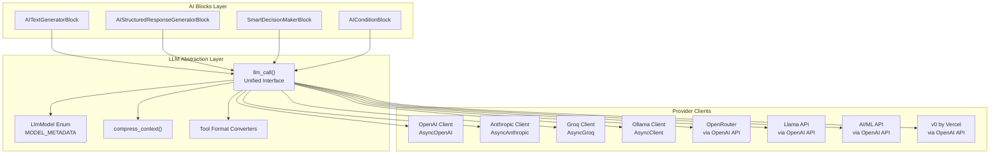
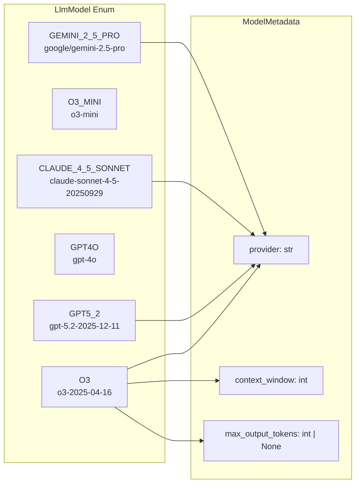
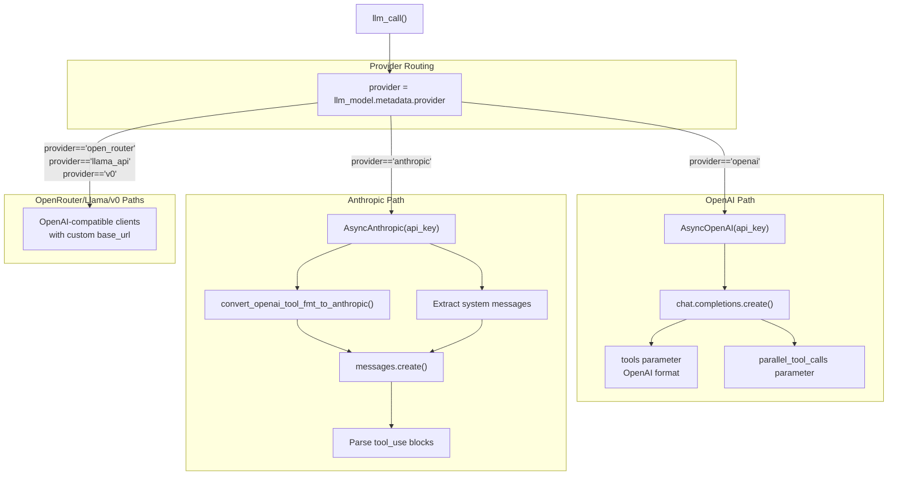
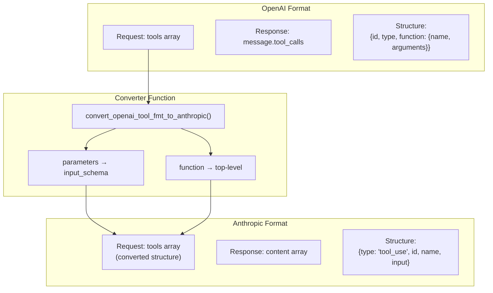
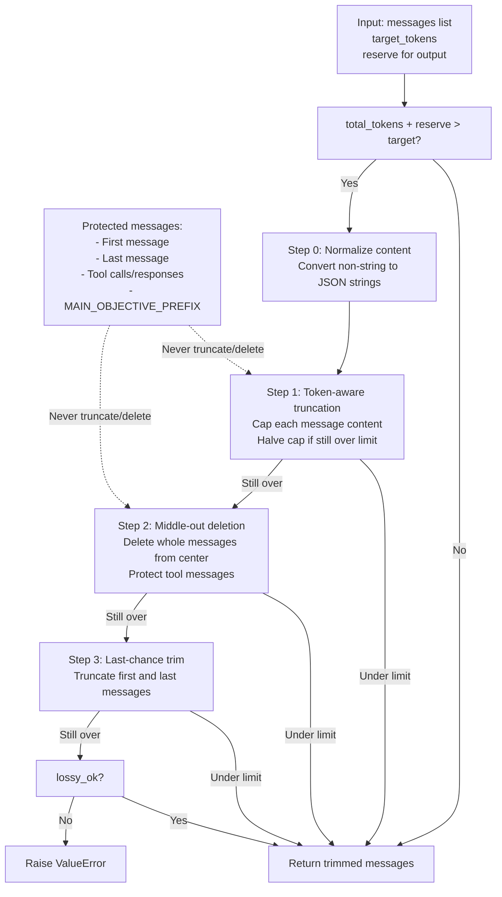
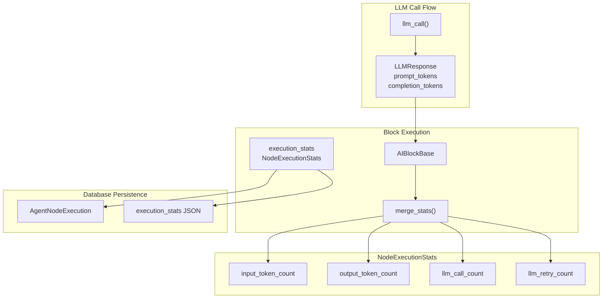
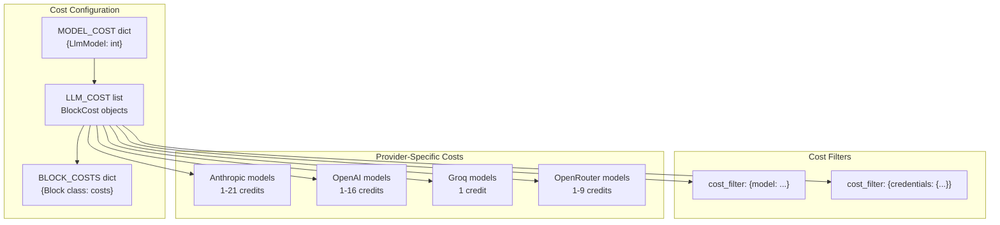

<!-- source: DeepWiki mcp.deepwiki.com · repo Significant-Gravitas/AutoGPT · extra page LLM Integration · fetched 2026-10-26 -->

# LLM Integration

<details>
<summary>Relevant source files</summary>

The following files were used as context for generating this wiki page:

- [autogpt_platform/backend/backend/blocks/llm.py](autogpt_platform/backend/backend/blocks/llm.py)
- [autogpt_platform/backend/backend/blocks/test/test_llm.py](autogpt_platform/backend/backend/blocks/test/test_llm.py)
- [autogpt_platform/backend/backend/copilot/sdk/compaction.py](autogpt_platform/backend/backend/copilot/sdk/compaction.py)
- [autogpt_platform/backend/backend/copilot/sdk/compaction_test.py](autogpt_platform/backend/backend/copilot/sdk/compaction_test.py)
- [autogpt_platform/backend/backend/copilot/sdk/conftest.py](autogpt_platform/backend/backend/copilot/sdk/conftest.py)
- [autogpt_platform/backend/backend/copilot/sdk/prompt_too_long_test.py](autogpt_platform/backend/backend/copilot/sdk/prompt_too_long_test.py)
- [autogpt_platform/backend/backend/copilot/sdk/thinking_blocks_test.py](autogpt_platform/backend/backend/copilot/sdk/thinking_blocks_test.py)
- [autogpt_platform/backend/backend/copilot/sdk/transcript_builder.py](autogpt_platform/backend/backend/copilot/sdk/transcript_builder.py)
- [autogpt_platform/backend/backend/copilot/tools/run_block.py](autogpt_platform/backend/backend/copilot/tools/run_block.py)
- [autogpt_platform/backend/backend/copilot/tools/run_block_test.py](autogpt_platform/backend/backend/copilot/tools/run_block_test.py)
- [autogpt_platform/backend/backend/data/block_cost_config.py](autogpt_platform/backend/backend/data/block_cost_config.py)
- [autogpt_platform/backend/backend/util/prompt.py](autogpt_platform/backend/backend/util/prompt.py)
- [autogpt_platform/backend/backend/util/prompt_test.py](autogpt_platform/backend/backend/util/prompt_test.py)
- [docs/integrations/block-integrations/llm.md](docs/integrations/block-integrations/llm.md)
- [docs/integrations/block-integrations/misc.md](docs/integrations/block-integrations/misc.md)

</details>


## Purpose and Scope

This document describes the LLM abstraction layer in the AutoGPT Platform backend, which provides a unified interface for calling multiple Large Language Model providers. The abstraction handles provider-specific API differences, prompt compression, tool call format conversion, and token usage tracking.

For information about AI blocks that use this integration layer, see [AI Blocks](#3.2.8). For the SmartDecisionMaker block that orchestrates tool calls via LLMs, see [AI Blocks](#3.2.8).

---

## Architecture Overview

The LLM integration layer provides a single `llm_call` function that abstracts away differences between 8+ LLM providers. This allows AI blocks to work with any supported model without provider-specific code.



**Sources:** [autogpt_platform/backend/backend/blocks/llm.py:1-768]()

---

## Core Components

### The llm_call Function

The `llm_call` function at [autogpt_platform/backend/backend/blocks/llm.py:410-768]() is the unified interface for all LLM interactions. It accepts standardized parameters and routes requests to the appropriate provider.

**Function Signature:**

```python
async def llm_call(
    credentials: APIKeyCredentials,
    llm_model: LlmModel,
    prompt: list[dict],
    max_tokens: int | None,
    force_json_output: bool = False,
    tools: list[dict] | None = None,
    ollama_host: str = "localhost:11434",
    parallel_tool_calls=None,
    compress_prompt_to_fit: bool = True,
) -> LLMResponse
```

**Parameters:**
- `credentials`: API key credentials for the provider
- `llm_model`: Model identifier from the `LlmModel` enum
- `prompt`: List of message dictionaries in OpenAI format
- `max_tokens`: Maximum tokens to generate (automatically capped based on context window)
- `force_json_output`: Whether to request JSON-only responses
- `tools`: Tool definitions for function calling (OpenAI format)
- `ollama_host`: Host for local Ollama instances
- `parallel_tool_calls`: Whether to allow multiple tool calls in one response
- `compress_prompt_to_fit`: Whether to compress prompts that exceed context window

**Return Value:**

The function returns an `LLMResponse` object [autogpt_platform/backend/backend/blocks/llm.py:326-334]():

```python
class LLMResponse(BaseModel):
    raw_response: Any
    prompt: List[Any]
    response: str
    tool_calls: Optional[List[ToolContentBlock]] | None
    prompt_tokens: int
    completion_tokens: int
    reasoning: Optional[str] = None
```

**Token Management:**

The function automatically manages token limits [autogpt_platform/backend/backend/blocks/llm.py:444-456]():

1. Optionally compresses prompts to fit context window
2. Estimates input token count
3. Calculates available tokens: `context_window - input_tokens`
4. Caps `max_tokens` to the minimum of:
   - Available tokens
   - Model's max output tokens
   - User-specified max tokens

**Sources:** [autogpt_platform/backend/backend/blocks/llm.py:410-768](), [autogpt_platform/backend/backend/blocks/llm.py:326-334]()

---

### LlmModel Enum and Model Metadata

The `LlmModel` enum [autogpt_platform/backend/backend/blocks/llm.py:88-189]() defines all supported models with their metadata.



**Model Metadata Structure:**

Each model in `MODEL_METADATA` [autogpt_platform/backend/backend/blocks/llm.py:191-306]() contains:

| Field | Description | Example |
|-------|-------------|---------|
| `provider` | Provider name (openai, anthropic, groq, etc.) | "openai" |
| `context_window` | Maximum input + output tokens | 200000 |
| `max_output_tokens` | Maximum tokens for completion | 100000 |

**Provider Groups:**

| Provider | Model Count | Examples |
|----------|-------------|----------|
| OpenAI | 17 | O3, GPT-5.2, GPT-4o, GPT-4.1 |
| Anthropic | 8 | Claude 4.1 Opus, Claude 4.5 Sonnet |
| OpenRouter | 32 | Gemini 2.5 Pro, DeepSeek R1, Grok 4 |
| Groq | 2 | Llama 3.3 70B, Llama 3.1 8B |
| Ollama | 5 | Llama 3.3, Dolphin Mistral |
| AI/ML API | 5 | Qwen 2.5 72B, Llama 3.3 70B |
| Llama API | 4 | Llama 4 Scout, Llama 3.3 70B |
| v0 by Vercel | 3 | v0-1.5-md, v0-1.5-lg |

**Default Model:**

The system uses `DEFAULT_LLM_MODEL = LlmModel.GPT5_2` [autogpt_platform/backend/backend/blocks/llm.py:308]() as the default across all AI blocks.

**Sources:** [autogpt_platform/backend/backend/blocks/llm.py:88-306]()

---

### Provider Implementations

Each provider has a dedicated code path within `llm_call` that handles API-specific details:



**OpenAI Provider [autogpt_platform/backend/backend/blocks/llm.py:458-490]():**

- Direct use of `openai.AsyncOpenAI`
- Supports `tools` parameter for function calling
- Supports `parallel_tool_calls` parameter
- Supports `response_format` for JSON mode
- Returns tool calls in `message.tool_calls` array

**Anthropic Provider [autogpt_platform/backend/backend/blocks/llm.py:491-574]():**

Key differences:
1. System messages extracted separately [autogpt_platform/backend/backend/blocks/llm.py:495-496]()
2. Consecutive messages with same role are combined [autogpt_platform/backend/backend/blocks/llm.py:498-511]()
3. Tools converted from OpenAI format via `convert_openai_tool_fmt_to_anthropic()` [autogpt_platform/backend/backend/blocks/llm.py:336-365]()
4. Tool calls returned in `content` array as `tool_use` blocks [autogpt_platform/backend/backend/blocks/llm.py:529-545]()

**OpenRouter/Llama API/v0 Providers:**

These use the OpenAI-compatible API with custom base URLs:
- OpenRouter: `https://openrouter.ai/api/v1` [autogpt_platform/backend/backend/blocks/llm.py:621]()
- Llama API: `https://api.llama.com/compat/v1/` [autogpt_platform/backend/backend/blocks/llm.py:663]()
- v0: `https://api.v0.dev/v1` [autogpt_platform/backend/backend/blocks/llm.py:733]()

**Groq Provider [autogpt_platform/backend/backend/blocks/llm.py:575-595]():**

Uses `groq.AsyncGroq` client but does not support tools.

**Ollama Provider [autogpt_platform/backend/backend/blocks/llm.py:596-617]():**

Local model hosting via `ollama.AsyncClient`. Uses `generate()` instead of chat completions API.

**Sources:** [autogpt_platform/backend/backend/blocks/llm.py:458-765]()

---

### Tool Call Format Conversion

The system handles two major tool calling formats:



**OpenAI Tool Format:**

Request format [autogpt_platform/backend/backend/blocks/llm.py:459]():
```python
tools = [
    {
        "type": "function",
        "function": {
            "name": "get_weather",
            "description": "Get weather for a location",
            "parameters": {
                "type": "object",
                "properties": {
                    "location": {"type": "string"}
                },
                "required": ["location"]
            }
        }
    }
]
```

Response format [autogpt_platform/backend/backend/blocks/llm.py:384-398]():
```python
tool_calls = [
    {
        "id": "call_abc123",
        "type": "function",
        "function": {
            "name": "get_weather",
            "arguments": '{"location": "San Francisco"}'
        }
    }
]
```

**Anthropic Tool Format:**

The `convert_openai_tool_fmt_to_anthropic()` function [autogpt_platform/backend/backend/blocks/llm.py:336-365]() transforms OpenAI tools:

```python
# Input: OpenAI format
{"type": "function", "function": {"name": "...", "parameters": {...}}}

# Output: Anthropic format
{"name": "...", "description": "...", "input_schema": {"type": "object", "properties": {...}}}
```

Response parsing [autogpt_platform/backend/backend/blocks/llm.py:529-545]():
```python
# Anthropic returns tool_use blocks in content array
for content_block in response.content:
    if content_block.type == "tool_use":
        tool_calls.append({
            "id": content_block.id,
            "type": "tool_use",
            "function": {
                "name": content_block.name,
                "arguments": json.dumps(content_block.input)
            }
        })
```

**Tool Call Extraction:**

Helper functions extract tool calls from provider-specific responses:
- `extract_openai_tool_calls()` [autogpt_platform/backend/backend/blocks/llm.py:384-398]()
- `extract_openai_reasoning()` [autogpt_platform/backend/backend/blocks/llm.py:368-381]()

**Sources:** [autogpt_platform/backend/backend/blocks/llm.py:336-398](), [autogpt_platform/backend/backend/blocks/llm.py:529-545]()

---

### Prompt Compression

The `compress_context()` function [autogpt_platform/backend/backend/util/prompt.py:143-290]() reduces prompt size when it exceeds the model's context window.



**Compression Strategy:**

The function uses a 4-step strategy [autogpt_platform/backend/backend/util/prompt.py:156-189]():

**Step 0: Normalize Content [autogpt_platform/backend/backend/util/prompt.py:203-218]():**
- Convert non-string content to JSON strings
- Skip tool messages and first/last messages
- Cap at 20,000 characters to prevent pathological blobs

**Step 1: Token-Aware Truncation [autogpt_platform/backend/backend/util/prompt.py:220-241]():**
- Start with `start_cap` tokens per message (default 8,192)
- Apply cap to all messages except first and last
- Halve cap repeatedly until reaching `floor_cap` (default 128)
- For tool messages, only truncate tool result content via `_truncate_tool_message_content()` [autogpt_platform/backend/backend/util/prompt.py:100-120]()

**Step 2: Middle-Out Deletion [autogpt_platform/backend/backend/util/prompt.py:243-260]():**
- Delete whole messages starting from the center
- Work outward symmetrically
- Never delete messages containing tool calls/responses
- Protect messages with `MAIN_OBJECTIVE_PREFIX` [autogpt_platform/backend/backend/util/prompt.py:13]()

**Step 3: Last-Chance Trim [autogpt_platform/backend/backend/util/prompt.py:262-271]():**
- Truncate first and last message content to `floor_cap`
- Uses `_truncate_middle_tokens()` to keep beginning and end

**Token Counting:**

Token counting uses tiktoken [autogpt_platform/backend/backend/util/prompt.py:20-70]():
- `_msg_tokens()` counts wrapper tokens (3-4 per message) plus content
- Handles tool calls in both OpenAI and Anthropic formats
- Counts tool_use and tool_result blocks in content arrays

**Integration with llm_call:**

When `compress_prompt_to_fit=True` [autogpt_platform/backend/backend/blocks/llm.py:444-449](), prompts are compressed to half the context window before sending to provider.

**Sources:** [autogpt_platform/backend/backend/util/prompt.py:143-290](), [autogpt_platform/backend/backend/util/prompt.py:20-70]()

---

### Token Usage Tracking

Token usage is tracked via `NodeExecutionStats` and accumulated across LLM calls and retries.



**AIBlockBase Class:**

All AI-powered blocks extend `AIBlockBase` [autogpt_platform/backend/backend/blocks/llm.py:770-778](), which provides:

```python
class AIBlockBase(Block, ABC):
    def __init__(self, *args, **kwargs):
        super().__init__(*args, **kwargs)
        self.prompt = []

    def merge_llm_stats(self, block: "AIBlockBase"):
        self.merge_stats(block.execution_stats)
        self.prompt = block.prompt
```

**Stats Accumulation Pattern:**

Blocks track stats across multiple LLM calls [autogpt_platform/backend/backend/blocks/smart_decision_maker.py:609-615]():

```python
resp = await llm.llm_call(...)

# Track LLM usage stats per call
self.merge_stats(
    NodeExecutionStats(
        input_token_count=resp.prompt_tokens,
        output_token_count=resp.completion_tokens,
        llm_call_count=1,
    )
)
```

**Retry Tracking:**

The `AIStructuredResponseGeneratorBlock` tracks retries [autogpt_platform/backend/backend/blocks/llm.py:921-1044]():
- Each retry increments `llm_retry_count`
- Token counts accumulate across all attempts
- Final stats reflect total usage

**Persistence:**

Stats are persisted to the `AgentNodeExecution` table as JSON [autogpt_platform/backend/backend/data/model.py](), enabling:
- Usage analytics
- Credit calculations
- Performance monitoring

**Sources:** [autogpt_platform/backend/backend/blocks/llm.py:770-778](), [autogpt_platform/backend/backend/blocks/smart_decision_maker.py:609-615]()

---

## Cost Configuration

Model costs are configured in `BLOCK_COSTS` [autogpt_platform/backend/backend/data/block_cost_config.py:265-643](), mapping block types and model selections to credit amounts.



**Cost Structure:**

| Cost Tier | Credit Amount | Example Models |
|-----------|---------------|----------------|
| Low (1) | 1 credit | GPT-4o-mini, Claude 3 Haiku, Groq models |
| Medium (2-5) | 2-5 credits | GPT-4.1, GPT-5, Claude 3.7 Sonnet |
| High (6-16) | 6-16 credits | O1, Claude 4.5 Opus |
| Premium (21) | 21 credits | Claude 4 Opus, Claude 4.1 Opus |

**Cost Definition [autogpt_platform/backend/backend/data/block_cost_config.py:60-138]():**

```python
MODEL_COST: dict[LlmModel, int] = {
    LlmModel.O3: 4,
    LlmModel.GPT5_2: 6,
    LlmModel.GPT4O_MINI: 1,
    LlmModel.CLAUDE_4_5_SONNET: 9,
    LlmModel.CLAUDE_4_6_OPUS: 14, # Updated from CLAUDE_4_1_OPUS: 21
    # ... 70+ model cost mappings
}
```

**BlockCost Objects [autogpt_platform/backend/backend/data/block_cost_config.py:145-261]():**

Costs are filtered by:
- Model name
- Credentials (provider, ID, type)

```python
BlockCost(
    cost_type=BlockCostType.RUN,
    cost_filter={
        "model": model,
        "credentials": {
            "id": openai_credentials.id,
            "provider": openai_credentials.provider,
            "type": openai_credentials.type,
        },
    },
    cost_amount=cost,
)
```

**Blocks Using LLM Costs [autogpt_platform/backend/backend/data/block_cost_config.py:265-513]():**

All AI blocks reference `LLM_COST`:
- `AIConversationBlock`
- `AITextGeneratorBlock`
- `AIStructuredResponseGeneratorBlock`
- `AITextSummarizerBlock`
- `AIListGeneratorBlock`
- `OrchestratorBlock` (formerly `SmartDecisionMakerBlock`)

**Sources:** [autogpt_platform/backend/backend/data/block_cost_config.py:60-261](), [autogpt_platform/backend/backend/data/block_cost_config.py:265-513]()

---

## Usage Patterns

### Pattern 1: Direct LLM Call in AI Blocks

`AITextGeneratorBlock` [autogpt_platform/backend/backend/blocks/llm.py:1249-1326]() uses delegation:

```python
async def run(self, input_data: Input, *, credentials: APIKeyCredentials, **kwargs):
    # Delegate to AIStructuredResponseGeneratorBlock
    struct_block = AIStructuredResponseGeneratorBlock()
    response = await struct_block.llm_call(
        input_data=struct_input,
        credentials=credentials,
    )
    
    # Merge stats from delegated block
    self.merge_llm_stats(struct_block)
    
    yield "response", response["response"]
```

### Pattern 2: Tool Call Orchestration

`OrchestratorBlock` [autogpt_platform/backend/backend/blocks/orchestrator.py:585-684]() orchestrates tool calls:

```python
# Get tool signatures from connected blocks
tool_functions = await self._create_tool_node_signatures(node_id)

# Call LLM with tools
resp = await llm.llm_call(
    credentials=credentials,
    llm_model=input_data.model,
    prompt=current_prompt,
    tools=tool_functions,
    parallel_tool_calls=input_data.multiple_tool_calls,
)

# Track stats
self.merge_stats(
    NodeExecutionStats(
        input_token_count=resp.prompt_tokens,
        output_token_count=resp.completion_tokens,
        llm_call_count=1,
    )
)

# Process tool calls
for tool_call in resp.tool_calls:
    # Execute the tool and feed results back to LLM
    ...
```

### Pattern 3: Conditional Logic with AI

`AIConditionBlock` [autogpt_platform/backend/backend/blocks/ai_condition.py:122-186]() uses LLM for natural language conditions:

```python
prompt = [
    {"role": "system", "content": "...evaluate conditions..."},
    {"role": "user", "content": f"Input: {input_str}\nCondition: {condition}"}
]

response = await self.llm_call(
    credentials=credentials,
    llm_model=input_data.model,
    prompt=prompt,
    max_tokens=50,
)

# Parse true/false from response
result = response.response.strip().lower() == "true"
```

### Pattern 4: Multi-Call with Retries

`AIStructuredResponseGeneratorBlock` [autogpt_platform/backend/backend/blocks/llm.py:921-1044]() retries on invalid responses:

```python
for attempt in range(input_data.retry):
    try:
        resp = await self.llm_call(...)
        
        # Track attempt
        self.merge_stats(NodeExecutionStats(
            input_token_count=resp.prompt_tokens,
            output_token_count=resp.completion_tokens,
            llm_call_count=1,
            llm_retry_count=(1 if attempt > 0 else 0),
        ))
        
        # Validate response format
        parsed = self.parse_response(resp.response)
        if valid:
            break
        
    except Exception as e:
        if attempt == input_data.retry - 1:
            raise
```

**Sources:** [autogpt_platform/backend/backend/blocks/llm.py:1249-1326](), [autogpt_platform/backend/backend/blocks/orchestrator.py:585-684](), [autogpt_platform/backend/backend/blocks/ai_condition.py:122-186](), [autogpt_platform/backend/backend/blocks/llm.py:921-1044]()

---

