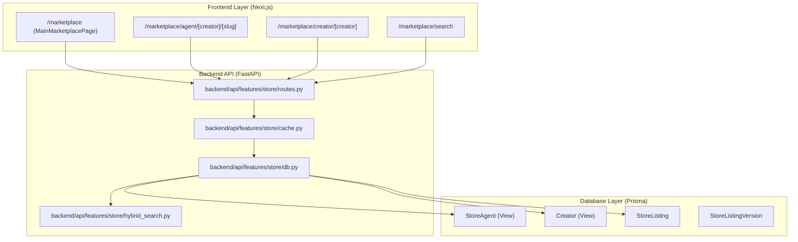
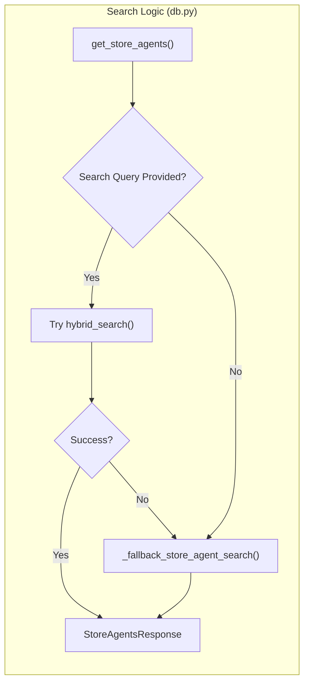
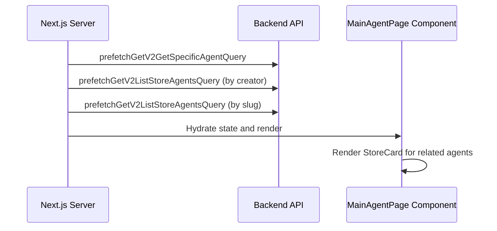
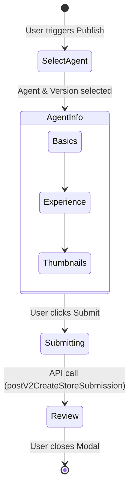

<!-- source: DeepWiki mcp.deepwiki.com · repo Significant-Gravitas/AutoGPT · extra page Marketplace · fetched 2026-10-26 -->

# Marketplace

Relevant source files

The following files were used as context for generating this wiki page:

- [autogpt_platform/backend/backend/api/features/store/db.py](autogpt_platform/backend/backend/api/features/store/db.py)
- [autogpt_platform/backend/backend/api/features/store/db_test.py](autogpt_platform/backend/backend/api/features/store/db_test.py)
- [autogpt_platform/backend/backend/api/features/store/model.py](autogpt_platform/backend/backend/api/features/store/model.py)
- [autogpt_platform/backend/backend/api/features/store/routes.py](autogpt_platform/backend/backend/api/features/store/routes.py)
- [autogpt_platform/backend/backend/api/features/store/routes_test.py](autogpt_platform/backend/backend/api/features/store/routes_test.py)
- [autogpt_platform/backend/backend/api/features/store/test_cache_delete.py](autogpt_platform/backend/backend/api/features/store/test_cache_delete.py)
- [autogpt_platform/backend/snapshots/agt_details](autogpt_platform/backend/snapshots/agt_details)
- [autogpt_platform/backend/snapshots/sub_success](autogpt_platform/backend/snapshots/sub_success)
- [autogpt_platform/frontend/next.config.mjs](autogpt_platform/frontend/next.config.mjs)
- [autogpt_platform/frontend/src/app/(platform)/marketplace/agent/[creator]/[slug]/page.tsx](autogpt_platform/frontend/src/app/(platform)/marketplace/agent/[creator]/[slug]/page.tsx)
- [autogpt_platform/frontend/src/app/(platform)/marketplace/components/AgentsSection/AgentsSection.tsx](autogpt_platform/frontend/src/app/(platform)/marketplace/components/AgentsSection/AgentsSection.tsx)
- [autogpt_platform/frontend/src/app/(platform)/marketplace/components/BecomeACreator/BecomeACreator.tsx](autogpt_platform/frontend/src/app/(platform)/marketplace/components/BecomeACreator/BecomeACreator.tsx)
- [autogpt_platform/frontend/src/app/(platform)/marketplace/components/CreatorCard/CreatorCard.tsx](autogpt_platform/frontend/src/app/(platform)/marketplace/components/CreatorCard/CreatorCard.tsx)
- [autogpt_platform/frontend/src/app/(platform)/marketplace/components/CreatorCard/helper.ts](autogpt_platform/frontend/src/app/(platform)/marketplace/components/CreatorCard/helper.ts)
- [autogpt_platform/frontend/src/app/(platform)/marketplace/components/CreatorInfoCard/CreatorInfoCard.tsx](autogpt_platform/frontend/src/app/(platform)/marketplace/components/CreatorInfoCard/CreatorInfoCard.tsx)
- [autogpt_platform/frontend/src/app/(platform)/marketplace/components/CreatorLinks/CreatorLinks.tsx](autogpt_platform/frontend/src/app/(platform)/marketplace/components/CreatorLinks/CreatorLinks.tsx)
- [autogpt_platform/frontend/src/app/(platform)/marketplace/components/CreatorPageLoading.tsx](autogpt_platform/frontend/src/app/(platform)/marketplace/components/CreatorPageLoading.tsx)
- [autogpt_platform/frontend/src/app/(platform)/marketplace/components/FeaturedAgentCard/FeaturedAgentCard.tsx](autogpt_platform/frontend/src/app/(platform)/marketplace/components/FeaturedAgentCard/FeaturedAgentCard.tsx)
- [autogpt_platform/frontend/src/app/(platform)/marketplace/components/FeaturedCreators/FeaturedCreators.tsx](autogpt_platform/frontend/src/app/(platform)/marketplace/components/FeaturedCreators/FeaturedCreators.tsx)
- [autogpt_platform/frontend/src/app/(platform)/marketplace/components/FeaturedSection/FeaturedSection.tsx](autogpt_platform/frontend/src/app/(platform)/marketplace/components/FeaturedSection/FeaturedSection.tsx)
- [autogpt_platform/frontend/src/app/(platform)/marketplace/components/FilterChips/FilterChips.tsx](autogpt_platform/frontend/src/app/(platform)/marketplace/components/FilterChips/FilterChips.tsx)
- [autogpt_platform/frontend/src/app/(platform)/marketplace/components/FilterChips/useFilterChips.ts](autogpt_platform/frontend/src/app/(platform)/marketplace/components/FilterChips/useFilterChips.ts)
- [autogpt_platform/frontend/src/app/(platform)/marketplace/components/HeroSection/HeroSection.tsx](autogpt_platform/frontend/src/app/(platform)/marketplace/components/HeroSection/HeroSection.tsx)
- [autogpt_platform/frontend/src/app/(platform)/marketplace/components/HeroSection/helpers.ts](autogpt_platform/frontend/src/app/(platform)/marketplace/components/HeroSection/helpers.ts)
- [autogpt_platform/frontend/src/app/(platform)/marketplace/components/HeroSection/useHeroSection.ts](autogpt_platform/frontend/src/app/(platform)/marketplace/components/HeroSection/useHeroSection.ts)
- [autogpt_platform/frontend/src/app/(platform)/marketplace/components/MainMarketplacePage/MainMarketplacePage.tsx](autogpt_platform/frontend/src/app/(platform)/marketplace/components/MainMarketplacePage/MainMarketplacePage.tsx)
- [autogpt_platform/frontend/src/app/(platform)/marketplace/components/MainMarketplacePageLoading.tsx](autogpt_platform/frontend/src/app/(platform)/marketplace/components/MainMarketplacePageLoading.tsx)
- [autogpt_platform/frontend/src/app/(platform)/marketplace/components/StoreCard/StoreCard.tsx](autogpt_platform/frontend/src/app/(platform)/marketplace/components/StoreCard/StoreCard.tsx)
- [autogpt_platform/frontend/src/app/(platform)/marketplace/creator/[creator]/components/MainCreatorPage/MainCreatorPage.tsx](autogpt_platform/frontend/src/app/(platform)/marketplace/creator/[creator]/components/MainCreatorPage/MainCreatorPage.tsx)
- [autogpt_platform/frontend/src/app/(platform)/marketplace/creator/[creator]/page.tsx](autogpt_platform/frontend/src/app/(platform)/marketplace/creator/[creator]/page.tsx)
- [autogpt_platform/frontend/src/app/(platform)/marketplace/search/components/MainSearchResultPage/MainSearchResultPage.tsx](autogpt_platform/frontend/src/app/(platform)/marketplace/search/components/MainSearchResultPage/MainSearchResultPage.tsx)
- [autogpt_platform/frontend/src/app/global-error.tsx](autogpt_platform/frontend/src/app/global-error.tsx)
- [autogpt_platform/frontend/src/components/__legacy__/composite/HeroSection.tsx](autogpt_platform/frontend/src/components/__legacy__/composite/HeroSection.tsx)
- [autogpt_platform/frontend/src/components/atoms/Avatar/Avatar.stories.tsx](autogpt_platform/frontend/src/components/atoms/Avatar/Avatar.stories.tsx)
- [autogpt_platform/frontend/src/components/atoms/Avatar/Avatar.tsx](autogpt_platform/frontend/src/components/atoms/Avatar/Avatar.tsx)
- [autogpt_platform/frontend/src/components/contextual/PublishAgentModal/PublishAgentModal.tsx](autogpt_platform/frontend/src/components/contextual/PublishAgentModal/PublishAgentModal.tsx)
- [autogpt_platform/frontend/src/components/contextual/PublishAgentModal/components/AgentInfoStep/AgentInfoStep.tsx](autogpt_platform/frontend/src/components/contextual/PublishAgentModal/components/AgentInfoStep/AgentInfoStep.tsx)
- [autogpt_platform/frontend/src/components/contextual/PublishAgentModal/components/AgentInfoStep/helpers.ts](autogpt_platform/frontend/src/components/contextual/PublishAgentModal/components/AgentInfoStep/helpers.ts)
- [autogpt_platform/frontend/src/components/contextual/PublishAgentModal/components/AgentInfoStep/useAgentInfoStep.ts](autogpt_platform/frontend/src/components/contextual/PublishAgentModal/components/AgentInfoStep/useAgentInfoStep.ts)
- [autogpt_platform/frontend/src/components/contextual/PublishAgentModal/components/AgentReviewStep.tsx](autogpt_platform/frontend/src/components/contextual/PublishAgentModal/components/AgentReviewStep.tsx)
- [autogpt_platform/frontend/src/components/contextual/PublishAgentModal/components/AgentSelectStep/AgentSelectStep.tsx](autogpt_platform/frontend/src/components/contextual/PublishAgentModal/components/AgentSelectStep/AgentSelectStep.tsx)
- [autogpt_platform/frontend/src/components/contextual/PublishAgentModal/components/AgentSelectStep/useAgentSelectStep.ts](autogpt_platform/frontend/src/components/contextual/PublishAgentModal/components/AgentSelectStep/useAgentSelectStep.ts)
- [autogpt_platform/frontend/src/components/contextual/PublishAgentModal/components/PublishAuthPrompt.tsx](autogpt_platform/frontend/src/components/contextual/PublishAgentModal/components/PublishAuthPrompt.tsx)
- [autogpt_platform/frontend/src/components/contextual/PublishAgentModal/components/StepHeader.tsx](autogpt_platform/frontend/src/components/contextual/PublishAgentModal/components/StepHeader.tsx)
- [autogpt_platform/frontend/src/components/layout/Navbar/components/MobileNavbar/MobileNavBar.tsx](autogpt_platform/frontend/src/components/layout/Navbar/components/MobileNavbar/MobileNavBar.tsx)
- [autogpt_platform/frontend/src/playwright/pages/marketplace.page.ts](autogpt_platform/frontend/src/playwright/pages/marketplace.page.ts)

The Marketplace is the public agent discovery and distribution system within the AutoGPT Platform. It enables users to browse, review, and download pre-built AI agents created by the community. The system provides a unified interface for listing agents, detailed agent information, creator profiles, and a submission workflow for new community content.

## 1. Overview

The Marketplace operates as a multi-layered system with frontend interfaces, backend APIs, and database layers that manage agent metadata, creator information, and submission workflows. It leverages hybrid search (combining semantic embeddings and lexical text search) to provide high-quality discovery.

### System Architecture

Sources:
- [autogpt_platform/backend/backend/api/features/store/routes.py:1-25]()
- [autogpt_platform/backend/backend/api/features/store/db.py:51-59]()
- [autogpt_platform/frontend/src/app/(platform)/marketplace/agent/[creator]/[slug]/page.tsx:1-12]()

## 2. Backend Architecture

The Marketplace backend is built on a RESTful API structure with dedicated database operations, caching, and hybrid search capabilities.

### Search Implementation
The system prioritizes availability through a fallback mechanism in `get_store_agents`. If the hybrid search (OpenAI embeddings + PostgreSQL `tsvector`) fails or is unavailable, it degrades to a standard lexical-only search.

### Data Models
The system uses several key data models defined in `store/model.py`:

| Model | Purpose | Key Fields |
|-------|---------|------------|
| `StoreAgent` | Basic agent listing | `slug`, `agent_name`, `creator`, `rating`, `runs` |
| `StoreAgentDetails` | Full agent information | `active_version_id`, `agent_image`, `description`, `graph_id` |
| `CreatorDetails` | Creator profile | `username`, `name`, `num_agents`, `agent_rating` |
| `StoreSubmission` | Agent submission | `graph_id`, `graph_version`, `status`, `review_comments` |

Sources:
- [autogpt_platform/backend/backend/api/features/store/db.py:83-145]()
- [autogpt_platform/backend/backend/api/features/store/model.py:1-100]()
- [autogpt_platform/backend/backend/api/features/store/routes.py:135-180]()

## 3. Frontend Components

The Marketplace UI is built with Next.js App Router and utilizes `tanstack/react-query` for data fetching and hydration.

### Agent Detail Page
The agent detail page at `/marketplace/agent/[creator]/[slug]` uses server-side prefetching to ensure fast initial loads. It prefetches the specific agent, other agents by the same creator, and similar agents based on the slug.

### StoreCard Component
The `StoreCard` is the primary unit of discovery. It displays:
- Agent preview image with a fallback `Skeleton` [autogpt_platform/frontend/src/app/(platform)/marketplace/components/StoreCard/StoreCard.tsx:66-87]()
- Creator information and avatar [autogpt_platform/frontend/src/app/(platform)/marketplace/components/StoreCard/StoreCard.tsx:97-115]()
- Dynamic stats (runs and star rating) [autogpt_platform/frontend/src/app/(platform)/marketplace/components/StoreCard/StoreCard.tsx:126-142]()
- `AddToLibraryButton` for direct acquisition [autogpt_platform/frontend/src/app/(platform)/marketplace/components/StoreCard/StoreCard.tsx:145-151]()

Sources:
- [autogpt_platform/frontend/src/app/(platform)/marketplace/agent/[creator]/[slug]/page.tsx:43-51]()
- [autogpt_platform/frontend/src/app/(platform)/marketplace/components/StoreCard/StoreCard.tsx:30-43]()

## 4. Submission and Review Workflow

The publishing workflow is managed via the `PublishAgentModal`. It is a state-driven multi-step form that handles both initial submissions and updates to existing marketplace listings.

### Submission Lifecycle

### Publishing Implementation
- **Validation**: Uses `zod` via `publishAgentSchemaFactory` to enforce requirements like `slug` formatting and mandatory images [autogpt_platform/frontend/src/components/contextual/PublishAgentModal/components/AgentInfoStep/useAgentInfoStep.ts:38-38]().
- **API Integration**: Calls `postV2CreateStoreSubmission` which maps frontend form data to the backend `StoreSubmission` model [autogpt_platform/frontend/src/components/contextual/PublishAgentModal/components/AgentInfoStep/useAgentInfoStep.ts:119-133]().
- **UI States**: The `AgentReviewStep` component dynamically changes its content based on the `SubmissionStatus` (e.g., `APPROVED`, `REJECTED`, or pending) [autogpt_platform/frontend/src/components/contextual/PublishAgentModal/components/AgentReviewStep.tsx:37-71]().

Sources:
- [autogpt_platform/frontend/src/components/contextual/PublishAgentModal/PublishAgentModal.tsx:72-118]()
- [autogpt_platform/frontend/src/components/contextual/PublishAgentModal/components/AgentInfoStep/useAgentInfoStep.ts:92-150]()
- [autogpt_platform/frontend/src/components/contextual/PublishAgentModal/components/AgentReviewStep.tsx:73-95]()

## 5. Creator Profiles

Creator profiles aggregate all agents published by a specific user. The page at `/marketplace/creator/[creator]` fetches creator metadata and a filtered list of agents.

- **Metadata**: Includes the creator's display name, avatar, bio, and statistics (total runs, average rating) [autogpt_platform/backend/backend/api/features/store/db_test.py:122-133]().
- **SEO**: `generateMetadata` dynamically sets the page title and description based on the creator's profile data [autogpt_platform/frontend/src/app/(platform)/marketplace/creator/[creator]/page.tsx:18-32]().

Sources:
- [autogpt_platform/frontend/src/app/(platform)/marketplace/creator/[creator]/page.tsx:34-55]()
- [autogpt_platform/backend/backend/api/features/store/db.py:444-460]()

## 6. Integration and Utilities

### Avatar System
The `Avatar` component provides a consistent identity UI. It supports:
- `AvatarImage`: Handles Next.js optimized images with loading and error states [autogpt_platform/frontend/src/components/atoms/Avatar/Avatar.tsx:82-96]().
- `AvatarFallback`: Uses `boring-avatars` to generate a "marble" variant placeholder when no image is available [autogpt_platform/frontend/src/components/atoms/Avatar/Avatar.tsx:169-198]().

### API Routing
The `router` in `backend/api/features/store/routes.py` defines the public and private contracts:
- `GET /agents`: Paginated list with filters [autogpt_platform/backend/backend/api/features/store/routes.py:135-157]().
- `GET /search`: Unified hybrid search across content types [autogpt_platform/backend/backend/api/features/store/routes.py:69-85]().
- `POST /agents/{username}/{agent_name}/review`: Allows authenticated users to submit star ratings and comments [autogpt_platform/backend/backend/api/features/store/routes.py:202-213]().

Sources:
- [autogpt_platform/frontend/src/components/atoms/Avatar/Avatar.tsx:32-58]()
- [autogpt_platform/backend/backend/api/features/store/routes.py:182-200]()

---

