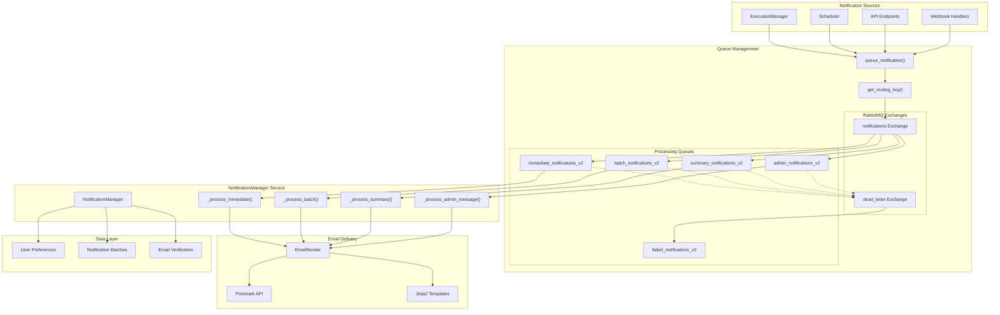
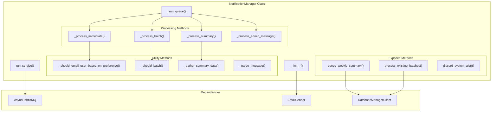
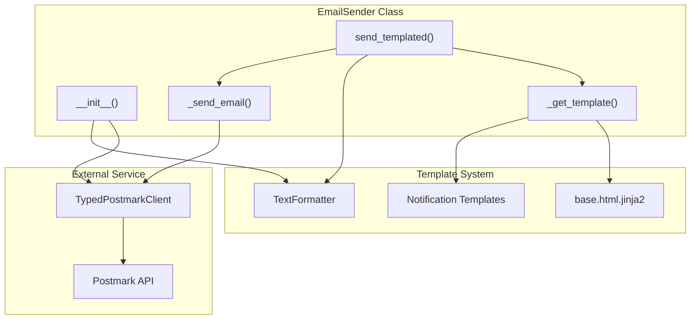
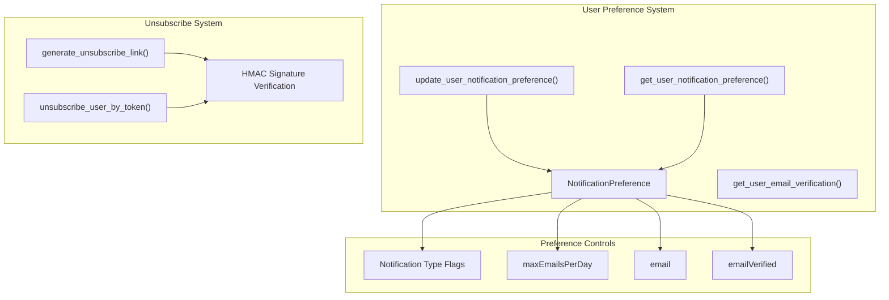
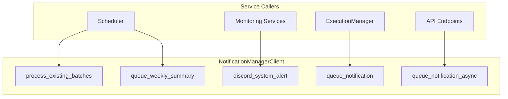

<!-- source: DeepWiki mcp.deepwiki.com · repo Significant-Gravitas/AutoGPT · extra page Notification System · fetched 2026-10-26 -->

# Notification System

Relevant source files

The following files were used as context for generating this wiki page:

- [autogpt_platform/backend/backend/data/notifications.py](autogpt_platform/backend/backend/data/notifications.py)
- [autogpt_platform/backend/backend/data/user.py](autogpt_platform/backend/backend/data/user.py)
- [autogpt_platform/backend/backend/executor/scheduler.py](autogpt_platform/backend/backend/executor/scheduler.py)
- [autogpt_platform/backend/backend/monitoring/block_error_monitor.py](autogpt_platform/backend/backend/monitoring/block_error_monitor.py)
- [autogpt_platform/backend/backend/monitoring/late_execution_monitor.py](autogpt_platform/backend/backend/monitoring/late_execution_monitor.py)
- [autogpt_platform/backend/backend/monitoring/notification_monitor.py](autogpt_platform/backend/backend/monitoring/notification_monitor.py)
- [autogpt_platform/backend/backend/notifications/email.py](autogpt_platform/backend/backend/notifications/email.py)
- [autogpt_platform/backend/backend/notifications/notifications.py](autogpt_platform/backend/backend/notifications/notifications.py)
- [autogpt_platform/backend/backend/notifications/templates/agent_run.html.jinja2](autogpt_platform/backend/backend/notifications/templates/agent_run.html.jinja2)
- [autogpt_platform/backend/backend/notifications/templates/base.html.jinja2](autogpt_platform/backend/backend/notifications/templates/base.html.jinja2)
- [autogpt_platform/backend/backend/util/service.py](autogpt_platform/backend/backend/util/service.py)
- [autogpt_platform/backend/backend/util/service_test.py](autogpt_platform/backend/backend/util/service_test.py)

The Notification System manages all user communications within the AutoGPT Platform, handling email delivery, notification batching, user preferences, and scheduled summaries. This system processes various notification types including agent execution results, balance alerts, error notifications, and periodic summaries.

For information about the broader service architecture that the notification system operates within, see [Service Architecture](#3.2.1). For details about API key management and user authentication, see [API Key Management](#3.2.14).

## Architecture Overview

The notification system follows a queue-based architecture using RabbitMQ for message routing and processing different notification strategies:

Sources: [autogpt_platform/backend/backend/notifications/notifications.py:59-125](), [autogpt_platform/backend/backend/notifications/notifications.py:207-291]()

## Core Components

### NotificationManager Service

The `NotificationManager` class serves as the main orchestrator for notification processing:

Sources: [autogpt_platform/backend/backend/notifications/notifications.py:207-291](), [autogpt_platform/backend/backend/notifications/notifications.py:728-781]()

### Notification Data Models

The system supports multiple notification types with specific data structures:

| Notification Type | Data Model | Queue Strategy | Purpose |
|-------------------|------------|----------------|---------|
| `AGENT_RUN` | `AgentRunData` | BATCH | Agent execution reports |
| `ZERO_BALANCE` | `ZeroBalanceData` | BACKOFF | Credit depletion alerts |
| `LOW_BALANCE` | `LowBalanceData` | IMMEDIATE | Low credit warnings |
| `BLOCK_EXECUTION_FAILED` | `BlockExecutionFailedData` | BACKOFF | Block execution errors |
| `CONTINUOUS_AGENT_ERROR` | `ContinuousAgentErrorData` | BACKOFF | Persistent agent failures |
| `DAILY_SUMMARY` | `DailySummaryData` | SUMMARY | Daily activity reports |
| `WEEKLY_SUMMARY` | `WeeklySummaryData` | SUMMARY | Weekly activity reports |
| `REFUND_REQUEST` | `RefundRequestData` | ADMIN | Payment refund requests |
| `AGENT_APPROVAL` | `AgentApprovalData` | IMMEDIATE | Notification for agent approval |
| `AGENT_REJECTION` | `AgentRejectionData` | IMMEDIATE | Notification for agent rejection |

Sources: [autogpt_platform/backend/backend/data/notifications.py:46-242](), [autogpt_platform/backend/backend/data/notifications.py:266-318]()

## Queue Processing Strategies

The notification system implements four distinct processing strategies:

### Immediate Processing

Messages routed to `immediate_notifications_v2` queue are processed immediately by `_process_immediate()`:

- Validates user email and preferences
- Sends notification directly via `EmailSender`
- Used for critical notifications like low balance warnings
Sources: [autogpt_platform/backend/backend/notifications/notifications.py:555-580]()

### Batch Processing

Messages routed to `batch_notifications_v2` queue are accumulated and processed by `_process_batch()`:

- Notifications are stored in `UserNotificationBatch` records
- Batches are processed when they reach maximum age (defined by `get_batch_delay()`)
- Multiple notifications of the same type are combined into single emails
- Prevents notification spam for high-frequency events
Sources: [autogpt_platform/backend/backend/notifications/notifications.py:582-640]()

### Summary Processing

Messages routed to `summary_notifications_v2` queue trigger summary generation by `_process_summary()`:

- Aggregates data from multiple sources (executions, credits, etc.)
- Generates comprehensive activity reports
- Scheduled via `Scheduler` service for daily/weekly summaries
Sources: [autogpt_platform/backend/backend/notifications/notifications.py:642-695]()

### Admin Processing

Messages routed to `admin_notifications_v2` queue are processed by `_process_admin_message()`:

- Sent directly to admin email addresses
- Used for system-critical notifications requiring immediate attention
- Bypasses user preferences and verification checks
Sources: [autogpt_platform/backend/backend/notifications/notifications.py:697-726]()

## Email Delivery System

### EmailSender Component

The `EmailSender` class handles template processing and email delivery:

Sources: [autogpt_platform/backend/backend/notifications/email.py:34-137]()

### Template System

Email templates are stored as Jinja2 files with specific naming conventions:

- Base template: `templates/base.html.jinja2` [autogpt_platform/backend/backend/notifications/templates/base.html.jinja2:1-174]()
- Notification templates: `templates/{notification_type}.html.jinja2` (e.g., `agent_run.html.jinja2` [autogpt_platform/backend/backend/notifications/templates/agent_run.html.jinja2:1-143]())
- Templates receive notification data and formatting context
- Support for unsubscribe links and branding

Sources: [autogpt_platform/backend/backend/notifications/email.py:92-109](), [autogpt_platform/backend/backend/notifications/templates/agent_run.html.jinja2:1-143]()

## User Preferences and Controls

### Notification Preferences

Users can control notification delivery through preference settings:

Sources: [autogpt_platform/backend/backend/data/user.py:208-319](), [autogpt_platform/backend/backend/data/user.py:348-401]()

## Scheduled Operations

### Scheduler Integration

The `Scheduler` service manages periodic notification operations:

| Operation | Schedule | Function | Purpose |
|-----------|----------|----------|---------|
| Weekly Summary | `0 * * * *` (hourly) | `process_weekly_summary()` | Queue weekly summary notifications |
| Batch Processing | On-demand | `process_existing_batches()` | Process aged notification batches |
| Late Execution Alerts | Configurable interval | `report_late_executions()` | Alert on delayed executions |
| Block Error Rates | Configurable interval | `report_block_error_rates()` | Alert on high block error rates |

Sources: [autogpt_platform/backend/backend/executor/scheduler.py:254-281](), [autogpt_platform/backend/backend/monitoring/notification_monitor.py:18-30](), [autogpt_platform/backend/backend/monitoring/late_execution_monitor.py:109-112](), [autogpt_platform/backend/backend/monitoring/block_error_monitor.py:53-54]()

### Background Processing

Long-running operations use `ProcessPoolExecutor` for background execution:

- Weekly summary generation: `background_executor.submit()`
- Batch processing: `_process_existing_batches()`
- Prevents blocking of main service thread

Sources: [autogpt_platform/backend/backend/notifications/notifications.py:235-266](), [autogpt_platform/backend/backend/util/service.py:60]()

## Service Communication

### Client Interface

Other services interact with the notification system via `NotificationManagerClient`:

Sources: [autogpt_platform/backend/backend/notifications/notifications.py:783-791](), [autogpt_platform/backend/backend/notifications/notifications.py:157-204]()

## Configuration and Setup

### RabbitMQ Configuration

The notification system requires specific RabbitMQ setup via `create_notification_config()`:

- **Exchanges**: `notifications` (topic), `dead_letter` (topic)
- **Queues**: Each with dead letter routing for failed messages, using `x-queue-type: quorum` for durability.
- **Routing Keys**: Pattern-based routing using notification type and strategy.

Sources: [autogpt_platform/backend/backend/notifications/notifications.py:63-118]()

### Service Dependencies

The `NotificationManager` depends on:

- **RabbitMQ**: Message queuing and routing
- **PostgreSQL**: User data, preferences, and batch storage  
- **Redis**: Caching and event bus (inherited from `AppService`)
- **Postmark**: Email delivery service
- **DatabaseManager**: Data access layer

Sources: [autogpt_platform/backend/backend/notifications/notifications.py:63-118](), [autogpt_platform/backend/backend/util/service.py:114-227]()

---

