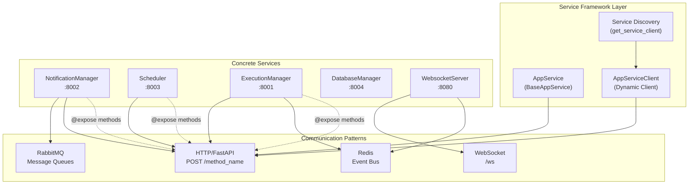
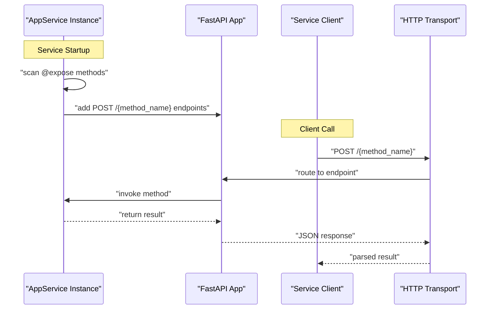
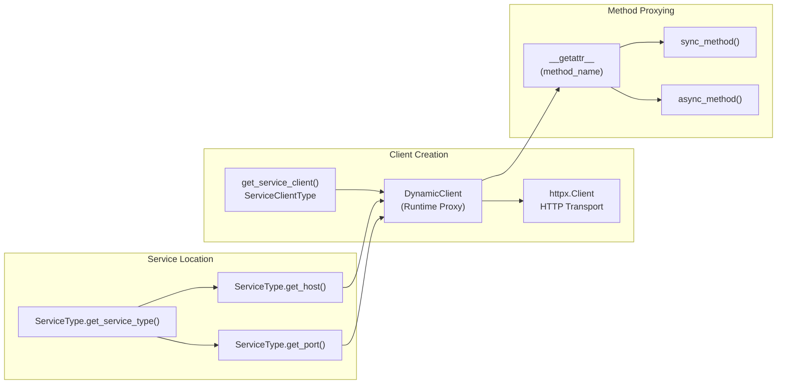
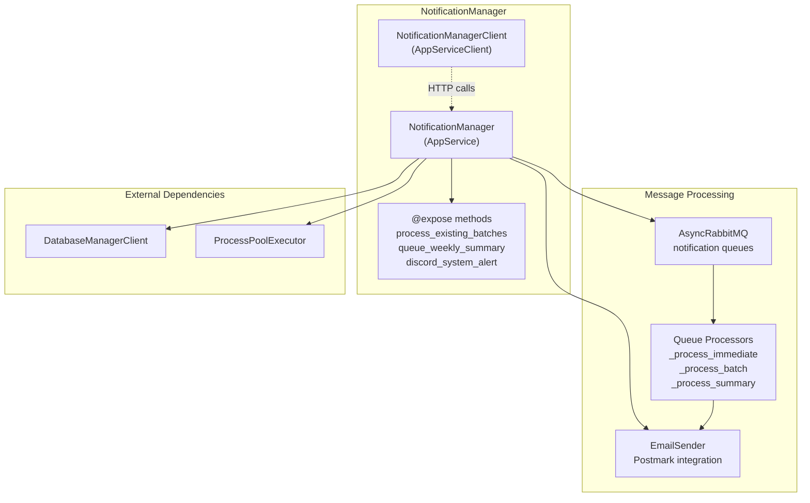
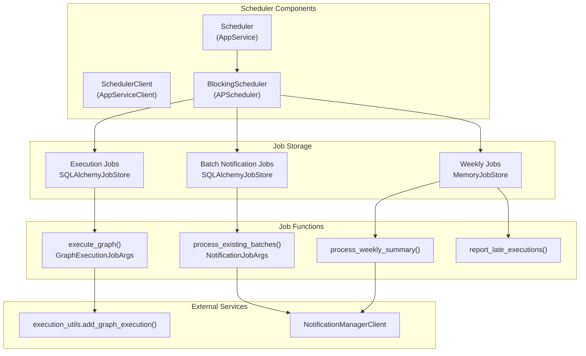
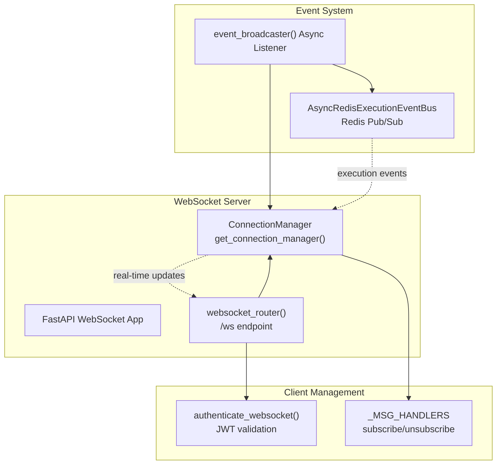
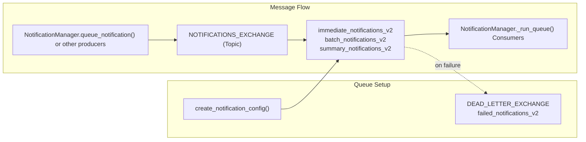
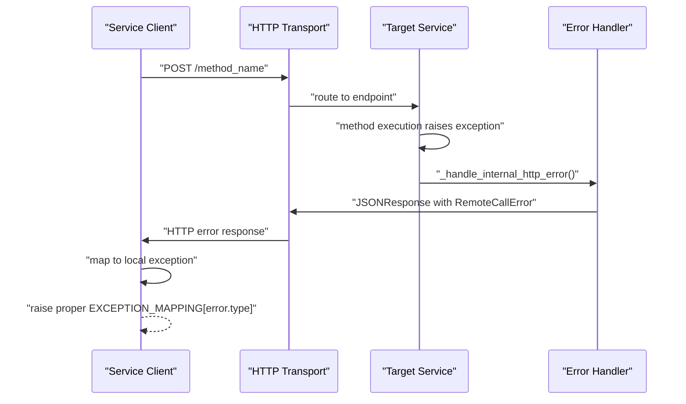

<!-- source: DeepWiki mcp.deepwiki.com · repo Significant-Gravitas/AutoGPT · extra page Service Architecture · fetched 2026-10-26 -->

# Service Architecture

<details>
<summary>Relevant source files</summary>

The following files were used as context for generating this wiki page:

- [autogpt_platform/autogpt_libs/autogpt_libs/auth/config.py](autogpt_platform/autogpt_libs/autogpt_libs/auth/config.py)
- [autogpt_platform/backend/backend/api/conftest.py](autogpt_platform/backend/backend/api/conftest.py)
- [autogpt_platform/backend/backend/api/external/fastapi_app.py](autogpt_platform/backend/backend/api/external/fastapi_app.py)
- [autogpt_platform/backend/backend/api/external/v1/routes.py](autogpt_platform/backend/backend/api/external/v1/routes.py)
- [autogpt_platform/backend/backend/api/external/v1/routes_test.py](autogpt_platform/backend/backend/api/external/v1/routes_test.py)
- [autogpt_platform/backend/backend/api/features/admin/diagnostics_admin_routes.py](autogpt_platform/backend/backend/api/features/admin/diagnostics_admin_routes.py)
- [autogpt_platform/backend/backend/api/features/library/routes/presets.py](autogpt_platform/backend/backend/api/features/library/routes/presets.py)
- [autogpt_platform/backend/backend/api/rest_api.py](autogpt_platform/backend/backend/api/rest_api.py)
- [autogpt_platform/backend/backend/app.py](autogpt_platform/backend/backend/app.py)
- [autogpt_platform/backend/backend/data/notifications.py](autogpt_platform/backend/backend/data/notifications.py)
- [autogpt_platform/backend/backend/data/user.py](autogpt_platform/backend/backend/data/user.py)
- [autogpt_platform/backend/backend/executor/scheduler.py](autogpt_platform/backend/backend/executor/scheduler.py)
- [autogpt_platform/backend/backend/monitoring/block_error_monitor.py](autogpt_platform/backend/backend/monitoring/block_error_monitor.py)
- [autogpt_platform/backend/backend/monitoring/late_execution_monitor.py](autogpt_platform/backend/backend/monitoring/late_execution_monitor.py)
- [autogpt_platform/backend/backend/monitoring/notification_monitor.py](autogpt_platform/backend/backend/monitoring/notification_monitor.py)
- [autogpt_platform/backend/backend/notification.py](autogpt_platform/backend/backend/notification.py)
- [autogpt_platform/backend/backend/notifications/email.py](autogpt_platform/backend/backend/notifications/email.py)
- [autogpt_platform/backend/backend/notifications/notifications.py](autogpt_platform/backend/backend/notifications/notifications.py)
- [autogpt_platform/backend/backend/notifications/templates/agent_run.html.jinja2](autogpt_platform/backend/backend/notifications/templates/agent_run.html.jinja2)
- [autogpt_platform/backend/backend/notifications/templates/base.html.jinja2](autogpt_platform/backend/backend/notifications/templates/base.html.jinja2)
- [autogpt_platform/backend/backend/rest.py](autogpt_platform/backend/backend/rest.py)
- [autogpt_platform/backend/backend/scheduler.py](autogpt_platform/backend/backend/scheduler.py)
- [autogpt_platform/backend/backend/util/decorator.py](autogpt_platform/backend/backend/util/decorator.py)
- [autogpt_platform/backend/backend/util/decorator_test.py](autogpt_platform/backend/backend/util/decorator_test.py)
- [autogpt_platform/backend/backend/util/process.py](autogpt_platform/backend/backend/util/process.py)
- [autogpt_platform/backend/backend/util/retry.py](autogpt_platform/backend/backend/util/retry.py)
- [autogpt_platform/backend/backend/util/retry_test.py](autogpt_platform/backend/backend/util/retry_test.py)
- [autogpt_platform/backend/backend/util/service.py](autogpt_platform/backend/backend/util/service.py)
- [autogpt_platform/backend/backend/util/service_test.py](autogpt_platform/backend/backend/util/service_test.py)

</details>


This document provides a detailed technical overview of the microservice architecture used in the AutoGPT Platform backend. It explains the structure, communication patterns, key components, and orchestration of services including the REST API, WebSocket server, ExecutionManager, DatabaseManager, Scheduler, and NotificationManager. The document focuses on how these services interact via HTTP APIs and RabbitMQ message queues to achieve scalable, modular, and maintainable AI workflow management.

---

## AppService Framework Overview

The core of the service architecture is the `AppService` framework, designed to facilitate IPC (Inter-Process Communication) with HTTP-based RPC, dynamic client proxies, and integration with asynchronous event loops.

### Service Base Class Hierarchy

- `AppProcess`: Abstract base for system processes managing start/stop lifecycle with signal handling.
- `BaseAppService`: Extends `AppProcess` and embeds an asyncio event loop for async operations in a service.
- `AppService`: Extends `BaseAppService` to build HTTP REST microservices using FastAPI, automatically exposing methods as endpoints.
- `AppServiceClient`: A dynamic client proxy to call exposed service methods over HTTP.

The framework enforces architectural boundaries by ensuring that only application models cross service boundaries, not database ORM models (Prisma objects).

---

### Service Communication Architecture



This diagram shows the foundational layers of the framework, the concrete services with their network ports, and communication channels: HTTP REST, WebSocket, RabbitMQ, and Redis Pub/Sub.

**Sources:** [backend/util/service.py:98-227](), [backend/notifications/notifications.py:230-268](), [backend/executor/scheduler.py:90-180]()

---

## AppService Method Exposure and Client Mechanism

### Method Exposure with `@expose`

Services explicitly expose RPC methods using the `@expose` decorator. At service startup, these methods are automatically registered as FastAPI POST endpoints at `/{method_name}`.

### Endpoint Call Flow



Internally, each exposed method wrapped by FastAPI handles JSON serialization/deserialization, error serialization, and result marshalling.

### Service Client Dynamic Proxy

Clients for services are created dynamically via `get_service_client(ServiceClientType)`. The returned client:

- Resolves the hostname and port from the corresponding `AppService` class.
- Dynamically proxies all exposed service methods as both sync and async calls.
- Manages connection retries and error translations.



**Sources:** [backend/util/service.py:252-397](), [backend/util/service.py:89-116]()

---

## Core Microservices Overview

### ExecutionManager

- Manages the execution lifecycle of AI agent graphs.
- Keeps track of node execution status, real-time progress, and interacts with ExecutionProcessor.
- Exposes RPC endpoints to trigger graph execution.
- Publishes events to Redis Pub/Sub for WebSocket clients.
- Listens to completion for downstream processes.

**Port:** 8001

### NotificationManager

- Manages user notifications asynchronously.
- Uses RabbitMQ topic exchanges with queues for immediate, batch, summary, and admin notifications.
- Processes notifications from queues and sends emails via Postmark.
- Exposes exposed RPC methods for queueing notifications and handling system alerts.

**Port:** 8002



**Sources:** [backend/notifications/notifications.py:59-180](), [backend/notifications/notifications.py:700-780]()

---

### Scheduler

- Uses APScheduler library with various job stores for scheduled and recurring jobs.
- Stores execution jobs in SQLAlchemyJobStore to persist cron jobs.
- Handles job events (executions, errors, missed runs).
- Manages graph executions on schedule by invoking ExecutionManager clients.
- Coordinates batch and weekly notification jobs by calling NotificationManager methods.

**Port:** 8003



**Sources:** [backend/executor/scheduler.py:50-190]()

---

### DatabaseManager

- Provides database access as an independent microservice.
- Manages Prisma ORM database connections and queries.
- Exposes REST API for CRUD operations on persistent AutoGPT data models.
- Other services invoke database manager to isolate database logic from business logic.

**Port:** 8004

---

### WebSocket Server

- Provides a real-time WebSocket API for client applications.
- Authenticates connections via JWT tokens.
- Manages subscriptions to graph executions and node execution events.
- Uses Redis Pub/Sub (via AsyncRedisExecutionEventBus) for event broadcasting.
- Emits real-time updates to subscribed WebSocket clients.



**Sources:** [backend/api/ws_api.py:18-61](), [backend/api/ws_api.py:207-296]()

---

## Inter-Service Communication Patterns

### 1. REST API over HTTP with FastAPI

- Services expose methods as HTTP POST endpoints (`/{method_name}`).
- Clients call these methods synchronously or asynchronously.
- Auto-generated clients dynamically provide synchronous and async proxies for exposed methods.
- HTTP communication includes JSON serialization for inputs/outputs.
- Error responses serialize exceptions back to clients for local exception mapping.

### 2. RabbitMQ Message Queues for Asynchronous Messaging

- `NotificationManager` prominently uses RabbitMQ for distributing notifications.
- Queues are organized by notification types: immediate, batch, summary, admin, dead-letter.
- Exchanges are topic-based allowing dynamic routing keys.
- Consumers process queued events asynchronously and reliably.
- Queues have quorum and dead-letter handling for fault tolerance.



**Sources:** [backend/notifications/notifications.py:50-135](), [backend/notifications/notifications.py:696-785](), [backend/data/rabbitmq.py]()

---

## Error Handling and Retry Logic

The platform includes robust error handling and retry mechanisms:

- **Retry Decorators:** Common retries for HTTP calls, RabbitMQ connections, and database operations using `tenacity` and custom retry decorators (`@conn_retry`, `@create_retry_decorator`).
- **Rate-limited Alerts:** For excessive retry failures, alerts are sent via Discord channels with rate limiting to prevent spam.
- **Error Serialization:** Exceptions in services serialize as `RemoteCallError` models which clients deserialize to raise local exception types.
- **Connection Healing:** Dynamic clients track connection failure counts and reset HTTP clients to heal transient connection errors.



**Sources:** [backend/util/service.py:120-150](), [backend/util/service.py:290-320](), [backend/util/retry.py]()

---

## Service Configuration and Deployment

### Service Ports and Environment

Each microservice defines a default port and provides environment-variable overrides for addresses/hosts:

| Service            | Default Port | Env Variable Override                     |
|--------------------|--------------|------------------------------------------|
| ExecutionManager    | 8001         | `EXECUTIONMANAGER_HOST`                   |
| NotificationManager | 8002         | `NOTIFICATIONMANAGER_HOST`                 |
| Scheduler          | 8003         | `SCHEDULER_HOST`                          |
| DatabaseManager     | 8004         | `DATABASEMANAGER_HOST`                     |
| WebSocket Server    | 8080         | `WEBSOCKETSERVER_HOST`                     |

Host resolution logic checks environment variables scoped per source/target services at runtime for flexible deployment.

### Process Orchestration

The main app startup script (`backend/app.py`) starts all core microservices as `AppProcess` instances, the last foreground and others in background:

```python
run_processes(
    DatabaseManager().set_log_level("warning"),
    Scheduler(),
    NotificationManager(),
    PlatformLinkingManager(),
    WebsocketServer(),
    AgentServer(),
    ExecutionManager(),
    CoPilotChatBridge(),
    CoPilotExecutor(),
)
```

This pattern ensures proper independent lifecycles and graceful shutdowns.

**Sources:** [backend/app.py:14-63](), [backend/util/service.py:105-120]()

---

# Summary Table of Key Classes and Responsibilities

| Component                  | Code Entry Point / Class         | Responsibilities                                                                                             |
|----------------------------|---------------------------------|-------------------------------------------------------------------------------------------------------------|
| AppService                 | `AppService` (backend/util/service.py) | Base class for HTTP microservices exposing RPC methods, manages async event loop                         |
| AppServiceClient           | `AppServiceClient` (backend/util/service.py) | Dynamic client proxy to call remote service methods over HTTP/JSON                                        |
| NotificationManager        | `NotificationManager` (backend/notifications/notifications.py) | Async message queue consumer and notification sender with RabbitMQ + email integration                   |
| Scheduler                 | `Scheduler` (backend/executor/scheduler.py) | Job scheduling service using APScheduler, manages cron jobs for graph executions and notifications        |
| ExecutionManager          | `ExecutionManager` (backend/executor/manager.py)          | Controls execution of AI agent graphs, publishes progress events via Redis                                |
| DatabaseManager           | `DatabaseManager` (backend/data/db_manager.py)            | Abstracted DB access microservice for CRUD operations on AutoGPT database entities                         |
| WebsocketServer           | `WebsocketServer` (backend/api/ws_api.py)                 | WebSocket server for real-time event notifications to frontend clients                                    |

---

This architecture provides a modular, scalable backbone for managing AI agent workflows with robust inter-service communication, fault tolerance, and real-time client notifications.

# End of Service Architecture

---

**Sources:**

- [backend/util/service.py:1-159]()
- [backend/util/service.py:252-397]()
- [backend/notifications/notifications.py:1-180]()
- [backend/notifications/notifications.py:690-780]()
- [backend/executor/scheduler.py:1-190]()
- [backend/api/ws_api.py:10-61]()
- [backend/api/ws_api.py:190-296]()
- [backend/app.py:8-64]()

---

