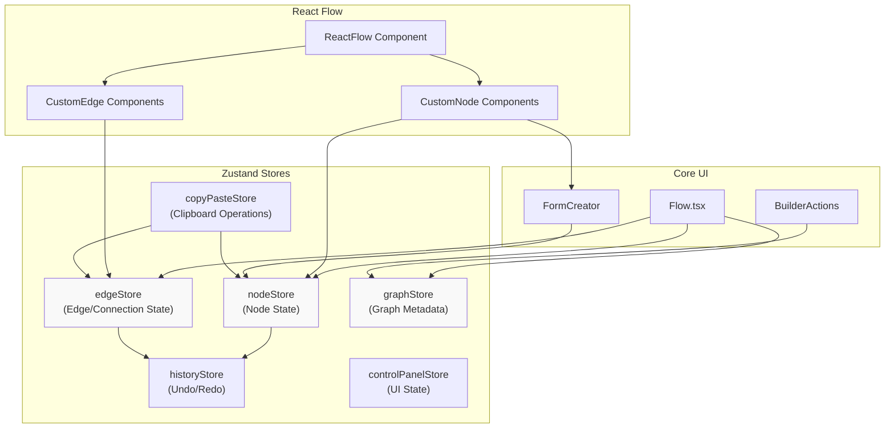
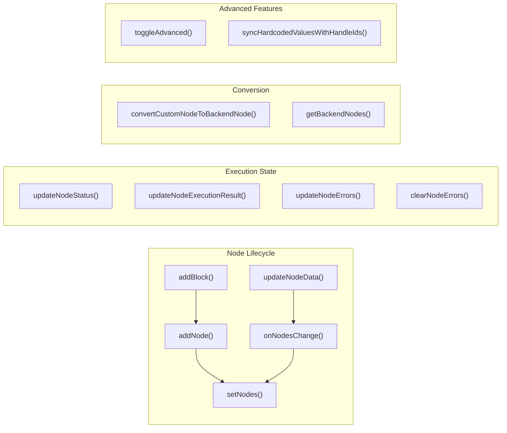
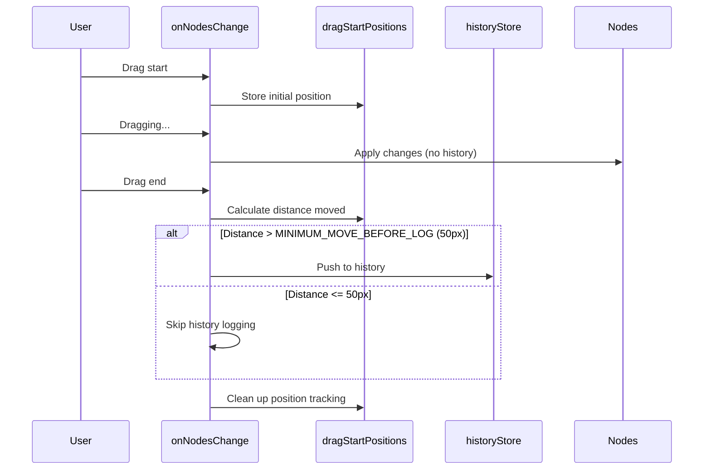
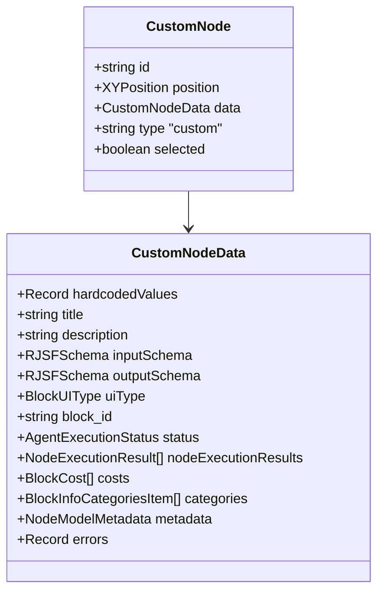
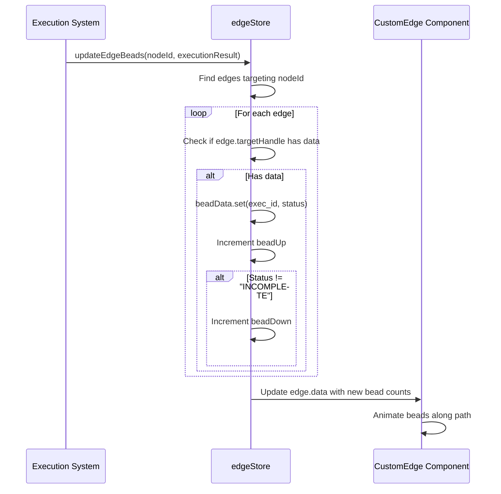
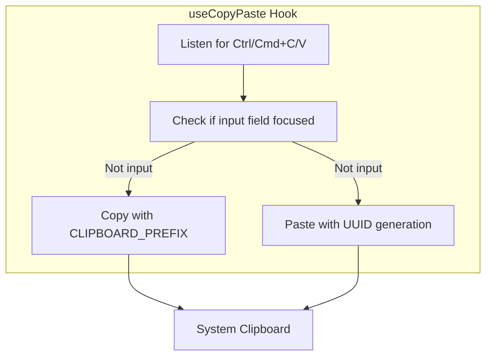
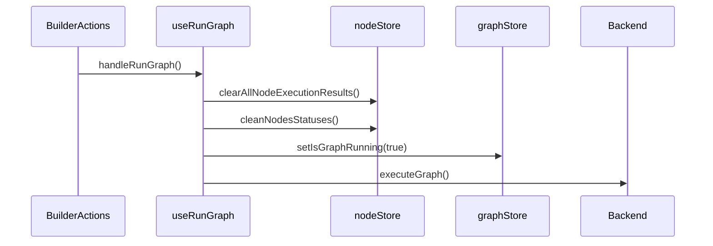

<!-- source: DeepWiki mcp.deepwiki.com · repo Significant-Gravitas/AutoGPT · extra page State Management · fetched 2026-10-26 -->

# State Management

<details>
<summary>Relevant source files</summary>

The following files were used as context for generating this wiki page:

- [autogpt_platform/frontend/src/app/(platform)/build/components/BuilderActions/components/RunGraph/useRunGraph.ts](autogpt_platform/frontend/src/app/(platform)/build/components/BuilderActions/components/RunGraph/useRunGraph.ts)
- [autogpt_platform/frontend/src/app/(platform)/build/components/BuilderChatPanel/BuilderChatPanel.tsx](autogpt_platform/frontend/src/app/(platform)/build/components/BuilderChatPanel/BuilderChatPanel.tsx)
- [autogpt_platform/frontend/src/app/(platform)/build/components/BuilderChatPanel/__tests__/BuilderChatPanel.test.tsx](autogpt_platform/frontend/src/app/(platform)/build/components/BuilderChatPanel/__tests__/BuilderChatPanel.test.tsx)
- [autogpt_platform/frontend/src/app/(platform)/build/components/BuilderChatPanel/useBuilderChatPanel.ts](autogpt_platform/frontend/src/app/(platform)/build/components/BuilderChatPanel/useBuilderChatPanel.ts)
- [autogpt_platform/frontend/src/app/(platform)/build/components/DraftRecoveryDialog/DraftRecoveryPopup.tsx](autogpt_platform/frontend/src/app/(platform)/build/components/DraftRecoveryDialog/DraftRecoveryPopup.tsx)
- [autogpt_platform/frontend/src/app/(platform)/build/components/DraftRecoveryDialog/useDraftRecoveryPopup.tsx](autogpt_platform/frontend/src/app/(platform)/build/components/DraftRecoveryDialog/useDraftRecoveryPopup.tsx)
- [autogpt_platform/frontend/src/app/(platform)/build/components/FlowEditor/Flow/Flow.tsx](autogpt_platform/frontend/src/app/(platform)/build/components/FlowEditor/Flow/Flow.tsx)
- [autogpt_platform/frontend/src/app/(platform)/build/components/FlowEditor/Flow/components/GraphLoadingBox.tsx](autogpt_platform/frontend/src/app/(platform)/build/components/FlowEditor/Flow/components/GraphLoadingBox.tsx)
- [autogpt_platform/frontend/src/app/(platform)/build/components/FlowEditor/Flow/components/RunningBackground.tsx](autogpt_platform/frontend/src/app/(platform)/build/components/FlowEditor/Flow/components/RunningBackground.tsx)
- [autogpt_platform/frontend/src/app/(platform)/build/components/FlowEditor/Flow/useCopyPaste.ts](autogpt_platform/frontend/src/app/(platform)/build/components/FlowEditor/Flow/useCopyPaste.ts)
- [autogpt_platform/frontend/src/app/(platform)/build/components/FlowEditor/Flow/useDraftManager.ts](autogpt_platform/frontend/src/app/(platform)/build/components/FlowEditor/Flow/useDraftManager.ts)
- [autogpt_platform/frontend/src/app/(platform)/build/components/FlowEditor/Flow/useFlow.ts](autogpt_platform/frontend/src/app/(platform)/build/components/FlowEditor/Flow/useFlow.ts)
- [autogpt_platform/frontend/src/app/(platform)/build/components/FlowEditor/edges/CustomEdge.tsx](autogpt_platform/frontend/src/app/(platform)/build/components/FlowEditor/edges/CustomEdge.tsx)
- [autogpt_platform/frontend/src/app/(platform)/build/components/FlowEditor/edges/components/JSBeads.tsx](autogpt_platform/frontend/src/app/(platform)/build/components/FlowEditor/edges/components/JSBeads.tsx)
- [autogpt_platform/frontend/src/app/(platform)/build/components/FlowEditor/edges/components/SVGBeads.tsx](autogpt_platform/frontend/src/app/(platform)/build/components/FlowEditor/edges/components/SVGBeads.tsx)
- [autogpt_platform/frontend/src/app/(platform)/build/components/FlowEditor/edges/helpers.ts](autogpt_platform/frontend/src/app/(platform)/build/components/FlowEditor/edges/helpers.ts)
- [autogpt_platform/frontend/src/app/(platform)/build/components/FlowEditor/edges/useCustomEdge.ts](autogpt_platform/frontend/src/app/(platform)/build/components/FlowEditor/edges/useCustomEdge.ts)
- [autogpt_platform/frontend/src/app/(platform)/build/components/FlowEditor/nodes/CustomNode/CustomNode.tsx](autogpt_platform/frontend/src/app/(platform)/build/components/FlowEditor/nodes/CustomNode/CustomNode.tsx)
- [autogpt_platform/frontend/src/app/(platform)/build/components/FlowEditor/nodes/CustomNode/components/AyrshareConnectButton.tsx](autogpt_platform/frontend/src/app/(platform)/build/components/FlowEditor/nodes/CustomNode/components/AyrshareConnectButton.tsx)
- [autogpt_platform/frontend/src/app/(platform)/build/components/FlowEditor/nodes/CustomNode/components/NodeContainer.tsx](autogpt_platform/frontend/src/app/(platform)/build/components/FlowEditor/nodes/CustomNode/components/NodeContainer.tsx)
- [autogpt_platform/frontend/src/app/(platform)/build/components/FlowEditor/nodes/CustomNode/components/NodeExecutionBadge.tsx](autogpt_platform/frontend/src/app/(platform)/build/components/FlowEditor/nodes/CustomNode/components/NodeExecutionBadge.tsx)
- [autogpt_platform/frontend/src/app/(platform)/build/components/FlowEditor/nodes/CustomNode/components/StickyNoteBlock.tsx](autogpt_platform/frontend/src/app/(platform)/build/components/FlowEditor/nodes/CustomNode/components/StickyNoteBlock.tsx)
- [autogpt_platform/frontend/src/app/(platform)/build/components/FlowEditor/nodes/CustomNode/components/WebhookDisclaimer.tsx](autogpt_platform/frontend/src/app/(platform)/build/components/FlowEditor/nodes/CustomNode/components/WebhookDisclaimer.tsx)
- [autogpt_platform/frontend/src/app/(platform)/build/components/FlowEditor/nodes/FormCreator.tsx](autogpt_platform/frontend/src/app/(platform)/build/components/FlowEditor/nodes/FormCreator.tsx)
- [autogpt_platform/frontend/src/app/(platform)/build/components/helper.ts](autogpt_platform/frontend/src/app/(platform)/build/components/helper.ts)
- [autogpt_platform/frontend/src/app/(platform)/build/hooks/useSaveGraph.ts](autogpt_platform/frontend/src/app/(platform)/build/hooks/useSaveGraph.ts)
- [autogpt_platform/frontend/src/app/(platform)/build/stores/copyPasteStore.ts](autogpt_platform/frontend/src/app/(platform)/build/stores/copyPasteStore.ts)
- [autogpt_platform/frontend/src/app/(platform)/build/stores/edgeStore.ts](autogpt_platform/frontend/src/app/(platform)/build/stores/edgeStore.ts)
- [autogpt_platform/frontend/src/app/(platform)/build/stores/graphStore.ts](autogpt_platform/frontend/src/app/(platform)/build/stores/graphStore.ts)
- [autogpt_platform/frontend/src/app/(platform)/build/stores/historyStore.ts](autogpt_platform/frontend/src/app/(platform)/build/stores/historyStore.ts)
- [autogpt_platform/frontend/src/app/(platform)/build/stores/nodeStore.ts](autogpt_platform/frontend/src/app/(platform)/build/stores/nodeStore.ts)
- [autogpt_platform/frontend/src/lib/dexie/db.ts](autogpt_platform/frontend/src/lib/dexie/db.ts)

</details>


The AutoGPT Platform frontend uses **Zustand** stores for state management across the Flow Editor. This document explains the architecture of the state stores, their responsibilities, and how they interact to maintain the application state for nodes, edges, graph metadata, and user interactions.

For information about the API Client that synchronizes state with the backend, see [API Client](#3.1.7). For information about how forms interact with node state, see [Form System (RJSF)](#3.1.2).

---

## Store Architecture Overview

The frontend state is distributed across multiple specialized Zustand stores, each managing a specific domain of the application:



**Diagram: State Store Architecture and Component Interactions**

Sources: [autogpt_platform/frontend/src/app/(platform)/build/stores/nodeStore.ts:1-121](), [autogpt_platform/frontend/src/app/(platform)/build/stores/edgeStore.ts:1-34](), [autogpt_platform/frontend/src/app/(platform)/build/stores/graphStore.ts:1-72]()

---

## nodeStore: Node State Management

The `nodeStore` is responsible for managing all node-related state in the Flow Editor. It stores node positions, data, execution status, validation errors, and provides methods for node manipulation.

### Store Structure

| Property | Type | Description |
|----------|------|-------------|
| `nodes` | `CustomNode[]` | Array of all nodes in the canvas |
| `nodeCounter` | `number` | Auto-incrementing counter for node IDs |
| `nodeAdvancedStates` | `Record<string, boolean>` | Tracks which nodes have advanced mode enabled |
| `latestNodeInputData` | `Record<string, NodeExecutionResultInputData>` | Most recent input data per node |
| `accumulatedNodeOutputData` | `Record<string, Record<string, unknown[]>>` | Data collected over multiple iterations |

**Table: nodeStore State Properties**

Sources: [autogpt_platform/frontend/src/app/(platform)/build/stores/nodeStore.ts:32-43]()

### Key Operations



**Diagram: nodeStore Operation Categories**

Sources: [autogpt_platform/frontend/src/app/(platform)/build/stores/nodeStore.ts:45-121]()

### Node Change Tracking

The `onNodesChange` method implements intelligent change tracking to avoid polluting the history store with minor position adjustments:



**Diagram: Position Change Tracking with Threshold**

The threshold prevents history pollution when users click on inputs inside blocks, which can cause small position changes.

Sources: [autogpt_platform/frontend/src/app/(platform)/build/stores/nodeStore.ts:26-190]()

### Node Data Structure



**Diagram: CustomNode Type Hierarchy**

Sources: [autogpt_platform/frontend/src/app/(platform)/build/components/FlowEditor/nodes/CustomNode/CustomNode.tsx:32-52]()

---

## edgeStore: Connection State Management

The `edgeStore` manages connections (edges) between nodes, including visual state like animated beads that show data flow during execution.

### Store Structure

| Property | Type | Description |
|----------|------|-------------|
| `edges` | `CustomEdge[]` | Array of all connections between nodes |

**Table: edgeStore State Properties**

Sources: [autogpt_platform/frontend/src/app/(platform)/build/stores/edgeStore.ts:12-12]()

### Bead Animation System

The edge store manages animated "beads" that visualize data flow during execution:



**Diagram: Edge Bead Animation Update Flow**

Sources: [autogpt_platform/frontend/src/app/(platform)/build/stores/edgeStore.ts:136-190]()

---

## copyPasteStore: Clipboard Operations

The `copyPasteStore` manages copy-paste operations for nodes and their connections. It works alongside the keyboard-based `useCopyPaste` hook.

### Keyboard-Based Copy-Paste

The `useCopyPaste` hook provides an implementation using the system clipboard with a custom prefix `autogpt-flow-data:`.



**Diagram: Keyboard Copy-Paste Implementation**

Sources: [autogpt_platform/frontend/src/app/(platform)/build/components/FlowEditor/Flow/useCopyPaste.ts:15-152]()

---

## historyStore: Undo/Redo Functionality

The `historyStore` maintains a stack of snapshots representing the state of both nodes and edges.

### History Integration

Both `nodeStore` and `edgeStore` integrate with `historyStore` for undo/redo functionality:

```typescript
// Example push to history in edgeStore.addEdge
const prevState = {
  nodes: useNodeStore.getState().nodes,
  edges: get().edges,
};
useHistoryStore.getState().pushState(prevState);
```

Sources: [autogpt_platform/frontend/src/app/(platform)/build/stores/edgeStore.ts:66-72]()

---

## graphStore: Graph Metadata Management

The `graphStore` maintains graph-level state including execution status, input/output schemas, and credentials requirements.

### Store Structure

| Property | Type | Description |
|----------|------|-------------|
| `graphExecutionStatus` | `AgentExecutionStatus` | Current execution status |
| `isGraphRunning` | `boolean` | Whether graph is currently executing |
| `inputSchema` | `Record<string, any>` | Graph input schema (INPUT blocks) |

**Table: graphStore State Properties**

Sources: [autogpt_platform/frontend/src/app/(platform)/build/stores/graphStore.ts:4-24]()

---

## Store Usage Patterns

### Accessing Store State

Zustand stores are accessed via hooks with optional selectors:

```typescript
// Access with shallow equality check
const nodes = useNodeStore(useShallow((state) => state.nodes));
const setNodes = useNodeStore(useShallow((state) => state.setNodes));
```

Sources: [autogpt_platform/frontend/src/app/(platform)/build/components/FlowEditor/Flow/Flow.tsx:49-50]()

### Execution Trigger Flow

When a user runs a graph, multiple stores are cleared and updated:



Sources: [autogpt_platform/frontend/src/app/(platform)/build/components/BuilderActions/components/RunGraph/useRunGraph.ts:138-162]()

---

