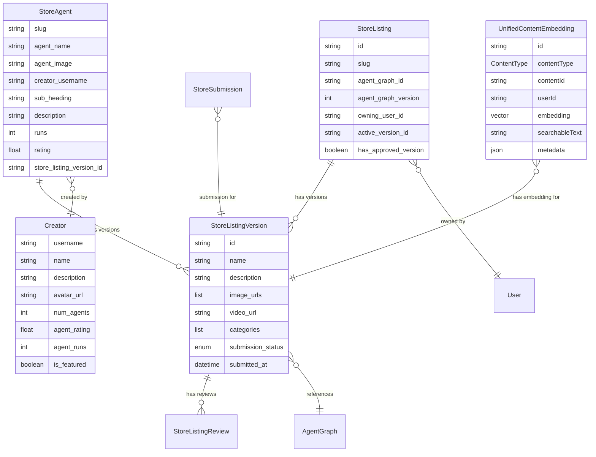
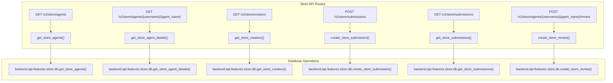
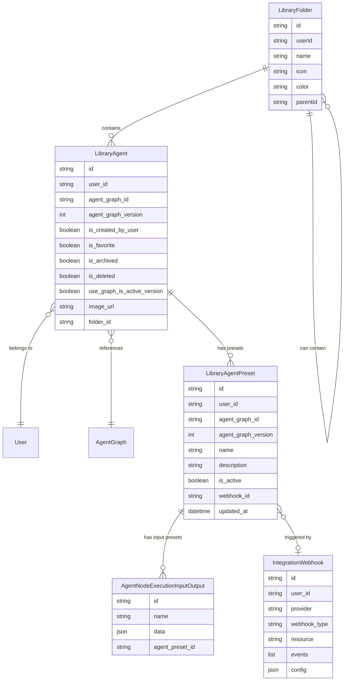
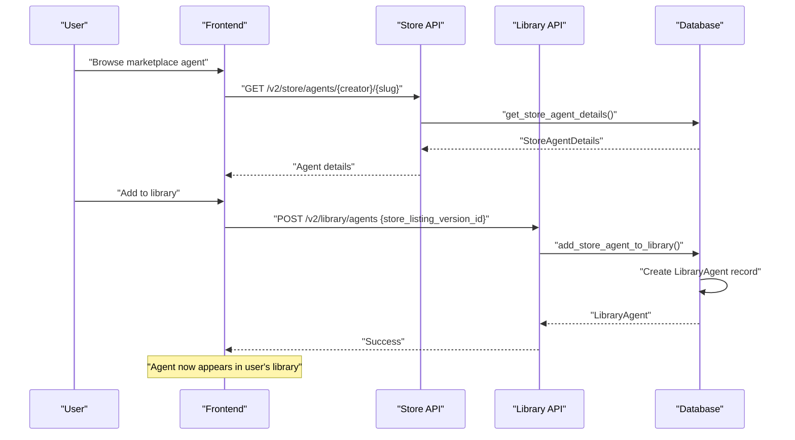
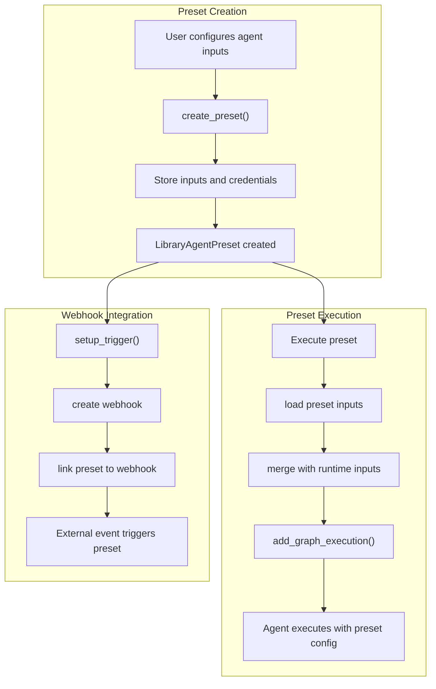
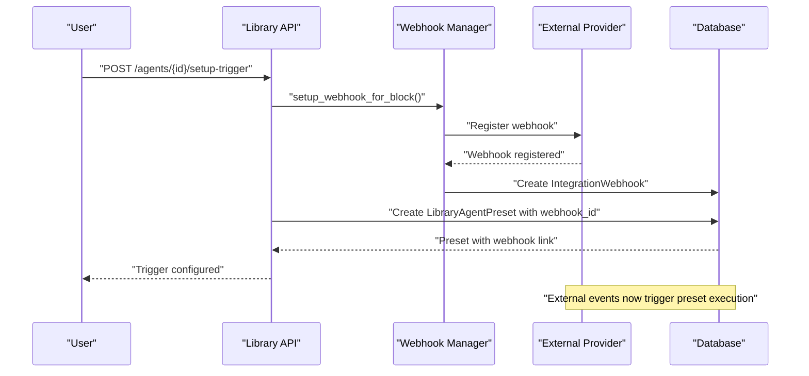
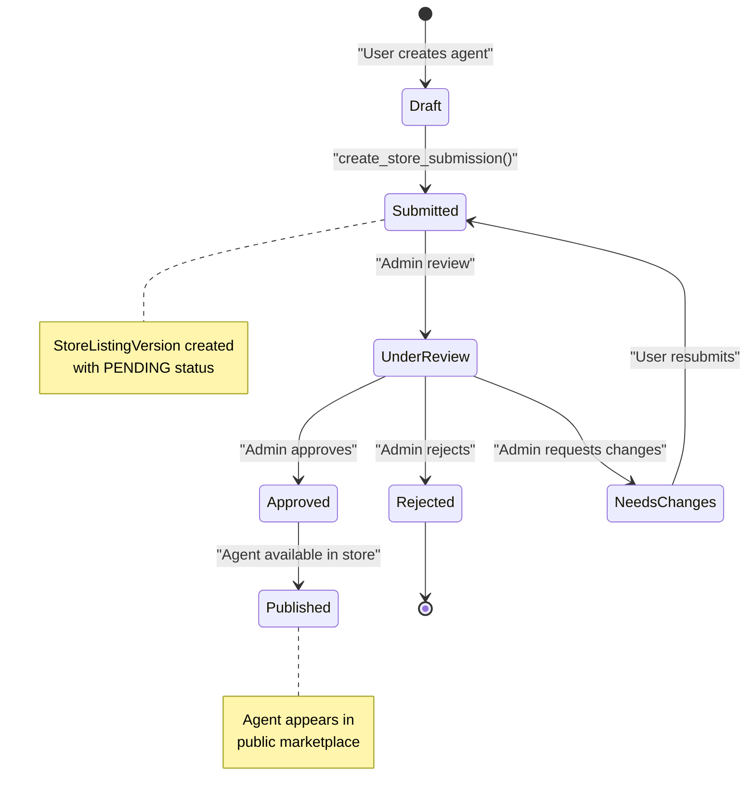
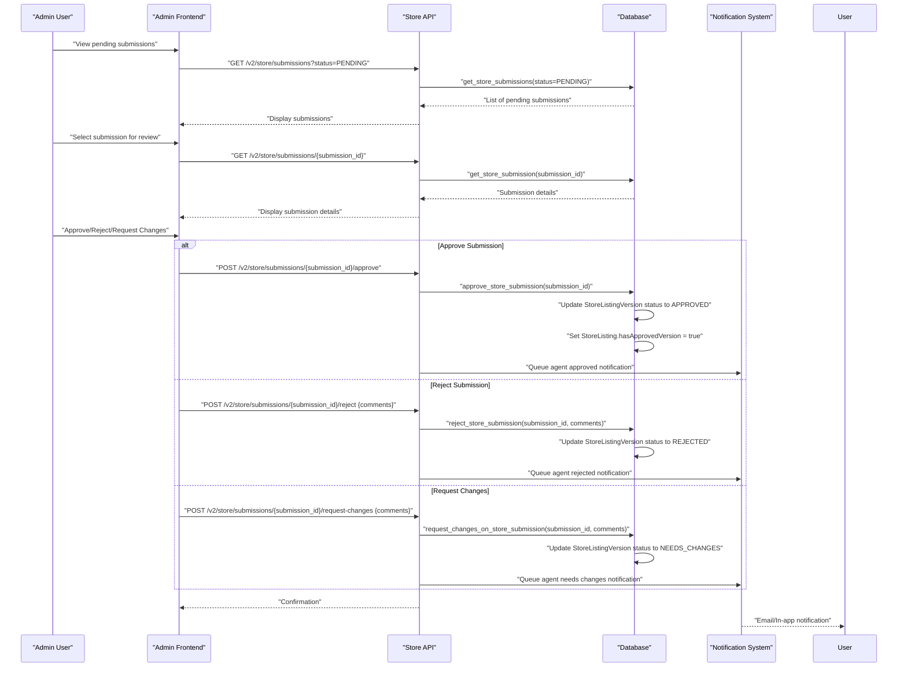

<!-- source: DeepWiki mcp.deepwiki.com · repo Significant-Gravitas/AutoGPT · extra page Store and Library Management · fetched 2026-10-26 -->

# Store and Library Management

Relevant source files

The following files were used as context for generating this wiki page:

- [autogpt_platform/backend/backend/api/features/library/_add_to_library.py](autogpt_platform/backend/backend/api/features/library/_add_to_library.py)
- [autogpt_platform/backend/backend/api/features/library/_add_to_library_test.py](autogpt_platform/backend/backend/api/features/library/_add_to_library_test.py)
- [autogpt_platform/backend/backend/api/features/library/db.py](autogpt_platform/backend/backend/api/features/library/db.py)
- [autogpt_platform/backend/backend/api/features/library/db_test.py](autogpt_platform/backend/backend/api/features/library/db_test.py)
- [autogpt_platform/backend/backend/api/features/library/model.py](autogpt_platform/backend/backend/api/features/library/model.py)
- [autogpt_platform/backend/backend/api/features/store/content_handlers.py](autogpt_platform/backend/backend/api/features/store/content_handlers.py)
- [autogpt_platform/backend/backend/api/features/store/content_handlers_test.py](autogpt_platform/backend/backend/api/features/store/content_handlers_test.py)
- [autogpt_platform/backend/backend/api/features/store/db.py](autogpt_platform/backend/backend/api/features/store/db.py)
- [autogpt_platform/backend/backend/api/features/store/db_test.py](autogpt_platform/backend/backend/api/features/store/db_test.py)
- [autogpt_platform/backend/backend/api/features/store/embeddings.py](autogpt_platform/backend/backend/api/features/store/embeddings.py)
- [autogpt_platform/backend/backend/api/features/store/embeddings_schema_test.py](autogpt_platform/backend/backend/api/features/store/embeddings_schema_test.py)
- [autogpt_platform/backend/backend/api/features/store/embeddings_test.py](autogpt_platform/backend/backend/api/features/store/embeddings_test.py)
- [autogpt_platform/backend/backend/api/features/store/hybrid_search.py](autogpt_platform/backend/backend/api/features/store/hybrid_search.py)
- [autogpt_platform/backend/backend/api/features/store/hybrid_search_test.py](autogpt_platform/backend/backend/api/features/store/hybrid_search_test.py)
- [autogpt_platform/backend/backend/api/features/store/model.py](autogpt_platform/backend/backend/api/features/store/model.py)
- [autogpt_platform/backend/backend/api/features/store/routes.py](autogpt_platform/backend/backend/api/features/store/routes.py)
- [autogpt_platform/backend/backend/api/features/store/routes_test.py](autogpt_platform/backend/backend/api/features/store/routes_test.py)
- [autogpt_platform/backend/backend/api/features/store/test_cache_delete.py](autogpt_platform/backend/backend/api/features/store/test_cache_delete.py)
- [autogpt_platform/backend/backend/api/features/store/text_utils.py](autogpt_platform/backend/backend/api/features/store/text_utils.py)
- [autogpt_platform/backend/backend/api/features/store/text_utils_test.py](autogpt_platform/backend/backend/api/features/store/text_utils_test.py)
- [autogpt_platform/backend/backend/data/db.py](autogpt_platform/backend/backend/data/db.py)
- [autogpt_platform/backend/migrations/20260109181714_add_docs_embedding/migration.sql](autogpt_platform/backend/migrations/20260109181714_add_docs_embedding/migration.sql)
- [autogpt_platform/backend/snapshots/agt_details](autogpt_platform/backend/snapshots/agt_details)
- [autogpt_platform/backend/snapshots/lib_agts_search](autogpt_platform/backend/snapshots/lib_agts_search)
- [autogpt_platform/backend/snapshots/sub_success](autogpt_platform/backend/snapshots/sub_success)
- [autogpt_platform/frontend/src/app/(platform)/copilot/components/PulseChips/usePulseChips.ts](autogpt_platform/frontend/src/app/(platform)/copilot/components/PulseChips/usePulseChips.ts)
- [autogpt_platform/frontend/src/app/(platform)/library/components/ContextualActionButton/ContextualActionButton.tsx](autogpt_platform/frontend/src/app/(platform)/library/components/ContextualActionButton/ContextualActionButton.tsx)
- [autogpt_platform/frontend/src/app/(platform)/library/components/SitrepItem/SitrepItem.tsx](autogpt_platform/frontend/src/app/(platform)/library/components/SitrepItem/SitrepItem.tsx)
- [autogpt_platform/frontend/src/app/(platform)/library/components/SitrepItem/useSitrepItems.ts](autogpt_platform/frontend/src/app/(platform)/library/components/SitrepItem/useSitrepItems.ts)
- [autogpt_platform/frontend/src/app/(platform)/library/hooks/useAgentStatus.ts](autogpt_platform/frontend/src/app/(platform)/library/hooks/useAgentStatus.ts)
- [autogpt_platform/frontend/src/components/contextual/PublishAgentModal/PublishAgentModal.tsx](autogpt_platform/frontend/src/components/contextual/PublishAgentModal/PublishAgentModal.tsx)
- [autogpt_platform/frontend/src/components/contextual/PublishAgentModal/components/AgentInfoStep/AgentInfoStep.tsx](autogpt_platform/frontend/src/components/contextual/PublishAgentModal/components/AgentInfoStep/AgentInfoStep.tsx)
- [autogpt_platform/frontend/src/components/contextual/PublishAgentModal/components/AgentInfoStep/helpers.ts](autogpt_platform/frontend/src/components/contextual/PublishAgentModal/components/AgentInfoStep/helpers.ts)
- [autogpt_platform/frontend/src/components/contextual/PublishAgentModal/components/AgentInfoStep/useAgentInfoStep.ts](autogpt_platform/frontend/src/components/contextual/PublishAgentModal/components/AgentInfoStep/useAgentInfoStep.ts)
- [autogpt_platform/frontend/src/components/contextual/PublishAgentModal/components/AgentReviewStep.tsx](autogpt_platform/frontend/src/components/contextual/PublishAgentModal/components/AgentReviewStep.tsx)
- [autogpt_platform/frontend/src/components/contextual/PublishAgentModal/components/AgentSelectStep/AgentSelectStep.tsx](autogpt_platform/frontend/src/components/contextual/PublishAgentModal/components/AgentSelectStep/AgentSelectStep.tsx)
- [autogpt_platform/frontend/src/components/contextual/PublishAgentModal/components/AgentSelectStep/useAgentSelectStep.ts](autogpt_platform/frontend/src/components/contextual/PublishAgentModal/components/AgentSelectStep/useAgentSelectStep.ts)
- [autogpt_platform/frontend/src/components/contextual/PublishAgentModal/components/PublishAuthPrompt.tsx](autogpt_platform/frontend/src/components/contextual/PublishAgentModal/components/PublishAuthPrompt.tsx)
- [autogpt_platform/frontend/src/components/contextual/PublishAgentModal/components/StepHeader.tsx](autogpt_platform/frontend/src/components/contextual/PublishAgentModal/components/StepHeader.tsx)
- [autogpt_platform/frontend/src/playwright/pages/marketplace.page.ts](autogpt_platform/frontend/src/playwright/pages/marketplace.page.ts)

This document covers the Store and Library Management system in the AutoGPT Platform, which handles both the public marketplace for agent discovery and distribution, and users' personal agent libraries. The store provides a public marketplace where agents can be published, discovered, and shared, while the library manages each user's personal collection of agents, presets, and configurations.

For information about agent execution and orchestration, see [Execution System](#3.2.2). For details about the block system that powers agents, see [Block System](#3.2.6).

## System Overview

The Store and Library Management system consists of two primary subsystems:

- **Store System**: Public marketplace for agent discovery, submission, and distribution
- **Library System**: Personal agent management, presets, and configurations

## Store System Architecture

The store system manages the public marketplace where agents are published, discovered, and distributed to users.

### Store Entity Model

Sources: [autogpt_platform/backend/backend/api/features/store/model.py:24-188](), [autogpt_platform/backend/backend/api/features/store/db.py:38-194](), [autogpt_platform/backend/backend/api/features/store/embeddings.py:153-175]()

### Store API Endpoints

Sources: [autogpt_platform/backend/backend/api/features/store/routes.py:111-182](), [autogpt_platform/backend/backend/api/features/store/routes.py:317-367](), [autogpt_platform/backend/backend/api/features/store/routes.py:515-561]()

## Library System Architecture

The library system manages users' personal collections of agents, including saved agents from the marketplace and user-created agents.

### Library Entity Model

Sources: [autogpt_platform/backend/backend/api/features/library/model.py:31-156](), [autogpt_platform/backend/backend/api/features/library/model.py:214-296]()

### Library API Structure

```mermaid
graph TD
    subgraph "Library Agent Routes"
        A["GET /v2/library/agents"] --> B["list_library_agents()"]
        C["GET /v2/library/agents/{id}"] --> D["get_library_agent()"]
        E["POST /v2/library/agents"] --> F["add_marketplace_agent_to_library()"]
        G["PATCH /v2/library/agents/{id}"] --> H["update_library_agent()"]
        I["DELETE /v2/library/agents/{id}"] --> J["delete_library_agent()"]
        K["POST /v2/library/agents/{id}/fork"] --> L["fork_library_agent()"]
        M["POST /v2/library/agents/bulk-move"] --> N["bulk_move_agents()"]
    end
    
    subgraph "Preset Routes"
        O["GET /v2/library/presets"] --> P["list_presets()"]
        Q["GET /v2/library/presets/{id}"] --> R["get_preset()"]
        S["POST /v2/library/presets"] --> T["create_preset()"]
        U["PATCH /v2/library/presets/{id}"] --> V["update_preset()"]
    end

    subgraph "Folder Routes"
        W["GET /v2/library/folders"] --> X["list_folders()"]
        Y["GET /v2/library/folders/tree"] --> Z["get_folder_tree()"]
        AA["POST /v2/library/folders"] --> BB["create_folder()"]
        CC["PATCH /v2/library/folders/{id}"] --> DD["update_folder()"]
        EE["DELETE /v2/library/folders/{id}"] --> FF["delete_folder()"]
        GG["PATCH /v2/library/folders/{id}/move"] --> HH["move_folder()"]
    end
    
    subgraph "Database Layer"
        B --> BI["library_db.list_library_agents()"]
        D --> DI["library_db.get_library_agent()"]
        F --> FI["library_db.add_store_agent_to_library()"]
        H --> HI["library_db.update_library_agent()"]
        N --> NI["library_db.bulk_move_agents()"]
        P --> PI["library_db.list_presets()"]
        T --> TI["library_db.create_preset()"]
        X --> XI["library_db.list_folders()"]
        Z --> ZI["library_db.get_folder_tree()"]
        BB --> BBI["library_db.create_folder()"]
        DD --> DDI["library_db.update_folder()"]
        FF --> FFI["library_db.delete_folder()"]
        HH --> HHI["library_db.move_folder()"]
    end
```

Sources: [autogpt_platform/backend/backend/api/features/library/db.py:106-165](), [autogpt_platform/backend/backend/api/features/library/db.py:434-525](), [autogpt_platform/backend/backend/api/features/library/db.py:627-678](), [autogpt_platform/backend/backend/api/features/library/db.py:700-740](), [autogpt_platform/backend/backend/api/features/library/db.py:760-800](), [autogpt_platform/backend/backend/api/features/library/db.py:820-860](), [autogpt_platform/backend/backend/api/features/library/db.py:880-920](), [autogpt_platform/backend/backend/api/features/library/db.py:940-980](), [autogpt_platform/backend/backend/api/features/library/db.py:1000-1040]()

## Store-to-Library Integration

The integration between store and library allows users to discover agents in the marketplace and add them to their personal libraries.

### Agent Addition Flow

Sources: [autogpt_platform/backend/backend/api/features/library/_add_to_library.py:27-100](), [autogpt_platform/backend/backend/api/features/library/db.py:434-525]()

## Preset Management

Presets allow users to save specific configurations for agents, including input values and credentials, enabling quick reuse of common setups.

### Preset Creation and Execution

Sources: [autogpt_platform/backend/backend/api/features/library/db.py:627-678](), [autogpt_platform/backend/backend/api/features/library/db.py:1000-1040]()

## Webhook and Integration Support

The system supports external triggers through webhooks, allowing agents to be automatically executed when external events occur.

### Webhook Setup Process

Sources: [autogpt_platform/backend/backend/api/features/library/db.py:1000-1040]()

## Store Submission Workflow

Users can submit their agents to the public marketplace through a submission and review process.

### Submission Process

Sources: [autogpt_platform/backend/backend/api/features/store/db.py:546-694](), [autogpt_platform/backend/backend/api/features/store/routes.py:515-561]()

### Admin Review Workflow

The admin review workflow involves administrators evaluating submitted agents for approval or rejection. This process is critical for maintaining the quality and safety of the marketplace.

The `approve_store_submission` function [autogpt_platform/backend/backend/api/features/store/db.py:700-740]() updates the `StoreListingVersion` status to `APPROVED` and sets `hasApprovedVersion` on the parent `StoreListing` to `true`. It also queues a notification for the user. Similarly, `reject_store_submission` [autogpt_platform/backend/backend/api/features/store/db.py:742-782]() and `request_changes_on_store_submission` [autogpt_platform/backend/backend/api/features/store/db.py:784-824]() update the status to `REJECTED` or `NEEDS_CHANGES` respectively, and send appropriate notifications.

Sources: [autogpt_platform/backend/backend/api/features/store/db.py:700-824](), [autogpt_platform/backend/backend/api/features/store/routes.py:563-680]()

## Hybrid Search with Embeddings

The store system utilizes a hybrid search mechanism to provide relevant results for agent discovery. This combines semantic search (using embeddings) with lexical search (using `tsvector`) for improved accuracy and relevance.

### Embedding Generation and Storage

When a store listing is approved, its relevant text fields (name, description, sub-heading, categories) are combined into a `searchable_text` string [autogpt_platform/backend/backend/api/features/store/embeddings.py:34-63](). An embedding is then generated for this text using OpenAI's `text-embedding-3-small` model [autogpt_platform/backend/backend/api/features/store/embeddings.py:29-30, 66-101](). This embedding, along with the `searchable_text` and metadata, is stored in the `UnifiedContentEmbedding` table [autogpt_platform/backend/backend/api/features/store/embeddings.py:126-175]().

The `StoreAgentHandler` [autogpt_platform/backend/backend/api/features/store/content_handlers.py:86-165]() is responsible for identifying approved store listings that lack embeddings and generating them.

### Hybrid Search Process

The `hybrid_search` function [autogpt_platform/backend/backend/api/features/store/hybrid_search.py:134-212]() performs the following steps:
1. **Query Embedding**: The user's search query is embedded into a vector. If embedding generation fails (e.g., OpenAI API is unavailable), the system gracefully degrades to lexical-only search [autogpt_platform/backend/backend/api/features/store/hybrid_search.py:189-212]().
2. **SQL Query**: A raw SQL query is constructed to search the `UnifiedContentEmbedding` table. This query calculates a combined score based on:
    - **Semantic Similarity**: Cosine similarity between the query embedding and content embeddings.
    - **Lexical Relevance**: `ts_rank_cd` score from PostgreSQL's full-text search (`tsvector`).
    - **Category Match**: Boost for matching categories.
    - **Recency**: Boost for newer content.
    These components are weighted according to `UnifiedSearchWeights` [autogpt_platform/backend/backend/api/features/store/hybrid_search.py:105-127]().
3. **BM25 Reranking**: The initial results are then reranked using BM25 (Okapi BM25) to further improve lexical relevance, especially for exact term matches [autogpt_platform/backend/backend/api/features/store/hybrid_search.py:40-101](). This combines the original combined score with a BM25 score.
4. **Pagination**: Results are paginated before being returned.

The `get_store_agents` function [autogpt_platform/backend/backend/api/features/store/db.py:51-160]() in the store database layer orchestrates this, attempting hybrid search first and falling back to a direct database query with `tsvector` if hybrid search fails or returns no results [autogpt_platform/backend/backend/api/features/store/db.py:84-145]().

Sources: [autogpt_platform/backend/backend/api/features/store/embeddings.py:29-175](), [autogpt_platform/backend/backend/api/features/store/hybrid_search.py:1-212](), [autogpt_platform/backend/backend/api/features/store/db.py:51-160](), [autogpt_platform/backend/backend/api/features/store/content_handlers.py:86-165]()

## Database Schema Relationships

The following table shows the key database models and their relationships:

| Model | Primary Purpose | Key Relationships |
|-------|----------------|-------------------|
| `LibraryAgent` | User's personal agent collection | → `User`, → `AgentGraph`, → `LibraryFolder` |
| `LibraryAgentPreset` | Saved agent configurations | → `LibraryAgent`, → `IntegrationWebhook` |
| `LibraryFolder` | Organizes `LibraryAgent`s | → `User`, → `LibraryFolder` (self-referential for nesting) |
| `StoreAgent` | Public marketplace agent view | → `Creator`, → `StoreListingVersion` |
| `StoreListing` | Store agent metadata | → `User`, → `StoreListingVersion` |
| `StoreListingVersion` | Versioned agent submissions | → `AgentGraph`, → `StoreListing`, → `UnifiedContentEmbedding` |
| `StoreSubmission` | Submission tracking | → `StoreListingVersion` |
| `UnifiedContentEmbedding` | Stores embeddings for various content types | → `StoreListingVersion`, `Block`, `Documentation` |
| `IntegrationWebhook` | External trigger configuration | → `LibraryAgentPreset` |

Sources: [autogpt_platform/backend/backend/api/features/store/model.py:24-188](), [autogpt_platform/backend/backend/api/features/library/model.py:31-296](), [autogpt_platform/backend/backend/api/features/store/embeddings.py:153-175]()

## Key Operations

### Store Operations

- **Agent Discovery**: Search and filter agents by category, creator, rating, and popularity using hybrid search.
- **Agent Details**: View comprehensive agent information, including descriptions, images, and reviews.
- **Submissions**: Submit agents for marketplace inclusion with metadata and media.
- **Reviews**: Rate and review marketplace agents.

### Library Operations

- **Agent Management**: Add, update, archive, and delete personal agents.
- **Folder Management**: Organize agents into hierarchical folders.
- **Preset Creation**: Save agent configurations with specific input values and credentials.
- **Forking**: Create editable copies of marketplace agents.
- **Trigger Setup**: Configure webhook-based external triggers for automated execution.

Sources: [autogpt_platform/backend/backend/api/features/store/routes.py:111-680](), [autogpt_platform/backend/backend/api/features/library/db.py:106-165](), [autogpt_platform/backend/backend/api/features/library/db.py:434-525](), [autogpt_platform/backend/backend/api/features/library/db.py:627-678](), [autogpt_platform/backend/backend/api/features/library/db.py:700-740](), [autogpt_platform/backend/backend/api/features/library/db.py:760-800](), [autogpt_platform/backend/backend/api/features/library/db.py:820-860](), [autogpt_platform/backend/backend/api/features/library/db.py:880-920](), [autogpt_platform/backend/backend/api/features/library/db.py:940-980](), [autogpt_platform/backend/backend/api/features/library/db.py:1000-1040]()

---

