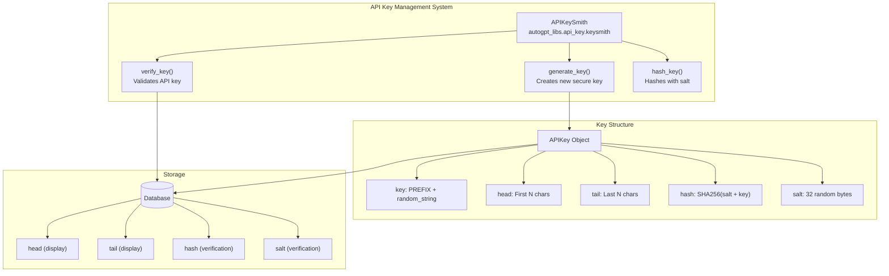
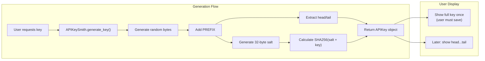
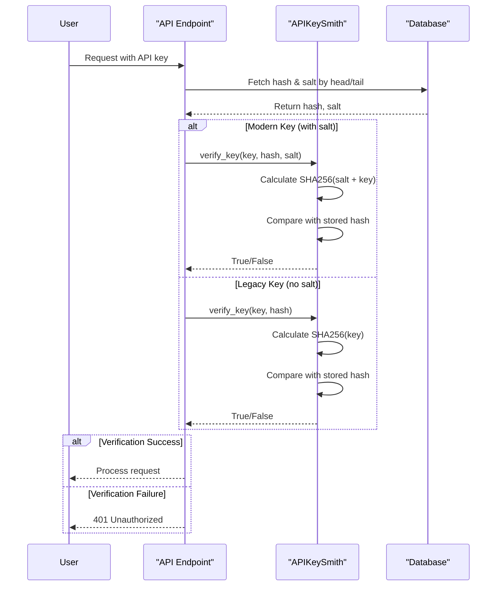
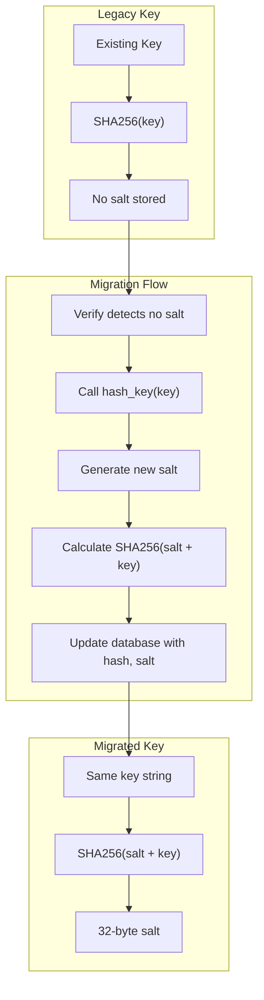
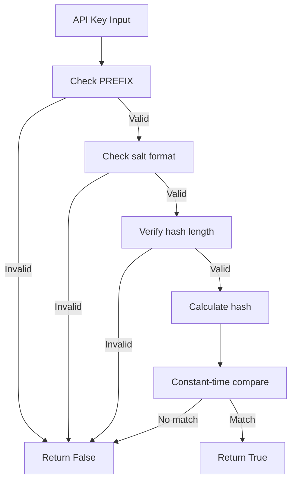
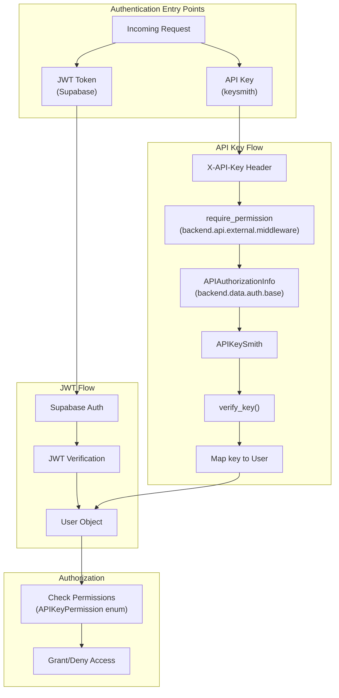

<!-- source: DeepWiki mcp.deepwiki.com · repo Significant-Gravitas/AutoGPT · extra page API Key Management · fetched 2026-10-26 -->

# API Key Management

<details>
<summary>Relevant source files</summary>

The following files were used as context for generating this wiki page:

- [autogpt_platform/backend/backend/api/conftest.py](autogpt_platform/backend/backend/api/conftest.py)
- [autogpt_platform/backend/backend/api/external/fastapi_app.py](autogpt_platform/backend/backend/api/external/fastapi_app.py)
- [autogpt_platform/backend/backend/api/external/v1/routes.py](autogpt_platform/backend/backend/api/external/v1/routes.py)
- [autogpt_platform/backend/backend/api/external/v1/routes_test.py](autogpt_platform/backend/backend/api/external/v1/routes_test.py)
- [autogpt_platform/backend/backend/api/features/admin/diagnostics_admin_routes.py](autogpt_platform/backend/backend/api/features/admin/diagnostics_admin_routes.py)
- [autogpt_platform/backend/backend/api/features/library/routes/presets.py](autogpt_platform/backend/backend/api/features/library/routes/presets.py)
- [autogpt_platform/backend/backend/api/features/v1_test.py](autogpt_platform/backend/backend/api/features/v1_test.py)
- [autogpt_platform/backend/backend/api/rest_api.py](autogpt_platform/backend/backend/api/rest_api.py)
- [autogpt_platform/backend/backend/data/execution_cost_summary.py](autogpt_platform/backend/backend/data/execution_cost_summary.py)
- [autogpt_platform/backend/backend/data/execution_cost_summary_test.py](autogpt_platform/backend/backend/data/execution_cost_summary_test.py)
- [autogpt_platform/frontend/src/app/(platform)/auth/integrations/oauth_callback/route.ts](autogpt_platform/frontend/src/app/(platform)/auth/integrations/oauth_callback/route.ts)
- [autogpt_platform/frontend/src/app/(platform)/auth/integrations/oauth_callback/types.ts](autogpt_platform/frontend/src/app/(platform)/auth/integrations/oauth_callback/types.ts)
- [autogpt_platform/frontend/src/app/(platform)/library/__tests__/briefing.test.tsx](autogpt_platform/frontend/src/app/(platform)/library/__tests__/briefing.test.tsx)
- [autogpt_platform/frontend/src/app/(platform)/library/components/AgentBriefingPanel/BriefingTabContent.tsx](autogpt_platform/frontend/src/app/(platform)/library/components/AgentBriefingPanel/BriefingTabContent.tsx)
- [autogpt_platform/frontend/src/app/(platform)/library/components/AgentBriefingPanel/CostsBreakdown/CostsBreakdown.tsx](autogpt_platform/frontend/src/app/(platform)/library/components/AgentBriefingPanel/CostsBreakdown/CostsBreakdown.tsx)
- [autogpt_platform/frontend/src/app/(platform)/library/components/AgentBriefingPanel/CostsBreakdown/__tests__/helpers.test.ts](autogpt_platform/frontend/src/app/(platform)/library/components/AgentBriefingPanel/CostsBreakdown/__tests__/helpers.test.ts)
- [autogpt_platform/frontend/src/app/(platform)/library/components/AgentBriefingPanel/CostsBreakdown/components/SpendByAgentList.tsx](autogpt_platform/frontend/src/app/(platform)/library/components/AgentBriefingPanel/CostsBreakdown/components/SpendByAgentList.tsx)
- [autogpt_platform/frontend/src/app/(platform)/library/components/AgentBriefingPanel/__tests__/BriefingTabContent.test.tsx](autogpt_platform/frontend/src/app/(platform)/library/components/AgentBriefingPanel/__tests__/BriefingTabContent.test.tsx)
- [autogpt_platform/frontend/src/app/(platform)/library/hooks/useLibraryFleetSummary.ts](autogpt_platform/frontend/src/app/(platform)/library/hooks/useLibraryFleetSummary.ts)

</details>


## Purpose and Scope

This document describes the API key generation, verification, and management system used in the AutoGPT Platform backend. The system provides secure API key handling through the `keysmith` module, supporting both legacy and modern cryptographic approaches for backward compatibility while maintaining security.

For information about user authentication via Supabase JWT tokens, see [Authentication](#3.1.6). For broader credential storage and OAuth flows, see [Credentials Management](#3.2.5).

**Sources:** [autogpt_platform/autogpt_libs/autogpt_libs/api_key/test_keysmith.py:1-80]()

---

## System Overview

The API key management system is implemented in the `autogpt_libs` shared library and provides cryptographically secure API key generation, verification, and migration capabilities. It supports both legacy SHA256-only keys and modern salt-based hashing for enhanced security.



**Sources:** [autogpt_platform/autogpt_libs/autogpt_libs/api_key/test_keysmith.py:6-14](), [autogpt_platform/autogpt_libs/pyproject.toml:19]()

---

## API Key Structure

API keys generated by the system have a multi-component structure designed for both security and usability.

### Key Components

| Component | Purpose | Storage | Example |
|-----------|---------|---------|---------|
| `PREFIX` | Identifies key type | Constant | `"agpt_"` (assumed) |
| `key` | Full API key string | Never stored | `PREFIX + random_bytes` |
| `head` | First N characters | Database | For UI display |
| `tail` | Last N characters | Database | For UI display |
| `hash` | SHA256 digest | Database | For verification |
| `salt` | Random 32 bytes | Database | For secure hashing |

The full key is only shown once at generation time and is never stored in plain text. Only the head, tail, hash, and salt are persisted.



**Sources:** [autogpt_platform/autogpt_libs/autogpt_libs/api_key/test_keysmith.py:6-14]()

---

## Key Generation

The `APIKeySmith` class provides the `generate_key()` method for creating new API keys with secure defaults.

### Generation Process

1. **Random Key Generation**: Creates a cryptographically secure random string
2. **Prefix Addition**: Prepends the system prefix (e.g., `agpt_`) for key identification
3. **Head/Tail Extraction**: Extracts first `HEAD_LENGTH` and last `TAIL_LENGTH` characters for display
4. **Salt Generation**: Creates a 32-byte (64 hex chars) random salt
5. **Hash Calculation**: Computes `SHA256(salt + key)` for secure storage
6. **Object Return**: Returns an `APIKey` object containing all components

### Implementation Details

```python
# From test file - shows expected behavior:
key = keysmith.generate_key()

# Returns object with:
# - key.key: full string starting with PREFIX
# - key.head: first HEAD_LENGTH chars
# - key.tail: last TAIL_LENGTH chars  
# - key.hash: 64 char hex (32 bytes)
# - key.salt: 64 char hex (32 bytes)
```

**Sources:** [autogpt_platform/autogpt_libs/autogpt_libs/api_key/test_keysmith.py:6-14]()

---

## Key Verification

The verification system supports both modern salt-based keys and legacy SHA256-only keys for backward compatibility.



### Verification Logic

The `verify_key()` method implements a dual-mode verification system:

| Mode | Signature | Hash Calculation | Use Case |
|------|-----------|------------------|----------|
| **Secure** | `verify_key(key, hash, salt)` | `SHA256(salt + key)` | New keys |
| **Legacy** | `verify_key(key, hash)` | `SHA256(key)` | Old keys without salt |

**Key Security Properties:**

- Constant-time comparison prevents timing attacks
- Invalid prefix immediately fails validation
- Salt requirement for new keys prevents rainbow table attacks
- Legacy mode allows gradual migration without breaking existing keys

**Sources:** [autogpt_platform/autogpt_libs/autogpt_libs/api_key/test_keysmith.py:17-27](), [autogpt_platform/autogpt_libs/autogpt_libs/api_key/test_keysmith.py:29-39]()

---

## Legacy Key Migration

The system provides a migration path for keys generated before salt-based hashing was implemented.

### Migration Process



### Migration Implementation

The `hash_key()` method allows rehashing an existing key with a new salt:

```python
# Example from tests:
legacy_key = f"{PREFIX}migratekey123"

# Migrate the legacy key
new_hash, new_salt = keysmith.hash_key(legacy_key)

# Verify migrated key works with new hash and salt
assert keysmith.verify_key(legacy_key, new_hash, new_salt) is True
```

**Migration Strategy:**
1. **Detection**: System identifies keys without salt during verification
2. **Transparent Migration**: Can rehash keys without user involvement
3. **No Key Change**: The actual key string remains unchanged
4. **Database Update**: Only hash and salt fields are updated
5. **Immediate Security**: Migrated keys gain salt-based protection

**Sources:** [autogpt_platform/autogpt_libs/autogpt_libs/api_key/test_keysmith.py:42-54]()

---

## Security Considerations

### Cryptographic Security

| Aspect | Implementation | Security Benefit |
|--------|----------------|------------------|
| **Hashing Algorithm** | SHA256 | Cryptographically secure one-way function |
| **Salt Length** | 32 bytes (256 bits) | Prevents rainbow table attacks |
| **Salt Generation** | Cryptographically random | Unique per key, unpredictable |
| **Key Storage** | Never stored plain | Compromised DB doesn't reveal keys |
| **Display** | Head + "..." + tail | Shows identity without full key |

### Validation Rules

The system enforces several validation rules:

1. **Prefix Validation**: Keys must start with the correct `PREFIX`
2. **Hash-Salt Pairing**: Secure verification requires both hash and salt
3. **Format Validation**: Invalid salt format (non-hex) fails gracefully
4. **Length Validation**: Key components must meet minimum length requirements



### Attack Resistance

- **Rainbow Tables**: Salt prevents precomputed hash lookups
- **Brute Force**: SHA256 computational cost + salt increases attack complexity
- **Timing Attacks**: Constant-time comparison prevents timing side-channels
- **Database Compromise**: Keys cannot be recovered from hash + salt alone

**Sources:** [autogpt_platform/autogpt_libs/autogpt_libs/api_key/test_keysmith.py:57-64](), [autogpt_platform/autogpt_libs/autogpt_libs/api_key/test_keysmith.py:66-72](), [autogpt_platform/autogpt_libs/autogpt_libs/api_key/test_keysmith.py:74-79]()

---

## Integration with Authentication System

The API key system integrates with the broader authentication infrastructure as an alternative to JWT-based authentication. The `backend.api.external.middleware.require_permission` dependency uses API keys to authorize requests to external API endpoints.



### API Key Permissions

The `prisma.enums.APIKeyPermission` enum defines the granular permissions that can be associated with an API key. These permissions are checked by the `require_permission` dependency.

| Permission | Description | Example Usage |
|---|---|---|
| `IDENTITY` | Read user identity information. | `GET /v1/me` [autogpt_platform/backend/backend/api/external/v1/routes.py:58-60]() |
| `READ_BLOCK` | Read block definitions. | `GET /v1/blocks` [autogpt_platform/backend/backend/api/external/v1/routes.py:74-75]() |
| `EXECUTE_BLOCK` | Execute individual blocks. | `POST /v1/blocks/{block_id}/execute` [autogpt_platform/backend/backend/api/external/v1/routes.py:83-85]() |
| `WRITE_GRAPH` | Create or modify agent graphs. | `POST /v1/graphs` [autogpt_platform/backend/backend/api/external/v1/routes.py:125-131]() |
| `WRITE_LIBRARY` | Create or modify library agents. | `POST /v1/graphs` [autogpt_platform/backend/backend/api/external/v1/routes.py:125-131]() |
| `EXECUTE_GRAPH` | Execute agent graphs. | `POST /v1/graphs/{graph_id}/execute/{graph_version}` [autogpt_platform/backend/backend/api/external/v1/routes.py:160-168]() |
| `READ_GRAPH` | Read agent graph details and execution results. | `GET /v1/graphs/{graph_id}/executions/{graph_exec_id}/results` [autogpt_platform/backend/backend/api/external/v1/routes.py:206-215]() |

### Use Cases

| Use Case | Authentication Method | Key Type |
|----------|----------------------|----------|
| **Web UI** | JWT from Supabase | Session token |
| **CLI Tools** | API Key | Long-lived |
| **External Integration** | API Key | Service account |
| **Webhooks** | API Key | Webhook-specific |
| **CI/CD** | API Key | Service account |

### Database Schema

API keys are stored alongside user credentials:

```
Table: UserAPIKey (hypothetical based on system design)
- id: UUID (primary key)
- user_id: UUID (foreign key to User)
- name: String (user-provided label)
- head: String (first N chars for display)
- tail: String (last N chars for display)  
- hash: String (SHA256 hash, 64 hex chars)
- salt: String (32 bytes, 64 hex chars)
- permissions: JSON (scope/permissions)
- created_at: Timestamp
- last_used_at: Timestamp
- revoked_at: Timestamp (nullable)
```

**Sources:** [autogpt_platform/autogpt_libs/autogpt_libs/auth/models.py:1-23](), [autogpt_platform/autogpt_libs/pyproject.toml:19](), [autogpt_platform/backend/backend/api/external/v1/routes.py:6-60](), [autogpt_platform/backend/backend/api/external/v1/routes.py:74-75](), [autogpt_platform/backend/backend/api/external/v1/routes.py:83-85](), [autogpt_platform/backend/backend/api/external/v1/routes.py:125-131](), [autogpt_platform/backend/backend/api/external/v1/routes.py:160-168](), [autogpt_platform/backend/backend/api/external/v1/routes.py:206-215]()

---

## Dependencies and Environment

The API key system relies on minimal dependencies from the `autogpt_libs` package:

| Dependency | Purpose | Version |
|------------|---------|---------|
| `cryptography` | Cryptographic primitives | ^45.0 |
| `pyjwt[crypto]` | JWT verification (auth system) | ^2.10.1 |
| Standard library | hashlib, secrets, os | Built-in |

The `keysmith` module is part of the `autogpt_libs` shared library, making it available to all platform services:

- REST API service
- WebSocket service
- Execution Manager
- Database Manager
- Scheduler
- Notification Manager

**Sources:** [autogpt_platform/autogpt_libs/pyproject.toml:9-22](), [autogpt_platform/backend/pyproject.toml:17]()

---

## Testing

The system includes comprehensive tests covering all scenarios:

### Test Coverage

| Test Case | File Location | Purpose |
|-----------|---------------|---------|
| `test_generate_api_key` | [test_keysmith.py:6-14]() | Validates key generation |
| `test_verify_new_secure_key` | [test_keysmith.py:17-27]() | Secure verification |
| `test_verify_legacy_key` | [test_keysmith.py:29-39]() | Legacy compatibility |
| `test_rehash_existing_key` | [test_keysmith.py:42-54]() | Key migration |
| `test_invalid_key_prefix` | [test_keysmith.py:57-64]() | Prefix validation |
| `test_secure_hash_requires_salt` | [test_keysmith.py:66-72]() | Salt requirement |
| `test_invalid_salt_format` | [test_keysmith.py:74-79]() | Format validation |

All tests are run in the CI/CD pipeline to ensure API key security is maintained across changes.

**Sources:** [autogpt_platform/autogpt_libs/autogpt_libs/api_key/test_keysmith.py:1-80](), [.github/workflows/platform-backend-ci.yml:188-205]()

---

