<!-- source: DeepWiki mcp.deepwiki.com · repo Significant-Gravitas/AutoGPT · extra page Agent Builder (Flow Editor) · fetched 2026-10-26 -->

# Agent Builder (Flow Editor)

Relevant source files

The following files were used as context for generating this wiki page:

- [autogpt_platform/frontend/src/app/(platform)/build/components/BuilderActions/components/AgentOutputs/AgentOutputs.tsx](autogpt_platform/frontend/src/app/(platform)/build/components/BuilderActions/components/AgentOutputs/AgentOutputs.tsx)
- [autogpt_platform/frontend/src/app/(platform)/build/components/BuilderActions/components/RunGraph/RunGraph.tsx](autogpt_platform/frontend/src/app/(platform)/build/components/BuilderActions/components/RunGraph/RunGraph.tsx)
- [autogpt_platform/frontend/src/app/(platform)/build/components/BuilderActions/components/RunGraph/useRunGraph.ts](autogpt_platform/frontend/src/app/(platform)/build/components/BuilderActions/components/RunGraph/useRunGraph.ts)
- [autogpt_platform/frontend/src/app/(platform)/build/components/BuilderActions/components/RunInputDialog/RunInputDialog.tsx](autogpt_platform/frontend/src/app/(platform)/build/components/BuilderActions/components/RunInputDialog/RunInputDialog.tsx)
- [autogpt_platform/frontend/src/app/(platform)/build/components/BuilderActions/components/RunInputDialog/useRunInputDialog.ts](autogpt_platform/frontend/src/app/(platform)/build/components/BuilderActions/components/RunInputDialog/useRunInputDialog.ts)
- [autogpt_platform/frontend/src/app/(platform)/build/components/BuilderActions/components/ScheduleGraph/ScheduleGraph.tsx](autogpt_platform/frontend/src/app/(platform)/build/components/BuilderActions/components/ScheduleGraph/ScheduleGraph.tsx)
- [autogpt_platform/frontend/src/app/(platform)/build/components/BuilderChatPanel/BuilderChatPanel.tsx](autogpt_platform/frontend/src/app/(platform)/build/components/BuilderChatPanel/BuilderChatPanel.tsx)
- [autogpt_platform/frontend/src/app/(platform)/build/components/BuilderChatPanel/__tests__/BuilderChatPanel.test.tsx](autogpt_platform/frontend/src/app/(platform)/build/components/BuilderChatPanel/__tests__/BuilderChatPanel.test.tsx)
- [autogpt_platform/frontend/src/app/(platform)/build/components/BuilderChatPanel/useBuilderChatPanel.ts](autogpt_platform/frontend/src/app/(platform)/build/components/BuilderChatPanel/useBuilderChatPanel.ts)
- [autogpt_platform/frontend/src/app/(platform)/build/components/DraftRecoveryDialog/DraftRecoveryPopup.tsx](autogpt_platform/frontend/src/app/(platform)/build/components/DraftRecoveryDialog/DraftRecoveryPopup.tsx)
- [autogpt_platform/frontend/src/app/(platform)/build/components/DraftRecoveryDialog/useDraftRecoveryPopup.tsx](autogpt_platform/frontend/src/app/(platform)/build/components/DraftRecoveryDialog/useDraftRecoveryPopup.tsx)
- [autogpt_platform/frontend/src/app/(platform)/build/components/FlowEditor/Flow/Flow.tsx](autogpt_platform/frontend/src/app/(platform)/build/components/FlowEditor/Flow/Flow.tsx)
- [autogpt_platform/frontend/src/app/(platform)/build/components/FlowEditor/Flow/components/CustomControl.tsx](autogpt_platform/frontend/src/app/(platform)/build/components/FlowEditor/Flow/components/CustomControl.tsx)
- [autogpt_platform/frontend/src/app/(platform)/build/components/FlowEditor/Flow/components/GraphLoadingBox.tsx](autogpt_platform/frontend/src/app/(platform)/build/components/FlowEditor/Flow/components/GraphLoadingBox.tsx)
- [autogpt_platform/frontend/src/app/(platform)/build/components/FlowEditor/Flow/components/RunningBackground.tsx](autogpt_platform/frontend/src/app/(platform)/build/components/FlowEditor/Flow/components/RunningBackground.tsx)
- [autogpt_platform/frontend/src/app/(platform)/build/components/FlowEditor/Flow/useCopyPaste.ts](autogpt_platform/frontend/src/app/(platform)/build/components/FlowEditor/Flow/useCopyPaste.ts)
- [autogpt_platform/frontend/src/app/(platform)/build/components/FlowEditor/Flow/useDraftManager.ts](autogpt_platform/frontend/src/app/(platform)/build/components/FlowEditor/Flow/useDraftManager.ts)
- [autogpt_platform/frontend/src/app/(platform)/build/components/FlowEditor/Flow/useFlow.ts](autogpt_platform/frontend/src/app/(platform)/build/components/FlowEditor/Flow/useFlow.ts)
- [autogpt_platform/frontend/src/app/(platform)/build/components/FlowEditor/edges/CustomEdge.tsx](autogpt_platform/frontend/src/app/(platform)/build/components/FlowEditor/edges/CustomEdge.tsx)
- [autogpt_platform/frontend/src/app/(platform)/build/components/FlowEditor/edges/components/JSBeads.tsx](autogpt_platform/frontend/src/app/(platform)/build/components/FlowEditor/edges/components/JSBeads.tsx)
- [autogpt_platform/frontend/src/app/(platform)/build/components/FlowEditor/edges/components/SVGBeads.tsx](autogpt_platform/frontend/src/app/(platform)/build/components/FlowEditor/edges/components/SVGBeads.tsx)
- [autogpt_platform/frontend/src/app/(platform)/build/components/FlowEditor/edges/helpers.ts](autogpt_platform/frontend/src/app/(platform)/build/components/FlowEditor/edges/helpers.ts)
- [autogpt_platform/frontend/src/app/(platform)/build/components/FlowEditor/edges/useCustomEdge.ts](autogpt_platform/frontend/src/app/(platform)/build/components/FlowEditor/edges/useCustomEdge.ts)
- [autogpt_platform/frontend/src/app/(platform)/build/components/FlowEditor/nodes/CustomNode/CustomNode.tsx](autogpt_platform/frontend/src/app/(platform)/build/components/FlowEditor/nodes/CustomNode/CustomNode.tsx)
- [autogpt_platform/frontend/src/app/(platform)/build/components/FlowEditor/nodes/CustomNode/components/AyrshareConnectButton.tsx](autogpt_platform/frontend/src/app/(platform)/build/components/FlowEditor/nodes/CustomNode/components/AyrshareConnectButton.tsx)
- [autogpt_platform/frontend/src/app/(platform)/build/components/FlowEditor/nodes/CustomNode/components/NodeContainer.tsx](autogpt_platform/frontend/src/app/(platform)/build/components/FlowEditor/nodes/CustomNode/components/NodeContainer.tsx)
- [autogpt_platform/frontend/src/app/(platform)/build/components/FlowEditor/nodes/CustomNode/components/NodeExecutionBadge.tsx](autogpt_platform/frontend/src/app/(platform)/build/components/FlowEditor/nodes/CustomNode/components/NodeExecutionBadge.tsx)
- [autogpt_platform/frontend/src/app/(platform)/build/components/FlowEditor/nodes/CustomNode/components/StickyNoteBlock.tsx](autogpt_platform/frontend/src/app/(platform)/build/components/FlowEditor/nodes/CustomNode/components/StickyNoteBlock.tsx)
- [autogpt_platform/frontend/src/app/(platform)/build/components/FlowEditor/nodes/CustomNode/components/WebhookDisclaimer.tsx](autogpt_platform/frontend/src/app/(platform)/build/components/FlowEditor/nodes/CustomNode/components/WebhookDisclaimer.tsx)
- [autogpt_platform/frontend/src/app/(platform)/build/components/FlowEditor/nodes/FormCreator.tsx](autogpt_platform/frontend/src/app/(platform)/build/components/FlowEditor/nodes/FormCreator.tsx)
- [autogpt_platform/frontend/src/app/(platform)/build/components/FlowEditor/nodes/helpers.ts](autogpt_platform/frontend/src/app/(platform)/build/components/FlowEditor/nodes/helpers.ts)
- [autogpt_platform/frontend/src/app/(platform)/build/components/FlowEditor/tutorial/icons.ts](autogpt_platform/frontend/src/app/(platform)/build/components/FlowEditor/tutorial/icons.ts)
- [autogpt_platform/frontend/src/app/(platform)/build/components/FlowEditor/tutorial/index.ts](autogpt_platform/frontend/src/app/(platform)/build/components/FlowEditor/tutorial/index.ts)
- [autogpt_platform/frontend/src/app/(platform)/build/components/helper.ts](autogpt_platform/frontend/src/app/(platform)/build/components/helper.ts)
- [autogpt_platform/frontend/src/app/(platform)/build/hooks/useSaveGraph.ts](autogpt_platform/frontend/src/app/(platform)/build/hooks/useSaveGraph.ts)
- [autogpt_platform/frontend/src/app/(platform)/build/stores/copyPasteStore.ts](autogpt_platform/frontend/src/app/(platform)/build/stores/copyPasteStore.ts)
- [autogpt_platform/frontend/src/app/(platform)/build/stores/edgeStore.ts](autogpt_platform/frontend/src/app/(platform)/build/stores/edgeStore.ts)
- [autogpt_platform/frontend/src/app/(platform)/build/stores/graphStore.ts](autogpt_platform/frontend/src/app/(platform)/build/stores/graphStore.ts)
- [autogpt_platform/frontend/src/app/(platform)/build/stores/historyStore.ts](autogpt_platform/frontend/src/app/(platform)/build/stores/historyStore.ts)
- [autogpt_platform/frontend/src/app/(platform)/build/stores/nodeStore.ts](autogpt_platform/frontend/src/app/(platform)/build/stores/nodeStore.ts)
- [autogpt_platform/frontend/src/components/renderers/InputRenderer/custom/CredentialField/components/CredentialFieldTitle.tsx](autogpt_platform/frontend/src/components/renderers/InputRenderer/custom/CredentialField/components/CredentialFieldTitle.tsx)
- [autogpt_platform/frontend/src/lib/dexie/db.ts](autogpt_platform/frontend/src/lib/dexie/db.ts)
- [autogpt_platform/frontend/src/lib/dexie/draft-utils.ts](autogpt_platform/frontend/src/lib/dexie/draft-utils.ts)

The Agent Builder is a visual node-based editor that allows users to create and configure AI agents through an intuitive drag-and-drop interface. It provides a flowchart-style canvas where users can connect different blocks (nodes) to build complex agent workflows. The system handles everything from basic input/output operations to advanced AI processing and external service integrations.

For information about the backend execution of agents created in the Agent Builder, see [Execution System](#3.2.2). For details about the available blocks that can be used in the Agent Builder, see [Block System](#3.2.6).

## Architecture Overview

The Agent Builder is built using React Flow as the core canvas framework, with a layered architecture that separates visual presentation, user interaction, and data management.

### High-Level Component Architecture

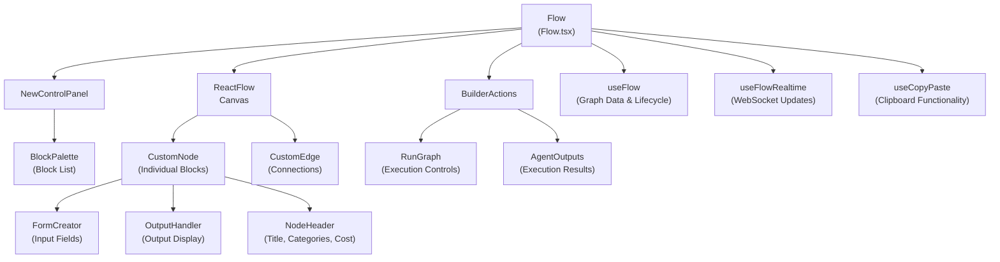
Sources: [autogpt_platform/frontend/src/app/(platform)/build/components/FlowEditor/Flow/Flow.tsx:32-147](), [autogpt_platform/frontend/src/app/(platform)/build/components/FlowEditor/nodes/CustomNode/CustomNode.tsx:54-146]()

## Core Components

### Flow Component

The `Flow` component [autogpt_platform/frontend/src/app/(platform)/build/components/FlowEditor/Flow/Flow.tsx:32-147]() is the main orchestrator component that manages the entire agent building interface. It provides the canvas, controls, and coordination between all subsystems.

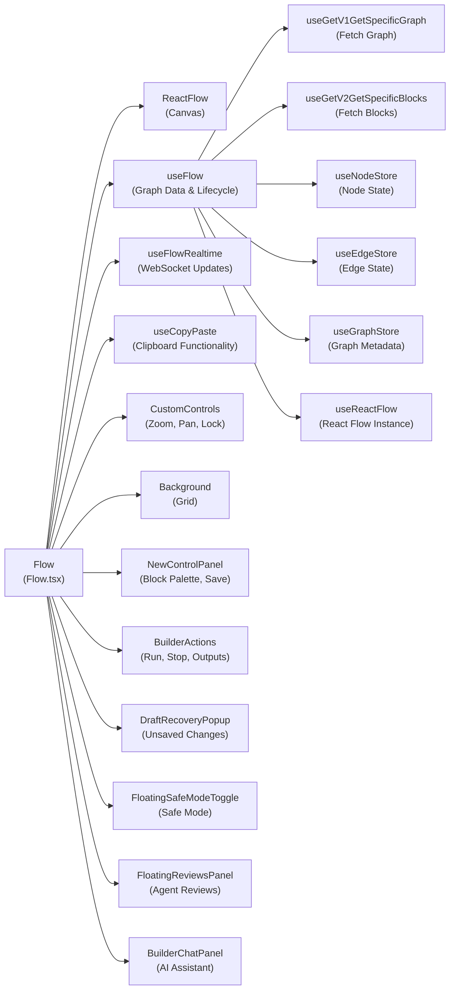
Key responsibilities:
- Renders the `ReactFlow` canvas and integrates various UI components like `NewControlPanel`, `BuilderActions`, `DraftRecoveryPopup`, etc. [autogpt_platform/frontend/src/app/(platform)/build/components/FlowEditor/Flow/Flow.tsx:99-147]()
- Manages graph loading and initial setup using `useFlow` hook [autogpt_platform/frontend/src/app/(platform)/build/components/FlowEditor/Flow/Flow.tsx:77]()
- Handles real-time updates via WebSockets using `useFlowRealtime` [autogpt_platform/frontend/src/app/(platform)/build/components/FlowEditor/Flow/Flow.tsx:87]()
- Implements copy/paste functionality with `useCopyPaste` [autogpt_platform/frontend/src/app/(platform)/build/components/FlowEditor/Flow/Flow.tsx:90]()
- Manages node and edge changes through `onNodesChange` and `onEdgesChange` callbacks [autogpt_platform/frontend/src/app/(platform)/build/components/FlowEditor/Flow/Flow.tsx:103-106]()
- Resolves node collisions on drag stop using `resolveCollisions` [autogpt_platform/frontend/src/app/(platform)/build/components/FlowEditor/Flow/Flow.tsx:64-71]()

Sources: [autogpt_platform/frontend/src/app/(platform)/build/components/FlowEditor/Flow/Flow.tsx:32-147](), [autogpt_platform/frontend/src/app/(platform)/build/components/FlowEditor/Flow/useFlow.ts:23-209]()

### CustomNode Component

The `CustomNode` component [autogpt_platform/frontend/src/app/(platform)/build/components/FlowEditor/nodes/CustomNode/CustomNode.tsx:54-146]() represents individual blocks in the agent workflow. Each node encapsulates a specific functionality block with its own configuration interface.

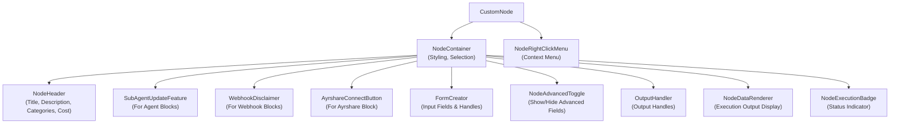
The `CustomNodeData` type defines the structure of data associated with each custom node, including `hardcodedValues`, `title`, `description`, `inputSchema`, `outputSchema`, `uiType`, `block_id`, `status`, `nodeExecutionResults`, `costs`, `categories`, `metadata`, and `errors`. [autogpt_platform/frontend/src/app/(platform)/build/components/FlowEditor/nodes/CustomNode/CustomNode.tsx:33-50]()

The node system supports different UI types defined in `BlockUIType` enum, each with specific behaviors and input/output configurations. For example, `BlockUIType.NOTE` renders a `StickyNoteBlock` [autogpt_platform/frontend/src/app/(platform)/build/components/FlowEditor/nodes/CustomNode/CustomNode.tsx:63-65](), and `BlockUIType.WEBHOOK` or `BlockUIType.WEBHOOK_MANUAL` display a `WebhookDisclaimer` [autogpt_platform/frontend/src/app/(platform)/build/components/FlowEditor/nodes/CustomNode/CustomNode.tsx:108]().

Sources: [autogpt_platform/frontend/src/app/(platform)/build/components/FlowEditor/nodes/CustomNode/CustomNode.tsx:54-146](), [autogpt_platform/frontend/src/app/(platform)/build/components/FlowEditor/nodes/CustomNode/CustomNode.tsx:33-50]()

### CustomEdge Component

The `CustomEdge` component [autogpt_platform/frontend/src/app/(platform)/build/components/FlowEditor/edges/CustomEdge.tsx:28-120]() represents connections between nodes in the agent workflow. It extends React Flow's `BaseEdge` and adds custom styling, interaction, and data visualization.

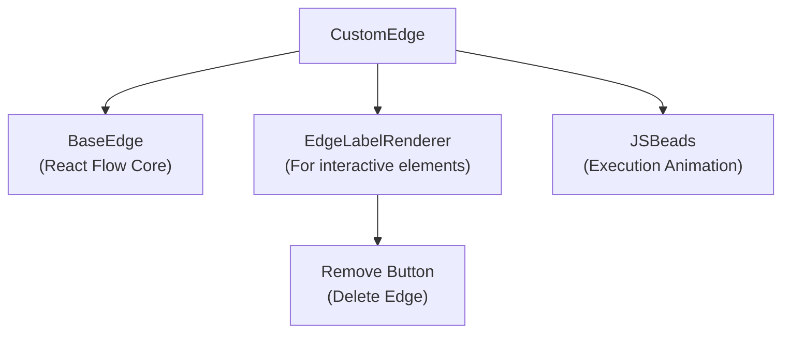
Key features:
- Renders a Bezier curve path for the connection [autogpt_platform/frontend/src/app/(platform)/build/components/FlowEditor/edges/CustomEdge.tsx:44-51]().
- Supports static edges with dashed lines [autogpt_platform/frontend/src/app/(platform)/build/components/FlowEditor/edges/CustomEdge.tsx:81]().
- Visualizes execution flow with "beads" animation using `JSBeads` [autogpt_platform/frontend/src/app/(platform)/build/components/FlowEditor/edges/CustomEdge.tsx:91-96]().
- Highlights broken edges in red [autogpt_platform/frontend/src/app/(platform)/build/components/FlowEditor/edges/CustomEdge.tsx:82-83]().
- Provides an interactive remove button on hover or when an edge is broken [autogpt_platform/frontend/src/app/(platform)/build/components/FlowEditor/edges/CustomEdge.tsx:98-117]().
- The `CustomEdgeData` type includes properties like `isStatic`, `beadUp`, `beadDown`, `beadData`, `edgeColorClass`, and `edgeHexColor` for visual customization and execution feedback. [autogpt_platform/frontend/src/app/(platform)/build/components/FlowEditor/edges/CustomEdge.tsx:17-24]()

Sources: [autogpt_platform/frontend/src/app/(platform)/build/components/FlowEditor/edges/CustomEdge.tsx:28-120](), [autogpt_platform/frontend/src/app/(platform)/build/components/FlowEditor/edges/CustomEdge.tsx:17-24]()

## Node Input System

The Agent Builder provides a comprehensive input system that dynamically generates appropriate UI components based on block schemas. This is primarily handled by the `FormCreator` component [autogpt_platform/frontend/src/app/(platform)/build/components/FlowEditor/nodes/FormCreator.tsx]() within each `CustomNode`.

### Input Component Hierarchy

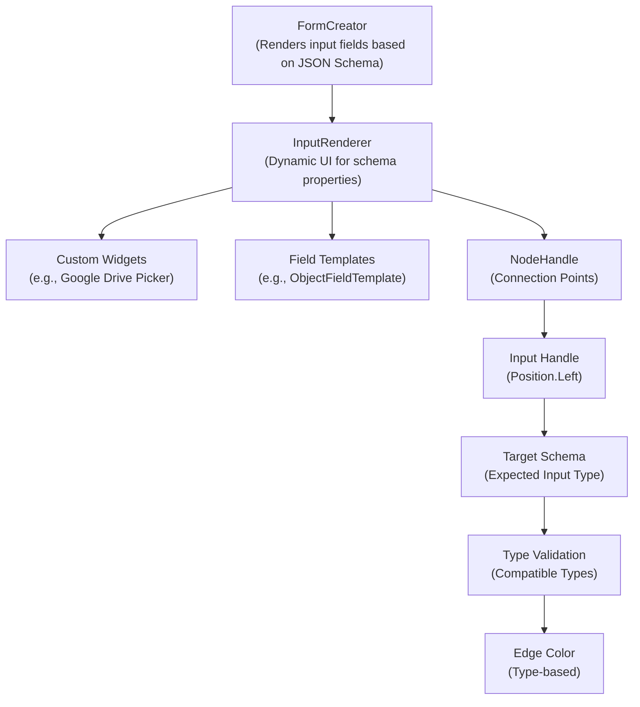
Sources: [autogpt_platform/frontend/src/app/(platform)/build/components/FlowEditor/nodes/CustomNode/CustomNode.tsx:110-120]()

### Dynamic Schema Handling

The input system handles complex schema patterns, including `oneOf` discriminators and dynamic array/object structures, to provide a flexible configuration experience. For more details on the form system, refer to [Form System (RJSF)](#3.1.2).

## Block Management System

The `NewControlPanel` component [autogpt_platform/frontend/src/app/(platform)/build/components/NewControlPanel/NewControlPanel.tsx]() provides the block palette interface for adding new blocks to the agent workflow.

### Block Discovery and Filtering

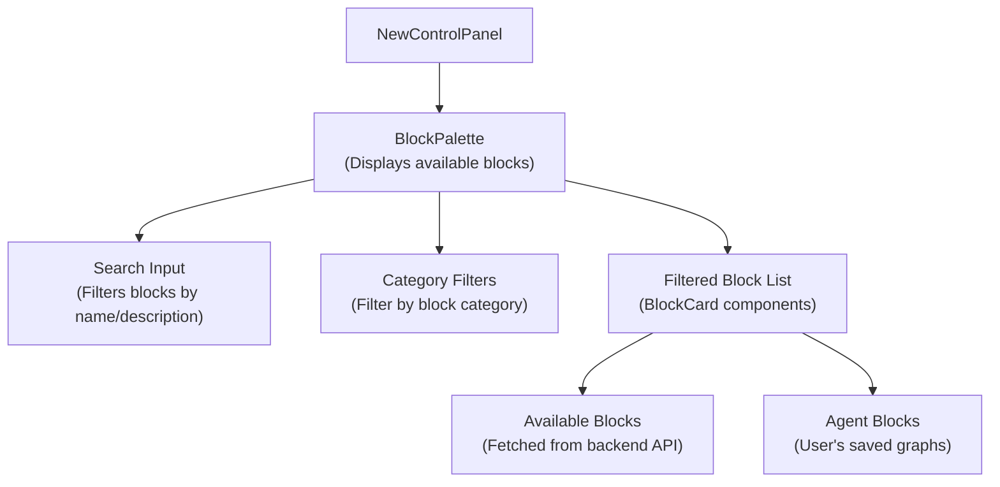

### Block Addition Flow

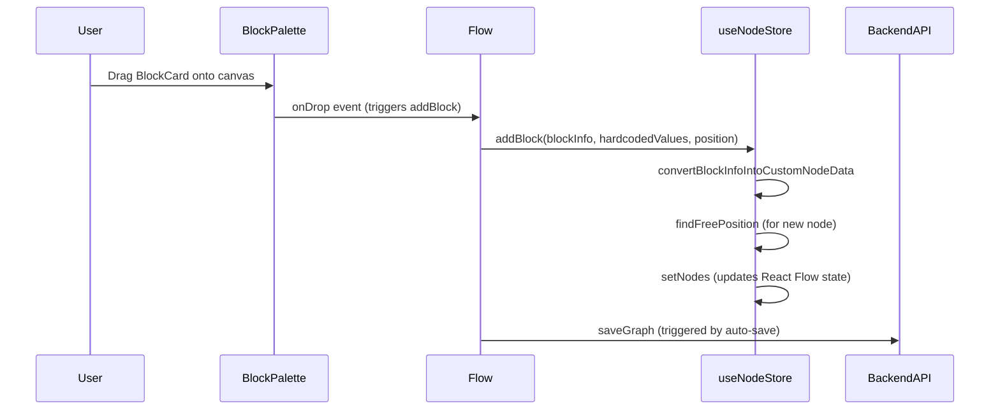
The `addBlock` function in `useNodeStore` [autogpt_platform/frontend/src/app/(platform)/build/stores/nodeStore.ts:48-51]() is responsible for converting `BlockInfo` into a `CustomNode` and finding a suitable position on the canvas using `findFreePosition` [autogpt_platform/frontend/src/app/(platform)/build/components/helper.ts:10-11]().

Sources: [autogpt_platform/frontend/src/app/(platform)/build/stores/nodeStore.ts:48-51](), [autogpt_platform/frontend/src/app/(platform)/build/components/helper.ts:10-11]()

## Connection System

The Agent Builder uses a sophisticated connection system built on React Flow's handle system with custom enhancements, managed by `useCustomEdge` [autogpt_platform/frontend/src/app/(platform)/build/components/FlowEditor/edges/useCustomEdge.ts]().

### Handle Management

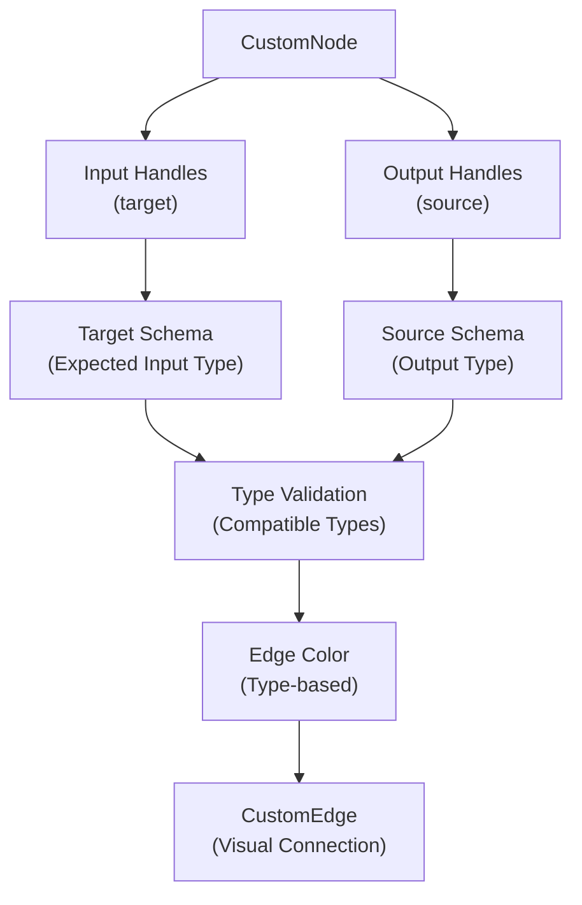

### Connection Data Flow

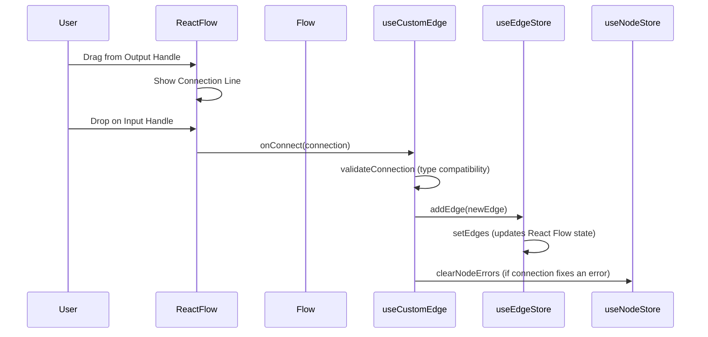
The `onConnect` callback in `useCustomEdge` [autogpt_platform/frontend/src/app/(platform)/build/components/FlowEditor/edges/useCustomEdge.ts:30-31]() is responsible for validating the connection based on input/output schemas and adding the new edge to the `edgeStore`.

### Handle Naming Convention

The system uses a specific naming convention for handles to support complex data structures, which is crucial for the dynamic fields system:

| Handle Pattern | Use Case | Example |
|---------------|----------|---------|
| `propKey` | Simple property | `"input_text"` |
| `propKey_#_subKey` | Object property | `"config_#_api_key"` |
| `propKey_$_index` | Array element | `"items_$_0"` |
| `propKey_@_dynamicKey` | Dynamic keys | `"headers_@_ContentType"` |

This convention allows the system to parse handle IDs into paths for accessing nested data within node schemas [autogpt_platform/frontend/src/app/(platform)/build/stores/nodeStore.ts:21]().

Sources: [autogpt_platform/frontend/src/app/(platform)/build/components/FlowEditor/edges/useCustomEdge.ts:30-31](), [autogpt_platform/frontend/src/app/(platform)/build/stores/nodeStore.ts:21]()

## State Management and Persistence

The Agent Builder implements a comprehensive state management system using Zustand stores and integrates with the backend API for persistence.

### State Architecture

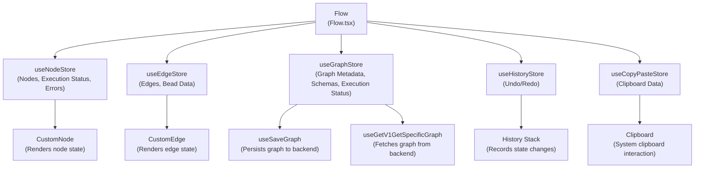
The primary Zustand stores are:
- `useNodeStore`: Manages all `CustomNode` objects, their data, execution statuses, and errors. [autogpt_platform/frontend/src/app/(platform)/build/stores/nodeStore.ts:123-124]()
- `useEdgeStore`: Manages all `CustomEdge` objects and their associated data, including execution beads. [autogpt_platform/frontend/src/app/(platform)/build/stores/edgeStore.ts:19-20]()
- `useGraphStore`: Holds global graph-related metadata, input/output schemas, credentials schema, and the overall graph execution status. [autogpt_platform/frontend/src/app/(platform)/build/stores/graphStore.ts:20-21]()
- `useHistoryStore`: Implements the undo/redo functionality by tracking changes to nodes and edges. [autogpt_platform/frontend/src/app/(platform)/build/stores/historyStore.ts:20-21]()
- `useCopyPasteStore`: Temporarily stores copied node and edge data for clipboard operations. [autogpt_platform/frontend/src/app/(platform)/build/stores/copyPasteStore.ts:10-11]()

Sources: [autogpt_platform/frontend/src/app/(platform)/build/stores/nodeStore.ts:123-124](), [autogpt_platform/frontend/src/app/(platform)/build/stores/edgeStore.ts:19-20](), [autogpt_platform/frontend/src/app/(platform)/build/stores/graphStore.ts:20-21](), [autogpt_platform/frontend/src/app/(platform)/build/stores/historyStore.ts:20-21](), [autogpt_platform/frontend/src/app/(platform)/build/stores/copyPasteStore.ts:10-11]()

### History System

The Agent Builder includes a comprehensive undo/redo system managed by `useHistoryStore` [autogpt_platform/frontend/src/app/(platform)/build/stores/historyStore.ts:20-21](). It tracks changes to nodes and edges, allowing users to revert or reapply actions.

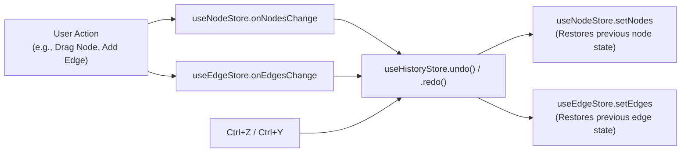
Supported history actions include:
- Node position changes: tracked by `onNodesChange` with a `MINIMUM_MOVE_BEFORE_LOG` threshold [autogpt_platform/frontend/src/app/(platform)/build/stores/nodeStore.ts:177-181]().
- Node additions/removals: tracked by `onNodesChange` [autogpt_platform/frontend/src/app/(platform)/build/stores/nodeStore.ts:161]().
- Edge additions/removals: tracked by `onEdgesChange` [autogpt_platform/frontend/src/app/(platform)/build/stores/edgeStore.ts:30]().
- Node data updates (e.g., input values): tracked by `updateNodeData` [autogpt_platform/frontend/src/app/(platform)/build/stores/nodeStore.ts:55]().

Sources: [autogpt_platform/frontend/src/app/(platform)/build/stores/historyStore.ts:20-21](), [autogpt_platform/frontend/src/app/(platform)/build/stores/nodeStore.ts:161](), [autogpt_platform/frontend/src/app/(platform)/build/stores/nodeStore.ts:177-181](), [autogpt_platform/frontend/src/app/(platform)/build/stores/edgeStore.ts:30](), [autogpt_platform/frontend/src/app/(platform)/build/stores/nodeStore.ts:55]()

### Copy/Paste Functionality

The `useCopyPaste` hook [autogpt_platform/frontend/src/app/(platform)/build/components/FlowEditor/Flow/useCopyPaste.ts:17-166]() provides clipboard integration for nodes and edges.

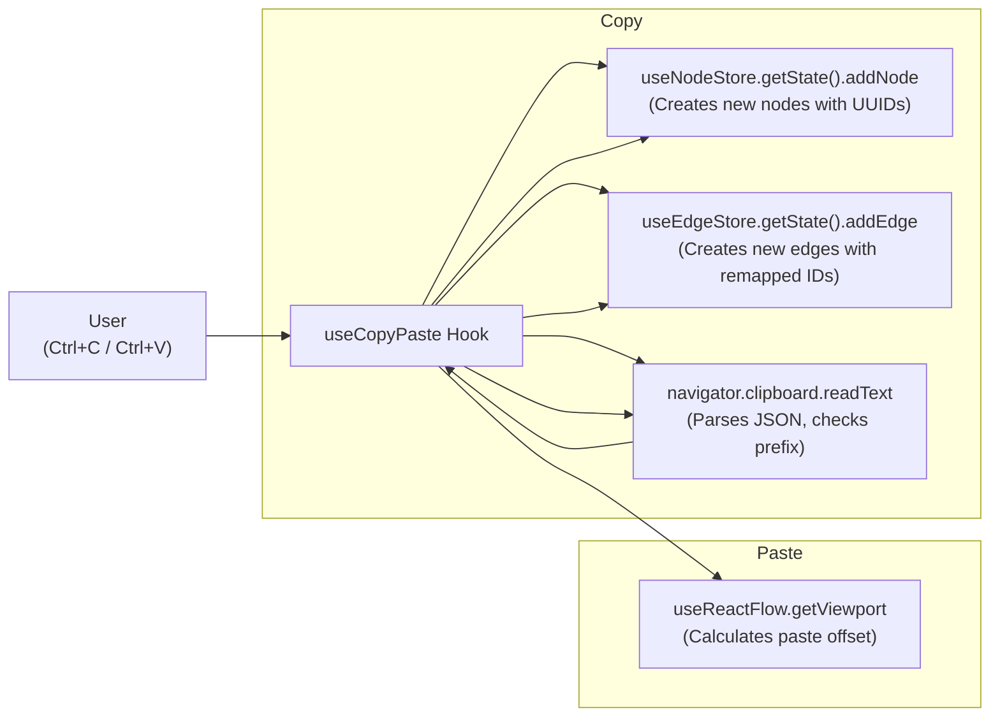
When copying, selected nodes and their connected edges are serialized into a JSON string prefixed with `autogpt-flow-data:` and written to the clipboard [autogpt_platform/frontend/src/app/(platform)/build/components/FlowEditor/Flow/useCopyPaste.ts:56-67](). When pasting, the data is deserialized, new unique IDs are generated for nodes, and their positions are offset to appear near the viewport center [autogpt_platform/frontend/src/app/(platform)/build/components/FlowEditor/Flow/useCopyPaste.ts:111-122]().

Sources: [autogpt_platform/frontend/src/app/(platform)/build/components/FlowEditor/Flow/useCopyPaste.ts:17-166](), [autogpt_platform/frontend/src/app/(platform)/build/components/FlowEditor/Flow/useCopyPaste.ts:56-67](), [autogpt_platform/frontend/src/app/(platform)/build/components/FlowEditor/Flow/useCopyPaste.ts:111-122]()

## Execution Integration

The Agent Builder integrates with the execution system to provide real-time feedback and control over agent runs.

### Execution State Visualization

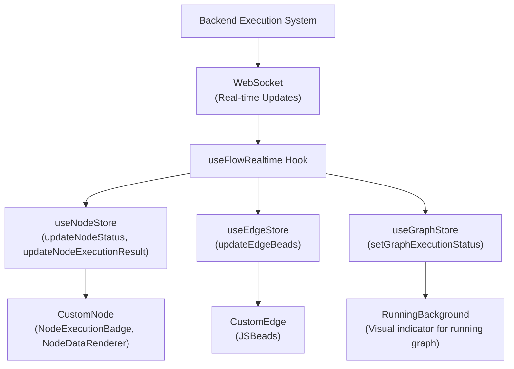
- **Node Status**: `CustomNode` displays the execution status (e.g., `QUEUED`, `RUNNING`, `COMPLETED`, `FAILED`) via the `NodeExecutionBadge` component [autogpt_platform/frontend/src/app/(platform)/build/components/FlowEditor/nodes/CustomNode/CustomNode.tsx:135](). The `updateNodeStatus` function in `useNodeStore` updates this state [autogpt_platform/frontend/src/app/(platform)/build/stores/nodeStore.ts:63]().
- **Output Data**: `NodeDataRenderer` within `CustomNode` displays the `NodeExecutionResult` output data [autogpt_platform/frontend/src/app/(platform)/build/components/FlowEditor/nodes/CustomNode/CustomNode.tsx:134](). `updateNodeExecutionResult` in `useNodeStore` stores this data [autogpt_platform/frontend/src/app/(platform)/build/stores/nodeStore.ts:68]().
- **Bead Visualization**: `CustomEdge` uses `JSBeads` to animate data flow between nodes, with `updateEdgeBeads` in `useEdgeStore` controlling the animation based on execution results [autogpt_platform/frontend/src/app/(platform)/build/components/FlowEditor/edges/CustomEdge.tsx:91-96]().
- **Graph Status**: The overall graph execution status is managed by `useGraphStore` and visually indicated by `RunningBackground` [autogpt_platform/frontend/src/app/(platform)/build/components/FlowEditor/Flow/Flow.tsx:127]().

Sources: [autogpt_platform/frontend/src/app/(platform)/build/components/FlowEditor/nodes/CustomNode/CustomNode.tsx:134-135](), [autogpt_platform/frontend/src/app/(platform)/build/stores/nodeStore.ts:63](), [autogpt_platform/frontend/src/app/(platform)/build/stores/nodeStore.ts:68](), [autogpt_platform/frontend/src/app/(platform)/build/components/FlowEditor/edges/CustomEdge.tsx:91-96](), [autogpt_platform/frontend/src/app/(platform)/build/components/FlowEditor/Flow/Flow.tsx:127]()

### Real-time Updates

The `useFlowRealtime` hook [autogpt_platform/frontend/src/app/(platform)/build/components/FlowEditor/Flow/useFlowRealtime.ts]() subscribes to WebSocket events from the backend to receive real-time execution updates. These updates trigger state changes in `useNodeStore`, `useEdgeStore`, and `useGraphStore`, ensuring the UI reflects the current execution status.

### Running and Stopping Graphs

The `BuilderActions` component [autogpt_platform/frontend/src/app/(platform)/build/components/BuilderActions/BuilderActions.tsx]() provides controls for running and stopping agent graphs.

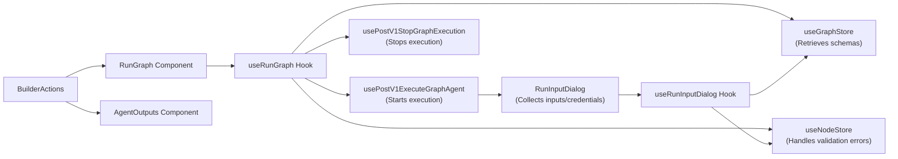
- **`handleRunGraph`**: Initiates graph execution. It first saves the graph using `useSaveGraph` [autogpt_platform/frontend/src/app/(platform)/build/hooks/useSaveGraph.ts](). If the graph has inputs or credentials, it opens the `RunInputDialog` [autogpt_platform/frontend/src/app/(platform)/build/components/BuilderActions/components/RunInputDialog/RunInputDialog.tsx]() to collect them. Otherwise, it directly calls `executeGraph` via `usePostV1ExecuteGraphAgent` [autogpt_platform/frontend/src/app/(platform)/build/components/BuilderActions/components/RunGraph/useRunGraph.ts:138-161]().
- **`handleStopGraph`**: Stops a running graph execution using `usePostV1StopGraphExecution` [autogpt_platform/frontend/src/app/(platform)/build/components/BuilderActions/components/RunGraph/useRunGraph.ts:164-172]().
- **Error Handling**: During execution, validation errors from the backend are caught, and `useNodeStore.updateNodeErrors` is used to highlight problematic nodes in the UI [autogpt_platform/frontend/src/app/(platform)/build/components/BuilderActions/components/RunGraph/useRunGraph.ts:89-96]().

Sources: [autogpt_platform/frontend/src/app/(platform)/build/components/BuilderActions/components/RunGraph/useRunGraph.ts:138-161](), [autogpt_platform/frontend/src/app/(platform)/build/components/BuilderActions/components/RunGraph/useRunGraph.ts:164-172](), [autogpt_platform/frontend/src/app/(platform)/build/components/BuilderActions/components/RunGraph/useRunGraph.ts:89-96]()

### Builder Chat Panel

The `BuilderChatPanel` [autogpt_platform/frontend/src/app/(platform)/build/components/BuilderChatPanel/BuilderChatPanel.tsx]() provides an AI-powered assistant within the Agent Builder. It allows users to interact with a Copilot to modify or run agents using natural language.

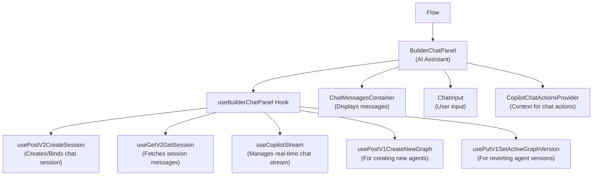
The `useBuilderChatPanel` hook [autogpt_platform/frontend/src/app/(platform)/build/components/BuilderChatPanel/useBuilderChatPanel.ts:62-146]() manages the state and logic for the chat panel, including:
- Creating and binding chat sessions to the current graph [autogpt_platform/frontend/src/app/(platform)/build/components/BuilderChatPanel/useBuilderChatPanel.ts:96-100]().
- Handling message streaming and hydration [autogpt_platform/frontend/src/app/(platform)/build/components/BuilderChatPanel/useBuilderChatPanel.ts:132-139]().
- Providing functionality to create new graphs or revert to previous versions based on Copilot instructions [autogpt_platform/frontend/src/app/(platform)/build/components/BuilderChatPanel/useBuilderChatPanel.ts:101-103]().
- Displaying errors and retry mechanisms for session binding or graph bootstrapping [autogpt_platform/frontend/src/app/(platform)/build/components/BuilderChatPanel/BuilderChatPanel.tsx:71-86]().

Sources: [autogpt_platform/frontend/src/app/(platform)/build/components/BuilderChatPanel/BuilderChatPanel.tsx:16-141](), [autogpt_platform/frontend/src/app/(platform)/build/components/BuilderChatPanel/useBuilderChatPanel.ts:62-146](), [autogpt_platform/frontend/src/app/(platform)/build/components/BuilderChatPanel/useBuilderChatPanel.ts:96-100](), [autogpt_platform/frontend/src/app/(platform)/build/components/BuilderChatPanel/useBuilderChatPanel.ts:132-139](), [autogpt_platform/frontend/src/app/(platform)/build/components/BuilderChatPanel/useBuilderChatPanel.ts:101-103]()

---

