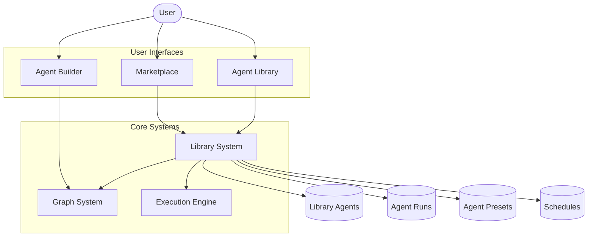
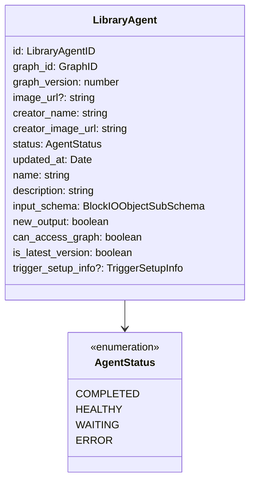
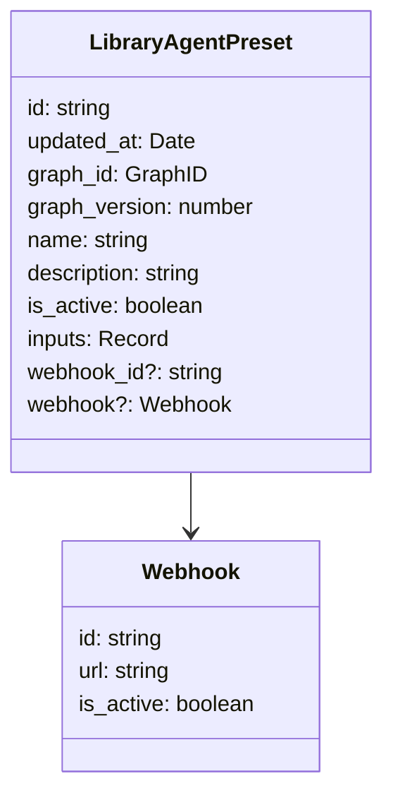
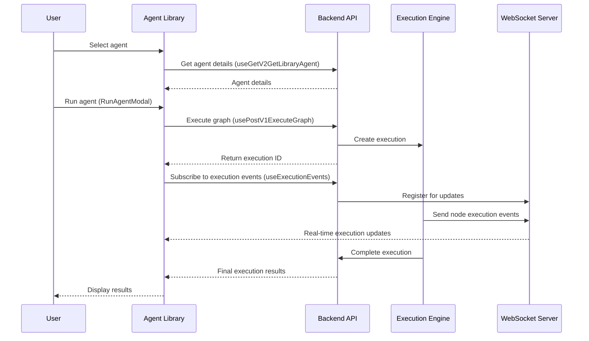
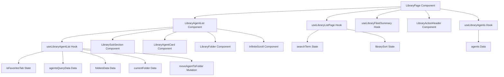
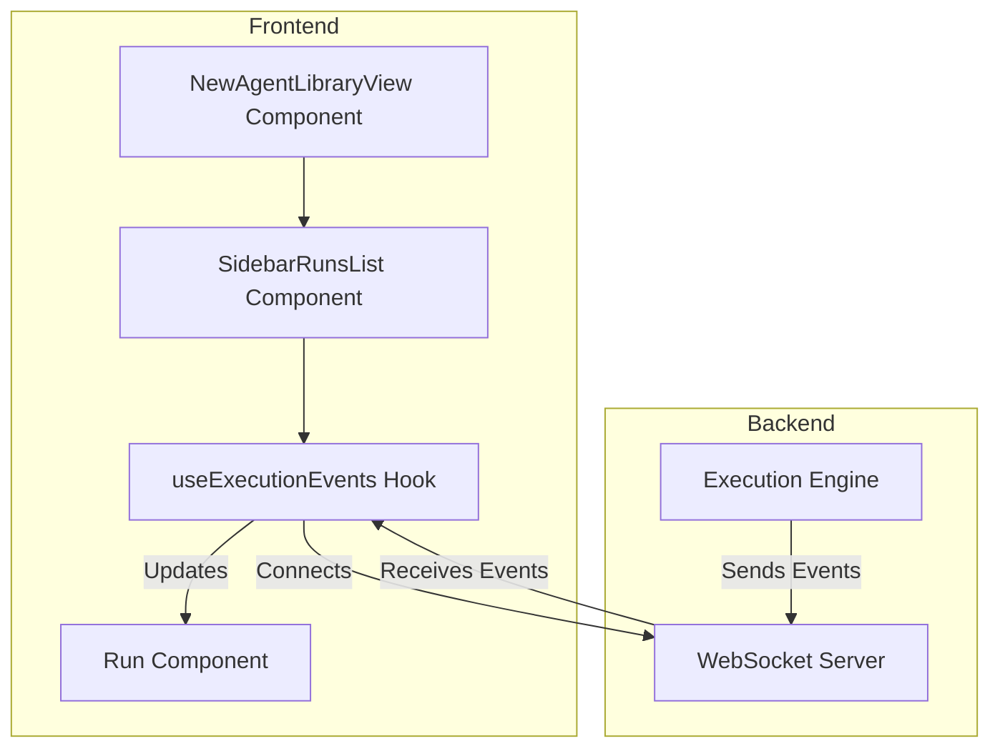
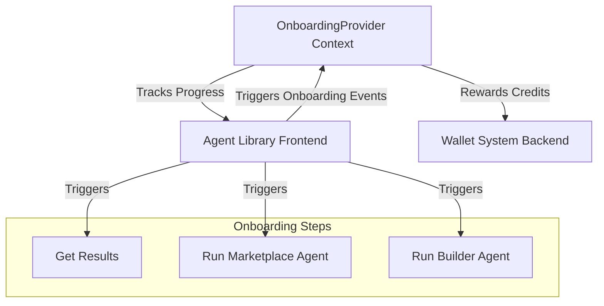

<!-- source: DeepWiki mcp.deepwiki.com · repo Significant-Gravitas/AutoGPT · extra page Agent Library · fetched 2026-10-26 -->

# Agent Library

<details>
<summary>Relevant source files</summary>

The following files were used as context for generating this wiki page:

- [autogpt_platform/backend/test/load_store_agents.py](autogpt_platform/backend/test/load_store_agents.py)
- [autogpt_platform/frontend/src/app/(platform)/library/__tests__/empty-state.test.tsx](autogpt_platform/frontend/src/app/(platform)/library/__tests__/empty-state.test.tsx)
- [autogpt_platform/frontend/src/app/(platform)/library/agents/[id]/components/NewAgentLibraryView/NewAgentLibraryView.tsx](autogpt_platform/frontend/src/app/(platform)/library/agents/[id]/components/NewAgentLibraryView/NewAgentLibraryView.tsx)
- [autogpt_platform/frontend/src/app/(platform)/library/agents/[id]/components/NewAgentLibraryView/components/modals/AgentInputsReadOnly/AgentInputsReadOnly.tsx](autogpt_platform/frontend/src/app/(platform)/library/agents/[id]/components/NewAgentLibraryView/components/modals/AgentInputsReadOnly/AgentInputsReadOnly.tsx)
- [autogpt_platform/frontend/src/app/(platform)/library/agents/[id]/components/NewAgentLibraryView/components/modals/AgentInputsReadOnly/helpers.ts](autogpt_platform/frontend/src/app/(platform)/library/agents/[id]/components/NewAgentLibraryView/components/modals/AgentInputsReadOnly/helpers.ts)
- [autogpt_platform/frontend/src/app/(platform)/library/agents/[id]/components/NewAgentLibraryView/components/modals/RunAgentModal/RunAgentModal.tsx](autogpt_platform/frontend/src/app/(platform)/library/agents/[id]/components/NewAgentLibraryView/components/modals/RunAgentModal/RunAgentModal.tsx)
- [autogpt_platform/frontend/src/app/(platform)/library/agents/[id]/components/NewAgentLibraryView/components/modals/RunAgentModal/components/ModalRunSection/ModalRunSection.tsx](autogpt_platform/frontend/src/app/(platform)/library/agents/[id]/components/NewAgentLibraryView/components/modals/RunAgentModal/components/ModalRunSection/ModalRunSection.tsx)
- [autogpt_platform/frontend/src/app/(platform)/library/agents/[id]/components/NewAgentLibraryView/components/modals/RunAgentModal/components/RunActions/RunActions.tsx](autogpt_platform/frontend/src/app/(platform)/library/agents/[id]/components/NewAgentLibraryView/components/modals/RunAgentModal/components/RunActions/RunActions.tsx)
- [autogpt_platform/frontend/src/app/(platform)/library/agents/[id]/components/NewAgentLibraryView/components/modals/RunAgentModal/useAgentRunModal.tsx](autogpt_platform/frontend/src/app/(platform)/library/agents/[id]/components/NewAgentLibraryView/components/modals/RunAgentModal/useAgentRunModal.tsx)
- [autogpt_platform/frontend/src/app/(platform)/library/agents/[id]/components/NewAgentLibraryView/components/other/EmptyTasks.tsx](autogpt_platform/frontend/src/app/(platform)/library/agents/[id]/components/NewAgentLibraryView/components/other/EmptyTasks.tsx)
- [autogpt_platform/frontend/src/app/(platform)/library/agents/[id]/components/NewAgentLibraryView/components/selected-views/RunDetailCard/RunDetailCard.tsx](autogpt_platform/frontend/src/app/(platform)/library/agents/[id]/components/NewAgentLibraryView/components/selected-views/RunDetailCard/RunDetailCard.tsx)
- [autogpt_platform/frontend/src/app/(platform)/library/agents/[id]/components/NewAgentLibraryView/components/selected-views/RunDetailHeader/RunDetailHeader.tsx](autogpt_platform/frontend/src/app/(platform)/library/agents/[id]/components/NewAgentLibraryView/components/selected-views/RunDetailHeader/RunDetailHeader.tsx)
- [autogpt_platform/frontend/src/app/(platform)/library/agents/[id]/components/NewAgentLibraryView/components/selected-views/SelectedRunView/SelectedRunView.tsx](autogpt_platform/frontend/src/app/(platform)/library/agents/[id]/components/NewAgentLibraryView/components/selected-views/SelectedRunView/SelectedRunView.tsx)
- [autogpt_platform/frontend/src/app/(platform)/library/agents/[id]/components/NewAgentLibraryView/components/selected-views/SelectedRunView/components/RunSummary.tsx](autogpt_platform/frontend/src/app/(platform)/library/agents/[id]/components/NewAgentLibraryView/components/selected-views/SelectedRunView/components/RunSummary.tsx)
- [autogpt_platform/frontend/src/app/(platform)/library/agents/[id]/components/NewAgentLibraryView/components/selected-views/SelectedRunView/components/SelectedRunActions/SelectedRunActions.tsx](autogpt_platform/frontend/src/app/(platform)/library/agents/[id]/components/NewAgentLibraryView/components/selected-views/SelectedRunView/components/SelectedRunActions/SelectedRunActions.tsx)
- [autogpt_platform/frontend/src/app/(platform)/library/agents/[id]/components/NewAgentLibraryView/components/selected-views/SelectedRunView/components/SelectedRunActions/useSelectedRunActions.ts](autogpt_platform/frontend/src/app/(platform)/library/agents/[id]/components/NewAgentLibraryView/components/selected-views/SelectedRunView/components/SelectedRunActions/useSelectedRunActions.ts)
- [autogpt_platform/frontend/src/app/(platform)/library/agents/[id]/components/NewAgentLibraryView/components/selected-views/SelectedScheduleView/SelectedScheduleView.tsx](autogpt_platform/frontend/src/app/(platform)/library/agents/[id]/components/NewAgentLibraryView/components/selected-views/SelectedScheduleView/SelectedScheduleView.tsx)
- [autogpt_platform/frontend/src/app/(platform)/library/agents/[id]/components/NewAgentLibraryView/components/selected-views/SelectedScheduleView/components/SelectedScheduleActions/SelectedScheduleActions.tsx](autogpt_platform/frontend/src/app/(platform)/library/agents/[id]/components/NewAgentLibraryView/components/selected-views/SelectedScheduleView/components/SelectedScheduleActions/SelectedScheduleActions.tsx)
- [autogpt_platform/frontend/src/app/(platform)/library/agents/[id]/components/NewAgentLibraryView/components/selected-views/SelectedScheduleView/components/SelectedScheduleActions/useSelectedScheduleActions.ts](autogpt_platform/frontend/src/app/(platform)/library/agents/[id]/components/NewAgentLibraryView/components/selected-views/SelectedScheduleView/components/SelectedScheduleActions/useSelectedScheduleActions.ts)
- [autogpt_platform/frontend/src/app/(platform)/library/agents/[id]/components/NewAgentLibraryView/components/selected-views/SelectedTemplateView/SelectedTemplateView.tsx](autogpt_platform/frontend/src/app/(platform)/library/agents/[id]/components/NewAgentLibraryView/components/selected-views/SelectedTemplateView/SelectedTemplateView.tsx)
- [autogpt_platform/frontend/src/app/(platform)/library/agents/[id]/components/NewAgentLibraryView/components/selected-views/SelectedTemplateView/useSelectedTemplateView.ts](autogpt_platform/frontend/src/app/(platform)/library/agents/[id]/components/NewAgentLibraryView/components/selected-views/SelectedTemplateView/useSelectedTemplateView.ts)
- [autogpt_platform/frontend/src/app/(platform)/library/agents/[id]/components/NewAgentLibraryView/components/selected-views/SelectedTriggerView/SelectedTriggerView.tsx](autogpt_platform/frontend/src/app/(platform)/library/agents/[id]/components/NewAgentLibraryView/components/selected-views/SelectedTriggerView/SelectedTriggerView.tsx)
- [autogpt_platform/frontend/src/app/(platform)/library/agents/[id]/components/NewAgentLibraryView/components/sidebar/SidebarRunsList/SidebarRunsList.tsx](autogpt_platform/frontend/src/app/(platform)/library/agents/[id]/components/NewAgentLibraryView/components/sidebar/SidebarRunsList/SidebarRunsList.tsx)
- [autogpt_platform/frontend/src/app/(platform)/library/agents/[id]/components/NewAgentLibraryView/components/sidebar/SidebarRunsList/components/ScheduleActionsDropdown.tsx](autogpt_platform/frontend/src/app/(platform)/library/agents/[id]/components/NewAgentLibraryView/components/sidebar/SidebarRunsList/components/ScheduleActionsDropdown.tsx)
- [autogpt_platform/frontend/src/app/(platform)/library/agents/[id]/components/NewAgentLibraryView/components/sidebar/SidebarRunsList/components/ScheduleListItem.tsx](autogpt_platform/frontend/src/app/(platform)/library/agents/[id]/components/NewAgentLibraryView/components/sidebar/SidebarRunsList/components/ScheduleListItem.tsx)
- [autogpt_platform/frontend/src/app/(platform)/library/agents/[id]/components/NewAgentLibraryView/components/sidebar/SidebarRunsList/components/SidebarItemCard.tsx](autogpt_platform/frontend/src/app/(platform)/library/agents/[id]/components/NewAgentLibraryView/components/sidebar/SidebarRunsList/components/SidebarItemCard.tsx)
- [autogpt_platform/frontend/src/app/(platform)/library/agents/[id]/components/NewAgentLibraryView/components/sidebar/SidebarRunsList/components/TaskListItem.tsx](autogpt_platform/frontend/src/app/(platform)/library/agents/[id]/components/NewAgentLibraryView/components/sidebar/SidebarRunsList/components/TaskListItem.tsx)
- [autogpt_platform/frontend/src/app/(platform)/library/agents/[id]/components/NewAgentLibraryView/components/sidebar/SidebarRunsList/useSidebarRunsList.ts](autogpt_platform/frontend/src/app/(platform)/library/agents/[id]/components/NewAgentLibraryView/components/sidebar/SidebarRunsList/useSidebarRunsList.ts)
- [autogpt_platform/frontend/src/app/(platform)/library/agents/[id]/components/NewAgentLibraryView/useNewAgentLibraryView.ts](autogpt_platform/frontend/src/app/(platform)/library/agents/[id]/components/NewAgentLibraryView/useNewAgentLibraryView.ts)
- [autogpt_platform/frontend/src/app/(platform)/library/components/LibraryAgentList/LibraryAgentList.tsx](autogpt_platform/frontend/src/app/(platform)/library/components/LibraryAgentList/LibraryAgentList.tsx)
- [autogpt_platform/frontend/src/app/(platform)/library/components/LibraryAgentList/helpers.ts](autogpt_platform/frontend/src/app/(platform)/library/components/LibraryAgentList/helpers.ts)
- [autogpt_platform/frontend/src/app/(platform)/library/components/LibraryAgentList/useLibraryAgentList.ts](autogpt_platform/frontend/src/app/(platform)/library/components/LibraryAgentList/useLibraryAgentList.ts)
- [autogpt_platform/frontend/src/app/(platform)/library/components/LibraryEmptyState/LibraryEmptyState.tsx](autogpt_platform/frontend/src/app/(platform)/library/components/LibraryEmptyState/LibraryEmptyState.tsx)
- [autogpt_platform/frontend/src/app/(platform)/library/components/LibrarySubSection/LibrarySubSection.tsx](autogpt_platform/frontend/src/app/(platform)/library/components/LibrarySubSection/LibrarySubSection.tsx)
- [autogpt_platform/frontend/src/app/(platform)/library/page.tsx](autogpt_platform/frontend/src/app/(platform)/library/page.tsx)
- [autogpt_platform/frontend/src/app/(platform)/library/types.ts](autogpt_platform/frontend/src/app/(platform)/library/types.ts)
- [autogpt_platform/frontend/src/app/(platform)/profile/(user)/settings/useTimezoneDetection.ts](autogpt_platform/frontend/src/app/(platform)/profile/(user)/settings/useTimezoneDetection.ts)
- [autogpt_platform/frontend/src/components/contextual/InfiniteScroll/InfiniteScroll.tsx](autogpt_platform/frontend/src/components/contextual/InfiniteScroll/InfiniteScroll.tsx)
- [autogpt_platform/frontend/src/components/contextual/InfiniteScroll/useInfiniteScroll.ts](autogpt_platform/frontend/src/components/contextual/InfiniteScroll/useInfiniteScroll.ts)
- [autogpt_platform/frontend/src/components/molecules/InformationTooltip/InformationTooltip.tsx](autogpt_platform/frontend/src/components/molecules/InformationTooltip/InformationTooltip.tsx)
- [autogpt_platform/frontend/src/hooks/useExecutionEvents.ts](autogpt_platform/frontend/src/hooks/useExecutionEvents.ts)
- [autogpt_platform/frontend/src/hooks/useLibraryAgents/store.ts](autogpt_platform/frontend/src/hooks/useLibraryAgents/store.ts)
- [autogpt_platform/frontend/src/hooks/useLibraryAgents/useLibraryAgents.ts](autogpt_platform/frontend/src/hooks/useLibraryAgents/useLibraryAgents.ts)
- [autogpt_platform/frontend/src/lib/autogpt-server-api/context.tsx](autogpt_platform/frontend/src/lib/autogpt-server-api/context.tsx)

</details>


The Agent Library is a core component of the AutoGPT Platform that allows users to store, organize, and manage their agents. It serves as a personal collection of agents that users have either created through the Agent Builder or added from the Marketplace. This document explains the architecture, functionality, and implementation of the Agent Library system.

For information about creating agents, see the [Agent Builder (Flow Editor)](#3.1.1). For discovering pre-built agents, see the [Marketplace](#3.1.4).

## Overview

The Agent Library provides a centralized location for users to access their agents, view execution history, manage presets, and schedule future runs. It offers a complete lifecycle management system for agents, bridging the gap between agent creation and execution.


The main entry point for the Library is `autogpt_platform/frontend/src/app/(platform)/library/page.tsx`(). This page uses `LibraryActionHeader` [autogpt_platform/frontend/src/app/(platform)/library/page.tsx:5](), `LibraryAgentList` [autogpt_platform/frontend/src/app/(platform)/library/page.tsx:6](), and `FavoriteAnimationProvider` [autogpt_platform/frontend/src/app/(platform)/library/page.tsx:8]() to render the library view. It manages state for `searchTerm`, `librarySort`, `selectedFolderId`, `activeTab`, and `statusFilter` [autogpt_platform/frontend/src/app/(platform)/library/page.tsx:20-25]().

Sources:
- [autogpt_platform/frontend/src/app/(platform)/library/page.tsx:1-66]()

## Library Data Models

The Agent Library is built around several key data structures:

### LibraryAgent

The main entity representing an agent in the library:



### LibraryAgentPreset

Predefined configurations for agent runs:



Sources:
- [autogpt_platform/frontend/src/app/api/__generated__/models/libraryAgent.ts:1-24]()
- [autogpt_platform/frontend/src/app/api/__generated__/models/libraryAgentPreset.ts:1-13]()

## Library API Interface

The Agent Library provides a comprehensive API interface for managing agents. The frontend interacts with these endpoints using generated hooks from `autogpt_platform/frontend/src/app/api/__generated__/endpoints/`.

| Endpoint | Method | Description |
|----------|--------|-------------|
| `/v2/library/agents` | GET | List agents in the library with search and pagination [autogpt_platform/frontend/src/app/api/__generated__/endpoints/library/library.ts:10-100]() |
| `/v2/library/agents/{id}` | GET | Get details of a specific agent [autogpt_platform/frontend/src/app/api/__generated__/endpoints/library/library.ts:101-140]() |
| `/v2/library/agents` | POST | Add a marketplace agent to the library [autogpt_platform/frontend/src/app/api/__generated__/endpoints/library/library.ts:141-179]() |
| `/v2/library/agents/{id}` | PUT | Update an agent (favorite, archive, delete) [autogpt_platform/frontend/src/app/api/__generated__/endpoints/library/library.ts:180-220]() |
| `/v2/library/folders` | GET | List folders in the library [autogpt_platform/frontend/src/app/api/__generated__/endpoints/folders/folders.ts:10-100]() |
| `/v2/library/folders/{id}` | GET | Get a specific folder [autogpt_platform/frontend/src/app/api/__generated__/endpoints/folders/folders.ts:101-140]() |
| `/v2/library/presets` | GET | List presets for agents [autogpt_platform/frontend/src/app/api/__generated__/endpoints/presets/presets.ts:10-100]() |
| `/v2/library/presets/{id}` | GET | Get a specific preset [autogpt_platform/frontend/src/app/api/__generated__/endpoints/presets/presets.ts:101-140]() |
| `/v2/library/presets` | POST | Create a new preset [autogpt_platform/frontend/src/app/api/__generated__/endpoints/presets/presets.ts:141-179]() |
| `/v2/library/presets/{id}` | PUT | Update a preset [autogpt_platform/frontend/src/app/api/__generated__/endpoints/presets/presets.ts:180-220]() |
| `/v2/library/presets/{id}` | DELETE | Delete a preset [autogpt_platform/frontend/src/app/api/__generated__/endpoints/presets/presets.ts:221-259]() |
| `/v2/library/presets/{id}/execute` | POST | Run an agent with a preset [autogpt_platform/frontend/src/app/api/__generated__/endpoints/presets/presets.ts:260-298]() |

Sources:
- [autogpt_platform/frontend/src/app/api/__generated__/endpoints/library/library.ts:10-220]()
- [autogpt_platform/frontend/src/app/api/__generated__/endpoints/folders/folders.ts:10-140]()
- [autogpt_platform/frontend/src/app/api/__generated__/endpoints/presets/presets.ts:10-298]()

## Agent Runs and Execution

The Agent Library is tightly integrated with the execution engine, providing a complete interface for running agents and viewing execution results. The `SelectedRunView` component [autogpt_platform/frontend/src/app/(platform)/library/agents/[id]/components/NewAgentLibraryView/components/selected-views/SelectedRunView/SelectedRunView.tsx:38]() fetches run details using `useSelectedRunView` and displays them.


The `SelectedRunView` [autogpt_platform/frontend/src/app/(platform)/library/agents/[id]/components/NewAgentLibraryView/components/selected-views/SelectedRunView/SelectedRunView.tsx:38]() displays run details, including a summary, output, and input. It also handles pending reviews for Human-in-the-Loop (HITL) scenarios [autogpt_platform/frontend/src/app/(platform)/library/agents/[id]/components/NewAgentLibraryView/components/selected-views/SelectedRunView/SelectedRunView.tsx:57-61]().

Sources:
- [autogpt_platform/frontend/src/app/(platform)/library/agents/[id]/components/NewAgentLibraryView/components/selected-views/SelectedRunView/SelectedRunView.tsx:38-183]()
- [autogpt_platform/frontend/src/app/(platform)/library/agents/[id]/components/NewAgentLibraryView/useNewAgentLibraryView.ts:30-43]()
- [autogpt_platform/frontend/src/hooks/useExecutionEvents.ts:1-100]()

## User Interface Components

The Agent Library provides a rich user interface that allows users to interact with their agents effectively. The `LibraryPage` [autogpt_platform/frontend/src/app/(platform)/library/page.tsx:19]() component orchestrates the main view, utilizing `LibraryAgentList` [autogpt_platform/frontend/src/app/(platform)/library/components/LibraryAgentList/LibraryAgentList.tsx:84]() to display agents and folders.

### Agent Runs Selector

This component displays a list of all runs, schedules, templates, and triggers for a specific agent and allows users to switch between them or create new ones. This is handled by `SidebarRunsList` [autogpt_platform/frontend/src/app/(platform)/library/agents/[id]/components/NewAgentLibraryView/components/sidebar/SidebarRunsList/SidebarRunsList.tsx:43]().

```mermaid
flowchart TD
    SidebarRunsList[SidebarRunsList Component]
    
    TabsLine[TabsLine Component]
    TabsLineList[TabsLineList Component]
    TabsLineTrigger_Runs[TabsLineTrigger "Tasks"]
    TabsLineTrigger_Scheduled[TabsLineTrigger "Scheduled"]
    TabsLineTrigger_Triggers[TabsLineTrigger "Triggers"]
    TabsLineTrigger_Templates[TabsLineTrigger "Templates"]
    
    TabsLineContent_Runs[TabsLineContent "runs"]
    TabsLineContent_Scheduled[TabsLineContent "scheduled"]
    TabsLineContent_Triggers[TabsLineContent "triggers"]
    TabsLineContent_Templates[TabsLineContent "templates"]
    
    InfiniteList_Runs[InfiniteList for Runs]
    TaskListItem[TaskListItem Component]
    
    ScheduleList_Scheduled[List for Schedules]
    ScheduleListItem[ScheduleListItem Component]
    
    TriggerList_Triggers[List for Triggers]
    TriggerListItem[TriggerListItem Component]
    TriggerAgentListItem[TriggerAgentListItem Component]
    
    TemplateList_Templates[List for Templates]
    TemplateListItem[TemplateListItem Component]
    
    SidebarRunsList --> TabsLine
    TabsLine --> TabsLineList
    TabsLineList --> TabsLineTrigger_Runs
    TabsLineList --> TabsLineTrigger_Scheduled
    TabsLineList --> TabsLineTrigger_Triggers
    TabsLineList --> TabsLineTrigger_Templates
    
    TabsLine --> TabsLineContent_Runs
    TabsLineContent_Runs --> InfiniteList_Runs
    InfiniteList_Runs --> TaskListItem
    
    TabsLine --> TabsLineContent_Scheduled
    TabsLineContent_Scheduled --> ScheduleList_Scheduled
    ScheduleList_Scheduled --> ScheduleListItem
    
    TabsLine --> TabsLineContent_Triggers
    TabsLineContent_Triggers --> TriggerList_Triggers
    TriggerList_Triggers --> TriggerListItem
    TriggerList_Triggers --> TriggerAgentListItem
    
    TabsLine --> TabsLineContent_Templates
    TabsLineContent_Templates --> TemplateList_Templates
    TemplateList_Templates --> TemplateListItem
```
The `SidebarRunsList` component [autogpt_platform/frontend/src/app/(platform)/library/agents/[id]/components/NewAgentLibraryView/components/sidebar/SidebarRunsList/SidebarRunsList.tsx:43]() uses `useSidebarRunsList` [autogpt_platform/frontend/src/app/(platform)/library/agents/[id]/components/NewAgentLibraryView/components/sidebar/SidebarRunsList/useSidebarRunsList.ts:40]() to fetch data for runs, schedules, templates, and triggers. It then renders these items using `TabsLine` [autogpt_platform/frontend/src/app/(platform)/library/agents/[id]/components/NewAgentLibraryView/components/sidebar/SidebarRunsList/SidebarRunsList.tsx:95]() and various list item components like `TaskListItem` [autogpt_platform/frontend/src/app/(platform)/library/agents/[id]/components/NewAgentLibraryView/components/sidebar/SidebarRunsList/SidebarRunsList.tsx:164](), `ScheduleListItem` [autogpt_platform/frontend/src/app/(platform)/library/agents/[id]/components/NewAgentLibraryView/components/sidebar/SidebarRunsList/SidebarRunsList.tsx:186](), `TemplateListItem` [autogpt_platform/frontend/src/app/(platform)/library/agents/[id]/components/NewAgentLibraryView/components/sidebar/SidebarRunsList/components/TemplateListItem.tsx:1](), and `TriggerListItem` [autogpt_platform/frontend/src/app/(platform)/library/agents/[id]/components/NewAgentLibraryView/components/sidebar/SidebarRunsList/components/TriggerListItem.tsx:1]().

Sources:
- [autogpt_platform/frontend/src/app/(platform)/library/agents/[id]/components/NewAgentLibraryView/components/sidebar/SidebarRunsList/SidebarRunsList.tsx:43-203]()
- [autogpt_platform/frontend/src/app/(platform)/library/agents/[id]/components/NewAgentLibraryView/components/sidebar/SidebarRunsList/useSidebarRunsList.ts:40]()
- [autogpt_platform/frontend/src/app/(platform)/library/agents/[id]/components/NewAgentLibraryView/components/sidebar/SidebarRunsList/components/TaskListItem.tsx:1]()
- [autogpt_platform/frontend/src/app/(platform)/library/agents/[id]/components/NewAgentLibraryView/components/sidebar/SidebarRunsList/components/ScheduleListItem.tsx:1]()
- [autogpt_platform/frontend/src/app/(platform)/library/agents/[id]/components/NewAgentLibraryView/components/sidebar/SidebarRunsList/components/TemplateListItem.tsx:1]()
- [autogpt_platform/frontend/src/app/(platform)/library/agents/[id]/components/NewAgentLibraryView/components/sidebar/SidebarRunsList/components/TriggerListItem.tsx:1]()

### Agent Run Views

The library offers three main views for working with agent runs:

1.  **Run Draft View**: For configuring and starting a new agent run. This is handled by `RunAgentModal` [autogpt_platform/frontend/src/app/(platform)/library/agents/[id]/components/NewAgentLibraryView/components/modals/RunAgentModal/RunAgentModal.tsx:1]().
2.  **Run Details View**: For viewing the results and execution details of a completed run. This is handled by `SelectedRunView` [autogpt_platform/frontend/src/app/(platform)/library/agents/[id]/components/NewAgentLibraryView/components/selected-views/SelectedRunView/SelectedRunView.tsx:38]().
3.  **Schedule Details View**: For managing scheduled agent executions. This is handled by `SelectedScheduleView` [autogpt_platform/frontend/src/app/(platform)/library/agents/[id]/components/NewAgentLibraryView/components/selected-views/SelectedScheduleView/SelectedScheduleView.tsx:27]().
4.  **Template Details View**: For viewing and managing agent templates. This is handled by `SelectedTemplateView` [autogpt_platform/frontend/src/app/(platform)/library/agents/[id]/components/NewAgentLibraryView/components/selected-views/SelectedTemplateView/SelectedTemplateView.tsx:1]().
5.  **Trigger Details View**: For viewing and managing agent triggers. This is handled by `SelectedTriggerView` [autogpt_platform/frontend/src/app/(platform)/library/agents/[id]/components/NewAgentLibraryView/components/selected-views/SelectedTriggerView/SelectedTriggerView.tsx:1]() and `SelectedTriggerAgentView` [autogpt_platform/frontend/src/app/(platform)/library/agents/[id]/components/NewAgentLibraryView/components/selected-views/SelectedTriggerAgentView/SelectedTriggerAgentView.tsx:1]().

```mermaid
flowchart TD
    subgraph "RunAgentModal (Run Draft View)"
        ModalRunSection[ModalRunSection Component]
        RunAgentInputs[RunAgentInputs Component]
        CredentialsGroupedView[CredentialsGroupedView Component]
        RunActions[RunActions Component]
    end
    
    subgraph "SelectedRunView (Run Details View)"
        RunDetailHeader[RunDetailHeader Component]
        SelectedRunActions[SelectedRunActions Component]
        WebhookTriggerSection[WebhookTriggerSection Component]
        ScrollableTabs_Run[ScrollableTabs Component]
        RunSummary[RunSummary Component]
        RunOutputs[RunOutputs Component]
        AgentInputsReadOnly_Run[AgentInputsReadOnly Component]
    end
    
    subgraph "SelectedScheduleView (Schedule Details View)"
        RunDetailHeader_Schedule[RunDetailHeader Component]
        SelectedScheduleActions[SelectedScheduleActions Component]
        ScheduleDetails[Schedule Details]
        AgentInputsReadOnly_Schedule[AgentInputsReadOnly Component]
    end

    subgraph "SelectedTemplateView (Template Details View)"
        TemplateDetailHeader[TemplateDetailHeader Component]
        SelectedTemplateActions[SelectedTemplateActions Component]
        AgentInputsReadOnly_Template[AgentInputsReadOnly Component]
    end

    subgraph "SelectedTriggerView (Trigger Details View)"
        TriggerDetailHeader[TriggerDetailHeader Component]
SelectedTriggerActions[SelectedTriggerActions Component]
        AgentInputsReadOnly_Trigger[AgentInputsReadOnly Component]
    end

    subgraph "SelectedTriggerAgentView (Trigger Agent Details View)"
        TriggerAgentDetailHeader[TriggerAgentDetailHeader Component]
        SelectedTriggerAgentActions[SelectedTriggerAgentActions Component]
        AgentInputsReadOnly_TriggerAgent[AgentInputsReadOnly Component]
    end
    
    ModalRunSection --> RunAgentInputs
    ModalRunSection --> CredentialsGroupedView
    RunAgentModal --> ModalRunSection
    RunAgentModal --> RunActions
    
    SelectedRunView --> RunDetailHeader
    SelectedRunView --> SelectedRunActions
    SelectedRunView --> WebhookTriggerSection
    SelectedRunView --> ScrollableTabs_Run
    ScrollableTabs_Run --> RunSummary
    ScrollableTabs_Run --> RunOutputs
    ScrollableTabs_Run --> AgentInputsReadOnly_Run
    
    SelectedScheduleView --> RunDetailHeader_Schedule
    SelectedScheduleView --> SelectedScheduleActions
    SelectedScheduleView --> ScheduleDetails
    SelectedScheduleView --> AgentInputsReadOnly_Schedule

    SelectedTemplateView --> TemplateDetailHeader
    SelectedTemplateView --> SelectedTemplateActions
    SelectedTemplateView --> AgentInputsReadOnly_Template

    SelectedTriggerView --> TriggerDetailHeader
    SelectedTriggerView --> SelectedTriggerActions
    SelectedTriggerView --> AgentInputsReadOnly_Trigger

    SelectedTriggerAgentView --> TriggerAgentDetailHeader
    SelectedTriggerAgentView --> SelectedTriggerAgentActions
    SelectedTriggerAgentView --> AgentInputsReadOnly_TriggerAgent
```


The `RunAgentModal` [autogpt_platform/frontend/src/app/(platform)/library/agents/[id]/components/NewAgentLibraryView/components/modals/RunAgentModal/RunAgentModal.tsx:1]() component handles the creation of new runs, schedules, and triggers. It uses `ModalRunSection` [autogpt_platform/frontend/src/app/(platform)/library/agents/[id]/components/NewAgentLibraryView/components/modals/RunAgentModal/components/ModalRunSection/ModalRunSection.tsx:10]() to gather inputs and credentials. The `AgentInputsReadOnly` component [autogpt_platform/frontend/src/app/(platform)/library/agents/[id]/components/NewAgentLibraryView/components/modals/AgentInputsReadOnly/AgentInputsReadOnly.tsx:17]() is used across various views to display agent inputs and credentials in a read-only format.

Sources:
- [autogpt_platform/frontend/src/app/(platform)/library/agents/[id]/components/NewAgentLibraryView/components/modals/RunAgentModal/RunAgentModal.tsx:1]()
- [autogpt_platform/frontend/src/app/(platform)/library/agents/[id]/components/NewAgentLibraryView/components/modals/RunAgentModal/components/ModalRunSection/ModalRunSection.tsx:10]()
- [autogpt_platform/frontend/src/app/(platform)/library/agents/[id]/components/NewAgentLibraryView/components/selected-views/SelectedRunView/SelectedRunView.tsx:38]()
- [autogpt_platform/frontend/src/app/(platform)/library/agents/[id]/components/NewAgentLibraryView/components/selected-views/SelectedScheduleView/SelectedScheduleView.tsx:27]()
- [autogpt_platform/frontend/src/app/(platform)/library/agents/[id]/components/NewAgentLibraryView/components/selected-views/SelectedTemplateView/SelectedTemplateView.tsx:1]()
- [autogpt_platform/frontend/src/app/(platform)/library/agents/[id]/components/NewAgentLibraryView/components/selected-views/SelectedTriggerView/SelectedTriggerView.tsx:1]()
- [autogpt_platform/frontend/src/app/(platform)/library/agents/[id]/components/NewAgentLibraryView/components/selected-views/SelectedTriggerAgentView/SelectedTriggerAgentView.tsx:1]()
- [autogpt_platform/frontend/src/app/(platform)/library/agents/[id]/components/NewAgentLibraryView/components/modals/AgentInputsReadOnly/AgentInputsReadOnly.tsx:17]()

## Technical Implementation

### Main Library Page

The main library page, `autogpt_platform/frontend/src/app/(platform)/library/page.tsx`(), is responsible for orchestrating the different components and managing state. It uses `useLibraryListPage` [autogpt_platform/frontend/src/app/(platform)/library/page.tsx:20]() for search and sort state, and `useLibraryAgents` [autogpt_platform/frontend/src/app/(platform)/library/page.tsx:26]() to fetch agents.


The `LibraryAgentList` component [autogpt_platform/frontend/src/app/(platform)/library/components/LibraryAgentList/LibraryAgentList.tsx:84]() is a central part of the library view. It uses `useLibraryAgentList` [autogpt_platform/frontend/src/app/(platform)/library/components/LibraryAgentList/useLibraryAgentList.ts:40]() to manage agent and folder data, including fetching, sorting, and filtering. It also handles drag-and-drop functionality for moving agents between folders [autogpt_platform/frontend/src/app/(platform)/library/components/LibraryAgentList/useLibraryAgentList.ts:194-201]().

Sources:
- [autogpt_platform/frontend/src/app/(platform)/library/page.tsx:19-66]()
- [autogpt_platform/frontend/src/app/(platform)/library/components/LibraryAgentList/LibraryAgentList.tsx:84-249]()
- [autogpt_platform/frontend/src/app/(platform)/library/components/LibraryAgentList/useLibraryAgentList.ts:40-211]()

### Integration with Execution Engine

The Agent Library integrates with the execution engine through WebSocket connections to receive real-time updates. The `useExecutionEvents` hook [autogpt_platform/frontend/src/hooks/useExecutionEvents.ts:1]() is used to subscribe to execution events.


The `NewAgentLibraryView` component [autogpt_platform/frontend/src/app/(platform)/library/agents/[id]/components/NewAgentLibraryView/NewAgentLibraryView.tsx:32]() is the main view for a specific agent in the library. It uses `useNewAgentLibraryView` [autogpt_platform/frontend/src/app/(platform)/library/agents/[id]/components/NewAgentLibraryView/useNewAgentLibraryView.ts:30]() to manage the active item (run, schedule, template, or trigger) and tab.

Sources:
- [autogpt_platform/frontend/src/app/(platform)/library/agents/[id]/components/NewAgentLibraryView/NewAgentLibraryView.tsx:32]()
- [autogpt_platform/frontend/src/app/(platform)/library/agents/[id]/components/NewAgentLibraryView/useNewAgentLibraryView.ts:30]()
- [autogpt_platform/frontend/src/hooks/useExecutionEvents.ts:1]()

### Agent Actions and Operations

The Agent Library supports various actions that can be performed on agents. These actions are typically exposed through buttons and dropdowns within the `SelectedRunActions` [autogpt_platform/frontend/src/app/(platform)/library/agents/[id]/components/NewAgentLibraryView/components/selected-views/SelectedRunView/components/SelectedRunActions/SelectedRunActions.tsx:25]() and `SelectedScheduleActions` [autogpt_platform/frontend/src/app/(platform)/library/agents/[id]/components/NewAgentLibraryView/components/selected-views/SelectedScheduleView/components/SelectedScheduleActions/SelectedScheduleActions.tsx:1]() components.

| Action | Description | Implementation |
|--------|-------------|----------------|
| Run Agent | Execute the agent with provided inputs | `handleRunAgain` in `useSelectedRunActions` [autogpt_platform/frontend/src/app/(platform)/library/agents/[id]/components/NewAgentLibraryView/components/selected-views/SelectedRunView/components/SelectedRunActions/useSelectedRunActions.ts:30]() |
| View Results | Examine the outputs and details of execution | `openInBuilderHref` in `useSelectedRunActions` [autogpt_platform/frontend/src/app/(platform)/library/agents/[id]/components/NewAgentLibraryView/components/selected-views/SelectedRunView/components/SelectedRunActions/useSelectedRunActions.ts:32]() |
| Stop Run | Terminate a running execution | `handleStopRun` in `useSelectedRunActions` [autogpt_platform/frontend/src/app/(platform)/library/agents/[id]/components/NewAgentLibraryView/components/selected-views/SelectedRunView/components/SelectedRunActions/useSelectedRunActions.ts:31]() |
| Run Again | Rerun an agent with the same inputs | `handleRunAgain` in `useSelectedRunActions` [autogpt_platform/frontend/src/app/(platform)/library/agents/[id]/components/NewAgentLibraryView/components/selected-views/SelectedRunView/components/SelectedRunActions/useSelectedRunActions.ts:30]() |
| Create Template | Save a run's inputs as a reusable template | `handleCreateTemplate` in `useSelectedRunActions` [autogpt_platform/frontend/src/app/(platform)/library/agents/[id]/components/NewAgentLibraryView/components/selected-views/SelectedRunView/components/SelectedRunActions/useSelectedRunActions.ts:33]() |
| Share Run | Generate a shareable link for a run | `ShareRunButton` component [autogpt_platform/frontend/src/app/(platform)/library/agents/[id]/components/NewAgentLibraryView/components/selected-views/SelectedRunView/components/SelectedRunActions/SelectedRunActions.tsx:105]() |
| Delete Agent | Remove the agent from the library | Handled by `AgentActionsDropdown` [autogpt_platform/frontend/src/app/(platform)/library/agents/[id]/components/NewAgentLibraryView/components/selected-views/SelectedRunView/components/SelectedRunActions/SelectedRunActions.tsx:130]() |
| Schedule Agent | Configure an agent to run automatically | `SelectedScheduleActions` [autogpt_platform/frontend/src/app/(platform)/library/agents/[id]/components/NewAgentLibraryView/components/selected-views/SelectedScheduleView/components/SelectedScheduleActions/SelectedScheduleActions.tsx:1]() and `ScheduleActionsDropdown` [autogpt_platform/frontend/src/app/(platform)/library/agents/[id]/components/NewAgentLibraryView/components/sidebar/SidebarRunsList/components/ScheduleActionsDropdown.tsx:1]() |

Sources:
- [autogpt_platform/frontend/src/app/(platform)/library/agents/[id]/components/NewAgentLibraryView/components/selected-views/SelectedRunView/components/SelectedRunActions/SelectedRunActions.tsx:25-137]()
- [autogpt_platform/frontend/src/app/(platform)/library/agents/[id]/components/NewAgentLibraryView/components/selected-views/SelectedRunView/components/SelectedRunActions/useSelectedRunActions.ts:29-33]()
- [autogpt_platform/frontend/src/app/(platform)/library/agents/[id]/components/NewAgentLibraryView/components/selected-views/SelectedScheduleView/components/SelectedScheduleActions/SelectedScheduleActions.tsx:1]()
- [autogpt_platform/frontend/src/app/(platform)/library/agents/[id]/components/NewAgentLibraryView/components/sidebar/SidebarRunsList/components/ScheduleActionsDropdown.tsx:1]()

## Integration with Onboarding

The Agent Library is integrated with the platform's onboarding experience. When new users complete onboarding steps related to running agents, they receive rewards and notifications. This is managed by the `OnboardingProvider` [autogpt_platform/frontend/src/lib/autogpt-server-api/context.tsx:1]() and related hooks.



Sources:
- [autogpt_platform/frontend/src/lib/autogpt-server-api/context.tsx:1]()

## Summary

The Agent Library serves as a critical component of the AutoGPT Platform, providing a complete management system for agents. It bridges the gap between agent creation and execution, offering users a centralized location to store, run, and monitor their agents. Through its integration with the execution engine and other platform components, it enables a seamless experience for working with AI agents.

---

