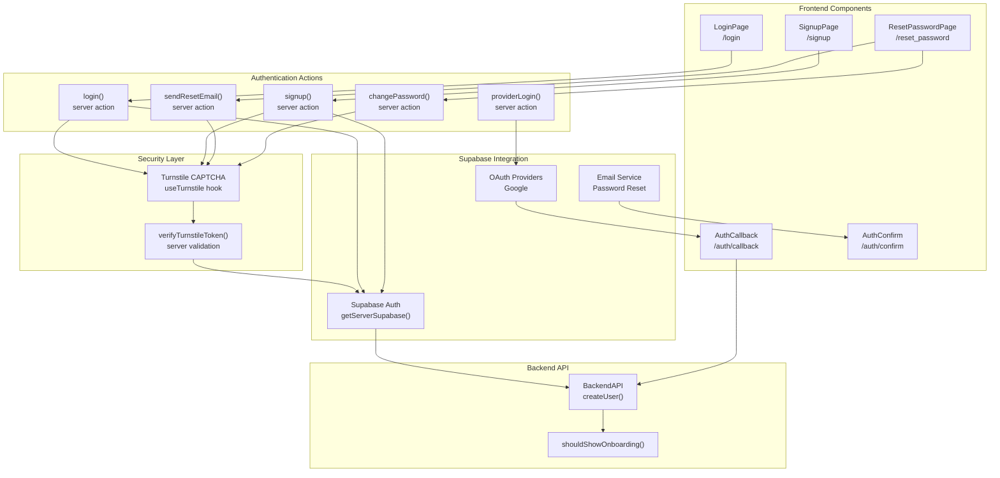
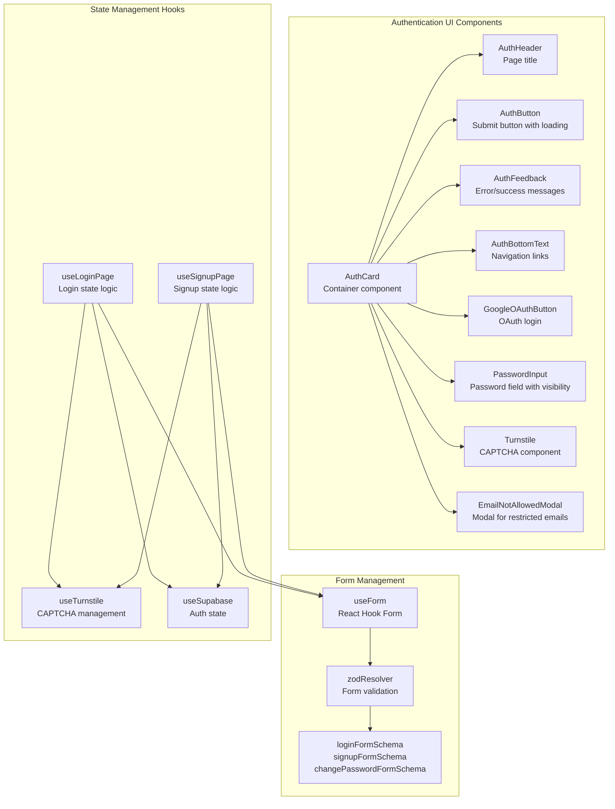
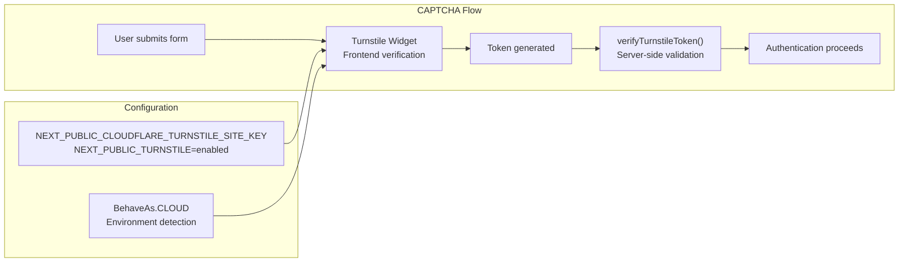
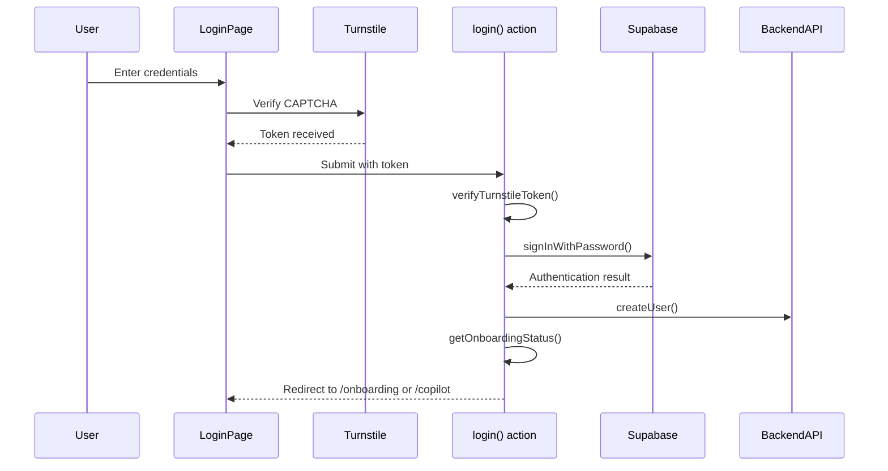
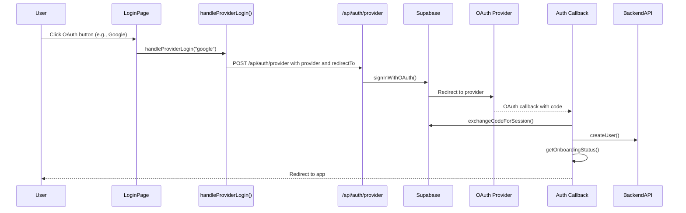
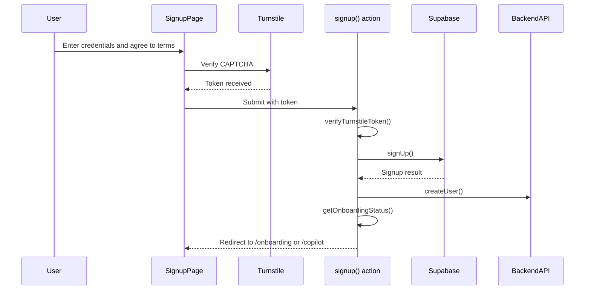
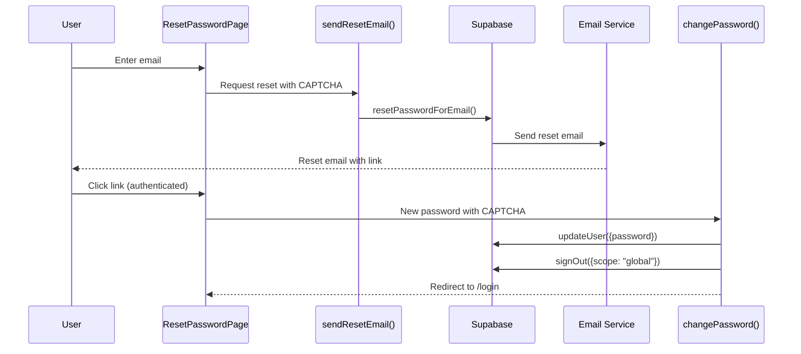
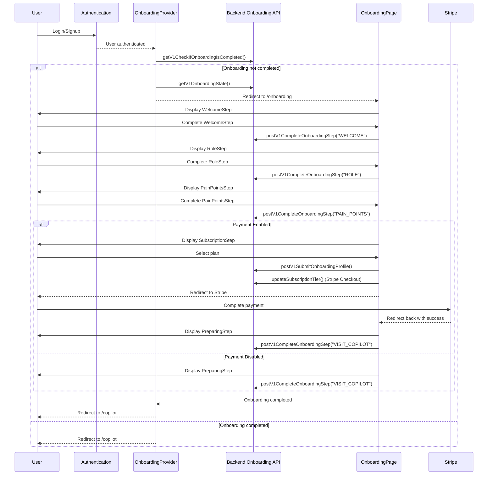

<!-- source: DeepWiki mcp.deepwiki.com · repo Significant-Gravitas/AutoGPT · extra page Authentication · fetched 2026-10-26 -->

# Authentication

Relevant source files

The following files were used as context for generating this wiki page:

- [autogpt_platform/frontend/src/app/(no-navbar)/onboarding/__tests__/page.test.tsx](autogpt_platform/frontend/src/app/(no-navbar)/onboarding/__tests__/page.test.tsx)
- [autogpt_platform/frontend/src/app/(no-navbar)/onboarding/__tests__/store.test.ts](autogpt_platform/frontend/src/app/(no-navbar)/onboarding/__tests__/store.test.ts)
- [autogpt_platform/frontend/src/app/(no-navbar)/onboarding/components/ProgressBar.tsx](autogpt_platform/frontend/src/app/(no-navbar)/onboarding/components/ProgressBar.tsx)
- [autogpt_platform/frontend/src/app/(no-navbar)/onboarding/helpers.ts](autogpt_platform/frontend/src/app/(no-navbar)/onboarding/helpers.ts)
- [autogpt_platform/frontend/src/app/(no-navbar)/onboarding/page.tsx](autogpt_platform/frontend/src/app/(no-navbar)/onboarding/page.tsx)
- [autogpt_platform/frontend/src/app/(no-navbar)/onboarding/steps/PainPointsStep.tsx](autogpt_platform/frontend/src/app/(no-navbar)/onboarding/steps/PainPointsStep.tsx)
- [autogpt_platform/frontend/src/app/(no-navbar)/onboarding/steps/SubscriptionStep/SubscriptionStep.tsx](autogpt_platform/frontend/src/app/(no-navbar)/onboarding/steps/SubscriptionStep/SubscriptionStep.tsx)
- [autogpt_platform/frontend/src/app/(no-navbar)/onboarding/steps/SubscriptionStep/useSubscriptionStep.ts](autogpt_platform/frontend/src/app/(no-navbar)/onboarding/steps/SubscriptionStep/useSubscriptionStep.ts)
- [autogpt_platform/frontend/src/app/(no-navbar)/onboarding/steps/__tests__/PainPointsStep.test.tsx](autogpt_platform/frontend/src/app/(no-navbar)/onboarding/steps/__tests__/PainPointsStep.test.tsx)
- [autogpt_platform/frontend/src/app/(no-navbar)/onboarding/steps/__tests__/SubscriptionStep.test.tsx](autogpt_platform/frontend/src/app/(no-navbar)/onboarding/steps/__tests__/SubscriptionStep.test.tsx)
- [autogpt_platform/frontend/src/app/(no-navbar)/onboarding/store.ts](autogpt_platform/frontend/src/app/(no-navbar)/onboarding/store.ts)
- [autogpt_platform/frontend/src/app/(no-navbar)/onboarding/useOnboardingPage.ts](autogpt_platform/frontend/src/app/(no-navbar)/onboarding/useOnboardingPage.ts)
- [autogpt_platform/frontend/src/app/(platform)/PaywallGate/__tests__/PaywallModal.test.tsx](autogpt_platform/frontend/src/app/(platform)/PaywallGate/__tests__/PaywallModal.test.tsx)
- [autogpt_platform/frontend/src/app/(platform)/PaywallGate/usePaywallModal.ts](autogpt_platform/frontend/src/app/(platform)/PaywallGate/usePaywallModal.ts)
- [autogpt_platform/frontend/src/app/(platform)/auth/callback/route.ts](autogpt_platform/frontend/src/app/(platform)/auth/callback/route.ts)
- [autogpt_platform/frontend/src/app/(platform)/login/__tests__/auth-redirect.test.tsx](autogpt_platform/frontend/src/app/(platform)/login/__tests__/auth-redirect.test.tsx)
- [autogpt_platform/frontend/src/app/(platform)/login/actions.ts](autogpt_platform/frontend/src/app/(platform)/login/actions.ts)
- [autogpt_platform/frontend/src/app/(platform)/login/page.tsx](autogpt_platform/frontend/src/app/(platform)/login/page.tsx)
- [autogpt_platform/frontend/src/app/(platform)/login/useLoginPage.ts](autogpt_platform/frontend/src/app/(platform)/login/useLoginPage.ts)
- [autogpt_platform/frontend/src/app/(platform)/reset-password/actions.ts](autogpt_platform/frontend/src/app/(platform)/reset-password/actions.ts)
- [autogpt_platform/frontend/src/app/(platform)/reset-password/page.tsx](autogpt_platform/frontend/src/app/(platform)/reset-password/page.tsx)
- [autogpt_platform/frontend/src/app/(platform)/signup/__tests__/auth-redirect.test.tsx](autogpt_platform/frontend/src/app/(platform)/signup/__tests__/auth-redirect.test.tsx)
- [autogpt_platform/frontend/src/app/(platform)/signup/actions.ts](autogpt_platform/frontend/src/app/(platform)/signup/actions.ts)
- [autogpt_platform/frontend/src/app/(platform)/signup/page.tsx](autogpt_platform/frontend/src/app/(platform)/signup/page.tsx)
- [autogpt_platform/frontend/src/app/(platform)/signup/useSignupPage.ts](autogpt_platform/frontend/src/app/(platform)/signup/useSignupPage.ts)
- [autogpt_platform/frontend/src/app/api/auth/callback/reset-password/route.ts](autogpt_platform/frontend/src/app/api/auth/callback/reset-password/route.ts)
- [autogpt_platform/frontend/src/app/api/helpers.ts](autogpt_platform/frontend/src/app/api/helpers.ts)
- [autogpt_platform/frontend/src/components/atoms/Emoji/Emoji.tsx](autogpt_platform/frontend/src/components/atoms/Emoji/Emoji.tsx)
- [autogpt_platform/frontend/src/components/auth/ExpiredLinkMessage.tsx](autogpt_platform/frontend/src/components/auth/ExpiredLinkMessage.tsx)
- [autogpt_platform/frontend/src/components/molecules/PlanCard/PlanCard.tsx](autogpt_platform/frontend/src/components/molecules/PlanCard/PlanCard.tsx)
- [autogpt_platform/frontend/src/components/molecules/PlanCard/computePricing.test.ts](autogpt_platform/frontend/src/components/molecules/PlanCard/computePricing.test.ts)
- [autogpt_platform/frontend/src/components/molecules/PlanCard/computePricing.ts](autogpt_platform/frontend/src/components/molecules/PlanCard/computePricing.ts)
- [autogpt_platform/frontend/src/lib/auth-redirect.test.ts](autogpt_platform/frontend/src/lib/auth-redirect.test.ts)
- [autogpt_platform/frontend/src/lib/auth-redirect.ts](autogpt_platform/frontend/src/lib/auth-redirect.ts)
- [autogpt_platform/frontend/src/playwright/utils/onboarding.ts](autogpt_platform/frontend/src/playwright/utils/onboarding.ts)
- [autogpt_platform/frontend/src/providers/onboarding/__tests__/onboarding-provider-routing.test.tsx](autogpt_platform/frontend/src/providers/onboarding/__tests__/onboarding-provider-routing.test.tsx)
- [autogpt_platform/frontend/src/providers/onboarding/helpers.test.ts](autogpt_platform/frontend/src/providers/onboarding/helpers.test.ts)
- [autogpt_platform/frontend/src/providers/onboarding/helpers.ts](autogpt_platform/frontend/src/providers/onboarding/helpers.ts)
- [autogpt_platform/frontend/src/providers/onboarding/onboarding-provider.tsx](autogpt_platform/frontend/src/providers/onboarding/onboarding-provider.tsx)
- [autogpt_platform/frontend/src/tests/integrations/vitest.setup.tsx](autogpt_platform/frontend/src/tests/integrations/vitest.setup.tsx)

This document covers the authentication system in the AutoGPT Platform, including user registration, login, OAuth integration, password management, and security features. The authentication system is built on Supabase with custom frontend interfaces and additional security layers.

For information about API key management and service authentication, see [LLM Integration](#3.2.7).

## Architecture Overview

The AutoGPT Platform authentication system uses Supabase as the backend authentication provider with a custom Next.js frontend. The system supports email/password authentication, OAuth providers, and includes security features like Turnstile CAPTCHA.

### Authentication Flow Architecture

**Sources:** [autogpt_platform/frontend/src/app/(platform)/login/page.tsx:1-151](), [autogpt_platform/frontend/src/app/(platform)/signup/page.tsx:1-196](), [autogpt_platform/frontend/src/app/(platform)/auth/callback/route.ts:1-75](), [autogpt_platform/frontend/src/hooks/useTurnstile.ts:1-185]()

## Authentication Components

### Core Authentication Pages

The authentication system includes several specialized pages for different authentication workflows:

| Component | Route | Purpose |
|-----------|-------|---------|
| `LoginPage` | `/login` | User login with email/password or OAuth |
| `SignupPage` | `/signup` | New user registration |
| `ResetPasswordPage` | `/reset_password` | Password reset workflow |
| `AuthCallback` | `/auth/callback` | OAuth callback handler |
| `AuthConfirm` | `/auth/confirm` | Email confirmation handler |

### Authentication Component Structure

**Sources:** [autogpt_platform/frontend/src/components/auth/index.ts:1-20](), [autogpt_platform/frontend/src/app/(platform)/login/useLoginPage.ts:1-136](), [autogpt_platform/frontend/src/app/(platform)/signup/useSignupPage.ts:1-171]()

## Security Features

### Turnstile CAPTCHA Integration

The authentication system integrates Cloudflare Turnstile CAPTCHA to prevent automated attacks:

The `useTurnstile` hook manages CAPTCHA state with automatic verification and error handling:

- **Automatic verification**: Validates tokens server-side when `autoVerify: true`
- **Environment awareness**: Only renders in cloud environments with proper configuration
- **Error handling**: Resets widgets on errors and provides user feedback
- **State management**: Tracks verification status, tokens, and loading states

**Sources:** [autogpt_platform/frontend/src/hooks/useTurnstile.ts:33-185](), [autogpt_platform/frontend/src/lib/turnstile.ts:6-47](), [autogpt_platform/frontend/src/components/auth/Turnstile.tsx:17-164]()

### Password Security Requirements

Password validation enforces security standards through Zod schemas:

- **Minimum length**: 12 characters required
- **Confirmation matching**: Password and confirm password must match
- **AutoGPT email restriction**: Forces SSO for `@agpt.co` email addresses [autogpt_platform/frontend/src/app/(platform)/login/useLoginPage.ts:86-94](), [autogpt_platform/frontend/src/app/(platform)/signup/useSignupPage.ts:95-103]()

**Sources:** [autogpt_platform/frontend/src/app/(platform)/signup/page.tsx:119-121](), [autogpt_platform/frontend/src/app/(platform)/login/useLoginPage.ts:68-73](), [autogpt_platform/frontend/src/app/(platform)/signup/useSignupPage.ts:69-77]()

## Authentication Flows

### Login Process

The `login` server action [autogpt_platform/frontend/src/app/(platform)/login/actions.ts:9-52]() handles email/password authentication. It first parses and validates the input using `loginFormSchema` [autogpt_platform/frontend/src/app/(platform)/login/actions.ts:11](). If successful, it calls `supabase.auth.signInWithPassword()` [autogpt_platform/frontend/src/app/(platform)/login/actions.ts:28]() to authenticate the user. After successful authentication, it calls `api.createUser()` [autogpt_platform/frontend/src/app/(platform)/login/actions.ts:37]() to ensure the user exists in the backend database and then determines the next redirect path using `getOnboardingStatus()` [autogpt_platform/frontend/src/app/(platform)/login/actions.ts:39](), directing to `/onboarding` if needed, or `/copilot` otherwise [autogpt_platform/frontend/src/app/(platform)/login/actions.ts:43]().

**Sources:** [autogpt_platform/frontend/src/app/(platform)/login/actions.ts:19-92]()

### OAuth Login Process

The `handleProviderLogin` function [autogpt_platform/frontend/src/app/(platform)/login/useLoginPage.ts:48-79]() initiates the OAuth flow. It constructs a `callbackUrl` [autogpt_platform/frontend/src/app/(platform)/login/useLoginPage.ts:54-57]() that includes the `nextUrl` parameter if present, ensuring the user is redirected to the intended page after OAuth completion. It then makes a `POST` request to `/api/auth/provider` [autogpt_platform/frontend/src/app/(platform)/login/useLoginPage.ts:59-63]() which handles the server-side `supabase.auth.signInWithOAuth()` call. Upon receiving the OAuth URL, the browser is redirected to the OAuth provider [autogpt_platform/frontend/src/app/(platform)/login/useLoginPage.ts:70](). The `/auth/callback` route [autogpt_platform/frontend/src/app/(platform)/auth/callback/route.ts:1-75]() processes the OAuth response, exchanges the code for a session, creates the user in the backend if necessary, and redirects the user based on their onboarding status.

**Sources:** [autogpt_platform/frontend/src/app/(platform)/login/useLoginPage.ts:48-79](), [autogpt_platform/frontend/src/app/(platform)/auth/callback/route.ts:25-74]()

### Signup Process

The `signup` server action [autogpt_platform/frontend/src/app/(platform)/signup/actions.ts:9-52]() handles new user registration. It validates the input using `signupFormSchema` [autogpt_platform/frontend/src/app/(platform)/signup/actions.ts:11]() and checks for `@agpt.co` emails, requiring Google SSO for them [autogpt_platform/frontend/src/app/(platform)/signup/useSignupPage.ts:95-103](). It then calls `supabase.auth.signUp()` [autogpt_platform/frontend/src/app/(platform)/signup/actions.ts:28](). If successful, it creates the user in the backend via `api.createUser()` [autogpt_platform/frontend/src/app/(platform)/signup/actions.ts:37]() and redirects to `/onboarding` or `/copilot` [autogpt_platform/frontend/src/app/(platform)/signup/actions.ts:43]() based on `getOnboardingStatus()`.

**Sources:** [autogpt_platform/frontend/src/app/(platform)/signup/actions.ts:19-92]()

### Password Reset Flow

The `ResetPasswordContent` component [autogpt_platform/frontend/src/app/(platform)/reset-password/page.tsx:18-220]() handles the password reset flow. Users can request a reset email by submitting their email address to `sendResetEmail()` [autogpt_platform/frontend/src/app/(platform)/reset-password/page.tsx:97](), which uses `supabase.auth.resetPasswordForEmail()` [autogpt_platform/frontend/src/app/(platform)/reset-password/actions.ts:19](). When a user clicks the link in the email, they are redirected back to the `ResetPasswordPage` where they can set a new password using `changePassword()` [autogpt_platform/frontend/src/app/(platform)/reset-password/page.tsx:131](), which calls `supabase.auth.updateUser()` [autogpt_platform/frontend/src/app/(platform)/reset-password/actions.ts:49](). The page also handles expired or used links by displaying an `ExpiredLinkMessage` [autogpt_platform/frontend/src/app/(platform)/reset-password/page.tsx:167-168]().

**Sources:** [autogpt_platform/frontend/src/app/(platform)/login/actions.ts:19-92](), [autogpt_platform/frontend/src/app/(platform)/reset-password/actions.ts:7-71](), [autogpt_platform/frontend/src/app/(platform)/auth/callback/route.ts:25-74]()

## Onboarding Flow

After successful login or signup, new users are directed through an onboarding process. The `OnboardingProvider` [autogpt_platform/frontend/src/providers/onboarding/onboarding-provider.tsx:81-220]() manages this flow, ensuring users complete necessary steps before accessing the main application.

The `OnboardingProvider` [autogpt_platform/frontend/src/providers/onboarding/onboarding-provider.tsx:81-220]() is a client-side React context provider that wraps the application. It checks if the user is logged in and if onboarding is completed using `getV1CheckIfOnboardingIsCompleted()` [autogpt_platform/frontend/src/providers/onboarding/onboarding-provider.tsx:170](). If not completed, it fetches the current onboarding state via `getV1OnboardingState()` [autogpt_platform/frontend/src/providers/onboarding/onboarding-provider.tsx:133]() and redirects the user to the `/onboarding` route [autogpt_platform/frontend/src/providers/onboarding/onboarding-provider.tsx:180]().

The `OnboardingPage` [autogpt_platform/frontend/src/app/(no-navbar)/onboarding/page.tsx:15-78]() renders different steps based on the `currentStep` state managed by `useOnboardingWizardStore` [autogpt_platform/frontend/src/app/(no-navbar)/onboarding/page.tsx:22](). Steps include `WelcomeStep`, `RoleStep`, `PainPointsStep`, `SubscriptionStep`, and `PreparingStep` [autogpt_platform/frontend/src/app/(no-navbar)/onboarding/page.tsx:53-58]().

The `useOnboardingPage` hook [autogpt_platform/frontend/src/app/(no-navbar)/onboarding/useOnboardingPage.ts:49-154]() manages the overall onboarding logic:
- It determines if the payment step (`SubscriptionStep`) is enabled based on feature flags (`ENABLE_PLATFORM_PAYMENT`) and the user's current subscription status [autogpt_platform/frontend/src/app/(no-navbar)/onboarding/useOnboardingPage.ts:104-105]().
- It persists the highest step reached by the user in `sessionStorage` to prevent fast-forwarding and allow resuming [autogpt_platform/frontend/src/app/(no-navbar)/onboarding/useOnboardingPage.ts:33-47]().
- When a plan is selected in `SubscriptionStep`, `handlePlanSelect` [autogpt_platform/frontend/src/app/(no-navbar)/onboarding/steps/SubscriptionStep/useSubscriptionStep.ts:55-124]() first submits the user's profile data (`user_name`, `user_role`, `pain_points`) to the backend using `postV1SubmitOnboardingProfile()` [autogpt_platform/frontend/src/app/(no-navbar)/onboarding/steps/SubscriptionStep/useSubscriptionStep.ts:87-91](). Then, it initiates a Stripe checkout session via `updateSubscriptionTier()` [autogpt_platform/frontend/src/app/(no-navbar)/onboarding/steps/SubscriptionStep/useSubscriptionStep.ts:95]() and redirects the user to Stripe.
- Upon successful completion of a step, `postV1CompleteOnboardingStep()` [autogpt_platform/frontend/src/providers/onboarding/onboarding-provider.tsx:43]() is called to update the backend.
- Once all steps are completed, the user is redirected to `/copilot` [autogpt_platform/frontend/src/providers/onboarding/onboarding-provider.tsx:191]().

**Sources:** [autogpt_platform/frontend/src/providers/onboarding/onboarding-provider.tsx:81-220](), [autogpt_platform/frontend/src/app/(no-navbar)/onboarding/page.tsx:15-78](), [autogpt_platform/frontend/src/app/(no-navbar)/onboarding/useOnboardingPage.ts:49-154](), [autogpt_platform/frontend/src/app/(no-navbar)/onboarding/steps/SubscriptionStep/useSubscriptionStep.ts:55-124](), [autogpt_platform/frontend/src/app/(no-navbar)/onboarding/__tests__/page.test.tsx:96-190]()

## Configuration

### Environment Variables

The authentication system requires several environment variables for proper configuration:

| Variable | Purpose | Example |
|----------|---------|---------|
| `NEXT_PUBLIC_SUPABASE_URL` | Supabase project URL | `http://localhost:8000` |
| `NEXT_PUBLIC_SUPABASE_ANON_KEY` | Supabase anonymous key | JWT token |
| `AUTH_CALLBACK_URL` | OAuth callback URL | `${FRONTEND_BASE_URL}/auth/callback` |
| `NEXT_PUBLIC_CLOUDFLARE_TURNSTILE_SITE_KEY` | Turnstile site key | Cloudflare dashboard key |
| `NEXT_PUBLIC_TURNSTILE` | Enable/disable CAPTCHA | `enabled` or `disabled` |
| `NEXT_PUBLIC_BEHAVE_AS` | Environment mode | `CLOUD` or `LOCAL` |

**Sources:** [autogpt_platform/frontend/.env.example:18-37]()

### Supabase Integration

The authentication system integrates with Supabase through server-side functions:

- **`getServerSupabase()`**: Creates authenticated Supabase client for server actions
- **Session management**: Handles user sessions and token refresh
- **OAuth configuration**: Supports Google OAuth with proper redirect URLs
- **Email services**: Manages password reset emails and confirmations

### OAuth Provider Configuration

OAuth authentication is configured for cloud environments with Google as the primary provider:

- **Google OAuth**: Configured with proper redirect URLs and scopes
- **Environment detection**: Only available when `BEHAVE_AS=CLOUD` [autogpt_platform/frontend/src/app/(platform)/login/page.tsx:103](), [autogpt_platform/frontend/src/app/(platform)/signup/page.tsx:181]()
- **Callback handling**: Processes OAuth responses and creates user sessions
- **Error handling**: Provides fallback for failed OAuth attempts

**Sources:** [autogpt_platform/frontend/src/app/(platform)/login/actions.ts:58-92](), [autogpt_platform/frontend/src/app/(platform)/auth/callback/route.ts:34-74]()

## User Session Management

### Session State

User authentication state is managed through the `useSupabase` hook which provides:

- **`user`**: Current authenticated user object
- **`supabase`**: Authenticated Supabase client instance  
- **`isUserLoading`**: Loading state for authentication checks
- **Session persistence**: Automatic session restoration on page load

### Route Protection

Authentication pages include automatic redirects:

- **Authenticated users**: Redirected to home page (`/`) from auth pages [autogpt_platform/frontend/src/providers/onboarding/onboarding-provider.tsx:122](), [autogpt_platform/frontend/src/app/(platform)/login/useLoginPage.ts:34-38](), [autogpt_platform/frontend/src/app/(platform)/signup/useSignupPage.ts:34-38]()
- **Unauthenticated users**: Redirected to login page from protected routes
- **Loading states**: Show loading spinners during authentication checks
- **Supabase availability**: Handle cases where Supabase is unavailable [autogpt_platform/frontend/src/app/(platform)/login/page.tsx:44-49](), [autogpt_platform/frontend/src/app/(platform)/signup/page.tsx:53-58]()

**Sources:** [autogpt_platform/frontend/src/app/(platform)/login/page.tsx:42-53](), [autogpt_platform/frontend/src/app/(platform)/signup/page.tsx:44-54](), [autogpt_platform/frontend/src/providers/onboarding/onboarding-provider.tsx:122]()

---

