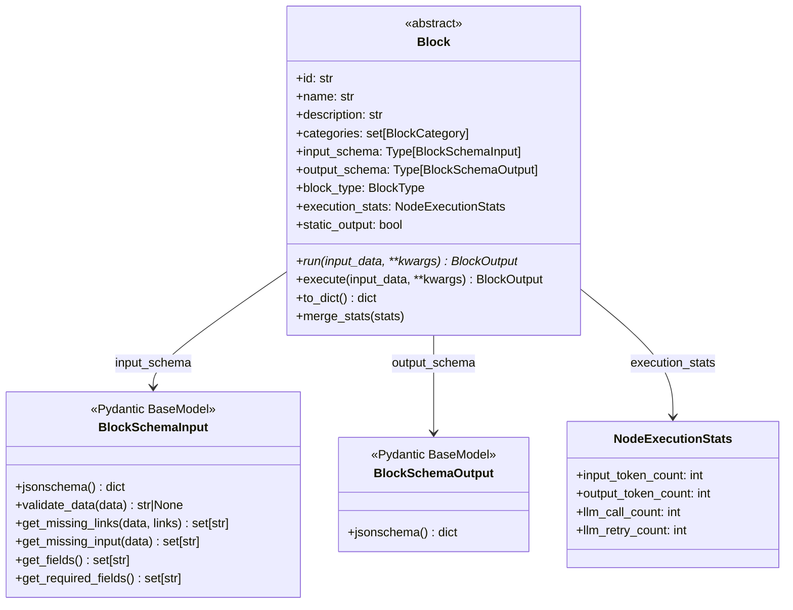
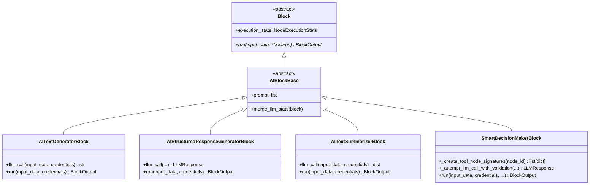
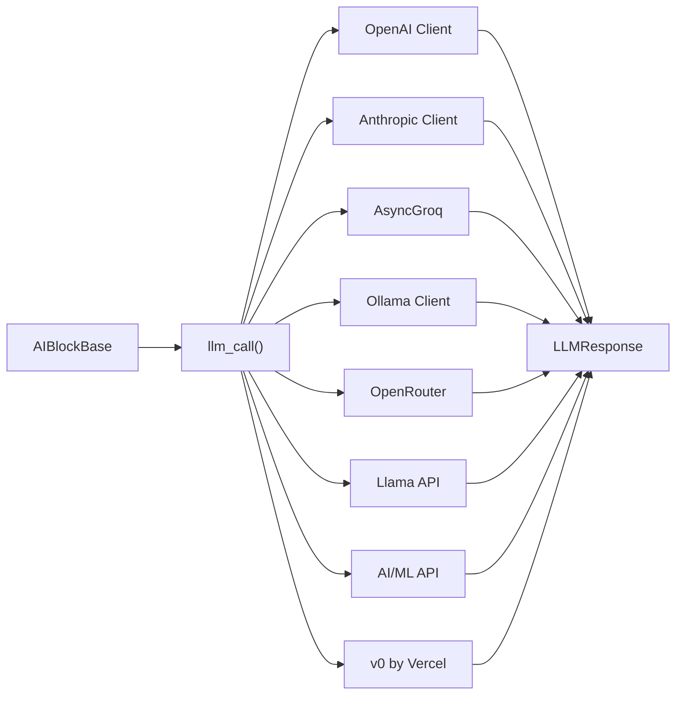
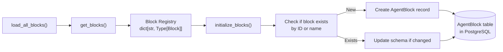

<!-- source: DeepWiki mcp.deepwiki.com · repo Significant-Gravitas/AutoGPT · extra page Block System · fetched 2026-10-26 -->

# Block System

<details>
<summary>Relevant source files</summary>

The following files were used as context for generating this wiki page:

- [autogpt_platform/backend/backend/blocks/__init__.py](autogpt_platform/backend/backend/blocks/__init__.py)
- [autogpt_platform/backend/backend/blocks/basic.py](autogpt_platform/backend/backend/blocks/basic.py)
- [autogpt_platform/backend/backend/blocks/data_manipulation.py](autogpt_platform/backend/backend/blocks/data_manipulation.py)
- [autogpt_platform/backend/backend/blocks/generic_webhook/__init__.py](autogpt_platform/backend/backend/blocks/generic_webhook/__init__.py)
- [autogpt_platform/backend/backend/blocks/google/calendar.py](autogpt_platform/backend/backend/blocks/google/calendar.py)
- [autogpt_platform/backend/backend/blocks/io.py](autogpt_platform/backend/backend/blocks/io.py)
- [autogpt_platform/backend/backend/blocks/slant3d/_api.py](autogpt_platform/backend/backend/blocks/slant3d/_api.py)
- [autogpt_platform/backend/backend/blocks/slant3d/base.py](autogpt_platform/backend/backend/blocks/slant3d/base.py)
- [autogpt_platform/backend/backend/blocks/slant3d/filament.py](autogpt_platform/backend/backend/blocks/slant3d/filament.py)
- [autogpt_platform/backend/backend/blocks/slant3d/order.py](autogpt_platform/backend/backend/blocks/slant3d/order.py)
- [autogpt_platform/backend/backend/blocks/slant3d/slicing.py](autogpt_platform/backend/backend/blocks/slant3d/slicing.py)
- [autogpt_platform/backend/backend/blocks/slant3d/webhook.py](autogpt_platform/backend/backend/blocks/slant3d/webhook.py)
- [autogpt_platform/backend/backend/blocks/test/test_block.py](autogpt_platform/backend/backend/blocks/test/test_block.py)
- [autogpt_platform/backend/backend/blocks/text.py](autogpt_platform/backend/backend/blocks/text.py)
- [autogpt_platform/backend/backend/blocks/time_blocks.py](autogpt_platform/backend/backend/blocks/time_blocks.py)
- [autogpt_platform/backend/backend/data/integrations.py](autogpt_platform/backend/backend/data/integrations.py)
- [autogpt_platform/backend/backend/executor/manager_test.py](autogpt_platform/backend/backend/executor/manager_test.py)
- [autogpt_platform/backend/backend/integrations/webhooks/__init__.py](autogpt_platform/backend/backend/integrations/webhooks/__init__.py)
- [autogpt_platform/backend/backend/integrations/webhooks/_base.py](autogpt_platform/backend/backend/integrations/webhooks/_base.py)
- [autogpt_platform/backend/backend/integrations/webhooks/compass.py](autogpt_platform/backend/backend/integrations/webhooks/compass.py)
- [autogpt_platform/backend/backend/integrations/webhooks/github.py](autogpt_platform/backend/backend/integrations/webhooks/github.py)
- [autogpt_platform/backend/backend/integrations/webhooks/graph_lifecycle_hooks.py](autogpt_platform/backend/backend/integrations/webhooks/graph_lifecycle_hooks.py)
- [autogpt_platform/backend/backend/integrations/webhooks/slant3d.py](autogpt_platform/backend/backend/integrations/webhooks/slant3d.py)
- [autogpt_platform/backend/backend/integrations/webhooks/utils.py](autogpt_platform/backend/backend/integrations/webhooks/utils.py)
- [autogpt_platform/backend/backend/sdk/builder.py](autogpt_platform/backend/backend/sdk/builder.py)
- [autogpt_platform/backend/backend/sdk/provider.py](autogpt_platform/backend/backend/sdk/provider.py)
- [autogpt_platform/backend/backend/sdk/registry.py](autogpt_platform/backend/backend/sdk/registry.py)
- [autogpt_platform/backend/backend/util/text.py](autogpt_platform/backend/backend/util/text.py)
- [autogpt_platform/backend/load-tests/tests/api/graph-execution-test.js](autogpt_platform/backend/load-tests/tests/api/graph-execution-test.js)
- [autogpt_platform/backend/test/blocks/test_list_concatenation.py](autogpt_platform/backend/test/blocks/test_list_concatenation.py)
- [autogpt_platform/backend/test/sdk/test_sdk_patching.py](autogpt_platform/backend/test/sdk/test_sdk_patching.py)
- [autogpt_platform/backend/test/sdk/test_sdk_registry.py](autogpt_platform/backend/test/sdk/test_sdk_registry.py)
- [docs/CLAUDE.md](docs/CLAUDE.md)
- [docs/integrations/block-integrations/basic.md](docs/integrations/block-integrations/basic.md)

</details>


The Block System provides the foundational architecture for creating modular, reusable components in the AutoGPT Platform. Each block is a self-contained unit that defines inputs, outputs, and execution logic. Blocks can be connected together to form agent workflows, with the system handling validation, execution, and output propagation.

This page covers:
- The `Block` base class and its core abstractions
- `AIBlockBase` for LLM-powered blocks with token tracking
- Block categories and organization
- Block registration and discovery mechanisms
- How blocks are executed within the platform

For details on how blocks are executed as part of graph workflows, see [Execution System](). For the LLM integration layer used by AI blocks, see [LLM Integration]().

## Block Base Class Architecture

All blocks inherit from the abstract `Block` class defined in [backend/blocks/_base.py](). This base class provides the standardized interface for block execution, validation, and metadata.

### Block Class Structure



**Key Components:**

| Component | Purpose |
|-----------|---------|
| `id` | Unique identifier (UUID) for the block type |
| `input_schema` | Pydantic model defining input fields and validation |
| `output_schema` | Pydantic model defining output fields |
| `run()` | Abstract method containing the block's execution logic |
| `execute()` | Wrapper that validates inputs, calls `run()`, and validates outputs |
| `execution_stats` | Tracks token usage and call counts for billing/monitoring |
| `categories` | Set of `BlockCategory` enums for organization |
| `block_type` | `BlockType` enum indicating special behavior (e.g., WEBHOOK, AI) |

Sources: [backend/blocks/_base.py:278-510]()

### Block Execution Model

Blocks use a generator-based execution model where the `run()` method yields `(output_name, output_data)` tuples for each output:

```python
# Example from StoreValueBlock
async def run(self, input_data: Input, **kwargs) -> BlockOutput:
    yield "output", input_data.data or input_data.input
```
Sources: [backend/blocks/basic.py:108-109]()

The `execute()` wrapper method orchestrates the execution lifecycle:

1. Validates input data against `input_schema`
2. Calls the `run()` method
3. Validates each output against `output_schema`
4. Collects execution statistics
5. Returns all outputs

**Block Initialization Pattern:**

```python
class MyCustomBlock(Block):
    def __init__(self):
        super().__init__(
            id="unique-uuid-here",
            description="What this block does",
            categories={BlockCategory.TEXT},
            input_schema=MyCustomBlock.Input,
            output_schema=MyCustomBlock.Output,
            test_input={"field": "test_value"},  # For automated testing
            test_output=[("output_name", "expected_value")],
        )
```
Sources: [backend/blocks/basic.py:35-48]()

### Block Schemas and Validation

Block schemas are Pydantic models that extend `BlockSchemaInput` or `BlockSchemaOutput`. Fields are defined using `SchemaField` which provides additional metadata:

```python
class Input(BlockSchemaInput):
    text: str = SchemaField(
        description="The text to process",
        placeholder="Enter text here",
    )
    case_sensitive: bool = SchemaField(
        description="Whether matching is case sensitive",
        default=True,
        advanced=True,  # Hidden in basic UI mode
    )
```
Sources: [backend/blocks/text.py:23-32]()

**Schema Capabilities:**

| Method | Purpose |
|--------|---------|
| `jsonschema()` | Returns JSON Schema representation for frontend |
| `validate_data(data)` | Validates data structure, returns error message if invalid |
| `get_required_fields()` | Returns set of field names that must be provided |
| `get_missing_input(data)` | Checks if required fields are present |
| `get_missing_links(data, links)` | Validates that all required inputs have connections |

**SchemaField Parameters:**

- `description`: Human-readable explanation shown in UI
- `placeholder`: Example value for input fields
- `default`: Default value if not provided
- `advanced`: Whether field is hidden in basic mode
- `title`: Display name (defaults to field name)

Sources: [backend/blocks/_base.py:83-225](), [backend/data/model.py:148-178]()

## AIBlockBase and LLM Integration

For blocks that interact with LLMs, the `AIBlockBase` class extends `Block` with specialized functionality for tracking token usage and managing LLM statistics.

### AIBlockBase Class



**Key Features:**

- **Token Tracking**: Automatically tracks `input_token_count`, `output_token_count`, and `llm_call_count` in `NodeExecutionStats`
- **Prompt Storage**: Stores the last prompt sent to the LLM in `self.prompt`
- **Stat Merging**: `merge_llm_stats()` method for aggregating statistics from multiple LLM calls

```python
class AIBlockBase(Block, ABC):
    def __init__(self, *args, **kwargs):
        super().__init__(*args, **kwargs)
        self.prompt = []

    def merge_llm_stats(self, block: "AIBlockBase"):
        self.merge_stats(block.execution_stats)
        self.prompt = block.prompt
```
Sources: [backend/blocks/llm.py:770-778]()

### LLM Integration Layer

AI blocks use the `llm_call()` function which provides a unified interface to multiple LLM providers:



**LLMResponse Structure:**

```python
class LLMResponse(BaseModel):
    raw_response: Any
    prompt: List[Any]
    response: str
    tool_calls: Optional[List[ToolContentBlock]] | None
    prompt_tokens: int
    completion_tokens: int
    reasoning: Optional[str] = None  # For o1/o3 models
```
Sources: [backend/blocks/llm.py:326-334]()

The `llm_call()` function handles:
- Provider-specific API differences
- Token counting for all providers
- Tool call format conversion (OpenAI ↔ Anthropic)
- Prompt compression via `compress_prompt()` when approaching context limits
- Max token calculation based on context window

Sources: [backend/blocks/llm.py:410-767]()

## Block Categories and Organization

Blocks are organized into categories defined in the `BlockCategory` enum:

```mermaid
graph TD
    BlockCategory --> AI["AI<br/>LLM-powered blocks"]
    BlockCategory --> Integration["SOCIAL<br/>External service APIs"]
    BlockCategory --> Data["DATA<br/>Data manipulation"]
    BlockCategory --> Text["TEXT<br/>Text processing"]
    BlockCategory --> Logic["LOGIC<br/>Control flow"]
    BlockCategory --> Basic["BASIC<br/>Core utilities"]
    BlockCategory --> Output["OUTPUT<br/>External outputs"]
    BlockCategory --> Input["INPUT<br/>Agent inputs"]
    
    AI --> AITextGeneratorBlock
    AI --> AIStructuredResponseGeneratorBlock
    AI --> AITextSummarizerBlock
    AI --> AIConversationBlock
    AI --> SmartDecisionMakerBlock
    AI --> AIConditionBlock
    
    Integration --> SendWebRequestBlock
    Integration --> TranscribeYoutubeVideoBlock
    Integration --> ReadRSSFeedBlock
    Integration --> EmailBlock
    
    Data --> CreateDictionaryBlock
    Data --> AddToListBlock
    Data --> StepThroughItemsBlock
    
    Text --> MatchTextPatternBlock
    Text --> ExtractTextInformationBlock
    Text --> FillTextTemplateBlock
    Text --> CombineTextsBlock
    
    Logic --> StepThroughItemsBlock
    
    Basic --> StoreValueBlock
    Basic --> PrintToConsoleBlock
    Basic --> FileStoreBlock
```



### Block Category Reference

| Category | Purpose | Example Blocks |
|----------|---------|----------------|
| `AI` | LLM-powered reasoning and generation | `AITextGeneratorBlock`, `AIStructuredResponseGeneratorBlock`, `SmartDecisionMakerBlock` |
| `SOCIAL` | Integration with social platforms | `TranscribeYoutubeVideoBlock`, `DiscordBlock` |
| `TEXT` | Text manipulation and pattern matching | `MatchTextPatternBlock`, `FillTextTemplateBlock` |
| `SEARCH` | Web search and content extraction | `SearchTheWebBlock`, `ExtractWebsiteContentBlock` |
| `DATA` | Data structure operations | `CreateDictionaryBlock`, `AddToListBlock` |
| `LOGIC` | Control flow and iteration | `StepThroughItemsBlock` |
| `BASIC` | Core utilities | `StoreValueBlock`, `PrintToConsoleBlock` |
| `OUTPUT` | External outputs | `AgentOutputBlock`, `EmailBlock` |
| `MULTIMEDIA` | Media processing | `FileStoreBlock`, `AIImageGeneratorBlock` |
| `AGENT` | Agent execution | `AgentExecutorBlock` |

Blocks can belong to multiple categories. For example, `StepThroughItemsBlock` is in both `DATA` and `LOGIC`.

Sources: [backend/blocks/_base.py:46-77](), [backend/blocks/llm.py:780-1471](), [backend/blocks/basic.py:1-225](), [backend/blocks/text.py:1-548](), [backend/blocks/http.py:1-232]()

## Example Block Implementations

### Basic Block: StoreValueBlock

A simple block that stores and forwards a value:

```python
class StoreValueBlock(Block):
    class Input(BlockSchemaInput):
        input: Any = SchemaField(
            description="Trigger the block to produce the output. "
            "The value is only used when `data` is None."
        )
        data: Any = SchemaField(
            description="The constant data to be retained in the block. "
            "This value is passed as `output`.",
            default=None,
        )

    class Output(BlockSchemaOutput):
        output: Any = SchemaField(description="The stored data retained in the block.")

    def __init__(self):
        super().__init__(
            id="1ff065e9-88e8-4358-9d82-8dc91f622ba9",
            description="A basic block that stores and forwards a value throughout workflows, allowing it to be reused without changes across multiple blocks.",
            categories={BlockCategory.BASIC},
            input_schema=StoreValueBlock.Input,
            output_schema=StoreValueBlock.Output,
            test_input=[
                {"input": "Hello, World!"},
                {"input": "Hello, World!", "data": "Existing Data"},
            ],
            test_output=[
                ("output", "Hello, World!"),  # No data provided, so trigger is returned
                ("output", "Existing Data"),  # Data is provided, so data is returned.
            ],
            static_output=True,
        )

    async def run(self, input_data: Input, **kwargs) -> BlockOutput:
        yield "output", input_data.data or input_data.input
```
Sources: [backend/blocks/basic.py:69-110]()

### AI Block: AITextGeneratorBlock

Uses `AIBlockBase` for LLM integration:

```python
class AITextGeneratorBlock(AIBlockBase):
    class Input(BlockSchemaInput):
        prompt: str = SchemaField(description="The prompt to send to the LLM")
        model: LlmModel = SchemaField(
            title="LLM Model",
            default=DEFAULT_LLM_MODEL,
        )
        credentials: AICredentials = AICredentialsField()
        sys_prompt: str = SchemaField(
            title="System Prompt",
            default="",
        )
        max_tokens: int | None = SchemaField(
            advanced=True,
            default=None,
        )

    class Output(BlockSchemaOutput):
        response: str = SchemaField(description="The generated text")

    async def run(
        self, input_data: Input, *, credentials: APIKeyCredentials, **kwargs
    ) -> BlockOutput:
        # Delegate to AIStructuredResponseGeneratorBlock
        structured_block = AIStructuredResponseGeneratorBlock()
        response = await structured_block.llm_call(...)
        
        # Merge stats from the delegated block
        self.merge_llm_stats(structured_block)
        
        yield "response", response["response"]
```
Sources: [backend/blocks/llm.py:1034-1118]()

### Integration Block: SendWebRequestBlock

Makes HTTP requests with file upload support:

```python
class SendWebRequestBlock(Block):
    class Input(BlockSchemaInput):
        url: str = SchemaField(description="The URL to send the request to")
        method: HttpMethod = SchemaField(default=HttpMethod.POST)
        headers: dict[str, str] = SchemaField(default_factory=dict)
        json_format: bool = SchemaField(default=True)
        body: dict | None = SchemaField(default=None)
        files: list[MediaFileType] = SchemaField(default_factory=list)

    class Output(BlockSchemaOutput):
        response: object = SchemaField(description="Response from server")
        client_error: object = SchemaField(description="4xx errors")
        server_error: object = SchemaField(description="5xx errors")
        error: str = SchemaField(description="Other errors")

    async def run(
        self, input_data: Input, *, graph_exec_id: str, user_id: str, **kwargs
    ) -> BlockOutput:
        # Prepare files if any
        files_payload = await self._prepare_files(...)
        
        # Make request with SSRF protection
        response = await Requests(
            raise_for_status=False,
            retry_max_attempts=1,
        ).request(
            input_data.method.value,
            input_data.url,
            headers=input_data.headers,
            files=files_payload if files_payload else None,
            json=input_data.body if input_data.json_format else None,
            data=input_data.body if not input_data.json_format else None,
        )
        
        if response.ok:
            yield "response", response.json() if "json" in response.headers.get("content-type", "") else response.text()
        elif 400 <= response.status < 500:
            yield "client_error", {"status": response.status, "body": response.text()}
        elif 500 <= response.status < 600:
            yield "server_error", {"status": response.status, "body": response.text()}
```
Sources: [backend/blocks/http.py:70-232]()

## Block Registration and Discovery

### Block Registration

Blocks are registered in the database through the `initialize_blocks()` process. Each block must have:

1. **Unique UUID**: Immutable identifier (e.g., `"1ff065e9-88e8-4358-9d82-8dc91f622ba9"`)
2. **Name**: Human-readable name derived from class name
3. **Input Schema**: JSON Schema representation of inputs
4. **Output Schema**: JSON Schema representation of outputs

The registration process:



**Block Loading:**

Blocks are discovered through module imports in [backend/blocks/__init__.py](). The `load_all_blocks()` function imports all block modules and collects their `Block` subclasses.
Sources: [backend/blocks/__init__.py:16-113]()

### Block Discovery in Frontend

The frontend fetches available blocks via the `/blocks` REST API endpoint, which returns:

```typescript
interface BlockUIType {
  id: string;
  name: string;
  description: string;
  categories: string[];
  inputSchema: object;  // JSON Schema
  outputSchema: object; // JSON Schema
  blockType: string;
  costs: BlockCost[];
}
```

The Flow Editor uses this data to:
1. Populate the blocks palette (`BlocksControl` component)
2. Render block input forms (`CustomNode` component)
3. Validate connections between blocks
4. Display block costs to users

Sources: [autogpt_platform/frontend/src/lib/autogpt-server-api/types.ts](), [autogpt_platform/frontend/src/app/(platform)/build/components/legacy-builder/BlocksControl.tsx]()

## Block Costs and Credential Requirements

### Cost Configuration

Block execution costs are defined in [backend/data/block_cost_config.py](). Costs are specified per block type and can vary based on input parameters:

```python
# LLM model costs (in credits per call)
MODEL_COST: dict[LlmModel, int] = {
    LlmModel.O3: 4,
    LlmModel.O3_MINI: 2,
    LlmModel.O1: 16,
    LlmModel.GPT4O: 3,
    LlmModel.GPT4O_MINI: 1,
    LlmModel.CLAUDE_4_5_OPUS: 14,
    LlmModel.CLAUDE_4_5_SONNET: 9,
    # ... 100+ models
}

# Block-specific costs
BLOCK_COSTS: dict[Type[Block], list[BlockCost]] = {
    AITextGeneratorBlock: LLM_COST,  # Variable based on model
    SearchTheWebBlock: [BlockCost(cost_amount=1, ...)],  # Fixed cost
    CreateTalkingAvatarVideoBlock: [BlockCost(cost_amount=15, ...)],
    # ...
}
```

**Cost Filters:**

Costs can be filtered based on input parameters:

```python
BlockCost(
    cost_type=BlockCostType.RUN,
    cost_filter={
        "model": LlmModel.GPT4O,  # Only applies to GPT-4o
        "credentials": {
            "provider": "openai",
            "type": "api_key",
        }
    },
    cost_amount=3,
)
```

This allows different costs for:
- Different LLM models
- Different credential providers
- Different input configurations (e.g., "raw_content": True/False)

Sources: [backend/data/block_cost_config.py:60-643]()

### Credential Types

Blocks declare required credentials in their input schema:

```python
# AI blocks require LLM credentials
class Input(BlockSchemaInput):
    credentials: AICredentials = AICredentialsField()
    # Discriminator automatically shows correct provider based on model

# HTTP blocks can use host-scoped credentials
HttpCredentials = CredentialsMetaInput[
    Literal[ProviderName.HTTP], 
    Literal["host_scoped"]
]

# Integration blocks use provider-specific credentials
WebshareProxyCredentials = UserPasswordCredentials
```
Sources: [backend/blocks/llm.py:68-75](), [backend/data/model.py:215-304](), [backend/blocks/http.py:36-58]()

**Credential Discriminators:**

The `AICredentialsField()` uses a discriminator to show the correct credential provider based on the selected model:

```python
def AICredentialsField() -> AICredentials:
    return CredentialsField(
        description="API key for the LLM provider.",
        discriminator="model",  # Field to discriminate on
        discriminator_mapping={
            model.value: model.metadata.provider for model in LlmModel
        },
    )
```

When a user selects `GPT4O` as the model, the frontend automatically shows OpenAI credentials. When they select `CLAUDE_3_5_SONNET`, it shows Anthropic credentials.

Sources: [backend/blocks/llm.py:68-75]()

## Local LLM Integration with Ollama

The Block System includes support for running local LLMs via Ollama. This allows users to run AutoGPT agents with locally-hosted models.

Key features of Ollama integration:

- Support for various Llama models
- Configuration of Ollama host (default: localhost:11434)
- Custom request handling for Ollama's API

```python
elif provider == "ollama":
    if tools:
        raise ValueError("Ollama does not support tools.")

    client = ollama.Client(host=ollama_host)
    sys_messages = [p["content"] for p in prompt if p["role"] == "system"]
    usr_messages = [p["content"] for p in prompt if p["role"] != "system"]
    response = client.generate(
        model=llm_model.value,
        prompt=f"{sys_messages}\n\n{usr_messages}",
        stream=False,
    )
    return LLMResponse(
        raw_response=response.get("response") or "",
        prompt=prompt,
        response=response.get("response") or "",
        tool_calls=None,
        prompt_tokens=response.get("prompt_eval_count") or 0,
        completion_tokens=response.get("eval_count") or 0,
    )
```
Sources: [backend/blocks/llm.py:454-473]()

## Block Registration and Initialization

The Block System includes mechanisms for registering blocks and initializing them in the database:

```python
def get_blocks() -> dict[str, Type[Block]]:
    from backend.blocks import load_all_blocks
    return load_all_blocks()

async def initialize_blocks() -> None:
    for cls in get_blocks().values():
        block = cls()
        existing_block = await AgentBlock.prisma().find_first(
            where={"OR": [{"id": block.id}, {"name": block.name}]}
        )
        if not existing_block:
            await AgentBlock.prisma().create(
                data=AgentBlockCreateInput(
                    id=block.id,
                    name=block.name,
                    inputSchema=json.dumps(block.input_schema.jsonschema()),
                    outputSchema=json.dumps(block.output_schema.jsonschema()),
                )
            )
            continue
        # Update existing block if needed
```
Sources: [backend/blocks/__init__.py:125-127]()

This ensures that all blocks are properly registered in the database with their latest schemas.

## Summary

The Block System is a fundamental component of the AutoGPT Platform that provides:

1. A standardized interface for all agent building blocks
2. Rich integration with multiple LLM providers
3. Specialized AI blocks for different purposes
4. Smart decision-making capabilities for autonomous agents
5. Credential management and cost tracking
6. Support for local LLMs via Ollama

This architecture enables users to build complex agents by connecting blocks together in the Agent Builder interface without requiring coding knowledge.

---

