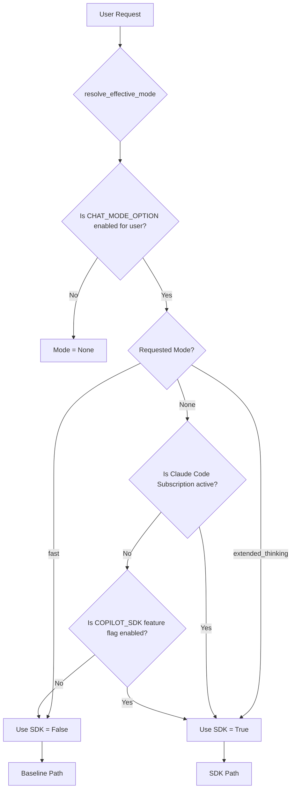

<!-- source: DeepWiki mcp.deepwiki.com · repo Significant-Gravitas/AutoGPT · extra page Copilot Architecture and Execution · fetched 2026-10-26 -->

# Copilot Architecture and Execution

<details>
<summary>Relevant source files</summary>

The following files were used as context for generating this wiki page:

- [.claude/skills/pr-polish/SKILL.md](.claude/skills/pr-polish/SKILL.md)
- [autogpt_platform/backend/backend/copilot/baseline/service.py](autogpt_platform/backend/backend/copilot/baseline/service.py)
- [autogpt_platform/backend/backend/copilot/baseline/service_unit_test.py](autogpt_platform/backend/backend/copilot/baseline/service_unit_test.py)
- [autogpt_platform/backend/backend/copilot/baseline/transcript_integration_test.py](autogpt_platform/backend/backend/copilot/baseline/transcript_integration_test.py)
- [autogpt_platform/backend/backend/copilot/config.py](autogpt_platform/backend/backend/copilot/config.py)
- [autogpt_platform/backend/backend/copilot/config_test.py](autogpt_platform/backend/backend/copilot/config_test.py)
- [autogpt_platform/backend/backend/copilot/constants.py](autogpt_platform/backend/backend/copilot/constants.py)
- [autogpt_platform/backend/backend/copilot/executor/manager.py](autogpt_platform/backend/backend/copilot/executor/manager.py)
- [autogpt_platform/backend/backend/copilot/executor/processor.py](autogpt_platform/backend/backend/copilot/executor/processor.py)
- [autogpt_platform/backend/backend/copilot/executor/processor_test.py](autogpt_platform/backend/backend/copilot/executor/processor_test.py)
- [autogpt_platform/backend/backend/copilot/model_normalize_test.py](autogpt_platform/backend/backend/copilot/model_normalize_test.py)
- [autogpt_platform/backend/backend/copilot/pending_messages.py](autogpt_platform/backend/backend/copilot/pending_messages.py)
- [autogpt_platform/backend/backend/copilot/pending_messages_test.py](autogpt_platform/backend/backend/copilot/pending_messages_test.py)
- [autogpt_platform/backend/backend/copilot/sdk/e2e_compaction_test.py](autogpt_platform/backend/backend/copilot/sdk/e2e_compaction_test.py)
- [autogpt_platform/backend/backend/copilot/sdk/mode_switch_context_test.py](autogpt_platform/backend/backend/copilot/sdk/mode_switch_context_test.py)
- [autogpt_platform/backend/backend/copilot/sdk/p0_guardrails_test.py](autogpt_platform/backend/backend/copilot/sdk/p0_guardrails_test.py)
- [autogpt_platform/backend/backend/copilot/sdk/query_builder_test.py](autogpt_platform/backend/backend/copilot/sdk/query_builder_test.py)
- [autogpt_platform/backend/backend/copilot/sdk/response_adapter.py](autogpt_platform/backend/backend/copilot/sdk/response_adapter.py)
- [autogpt_platform/backend/backend/copilot/sdk/response_adapter_test.py](autogpt_platform/backend/backend/copilot/sdk/response_adapter_test.py)
- [autogpt_platform/backend/backend/copilot/sdk/retry_scenarios_test.py](autogpt_platform/backend/backend/copilot/sdk/retry_scenarios_test.py)
- [autogpt_platform/backend/backend/copilot/sdk/service.py](autogpt_platform/backend/backend/copilot/sdk/service.py)
- [autogpt_platform/backend/backend/copilot/sdk/service_helpers_test.py](autogpt_platform/backend/backend/copilot/sdk/service_helpers_test.py)
- [autogpt_platform/backend/backend/copilot/sdk/service_test.py](autogpt_platform/backend/backend/copilot/sdk/service_test.py)
- [autogpt_platform/backend/backend/copilot/sdk/session_persistence_test.py](autogpt_platform/backend/backend/copilot/sdk/session_persistence_test.py)
- [autogpt_platform/backend/backend/copilot/sdk/transcript.py](autogpt_platform/backend/backend/copilot/sdk/transcript.py)
- [autogpt_platform/backend/backend/copilot/sdk/transcript_test.py](autogpt_platform/backend/backend/copilot/sdk/transcript_test.py)
- [autogpt_platform/backend/backend/copilot/service.py](autogpt_platform/backend/backend/copilot/service.py)
- [autogpt_platform/backend/backend/copilot/service_test.py](autogpt_platform/backend/backend/copilot/service_test.py)
- [autogpt_platform/backend/backend/copilot/session_cleanup.py](autogpt_platform/backend/backend/copilot/session_cleanup.py)
- [autogpt_platform/backend/backend/copilot/stream_registry.py](autogpt_platform/backend/backend/copilot/stream_registry.py)
- [autogpt_platform/backend/backend/copilot/stream_registry_test.py](autogpt_platform/backend/backend/copilot/stream_registry_test.py)
- [autogpt_platform/backend/backend/copilot/transcript.py](autogpt_platform/backend/backend/copilot/transcript.py)
- [autogpt_platform/backend/backend/copilot/transcript_test.py](autogpt_platform/backend/backend/copilot/transcript_test.py)
- [autogpt_platform/backend/backend/data/redis_client.py](autogpt_platform/backend/backend/data/redis_client.py)
- [autogpt_platform/backend/backend/data/redis_client_test.py](autogpt_platform/backend/backend/data/redis_client_test.py)
- [autogpt_platform/backend/backend/executor/cluster_lock.py](autogpt_platform/backend/backend/executor/cluster_lock.py)
- [autogpt_platform/backend/backend/executor/cluster_lock_test.py](autogpt_platform/backend/backend/executor/cluster_lock_test.py)
- [autogpt_platform/backend/scripts/download_transcripts.py](autogpt_platform/backend/scripts/download_transcripts.py)
- [autogpt_platform/backend/test/copilot/test_transcript_watermark.py](autogpt_platform/backend/test/copilot/test_transcript_watermark.py)

</details>


This page details the architecture and execution flow of the AutoGPT Copilot system. It covers the two primary execution paths (SDK and Baseline), the role of the `CoPilotProcessor`, the `stream_registry` for managing real-time communication, the session lifecycle, distributed locking mechanisms, and transcript management.

## Execution Paths

The Copilot system supports two main execution paths for processing user requests:

1.  **SDK Path (Extended Thinking)**: This path leverages the Claude Agent SDK for advanced reasoning and tool orchestration. It is designed for complex tasks requiring more sophisticated AI capabilities.
2.  **Baseline Path (Fast)**: This path uses an OpenAI-compatible API (typically via OpenRouter) and a shared tool registry. It is optimized for faster responses and simpler interactions.

The choice between these paths is determined by a combination of user-selected mode, Claude Code subscription status, and feature flags.

### Mode Resolution

The `resolve_effective_mode` function [backend/backend/copilot/executor/processor.py:123-144]() first checks if the user is entitled to use the mode toggle via the `CHAT_MODE_OPTION` feature flag. If not, any requested mode is ignored.

The `resolve_use_sdk_for_mode` function [backend/backend/copilot/executor/processor.py:147-168]() then determines whether to use the SDK path based on the resolved mode:
*   If `mode` is "fast", the SDK path is not used.
*   If `mode` is "extended_thinking", the SDK path is used.
*   Otherwise, it falls back to checking the `use_claude_code_subscription` flag and then the `COPILOT_SDK` LaunchDarkly feature flag.



Sources:
* [backend/backend/copilot/executor/processor.py:123-144]()
* [backend/backend/copilot/executor/processor.py:147-168]()

### SDK Path (`stream_chat_completion_sdk`)

The SDK path is handled by the `stream_chat_completion_sdk` function [backend/backend/copilot/sdk/service.py:300-300](). This function orchestrates the interaction with the Claude Agent SDK.

**Key Components and Flow:**

1.  **Initialization**:
    *   A `ClaudeSDKClient` [backend/backend/copilot/sdk/service.py:30-37]() is initialized with the appropriate model and API key.
    *   A `TranscriptBuilder` [backend/backend/copilot/transcript_builder.py:1-1]() is used to manage the conversation history.
    *   `SDKResponseAdapter` [backend/backend/copilot/sdk/response_adapter.py:72-72]() converts SDK-specific messages into a standardized `StreamBaseResponse` format for the frontend.
    *   `AsyncClusterLock` [backend/backend/executor/cluster_lock.py:1-1]() is acquired to ensure exclusive access to the session.

2.  **System Prompt and Context**:
    *   The system prompt is constructed using `_build_system_prompt` [backend/backend/copilot/service.py:153-153] and augmented with user context, Graphiti supplements, and environment context.
    *   File attachments are prepared, with images embedded as vision blocks and other files saved to the workspace for tool access [backend/backend/copilot/sdk/service.py:480-560]().

3.  **Streaming Loop**:
    *   The `_iter_sdk_messages` generator [backend/backend/copilot/sdk/service.py:600-600]() continuously yields messages from the Claude Agent SDK.
    *   Messages are processed by the `SDKResponseAdapter` [backend/backend/copilot/sdk/response_adapter.py:72-72]() and sent to the `stream_registry` [backend/backend/copilot/stream_registry.py:1-1]().
    *   Tool calls are intercepted and executed via the `create_copilot_mcp_server` [backend/backend/copilot/sdk/tool_adapter.py:200-200]() (Multi-Client Proxy) which routes them to the appropriate backend tools.
    *   The `ThinkingStripper` [backend/backend/copilot/thinking_stripper.py:1-1]() removes internal thinking blocks from the final output.

4.  **Retry Mechanism**:
    *   If a "prompt too long" error occurs, the system attempts to reduce the context by:
        1.  Compacting the transcript using `compact_transcript` [backend/backend/copilot/transcript.py:200-200]().
        2.  If compaction fails or is insufficient, dropping the transcript and rebuilding messages from the database.
    *   This retry loop is managed by `_MAX_STREAM_ATTEMPTS` [backend/backend/copilot/sdk/service.py:186-186] (currently 3 attempts).

5.  **Transcript Management**:
    *   The conversation transcript is continuously updated and managed by the `TranscriptBuilder` [backend/backend/copilot/transcript_builder.py:1-1]().
    *   At the end of a turn, the transcript is uploaded to storage via `upload_transcript` [backend/backend/copilot/transcript.py:260-260]().

6.  **Usage Tracking**:
    *   Token usage and cost are tracked and persisted using `persist_and_record_usage` [backend/backend/copilot/token_tracking.py:1-1]().

```mermaid
graph TD
    A[User Message] --> B{stream_chat_completion_sdk};
    B --> C[Initialize ClaudeSDKClient];
    B --> D[Acquire AsyncClusterLock];
    B --> E[Build System Prompt & Context];
    E --> F[Prepare File Attachments];
    F --> G[Start Streaming Loop (_iter_sdk_messages)];
    G --> H{Claude Agent SDK StreamEvent};
    H -- SystemMessage --> I[SDKResponseAdapter.convert_message];
    H -- AssistantMessage (TextBlock) --> I;
    H -- AssistantMessage (ToolUseBlock) --> J[MCP Server (create_copilot_mcp_server)];
    J --> K[Execute Tool];
    K --> L[ToolResultBlock];
    L --> I;
    I --> M[StreamRegistry.publish_message];
    M --> N[Frontend (SSE)];
    H -- Error (e.g., "prompt too long") --> O{Retry Logic};
    O -- Attempt 1 (Original) --> G;
    O -- Attempt 2 (Compacted Transcript) --> P[compact_transcript];
    P --> G;
    O -- Attempt 3 (DB Messages Only) --> Q[Rebuild from DB];
    Q --> G;
    O -- All attempts exhausted --> R[StreamError];
    G --> S[End of Turn];
    S --> T[Upload Transcript];
    S --> U[Persist Usage];
    S --> V[Release Lock];
```

Sources:
* [backend/backend/copilot/sdk/service.py:300-300]()
* [backend/backend/copilot/sdk/service.py:30-37]()
* [backend/backend/copilot/transcript_builder.py:1-1]()
* [backend/backend/copilot/sdk/response_adapter.py:72-72]()
* [backend/backend/executor/cluster_lock.py:1-1]()
* [backend/backend/copilot/service.py:153-153]()
* [backend/backend/copilot/sdk/service.py:480-560]()
* [backend/backend/copilot/sdk/service.py:600-600]()
* [backend/backend/copilot/sdk/tool_adapter.py:200-200]()
* [backend/backend/copilot/thinking_stripper.py:1-1]()
* [backend/backend/copilot/sdk/service.py:186-186]()
* [backend/backend/copilot/transcript.py:200-200]()
* [backend/backend/copilot/transcript.py:260-260]()
* [backend/backend/copilot/token_tracking.py:1-1]()
* [backend/backend/copilot/stream_registry.py:1-1]()

### Baseline Path (`stream_chat_completion_baseline`)

The baseline path is implemented in `stream_chat_completion_baseline` [backend/backend/copilot/baseline/service.py:210-210](). It uses an OpenAI-compatible client and a `tool_call_loop` [backend/util/tool_call_loop.py:1-1]() to manage tool execution.

**Key Components and Flow:**

1.  **Initialization**:
    *   An OpenAI-compatible client (`LangfuseAsyncOpenAI`) is obtained via `_get_main_client` [backend/backend/copilot/service.py:67-80]().
    *   A `TranscriptBuilder` [backend/backend/copilot/transcript_builder.py:1-1]() manages conversation history.
    *   `AsyncClusterLock` [backend/backend/executor/cluster_lock.py:1-1]() is acquired.

2.  **System Prompt and Context**:
    *   Similar to the SDK path, a system prompt is built with user context, Graphiti supplements, and environment context.
    *   The `SHARED_TOOL_NOTES` [backend/backend/copilot/prompting.py:1-1]() are included in the system prompt to inform the LLM about available tools.

3.  **Tool Call Loop**:
    *   The core of the baseline path is the `tool_call_loop` [backend/util/tool_call_loop.py:1-1](). This loop iteratively:
        1.  Sends messages to the LLM.
        2.  Receives LLM responses, which can be text or tool calls.
        3.  If tool calls are present, `execute_tool` [backend/backend/copilot/tools.py:1-1]() is invoked.
        4.  Tool results are then fed back into the LLM as part of the next turn.
    *   The `BaselineReasoningEmitter` [backend/backend/copilot/baseline/reasoning.py:33-33]() streams reasoning steps to the frontend.

4.  **Transcript Management**:
    *   The `TranscriptBuilder` [backend/backend/copilot/transcript_builder.py:1-1]() is used to record messages and tool interactions.
    *   `_load_prior_transcript` [backend/backend/copilot/baseline/service.py:309-309]() and `_upload_final_transcript` [backend/backend/copilot/baseline/service.py:370-370]() handle persistence.

5.  **Usage Tracking**:
    *   Token usage and cost are tracked and persisted using `persist_and_record_usage` [backend/backend/copilot/token_tracking.py:1-1]().

```mermaid
graph TD
    A[User Message] --> B{stream_chat_completion_baseline};
    B --> C[Initialize OpenAI-compatible Client];
    B --> D[Acquire AsyncClusterLock];
    B --> E[Build System Prompt & Context];
    E --> F[Start Tool Call Loop (tool_call_loop)];
    F --> G{Send Messages to LLM};
    G --> H{LLM Response};
    H -- Text --> I[Stream Text Delta];
    H -- Tool Call --> J[Execute Tool (execute_tool)];
    J --> K[Tool Result];
    K --> G;
    I --> L[BaselineReasoningEmitter];
    L --> M[StreamRegistry.publish_message];
    M --> N[Frontend (SSE)];
    F --> O[End of Turn];
    O --> P[Upload Transcript];
    O --> Q[Persist Usage];
    O --> R[Release Lock];
```

Sources:
* [backend/backend/copilot/baseline/service.py:210-210]()
* [backend/util/tool_call_loop.py:1-1]()
* [backend/backend/copilot/service.py:67-80]()
* [backend/backend/copilot/transcript_builder.py:1-1]()
* [backend/backend/executor/cluster_lock.py:1-1]()
* [backend/backend/copilot/prompting.py:1-1]()
* [backend/backend/copilot/tools.py:1-1]()
* [backend/backend/copilot/baseline/reasoning.py:33-33]()
* [backend/backend/copilot/baseline/service.py:309-309]()
* [backend/backend/copilot/baseline/service.py:370-370]()
* [backend/backend/copilot/token_tracking.py:1-1]()
* [backend/backend/copilot/stream_registry.py:1-1]()

## CoPilotProcessor

The `CoPilotProcessor` [backend/backend/copilot/executor/processor.py:177-177]() is responsible for executing a single Copilot turn within a dedicated thread pool worker. It acts as the bridge between the manager and the specific execution path (SDK or Baseline).

**Key Responsibilities:**

*   **Entry Point**: The `execute_copilot_turn` function [backend/backend/copilot/executor/processor.py:177-177]() is called by the thread pool executor to start a turn.
*   **Mode Selection**: It determines which execution path (`stream_chat_completion_sdk` or `stream_chat_completion_baseline`) to use based on the resolved mode.
*   **Cancellation Handling**: It monitors a `threading.Event` [backend/backend/copilot/executor/processor.py:180-180]() for cancellation signals and attempts to gracefully stop the ongoing stream.
*   **Distributed Locking**: It manages the `ClusterLock` [backend/backend/executor/cluster_lock.py:20-20]() for the session, ensuring only one worker processes a session at a time.
*   **Fail-Close Mechanism**: In case of unexpected shutdown or errors, `sync_fail_close_session` [backend/backend/copilot/executor/processor.py:63-118]() attempts to synchronously mark the session as failed in Redis, preventing it from hanging indefinitely.

```mermaid
graph TD
    A[Manager (main thread)] --> B[Thread Pool Executor];
    B --> C[Worker Thread];
    C --> D[CoPilotProcessor.execute_copilot_turn];
    D --> E[Acquire ClusterLock];
    D --> F{Resolve Execution Mode};
    F -- SDK Path --> G[stream_chat_completion_sdk];
    F -- Baseline Path --> H[stream_chat_completion_baseline];
    G --> I[Stream Messages to Frontend];
    H --> I;
    I --> J[Release ClusterLock];
    D -- Cancellation Signal --> K[Attempt Graceful Shutdown];
    D -- Error / Timeout --> L[sync_fail_close_session];
    L --> M[Mark Session Failed in Redis];
```

Sources:
* [backend/backend/copilot/executor/processor.py:177-177]()
* [backend/backend/copilot/executor/processor.py:180-180]()
* [backend/backend/executor/cluster_lock.py:20-20]()
* [backend/backend/copilot/executor/processor.py:63-118]()

## Stream Registry

The `stream_registry` [backend/backend/copilot/stream_registry.py:1-1]() is a critical component for managing real-time communication between the backend and the frontend. It uses Redis Streams and Hashes to provide a scalable and stateless mechanism for delivering streaming responses.

**Key Features:**

*   **Statelessness**: All state is stored in Redis, allowing any backend pod to handle any part of a session without maintaining in-memory state.
*   **Redis Streams**: Messages are published to a Redis Stream keyed by `turn_id` [backend/backend/copilot/stream_registry.py:111-111](). This provides a persistent log of events for replay and real-time delivery.
*   **Redis Hashes**: Session metadata (e.g., `session_id`, `user_id`, `status`) is stored in Redis Hashes, keyed by `session_id` [backend/backend/copilot/stream_registry.py:103-103]().
*   **`create_session`**: Initializes a new streaming session in Redis, storing metadata and setting the initial status to "running" [backend/backend/copilot/stream_registry.py:143-160]().
*   **`publish_message`**: Publishes `StreamBaseResponse` objects to the Redis Stream for the current turn [backend/backend/copilot/stream_registry.py:250-250]().
*   **`subscribe_to_session`**: Allows frontend clients to subscribe to a session. It first replays missed messages from the Redis Stream and then listens for live updates using blocking `XREAD` [backend/backend/copilot/stream_registry.py:300-300]().
*   **`mark_session_completed`**: Updates the session status in Redis to "completed" or "failed" and releases the turn slot [backend/backend/copilot/stream_registry.py:219-219]().
*   **Heartbeats**: `StreamHeartbeat` events [backend/backend/copilot/response_model.py:43-43]() are sent periodically to keep the Redis TTL alive for active sessions.

```mermaid
graph TD
    A[CoPilotProcessor] --> B[stream_registry.create_session];
    B --> C[Redis Hash (Session Metadata)];
    C --> D[Redis Stream (Turn Messages)];
    A --> E[stream_registry.publish_message];
    E --> D;
    F[Frontend Client] --> G[stream_registry.subscribe_to_session];
    G --> H[Replay Missed Messages from Redis Stream];
    H --> I[Listen for Live Updates (XREAD)];
    D --> I;
    I --> J[StreamBaseResponse to Frontend];
    A --> K[stream_registry.mark_session_completed];
    K --> C;
```

Sources:
* [backend/backend/copilot/stream_registry.py:1-1]()
* [backend/backend/copilot/stream_registry.py:111-111]()
* [backend/backend/copilot/stream_registry.py:103-103]()
* [backend/backend/copilot/stream_registry.py:143-160]()
* [backend/backend/copilot/stream_registry.py:250-250]()
* [backend/backend/copilot/stream_registry.py:300-300]()
* [backend/backend/copilot/stream_registry.py:219-219]()
* [backend/backend/copilot/response_model.py:43-43]()

## Session Lifecycle

A Copilot session progresses through several states, managed primarily by the `stream_registry` and the `CoPilotProcessor`.

1.  **Creation**: A new session is initiated by `create_session` [backend/backend/copilot/stream_registry.py:143-160](), which sets its status to "running" in Redis.
2.  **Execution**: The `CoPilotProcessor` [backend/backend/copilot/executor/processor.py:177-177]() executes the turn, publishing messages to the Redis Stream.
3.  **Streaming**: Frontend clients subscribe to the session and receive real-time updates.
4.  **Completion**: When the AI turn finishes (either successfully or with an error), `mark_session_completed` [backend/backend/copilot/stream_registry.py:219-219]() updates the session status to "completed" or "failed".
5.  **Cleanup**:
    *   `prune_orphan_tool_calls` [backend/backend/copilot/session_cleanup.py:1-1]() periodically cleans up tool calls that were initiated but never completed.
    *   Stale sessions in Redis are eventually reaped by TTLs.

## Distributed Locking

The Copilot system uses `AsyncClusterLock` [backend/backend/executor/cluster_lock.py:20-20]() to ensure that only one worker processes a given session at a time. This is crucial in a distributed environment to prevent race conditions and inconsistent state.

*   **Acquisition**: Before starting a turn, the `CoPilotProcessor` [backend/backend/copilot/executor/processor.py:177-177]() attempts to acquire a lock for the `session_id` using `AsyncClusterLock(get_session_lock_key(session_id))` [backend/backend/copilot/executor/utils.py:1-1]().
*   **Release**: The lock is released upon completion of the turn, or in case of an error, by the `sync_fail_close_session` [backend/backend/copilot/executor/processor.py:63-118]() mechanism.
*   **Redis-backed**: The `AsyncClusterLock` [backend/backend/executor/cluster_lock.py:20-20]() uses Redis for its underlying locking mechanism, ensuring atomicity and visibility across different worker instances.

Sources:
* [backend/backend/executor/cluster_lock.py:20-20]()
* [backend/backend/copilot/executor/processor.py:177-177]()
* [backend/backend/copilot/executor/utils.py:1-1]()
* [backend/backend/copilot/executor/processor.py:63-118]()

## Transcript Management

Conversation transcripts are essential for maintaining context and enabling features like session replay and compression.

*   **`TranscriptBuilder`**: This class [backend/backend/copilot/transcript_builder.py:1-1]() is used to construct the conversation history in a JSONL format. It appends user messages, assistant messages, and tool interactions.
*   **`download_transcript`**: Retrieves the stored transcript for a given session from storage [backend/backend/copilot/transcript.py:170-170]().
*   **`upload_transcript`**: Persists the current state of the `TranscriptBuilder` [backend/backend/copilot/transcript.py:260-260]() to storage (e.g., S3).
*   **`compact_transcript`**: When the prompt becomes too long, this function [backend/backend/copilot/transcript.py:200-200]() uses an LLM to summarize older parts of the conversation, reducing the token count while preserving essential context.
*   **`validate_transcript`**: Ensures the integrity and correctness of the transcript data [backend/backend/copilot/transcript.py:280-280]().
*   **`cleanup_stale_project_dirs`**: Periodically removes old project directories associated with transcripts [backend/backend/copilot/transcript.py:300-300]().

Sources:
* [backend/backend/copilot/transcript_builder.py:1-1]()
* [backend/backend/copilot/transcript.py:170-170]()
* [backend/backend/copilot/transcript.py:260-260]()
* [backend/backend/copilot/transcript.py:200-200]()
* [backend/backend/copilot/transcript.py:280-280]()
* [backend/backend/copilot/transcript.py:300-300]()

---

