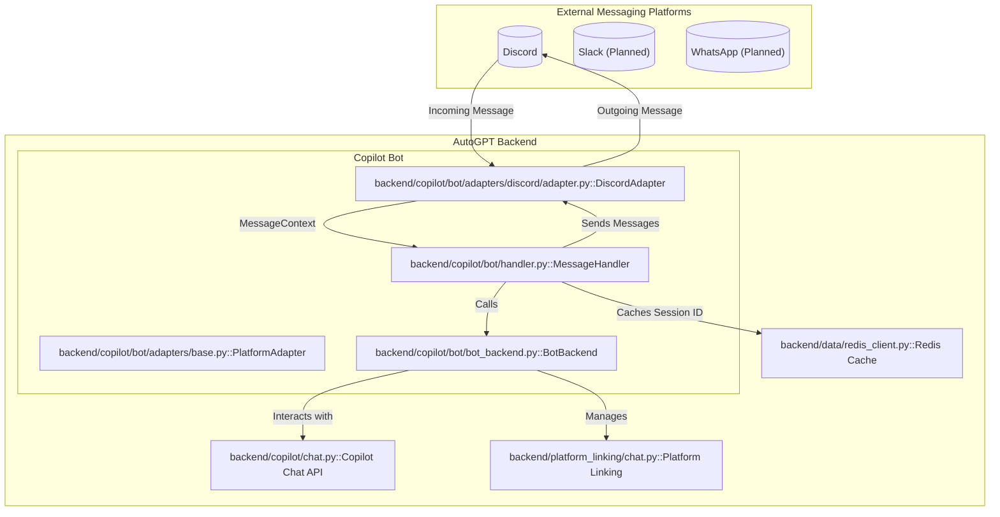
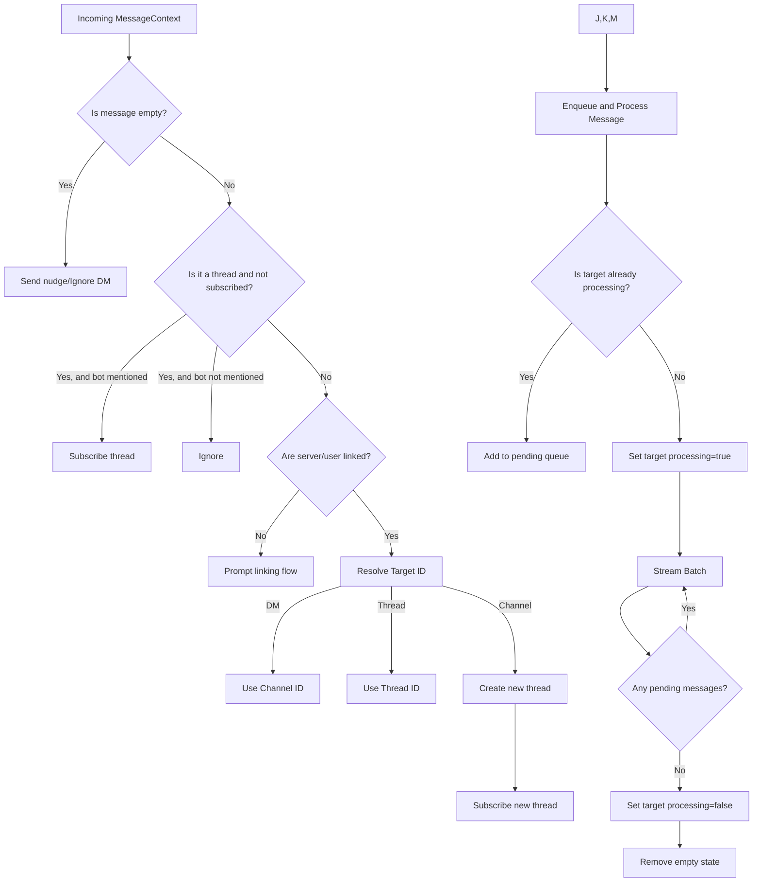

<!-- source: DeepWiki mcp.deepwiki.com · repo Significant-Gravitas/AutoGPT · extra page Copilot Bot Adapters · fetched 2026-10-26 -->

# Copilot Bot Adapters

Relevant source files

The following files were used as context for generating this wiki page:

- [autogpt_platform/backend/backend/copilot/bot/adapters/base.py](autogpt_platform/backend/backend/copilot/bot/adapters/base.py)
- [autogpt_platform/backend/backend/copilot/bot/adapters/discord/adapter.py](autogpt_platform/backend/backend/copilot/bot/adapters/discord/adapter.py)
- [autogpt_platform/backend/backend/copilot/bot/adapters/discord/adapter_test.py](autogpt_platform/backend/backend/copilot/bot/adapters/discord/adapter_test.py)
- [autogpt_platform/backend/backend/copilot/bot/adapters/discord/commands.py](autogpt_platform/backend/backend/copilot/bot/adapters/discord/commands.py)
- [autogpt_platform/backend/backend/copilot/bot/adapters/discord/commands_test.py](autogpt_platform/backend/backend/copilot/bot/adapters/discord/commands_test.py)
- [autogpt_platform/backend/backend/copilot/bot/bot_backend.py](autogpt_platform/backend/backend/copilot/bot/bot_backend.py)
- [autogpt_platform/backend/backend/copilot/bot/bot_backend_test.py](autogpt_platform/backend/backend/copilot/bot/bot_backend_test.py)
- [autogpt_platform/backend/backend/copilot/bot/handler.py](autogpt_platform/backend/backend/copilot/bot/handler.py)
- [autogpt_platform/backend/backend/copilot/bot/handler_test.py](autogpt_platform/backend/backend/copilot/bot/handler_test.py)
- [autogpt_platform/backend/backend/platform_linking/chat.py](autogpt_platform/backend/backend/platform_linking/chat.py)
- [autogpt_platform/backend/backend/platform_linking/chat_test.py](autogpt_platform/backend/backend/platform_linking/chat_test.py)
- [autogpt_platform/frontend/public/integrations/teams.png](autogpt_platform/frontend/public/integrations/teams.png)
- [autogpt_platform/frontend/public/integrations/whatsapp.png](autogpt_platform/frontend/public/integrations/whatsapp.png)
- [autogpt_platform/frontend/src/app/(platform)/copilot/components/ChatOriginIcon/ChatOriginIcon.tsx](autogpt_platform/frontend/src/app/(platform)/copilot/components/ChatOriginIcon/ChatOriginIcon.tsx)
- [autogpt_platform/frontend/src/app/(platform)/copilot/components/ChatSearchModal/ChatSearchResults.tsx](autogpt_platform/frontend/src/app/(platform)/copilot/components/ChatSearchModal/ChatSearchResults.tsx)
- [autogpt_platform/frontend/src/app/(platform)/copilot/components/ChatSearchModal/helpers.ts](autogpt_platform/frontend/src/app/(platform)/copilot/components/ChatSearchModal/helpers.ts)
- [autogpt_platform/frontend/src/app/(platform)/copilot/components/ChatSessionBlock/ChatSessionBlock.stories.tsx](autogpt_platform/frontend/src/app/(platform)/copilot/components/ChatSessionBlock/ChatSessionBlock.stories.tsx)
- [autogpt_platform/frontend/src/app/(platform)/copilot/components/ChatSidebar/ChatSidebar.tsx](autogpt_platform/frontend/src/app/(platform)/copilot/components/ChatSidebar/ChatSidebar.tsx)
- [autogpt_platform/frontend/src/app/(platform)/copilot/components/ChatSidebar/__tests__/ChatSidebar.test.tsx](autogpt_platform/frontend/src/app/(platform)/copilot/components/ChatSidebar/__tests__/ChatSidebar.test.tsx)
- [autogpt_platform/frontend/src/app/(platform)/copilot/components/MobileDrawer/MobileDrawer.tsx](autogpt_platform/frontend/src/app/(platform)/copilot/components/MobileDrawer/MobileDrawer.tsx)
- [autogpt_platform/frontend/src/app/(platform)/copilot/components/MobileDrawer/__tests__/MobileDrawer.test.tsx](autogpt_platform/frontend/src/app/(platform)/copilot/components/MobileDrawer/__tests__/MobileDrawer.test.tsx)

This page documents the Copilot bot adapter system, which enables AutoGPT's Copilot to interact with external messaging platforms like Discord. It details the architecture of the platform-agnostic message handler, the role of platform-specific adapters, and how Copilot sessions are initiated and managed from these external channels.

## Architecture Overview

The Copilot bot system is designed with a clear separation of concerns:
1.  **Platform Adapters**: These are platform-specific implementations (e.g., Discord) that handle the nuances of interacting with each messaging service's API. They translate incoming messages into a standardized `MessageContext` and send outgoing messages using platform-specific methods.
2.  **Message Handler**: This is the core, platform-agnostic logic that processes incoming `MessageContext` objects. It manages user and server linking, routes messages to appropriate Copilot sessions, handles streaming responses, and orchestrates thread creation and renaming.
3.  **Bot Backend**: This component provides the interface to the AutoGPT platform's Copilot API, handling session creation, message streaming, and linking tokens.

This architecture ensures that new messaging platforms can be integrated by simply implementing a new `PlatformAdapter`, without modifying the core Copilot logic.

### Copilot Bot System Diagram

Sources:
- [autogpt_platform/backend/backend/copilot/bot/adapters/discord/adapter.py]()
- [autogpt_platform/backend/backend/copilot/bot/adapters/base.py]()
- [autogpt_platform/backend/backend/copilot/bot/handler.py]()
- [autogpt_platform/backend/backend/copilot/bot/bot_backend.py]()
- [autogpt_platform/backend/backend/platform_linking/chat.py]()
- [autogpt_platform/backend/backend/data/redis_client.py]()

## Platform Adapters

The `PlatformAdapter` abstract base class defines the contract for integrating with any messaging platform [autogpt_platform/backend/backend/copilot/bot/adapters/base.py:56-151](). Each adapter is responsible for:
-   **Connecting to the platform**: Establishing and maintaining a connection (e.g., Discord Gateway).
-   **Receiving messages**: Listening for incoming messages and converting them into a `MessageContext` object [autogpt_platform/backend/backend/copilot/bot/adapters/base.py:31-54]().
-   **Sending messages**: Implementing methods to send various types of messages back to the platform, including replies, direct messages, and messages with interactive elements like buttons.
-   **Thread management**: Creating and renaming conversation threads.
-   **Typing indicators**: Showing and hiding typing indicators.
-   **Mention resolution**: Handling platform-specific user mentions.

### `MessageContext`

The `MessageContext` dataclass [autogpt_platform/backend/backend/copilot/bot/adapters/base.py:31-54]() encapsulates all necessary information about an incoming message in a platform-agnostic format. Key fields include:
-   `platform`: The name of the platform (e.g., "discord").
-   `channel_type`: Categorizes the conversation as "dm", "channel" (public channel mention), or "thread" [autogpt_platform/backend/backend/copilot/bot/adapters/base.py:19-20]().
-   `server_id`, `channel_id`, `message_id`, `user_id`, `username`: Identifiers and metadata from the platform.
-   `text`: The message content, with bot mentions stripped [autogpt_platform/backend/backend/copilot/bot/adapters/discord/adapter.py:290-300]().
-   `bot_mentioned`: A boolean indicating if the bot was explicitly mentioned.
-   `thread_history`: A tuple of `MessageHistoryEntry` objects [autogpt_platform/backend/backend/copilot/bot/adapters/base.py:23-29]() providing recent conversation context.
-   `mentionable_users`: A list of users that the bot is allowed to mention in its response, preventing accidental pings [autogpt_platform/backend/backend/copilot/bot/adapters/base.py:45-49]().

### Discord Adapter (`DiscordAdapter`)

The `DiscordAdapter` [autogpt_platform/backend/backend/copilot/bot/adapters/discord/adapter.py:30-48]() implements the `PlatformAdapter` interface for Discord.
-   It uses `discord.Client` to connect to the Discord Gateway [autogpt_platform/backend/backend/copilot/bot/adapters/discord/adapter.py:37-40]().
-   It registers event handlers for `on_ready` and `on_message` [autogpt_platform/backend/backend/copilot/bot/adapters/discord/adapter.py:175-239]().
-   `on_message` processes incoming Discord messages, filters out bot's own messages [autogpt_platform/backend/backend/copilot/bot/adapters/discord/adapter.py:302-310](), determines the `channel_type` [autogpt_platform/backend/backend/copilot/bot/adapters/discord/adapter.py:312-320](), extracts `thread_history` [autogpt_platform/backend/backend/copilot/bot/adapters/discord/adapter.py:241-288](), and constructs a `MessageContext` before passing it to the `MessageHandler` [autogpt_platform/backend/backend/copilot/bot/adapters/discord/adapter.py:230-239]().
-   It implements `send_message`, `send_reply`, `send_link`, `start_typing`, `stop_typing`, `create_thread`, and `rename_thread` using Discord API calls [autogpt_platform/backend/backend/copilot/bot/adapters/discord/adapter.py:88-170]().
-   Slash commands like `/setup`, `/help`, and `/unlink` are registered via `discord.app_commands.CommandTree` [autogpt_platform/backend/backend/copilot/bot/adapters/discord/commands.py:23-40](). These commands facilitate server linking and provide user information.

### Frontend Display of Source Platform

The frontend displays the source platform for Copilot chat sessions. This is visible in the chat sidebar and mobile drawer.
-   The `ChatSessionBlock` component [autogpt_platform/frontend/src/app/(platform)/copilot/components/ChatSessionBlock/ChatSessionBlock.stories.tsx]() renders a `ChatOriginIcon` [autogpt_platform/frontend/src/app/(platform)/copilot/components/ChatOriginIcon/ChatOriginIcon.tsx]() based on the `source_platform` property of a session.
-   Examples of platform icons include Discord, Slack, WhatsApp, and Teams [autogpt_platform/frontend/public/integrations/whatsapp.png](), [autogpt_platform/frontend/public/integrations/teams.png]().
-   The `ChatSidebar` [autogpt_platform/frontend/src/app/(platform)/copilot/components/ChatSidebar/ChatSidebar.tsx:53-54]() and `MobileDrawer` [autogpt_platform/frontend/src/app/(platform)/copilot/components/MobileDrawer/MobileDrawer.tsx:30-31]() components use `useSessionList()` to fetch sessions, which include the `source_platform` [autogpt_platform/frontend/src/app/(platform)/copilot/components/ChatSidebar/__tests__/ChatSidebar.test.tsx:58]().
-   The `ChatSearchResults` component also displays the `ChatOriginIcon` [autogpt_platform/frontend/src/app/(platform)/copilot/components/ChatSearchModal/ChatSearchResults.tsx:95]().

Sources:
- [autogpt_platform/backend/backend/copilot/bot/adapters/base.py:19-20]()
- [autogpt_platform/backend/backend/copilot/bot/adapters/base.py:23-29]()
- [autogpt_platform/backend/backend/copilot/bot/adapters/base.py:31-54]()
- [autogpt_platform/backend/backend/copilot/bot/adapters/base.py:45-49]()
- [autogpt_platform/backend/backend/copilot/bot/adapters/base.py:56-151]()
- [autogpt_platform/backend/backend/copilot/bot/adapters/discord/adapter.py:30-48]()
- [autogpt_platform/backend/backend/copilot/bot/adapters/discord/adapter.py:37-40]()
- [autogpt_platform/backend/backend/copilot/bot/adapters/discord/adapter.py:88-170]()
- [autogpt_platform/backend/backend/copilot/bot/adapters/discord/adapter.py:175-239]()
- [autogpt_platform/backend/backend/copilot/bot/adapters/discord/adapter.py:230-239]()
- [autogpt_platform/backend/backend/copilot/bot/adapters/discord/adapter.py:241-288]()
- [autogpt_platform/backend/backend/copilot/bot/adapters/discord/adapter.py:290-300]()
- [autogpt_platform/backend/backend/copilot/bot/adapters/discord/adapter.py:302-310]()
- [autogpt_platform/backend/backend/copilot/bot/adapters/discord/adapter.py:312-320]()
- [autogpt_platform/backend/backend/copilot/bot/adapters/discord/commands.py:23-40]()
- [autogpt_platform/frontend/public/integrations/whatsapp.png]()
- [autogpt_platform/frontend/public/integrations/teams.png]()
- [autogpt_platform/frontend/src/app/(platform)/copilot/components/ChatSessionBlock/ChatSessionBlock.stories.tsx]()
- [autogpt_platform/frontend/src/app/(platform)/copilot/components/ChatOriginIcon/ChatOriginIcon.tsx]()
- [autogpt_platform/frontend/src/app/(platform)/copilot/components/ChatSidebar/ChatSidebar.tsx:53-54]()
- [autogpt_platform/frontend/src/app/(platform)/copilot/components/ChatSidebar/__tests__/ChatSidebar.test.tsx:58]()
- [autogpt_platform/frontend/src/app/(platform)/copilot/components/ChatSearchModal/ChatSearchResults.tsx:95]()
- [autogpt_platform/frontend/src/app/(platform)/copilot/components/MobileDrawer/MobileDrawer.tsx:30-31]()

## Message Handler (`MessageHandler`)

The `MessageHandler` class [autogpt_platform/backend/backend/copilot/bot/handler.py:50-56]() is the central component that orchestrates the Copilot's interaction flow. It receives `MessageContext` objects from adapters and drives the conversation.

### Message Handling Flow

Sources:
- [autogpt_platform/backend/backend/copilot/bot/handler.py:58-87]()
- [autogpt_platform/backend/backend/copilot/bot/handler.py:90-108]()
- [autogpt_platform/backend/backend/copilot/bot/handler.py:128-155]()

### Key Responsibilities of `MessageHandler`

1.  **Empty Message Handling**: Ignores empty direct messages and sends a nudge for empty channel mentions [autogpt_platform/backend/backend/copilot/bot/handler.py:58-65]().
2.  **Thread Subscription**: For messages in threads, it checks if the bot is subscribed. If not, and the bot was mentioned, it subscribes to the thread [autogpt_platform/backend/backend/copilot/bot/handler.py:67-75]().
3.  **Linking Enforcement (`_ensure_linked`)**:
    -   Verifies if the server (for public channels/threads) or user (for DMs) is linked to an AutoGPT account [autogpt_platform/backend/backend/copilot/bot/handler.py:77]().
    -   If a server is unlinked, it instructs the user to use the `/setup` command [autogpt_platform/backend/backend/copilot/bot/handler_test.py:116-124]().
    -   If a user's DM is unlinked, it initiates the linking flow by sending a link URL [autogpt_platform/backend/backend/copilot/bot/handler_test.py:162-169]().
    -   This linking process involves `BotBackend.resolve_server`, `BotBackend.resolve_user`, and `BotBackend.create_user_link_token` [autogpt_platform/backend/backend/copilot/bot/handler_test.py:55-65]().
4.  **Target Resolution (`_resolve_target`)**:
    -   For DMs, the `channel_id` is used as the target ID [autogpt_platform/backend/backend/copilot/bot/handler.py:93-94]().
    -   For existing threads, the `channel_id` (which is the thread ID) is used [autogpt_platform/backend/backend/copilot/bot/handler.py:96-97]().
    -   For messages in public channels, it creates a new thread using `adapter.create_thread` [autogpt_platform/backend/backend/copilot/bot/handler.py:100-103]() and subscribes to it [autogpt_platform/backend/backend/copilot/bot/handler.py:107]().
5.  **Batched Streaming (`_enqueue_and_process`, `_stream_batch`)**:
    -   Messages for a given target (DM channel or thread) are enqueued into a `TargetState` object [autogpt_platform/backend/backend/copilot/bot/handler.py:135-136]().
    -   If a stream is already active for that target, new messages are added to a `pending` queue [autogpt_platform/backend/backend/copilot/bot/handler.py:138-141]().
    -   Otherwise, a new streaming process is started, which drains the `pending` queue in batches [autogpt_platform/backend/backend/copilot/bot/handler.py:143-155]().
    -   The `_stream_batch` method [autogpt_platform/backend/backend/copilot/bot/handler.py:157-229]() streams responses from the `BotBackend.stream_chat` API [autogpt_platform/backend/backend/copilot/bot/handler.py:231](), sending chunks to the adapter.
    -   It maintains a typing indicator during streaming [autogpt_platform/backend/backend/copilot/bot/handler.py:233-234]().
    -   It handles session caching in Redis [autogpt_platform/backend/backend/copilot/bot/handler.py:165-181]() to maintain continuity across messages.
6.  **Thread Renaming**: After a session completes, the handler attempts to rename the thread based on the session's title [autogpt_platform/backend/backend/copilot/bot/handler.py:260-277](). This is done asynchronously to avoid blocking the main message flow.

### `TargetState`

The `TargetState` dataclass [autogpt_platform/backend/backend/copilot/bot/handler.py:37-48]() holds the processing state for each conversation target (DM or thread). It tracks whether a target is currently `processing` a stream and any `pending` messages that arrived during an active stream.

Sources:
- [autogpt_platform/backend/backend/copilot/bot/handler.py:37-48]()
- [autogpt_platform/backend/backend/copilot/bot/handler.py:50-56]()
- [autogpt_platform/backend/backend/copilot/bot/handler.py:58-65]()
- [autogpt_platform/backend/backend/copilot/bot/handler.py:67-75]()
- [autogpt_platform/backend/backend/copilot/bot/handler.py:77]()
- [autogpt_platform/backend/backend/copilot/bot/handler.py:93-94]()
- [autogpt_platform/backend/backend/copilot/bot/handler.py:96-97]()
- [autogpt_platform/backend/backend/copilot/bot/handler.py:100-103]()
- [autogpt_platform/backend/backend/copilot/bot/handler.py:107]()
- [autogpt_platform/backend/backend/copilot/bot/handler.py:128-155]()
- [autogpt_platform/backend/backend/copilot/bot/handler.py:135-136]()
- [autogpt_platform/backend/backend/copilot/bot/handler.py:138-141]()
- [autogpt_platform/backend/backend/copilot/bot/handler.py:143-155]()
- [autogpt_platform/backend/backend/copilot/bot/handler.py:157-229]()
- [autogpt_platform/backend/backend/copilot/bot/handler.py:165-181]()
- [autogpt_platform/backend/backend/copilot/bot/handler.py:231]()
- [autogpt_platform/backend/backend/copilot/bot/handler.py:233-234]()
- [autogpt_platform/backend/backend/copilot/bot/handler.py:260-277]()
- [autogpt_platform/backend/backend/copilot/bot/handler_test.py:55-65]()
- [autogpt_platform/backend/backend/copilot/bot/handler_test.py:116-124]()
- [autogpt_platform/backend/backend/copilot/bot/handler_test.py:162-169]()

## Bot Backend (`BotBackend`)

The `BotBackend` class [autogpt_platform/backend/backend/copilot/bot/bot_backend.py:19-20]() acts as an intermediary between the `MessageHandler` and the core AutoGPT platform services. It provides methods for:
-   **Linking**: `resolve_server`, `resolve_user`, `create_link_token` [autogpt_platform/backend/backend/copilot/bot/bot_backend.py:22-24](). These methods interact with the `PlatformLinking` service [autogpt_platform/backend/backend/platform_linking/chat.py]() to establish and verify connections between external platforms and AutoGPT user accounts.
-   **Chat Streaming**: `stream_chat` [autogpt_platform/backend/backend/copilot/bot/bot_backend.py:26](). This method is the primary interface for sending user messages to the Copilot system and receiving a streamed response. It calls the `CopilotProcessor.stream_chat` method [autogpt_platform/backend/backend/copilot/bot/bot_backend.py:100]() to initiate a Copilot session and stream messages.
-   **Session Management**: `get_session_title` [autogpt_platform/backend/backend/copilot/bot/bot_backend.py:25](). Retrieves the title of a Copilot session, used for renaming threads.

Sources:
- [autogpt_platform/backend/backend/copilot/bot/bot_backend.py:19-20]()
- [autogpt_platform/backend/backend/copilot/bot/bot_backend.py:22-24]()
- [autogpt_platform/backend/backend/copilot/bot/bot_backend.py:25]()
- [autogpt_platform/backend/backend/copilot/bot/bot_backend.py:26]()
- [autogpt_platform/backend/backend/copilot/bot/bot_backend.py:100]()
- [autogpt_platform/backend/backend/platform_linking/chat.py]()

## Copilot Session Initiation from External Channels

When a message arrives from an external platform:

1.  **Adapter Receives Message**: The platform-specific adapter (e.g., `DiscordAdapter`) receives the message.
2.  **Context Creation**: The adapter processes the raw message into a `MessageContext` object, stripping bot mentions and gathering thread history [autogpt_platform/backend/backend/copilot/bot/adapters/discord/adapter.py:230-239]().
3.  **Handler Invocation**: The adapter calls `MessageHandler.handle()` with the `MessageContext` [autogpt_platform/backend/backend/copilot/bot/adapters/discord/adapter.py:238]().
4.  **Linking Check**: `MessageHandler` verifies if the user/server is linked to an AutoGPT account. If not, it guides the user through the linking process [autogpt_platform/backend/backend/copilot/bot/handler.py:77]().
5.  **Target Resolution**: `MessageHandler` determines the `target_id` (DM channel ID or thread ID). If the message is from a public channel and the bot was mentioned, a new thread is created [autogpt_platform/backend/backend/copilot/bot/handler.py:100-103]().
6.  **Message Enqueue and Processing**: The message is enqueued for the determined `target_id`. If no active stream exists for that target, `MessageHandler` initiates a new streaming process [autogpt_platform/backend/backend/copilot/bot/handler.py:143-155]().
7.  **Copilot API Call**: `MessageHandler` calls `BotBackend.stream_chat()` [autogpt_platform/backend/backend/copilot/bot/handler.py:231](), passing the message and session context.
8.  **Session Management**: `BotBackend` interacts with the core Copilot system to either retrieve an existing session (from Redis cache [autogpt_platform/backend/backend/copilot/bot/handler.py:165-181]()) or create a new one.
9.  **Streaming Response**: The Copilot system processes the message and streams its response back through `BotBackend` to `MessageHandler`.
10. **Adapter Sends Response**: `MessageHandler` receives the streamed chunks and uses the `PlatformAdapter` (e.g., `adapter.send_message`, `adapter.send_reply`) to send the response back to the external platform [autogpt_platform/backend/backend/copilot/bot/handler.py:200-202]().
11. **Thread Renaming**: Once the Copilot session concludes, `MessageHandler` attempts to rename the thread using `adapter.rename_thread` based on the session's generated title [autogpt_platform/backend/backend/copilot/bot/handler.py:260-277]().

Sources:
- [autogpt_platform/backend/backend/copilot/bot/adapters/discord/adapter.py:230-239]()
- [autogpt_platform/backend/backend/copilot/bot/adapters/discord/adapter.py:238]()
- [autogpt_platform/backend/backend/copilot/bot/handler.py:77]()
- [autogpt_platform/backend/backend/copilot/bot/handler.py:100-103]()
- [autogpt_platform/backend/backend/copilot/bot/handler.py:143-155]()
- [autogpt_platform/backend/backend/copilot/bot/handler.py:165-181]()
- [autogpt_platform/backend/backend/copilot/bot/handler.py:200-202]()
- [autogpt_platform/backend/backend/copilot/bot/handler.py:231]()
- [autogpt_platform/backend/backend/copilot/bot/handler.py:260-277]()

---

