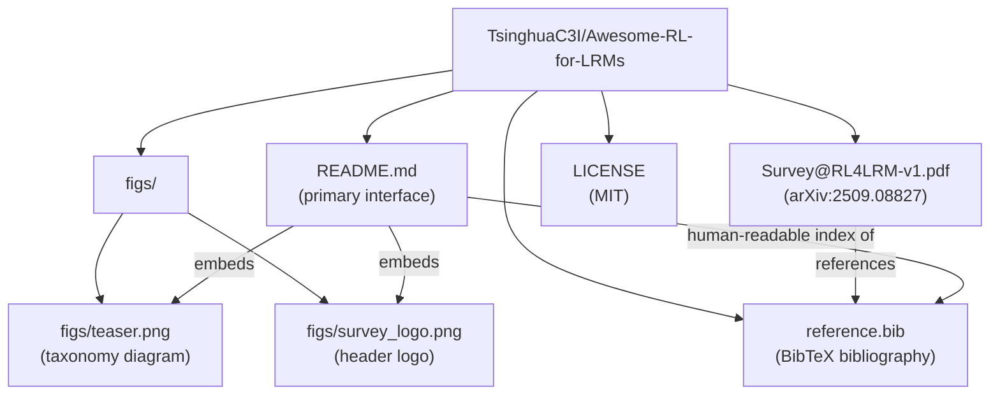
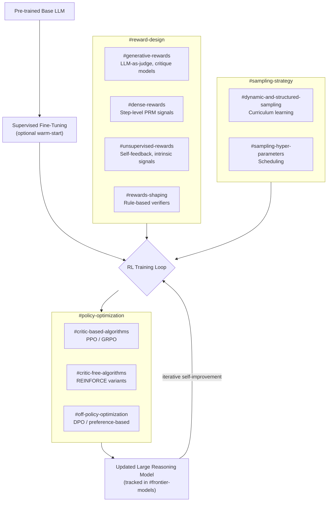

<!-- source: DeepWiki mcp.deepwiki.com · repo TsinghuaC3I/Awesome-RL-for-LRMs · page 1 Overview · fetched 2026-10-30 -->

# Overview

<details>
<summary>Relevant source files</summary>

The following files were used as context for generating this wiki page:

- [README.md](README.md)
- [Survey@RL4LRM-v1.pdf](Survey@RL4LRM-v1.pdf)
- [figs/survey_logo.png](figs/survey_logo.png)
- [figs/teaser.png](figs/teaser.png)

</details>


This page covers the structure, purpose, and navigation of the **Awesome-RL-for-LRMs** repository. For the detailed survey taxonomy and paper sub-categories, see [Survey Taxonomy](#2). For affiliated external projects and news, see [Related Projects and News](#1.1). For the BibTeX citation and license terms, see [Citation and License](#1.2).

---

## Purpose

`TsinghuaC3I/Awesome-RL-for-LRMs` is a curated, community-maintained paper index accompanying the survey:

> **"A Survey of Reinforcement Learning for Large Reasoning Models"**
> Zhang et al., 2025 — arXiv:2509.08827

The repository ranked #1 Paper of the Day on Hugging Face Daily Papers on 2025-09-12. It serves two audiences:

- **Researchers** seeking a structured index of papers on RL for Large Reasoning Models (LRMs), organized by method and domain.
- **Practitioners** who want to understand which RL techniques, datasets, environments, and infrastructure frameworks are used in training large reasoning models.

The repository has two functions:

| Function | File(s) |
|---|---|
| Curated paper list | `README.md` |
| Survey companion | `Survey@RL4LRM-v1.pdf`, `reference.bib` |

---

## File Layout

| Path | Role |
|---|---|
| `README.md` | Primary interface: survey overview and all categorized paper tables |
| `Survey@RL4LRM-v1.pdf` | Full survey PDF (slides used for BAAI, Qingke, and Tencent Wiztalk) |
| `reference.bib` | BibTeX bibliography backing the survey (~1000+ entries) |
| `figs/teaser.png` | Survey taxonomy overview figure, embedded at [README.md:99-101]() |
| `figs/survey_logo.png` | Repository logo, embedded at [README.md:3]() |
| `LICENSE` | MIT License, Copyright TsinghuaC3I 2025 |

**Repository component relationships:**



Sources: [README.md:1-10](), [README.md:95-101]()

---

## README.md Internal Structure

`README.md` is the sole navigation document. Its sections and their markdown anchors:

| Section | Anchor | Lines | Content |
|---|---|---|---|
| Header | — | [README.md:1-9]() | Badges: arXiv, GitHub, HuggingFace, Twitter |
| News | `#-news` | [README.md:14-24]() | Chronological release and project announcements |
| Citation | `#-citation` | [README.md:27-38]() | BibTeX entry for the survey |
| Contents | `#-contents` | [README.md:40-93]() | Internal anchor index for all sections |
| Overview | `#️-overview` | [README.md:95-110]() | Survey scope description + embedded `teaser.png` |
| Paper List | `#-paper-list` | [README.md:111-end]() | All categorized paper tables |

**README.md paper list anchor hierarchy** (bridges taxonomy concepts to markdown section identifiers):

```mermaid
graph TD
    PL["README.md\n#-paper-list"]

    FM["#frontier-models"]

    RD["#reward-design"]
    GR["#generative-rewards"]
    DR["#dense-rewards"]
    UR["#unsupervised-rewards"]
    RS["#rewards-shaping"]

    PO["#policy-optimization"]
    PGO["#policy-gradient-objective"]
    CBA["#critic-based-algorithms"]
    CFA["#critic-free-algorithms"]
    OPO["#off-policy-optimization"]
    OPOE["#off-policy-optimization-exp-replay"]
    REG["#regularization-objectives"]

    SS["#sampling-strategy"]
    DAS["#dynamic-and-structured-sampling"]
    SHP["#sampling-hyper-parameters"]

    TR["#training-resource"]
    SC["Static Corpus\n(code, stem, math, agent, mix)"]
    DE["Dynamic Environment\n(rule, code, game, model, ensemble)"]
    RI["RL Infrastructure\n(primary, secondary)"]

    APP["#applications\n(14 sub-sections)"]

    PL --> FM
    PL --> RD
    RD --> GR
    RD --> DR
    RD --> UR
    RD --> RS
    PL --> PO
    PO --> PGO
    PO --> CBA
    PO --> CFA
    PO --> OPO
    PO --> OPOE
    PO --> REG
    PL --> SS
    SS --> DAS
    SS --> SHP
    PL --> TR
    TR --> SC
    TR --> DE
    TR --> RI
    PL --> APP
```



Sources: [README.md:40-93](), [README.md:111-end]()

---

## Paper Entry Format

Every paper in the README tables follows a consistent five-column schema ([README.md:115-116]()):

| Column | Content |
|---|---|
| `Date` | Year-month of publication (or `-` if undated) |
| `Name` | Short backtick-formatted identifier, e.g. `` `DeepSeek-R1` ``, `` `QwQ` `` |
| `Title` | Full paper or technical report title |
| `Paper` | Badge linking to arXiv PDF, blog, or hosted report |
| `Github` | Badge linking to code repository with live star count (omitted if unavailable) |

A representative entry from [README.md:138]():

```
| 2025-01 | `DeepSeek-R1` | DeepSeek-R1: Incentivizing Reasoning Capability in LLMs via Reinforcement Learning | [arXiv badge] | [GitHub badge] |
```

---

## Survey Structure vs. README Sections

The survey paper ([README.md:103-110]()) defines five top-level sections. The `README.md` paper list exposes paper tables for four of them. "Foundational Problems" and "Future Directions" are covered in `Survey@RL4LRM-v1.pdf` but have no dedicated paper tables in the README.

| Survey Section | README Anchor(s) | Wiki Page |
|---|---|---|
| Frontier Models *(model catalog)* | `#frontier-models` | [Frontier Models](#2.1) |
| 1. Foundational Components | `#reward-design`, `#policy-optimization`, `#sampling-strategy` | [Foundational Components](#2.2) |
| 2. Foundational Problems | *(survey PDF only)* | — |
| 3. Training Resources | `#training-resource` | [Training Resources](#2.3) |
| 4. Applications | `#applications` | [Applications](#2.4) |
| 5. Future Directions | *(survey PDF only)* | — |

Sources: [README.md:103-110](), [README.md:47-91]()

---

## RL Training Pipeline (Conceptual Scope)

The survey covers the full pipeline for RL training of LRMs. Each stage maps to a top-level README paper list section:



Sources: [README.md:95-110](), [README.md:47-91]()

---

## Taxonomy at a Glance

| README Section | Sub-categories | Scope |
|---|---|---|
| `#frontier-models` | — | ~20+ recent LRM model cards |
| `#reward-design` | Generative, Dense, Unsupervised, Shaping | How reward signals are constructed |
| `#policy-optimization` | Gradient, Critic-based, Critic-free, Off-policy (×2), Regularization | How the policy is updated |
| `#sampling-strategy` | Dynamic/Structured, Hyper-Parameters | How training samples are selected |
| `#training-resource` | Static Corpus ×5, Dynamic Env ×5, Infrastructure ×2 | Datasets and RL frameworks |
| `#applications` | Agent ×7, Code ×2, Multimodal ×3, Multi-Agent, Scientific | Real-world deployment domains |

For full details on each section, see [Survey Taxonomy](#2).

---

