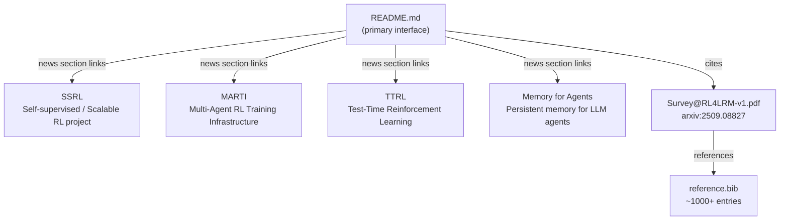
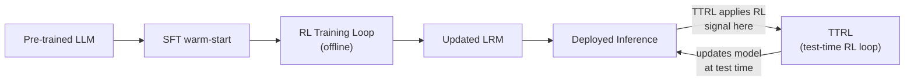
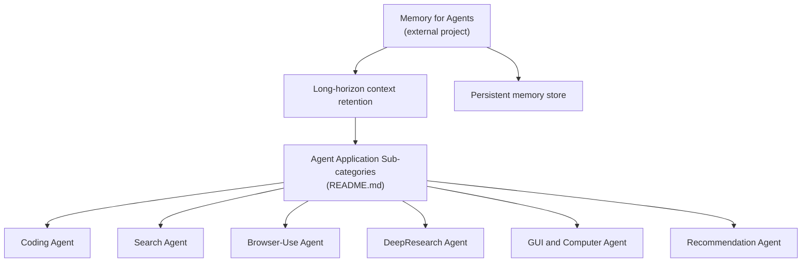

<!-- source: DeepWiki mcp.deepwiki.com · repo TsinghuaC3I/Awesome-RL-for-LRMs · page 1.1 Related Projects and News · fetched 2026-10-30 -->

# Related Projects and News

Relevant source files

The following files were used as context for generating this wiki page:

- [README.md](README.md)

## Scope

This page documents the affiliated external projects listed in the news section of the repository's primary interface, `README.md`. These projects are developed by the same research group (TsinghuaC3I) and closely related to the themes of RL for Large Reasoning Models.

For an introduction to the repository itself, see [Overview](#1). For citation and license information, see [Citation and License](#1.2). For the survey's technical content, see [Survey Taxonomy](#2).

---

## Relationship to the Repository

The news section of `README.md` tracks active sibling projects that either contribute to, or directly build on, the research themes catalogued in this survey. These are distinct codebases — not embedded within this repository — but are highlighted here because they extend or complement the survey's coverage of RL methodology for LRMs.

**Diagram: Affiliated Projects Referenced from README.md**

Sources: `README.md` (news section), system diagram 1

---

## Affiliated Projects

The four projects listed below are referenced in the `README.md` news section. Each is a standalone project from the TsinghuaC3I group that is closely related to the domains covered by this survey.

| Project | Theme | Relation to Survey |
|---|---|---|
| **SSRL** | Scalable / Self-supervised RL | Methodology: reward design and policy optimization |
| **MARTI** | Multi-agent RL training infrastructure | Infrastructure and training resources |
| **TTRL** | Test-time reinforcement learning | Policy optimization at inference time |
| **Memory for Agents** | Persistent memory for LLM-based agents | Agent applications and environment interaction |

Sources: `README.md` (news section), system diagram 1 (`EXTPROJECTS` node)

---

## SSRL

**SSRL** (Self-supervised / Scalable Reinforcement Learning) is an affiliated project concerned with scaling RL training signals without dense human-labeled reward data. Its themes overlap with the **Unsupervised Rewards** and **Reward Shaping** sub-categories described in the survey's [Reward Design](#2.2.1) section.

---

## MARTI

**MARTI** is a multi-agent RL training infrastructure project. It addresses the coordination and training of multiple LLM-based agents under a shared RL objective. Its infrastructure concerns overlap with the **RL Infrastructure** sub-category described in [Training Resources](#2.3), and its multi-agent framing connects to [Scientific Tasks and Multi-Agent Systems](#2.4.4).

---

## TTRL

**TTRL** (Test-Time Reinforcement Learning) investigates applying RL optimization signals at inference time rather than only during the offline training phase. This relates to the **Policy Optimization** component documented in [Policy Optimization](#2.2.2) and connects to the broader concept of iterative self-improvement illustrated in the RL training pipeline (Diagram 5 in the high-level overview).

**Diagram: Where TTRL fits in the RL Training Pipeline**

Sources: `README.md` (news section), system diagram 5 (RL training pipeline)

---

## Memory for Agents

**Memory for Agents** is a project that equips LLM-based agents with persistent, structured memory across interactions. This directly supports the **Agent Applications** domain (see [Agent Applications](#2.4.1)), particularly sub-categories such as **DeepResearch Agent**, **Browser-Use Agent**, and **GUI and Computer Agent**, where long-horizon task completion requires retaining context across steps.

**Diagram: Memory for Agents in the Agent Application Stack**

Sources: `README.md` (news section), system diagram 4 (Applications taxonomy)

---

## Summary

These four projects — SSRL, MARTI, TTRL, and Memory for Agents — represent active research threads from the same group that produced this survey. They are not part of this repository's codebase but are tracked in `README.md` as news items to keep readers oriented toward the evolving state of the field. The survey paper (`Survey@RL4LRM-v1.pdf`, arXiv:2509.08827) and its associated bibliography (`reference.bib`) provide the canonical academic reference for the ideas these projects build on.

Sources: `README.md`, `Survey@RL4LRM-v1.pdf`, `reference.bib`

---

