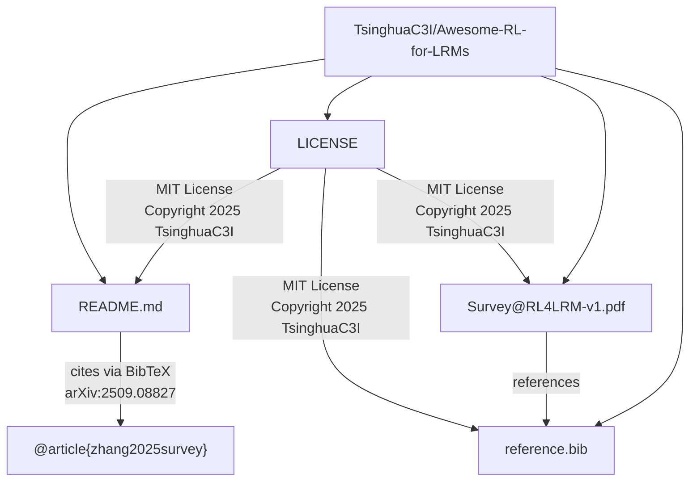
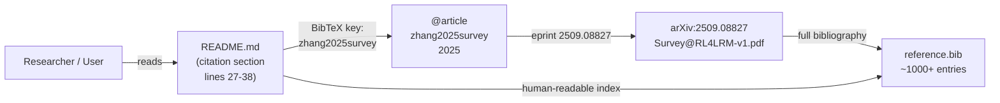

<!-- source: DeepWiki mcp.deepwiki.com · repo TsinghuaC3I/Awesome-RL-for-LRMs · page 1.2 Citation and License · fetched 2026-10-30 -->

# Citation and License

<details>
<summary>Relevant source files</summary>

The following files were used as context for generating this wiki page:

- [LICENSE](LICENSE)
- [README.md](README.md)

</details>


This page documents the formal attribution requirements and usage rights for the `TsinghuaC3I/Awesome-RL-for-LRMs` repository. It covers the BibTeX citation entry for the associated survey paper and the full terms of the MIT License. For background on what the repository contains and how it is organized, see [Overview](#1).

---

## Citation

If you use material from this repository or the associated survey paper in your research or projects, you are expected to cite the work. The canonical citation is provided in `README.md` as a BibTeX entry.

**Survey paper:** *A Survey of Reinforcement Learning for Large Reasoning Models*
**arXiv ID:** `2509.08827`
**Hugging Face Papers:** `https://huggingface.co/papers/2509.08827`

### BibTeX Entry

The following entry is sourced directly from [README.md:31-38]():

```bibtex
@article{zhang2025survey,
  title={A survey of reinforcement learning for large reasoning models},
  author={Zhang, Kaiyan and Zuo, Yuxin and He, Bingxiang and Sun, Youbang and Liu, Runze
          and Jiang, Che and Fan, Yuchen and Tian, Kai and Jia, Guoli and Li, Pengfei
          and others},
  journal={arXiv preprint arXiv:2509.08827},
  year={2025}
}
```

### Citation Field Reference

| Field | Value |
|---|---|
| `title` | A survey of reinforcement learning for large reasoning models |
| `author` | Zhang, Kaiyan et al. (TsinghuaC3I) |
| `journal` | arXiv preprint |
| `archivePrefix` | arXiv |
| `eprint` | 2509.08827 |
| `year` | 2025 |

Sources: [README.md:27-38]()

---

## License

The repository is distributed under the **MIT License**, held by TsinghuaC3I. The full license text is in [LICENSE:1-21]().

### License Summary

| Attribute | Detail |
|---|---|
| **License type** | MIT License |
| **Copyright holder** | TsinghuaC3I |
| **Copyright year** | 2025 |
| **Permissions** | Use, copy, modify, merge, publish, distribute, sublicense, sell |
| **Conditions** | Include copyright notice and license text in all copies |
| **Limitations** | No warranty; no liability |

### Full License Text

Reproduced from [LICENSE:1-21]():

```
MIT License

Copyright (c) 2025 TsinghuaC3I

Permission is hereby granted, free of charge, to any person obtaining a copy
of this software and associated documentation files (the "Software"), to deal
in the Software without restriction, including without limitation the rights
to use, copy, modify, merge, publish, distribute, sublicense, and/or sell
copies of the Software, and to permit persons to whom the Software is
furnished to do so, subject to the following conditions:

The above copyright notice and this permission notice shall be included in all
copies or substantial portions of the Software.

THE SOFTWARE IS PROVIDED "AS IS", WITHOUT WARRANTY OF ANY KIND, EXPRESS OR
IMPLIED, INCLUDING BUT NOT LIMITED TO THE WARRANTIES OF MERCHANTABILITY,
FITNESS FOR A PARTICULAR PURPOSE AND NONINFRINGEMENT. IN NO EVENT SHALL THE
AUTHORS OR COPYRIGHT HOLDERS BE LIABLE FOR ANY CLAIM, DAMAGES OR OTHER
LIABILITY, WHETHER IN AN ACTION OF CONTRACT, TORT OR OTHERWISE, ARISING FROM,
OUT OF OR IN CONNECTION WITH THE SOFTWARE OR THE USE OR OTHER DEALINGS IN THE
SOFTWARE.
```

Sources: [LICENSE:1-21]()

---

## Repository Artifacts and Their Governance

The diagram below maps each repository artifact to its governing terms and the relevant file that declares them.

**Diagram: Artifact Ownership and License Scope**



Sources: [LICENSE:1-4](), [README.md:27-38]()

---

## Citation Workflow

The following diagram illustrates how the citation entry in `README.md` connects to the actual paper artifacts.

**Diagram: Citation Chain — README to arXiv Paper**



Sources: [README.md:7](), [README.md:31-38]()

---

