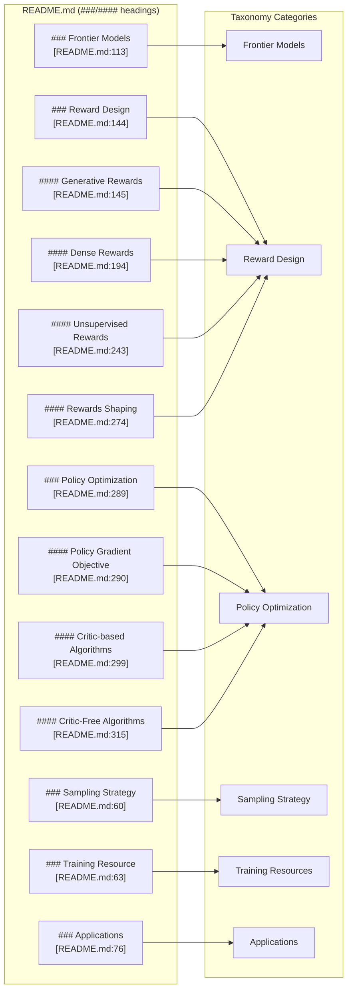
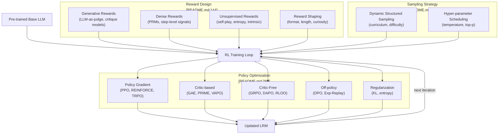

<!-- source: DeepWiki mcp.deepwiki.com · repo TsinghuaC3I/Awesome-RL-for-LRMs · page 2 Survey Taxonomy · fetched 2026-10-30 -->

# Survey Taxonomy

<details>
<summary>Relevant source files</summary>

The following files were used as context for generating this wiki page:

- [README.md](README.md)
- [Survey@RL4LRM-v1.pdf](Survey@RL4LRM-v1.pdf)
- [reference.bib](reference.bib)

</details>


This page describes the full categorical structure used by the **Awesome-RL-for-LRMs** survey to organize the literature on Reinforcement Learning for Large Reasoning Models. It covers the four top-level divisions, their subsections, and how they are physically laid out in the repository.

This page describes the taxonomy *structure* only. For details on individual subcategories, see the child pages:
- Frontier Models: [2.1](#2.1)
- Foundational Components: [2.2](#2.2)
- Training Resources: [2.3](#2.3)
- Applications: [2.4](#2.4)

---

## Overview

The survey organizes the field into **four top-level categories**, each of which maps directly to a `###`-level heading in [README.md:47-91]() and a corresponding set of entries in [reference.bib]():

| Top-Level Category | README Anchor | Purpose |
|---|---|---|
| **Frontier Models** | `#frontier-models` | Recent foundational LRM releases |
| **Foundational Components** | `#reward-design`, `#policy-optimization`, `#sampling-strategy` | Core RL methodology |
| **Training Resources** | `#training-resource` | Datasets, environments, and infrastructure |
| **Applications** | `#applications` | Task-specific deployment domains |

The README overview section ([README.md:95-110]()) provides a five-point prose summary that slightly differs from the paper-list structure: it additionally names "Foundational Problems" and "Future Directions" as survey sections, but those do not have separate paper-list headings in the repository.

Sources: [README.md:40-93](), [README.md:95-110]()

---

## Top-Level Taxonomy Diagram

The diagram below maps the four top-level categories to their README section anchors and their child subcategories.

**Figure 1: Full taxonomy as structured in `README.md`**

```mermaid
graph TD
  ROOT["README.md Paper List"]

  ROOT --> FM["### Frontier Models"]
  ROOT --> FC["Foundational Components"]
  ROOT --> TR["### Training Resource"]
  ROOT --> APP["### Applications"]

  FC --> RD["### Reward Design"]
  FC --> PO["### Policy Optimization"]
  FC --> SS["### Sampling Strategy"]

  RD --> GR["#### Generative Rewards"]
  RD --> DR["#### Dense Rewards"]
  RD --> UR["#### Unsupervised Rewards"]
  RD --> RS["#### Rewards Shaping"]

  PO --> PG["#### Policy Gradient Objective"]
  PO --> CB["#### Critic-based Algorithms"]
  PO --> CF["#### Critic-Free Algorithms"]
  PO --> OP["#### Off-policy Optimization"]
  PO --> ER["#### Off-policy Optimization (Exp replay)"]
  PO --> RO["#### Regularization Objectives"]

  SS --> DS["#### Dynamic and Structured Sampling"]
  SS --> SH["#### Sampling Hyper-Parameters"]

  TR --> SC["Static Corpus"]
  TR --> DE["Dynamic Environment"]
  TR --> RI["RL Infrastructure"]

  SC --> SCC["(Code)"]
  SC --> SCS["(STEM)"]
  SC --> SCM["(Math)"]
  SC --> SCA["(Agent)"]
  SC --> SCMX["(Mix)"]

  DE --> DER["(Rule-based)"]
  DE --> DEC["(Code-based)"]
  DE --> DEG["(Game-based)"]
  DE --> DEM["(Model-based)"]
  DE --> DEE["(Ensemble-based)"]

  RI --> RIP["(Primary)"]
  RI --> RIS["(Secondary)"]

  APP --> AG["Agent Applications"]
  APP --> CG["Code Generation / SE"]
  APP --> MM["Multimodal"]
  APP --> SC2["Scientific / Multi-Agent"]
```



Sources: [README.md:47-91]()

---

## README Section-to-Anchor Mapping

The paper-list section of [README.md:111-91]() uses the following headings. Each heading creates a navigable anchor used in the table of contents at [README.md:40-91]():

**Figure 2: Correspondence between README headings and taxonomy sections**



Sources: [README.md:47-91](), [README.md:111-144]()

---

## Category Descriptions

### Frontier Models

This category ([README.md:113-141]()) tracks major LRM releases, both open-source and proprietary. Entries are sorted reverse-chronologically and include the release date, model name (as an inline code badge), paper title, arXiv link, and GitHub repository link. Models in this section are considered "frontier" in the sense that they represent state-of-the-art reasoning capabilities achieved via RL-based post-training.

Representative entries include: `DeepSeek-R1`, `Qwen3`, `MiMo`, `Kimi K2`, `GLM-4.5`, `Intern-S1`.

For detail on what qualifies a model and a full listing, see [2.1](#2.1).

---

### Foundational Components

Foundational Components is the methodological core of the survey. It does **not** appear as a single `###` heading in README.md; instead, it is represented by three sibling `###` sections: `Reward Design`, `Policy Optimization`, and `Sampling Strategy`. This grouping is described as a top-level survey section in the prose overview at [README.md:105]().

#### Reward Design

Section `### Reward Design` ([README.md:144]()) contains four `####` subsections:

| Subsection | README Anchor | Core Idea |
|---|---|---|
| Generative Rewards | `#generative-rewards` | LLM-generated critique or judgment used as a reward signal |
| Dense Rewards | `#dense-rewards` | Step-level or token-level process reward signals (PRMs) |
| Unsupervised Rewards | `#unsupervised-rewards` | Self-rewarding, intrinsic motivation, no external labels |
| Rewards Shaping | `#rewards-shaping` | Modifications to raw reward signals for stability/exploration |

For detailed per-subcategory coverage, see [2.2.1](#2.2.1).

#### Policy Optimization

Section `### Policy Optimization` ([README.md:289]()) contains six `####` subsections:

| Subsection | README Anchor | Core Algorithms |
|---|---|---|
| Policy Gradient Objective | `#policy-gradient-objective` | `PPO`, `REINFORCE`, `TRPO`, `PG` |
| Critic-based Algorithms | `#critic-based-algorithms` | `GAE`, `PRIME`, `VAPO`, `Math-Shepherd` |
| Critic-Free Algorithms | `#critic-free-algorithms` | `GRPO`, `DAPO`, `RLOO`, `ReMax`, `Dr. GRPO` |
| Off-policy Optimization | `#off-policy-optimization` | `DPO` and variants |
| Off-policy (Exp replay) | `#off-policy-optimization-exp-replay` | Off-policy methods with experience replay buffers |
| Regularization Objectives | `#regularization-objectives` | KL divergence, entropy regularization |

For detailed per-subcategory coverage, see [2.2.2](#2.2.2).

#### Sampling Strategy

Section `### Sampling Strategy` ([README.md:60-62]()) contains two `####` subsections:

| Subsection | README Anchor | Focus |
|---|---|---|
| Dynamic and Structured Sampling | `#dynamic-and-structured-sampling` | Curriculum learning, difficulty scheduling |
| Sampling Hyper-Parameters | `#sampling-hyper-parameters` | Temperature, top-p, number of samples |

For detailed coverage, see [2.2.3](#2.2.3).

---

### Training Resources

Section `### Training Resource` ([README.md:63-75]()) is subdivided into three groups with twelve total subsections:

**Static Corpus** — pre-collected, labeled datasets:

| Subsection | README Anchor |
|---|---|
| Static Corpus (Code) | `#static-corpus-code` |
| Static Corpus (STEM) | `#static-corpus-stem` |
| Static Corpus (Math) | `#static-corpus-math` |
| Static Corpus (Agent) | `#static-corpus-agent` |
| Static Corpus (Mix) | `#static-corpus-mix` |

**Dynamic Environment** — interactive feedback sources:

| Subsection | README Anchor |
|---|---|
| Dynamic Environment (Rule-based) | `#dynamic-environment-rule-based` |
| Dynamic Environment (Code-based) | `#dynamic-environment-code-based` |
| Dynamic Environment (Game-based) | `#dynamic-environment-game-based` |
| Dynamic Environment (Model-based) | `#dynamic-environment-model-based` |
| Dynamic Environment (Ensemble-based) | `#dynamic-environment-ensemble-based` |

**RL Infrastructure** — training framework tooling:

| Subsection | README Anchor |
|---|---|
| RL Infrastructure (Primary) | `#rl-infrastructure-primary` |
| RL Infrastructure (Secondary) | `#rl-infrastructure-secondary` |

For detailed per-subcategory coverage, see [2.3](#2.3).

---

### Applications

Section `### Applications` ([README.md:76-91]()) spans fourteen `####` subsections grouped into four domains:

| Domain Group | Subsections |
|---|---|
| **Agent Applications** | Coding Agent, Search Agent, Browser-Use Agent, DeepResearch Agent, GUI & Computer Agent, Recommendation Agent, Agent (Others) |
| **Code & Engineering** | Code Generation, Software Engineering |
| **Multimodal** | Multimodal Understanding, Multimodal Generation, Robotics Tasks |
| **Scientific / Multi-Agent** | Multi-Agent Systems, Scientific Tasks |

For detailed per-subcategory coverage, see [2.4](#2.4).

---

## How Papers Are Organized

Each entry across all sections follows a consistent table schema defined in [README.md:115-116]():

```
| Date | Name | Title | Paper | Github |
|:-:|:-:|:-|:-:|:-:|
```

- **Date** — publication year and month (or `-` if undated)
- **Name** — model or system short name as an inline badge (e.g., `` `DeepSeek-R1` ``)
- **Title** — full paper title as plain text
- **Paper** — badge linking to arXiv or conference page
- **Github** — badge showing the GitHub star count and linking to the repository, or `-` if no public code

Some papers appear under **multiple subsections** when they are relevant to more than one category. For example, `GenPRM` ([README.md:229]()) appears in both `Dense Rewards` and `Generative Rewards`, and `CAPO` ([README.md:204]()) appears in both `Generative Rewards` and `Dense Rewards`.

---

## Relationship Between the BibTeX Database and the README

The file [reference.bib]() stores bibliographic records for papers cited in the survey PDF (`Survey@RL4LRM-v1.pdf`). Its internal comment structure mirrors the README taxonomy, using `#` and `##` comments as section markers:

| `reference.bib` comment header | Corresponds to |
|---|---|
| `# RL Methodology` | Foundational Components |
| `## Reward Design - Verifiable Rewards` | Dense Rewards |
| `## Reward Design - Unsupervised rewards` | Unsupervised Rewards |
| `## Reward Design - Credit Assignment` | Dense Rewards / PRM papers |
| `## Reward Design - Generative Rewards` | Generative Rewards |
| `## Reward: Turn Level` | Dense Rewards (multi-turn) |
| `## Reward Design - Reward Shaping` | Rewards Shaping |

The README paper list is the **human-readable index** into this bibliography. Not every entry in [reference.bib]() appears in the README, and vice versa — the README also links to papers whose primary BibTeX record may be in external databases.

Sources: [reference.bib:241-1210](), [README.md:111-142]()

---

## RL Training Pipeline Position of Each Category

**Figure 3: Where each taxonomy section enters the RL training loop**



Sources: [README.md:95-110](), [README.md:144-289]()

---

## Summary

The survey taxonomy defines a flat three-level hierarchy in the README:

1. **Top-level category** (`###` headings) — Frontier Models, Reward Design, Policy Optimization, Sampling Strategy, Training Resource, Applications
2. **Subcategory** (`####` headings) — e.g., Generative Rewards, Critic-Free Algorithms, Static Corpus (Math)
3. **Individual papers** — rows in a markdown table with date, name, title, paper link, and code link

The taxonomy is expressed twice in the repository: as section headings in [README.md]() (readable index) and as comment-delimited sections in [reference.bib]() (bibliographic database for the survey PDF). Child pages in this wiki document each subcategory in depth.

---

