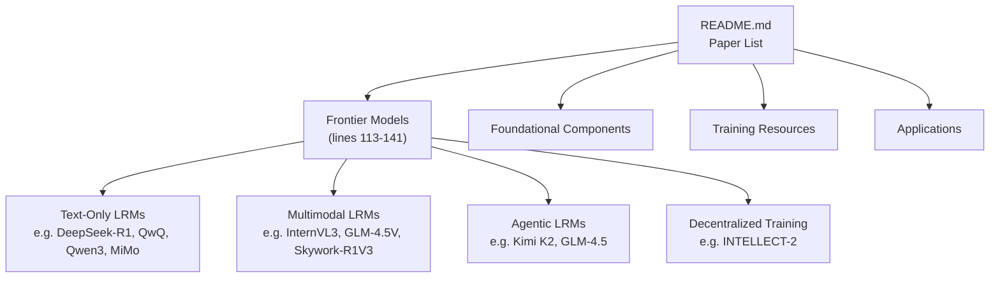
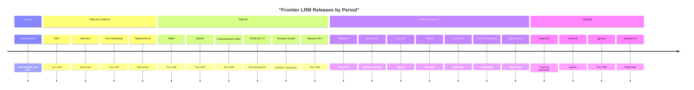
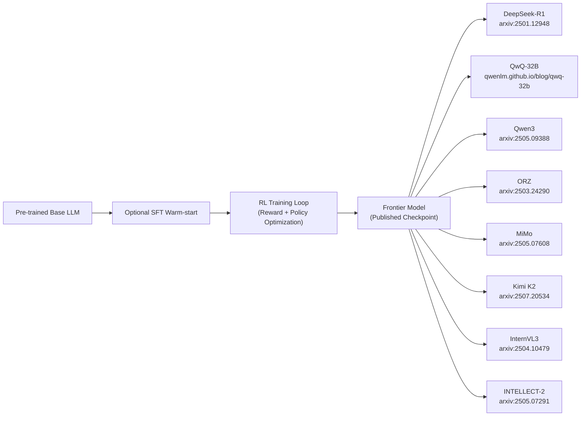

<!-- source: DeepWiki mcp.deepwiki.com · repo TsinghuaC3I/Awesome-RL-for-LRMs · page 2.1 Frontier Models · fetched 2026-10-30 -->

# Frontier Models

Relevant source files

The following files were used as context for generating this wiki page:

- [README.md](README.md)
- [reference.bib](reference.bib)

This page documents the **Frontier Models** category from the survey taxonomy — the first of four top-level sections tracked by this repository. It covers the large reasoning models (LRMs) that serve as primary references and benchmarks for the field: what makes a model qualify as a frontier LRM, how models are organized, and a summary of each entry.

This page is about the *models themselves*, not the algorithmic techniques used to train them. For the training methods applied to these models (reward design, policy optimization, sampling), see [Foundational Components](#2.2). For datasets and environments used, see [Training Resources](#2.3).

---

## What Qualifies as a Frontier Model

The Frontier Models category in [README.md:113-141]() collects papers and technical reports for models that satisfy one or more of the following criteria:

- The model is a **publicly reported** language or multimodal model trained with RL as a core post-training step.
- The model either achieves **state-of-the-art performance** on reasoning benchmarks at time of release or introduces a novel training paradigm that influences subsequent work.
- The model is associated with a formal **technical report or paper** (arXiv or equivalent).

Frontier Models span both **text-only** and **multimodal** architectures, and both **open-source** and **proprietary** (but publicly documented) systems.

Sources: [README.md:113-141]()

---

## Model Landscape

The following diagram shows how frontier models relate to the broader repository taxonomy.

**Diagram: Frontier Models in Repository Taxonomy**

Sources: [README.md:47-141]()

---

## Tracked Models

The repository tracks 25 models in this category as of the current version. The table below consolidates all entries from [README.md:115-141]().

| Date | Model Name | Category | Institution | Open Source |
|:----:|:----------:|:--------:|:-----------:|:-----------:|
| 2025-08 | `Intern-S1` | Multimodal / Science | InternLM | ✓ |
| 2025-08 | `GLM-4.5` | Agentic / Reasoning | Zhipu AI | ✓ |
| 2025-08 | `gpt-oss` | Text LRM | OpenAI | ✓ (weights) |
| 2025-08 | `InternVL3.5` | Multimodal | OpenGVLab | ✓ |
| 2025-07 | `Kimi K2` | Agentic | Moonshot AI | ✓ |
| 2025-07 | `Step 3` | Text LRM | StepFun | ✓ |
| 2025-07 | `GLM-4.1V-Thinking` | Multimodal / Reasoning | Zhipu AI | ✓ |
| 2025-07 | `Skywork-R1V3` | Multimodal | SkyworkAI | ✓ |
| 2025-07 | `GLM-4.5V` | Multimodal | Zhipu AI | ✓ |
| 2025-06 | `Magistral` | Text LRM | Mistral | — |
| 2025-06 | `Minimax-M1` | Text LRM (Lightning Attn) | MiniMax AI | ✓ |
| 2025-05 | `MiMo` | Text LRM | Xiaomi | ✓ |
| 2025-05 | `Qwen3` | Text LRM | Alibaba | ✓ |
| 2025-05 | `Llama-Nemotron-Ultra` | Text LRM | NVIDIA | ✓ |
| 2025-05 | `INTELLECT-2` | Decentralized RL | Prime Intellect | — |
| 2025-05 | `Hunyuan-TurboS` | Text LRM (Mamba+Transformer) | Tencent | ✓ |
| 2025-05 | `Skywork OR-1` | Text LRM | SkyworkAI | ✓ |
| 2025-04 | `Phi-4 Reasoning` | Text LRM | Microsoft | — |
| 2025-04 | `Skywork-R1V2` | Multimodal | SkyworkAI | ✓ |
| 2025-04 | `InternVL3` | Multimodal | OpenGVLab | ✓ |
| 2025-03 | `ORZ` | Text LRM (base model RL) | Open-Reasoner-Zero | ✓ |
| 2025-01 | `DeepSeek-R1` | Text LRM | DeepSeek | ✓ |
| — | `QwQ` | Text LRM | Alibaba (Qwen) | ✓ |
| — | `Seed-OSS` | Text LRM | ByteDance | ✓ |
| — | `ERNIE-4.5-Thinking` | Text LRM | Baidu | — |

Sources: [README.md:115-141]()

---

## Temporal Distribution

**Diagram: Frontier Model Release Timeline by Modality**

Sources: [README.md:115-141]()

---

## Model Groupings

### Text-Only Reasoning Models

These models apply RL post-training to text-based base LLMs:

| Model | Key Characteristic |
|:-----:|:----------------:|
| `DeepSeek-R1` | Seminal open-source RL-for-reasoning model; introduced GRPO-based training from a base model |
| `QwQ` | Embraces RL for extended thinking; 32B scale |
| `Qwen3` | Qwen series with RL reasoning at scale |
| `MiMo` | End-to-end training from pretraining to RL post-training |
| `ORZ` | Demonstrates RL scaling directly on a base model without SFT warmup |
| `Phi-4 Reasoning` | Microsoft; compact yet capable reasoning model |
| `Minimax-M1` | Introduces Lightning Attention for efficient test-time scaling |
| `Skywork OR-1` | Open reasoner with detailed RL training recipe |
| `Hunyuan-TurboS` | Hybrid Mamba-Transformer architecture with adaptive chain-of-thought |
| `Llama-Nemotron-Ultra` | NVIDIA's efficient reasoning model on Llama base |
| `INTELLECT-2` | Globally decentralized RL training paradigm |
| `Magistral` | Mistral's reasoning model |
| `Step 3` | Cost-effective decoding via model-system co-design |
| `gpt-oss` | OpenAI open-weight models (120B and 20B variants) |
| `Seed-OSS` | ByteDance open-source reasoning series |
| `ERNIE-4.5-Thinking` | Baidu's ERNIE series with thinking capability |

### Multimodal Reasoning Models

These models extend RL-based reasoning to vision-language inputs:

| Model | Key Characteristic |
|:-----:|:----------------:|
| `InternVL3` | Open-source multimodal with RL training recipes |
| `InternVL3.5` | Improved versatility, reasoning, and efficiency over InternVL3 |
| `Skywork-R1V2` | Hybrid RL for multimodal reasoning |
| `Skywork-R1V3` | Third iteration of Skywork's multimodal reasoner |
| `GLM-4.5V` | Zhipu AI multimodal model with scalable RL |
| `GLM-4.1V-Thinking` | Thinking variant with extended multimodal reasoning chains |
| `Intern-S1` | Scientific domain multimodal foundation model |

### Agentic Models

Models specifically designed or marketed for agentic tasks, where RL training targets tool use and multi-step interaction:

| Model | Key Characteristic |
|:-----:|:----------------:|
| `Kimi K2` | Open agentic intelligence; MoE architecture |
| `GLM-4.5` | Agentic, Reasoning, and Coding (ARC) capabilities |

Sources: [README.md:115-141]()

---

## Relationship to RL Training Pipeline

Each frontier model sits at the *output* end of an RL training pipeline. The diagram below maps the code-level identifiers used in the README to their role in the pipeline described by the survey.

**Diagram: Frontier Models as Pipeline Outputs**

Sources: [README.md:113-141]()

---

## Notable Model Details

### `DeepSeek-R1`

The earliest and most widely referenced entry. Released 2025-01, it demonstrated that RL applied directly to a base LLM (using GRPO) could produce strong reasoning behavior without supervised fine-tuning as a prerequisite. It established many conventions now used by downstream works in this survey.

- Paper: `arxiv:2501.12948`
- GitHub: `deepseek-ai/DeepSeek-R1`

### `ORZ` (Open-Reasoner-Zero)

Replicates the DeepSeek-R1-Zero methodology as a fully open-source implementation, scaling RL on a base model. Useful as a research baseline.

- Paper: `arxiv:2503.24290`
- GitHub: `Open-Reasoner-Zero/Open-Reasoner-Zero`

### `INTELLECT-2`

Distinctive for its **globally decentralized** RL training approach, where compute is contributed across distributed, untrusted nodes.

- Paper: `arxiv:2505.07291`

### `Minimax-M1`

Introduces **Lightning Attention** for scaling test-time compute efficiently, allowing longer reasoning chains without quadratic attention cost.

- Paper: `arxiv:2506.13585`
- GitHub: `MiniMax-AI/MiniMax-M1`

### `Kimi K2`

An agentic model from Moonshot AI using a Mixture-of-Experts architecture, with RL tuned for tool use and multi-step agent trajectories.

- Paper: `arxiv:2507.20534`
- GitHub: `MoonshotAI/Kimi-K2`

Sources: [README.md:115-141]()

---

## Summary of Entry Format

Each frontier model entry in [README.md:115-141]() follows a consistent schema:

| Field | Description |
|:-----:|:------------|
| `Date` | Publication or release date (`YYYY-MM` format; `-` if undated) |
| `Name` | Short model identifier used as a code token (e.g., `` `DeepSeek-R1` ``) |
| `Title` | Full paper or report title |
| `Paper` | Badge linking to arXiv or blog post |
| `Github` | Badge linking to the primary GitHub repository, with star count |

This schema is shared with all other paper list sections in the README (Reward Design, Policy Optimization, etc.) and allows the list to be filtered or extended uniformly.

Sources: [README.md:115-141]()

---

