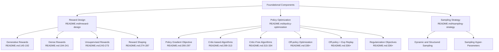
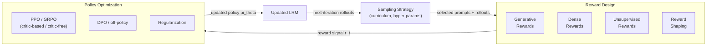
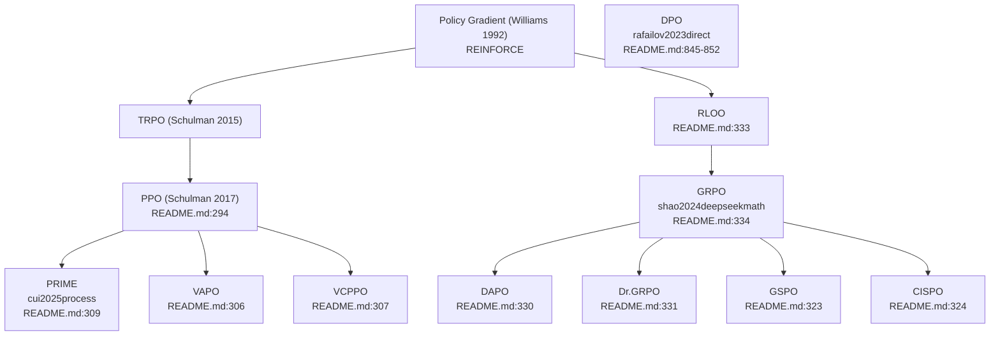
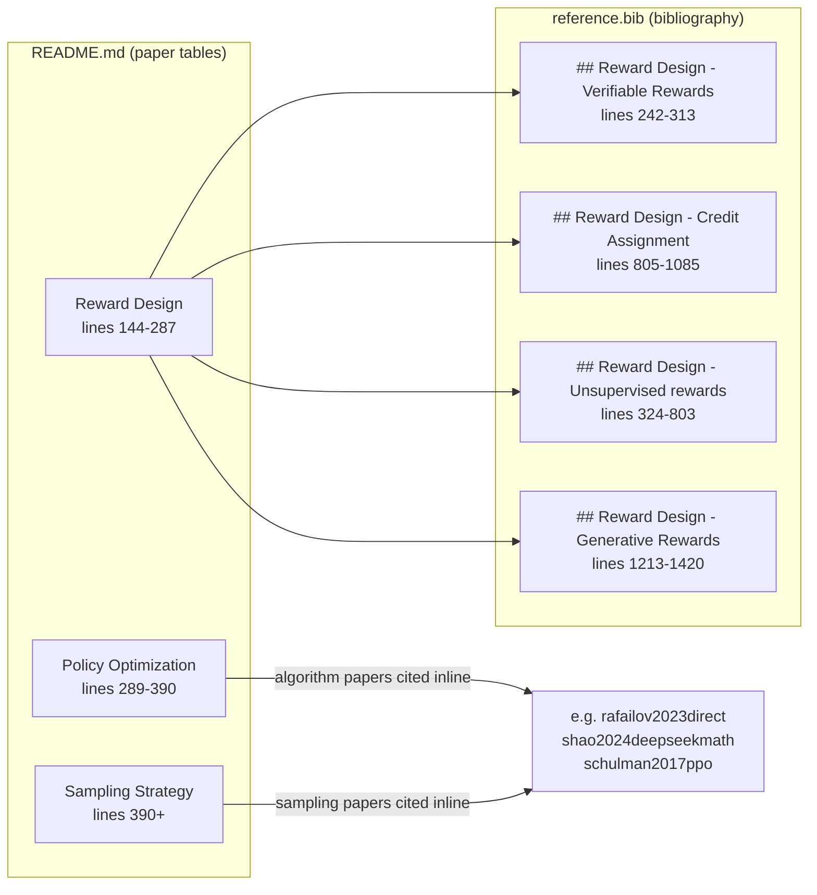

<!-- source: DeepWiki mcp.deepwiki.com · repo TsinghuaC3I/Awesome-RL-for-LRMs · page 2.2 Foundational Components · fetched 2026-10-30 -->

# Foundational Components

Relevant source files

The following files were used as context for generating this wiki page:

- [README.md](README.md)
- [Survey@RL4LRM-v1.pdf](Survey@RL4LRM-v1.pdf)
- [reference.bib](reference.bib)

This page describes the three methodological pillars of RL for Large Reasoning Models as catalogued in the survey: **Reward Design**, **Policy Optimization**, and **Sampling Strategy**. Together, these components constitute the technical core around which every RL training loop for LRMs is built.

This page provides an overview of all three pillars and how they interact. For detailed treatment of each pillar, see:
- [Reward Design (2.2.1)](#2.2.1)
- [Policy Optimization (2.2.2)](#2.2.2)
- [Sampling Strategy (2.2.3)](#2.2.3)

For the broader survey taxonomy that places Foundational Components alongside Frontier Models, Training Resources, and Applications, see [Survey Taxonomy (2)](#2).

---

## Role in the Survey

The Foundational Components category is organized under the `## Reward Design`, `## Policy Optimization`, and `## Sampling Strategy` headings in [README.md:144-390](). Each heading contains multiple sub-category tables with columns `Date | Name | Title | Paper | Github`. Citation keys for all listed papers are maintained in [reference.bib:1-1210]().

The three components are not independent. Every RL training loop for LRMs requires a signal (Reward Design), an update rule (Policy Optimization), and a data generation procedure (Sampling Strategy). The survey's taxonomy reflects this dependency explicitly.

---

## Component Overview

| Component | Role in RL Loop | Sub-categories |
|---|---|---|
| **Reward Design** | Produces scalar or dense signal to supervise policy updates | Generative Rewards, Dense Rewards, Unsupervised Rewards, Reward Shaping |
| **Policy Optimization** | Defines how parameters are updated given the reward signal | Policy Gradient Objective, Critic-based, Critic-Free, Off-policy, Off-policy+Replay, Regularization |
| **Sampling Strategy** | Controls how training rollouts are generated and scheduled | Dynamic & Structured Sampling, Sampling Hyper-Parameters |

Sources: [README.md:40-91](), [README.md:144-390]()

---

## Taxonomy Diagram

**Foundational Components — full taxonomy**

Sources: [README.md:47-62](), [README.md:144-390]()

---

## How the Components Interact

The three components map directly onto distinct phases of a single RL training iteration:

1. **Sampling Strategy** determines which prompts are selected and how many rollouts are generated per prompt.
2. **Reward Design** evaluates each rollout and produces a training signal — either outcome-level (sparse), step-level (dense), or unsupervised.
3. **Policy Optimization** uses the reward signal to compute a gradient update according to a specific algorithm (e.g., `PPO`, `GRPO`, `DPO`).

**RL Training Loop — component interaction**

Sources: [README.md:95-110](), [reference.bib:805-1210]()

---

## Reward Design

The reward design component answers: *what signal should the policy optimize toward?*

The survey distinguishes four mechanisms, organized by how the reward is produced:

| Sub-category | Signal Type | Key Mechanism | Representative Papers |
|---|---|---|---|
| Generative Rewards | Outcome / critique | LLM generates a textual critique or score | `GenRM` (`mahan2024generative`), `Auto-J` (`li2023generative`), `JudgeLRM` (`chen2025judgelrm`) |
| Dense Rewards | Step-level | Process Reward Models (PRMs) assign credit to intermediate steps | `PRM800K` (`lightman2023let`), `Math-Shepherd` (`wang2023math`), `PRIME` (`cui2025process`) |
| Unsupervised Rewards | Self-generated | Model provides its own signal without external labels | `Absolute Zero` (`zhao2025absolute`), `TTRL` (`zuo2025ttrl`), `EMPO` (`zhang2025right`) |
| Reward Shaping | Auxiliary augmentation | Format, length, curiosity signals augment base reward | `DeepSeek-R1` (`deepseek-r1`), `Qwen2.5-Math`, `Pass@kTraining` |

The Generative Rewards sub-category includes papers on LLM-as-judge (`Judge LLM-as-a-Judge`, 2023) through modern reasoning-capable reward models (`Think-RM`, `RM-R1`, `GenPRM`). Dense Rewards covers step-level PRM research from the foundational `PRM800K` dataset through implicit PRMs (`ImplicitPRM`, `VinePPO`). Unsupervised Rewards tracks an active line of research on RL without ground-truth labels.

See [Reward Design (2.2.1)](#2.2.1) for full detail.

Sources: [README.md:144-287](), [reference.bib:242-1420]()

---

## Policy Optimization

The policy optimization component answers: *how should the model parameters be updated given the reward?*

The survey identifies six sub-categories:

| Sub-category | Approach | Key Papers in README |
|---|---|---|
| Policy Gradient Objective | Foundational PG algorithms | `PPO` (2017), `REINFORCE`, `TRPO`, `PG` |
| Critic-based Algorithms | Use a learned value function for advantage | `GAE` (2015), `VAPO`, `PRIME`, `VCPPO` |
| Critic-Free Algorithms | Estimate advantage without a separate critic | `GRPO` (`shao2024deepseekmath`), `DAPO`, `RLOO`, `ReMax` |
| Off-policy Optimization | Optimize on pre-collected preference data | `DPO` (`rafailov2023direct`) |
| Off-policy + Experience Replay | Combine off-policy data with a replay buffer | — |
| Regularization Objectives | Add explicit KL, entropy, or clip constraints | `Clip-Cov/KL-Cov`, `CPGD`, `Dr. GRPO` |

The critic-free sub-category is the most heavily populated in the survey, reflecting the widespread adoption of `GRPO` (Group Relative Policy Optimization, introduced in `DeepSeekMath`) and its variants (`DAPO`, `GSPO`, `CISPO`, `Dr. GRPO`, `LitePPO`, `KRPO`).

**Policy optimization algorithms — from foundational to LRM-specific**

See [Policy Optimization (2.2.2)](#2.2.2) for full detail.

Sources: [README.md:289-390](), [reference.bib:845-860]()

---

## Sampling Strategy

The sampling strategy component answers: *which data should the model train on, and how should rollouts be structured?*

Two sub-categories are identified:

| Sub-category | Concern | Representative Approaches |
|---|---|---|
| Dynamic and Structured Sampling | Curriculum scheduling, prompt selection, group sampling | Difficulty-based curriculum, rejection sampling |
| Sampling Hyper-Parameters | Temperature, number of samples per prompt (`G`), clip ratio | `DAPO`'s dynamic clip, `GRPO`'s `G` parameter |

The sampling strategy has direct interactions with both reward design (more samples per prompt enables group-based advantage normalization, as in `GRPO`) and policy optimization (the size and diversity of rollout batches affect gradient variance and stability).

See [Sampling Strategy (2.2.3)](#2.2.3) for full detail.

Sources: [README.md:60-62](), [README.md:390+]()

---

## Mapping to Repository Files

**README.md sections → reference.bib citation keys**

Sources: [README.md:144-390](), [reference.bib:1-1420]()

---

## Summary

The Foundational Components section captures the algorithmic layer of RL for LRMs — independent of what data is used or what application domain is targeted. It is structured to allow a reader to navigate from classical RL primitives (`PPO`, `REINFORCE`, `GAE`) through to the most recent LRM-specific innovations (`GRPO`, `DAPO`, `PRIME`, `TTRL`), while also tracking the parallel evolution of reward modeling from scalar verifiers to generative reasoning-capable reward models.

The three sub-pages ([2.2.1](#2.2.1), [2.2.2](#2.2.2), [2.2.3](#2.2.3)) each enumerate the papers in their respective README tables and explain the technical distinctions between sub-categories.

---

