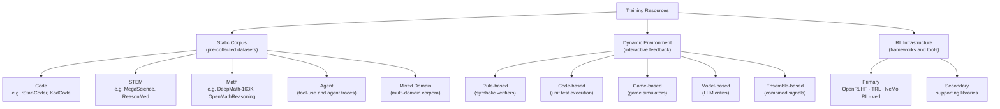
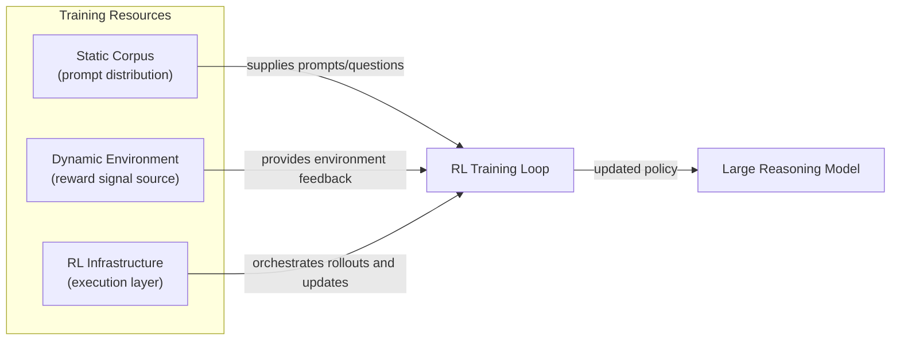
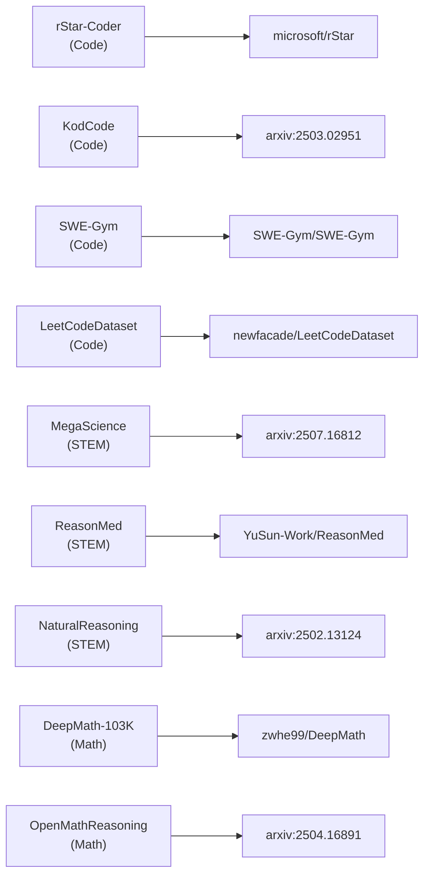
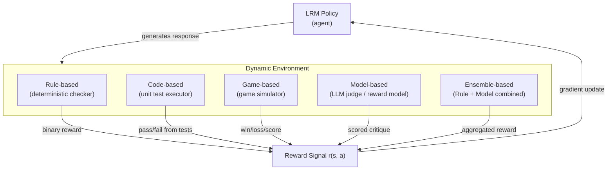
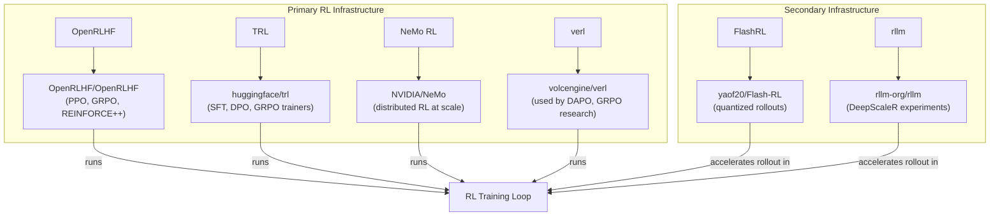

<!-- source: DeepWiki mcp.deepwiki.com · repo TsinghuaC3I/Awesome-RL-for-LRMs · page 2.3 Training Resources · fetched 2026-10-30 -->

# Training Resources

Relevant source files

The following files were used as context for generating this wiki page:

- [README.md](README.md)
- [reference.bib](reference.bib)

## Purpose and Scope

This page documents the **Training Resources** category of the survey, which covers the data and tooling that power RL training for Large Reasoning Models (LRMs). It spans three distinct resource types: pre-collected **Static Corpus** datasets, interactive **Dynamic Environments**, and the **RL Infrastructure** frameworks used to run experiments.

This page provides an orientation to the overall structure. Detailed entries for each sub-category are covered in:
- [Static Corpus Datasets](#2.3.1)
- [Dynamic Environments](#2.3.2)
- [RL Infrastructure](#2.3.3)

For how training resources plug into the broader RL training pipeline—including reward signals and policy optimization—see [Foundational Components](#2.2).

---

## Taxonomy Overview

The Training Resources section of the survey is organized into three top-level classes. Each class serves a different role in the RL training loop.

**Training Resources Taxonomy**

Sources: [README.md:63-75]()

---

## The Three Resource Classes

The three resource classes occupy different positions in the RL training loop. The diagram below shows how each feeds into the pipeline described in [Foundational Components](#2.2).

**Training Resources in the RL Pipeline**

Sources: [README.md:63-75](), [README.md:95-110]()

| Resource Class | Role in RL Training | Typical Format |
|---|---|---|
| **Static Corpus** | Provides the question/problem distribution from which prompts are sampled | Curated dataset files (JSONL, HuggingFace datasets) |
| **Dynamic Environment** | Acts as the reward oracle, returning success/failure signals to the agent | Executable environments, simulators, or LLM judges |
| **RL Infrastructure** | Manages the training loop: rollout generation, gradient updates, distributed execution | Python libraries / frameworks with CLI or API |

---

## Static Corpus

Static corpora are pre-collected, fixed datasets used as the source of training prompts. The policy is trained to produce correct responses to problems drawn from these corpora. Correctness is then verified—either by a rule-based checker or a model—before assigning a reward.

The survey divides static corpora into five domain sub-categories:

| Sub-category | Domain | Representative Datasets |
|---|---|---|
| **Code** | Competitive and practical programming | `rStar-Coder`, `KodCode`, `LeetCodeDataset`, `OpenCodeReasoning`, `SWE-Gym` |
| **STEM** | Science, technology, engineering, medicine, music | `MegaScience`, `ReasonMed`, `NaturalReasoning`, `SCP-116K` |
| **Math** | Mathematical problem solving | `DeepMath-103K`, `OpenMathReasoning`, `MiroMind-M1-RL-62K` |
| **Agent** | Tool-use, multi-step agent traces | Agent trajectory datasets |
| **Mixed Domain** | Cross-domain corpora combining multiple fields | Mixed-domain compilations |

Full entries, including paper links and GitHub repositories, are in [Static Corpus Datasets](#2.3.1).

**Static Corpus: Dataset-to-Repository Mapping**

Sources: [README.md:439-471]()

---

## Dynamic Environments

Dynamic environments provide interactive feedback to the agent during training. Unlike static corpora (which only supply prompts), dynamic environments also act as the **reward oracle**: they evaluate agent actions and return a reward signal. This makes them the bridge between the policy and the training signal.

The survey classifies dynamic environments by the mechanism that generates feedback:

| Sub-category | Feedback Mechanism | Examples |
|---|---|---|
| **Rule-based** | Deterministic symbolic verifiers (regex, math checker) | Format validators, answer comparison rules |
| **Code-based** | Unit test execution against generated code | Test runners, sandbox executors |
| **Game-based** | Game simulator scoring or win/loss signal | Board games, text games, puzzle environments |
| **Model-based** | LLM or trained model acts as the judge | LLM-as-Judge, trained reward models |
| **Ensemble-based** | Combination of multiple feedback sources | Hybrid rule + model verifiers |

Full entries are in [Dynamic Environments](#2.3.2).

**Dynamic Environment Feedback Mechanisms**

Sources: [README.md:69-73]()

---

## RL Infrastructure

RL Infrastructure refers to the open-source frameworks and libraries that implement the mechanics of the RL training loop: generating rollouts, computing advantages, applying gradient updates, and managing distributed execution. These tools are the substrate that all other components run on.

The survey distinguishes **Primary Infrastructure** (full-featured frameworks) from **Secondary Infrastructure** (supporting utilities and libraries).

### Primary Infrastructure

| Framework | GitHub Repository | Primary Role |
|---|---|---|
| `OpenRLHF` | `OpenRLHF/OpenRLHF` | Full RL training framework supporting PPO, GRPO, REINFORCE++ |
| `TRL` | `huggingface/trl` | HuggingFace library for RLHF and GRPO fine-tuning |
| `NeMo RL` | `NVIDIA/NeMo` | NVIDIA's RL stack for large-scale distributed training |
| `verl` | `volcengine/verl` | Volcano Engine RL framework (used by DAPO, GRPO research) |

### Secondary Infrastructure

Secondary tools support specific aspects of the pipeline such as efficient rollout generation, quantization during inference, or reward computation utilities. Full listings are in [RL Infrastructure](#2.3.3).

**RL Infrastructure: Framework-to-Repository Mapping**

Sources: [README.md:74-75](), [README.md:337]()

---

## Relationship Between Resource Classes

Each resource class is independently selectable and composable. A training run typically combines one or more static corpora (for prompts), a dynamic environment type (for reward signals), and one infrastructure framework (for execution). The table below shows how common published systems combine these:

| System | Static Corpus Domain | Environment Type | Infrastructure |
|---|---|---|---|
| `DeepSeek-R1` | Math | Rule-based (answer checker) | Custom |
| `DAPO` | Math | Rule-based | `verl` |
| `PRIME` | Math | Rule-based + implicit PRM | `OpenRLHF` |
| `SWE-Gym` | Code (GitHub issues) | Code-based (unit tests) | Custom |
| `Absolute Zero` | Self-generated (zero data) | Model-based (self-feedback) | Custom |

Sources: [README.md:285-287](), [README.md:416](), [README.md:417](), [README.md:448-449](), [README.md:259]()

---

