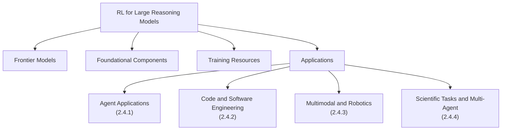
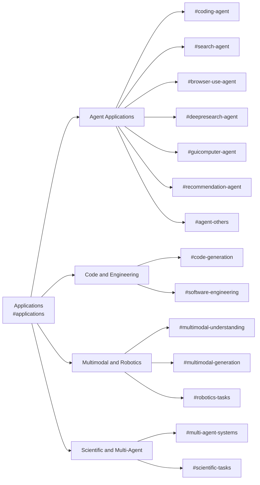
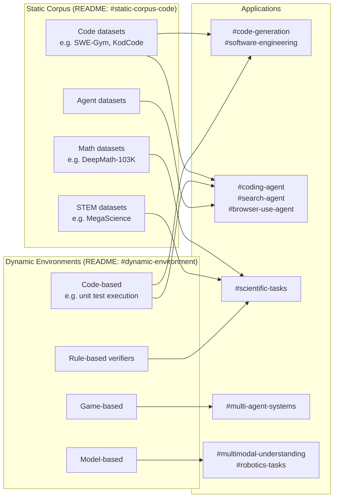

<!-- source: DeepWiki mcp.deepwiki.com · repo TsinghuaC3I/Awesome-RL-for-LRMs · page 2.4 Applications · fetched 2026-10-30 -->

# Applications

Relevant source files

The following files were used as context for generating this wiki page:

- [README.md](README.md)
- [reference.bib](reference.bib)

This page provides an overview of the **Applications** category in the survey taxonomy — the fourth top-level area in the repository. It covers the full breadth of real-world domains where RL-trained Large Reasoning Models (LRMs) have been deployed. This page summarizes the high-level organization; detailed paper listings for each sub-domain are documented in child pages [2.4.1](#2.4.1), [2.4.2](#2.4.2), [2.4.3](#2.4.3), and [2.4.4](#2.4.4).

For background on the foundational techniques (reward design, policy optimization, sampling strategy) that enable these applications, see [2.2 Foundational Components](#2.2). For the training datasets and environments that support them, see [2.3 Training Resources](#2.3).

---

## Position in the Survey Taxonomy

The Applications category sits alongside Frontier Models, Foundational Components, and Training Resources as one of the four top-level groupings in the survey. Unlike the other three — which focus on *how* RL is applied to LRMs — Applications focuses on *where* and *what for*.

**Taxonomy diagram: Applications within the overall survey structure**

Sources: [README.md:76-91](), [README.md:103-109]()

---

## Application Domains at a Glance

The survey organizes applications into **14 named sub-categories** across four groups. The table below maps each group to its sub-categories and the corresponding child wiki page.

| Group | Sub-categories | Child Page |
|---|---|---|
| **Agent Applications** | Coding Agent, Search Agent, Browser-Use Agent, DeepResearch Agent, GUI & Computer Agent, Recommendation Agent, Agent (Others) | [2.4.1](#2.4.1) |
| **Code Generation & Software Engineering** | Code Generation, Software Engineering | [2.4.2](#2.4.2) |
| **Multimodal & Robotics** | Multimodal Understanding, Multimodal Generation, Robotics Tasks | [2.4.3](#2.4.3) |
| **Scientific Tasks & Multi-Agent Systems** | Multi-Agent Systems, Scientific Tasks | [2.4.4](#2.4.4) |

Sources: [README.md:76-91]()

---

## Structural Diagram of All Sub-categories

The following diagram maps every named sub-category to its anchor in `README.md`, which is the primary index for paper listings.

**Diagram: README section anchors for each application sub-category**

Sources: [README.md:76-91]()

---

## Group Summaries

### Agent Applications

The largest application group. Covers LRMs acting as autonomous agents with tool use, multi-step planning, and environment interaction. The sub-categories distinguish agents by the type of task environment:

- **Coding Agent** — agents that write, execute, and debug code autonomously.
- **Search Agent** — agents that invoke search engines or internal retrieval to answer questions (see also the affiliated SSRL project, which investigates agentic search RL without reliance on external search engines).
- **Browser-Use Agent** — agents that operate web browsers programmatically.
- **DeepResearch Agent** — agents that conduct multi-step research tasks, synthesizing across sources.
- **GUI & Computer Agent** — agents that interact with graphical interfaces and operating system environments.
- **Recommendation Agent** — agents trained with RL to provide personalized recommendations.
- **Agent (Others)** — catch-all for agent applications not covered by the above.

For detailed paper listings, see [2.4.1 Agent Applications](#2.4.1).

Sources: [README.md:77-83]()

---

### Code Generation and Software Engineering

Covers work where RL is applied to improve a model's ability to produce syntactically and semantically correct code, and to address realistic software engineering tasks such as bug fixing and repository-level changes.

- **Code Generation** — training LRMs to generate code correct with respect to unit tests or formal specifications.
- **Software Engineering** — tasks like GitHub issue resolution, patch generation, and repository navigation.

For detailed paper listings, see [2.4.2 Code Generation and Software Engineering](#2.4.2).

Sources: [README.md:84-85]()

---

### Multimodal and Robotics

Covers extensions of RL-trained LRMs beyond text to image, video, audio, and physical embodiment.

- **Multimodal Understanding** — models trained with RL to reason over image-text or video-text inputs.
- **Multimodal Generation** — RL applied to generation tasks that produce images, video, or other non-text outputs.
- **Robotics Tasks** — using RL-trained LRMs as controllers or planners in physical or simulated robotic systems.

For detailed paper listings, see [2.4.3 Multimodal and Robotics](#2.4.3).

Sources: [README.md:86-88]()

---

### Scientific Tasks and Multi-Agent Systems

Covers specialized applications to scientific discovery and setups where multiple LRM agents interact.

- **Multi-Agent Systems** — architectures where multiple LRMs collaborate, compete, or communicate during RL training or inference (see also the affiliated MARTI project: a framework for LLM-based Multi-Agent Reinforced Training and Inference).
- **Scientific Tasks** — RL applied to domain-specific scientific problems such as mathematical theorem proving, chemistry, biology, and medicine.

For detailed paper listings, see [2.4.4 Scientific Tasks and Multi-Agent Systems](#2.4.4).

Sources: [README.md:89-90]()

---

## Relationship Between Applications and Training Resources

Application domains do not exist in isolation from training resources. The diagram below shows how specific dynamic environment types (see [2.3.2](#2.3.2)) and static corpus types (see [2.3.1](#2.3.1)) typically feed particular application groups.

**Diagram: Common pairings between training resources and application domains**

Sources: [README.md:63-91]()

---

## Related Pages

| Topic | Page |
|---|---|
| How reward signals are designed (applies across all application domains) | [2.2.1 Reward Design](#2.2.1) |
| Policy optimization algorithms used in these applications | [2.2.2 Policy Optimization](#2.2.2) |
| Static datasets used to train application-specific models | [2.3.1 Static Corpus Datasets](#2.3.1) |
| Interactive environments providing feedback during training | [2.3.2 Dynamic Environments](#2.3.2) |
| Agent applications in detail | [2.4.1 Agent Applications](#2.4.1) |
| Code generation and software engineering in detail | [2.4.2 Code Generation and Software Engineering](#2.4.2) |
| Multimodal and robotics in detail | [2.4.3 Multimodal and Robotics](#2.4.3) |
| Scientific tasks and multi-agent systems in detail | [2.4.4 Scientific Tasks and Multi-Agent Systems](#2.4.4) |

---

