# Page: Overview

# Overview

<details>
<summary>Relevant source files</summary>

The following files were used as context for generating this wiki page:

- [README.md](README.md)
- [Survey@RL4LRM-v1.pdf](Survey@RL4LRM-v1.pdf)
- [figs/survey_logo.png](figs/survey_logo.png)
- [figs/teaser.png](figs/teaser.png)

</details>


This page covers the structure, purpose, and navigation of the **Awesome-RL-for-LRMs** repository. For the detailed survey taxonomy and paper sub-categories, see [Survey Taxonomy](#2). For affiliated external projects and news, see [Related Projects and News](#1.1). For the BibTeX citation and license terms, see [Citation and License](#1.2).

---

## Purpose

`TsinghuaC3I/Awesome-RL-for-LRMs` is a curated, community-maintained paper index accompanying the survey:

> **"A Survey of Reinforcement Learning for Large Reasoning Models"**
> Zhang et al., 2025 — arXiv:2509.08827

The repository ranked #1 Paper of the Day on Hugging Face Daily Papers on 2025-09-12. It serves two audiences:

- **Researchers** seeking a structured index of papers on RL for Large Reasoning Models (LRMs), organized by method and domain.
- **Practitioners** who want to understand which RL techniques, datasets, environments, and infrastructure frameworks are used in training large reasoning models.

The repository has two functions:

| Function | File(s) |
|---|---|
| Curated paper list | `README.md` |
| Survey companion | `Survey@RL4LRM-v1.pdf`, `reference.bib` |

---

## File Layout

| Path | Role |
|---|---|
| `README.md` | Primary interface: survey overview and all categorized paper tables |
| `Survey@RL4LRM-v1.pdf` | Full survey PDF (slides used for BAAI, Qingke, and Tencent Wiztalk) |
| `reference.bib` | BibTeX bibliography backing the survey (~1000+ entries) |
| `figs/teaser.png` | Survey taxonomy overview figure, embedded at [README.md:99-101]() |
| `figs/survey_logo.png` | Repository logo, embedded at [README.md:3]() |
| `LICENSE` | MIT License, Copyright TsinghuaC3I 2025 |

**Repository component relationships:**

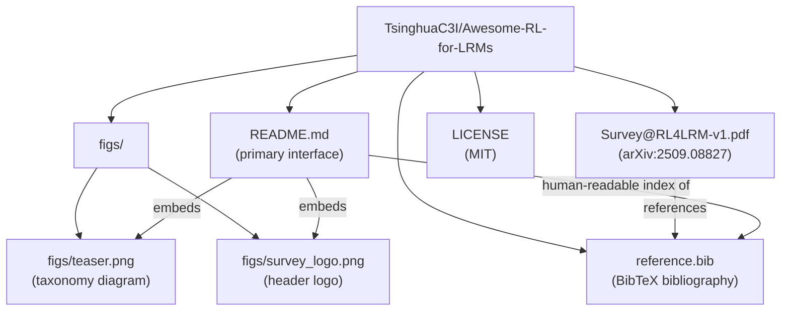

Sources: [README.md:1-10](), [README.md:95-101]()

---

## README.md Internal Structure

`README.md` is the sole navigation document. Its sections and their markdown anchors:

| Section | Anchor | Lines | Content |
|---|---|---|---|
| Header | — | [README.md:1-9]() | Badges: arXiv, GitHub, HuggingFace, Twitter |
| News | `#-news` | [README.md:14-24]() | Chronological release and project announcements |
| Citation | `#-citation` | [README.md:27-38]() | BibTeX entry for the survey |
| Contents | `#-contents` | [README.md:40-93]() | Internal anchor index for all sections |
| Overview | `#️-overview` | [README.md:95-110]() | Survey scope description + embedded `teaser.png` |
| Paper List | `#-paper-list` | [README.md:111-end]() | All categorized paper tables |

**README.md paper list anchor hierarchy** (bridges taxonomy concepts to markdown section identifiers):

```mermaid
graph TD
    PL["README.md\n#-paper-list"]

    FM["#frontier-models"]

    RD["#reward-design"]
    GR["#generative-rewards"]
    DR["#dense-rewards"]
    UR["#unsupervised-rewards"]
    RS["#rewards-shaping"]

    PO["#policy-optimization"]
    PGO["#policy-gradient-objective"]
    CBA["#critic-based-algorithms"]
    CFA["#critic-free-algorithms"]
    OPO["#off-policy-optimization"]
    OPOE["#off-policy-optimization-exp-replay"]
    REG["#regularization-objectives"]

    SS["#sampling-strategy"]
    DAS["#dynamic-and-structured-sampling"]
    SHP["#sampling-hyper-parameters"]

    TR["#training-resource"]
    SC["Static Corpus\n(code, stem, math, agent, mix)"]
    DE["Dynamic Environment\n(rule, code, game, model, ensemble)"]
    RI["RL Infrastructure\n(primary, secondary)"]

    APP["#applications\n(14 sub-sections)"]

    PL --> FM
    PL --> RD
    RD --> GR
    RD --> DR
    RD --> UR
    RD --> RS
    PL --> PO
    PO --> PGO
    PO --> CBA
    PO --> CFA
    PO --> OPO
    PO --> OPOE
    PO --> REG
    PL --> SS
    SS --> DAS
    SS --> SHP
    PL --> TR
    TR --> SC
    TR --> DE
    TR --> RI
    PL --> APP
```

Sources: [README.md:40-93](), [README.md:111-end]()

---

## Paper Entry Format

Every paper in the README tables follows a consistent five-column schema ([README.md:115-116]()):

| Column | Content |
|---|---|
| `Date` | Year-month of publication (or `-` if undated) |
| `Name` | Short backtick-formatted identifier, e.g. `` `DeepSeek-R1` ``, `` `QwQ` `` |
| `Title` | Full paper or technical report title |
| `Paper` | Badge linking to arXiv PDF, blog, or hosted report |
| `Github` | Badge linking to code repository with live star count (omitted if unavailable) |

A representative entry from [README.md:138]():

```
| 2025-01 | `DeepSeek-R1` | DeepSeek-R1: Incentivizing Reasoning Capability in LLMs via Reinforcement Learning | [arXiv badge] | [GitHub badge] |
```

---

## Survey Structure vs. README Sections

The survey paper ([README.md:103-110]()) defines five top-level sections. The `README.md` paper list exposes paper tables for four of them. "Foundational Problems" and "Future Directions" are covered in `Survey@RL4LRM-v1.pdf` but have no dedicated paper tables in the README.

| Survey Section | README Anchor(s) | Wiki Page |
|---|---|---|
| Frontier Models *(model catalog)* | `#frontier-models` | [Frontier Models](#2.1) |
| 1. Foundational Components | `#reward-design`, `#policy-optimization`, `#sampling-strategy` | [Foundational Components](#2.2) |
| 2. Foundational Problems | *(survey PDF only)* | — |
| 3. Training Resources | `#training-resource` | [Training Resources](#2.3) |
| 4. Applications | `#applications` | [Applications](#2.4) |
| 5. Future Directions | *(survey PDF only)* | — |

Sources: [README.md:103-110](), [README.md:47-91]()

---

## RL Training Pipeline (Conceptual Scope)

The survey covers the full pipeline for RL training of LRMs. Each stage maps to a top-level README paper list section:

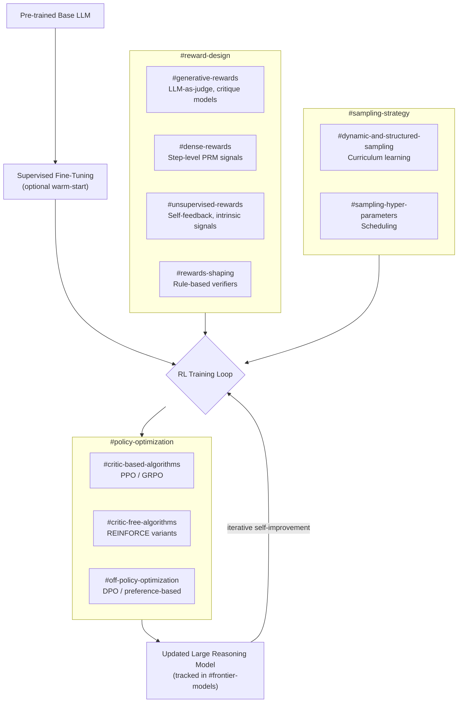

Sources: [README.md:95-110](), [README.md:47-91]()

---

## Taxonomy at a Glance

| README Section | Sub-categories | Scope |
|---|---|---|
| `#frontier-models` | — | ~20+ recent LRM model cards |
| `#reward-design` | Generative, Dense, Unsupervised, Shaping | How reward signals are constructed |
| `#policy-optimization` | Gradient, Critic-based, Critic-free, Off-policy (×2), Regularization | How the policy is updated |
| `#sampling-strategy` | Dynamic/Structured, Hyper-Parameters | How training samples are selected |
| `#training-resource` | Static Corpus ×5, Dynamic Env ×5, Infrastructure ×2 | Datasets and RL frameworks |
| `#applications` | Agent ×7, Code ×2, Multimodal ×3, Multi-Agent, Scientific | Real-world deployment domains |

For full details on each section, see [Survey Taxonomy](#2).

---

# Page: Related Projects and News

# Related Projects and News

<details>
<summary>Relevant source files</summary>

The following files were used as context for generating this wiki page:

- [README.md](README.md)

</details>


## Scope

This page documents the affiliated external projects listed in the news section of the repository's primary interface, `README.md`. These projects are developed by the same research group (TsinghuaC3I) and closely related to the themes of RL for Large Reasoning Models.

For an introduction to the repository itself, see [Overview](#1). For citation and license information, see [Citation and License](#1.2). For the survey's technical content, see [Survey Taxonomy](#2).

---

## Relationship to the Repository

The news section of `README.md` tracks active sibling projects that either contribute to, or directly build on, the research themes catalogued in this survey. These are distinct codebases — not embedded within this repository — but are highlighted here because they extend or complement the survey's coverage of RL methodology for LRMs.

**Diagram: Affiliated Projects Referenced from README.md**

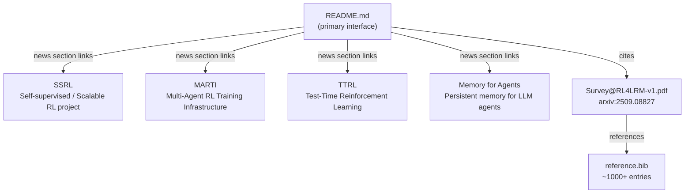

Sources: `README.md` (news section), system diagram 1

---

## Affiliated Projects

The four projects listed below are referenced in the `README.md` news section. Each is a standalone project from the TsinghuaC3I group that is closely related to the domains covered by this survey.

| Project | Theme | Relation to Survey |
|---|---|---|
| **SSRL** | Scalable / Self-supervised RL | Methodology: reward design and policy optimization |
| **MARTI** | Multi-agent RL training infrastructure | Infrastructure and training resources |
| **TTRL** | Test-time reinforcement learning | Policy optimization at inference time |
| **Memory for Agents** | Persistent memory for LLM-based agents | Agent applications and environment interaction |

Sources: `README.md` (news section), system diagram 1 (`EXTPROJECTS` node)

---

## SSRL

**SSRL** (Self-supervised / Scalable Reinforcement Learning) is an affiliated project concerned with scaling RL training signals without dense human-labeled reward data. Its themes overlap with the **Unsupervised Rewards** and **Reward Shaping** sub-categories described in the survey's [Reward Design](#2.2.1) section.

---

## MARTI

**MARTI** is a multi-agent RL training infrastructure project. It addresses the coordination and training of multiple LLM-based agents under a shared RL objective. Its infrastructure concerns overlap with the **RL Infrastructure** sub-category described in [Training Resources](#2.3), and its multi-agent framing connects to [Scientific Tasks and Multi-Agent Systems](#2.4.4).

---

## TTRL

**TTRL** (Test-Time Reinforcement Learning) investigates applying RL optimization signals at inference time rather than only during the offline training phase. This relates to the **Policy Optimization** component documented in [Policy Optimization](#2.2.2) and connects to the broader concept of iterative self-improvement illustrated in the RL training pipeline (Diagram 5 in the high-level overview).

**Diagram: Where TTRL fits in the RL Training Pipeline**

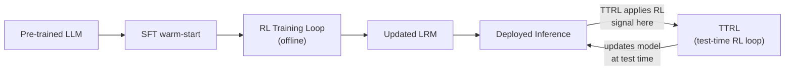

Sources: `README.md` (news section), system diagram 5 (RL training pipeline)

---

## Memory for Agents

**Memory for Agents** is a project that equips LLM-based agents with persistent, structured memory across interactions. This directly supports the **Agent Applications** domain (see [Agent Applications](#2.4.1)), particularly sub-categories such as **DeepResearch Agent**, **Browser-Use Agent**, and **GUI and Computer Agent**, where long-horizon task completion requires retaining context across steps.

**Diagram: Memory for Agents in the Agent Application Stack**

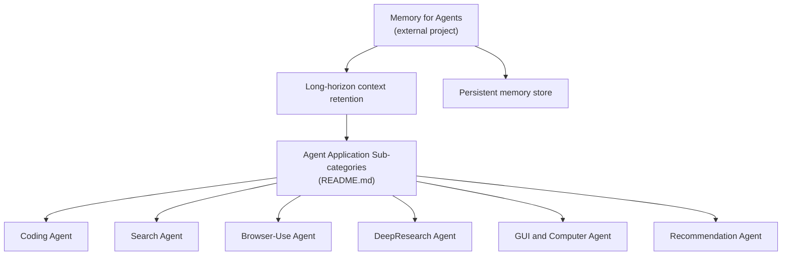

Sources: `README.md` (news section), system diagram 4 (Applications taxonomy)

---

## Summary

These four projects — SSRL, MARTI, TTRL, and Memory for Agents — represent active research threads from the same group that produced this survey. They are not part of this repository's codebase but are tracked in `README.md` as news items to keep readers oriented toward the evolving state of the field. The survey paper (`Survey@RL4LRM-v1.pdf`, arXiv:2509.08827) and its associated bibliography (`reference.bib`) provide the canonical academic reference for the ideas these projects build on.

Sources: `README.md`, `Survey@RL4LRM-v1.pdf`, `reference.bib`

---

# Page: Citation and License

# Citation and License

<details>
<summary>Relevant source files</summary>

The following files were used as context for generating this wiki page:

- [LICENSE](LICENSE)
- [README.md](README.md)

</details>


This page documents the formal attribution requirements and usage rights for the `TsinghuaC3I/Awesome-RL-for-LRMs` repository. It covers the BibTeX citation entry for the associated survey paper and the full terms of the MIT License. For background on what the repository contains and how it is organized, see [Overview](#1).

---

## Citation

If you use material from this repository or the associated survey paper in your research or projects, you are expected to cite the work. The canonical citation is provided in `README.md` as a BibTeX entry.

**Survey paper:** *A Survey of Reinforcement Learning for Large Reasoning Models*
**arXiv ID:** `2509.08827`
**Hugging Face Papers:** `https://huggingface.co/papers/2509.08827`

### BibTeX Entry

The following entry is sourced directly from [README.md:31-38]():

```bibtex
@article{zhang2025survey,
  title={A survey of reinforcement learning for large reasoning models},
  author={Zhang, Kaiyan and Zuo, Yuxin and He, Bingxiang and Sun, Youbang and Liu, Runze
          and Jiang, Che and Fan, Yuchen and Tian, Kai and Jia, Guoli and Li, Pengfei
          and others},
  journal={arXiv preprint arXiv:2509.08827},
  year={2025}
}
```

### Citation Field Reference

| Field | Value |
|---|---|
| `title` | A survey of reinforcement learning for large reasoning models |
| `author` | Zhang, Kaiyan et al. (TsinghuaC3I) |
| `journal` | arXiv preprint |
| `archivePrefix` | arXiv |
| `eprint` | 2509.08827 |
| `year` | 2025 |

Sources: [README.md:27-38]()

---

## License

The repository is distributed under the **MIT License**, held by TsinghuaC3I. The full license text is in [LICENSE:1-21]().

### License Summary

| Attribute | Detail |
|---|---|
| **License type** | MIT License |
| **Copyright holder** | TsinghuaC3I |
| **Copyright year** | 2025 |
| **Permissions** | Use, copy, modify, merge, publish, distribute, sublicense, sell |
| **Conditions** | Include copyright notice and license text in all copies |
| **Limitations** | No warranty; no liability |

### Full License Text

Reproduced from [LICENSE:1-21]():

```
MIT License

Copyright (c) 2025 TsinghuaC3I

Permission is hereby granted, free of charge, to any person obtaining a copy
of this software and associated documentation files (the "Software"), to deal
in the Software without restriction, including without limitation the rights
to use, copy, modify, merge, publish, distribute, sublicense, and/or sell
copies of the Software, and to permit persons to whom the Software is
furnished to do so, subject to the following conditions:

The above copyright notice and this permission notice shall be included in all
copies or substantial portions of the Software.

THE SOFTWARE IS PROVIDED "AS IS", WITHOUT WARRANTY OF ANY KIND, EXPRESS OR
IMPLIED, INCLUDING BUT NOT LIMITED TO THE WARRANTIES OF MERCHANTABILITY,
FITNESS FOR A PARTICULAR PURPOSE AND NONINFRINGEMENT. IN NO EVENT SHALL THE
AUTHORS OR COPYRIGHT HOLDERS BE LIABLE FOR ANY CLAIM, DAMAGES OR OTHER
LIABILITY, WHETHER IN AN ACTION OF CONTRACT, TORT OR OTHERWISE, ARISING FROM,
OUT OF OR IN CONNECTION WITH THE SOFTWARE OR THE USE OR OTHER DEALINGS IN THE
SOFTWARE.
```

Sources: [LICENSE:1-21]()

---

## Repository Artifacts and Their Governance

The diagram below maps each repository artifact to its governing terms and the relevant file that declares them.

**Diagram: Artifact Ownership and License Scope**

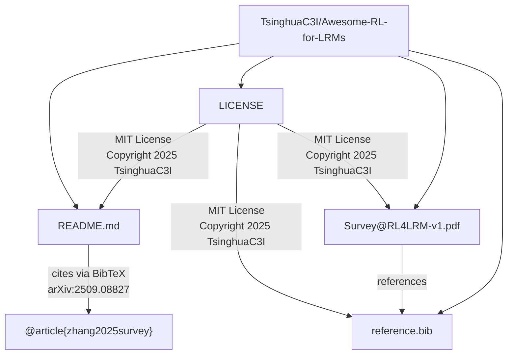

Sources: [LICENSE:1-4](), [README.md:27-38]()

---

## Citation Workflow

The following diagram illustrates how the citation entry in `README.md` connects to the actual paper artifacts.

**Diagram: Citation Chain — README to arXiv Paper**

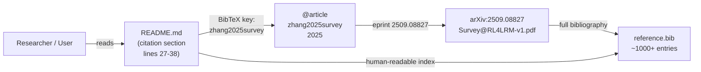

Sources: [README.md:7](), [README.md:31-38]()

---

# Page: Survey Taxonomy

# Survey Taxonomy

<details>
<summary>Relevant source files</summary>

The following files were used as context for generating this wiki page:

- [README.md](README.md)
- [Survey@RL4LRM-v1.pdf](Survey@RL4LRM-v1.pdf)
- [reference.bib](reference.bib)

</details>


This page describes the full categorical structure used by the **Awesome-RL-for-LRMs** survey to organize the literature on Reinforcement Learning for Large Reasoning Models. It covers the four top-level divisions, their subsections, and how they are physically laid out in the repository.

This page describes the taxonomy *structure* only. For details on individual subcategories, see the child pages:
- Frontier Models: [2.1](#2.1)
- Foundational Components: [2.2](#2.2)
- Training Resources: [2.3](#2.3)
- Applications: [2.4](#2.4)

---

## Overview

The survey organizes the field into **four top-level categories**, each of which maps directly to a `###`-level heading in [README.md:47-91]() and a corresponding set of entries in [reference.bib]():

| Top-Level Category | README Anchor | Purpose |
|---|---|---|
| **Frontier Models** | `#frontier-models` | Recent foundational LRM releases |
| **Foundational Components** | `#reward-design`, `#policy-optimization`, `#sampling-strategy` | Core RL methodology |
| **Training Resources** | `#training-resource` | Datasets, environments, and infrastructure |
| **Applications** | `#applications` | Task-specific deployment domains |

The README overview section ([README.md:95-110]()) provides a five-point prose summary that slightly differs from the paper-list structure: it additionally names "Foundational Problems" and "Future Directions" as survey sections, but those do not have separate paper-list headings in the repository.

Sources: [README.md:40-93](), [README.md:95-110]()

---

## Top-Level Taxonomy Diagram

The diagram below maps the four top-level categories to their README section anchors and their child subcategories.

**Figure 1: Full taxonomy as structured in `README.md`**

```mermaid
graph TD
  ROOT["README.md Paper List"]

  ROOT --> FM["### Frontier Models"]
  ROOT --> FC["Foundational Components"]
  ROOT --> TR["### Training Resource"]
  ROOT --> APP["### Applications"]

  FC --> RD["### Reward Design"]
  FC --> PO["### Policy Optimization"]
  FC --> SS["### Sampling Strategy"]

  RD --> GR["#### Generative Rewards"]
  RD --> DR["#### Dense Rewards"]
  RD --> UR["#### Unsupervised Rewards"]
  RD --> RS["#### Rewards Shaping"]

  PO --> PG["#### Policy Gradient Objective"]
  PO --> CB["#### Critic-based Algorithms"]
  PO --> CF["#### Critic-Free Algorithms"]
  PO --> OP["#### Off-policy Optimization"]
  PO --> ER["#### Off-policy Optimization (Exp replay)"]
  PO --> RO["#### Regularization Objectives"]

  SS --> DS["#### Dynamic and Structured Sampling"]
  SS --> SH["#### Sampling Hyper-Parameters"]

  TR --> SC["Static Corpus"]
  TR --> DE["Dynamic Environment"]
  TR --> RI["RL Infrastructure"]

  SC --> SCC["(Code)"]
  SC --> SCS["(STEM)"]
  SC --> SCM["(Math)"]
  SC --> SCA["(Agent)"]
  SC --> SCMX["(Mix)"]

  DE --> DER["(Rule-based)"]
  DE --> DEC["(Code-based)"]
  DE --> DEG["(Game-based)"]
  DE --> DEM["(Model-based)"]
  DE --> DEE["(Ensemble-based)"]

  RI --> RIP["(Primary)"]
  RI --> RIS["(Secondary)"]

  APP --> AG["Agent Applications"]
  APP --> CG["Code Generation / SE"]
  APP --> MM["Multimodal"]
  APP --> SC2["Scientific / Multi-Agent"]
```

Sources: [README.md:47-91]()

---

## README Section-to-Anchor Mapping

The paper-list section of [README.md:111-91]() uses the following headings. Each heading creates a navigable anchor used in the table of contents at [README.md:40-91]():

**Figure 2: Correspondence between README headings and taxonomy sections**

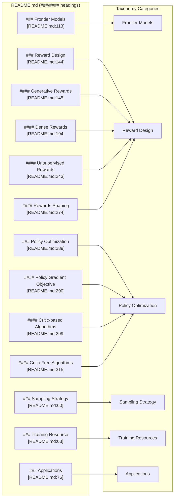

Sources: [README.md:47-91](), [README.md:111-144]()

---

## Category Descriptions

### Frontier Models

This category ([README.md:113-141]()) tracks major LRM releases, both open-source and proprietary. Entries are sorted reverse-chronologically and include the release date, model name (as an inline code badge), paper title, arXiv link, and GitHub repository link. Models in this section are considered "frontier" in the sense that they represent state-of-the-art reasoning capabilities achieved via RL-based post-training.

Representative entries include: `DeepSeek-R1`, `Qwen3`, `MiMo`, `Kimi K2`, `GLM-4.5`, `Intern-S1`.

For detail on what qualifies a model and a full listing, see [2.1](#2.1).

---

### Foundational Components

Foundational Components is the methodological core of the survey. It does **not** appear as a single `###` heading in README.md; instead, it is represented by three sibling `###` sections: `Reward Design`, `Policy Optimization`, and `Sampling Strategy`. This grouping is described as a top-level survey section in the prose overview at [README.md:105]().

#### Reward Design

Section `### Reward Design` ([README.md:144]()) contains four `####` subsections:

| Subsection | README Anchor | Core Idea |
|---|---|---|
| Generative Rewards | `#generative-rewards` | LLM-generated critique or judgment used as a reward signal |
| Dense Rewards | `#dense-rewards` | Step-level or token-level process reward signals (PRMs) |
| Unsupervised Rewards | `#unsupervised-rewards` | Self-rewarding, intrinsic motivation, no external labels |
| Rewards Shaping | `#rewards-shaping` | Modifications to raw reward signals for stability/exploration |

For detailed per-subcategory coverage, see [2.2.1](#2.2.1).

#### Policy Optimization

Section `### Policy Optimization` ([README.md:289]()) contains six `####` subsections:

| Subsection | README Anchor | Core Algorithms |
|---|---|---|
| Policy Gradient Objective | `#policy-gradient-objective` | `PPO`, `REINFORCE`, `TRPO`, `PG` |
| Critic-based Algorithms | `#critic-based-algorithms` | `GAE`, `PRIME`, `VAPO`, `Math-Shepherd` |
| Critic-Free Algorithms | `#critic-free-algorithms` | `GRPO`, `DAPO`, `RLOO`, `ReMax`, `Dr. GRPO` |
| Off-policy Optimization | `#off-policy-optimization` | `DPO` and variants |
| Off-policy (Exp replay) | `#off-policy-optimization-exp-replay` | Off-policy methods with experience replay buffers |
| Regularization Objectives | `#regularization-objectives` | KL divergence, entropy regularization |

For detailed per-subcategory coverage, see [2.2.2](#2.2.2).

#### Sampling Strategy

Section `### Sampling Strategy` ([README.md:60-62]()) contains two `####` subsections:

| Subsection | README Anchor | Focus |
|---|---|---|
| Dynamic and Structured Sampling | `#dynamic-and-structured-sampling` | Curriculum learning, difficulty scheduling |
| Sampling Hyper-Parameters | `#sampling-hyper-parameters` | Temperature, top-p, number of samples |

For detailed coverage, see [2.2.3](#2.2.3).

---

### Training Resources

Section `### Training Resource` ([README.md:63-75]()) is subdivided into three groups with twelve total subsections:

**Static Corpus** — pre-collected, labeled datasets:

| Subsection | README Anchor |
|---|---|
| Static Corpus (Code) | `#static-corpus-code` |
| Static Corpus (STEM) | `#static-corpus-stem` |
| Static Corpus (Math) | `#static-corpus-math` |
| Static Corpus (Agent) | `#static-corpus-agent` |
| Static Corpus (Mix) | `#static-corpus-mix` |

**Dynamic Environment** — interactive feedback sources:

| Subsection | README Anchor |
|---|---|
| Dynamic Environment (Rule-based) | `#dynamic-environment-rule-based` |
| Dynamic Environment (Code-based) | `#dynamic-environment-code-based` |
| Dynamic Environment (Game-based) | `#dynamic-environment-game-based` |
| Dynamic Environment (Model-based) | `#dynamic-environment-model-based` |
| Dynamic Environment (Ensemble-based) | `#dynamic-environment-ensemble-based` |

**RL Infrastructure** — training framework tooling:

| Subsection | README Anchor |
|---|---|
| RL Infrastructure (Primary) | `#rl-infrastructure-primary` |
| RL Infrastructure (Secondary) | `#rl-infrastructure-secondary` |

For detailed per-subcategory coverage, see [2.3](#2.3).

---

### Applications

Section `### Applications` ([README.md:76-91]()) spans fourteen `####` subsections grouped into four domains:

| Domain Group | Subsections |
|---|---|
| **Agent Applications** | Coding Agent, Search Agent, Browser-Use Agent, DeepResearch Agent, GUI & Computer Agent, Recommendation Agent, Agent (Others) |
| **Code & Engineering** | Code Generation, Software Engineering |
| **Multimodal** | Multimodal Understanding, Multimodal Generation, Robotics Tasks |
| **Scientific / Multi-Agent** | Multi-Agent Systems, Scientific Tasks |

For detailed per-subcategory coverage, see [2.4](#2.4).

---

## How Papers Are Organized

Each entry across all sections follows a consistent table schema defined in [README.md:115-116]():

```
| Date | Name | Title | Paper | Github |
|:-:|:-:|:-|:-:|:-:|
```

- **Date** — publication year and month (or `-` if undated)
- **Name** — model or system short name as an inline badge (e.g., `` `DeepSeek-R1` ``)
- **Title** — full paper title as plain text
- **Paper** — badge linking to arXiv or conference page
- **Github** — badge showing the GitHub star count and linking to the repository, or `-` if no public code

Some papers appear under **multiple subsections** when they are relevant to more than one category. For example, `GenPRM` ([README.md:229]()) appears in both `Dense Rewards` and `Generative Rewards`, and `CAPO` ([README.md:204]()) appears in both `Generative Rewards` and `Dense Rewards`.

---

## Relationship Between the BibTeX Database and the README

The file [reference.bib]() stores bibliographic records for papers cited in the survey PDF (`Survey@RL4LRM-v1.pdf`). Its internal comment structure mirrors the README taxonomy, using `#` and `##` comments as section markers:

| `reference.bib` comment header | Corresponds to |
|---|---|
| `# RL Methodology` | Foundational Components |
| `## Reward Design - Verifiable Rewards` | Dense Rewards |
| `## Reward Design - Unsupervised rewards` | Unsupervised Rewards |
| `## Reward Design - Credit Assignment` | Dense Rewards / PRM papers |
| `## Reward Design - Generative Rewards` | Generative Rewards |
| `## Reward: Turn Level` | Dense Rewards (multi-turn) |
| `## Reward Design - Reward Shaping` | Rewards Shaping |

The README paper list is the **human-readable index** into this bibliography. Not every entry in [reference.bib]() appears in the README, and vice versa — the README also links to papers whose primary BibTeX record may be in external databases.

Sources: [reference.bib:241-1210](), [README.md:111-142]()

---

## RL Training Pipeline Position of Each Category

**Figure 3: Where each taxonomy section enters the RL training loop**

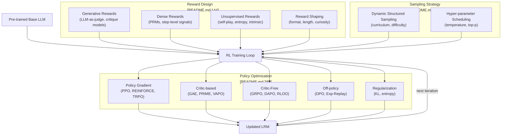

Sources: [README.md:95-110](), [README.md:144-289]()

---

## Summary

The survey taxonomy defines a flat three-level hierarchy in the README:

1. **Top-level category** (`###` headings) — Frontier Models, Reward Design, Policy Optimization, Sampling Strategy, Training Resource, Applications
2. **Subcategory** (`####` headings) — e.g., Generative Rewards, Critic-Free Algorithms, Static Corpus (Math)
3. **Individual papers** — rows in a markdown table with date, name, title, paper link, and code link

The taxonomy is expressed twice in the repository: as section headings in [README.md]() (readable index) and as comment-delimited sections in [reference.bib]() (bibliographic database for the survey PDF). Child pages in this wiki document each subcategory in depth.

---

# Page: Frontier Models

# Frontier Models

<details>
<summary>Relevant source files</summary>

The following files were used as context for generating this wiki page:

- [README.md](README.md)
- [reference.bib](reference.bib)

</details>


This page documents the **Frontier Models** category from the survey taxonomy — the first of four top-level sections tracked by this repository. It covers the large reasoning models (LRMs) that serve as primary references and benchmarks for the field: what makes a model qualify as a frontier LRM, how models are organized, and a summary of each entry.

This page is about the *models themselves*, not the algorithmic techniques used to train them. For the training methods applied to these models (reward design, policy optimization, sampling), see [Foundational Components](#2.2). For datasets and environments used, see [Training Resources](#2.3).

---

## What Qualifies as a Frontier Model

The Frontier Models category in [README.md:113-141]() collects papers and technical reports for models that satisfy one or more of the following criteria:

- The model is a **publicly reported** language or multimodal model trained with RL as a core post-training step.
- The model either achieves **state-of-the-art performance** on reasoning benchmarks at time of release or introduces a novel training paradigm that influences subsequent work.
- The model is associated with a formal **technical report or paper** (arXiv or equivalent).

Frontier Models span both **text-only** and **multimodal** architectures, and both **open-source** and **proprietary** (but publicly documented) systems.

Sources: [README.md:113-141]()

---

## Model Landscape

The following diagram shows how frontier models relate to the broader repository taxonomy.

**Diagram: Frontier Models in Repository Taxonomy**

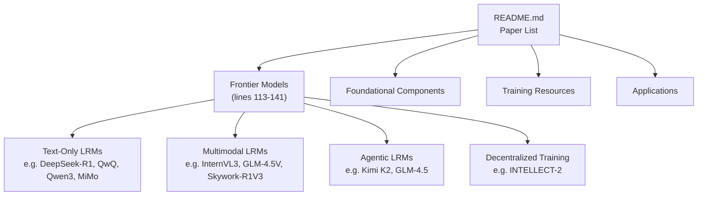

Sources: [README.md:47-141]()

---

## Tracked Models

The repository tracks 25 models in this category as of the current version. The table below consolidates all entries from [README.md:115-141]().

| Date | Model Name | Category | Institution | Open Source |
|:----:|:----------:|:--------:|:-----------:|:-----------:|
| 2025-08 | `Intern-S1` | Multimodal / Science | InternLM | ✓ |
| 2025-08 | `GLM-4.5` | Agentic / Reasoning | Zhipu AI | ✓ |
| 2025-08 | `gpt-oss` | Text LRM | OpenAI | ✓ (weights) |
| 2025-08 | `InternVL3.5` | Multimodal | OpenGVLab | ✓ |
| 2025-07 | `Kimi K2` | Agentic | Moonshot AI | ✓ |
| 2025-07 | `Step 3` | Text LRM | StepFun | ✓ |
| 2025-07 | `GLM-4.1V-Thinking` | Multimodal / Reasoning | Zhipu AI | ✓ |
| 2025-07 | `Skywork-R1V3` | Multimodal | SkyworkAI | ✓ |
| 2025-07 | `GLM-4.5V` | Multimodal | Zhipu AI | ✓ |
| 2025-06 | `Magistral` | Text LRM | Mistral | — |
| 2025-06 | `Minimax-M1` | Text LRM (Lightning Attn) | MiniMax AI | ✓ |
| 2025-05 | `MiMo` | Text LRM | Xiaomi | ✓ |
| 2025-05 | `Qwen3` | Text LRM | Alibaba | ✓ |
| 2025-05 | `Llama-Nemotron-Ultra` | Text LRM | NVIDIA | ✓ |
| 2025-05 | `INTELLECT-2` | Decentralized RL | Prime Intellect | — |
| 2025-05 | `Hunyuan-TurboS` | Text LRM (Mamba+Transformer) | Tencent | ✓ |
| 2025-05 | `Skywork OR-1` | Text LRM | SkyworkAI | ✓ |
| 2025-04 | `Phi-4 Reasoning` | Text LRM | Microsoft | — |
| 2025-04 | `Skywork-R1V2` | Multimodal | SkyworkAI | ✓ |
| 2025-04 | `InternVL3` | Multimodal | OpenGVLab | ✓ |
| 2025-03 | `ORZ` | Text LRM (base model RL) | Open-Reasoner-Zero | ✓ |
| 2025-01 | `DeepSeek-R1` | Text LRM | DeepSeek | ✓ |
| — | `QwQ` | Text LRM | Alibaba (Qwen) | ✓ |
| — | `Seed-OSS` | Text LRM | ByteDance | ✓ |
| — | `ERNIE-4.5-Thinking` | Text LRM | Baidu | — |

Sources: [README.md:115-141]()

---

## Temporal Distribution

**Diagram: Frontier Model Release Timeline by Modality**

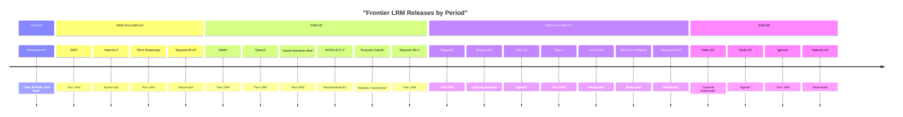

Sources: [README.md:115-141]()

---

## Model Groupings

### Text-Only Reasoning Models

These models apply RL post-training to text-based base LLMs:

| Model | Key Characteristic |
|:-----:|:----------------:|
| `DeepSeek-R1` | Seminal open-source RL-for-reasoning model; introduced GRPO-based training from a base model |
| `QwQ` | Embraces RL for extended thinking; 32B scale |
| `Qwen3` | Qwen series with RL reasoning at scale |
| `MiMo` | End-to-end training from pretraining to RL post-training |
| `ORZ` | Demonstrates RL scaling directly on a base model without SFT warmup |
| `Phi-4 Reasoning` | Microsoft; compact yet capable reasoning model |
| `Minimax-M1` | Introduces Lightning Attention for efficient test-time scaling |
| `Skywork OR-1` | Open reasoner with detailed RL training recipe |
| `Hunyuan-TurboS` | Hybrid Mamba-Transformer architecture with adaptive chain-of-thought |
| `Llama-Nemotron-Ultra` | NVIDIA's efficient reasoning model on Llama base |
| `INTELLECT-2` | Globally decentralized RL training paradigm |
| `Magistral` | Mistral's reasoning model |
| `Step 3` | Cost-effective decoding via model-system co-design |
| `gpt-oss` | OpenAI open-weight models (120B and 20B variants) |
| `Seed-OSS` | ByteDance open-source reasoning series |
| `ERNIE-4.5-Thinking` | Baidu's ERNIE series with thinking capability |

### Multimodal Reasoning Models

These models extend RL-based reasoning to vision-language inputs:

| Model | Key Characteristic |
|:-----:|:----------------:|
| `InternVL3` | Open-source multimodal with RL training recipes |
| `InternVL3.5` | Improved versatility, reasoning, and efficiency over InternVL3 |
| `Skywork-R1V2` | Hybrid RL for multimodal reasoning |
| `Skywork-R1V3` | Third iteration of Skywork's multimodal reasoner |
| `GLM-4.5V` | Zhipu AI multimodal model with scalable RL |
| `GLM-4.1V-Thinking` | Thinking variant with extended multimodal reasoning chains |
| `Intern-S1` | Scientific domain multimodal foundation model |

### Agentic Models

Models specifically designed or marketed for agentic tasks, where RL training targets tool use and multi-step interaction:

| Model | Key Characteristic |
|:-----:|:----------------:|
| `Kimi K2` | Open agentic intelligence; MoE architecture |
| `GLM-4.5` | Agentic, Reasoning, and Coding (ARC) capabilities |

Sources: [README.md:115-141]()

---

## Relationship to RL Training Pipeline

Each frontier model sits at the *output* end of an RL training pipeline. The diagram below maps the code-level identifiers used in the README to their role in the pipeline described by the survey.

**Diagram: Frontier Models as Pipeline Outputs**

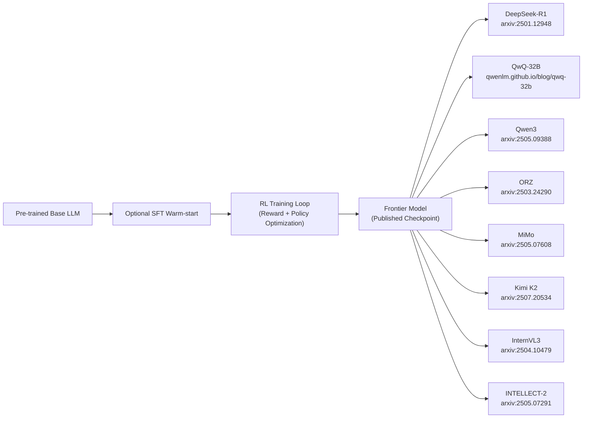

Sources: [README.md:113-141]()

---

## Notable Model Details

### `DeepSeek-R1`

The earliest and most widely referenced entry. Released 2025-01, it demonstrated that RL applied directly to a base LLM (using GRPO) could produce strong reasoning behavior without supervised fine-tuning as a prerequisite. It established many conventions now used by downstream works in this survey.

- Paper: `arxiv:2501.12948`
- GitHub: `deepseek-ai/DeepSeek-R1`

### `ORZ` (Open-Reasoner-Zero)

Replicates the DeepSeek-R1-Zero methodology as a fully open-source implementation, scaling RL on a base model. Useful as a research baseline.

- Paper: `arxiv:2503.24290`
- GitHub: `Open-Reasoner-Zero/Open-Reasoner-Zero`

### `INTELLECT-2`

Distinctive for its **globally decentralized** RL training approach, where compute is contributed across distributed, untrusted nodes.

- Paper: `arxiv:2505.07291`

### `Minimax-M1`

Introduces **Lightning Attention** for scaling test-time compute efficiently, allowing longer reasoning chains without quadratic attention cost.

- Paper: `arxiv:2506.13585`
- GitHub: `MiniMax-AI/MiniMax-M1`

### `Kimi K2`

An agentic model from Moonshot AI using a Mixture-of-Experts architecture, with RL tuned for tool use and multi-step agent trajectories.

- Paper: `arxiv:2507.20534`
- GitHub: `MoonshotAI/Kimi-K2`

Sources: [README.md:115-141]()

---

## Summary of Entry Format

Each frontier model entry in [README.md:115-141]() follows a consistent schema:

| Field | Description |
|:-----:|:------------|
| `Date` | Publication or release date (`YYYY-MM` format; `-` if undated) |
| `Name` | Short model identifier used as a code token (e.g., `` `DeepSeek-R1` ``) |
| `Title` | Full paper or report title |
| `Paper` | Badge linking to arXiv or blog post |
| `Github` | Badge linking to the primary GitHub repository, with star count |

This schema is shared with all other paper list sections in the README (Reward Design, Policy Optimization, etc.) and allows the list to be filtered or extended uniformly.

Sources: [README.md:115-141]()

---

# Page: Foundational Components

# Foundational Components

<details>
<summary>Relevant source files</summary>

The following files were used as context for generating this wiki page:

- [README.md](README.md)
- [Survey@RL4LRM-v1.pdf](Survey@RL4LRM-v1.pdf)
- [reference.bib](reference.bib)

</details>


This page describes the three methodological pillars of RL for Large Reasoning Models as catalogued in the survey: **Reward Design**, **Policy Optimization**, and **Sampling Strategy**. Together, these components constitute the technical core around which every RL training loop for LRMs is built.

This page provides an overview of all three pillars and how they interact. For detailed treatment of each pillar, see:
- [Reward Design (2.2.1)](#2.2.1)
- [Policy Optimization (2.2.2)](#2.2.2)
- [Sampling Strategy (2.2.3)](#2.2.3)

For the broader survey taxonomy that places Foundational Components alongside Frontier Models, Training Resources, and Applications, see [Survey Taxonomy (2)](#2).

---

## Role in the Survey

The Foundational Components category is organized under the `## Reward Design`, `## Policy Optimization`, and `## Sampling Strategy` headings in [README.md:144-390](). Each heading contains multiple sub-category tables with columns `Date | Name | Title | Paper | Github`. Citation keys for all listed papers are maintained in [reference.bib:1-1210]().

The three components are not independent. Every RL training loop for LRMs requires a signal (Reward Design), an update rule (Policy Optimization), and a data generation procedure (Sampling Strategy). The survey's taxonomy reflects this dependency explicitly.

---

## Component Overview

| Component | Role in RL Loop | Sub-categories |
|---|---|---|
| **Reward Design** | Produces scalar or dense signal to supervise policy updates | Generative Rewards, Dense Rewards, Unsupervised Rewards, Reward Shaping |
| **Policy Optimization** | Defines how parameters are updated given the reward signal | Policy Gradient Objective, Critic-based, Critic-Free, Off-policy, Off-policy+Replay, Regularization |
| **Sampling Strategy** | Controls how training rollouts are generated and scheduled | Dynamic & Structured Sampling, Sampling Hyper-Parameters |

Sources: [README.md:40-91](), [README.md:144-390]()

---

## Taxonomy Diagram

**Foundational Components — full taxonomy**

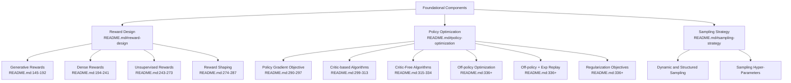

Sources: [README.md:47-62](), [README.md:144-390]()

---

## How the Components Interact

The three components map directly onto distinct phases of a single RL training iteration:

1. **Sampling Strategy** determines which prompts are selected and how many rollouts are generated per prompt.
2. **Reward Design** evaluates each rollout and produces a training signal — either outcome-level (sparse), step-level (dense), or unsupervised.
3. **Policy Optimization** uses the reward signal to compute a gradient update according to a specific algorithm (e.g., `PPO`, `GRPO`, `DPO`).

**RL Training Loop — component interaction**

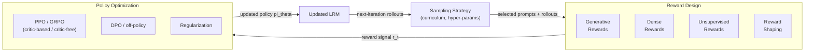

Sources: [README.md:95-110](), [reference.bib:805-1210]()

---

## Reward Design

The reward design component answers: *what signal should the policy optimize toward?*

The survey distinguishes four mechanisms, organized by how the reward is produced:

| Sub-category | Signal Type | Key Mechanism | Representative Papers |
|---|---|---|---|
| Generative Rewards | Outcome / critique | LLM generates a textual critique or score | `GenRM` (`mahan2024generative`), `Auto-J` (`li2023generative`), `JudgeLRM` (`chen2025judgelrm`) |
| Dense Rewards | Step-level | Process Reward Models (PRMs) assign credit to intermediate steps | `PRM800K` (`lightman2023let`), `Math-Shepherd` (`wang2023math`), `PRIME` (`cui2025process`) |
| Unsupervised Rewards | Self-generated | Model provides its own signal without external labels | `Absolute Zero` (`zhao2025absolute`), `TTRL` (`zuo2025ttrl`), `EMPO` (`zhang2025right`) |
| Reward Shaping | Auxiliary augmentation | Format, length, curiosity signals augment base reward | `DeepSeek-R1` (`deepseek-r1`), `Qwen2.5-Math`, `Pass@kTraining` |

The Generative Rewards sub-category includes papers on LLM-as-judge (`Judge LLM-as-a-Judge`, 2023) through modern reasoning-capable reward models (`Think-RM`, `RM-R1`, `GenPRM`). Dense Rewards covers step-level PRM research from the foundational `PRM800K` dataset through implicit PRMs (`ImplicitPRM`, `VinePPO`). Unsupervised Rewards tracks an active line of research on RL without ground-truth labels.

See [Reward Design (2.2.1)](#2.2.1) for full detail.

Sources: [README.md:144-287](), [reference.bib:242-1420]()

---

## Policy Optimization

The policy optimization component answers: *how should the model parameters be updated given the reward?*

The survey identifies six sub-categories:

| Sub-category | Approach | Key Papers in README |
|---|---|---|
| Policy Gradient Objective | Foundational PG algorithms | `PPO` (2017), `REINFORCE`, `TRPO`, `PG` |
| Critic-based Algorithms | Use a learned value function for advantage | `GAE` (2015), `VAPO`, `PRIME`, `VCPPO` |
| Critic-Free Algorithms | Estimate advantage without a separate critic | `GRPO` (`shao2024deepseekmath`), `DAPO`, `RLOO`, `ReMax` |
| Off-policy Optimization | Optimize on pre-collected preference data | `DPO` (`rafailov2023direct`) |
| Off-policy + Experience Replay | Combine off-policy data with a replay buffer | — |
| Regularization Objectives | Add explicit KL, entropy, or clip constraints | `Clip-Cov/KL-Cov`, `CPGD`, `Dr. GRPO` |

The critic-free sub-category is the most heavily populated in the survey, reflecting the widespread adoption of `GRPO` (Group Relative Policy Optimization, introduced in `DeepSeekMath`) and its variants (`DAPO`, `GSPO`, `CISPO`, `Dr. GRPO`, `LitePPO`, `KRPO`).

**Policy optimization algorithms — from foundational to LRM-specific**

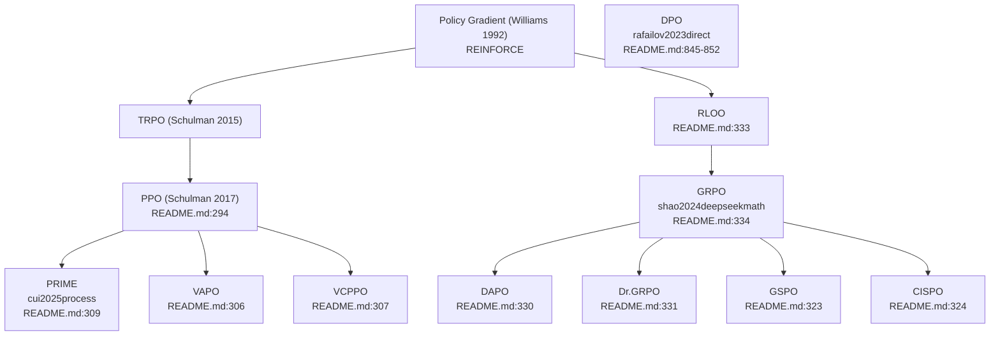

See [Policy Optimization (2.2.2)](#2.2.2) for full detail.

Sources: [README.md:289-390](), [reference.bib:845-860]()

---

## Sampling Strategy

The sampling strategy component answers: *which data should the model train on, and how should rollouts be structured?*

Two sub-categories are identified:

| Sub-category | Concern | Representative Approaches |
|---|---|---|
| Dynamic and Structured Sampling | Curriculum scheduling, prompt selection, group sampling | Difficulty-based curriculum, rejection sampling |
| Sampling Hyper-Parameters | Temperature, number of samples per prompt (`G`), clip ratio | `DAPO`'s dynamic clip, `GRPO`'s `G` parameter |

The sampling strategy has direct interactions with both reward design (more samples per prompt enables group-based advantage normalization, as in `GRPO`) and policy optimization (the size and diversity of rollout batches affect gradient variance and stability).

See [Sampling Strategy (2.2.3)](#2.2.3) for full detail.

Sources: [README.md:60-62](), [README.md:390+]()

---

## Mapping to Repository Files

**README.md sections → reference.bib citation keys**

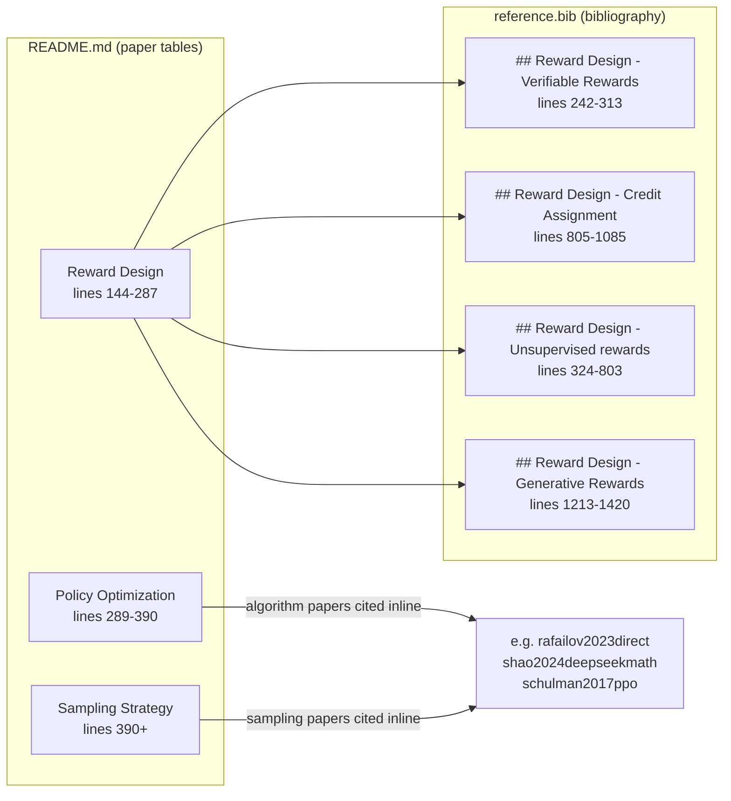

Sources: [README.md:144-390](), [reference.bib:1-1420]()

---

## Summary

The Foundational Components section captures the algorithmic layer of RL for LRMs — independent of what data is used or what application domain is targeted. It is structured to allow a reader to navigate from classical RL primitives (`PPO`, `REINFORCE`, `GAE`) through to the most recent LRM-specific innovations (`GRPO`, `DAPO`, `PRIME`, `TTRL`), while also tracking the parallel evolution of reward modeling from scalar verifiers to generative reasoning-capable reward models.

The three sub-pages ([2.2.1](#2.2.1), [2.2.2](#2.2.2), [2.2.3](#2.2.3)) each enumerate the papers in their respective README tables and explain the technical distinctions between sub-categories.

---

# Page: Reward Design

# Reward Design

<details>
<summary>Relevant source files</summary>

The following files were used as context for generating this wiki page:

- [README.md](README.md)
- [Survey@RL4LRM-v1.pdf](Survey@RL4LRM-v1.pdf)
- [reference.bib](reference.bib)

</details>


This page covers the **Reward Design** sub-section of the survey taxonomy. It documents how reward signals are constructed to train Large Reasoning Models (LRMs) via RL. The four sub-categories — Generative Rewards, Dense Rewards, Unsupervised Rewards, and Reward Shaping — correspond directly to the `### Reward Design` section of [README.md:144-288]().

For the broader context of how reward design fits alongside Policy Optimization and Sampling Strategy, see [Foundational Components](#2.2). For the RL infrastructure frameworks that implement these reward signals at training time, see [RL Infrastructure](#2.3.3).

---

## Overview

Reward design determines what signal the policy receives after generating a response. The choice of reward construction method has significant downstream effects on training stability, the range of tasks where RL can be applied, and the quality of learned behaviors.

The survey partitions reward design into four distinct categories based on **how the reward is derived**:

| Sub-category | Source of Reward | Supervision Required |
|---|---|---|
| **Generative Rewards** | Another LLM (judge, critic, verifier) | Weak / preference labels |
| **Dense Rewards** | Step-level process verifier | Step labels or implicit signals |
| **Unsupervised Rewards** | Self-consistency, entropy, self-play | None (no ground-truth needed) |
| **Reward Shaping** | Auxiliary signals added to a base reward | Varies |

**Taxonomy diagram: Reward Design sub-categories and representative named systems**

```mermaid
graph TD
  RD["Reward Design"]

  RD --> GR["Generative Rewards"]
  RD --> DR["Dense Rewards"]
  RD --> UR["Unsupervised Rewards"]
  RD --> RS["Reward Shaping"]

  GR --> GR1["LLM-as-Judge\n(Judge, Auto-J, JudgeLRM)"]
  GR --> GR2["Generative Verifier / GenRM\n(GenRM, Generative Verifier, ThinkPRM)"]
  GR --> GR3["Reasoning Reward Models\n(RM-R1, RRM, J1, Think-RM, LIBRA)"]
  GR --> GR4["Critique Models\n(CLoud, Critique-GRPO, GRAM)"]
  GR --> GR5["Self-Rewarding\n(Self-Rewarding LM, Self-rewarding correction)"]

  DR --> DR1["Outcome vs Process Feedback\n(PRM800K, Math-Shepherd)"]
  DR --> DR2["Implicit Process Rewards\n(Implicit PRM, PRIME)"]
  DR --> DR3["Tree-based Credit Assignment\n(VinePPO, TreeRPO, TreeRL, TreePO)"]
  DR --> DR4["Step/Segment-level\n(SPA-RL, SPO, S-GRPO, GiGPO)"]
  DR --> DR5["Generative PRMs\n(GenPRM, ReasonFlux-PRM, TP-GRPO)"]

  UR --> UR1["Self-Play\n(Absolute Zero, SeRL, TRANS-ZERO)"]
  UR --> UR2["Self-Rewarding / Consistency\n(SSR-Zero, CoVo, EMPO, R-Zero)"]
  UR --> UR3["Entropy / Confidence\n(EM-RL, RENT-RL, RLIF)"]
  UR --> UR4["Test-Time RL\n(TTRL, One-Shot-RLVR)"]

  RS --> RS1["Format / Length Signals\n(DeepSeek-R1, rl-without-gt)"]
  RS --> RS2["Pass-at-k Objectives\n(Pass@kTraining, PKPO)"]
  RS --> RS3["Exploration Bonuses\n(CDE, DARLING, OBE)"]
```

Sources: [README.md:144-288](), [README.md:48-53]()

---

## Generative Rewards

A **generative reward** is produced by a language model that evaluates a candidate response, rather than by a deterministic rule or lookup. This enables reward signals in open-ended domains (creative writing, long-form reasoning, multi-step judgment) where symbolic verifiers do not exist.

### Conceptual Variants

**Taxonomy diagram: Generative Reward model types mapped to named README entries**

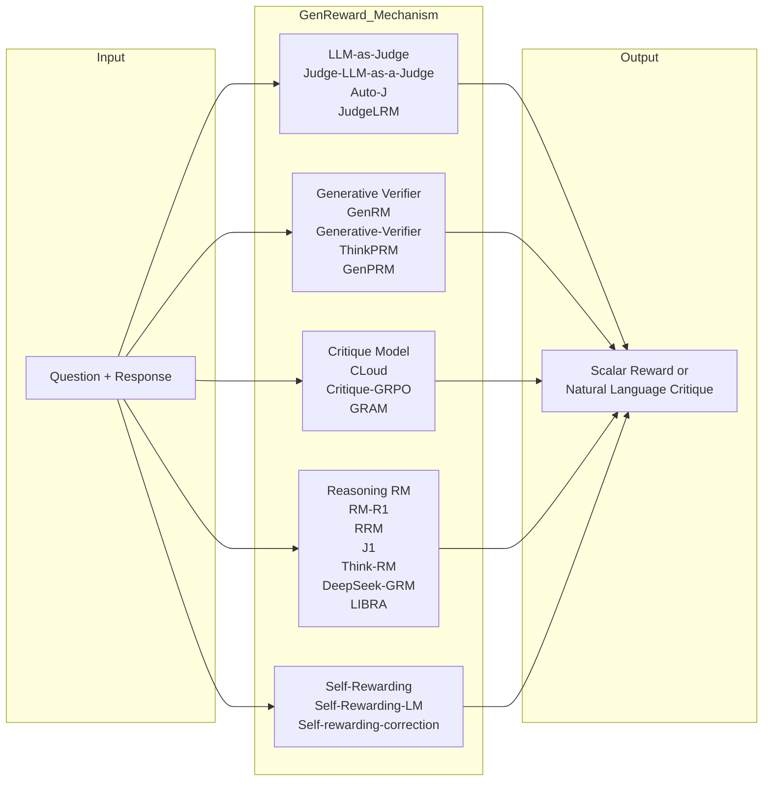

Sources: [README.md:145-192](), [reference.bib:1213-1425]()

### Key Approaches

| Approach | How it works | Representative papers |
|---|---|---|
| **LLM-as-Judge** | A separate LLM scores responses using a prompt-based rubric, without explicit training for judging | `Judge LLM-as-a-Judge` (2023), `Auto-J`, `JudgeLRM` |
| **Generative Verifier** | The verifier generates reasoning before emitting a correctness verdict, framing reward modeling as next-token prediction | `Generative Verifier` (2024), `GenRM`, `ThinkPRM` |
| **Reasoning Reward Model** | An RM trained explicitly to reason about response quality, often via RL itself | `RM-R1`, `RRM`, `J1`, `Think-RM`, `LIBRA`, `DeepSeek-GRM` |
| **Critique Model** | The reward model outputs a natural-language critique alongside a score | `CLoud`, `Critique-GRPO`, `GRAM`, `CAPO` |
| **Self-Rewarding** | The same model being trained also generates its own reward signal | `Self-Rewarding LM`, `Self-rewarding correction` |
| **Unified / Principle-Following** | Reward models that generalize across domains using principles or constitutions | `RewardAnything`, `QA-LIGN`, `RLCF` |
| **Verifier Tooling** | Lightweight verifiers designed for efficiency or false-negative reduction | `xVerify`, `TinyV`, `CompassVerifier` |

### When to Use

Generative rewards are appropriate when:
- The correct answer is not symbolically verifiable (e.g., writing quality, alignment).
- Fine-grained natural language feedback is needed for multi-step credit assignment.
- The task domain is too broad for hand-crafted rules.

Potential pitfalls include reward model bias, self-consistency collapse when the policy and reward model share parameters, and susceptibility to adversarial inputs ("one token to fool" vulnerabilities noted in the survey).

Sources: [README.md:145-192](), [reference.bib:1213-1425]()

---

## Dense Rewards

A **dense reward** provides feedback at the level of individual steps within a chain-of-thought, rather than a single outcome reward at the end. This addresses the **credit assignment problem**: determining which reasoning steps contributed to a correct or incorrect final answer.

### Process Reward Models (PRMs)

Dense rewards are commonly delivered through a **Process Reward Model (PRM)** that scores each intermediate step. The survey traces PRM development from early human-annotated datasets to fully automatic derivation.

**Diagram: Dense reward signal flow and key PRM implementations**

```mermaid
flowchart TD
  subgraph "Trajectory"
    S1["Step 1\n(reasoning token block)"]
    S2["Step 2"]
    SN["Step N\n(final answer)"]
    S1 --> S2 --> SN
  end

  subgraph "PRM_Implementations"
    direction TB
    PRM800K["PRM800K\n(human labels, OpenAI 2023)"]
    MathShepherd["Math-Shepherd\n(automatic MC estimation)"]
    ImplicitPRM["Implicit PRM\n(no step labels needed)"]
    PRIME_s["PRIME\n(implicit rewards via ref model)"]
    GenPRM_s["GenPRM\n(generative PRM with reasoning)"]
    AttnRL["AttnRL\n(attention-guided step signals)"]
    ReasonFlux["ReasonFlux-PRM\n(trajectory-aware)"]
  end

  subgraph "Credit_Assignment_Methods"
    VinePPO_s["VinePPO\n(Monte Carlo rollouts)"]
    TreeRPO_s["TreeRPO / TreeRL / Tree-GRPO\n(on-policy tree search)"]
    SPA["SPA-RL\n(stepwise progress attribution)"]
    SPO_s["SPO\n(segment-level)"]
    GiGPO_s["GiGPO\n(group-in-group advantage)"]
    PURE_s["PURE\n(min-form credit assignment)"]
    SWEET["SWEET-RL\n(multi-turn credit)"]
  end

  S1 -->|"scored"| PRM800K
  S1 -->|"scored"| MathShepherd
  S1 -->|"scored"| ImplicitPRM
  S1 -->|"scored"| GenPRM_s

  PRM800K --> VinePPO_s
  ImplicitPRM --> PRIME_s
  GenPRM_s --> AttnRL

  VinePPO_s --> SPA
  TreeRPO_s --> SPO_s
  PRIME_s --> GiGPO_s
```

Sources: [README.md:194-241](), [reference.bib:805-1148]()

### Sub-approaches

| Approach | Mechanism | Representative Papers |
|---|---|---|
| **Foundational PRMs** | Human-annotated step labels used to train a verifier | `PRM800K` (Let's Verify Step by Step), `Math-Shepherd` |
| **Implicit PRMs** | Derive process rewards from outcome supervision without step labels | `Implicit PRM`, `PRIME` |
| **Generative PRMs** | PRM generates explicit reasoning before scoring each step | `GenPRM`, `ThinkPRM`, `ReasonFlux-PRM`, `TP-GRPO` |
| **Tree-based Credit Assignment** | Use Monte Carlo tree search or branching rollouts to estimate step value | `VinePPO`, `TreeRPO`, `TreeRL`, `Tree-GRPO`, `TreePO` |
| **Segment / Step Aggregation** | Aggregate token-level advantages into step or segment-level signals | `SPO`, `SPA-RL`, `GiGPO`, `S-GRPO` |
| **Min-form Assignment** | Replace sum-based reward aggregation with minimum across steps | `PURE` |
| **Multi-turn Dense Rewards** | Assign per-turn rewards in dialogue/agentic multi-step trajectories | `SWEET-RL`, `G-RA`, `MUA-RL`, turn-level credit assignment |

### Process vs. Outcome Reward

The tension between process rewards (per-step) and outcome rewards (final answer only) is a central topic. Several papers (`PROF`, `HICRA`) study how to harmonize both signal types during training.

Sources: [README.md:194-241](), [reference.bib:805-1148](), [reference.bib:1149-1209]()

---

## Unsupervised Rewards

**Unsupervised rewards** require no ground-truth labels, human preferences, or trained reward models. They derive the training signal entirely from the model's own outputs via consistency, entropy, self-play, or structural properties of the response.

This category is especially important for tasks where:
- No labeled answer corpus exists (e.g., open-ended generation, novel domains).
- Training must proceed at test time on unseen inputs (`TTRL`).
- The goal is data-free or near-data-free self-improvement.

### Approach Map

**Diagram: Unsupervised reward mechanisms mapped to README entries**

```mermaid
graph TD
  subgraph "Signal_Source"
    C["Consistency\nSelf-Agreement"]
    E["Entropy\nModel Confidence"]
    SP["Self-Play\nProposer + Solver"]
    SF["Self-Feedback\nIntrinsic Critique"]
    FMT["Surrogate Structural\nFormat + Length"]
  end

  subgraph "Representative_Systems"
    CoVo_s["CoVo\n(path consistency)"]
    TTRL_s["TTRL\n(majority vote pseudo-label)"]
    AbsoluteZero["Absolute-Zero\n(self-play, zero data)"]
    SeRL_s["SeRL\n(limited data self-play)"]
    EMPO_s["EMPO\n(question self-generation)"]
    RZero["R-Zero\n(self-evolving, zero data)"]
    EMmin["EM-RL\n(entropy minimization)"]
    RENT["RENT-RL\n(confidence maximization)"]
    RLIF["RLIF / Intuitor\n(no external reward)"]
    SSRZero["SSR-Zero\n(self-rewarding translation)"]
    SurSig["rl-without-gt\n(format+length surrogates)"]
    CoReward["Co-Reward\n(contrastive agreement)"]
    SQLM_s["SQLM\n(self-questioning)"]
    TransZ["TRANS-ZERO\n(multilingual self-play)"]
    OneShot["One-Shot-RLVR\n(single example)"]
    Spurious["Spurious-Rewards\n(signal analysis)"]
  end

  C --> CoVo_s
  C --> TTRL_s
  C --> CoReward
  SP --> AbsoluteZero
  SP --> SeRL_s
  SP --> TransZ
  SF --> EMPO_s
  SF --> RZero
  SF --> SQLM_s
  E --> EMmin
  E --> RENT
  E --> RLIF
  FMT --> SurSig
  FMT --> OneShot
  FMT --> Spurious
```

Sources: [README.md:243-273](), [reference.bib:324-803]()

### Sub-approaches

| Approach | Mechanism | Representative Papers |
|---|---|---|
| **Self-play** | A model proposes tasks for itself (or an opponent) to solve; reward comes from solving success | `Absolute Zero`, `SeRL`, `TRANS-ZERO`, `Vision-Zero` |
| **Self-rewarding / consistency** | Rewards are derived from agreement across multiple sampled solutions | `CoVo`, `TTRL`, `SSR-Zero`, `Co-Reward` |
| **Confidence / entropy minimization** | High-confidence (low-entropy) outputs are rewarded, driving model to be more decisive | `EM-RL`, `RENT-RL`, `ETTRL` |
| **Intrinsic / internal feedback** | The model critiques or questions itself without an external oracle | `RLIF`, `SQLM`, `RLSF`, `R-Zero`, `EMPO` |
| **Surrogate structural signals** | Format compliance and response length proxy for quality when ground truth is absent | `rl-without-gt`, `One-Shot-RLVR`, `Spurious Rewards` |
| **Test-time RL** | RL applied at inference time on the test prompt, using pseudo-labels derived from consistency | `TTRL`, `SEAL`, `RPT` |

> **Note on `Spurious Rewards`**: This paper provides a critical analysis — it shows that even random or structurally trivial reward signals can improve reasoning metrics, raising questions about what the RL signal is actually teaching.

Sources: [README.md:243-273](), [reference.bib:324-803]()

---

## Reward Shaping

**Reward shaping** refers to augmenting or modifying the base reward signal with additional auxiliary terms designed to improve exploration, regularize training, or guide the model toward qualitatively better behaviors.

This is a broad, catch-all category. Unlike the other three, reward shaping does not define a new reward source — it modifies an existing outcome reward.

### Common Shaping Techniques

| Technique | Effect | Representative Papers |
|---|---|---|
| **Format rewards** | Binary bonus for well-structured output (e.g., using `` tags.

This is the canonical example of reward shaping as a simple, non-learned auxiliary signal layered on top of outcome verification.

Sources: [README.md:274-288](), [reference.bib:1210-1212]()

---

## Summary: Reward Design Landscape

The following diagram maps each reward sub-category to where it sits in the RL training loop and the key README entries that implement it.

**Diagram: Reward sub-category position in RL training pipeline and README section headers**

```mermaid
flowchart LR
  subgraph "Policy"
    POLICY["LRM Policy\n(generates response)"]
  end

  subgraph "Reward_Computation"
    GEN_R["Generative Rewards\nREADME: Generative Rewards\nGenRM, ThinkPRM, RM-R1,\nCritique-GRPO, JudgeLRM"]
    DENSE_R["Dense Rewards\nREADME: Dense Rewards\nPRIME, VinePPO, TreeRL,\nGenPRM, SPA-RL, PURE"]
    UNSUP_R["Unsupervised Rewards\nREADME: Unsupervised Rewards\nTTRL, Absolute-Zero,\nCoVo, EM-RL, SeRL"]
    SHAPE_R["Reward Shaping\nREADME: Rewards Shaping\nDeepSeek-R1 format reward,\nPass@kTraining, DARLING"]
  end

  subgraph "Optimizer"
    OPT["Policy Optimizer\n(PPO / GRPO / REINFORCE)"]
  end

  POLICY -->|"full trajectory"| GEN_R
  POLICY -->|"per-step tokens"| DENSE_R
  POLICY -->|"no labels needed"| UNSUP_R
  GEN_R -->|"+ shaping terms"| SHAPE_R
  DENSE_R -->|"+ shaping terms"| SHAPE_R
  UNSUP_R -->|"+ shaping terms"| SHAPE_R

  GEN_R --> OPT
  DENSE_R --> OPT
  UNSUP_R --> OPT
  SHAPE_R --> OPT

  OPT -->|"gradient update"| POLICY
```

Sources: [README.md:144-288](), [reference.bib:241-1425]()

### Design Tradeoffs at a Glance

| Property | Generative | Dense (PRM) | Unsupervised | Shaping |
|---|---|---|---|---|
| Requires ground truth | Partial | Often (step labels) | No | Depends on base reward |
| Scalable to open-ended tasks | Yes | Harder | Yes | Depends |
| Credit assignment granularity | Outcome or step | Step | Outcome | Varies |
| Training cost | High (judge model inference) | Medium | Low | Low |
| Risk of reward hacking | Moderate–high | Low–medium | High | Moderate |
| Key limitation | Judge bias / cost | Step label scarcity | Signal quality | Hyperparameter sensitivity |

Sources: [README.md:144-288](), [reference.bib:241-1425]()

---

# Page: Policy Optimization

# Policy Optimization

<details>
<summary>Relevant source files</summary>

The following files were used as context for generating this wiki page:

- [README.md](README.md)
- [Survey@RL4LRM-v1.pdf](Survey@RL4LRM-v1.pdf)
- [reference.bib](reference.bib)

</details>


This page documents the **Policy Optimization** sub-category of the survey's Foundational Components, covering the six algorithm families used to update LLM policies during RL training. The scope is the six algorithm categories listed in [README.md:53-59]() under the `### Policy Optimization` section.

For the reward signals that feed into these algorithms, see [Reward Design](#2.2.1). For the data sampling strategies that interact with policy optimization, see [Sampling Strategy](#2.2.3). For an overview of all three Foundational Components together, see [Foundational Components](#2.2).

---

## Overview

Policy optimization defines how the LLM's parameters are updated given a reward signal. The survey partitions this into six categories based on how value estimation, reference policy constraints, and training data provenance are handled.

**Policy Optimization Taxonomy**

```mermaid
graph TD
  PO["Policy Optimization"]
  PO --> PGO["Policy Gradient Objective\nPPO · REINFORCE · TRPO · PG"]
  PO --> CBA["Critic-based Algorithms\nGAE · VAPO · PRIME · VCPPO"]
  PO --> CFA["Critic-Free Algorithms\nGRPO · DAPO · RLOO · GSPO"]
  PO --> OPO["Off-policy Optimization\nDPO · SimPO · TDPO"]
  PO --> OER["Off-policy + Experience Replay\nIterative DPO · ReSTEM variants"]
  PO --> REG["Regularization Objectives\nKL · Entropy · Clipping"]
```

Sources: [README.md:53-59](), [README.md:289-334]()

**Relationship to the RL Training Loop**

```mermaid
flowchart LR
  ENV["Prompt / Environment"]
  POL["Policy LLM"]
  REWARD["Reward Signal\n(rule-based or model-based)"]
  UPDATE["Parameter Update"]

  ENV -->|"sample prompt"| POL
  POL -->|"generate response"| REWARD
  REWARD -->|"scalar signal r"| UPDATE
  UPDATE -->|"applies one of 6 algorithm families"| POL

  subgraph "Critic-based"
    V["Value Network V(s)"]
    ADV["Advantage A = r + γV(s') - V(s)"]
    V --> ADV
  end

  subgraph "Critic-Free"
    GRP["Group baseline\nmean reward of K samples"]
    GADV["Advantage A_i = r_i - mean(r)"]
    GRP --> GADV
  end

  UPDATE -.->|"uses"| ADV
  UPDATE -.->|"or uses"| GADV
```

Sources: [README.md:95-110](), [README.md:289-334]()

---

## Policy Gradient Objective

These are the foundational RL algorithms from which all LRM-specific methods derive.

| Algorithm | Year | Core Idea |
|:---|:---:|:---|
| `REINFORCE` | — | Monte-Carlo policy gradient; high variance, no baseline |
| `PG` | — | Policy gradient with function approximation |
| `TRPO` | — | Trust-region constraint: limits KL divergence per update |
| `PPO` | 2017 | Clipped surrogate objective; practical approximation of TRPO |

All four foundational papers are listed in the `#### Policy Gradient Objective` section of [README.md:290-297]().

### PPO Objective

PPO dominates practical LRM training. Its clipped surrogate loss is:

```
L_CLIP(θ) = E[ min(r_t(θ) · A_t,  clip(r_t(θ), 1-ε, 1+ε) · A_t) ]

where r_t(θ) = π_θ(a_t|s_t) / π_θ_old(a_t|s_t)
```

The `ε` clip parameter (typically 0.2) prevents large policy updates, serving the same purpose as TRPO's KL constraint but with lower computational cost.

Sources: [README.md:292-297]()

---

## Critic-based Algorithms

Critic-based methods train a separate **value network** alongside the policy. The value network estimates `V(s)` (expected future reward from state `s`), enabling lower-variance advantage estimates via **Generalized Advantage Estimation (GAE)**.

**Critic-based Algorithm Lineage**

```mermaid
graph TD
  GAE["GAE (2015)\nHigh-dimensional continuous control"]
  PPO2["PPO\nPolicy clipping + GAE"]
  PRIME["PRIME (2025-02)\nProcess Reinforcement via Implicit Rewards"]
  IMPLICITPRM["Implicit PRM (2024-12)\nFree process rewards without labels"]
  MATHSHEPHERD["Math-shepherd (2023-12)\nStep-by-step verification"]
  VAPO["VAPO (2025-04)\nValue-Aware Policy Optimization"]
  VCPPO["VCPPO (2025-03)\nValue-Corrected PPO for Long-CoT"]
  ORZ["Open-Reasoner-Zero (2025-03)\nScaling RL on base model"]
  VLDAC["VL-DAC (2025-08)\nVision-Language with Domain-Adapted Critic"]
  VRPO["VRPO (2025-08)\nRobust value modeling under noisy supervision"]
  VERIPO["VerIPO (2025-05)\nIterative Policy Optimization for video"]

  GAE --> PPO2
  PPO2 --> VAPO
  PPO2 --> VCPPO
  PPO2 --> ORZ
  PPO2 --> VLDAC
  PPO2 --> VRPO
  PPO2 --> VERIPO
  MATHSHEPHERD --> IMPLICITPRM
  IMPLICITPRM --> PRIME
```

Sources: [README.md:299-313]()

### Representative Papers

| Date | Name | Key Contribution |
|:---:|:---|:---|
| 2015-06 | `GAE` | Generalized Advantage Estimation for high-dim continuous control |
| 2023-12 | `Math-shepherd` | Step-by-step process reward without human annotations |
| 2024-12 | `Implicit PRM` | Free process rewards without explicit process labels |
| 2025-02 | `PRIME` | Process reinforcement through implicit rewards; combines ORM + PRM |
| 2025-03 | `VCPPO` | Diagnoses value collapse in long-CoT; proposes value optimization fix |
| 2025-04 | `VAPO` | Value-aware policy optimization for advanced reasoning |
| 2025-08 | `VRPO` | Robust value modeling under noisy reward supervision |
| — | `Autopsv` | Automated process-supervised verifier |

Sources: [README.md:299-313]()

### Limitation: Critic Overhead

Maintaining a value network roughly doubles memory and compute relative to critic-free approaches. This cost motivated the development of the critic-free family described below.

---

## Critic-Free Algorithms

Critic-free methods eliminate the value network entirely. Advantage is estimated using a **group baseline**: for each prompt, `K` responses are sampled and the baseline is the mean reward across the group.

**Critic-Free Algorithm Lineage**

```mermaid
graph TD
  REINFORCE2["REINFORCE\nbaseline = 0"]
  RLOO["RLOO (2024-02)\nLeave-One-Out baseline"]
  REMAX["ReMax (2023-10)\nGreedy rollout as baseline"]
  GRPO["GRPO (2024-02)\nGroup Relative Policy Optimization\n(DeepSeekMath)"]
  DAPO["DAPO (2025-03)\nDynamic clip + token-level loss"]
  DRGRPO["Dr. GRPO (2025-03)\nDebiased GRPO - removes length/difficulty bias"]
  K1_5["Kimi k1.5 (2025-01)\nScaling RL with long-CoT"]
  KRPO["KRPO (2025-05)\nKalman Filter enhanced GRPO"]
  CPGD["CPGD (2025-05)\nStable rule-based RL"]
  GSPO["GSPO (2025-07)\nGroup Sequence Policy Optimization"]
  CISPO["CISPO (2025-06)\nClip-Importance-Sampling; used in MiniMax-M1"]
  CLIPCOV["Clip-Cov/KL-Cov (2025-05)\nEntropy mechanism analysis"]
  UPGE["UPGE (2025-09)\nUnified view of post-training"]
  SPO2["SPO (2025-09)\nSingle-stream Policy Optimization"]
  OPENVL["OpenVLThinker (2025-03)\nIterative SFT-RL for vision-language"]
  LITEPPO["LitePPO (2025-08)\nCritic-free PPO analysis"]

  REINFORCE2 --> RLOO
  REINFORCE2 --> REMAX
  GRPO --> DAPO
  GRPO --> DRGRPO
  GRPO --> KRPO
  GRPO --> CPGD
  GRPO --> GSPO
  GRPO --> CISPO
  GRPO --> CLIPCOV
  GRPO --> UPGE
  GRPO --> SPO2
  RLOO --> GRPO
```

Sources: [README.md:315-334]()

### GRPO: The Central Algorithm

`GRPO` (Group Relative Policy Optimization), introduced with DeepSeekMath, is the most widely adopted critic-free algorithm in this survey. It defines advantage as:

```
A_i = (r_i - mean(r_1..r_K)) / std(r_1..r_K)

where K responses are sampled per prompt
```

It replaces the per-token value baseline of PPO with a per-group scalar, eliminating the critic network.

### Representative Papers

| Date | Name | Key Contribution |
|:---:|:---|:---|
| 2023-10 | `ReMax` | Greedy rollout as variance-reduction baseline |
| 2024-02 | `RLOO` | Leave-one-out baseline; revisits REINFORCE for RLHF |
| 2024-02 | `GRPO` | Group relative advantage; no value network needed |
| 2025-01 | `Kimi k1.5` | Scales critic-free RL to long-CoT with curriculum |
| 2025-03 | `DAPO` | Dynamic sampling + token-level policy loss; improves GRPO stability |
| 2025-03 | `Dr. GRPO` | Removes length and difficulty bias from GRPO advantage |
| 2025-05 | `Clip-Cov/KL-Cov` | Analyzes entropy collapse in RL for reasoning models |
| 2025-06 | `CISPO` | Clip importance sampling; used in MiniMax-M1 training |
| 2025-07 | `GSPO` | Group Sequence Policy Optimization; sequence-level grouping |
| 2025-08 | `LitePPO` | Empirical deep dive into tricks vs. traps in critic-free RL |
| 2025-09 | `UPGE` | Unified gradient estimation framework across post-training methods |

Sources: [README.md:315-334]()

---

## Off-policy Optimization

Off-policy methods use pre-collected preference pairs `(x, y_w, y_l)` rather than online rollouts. The central algorithm is **DPO** (Direct Preference Optimization), which reparameterizes the reward as an implicit function of the policy ratio.

**DPO Family Relationships**

```mermaid
graph TD
  RLHF["RLHF (PPO + reward model)"]
  DPO["DPO (2023)\nDirect Preference Optimization\nRafailov et al."]
  SIMPO["SimPO\nSimple Preference Optimization\nreference-free"]
  TDPO["TDPO\nToken-level DPO"]
  ORPO["ORPO\nOdds Ratio Preference Optimization"]
  ROPO["ROPO\nRobust DPO variants"]

  RLHF -->|"eliminates reward model"| DPO
  DPO --> SIMPO
  DPO --> TDPO
  DPO --> ORPO
  DPO --> ROPO
```

Sources: [README.md:53-59]()

### DPO Objective

```
L_DPO(θ) = -E[ log σ( β · log(π_θ(y_w|x)/π_ref(y_w|x))
                     - β · log(π_θ(y_l|x)/π_ref(y_l|x)) ) ]
```

The `β` parameter controls deviation from the reference policy `π_ref`. DPO directly optimizes preference rankings without a separate reward model.

---

## Off-policy Optimization with Experience Replay

This category covers methods that combine off-policy preference data with a **replay buffer** or iterative data collection, allowing the training distribution to evolve while reusing historical data.

Key strategies in this family:

| Strategy | Description |
|:---|:---|
| **Iterative DPO** | Re-sample preference pairs from the updated policy periodically |
| **ReSTEM-style** | Rejection sampling fine-tuning; filtered self-generated rollouts |
| **Hybrid on/off-policy** | Mix fresh rollouts with a historical buffer |

Sources: [README.md:53-59]()

---

## Regularization Objectives

Regularization terms are added to any of the above objectives to control entropy, prevent reward hacking, and stabilize training.

**Common Regularization Terms**

| Term | Symbol | Effect |
|:---|:---:|:---|
| KL divergence from reference | `KL(π_θ ‖ π_ref)` | Prevents deviation from the base model; used in PPO and DPO |
| Entropy bonus | `H(π_θ)` | Encourages exploration; prevents premature collapse |
| Token-level loss normalization | per-token vs per-sequence | Affects length bias in GRPO/DAPO |
| Clip ratio | `ε` in PPO | Limits per-step policy change |

**Regularization in Practice: DAPO Modifications to GRPO**

`DAPO` [README.md:330]() introduces several regularization changes over base `GRPO`:

1. **Clip-Higher**: Asymmetric clipping — raises the upper clip bound to allow more exploration
2. **Dynamic Sampling**: Drops prompts where all `K` samples have the same reward (zero gradient)
3. **Token-level Policy Gradient Loss**: Averages loss over tokens, not sequences, reducing length bias
4. **Overlong Reward Shaping**: Penalizes responses that exceed a maximum length

`Clip-Cov/KL-Cov` [README.md:328]() provides a theoretical analysis of entropy dynamics, showing that standard KL regularization can cause entropy collapse that harms reasoning diversity.

Sources: [README.md:315-334]()

---

## Critic-based vs Critic-Free: Trade-offs

```mermaid
flowchart LR
  subgraph "Critic-based (PPO family)"
    CB_POLICY["Policy network π_θ"]
    CB_VALUE["Value network V_φ"]
    CB_ADV["A = r + γV(s') - V(s)\nvia GAE"]
    CB_POLICY --- CB_VALUE
    CB_VALUE --> CB_ADV
  end

  subgraph "Critic-Free (GRPO family)"
    CF_POLICY["Policy network π_θ"]
    CF_K["K rollouts per prompt"]
    CF_ADV["A_i = (r_i - mean_r) / std_r"]
    CF_POLICY --> CF_K
    CF_K --> CF_ADV
  end

  COST["Memory/Compute cost:\nCritic-based ≈ 2× Critic-Free"]
  VARIANCE["Variance:\nCritic-based lower for long-horizon\nCritic-Free lower for short-horizon"]
```

| Property | Critic-based | Critic-Free |
|:---|:---|:---|
| Extra parameters | Value network `V_φ` | None |
| Advantage estimation | GAE with bootstrapping | Group mean/std baseline |
| Training stability | Higher for long CoT | Can collapse entropy |
| Complexity | Higher (two-model update) | Lower (single model) |
| Primary algorithm | PPO + GAE | GRPO, RLOO, REINFORCE |
| Key fix for instability | `VCPPO` (value collapse) | `DAPO` (clip-higher) |

Sources: [README.md:289-334]()

---

## Cross-Reference: Algorithm Names to README Sections

The README organizes papers under these exact section anchors. The table below maps algorithm names to their canonical README entry locations.

```mermaid
graph LR
  subgraph "README.md Policy Optimization Section"
    SEC1["#policy-gradient-objective\nlines 290-297"]
    SEC2["#critic-based-algorithms\nlines 299-313"]
    SEC3["#critic-free-algorithms\nlines 315-334"]
    SEC4["#off-policy-optimization\nlines 336+"]
    SEC5["#off-policy-optimization-exp-replay"]
    SEC6["#regularization-objectives"]
  end

  PPO_PAPER["PPO (Schulman 2017)"] --> SEC1
  REINFORCE_PAPER["REINFORCE (Williams 1992)"] --> SEC1
  TRPO_PAPER["TRPO (Schulman 2015)"] --> SEC1

  GAE_PAPER["GAE (Schulman 2015)"] --> SEC2
  PRIME_PAPER["PRIME (2025-02)"] --> SEC2
  VAPO_PAPER["VAPO (2025-04)"] --> SEC2
  VCPPO_PAPER["VCPPO (2025-03)"] --> SEC2

  GRPO_PAPER["GRPO / DeepSeekMath (2024-02)"] --> SEC3
  RLOO_PAPER["RLOO (2024-02)"] --> SEC3
  DAPO_PAPER["DAPO (2025-03)"] --> SEC3
  DRGRPO_PAPER["Dr. GRPO (2025-03)"] --> SEC3
  GSPO_PAPER["GSPO (2025-07)"] --> SEC3

  DPO_PAPER["DPO (Rafailov 2023)"] --> SEC4
```

Sources: [README.md:53-59](), [README.md:289-334]()

---

## Summary Table: All Sub-Categories

| Sub-category | README Anchor | Core Mechanism | Representative Algorithms |
|:---|:---|:---|:---|
| Policy Gradient Objective | `#policy-gradient-objective` | Direct gradient of expected reward | `PPO`, `REINFORCE`, `TRPO`, `PG` |
| Critic-based Algorithms | `#critic-based-algorithms` | Learned value function `V(s)` for advantage | `GAE`, `PRIME`, `VAPO`, `VCPPO` |
| Critic-Free Algorithms | `#critic-free-algorithms` | Group baseline from `K` rollouts | `GRPO`, `DAPO`, `RLOO`, `GSPO`, `CISPO` |
| Off-policy Optimization | `#off-policy-optimization` | Pre-collected preference pairs; no rollouts | `DPO`, `SimPO`, `TDPO` |
| Off-policy + Exp Replay | `#off-policy-optimization-exp-replay` | Replay buffer + iterative data refresh | Iterative DPO, ReSTEM |
| Regularization Objectives | `#regularization-objectives` | KL penalty, entropy bonus, clipping | KL-Cov, Clip-Cov, DAPO clip-higher |

Sources: [README.md:53-59](), [README.md:289-334]()

---

# Page: Sampling Strategy

# Sampling Strategy

<details>
<summary>Relevant source files</summary>

The following files were used as context for generating this wiki page:

- [README.md](README.md)
- [reference.bib](reference.bib)

</details>


This page covers the **Sampling Strategy** category of the survey taxonomy — specifically, how training examples and rollout samples are selected, structured, and configured during RL training of Large Reasoning Models (LRMs). Sampling strategy is distinct from what reward signal is used (see [Reward Design](#2.2.1)) and how policy parameters are updated given collected samples (see [Policy Optimization](#2.2.2)). It answers the question: *which data to sample, how to structure that sampling, and with what quantitative settings?*

The survey organizes sampling strategy into two sub-categories: **Dynamic and Structured Sampling** and **Sampling Hyper-Parameters**.

---

## Position in the RL Training Loop

Sampling strategy operates at the data collection stage of each RL update step. It determines what prompts are selected, how responses are generated or structured, and what filtering is applied before reward computation and policy updates occur.

**Diagram: Sampling Strategy in the RL Training Pipeline**

```mermaid
flowchart TD
    subgraph "RL Training Loop"
        P["Prompt Corpus / Environment"]
        SS["Sampling Strategy"]
        ROLLOUT["Response Rollout\n(1 or N completions per prompt)"]
        REWARD["Reward Computation"]
        OPTIM["Policy Optimization\n(PPO / GRPO / REINFORCE)"]
        UPDATE["Model Update"]

        P --> SS
        SS --> ROLLOUT
        ROLLOUT --> REWARD
        REWARD --> OPTIM
        OPTIM --> UPDATE
        UPDATE --> P
    end

    subgraph "Sampling Strategy Components"
        DSS["Dynamic and Structured Sampling\n(which prompts, how structured)"]
        SHP["Sampling Hyper-Parameters\n(group size, length, temperature)"]
    end

    SS --> DSS
    SS --> SHP
```

Sources: [README.md:398-436]()

---

## Dynamic and Structured Sampling

Dynamic and structured sampling covers methods that go beyond uniform random sampling of training prompts. The core ideas are:

- **Curriculum learning**: schedule prompts by difficulty, from easy to hard, so the model builds capability progressively.
- **Difficulty-aware selection**: select prompts whose current estimated difficulty is optimal for learning (not too easy, not too hard).
- **Tree-structured rollout**: instead of sampling a single linear response, explore a branching tree of partial completions to better cover the solution space.
- **Exploration-focused sampling**: explicitly design the sampling procedure to maximize solution diversity and avoid mode collapse.

**Diagram: Dynamic and Structured Sampling Sub-categories and Representative Methods**

```mermaid
graph TD
    DSS["Dynamic and Structured Sampling"]

    DSS --> CURR["Curriculum / Difficulty-Aware\nScheduling"]
    DSS --> TREE["Tree-Structured\nSampling"]
    DSS --> EXPL["Exploration-Focused\nSampling"]
    DSS --> AGENT["Agentic / Multi-step\nStructured Sampling"]

    CURR --> E2H["E2H\n(easy-to-hard curriculum)"]
    CURR --> DACE["DACE\n(difficulty-aware certainty)"]
    CURR --> POLARIS["POLARIS\n(post-training recipe)"]

    TREE --> TreeRL["TreeRL\n(on-policy tree search)"]
    TREE --> TreeRPO["TreeRPO\n(tree relative policy optimization)"]
    TREE --> TreePO["TreePO\n(heuristic tree-based modeling)"]
    TREE --> ToTRL["ToTRL\n(tree-of-thoughts RL)"]
    TREE --> DARS["DARS\n(dynamic action re-sampling)"]

    EXPL --> EEPO["EEPO\n(sample-then-forget)"]
    EXPL --> AttnRL["AttnRL\n(attention-guided exploration)"]
    EXPL --> GG2RPO["G2RPO-A\n(guided group relative policy opt)"]
    EXPL --> RuscaRL["RuscaRL\n(rubric-scaffolded RL)"]

    AGENT --> ARPO["ARPO\n(agentic reinforced policy opt)"]
    AGENT --> ParallelR1["Parallel-R1\n(parallel thinking)"]
    AGENT --> PRIME["PRIME\n(process reinforcement)"]
    AGENT --> DAPO["DAPO\n(dynamic sampling policy opt)"]
```

Sources: [README.md:398-418]()

### Curriculum and Difficulty-Aware Sampling

Curriculum sampling progressively increases task difficulty so that a model receives learning signal appropriate to its current capability. If tasks are always too easy, gradients carry little information; if too hard, all rollouts fail and rewards are uniformly zero.

| Paper | Method Name | Key Idea |
|---|---|---|
| arXiv:2506.06632 | `E2H` | Curriculum RL from easy-to-hard tasks; shows systematic difficulty ordering improves reasoning |
| arXiv:2509.00125 | `DACE` | Difficulty-Aware Certainty as a guide; samples prompts where model certainty is intermediate |
| POLARIS blog | `POLARIS` | Post-training recipe that includes difficulty-based prompt scheduling as part of a broader RL recipe |

Sources: [README.md:412](), [README.md:405](), [README.md:418]()

### Tree-Structured Sampling

Rather than sampling a single linear completion per prompt, tree-structured methods generate a branching tree of partial completions. This is particularly useful for problems where reasoning paths diverge after early steps, providing richer training signal and enabling process-level reward assignment.

| Paper | Method Name | Key Idea |
|---|---|---|
| arXiv:2506.11902 | `TreeRL` | On-policy tree search integrated into RL training loop |
| arXiv:2506.05183 | `TreeRPO` | Tree Relative Policy Optimization — advantage estimation over tree branches |
| arXiv:2508.17445 | `TreePO` | Heuristic tree-based modeling bridging policy optimization and inference efficiency |
| arXiv:2505.12717 | `ToTRL` | Tree-of-Thoughts RL using puzzle-solving to unlock branching reasoning |
| arXiv:2503.14269 | `DARS` | Dynamic Action Re-Sampling via adaptive tree traversal for coding agents |

Sources: [README.md:409-416]()

**Diagram: Tree-Structured vs. Linear Sampling in RL Rollout**

```mermaid
graph TD
    subgraph "Linear Sampling (standard GRPO)"
        P1["Prompt"]
        R1A["Response 1"]
        R1B["Response 2"]
        R1C["Response 3"]
        P1 --> R1A
        P1 --> R1B
        P1 --> R1C
    end

    subgraph "Tree-Structured Sampling (TreeRL / TreeRPO / TreePO)"
        P2["Prompt"]
        S1["Step 1a"]
        S2["Step 1b"]
        S1A["Step 2a"]
        S1B["Step 2b"]
        S2A["Step 2c"]
        S2B["Step 2d"]
        P2 --> S1
        P2 --> S2
        S1 --> S1A
        S1 --> S1B
        S2 --> S2A
        S2 --> S2B
    end
```

Sources: [README.md:409-416]()

### Exploration-Focused Sampling

A recurring challenge in RL for LRMs is entropy collapse — the policy concentrates on a narrow distribution of responses, reducing gradient diversity and stalling learning. Exploration-focused sampling methods directly address this.

| Paper | Method Name | Key Idea |
|---|---|---|
| arXiv:2510.05837 | `EEPO` | Sample-Then-Forget: generates many samples but drops lower-quality ones to maintain diversity |
| arXiv:2509.26628 | `AttnRL` | Uses attention patterns as a compass for efficient exploration in process-supervised RL |
| arXiv:2508.13023 | `G^2RPO-A` | Guided Group Relative Policy Optimization with adaptive guidance for exploration |
| arXiv:2508.16949 | `RuscaRL` | Rubric-Scaffolded RL to break the exploration bottleneck in general reasoning |

Sources: [README.md:403-408]()

---

## Sampling Hyper-Parameters

Sampling hyper-parameters are the quantitative settings governing how many and which responses are collected per update step. While these may appear to be implementation details, they materially affect training stability, compute efficiency, and final model quality.

The primary hyper-parameters studied in the literature are:

| Parameter | Description | Effect |
|---|---|---|
| **Group size G** | Number of responses sampled per prompt per RL step | Larger G improves advantage estimation quality in GRPO-style algorithms; diminishing returns at high G |
| **Response length** | Maximum token budget per rollout | Directly controls training cost and affects quality of long-chain-of-thought models |
| **Temperature** | Sampling temperature during rollout | Controls diversity; too low → collapse; too high → incoherent |
| **Filtering / pruning** | Which samples are retained for update | Removes degenerate samples (all-correct, all-wrong) that provide no gradient signal |
| **Truncation** | Early stopping of rollout | Reduces compute cost per step; trade-off with completeness of reasoning chains |

**Diagram: Sampling Hyper-Parameter Methods and Their Primary Focus**

```mermaid
graph LR
    SHP["Sampling Hyper-Parameters"]

    SHP --> GS["Group Size / Filtering"]
    SHP --> LEN["Response Length"]
    SHP --> TRUNC["Truncation Strategies"]
    SHP --> SCHEDULE["Scheduling / Curriculum HP"]

    GS --> GFPO["GFPO\n(Group Filtered Policy Opt)"]
    GS --> E3RL["E3-RL4LLMs\n(efficiency and exploration)"]
    GS --> DAPO["DAPO\n(clip-higher, dynamic sampling)"]

    LEN --> DeepScaleR["DeepScaleR\n(1.5B model, scaling RL)"]
    LEN --> POLARIS["POLARIS\n(context length scheduling)"]
    LEN --> SafetyLen["Output Length Effect\n(DeepSeek-R1 safety study)"]
    LEN --> TrainEfficient["Training LMs to Reason Efficiently\n(arXiv:2502.04463)"]

    TRUNC --> TPPO["T-PPO\n(Truncated PPO)"]
    TRUNC --> ProRL["Pro-RL\n(prolonged RL)"]

    SCHEDULE --> AceReasonNemotron["AceReason-Nemotron\n(SFT+RL synergy)"]
    SCHEDULE --> Confucius3["Confucius3-Math\n(lightweight math model)"]
    SCHEDULE --> PRIME["PRIME\n(implicit rewards)"]
```

Sources: [README.md:420-436]()

### Group Size and Filtering

In GRPO-style algorithms, each prompt is answered by a group of G rollouts; the advantage is estimated relative to the group mean reward. The choice of G and whether to filter certain sample groups significantly affects the training signal quality.

`GFPO` (Group Filtered Policy Optimization, arXiv:2508.09726) proposes filtering at the group level — if a group's variance is too low (all correct or all wrong), the group is dropped from the update. This reduces wasted compute and focuses gradient steps on genuinely informative prompts.

`E3-RL4LLMs` (arXiv:2505.18573) systematically studies the interaction between efficiency and exploration, examining how group size and sampling strategy jointly determine training dynamics.

`DAPO` (arXiv:2503.14476) introduces several practical sampling fixes including a **clip-higher** trick and dynamic sampling to keep group diversity above a minimum threshold.

Sources: [README.md:424](), [README.md:428](), [README.md:416](), [README.md:432]()

### Response Length Scheduling

Overly long responses dominate compute budgets during rollout. Several works treat maximum response length as an active hyper-parameter:

| Paper | Method Name | Approach |
|---|---|---|
| DeepScaleR blog | `DeepScaleR` | Incrementally increases maximum length budget during training, starting short and expanding as capability grows |
| POLARIS blog | `POLARIS` | Context length warm-up schedule as part of a principled post-training recipe |
| arXiv:2503.01923 | (unnamed) | Studies the effect of forced thinking length on safety properties of DeepSeek-R1 |
| arXiv:2502.04463 | (unnamed) | Demonstrates training LMs to reason efficiently by controlling budget during RL |

Sources: [README.md:431](), [README.md:434-436]()

### Truncation and Prolongation

Two contrasting approaches exist:

- **Truncated rollout** (`T-PPO`, arXiv:2506.15050): truncates rollouts early to save compute, relying on the value function to estimate future returns for incomplete traces.
- **Prolonged RL** (`Pro-RL` / `ProRL`, arXiv:2505.24864): intentionally extends RL training duration with carefully controlled schedules, finding that longer RL can push reasoning boundaries further than previously assumed.

Sources: [README.md:426](), [README.md:430]()

---

## Summary Comparison

The table below summarizes the two sub-categories with their primary concerns and representative papers drawn from the survey.

| Sub-category | Primary Concern | Representative Papers |
|---|---|---|
| Dynamic and Structured Sampling | *Which* data to sample; *how* rollouts are structured | `E2H`, `DACE`, `TreeRL`, `TreeRPO`, `TreePO`, `EEPO`, `DAPO`, `POLARIS`, `PRIME` |
| Sampling Hyper-Parameters | *How much* to sample; quantitative settings per update | `GFPO`, `T-PPO`, `DeepScaleR`, `POLARIS`, `E3-RL4LLMs`, `AceReason-Nemotron`, `Pro-RL` |

Sources: [README.md:398-436]()

---

## Relationship to Other Foundational Components

Sampling strategy interacts closely with both reward design and policy optimization:

- **Reward Design** (see [2.2.1](#2.2.1)): tree-structured sampling generates intermediate steps, which enables dense/process-level rewards to be applied to each branch.
- **Policy Optimization** (see [2.2.2](#2.2.2)): group-based algorithms like GRPO depend directly on group size G set by sampling hyper-parameters; off-policy algorithms (DPO, experience replay) interact with filtering decisions about which samples to retain.
- **Training Resources** (see [2.3](#2.3)): the static corpus and dynamic environment used determine what prompts are available for curriculum or difficulty-aware scheduling.

Sources: [README.md:60-62](), [README.md:398-436]()

---

# Page: Training Resources

# Training Resources

<details>
<summary>Relevant source files</summary>

The following files were used as context for generating this wiki page:

- [README.md](README.md)
- [reference.bib](reference.bib)

</details>


## Purpose and Scope

This page documents the **Training Resources** category of the survey, which covers the data and tooling that power RL training for Large Reasoning Models (LRMs). It spans three distinct resource types: pre-collected **Static Corpus** datasets, interactive **Dynamic Environments**, and the **RL Infrastructure** frameworks used to run experiments.

This page provides an orientation to the overall structure. Detailed entries for each sub-category are covered in:
- [Static Corpus Datasets](#2.3.1)
- [Dynamic Environments](#2.3.2)
- [RL Infrastructure](#2.3.3)

For how training resources plug into the broader RL training pipeline—including reward signals and policy optimization—see [Foundational Components](#2.2).

---

## Taxonomy Overview

The Training Resources section of the survey is organized into three top-level classes. Each class serves a different role in the RL training loop.

**Training Resources Taxonomy**

```mermaid
graph TD
  TR["Training Resources"]

  TR --> SC["Static Corpus\n(pre-collected datasets)"]
  TR --> DE["Dynamic Environment\n(interactive feedback)"]
  TR --> INFRA["RL Infrastructure\n(frameworks and tools)"]

  SC --> SC_Code["Code\ne.g. rStar-Coder, KodCode"]
  SC --> SC_STEM["STEM\ne.g. MegaScience, ReasonMed"]
  SC --> SC_Math["Math\ne.g. DeepMath-103K, OpenMathReasoning"]
  SC --> SC_Agent["Agent\n(tool-use and agent traces)"]
  SC --> SC_Mix["Mixed Domain\n(multi-domain corpora)"]

  DE --> DE_Rule["Rule-based\n(symbolic verifiers)"]
  DE --> DE_Code["Code-based\n(unit test execution)"]
  DE --> DE_Game["Game-based\n(game simulators)"]
  DE --> DE_Model["Model-based\n(LLM critics)"]
  DE --> DE_Ensemble["Ensemble-based\n(combined signals)"]

  INFRA --> INFRA_Primary["Primary\nOpenRLHF · TRL · NeMo RL · verl"]
  INFRA --> INFRA_Secondary["Secondary\nsupporting libraries"]
```

Sources: [README.md:63-75]()

---

## The Three Resource Classes

The three resource classes occupy different positions in the RL training loop. The diagram below shows how each feeds into the pipeline described in [Foundational Components](#2.2).

**Training Resources in the RL Pipeline**

```mermaid
flowchart LR
  subgraph RESOURCES["Training Resources"]
    SC["Static Corpus\n(prompt distribution)"]
    DE["Dynamic Environment\n(reward signal source)"]
    INFRA["RL Infrastructure\n(execution layer)"]
  end

  SC -->|"supplies prompts/questions"| LOOP["RL Training Loop"]
  DE -->|"provides environment feedback"| LOOP
  INFRA -->|"orchestrates rollouts and updates"| LOOP
  LOOP -->|"updated policy"| LRM["Large Reasoning Model"]
```

Sources: [README.md:63-75](), [README.md:95-110]()

| Resource Class | Role in RL Training | Typical Format |
|---|---|---|
| **Static Corpus** | Provides the question/problem distribution from which prompts are sampled | Curated dataset files (JSONL, HuggingFace datasets) |
| **Dynamic Environment** | Acts as the reward oracle, returning success/failure signals to the agent | Executable environments, simulators, or LLM judges |
| **RL Infrastructure** | Manages the training loop: rollout generation, gradient updates, distributed execution | Python libraries / frameworks with CLI or API |

---

## Static Corpus

Static corpora are pre-collected, fixed datasets used as the source of training prompts. The policy is trained to produce correct responses to problems drawn from these corpora. Correctness is then verified—either by a rule-based checker or a model—before assigning a reward.

The survey divides static corpora into five domain sub-categories:

| Sub-category | Domain | Representative Datasets |
|---|---|---|
| **Code** | Competitive and practical programming | `rStar-Coder`, `KodCode`, `LeetCodeDataset`, `OpenCodeReasoning`, `SWE-Gym` |
| **STEM** | Science, technology, engineering, medicine, music | `MegaScience`, `ReasonMed`, `NaturalReasoning`, `SCP-116K` |
| **Math** | Mathematical problem solving | `DeepMath-103K`, `OpenMathReasoning`, `MiroMind-M1-RL-62K` |
| **Agent** | Tool-use, multi-step agent traces | Agent trajectory datasets |
| **Mixed Domain** | Cross-domain corpora combining multiple fields | Mixed-domain compilations |

Full entries, including paper links and GitHub repositories, are in [Static Corpus Datasets](#2.3.1).

**Static Corpus: Dataset-to-Repository Mapping**

```mermaid
graph LR
  rStarCoder["rStar-Coder\n(Code)"] --> rStarRepo["microsoft/rStar"]
  KodCode["KodCode\n(Code)"] --> KodCodePaper["arxiv:2503.02951"]
  SWEGym["SWE-Gym\n(Code)"] --> SWEGymRepo["SWE-Gym/SWE-Gym"]
  LeetCode["LeetCodeDataset\n(Code)"] --> LeetCodeRepo["newfacade/LeetCodeDataset"]

  MegaScience["MegaScience\n(STEM)"] --> MegaSciPaper["arxiv:2507.16812"]
  ReasonMed["ReasonMed\n(STEM)"] --> ReasonMedRepo["YuSun-Work/ReasonMed"]
  NatReason["NaturalReasoning\n(STEM)"] --> NatReasonPaper["arxiv:2502.13124"]

  DeepMath["DeepMath-103K\n(Math)"] --> DeepMathRepo["zwhe99/DeepMath"]
  OpenMathReason["OpenMathReasoning\n(Math)"] --> OpenMathPaper["arxiv:2504.16891"]
```

Sources: [README.md:439-471]()

---

## Dynamic Environments

Dynamic environments provide interactive feedback to the agent during training. Unlike static corpora (which only supply prompts), dynamic environments also act as the **reward oracle**: they evaluate agent actions and return a reward signal. This makes them the bridge between the policy and the training signal.

The survey classifies dynamic environments by the mechanism that generates feedback:

| Sub-category | Feedback Mechanism | Examples |
|---|---|---|
| **Rule-based** | Deterministic symbolic verifiers (regex, math checker) | Format validators, answer comparison rules |
| **Code-based** | Unit test execution against generated code | Test runners, sandbox executors |
| **Game-based** | Game simulator scoring or win/loss signal | Board games, text games, puzzle environments |
| **Model-based** | LLM or trained model acts as the judge | LLM-as-Judge, trained reward models |
| **Ensemble-based** | Combination of multiple feedback sources | Hybrid rule + model verifiers |

Full entries are in [Dynamic Environments](#2.3.2).

**Dynamic Environment Feedback Mechanisms**

```mermaid
flowchart TD
  Agent["LRM Policy\n(agent)"] -->|"generates response"| ENV["Dynamic Environment"]

  subgraph ENV["Dynamic Environment"]
    Rule["Rule-based\n(deterministic checker)"]
    Code["Code-based\n(unit test executor)"]
    Game["Game-based\n(game simulator)"]
    Model["Model-based\n(LLM judge / reward model)"]
    Ensemble["Ensemble-based\n(Rule + Model combined)"]
  end

  Rule -->|"binary reward"| Signal["Reward Signal r(s, a)"]
  Code -->|"pass/fail from tests"| Signal
  Game -->|"win/loss/score"| Signal
  Model -->|"scored critique"| Signal
  Ensemble -->|"aggregated reward"| Signal

  Signal -->|"gradient update"| Agent
```

Sources: [README.md:69-73]()

---

## RL Infrastructure

RL Infrastructure refers to the open-source frameworks and libraries that implement the mechanics of the RL training loop: generating rollouts, computing advantages, applying gradient updates, and managing distributed execution. These tools are the substrate that all other components run on.

The survey distinguishes **Primary Infrastructure** (full-featured frameworks) from **Secondary Infrastructure** (supporting utilities and libraries).

### Primary Infrastructure

| Framework | GitHub Repository | Primary Role |
|---|---|---|
| `OpenRLHF` | `OpenRLHF/OpenRLHF` | Full RL training framework supporting PPO, GRPO, REINFORCE++ |
| `TRL` | `huggingface/trl` | HuggingFace library for RLHF and GRPO fine-tuning |
| `NeMo RL` | `NVIDIA/NeMo` | NVIDIA's RL stack for large-scale distributed training |
| `verl` | `volcengine/verl` | Volcano Engine RL framework (used by DAPO, GRPO research) |

### Secondary Infrastructure

Secondary tools support specific aspects of the pipeline such as efficient rollout generation, quantization during inference, or reward computation utilities. Full listings are in [RL Infrastructure](#2.3.3).

**RL Infrastructure: Framework-to-Repository Mapping**

```mermaid
graph TD
  subgraph PRIMARY["Primary RL Infrastructure"]
    OpenRLHF["OpenRLHF"] --> OpenRLHFRepo["OpenRLHF/OpenRLHF\n(PPO, GRPO, REINFORCE++)"]
    TRL["TRL"] --> TRLRepo["huggingface/trl\n(SFT, DPO, GRPO trainers)"]
    NeMoRL["NeMo RL"] --> NeMoRepo["NVIDIA/NeMo\n(distributed RL at scale)"]
    verl["verl"] --> verlRepo["volcengine/verl\n(used by DAPO, GRPO research)"]
  end

  subgraph SECONDARY["Secondary Infrastructure"]
    FlashRL["FlashRL"] --> FlashRLRepo["yaof20/Flash-RL\n(quantized rollouts)"]
    rllm["rllm"] --> rllmRepo["rllm-org/rllm\n(DeepScaleR experiments)"]
  end

  OpenRLHFRepo -->|"runs"| Loop["RL Training Loop"]
  TRLRepo -->|"runs"| Loop
  NeMoRepo -->|"runs"| Loop
  verlRepo -->|"runs"| Loop
  FlashRLRepo -->|"accelerates rollout in"| Loop
  rllmRepo -->|"accelerates rollout in"| Loop
```

Sources: [README.md:74-75](), [README.md:337]()

---

## Relationship Between Resource Classes

Each resource class is independently selectable and composable. A training run typically combines one or more static corpora (for prompts), a dynamic environment type (for reward signals), and one infrastructure framework (for execution). The table below shows how common published systems combine these:

| System | Static Corpus Domain | Environment Type | Infrastructure |
|---|---|---|---|
| `DeepSeek-R1` | Math | Rule-based (answer checker) | Custom |
| `DAPO` | Math | Rule-based | `verl` |
| `PRIME` | Math | Rule-based + implicit PRM | `OpenRLHF` |
| `SWE-Gym` | Code (GitHub issues) | Code-based (unit tests) | Custom |
| `Absolute Zero` | Self-generated (zero data) | Model-based (self-feedback) | Custom |

Sources: [README.md:285-287](), [README.md:416](), [README.md:417](), [README.md:448-449](), [README.md:259]()

---

# Page: Static Corpus Datasets

# Static Corpus Datasets

<details>
<summary>Relevant source files</summary>

The following files were used as context for generating this wiki page:

- [README.md](README.md)
- [reference.bib](reference.bib)

</details>


This page documents the **Static Corpus** sub-section of the Training Resources taxonomy used in the survey. A static corpus is a pre-collected, fixed dataset used to supply training prompts and verifiable reference answers to an RL training loop. These datasets do not change during training and differ from dynamic environments, which provide interactive feedback at inference time. For information about environments that generate feedback dynamically, see [Dynamic Environments](#2.3.2). For the RL frameworks that consume these datasets, see [RL Infrastructure](#2.3.3).

The survey organizes static corpora into five domain-specific sub-categories reflected directly in the `README.md` section headers: **Code**, **STEM**, **Math**, **Agent**, and **Mix**.

---

## Role in the RL Training Pipeline

Static corpus datasets serve as the **prompt source** for the policy's rollout phase. Each dataset entry typically consists of a problem statement and one or more verifiable answers. The RL loop samples problems from this corpus, generates candidate solutions, and scores them against the reference answer using a rule-based or model-based verifier.

**Taxonomy Diagram: Static Corpus within Training Resources**

```mermaid
graph TD
  TR["Training Resources"]
  TR --> SC["Static Corpus"]
  TR --> DE["Dynamic Environment"]
  TR --> INFRA["RL Infrastructure"]

  SC --> CODE["Static Corpus (Code)\nREADME.md §Static Corpus (Code)"]
  SC --> STEM["Static Corpus (STEM)\nREADME.md §Static Corpus (STEM)"]
  SC --> MATH["Static Corpus (Math)\nREADME.md §Static Corpus (Math)"]
  SC --> AGENT["Static Corpus (Agent)\nREADME.md §Static Corpus (Agent)"]
  SC --> MIX["Static Corpus (Mix)\nREADME.md §Static Corpus (Mix)"]
```

Sources: [README.md:63-68]()

---

## Sub-category Overview

| Sub-category | Domain | Typical Verifier Type | Examples |
|---|---|---|---|
| Code | Programming tasks, competitive coding, SWE | Unit test execution | `rStar-Coder`, `KodCode`, `SWE-Gym` |
| STEM | Science, medicine, music theory | Rule-based, model-based | `MegaScience`, `ReasonMed`, `SCP-116K` |
| Math | Mathematical problem solving | Exact-match symbolic | `DeepMath-103K`, `OpenMathReasoning` |
| Agent | Tool use, multi-step agentic tasks | Trajectory evaluation | *(see Agent sub-section)* |
| Mix | Cross-domain blended collections | Mixed | *(see Mix sub-section)* |

---

## Static Corpus (Code)

Code datasets provide programming problems with verifiable correctness criteria, typically executed via unit tests or comparison against reference outputs. Problems span competitive programming, open-source repository issues, and general algorithmic challenges.

**Dataset → GitHub Repository Mapping**

```mermaid
graph LR
  CODE["Static Corpus\n(Code)"]

  CODE --> rStarCoder["rStar-Coder\nmicrosoft/rStar"]
  CODE --> Z1["Z1\nefficientscaling/Z1"]
  CODE --> OCR["OpenCodeReasoning\n(NVIDIA, no public repo)"]
  CODE --> LCD["LeetCodeDataset\nnewfacade/LeetCodeDataset"]
  CODE --> KodCode["KodCode\n(no public repo)"]
  CODE --> SWEFixer["SWE-Fixer\nInternLM/SWE-Fixer"]
  CODE --> SWEGym["SWE-Gym\nSWE-Gym/SWE-Gym"]
  CODE --> CodeR1["Code-R1\nganler/code-r1"]
  CODE --> CFCoTs["codeforces-cots\nopen-r1/codeforces-cots"]
  CODE --> DeepCoder["DeepCoder\nagentica-project/rllm"]
```

Sources: [README.md:439-452]()

| Date | Name | Description |
|---|---|---|
| 2025-05 | `rStar-Coder` | Large-scale verified competitive code reasoning dataset from Microsoft. |
| 2025-04 | `Z1` | Code-centric dataset designed for efficient test-time scaling. |
| 2025-04 | `OpenCodeReasoning` | Competitive coding dataset built via data distillation from frontier models (NVIDIA). |
| 2025-04 | `LeetCodeDataset` | Temporally partitioned LeetCode problems for robust evaluation and training. |
| 2025-03 | `KodCode` | Diverse, challenging, verifiable synthetic coding problems. |
| 2025-01 | `SWE-Fixer` | GitHub issue resolution training data for open-source LLM fine-tuning. |
| 2024-12 | `SWE-Gym` | Environment and dataset for training software engineering agents and verifiers. |
| — | `Code-R1` | Dataset reproducing DeepSeek-R1 setup for code tasks with reliable rewards. |
| — | `codeforces-cots` | CodeForces problems with associated chain-of-thought reasoning traces (HuggingFace). |
| — | `DeepCoder` | Training data for a fully open-source 14B coder at O3-mini parity level. |

Sources: [README.md:439-452]()

---

## Static Corpus (STEM)

STEM datasets span science disciplines beyond mathematics: physics, chemistry, biology, medicine, and even music theory. They typically require multi-step scientific reasoning and may include structured knowledge extraction from textbooks or research literature.

| Date | Name | Description |
|---|---|---|
| 2025-09 | `SSMR-Bench` | Sheet music problem synthesis for evaluation and RL (music theory domain). |
| 2025-09 | `Loong` | Long chain-of-thought synthesis at scale using verifier-guided generation (`camel-ai/loong`). |
| 2025-07 | `MegaScience` | Large post-training dataset pushing frontiers of science reasoning across multiple disciplines. |
| 2025-06 | `ReasonMed` | 370K multi-agent generated dataset for medical reasoning (`YuSun-Work/ReasonMed`). |
| 2025-05 | `ChemCoTDataset` | Chemical QA with modular chemical operations for step-level reasoning evaluation. |
| 2025-02 | `NaturalReasoning` | 2.8M challenging naturally-occurring reasoning questions across STEM topics. |
| 2025-01 | `SCP-116K` | 116K high-quality problem–solution pairs extracted from higher education science sources. |

Sources: [README.md:454-464]()

---

## Static Corpus (Math)

Mathematical datasets are the most widely used static corpus for RL training of LRMs, because answers are programmatically verifiable (exact symbolic match, numerical equivalence). Competition-level and olympiad-level problems provide sufficient difficulty to challenge frontier models.

| Date | Name | Description |
|---|---|---|
| 2025-07 | `MiroMind-M1-RL-62K` | 62K problems supporting multi-stage policy optimization for math reasoning (`MiroMindAI/MiroMind-M1`). |
| 2025-04 | `DeepMath-103K` | 103K large-scale, decontaminated, verifiable math problems (`zwhe99/DeepMath`). |
| 2025-04 | `OpenMathReasoning` | State-of-the-art math reasoning dataset from the AIMO-2 winning solution (NVIDIA). |

Sources: [README.md:466-472]()

> **Note:** The Math sub-section continues beyond the visible excerpt. Additional datasets are referenced in the full `README.md` and `reference.bib`.

---

## Static Corpus (Agent)

Agent datasets cover multi-step tasks requiring tool use, web interaction, or other agentic behavior. Verifiable reward signals in this category typically assess task completion over a full trajectory rather than a single output token.

> The specific dataset entries for this sub-category appear in the full `README.md` beyond the available excerpt. The section is referenced in the table of contents at [README.md:67]().

---

## Static Corpus (Mix)

Mixed-domain datasets combine problems from multiple categories (math, code, STEM, general reasoning) into a single training corpus. These are used when training a generalist reasoning model that should not specialize in a single domain.

> The specific dataset entries for this sub-category appear in the full `README.md` beyond the available excerpt. The section is referenced in the table of contents at [README.md:68]().

---

## Dataset Provenance and Verification Approach

A key property distinguishing static corpus datasets suitable for RL is that they must supply **verifiable** ground truth. The diagram below maps dataset names to the verification strategy they support.

**Diagram: Dataset Names → Verification Strategy**

```mermaid
graph TD
  subgraph "Exact-Match / Symbolic"
    DeepMath["DeepMath-103K\nzwhe99/DeepMath"]
    OpenMathR["OpenMathReasoning"]
    MiroMind["MiroMind-M1-RL-62K\nMiroMindAI/MiroMind-M1"]
  end

  subgraph "Unit-Test Execution"
    rStarC["rStar-Coder\nmicrosoft/rStar"]
    KodC["KodCode"]
    SWEGymD["SWE-Gym\nSWE-Gym/SWE-Gym"]
    LCD2["LeetCodeDataset\nnewfacade/LeetCodeDataset"]
    CodeR1D["Code-R1\nganler/code-r1"]
    CFCoTs2["codeforces-cots\nopen-r1/codeforces-cots"]
  end

  subgraph "Rule-Based or Model-Assisted"
    MegaSci["MegaScience"]
    ReasonMedD["ReasonMed\nYuSun-Work/ReasonMed"]
    NatR["NaturalReasoning"]
    SCP["SCP-116K"]
    Loong2["Loong\ncamel-ai/loong"]
  end
```

Sources: [README.md:439-472]()

---

## Relationship to the RL Training Loop

Static corpus datasets feed into the **rollout / sampling phase** of the RL loop described in the survey. The policy generates completions for sampled prompts; the verifier checks correctness against the stored ground truth labels.

**Diagram: Static Corpus → RL Loop Integration**

```mermaid
flowchart LR
  subgraph "Static Corpus Datasets"
    MathDS["Math datasets\nDeepMath-103K\nOpenMathReasoning"]
    CodeDS["Code datasets\nrStar-Coder\nSWE-Gym\nKodCode"]
    STEMDS["STEM datasets\nMegaScience\nReasonMed\nSCP-116K"]
  end

  MathDS --> Sampler["Prompt Sampler\n(RL training loop)"]
  CodeDS --> Sampler
  STEMDS --> Sampler

  Sampler --> Policy["Policy Model\n(LRM under training)"]
  Policy --> Verifier["Verifier\n(rule-based / code executor)"]
  Verifier --> Reward["Reward Signal\nr = {0, 1} or continuous"]
  Reward --> PO["Policy Optimization\n(PPO / GRPO / REINFORCE)"]
  PO --> Policy
```

Sources: [README.md:63-68](), [README.md:439-472]()

For the dynamic alternative to this static prompt-supply pattern, see [Dynamic Environments](#2.3.2). For the infrastructure frameworks that orchestrate this loop, see [RL Infrastructure](#2.3.3).

---

# Page: Dynamic Environments

# Dynamic Environments

<details>
<summary>Relevant source files</summary>

The following files were used as context for generating this wiki page:

- [README.md](README.md)
- [reference.bib](reference.bib)

</details>


This page documents the **Dynamic Environment** sub-category of Training Resources in the survey taxonomy. Dynamic environments are interactive systems that provide feedback to an RL-trained language model at runtime, as opposed to static corpora which are fixed datasets collected offline. For documentation on static pre-collected datasets, see [2.3.1](#2.3.1). For documentation on RL infrastructure tools that implement or wrap these environments, see [2.3.3](#2.3.3).

Dynamic environments supply the reward signal by actually executing, judging, or simulating the model's output. They are a core ingredient in the RL training loop (see [2](#2) for the full survey taxonomy overview). The five sub-categories differ in *what generates the feedback*: hand-written rules, code execution engines, game simulators, learned models, or a combination of the above.

---

## Role in the RL Training Pipeline

Dynamic environments sit between the policy model and the reward signal. At each training step, the model generates a response (action), the environment processes it, and a scalar reward is returned for use by the policy optimizer.

**Dynamic Environment Interaction Flow**

```mermaid
flowchart LR
  LRM["LRM Policy Model"]
  ENV["Dynamic Environment"]
  REWARD["Reward Signal"]
  OPTIM["Policy Optimizer\n(PPO / GRPO / REINFORCE)"]

  LRM -- "action / response" --> ENV
  ENV -- "reward" --> REWARD
  REWARD --> OPTIM
  OPTIM -- "gradient update" --> LRM
```

Sources: [README.md:63-73]()

---

## Sub-category Overview

| Sub-category | Feedback Source | Primary Use Cases |
|---|---|---|
| Rule-based | Hard-coded deterministic verifiers | Math, logic, format compliance |
| Code-based | Code execution engine / unit tests | Programming tasks, software engineering |
| Game-based | Game simulator / game engine | Strategy games, text adventures, board games |
| Model-based | A learned model (e.g., LLM-as-judge) | Open-ended tasks, subjective quality |
| Ensemble-based | Combination of the above | Mixed-domain or robustness-focused training |

Sources: [README.md:69-73]()

---

## Environment Type Taxonomy

**Taxonomy of Dynamic Environment Sub-categories**

```mermaid
graph TD
  DE["Dynamic Environment\n(Training Resource)"]
  RB["Rule-based"]
  CB["Code-based"]
  GB["Game-based"]
  MB["Model-based"]
  EB["Ensemble-based"]

  DE --> RB
  DE --> CB
  DE --> GB
  DE --> MB
  DE --> EB

  RB --> RB1["Math verifier\n(symbolic checker)"]
  RB --> RB2["Logic / format\ncompliance checker"]
  RB --> RB3["Formal theorem\nprover oracle"]

  CB --> CB1["Unit test executor"]
  CB --> CB2["Competitive judge\n(e.g. SWE-Gym)"]
  CB --> CB3["REPL / sandbox\nexecution"]

  GB --> GB1["Board game engine\n(Chess, Go)"]
  GB --> GB2["Text adventure\nsimulator"]
  GB --> GB3["Strategy game\nenvironment"]

  MB --> MB1["LLM-as-judge\nreward model"]
  MB --> MB2["Trained verifier\n/ discriminator"]

  EB --> EB1["Rule + Code"]
  EB --> EB2["Rule + Model"]
  EB --> EB3["Multi-source\nreward fusion"]
```

Sources: [README.md:63-73]()

---

## Rule-based Environments

Rule-based environments use manually authored, deterministic functions to verify correctness. They require no learned component and produce consistent rewards for identical outputs.

**Characteristics:**
- Reward computation is deterministic and cheap.
- Rules must be authored by humans (or generated formally), so coverage is limited to domains with verifiable ground truth.
- Commonly used for math problem solving, where a symbolic checker or string-matching verifier can confirm whether the final numerical answer is correct.
- Also used for format compliance rewards (e.g., rewarding structured output formats like JSON).

**Typical feedback mechanism:** The model's response is parsed, and the extracted answer is compared against a known solution using exact match, numerical equivalence, or a symbolic solver. DeepSeek-R1 uses this approach — its math training relies on rule-based outcome verifiers that check whether the final boxed answer matches the reference.

| Representative Paper | Notes |
|---|---|
| `DeepSeek-R1` (arxiv:2501.12948) | Uses format and answer correctness rules as the primary reward signal |
| `Qwen2.5-Math` (arxiv:2409.12122) | Rule-based verifiers for mathematical reasoning |
| `DAPO` (arxiv:2503.14476) | Combines rule-based correctness with format reward shaping |

Sources: [README.md:286-287](), [README.md:330]()

---

## Code-based Environments

Code-based environments execute the model's generated code against a test harness and return a binary or graded reward based on test outcomes. They are the standard environment for programming and software engineering tasks.

**Characteristics:**
- Reward signal is objective and unambiguous: code either passes tests or it does not.
- Environment requires a sandboxed execution runtime (subprocess, container, or remote judge).
- Naturally supports multi-turn interaction when the model iteratively debugs code.
- Unit test suites provide dense, per-test coverage signals that can optionally be aggregated.

**Typical feedback mechanism:** The model generates a code solution; the environment compiles and runs it against a hidden or visible test suite; the fraction of passing tests (or a binary pass/fail) becomes the reward.

**SWE-Gym** (arxiv:2412.21139) is the canonical example: it provides a repository of real GitHub issues with associated test suites, allowing an agent to receive reward by making repository-level code changes that pass the CI test suite.

```mermaid
sequenceDiagram
  participant M as "LRM Policy"
  participant E as "Code Executor\n(sandbox)"
  participant T as "Test Suite"
  participant R as "Reward Signal"

  M->>E: "generated code patch"
  E->>T: "run unit tests"
  T-->>E: "pass / fail per test"
  E-->>R: "pass_rate (0.0 – 1.0)"
  R-->>M: "reward for policy update"
```

| Representative Paper | Notes |
|---|---|
| `SWE-Gym` (arxiv:2412.21139) | GitHub-issue sandbox with CI test suite feedback |
| `Code-R1` | Competitive coding with reliable unit-test-based rewards |
| `KodCode` (arxiv:2503.02951) | Synthetic verified coding dataset with execution-based verification |
| `rStar-Coder` (arxiv:2505.21297) | Scaled competitive code reasoning with execution-verified data |
| `LeetCodeDataset` (arxiv:2504.14655) | Temporal benchmark with judge-based pass/fail rewards |

Sources: [README.md:443-452]()

---

## Game-based Environments

Game-based environments use established game simulators as the reward oracle. Games offer advantages for RL research because they have clear win/loss conditions, are fully specified, and can generate unlimited training experience.

**Characteristics:**
- Win/loss outcomes or game scores provide unambiguous terminal rewards.
- Environments can often be run millions of times in parallel, enabling high sample efficiency.
- Multi-step game trajectories naturally model sequential decision-making.
- Useful for developing and benchmarking general reasoning and planning capabilities before applying to less structured domains.

**Examples include:**
- Board games (Chess, Go): require long-horizon strategic planning.
- Text adventure games: require natural language understanding and multi-step navigation.
- Strategy and puzzle games: test compositional reasoning under constraint.

**Vision-Zero** (arxiv:2509.25541) applies a gamified self-play approach to VLM improvement, using strategic game interactions to generate the training signal without external annotators.

| Representative Paper | Notes |
|---|---|
| `Vision-Zero` (arxiv:2509.25541) | Gamified self-play for VLM training |
| `Absolute Zero` (arxiv:2505.03335) | Self-play reasoning with zero external data; game-like problem construction |

Sources: [README.md:247](), [README.md:259]()

---

## Model-based Environments

Model-based environments use a learned model — most commonly another language model acting as a judge or critic — to evaluate the policy model's outputs. This enables RL training in domains where no ground-truth rule or executable program is available.

**Characteristics:**
- Enables training on open-ended tasks (writing, dialogue, reasoning over ambiguous text) that cannot be verified symbolically or by code execution.
- The environment model can itself be updated, leading to co-training dynamics.
- Risk of reward hacking: the policy may learn to exploit weaknesses of the verifier model.
- The verifier/judge is a source of potential noise; papers like `TinyV` (arxiv:2505.14625) specifically study reducing false negatives from model-based verifiers.

**Typical feedback mechanism:** The model output is passed to a judge LLM (or a trained reward model), which returns a score or binary preference signal.

```mermaid
flowchart LR
  POLICY["LRM Policy Output"]
  JUDGE["Judge Model\n(LLM-as-judge /\nreward model)"]
  SCORE["Reward Score"]

  POLICY -- "text response" --> JUDGE
  JUDGE -- "critique / score" --> SCORE
```

| Representative Paper | Notes |
|---|---|
| `JudgeLRM` (arxiv:2504.00050) | Large reasoning model acting as a judge / reward oracle |
| `Auto-J` (arxiv:2310.05470) | Generative judge model for evaluating alignment |
| `J1` (arxiv:2505.10320) | Incentivizes reasoning in LLM-as-a-judge via RL |
| `GRAM` (arxiv:2506.14175) | Generative foundation reward model for reward generalization |
| `RewardAnything` (arxiv:2506.03637) | Generalizable principle-following reward models |
| `TinyV` (arxiv:2505.14625) | Reducing false negatives from model verifiers in RL |
| `Cooper` (arxiv:2508.05613) | Co-optimizing policy and reward model jointly |

Sources: [README.md:147-192](), [README.md:171-172]()

---

## Ensemble-based Environments

Ensemble-based environments combine multiple feedback sources — typically a mix of rule-based, code-based, and model-based mechanisms — to produce a more robust or comprehensive reward signal.

**Characteristics:**
- Different environment components address different aspects of quality (correctness, style, safety, relevance).
- Reward fusion can be additive, weighted, or gated.
- Reduces the failure modes of relying on any single verifier type.
- Often used when training on heterogeneous task mixes where no single verification strategy covers all domains.

**Typical reward fusion patterns:**

| Fusion Strategy | Description |
|---|---|
| Additive | `reward = w1 * rule_reward + w2 * model_reward` |
| Gated | Rule-based reward used when exact verification is possible; model-based otherwise |
| Sequential | Code executor filters responses; model judge scores the remaining candidates |

Papers applying ensemble-based reward design include `OMNI-THINKER` (arxiv:2507.14783), which uses hybrid rewards across multiple domains, and `Skywork-R1V2` (arxiv:2504.16656), which employs multimodal hybrid RL combining rule-based and model-based components.

| Representative Paper | Notes |
|---|---|
| `OMNI-THINKER` (arxiv:2507.14783) | Multi-task RL with hybrid reward sources across domains |
| `Skywork-R1V2` (arxiv:2504.16656) | Multimodal hybrid RL with mixed reward types |
| `Tool-Star` (arxiv:2505.16410) | Multi-tool reasoner; verification combines tool execution + rule checking |

Sources: [README.md:155](), [README.md:135](), [README.md:226]()

---

## Comparison of Environment Types

```mermaid
graph LR
  subgraph "Verification Method"
    R["Rule-based\n(deterministic)"]
    C["Code-based\n(execution)"]
    G["Game-based\n(simulator)"]
    M["Model-based\n(learned judge)"]
    E["Ensemble-based\n(hybrid)"]
  end

  subgraph "Properties"
    P1["Reproducible rewards"]
    P2["Scalable without annotation"]
    P3["Covers open-ended tasks"]
    P4["Unlimited experience"]
    P5["Robust to domain shift"]
  end

  R --> P1
  C --> P1
  G --> P1
  G --> P4
  M --> P2
  M --> P3
  E --> P3
  E --> P5
```

| Property | Rule-based | Code-based | Game-based | Model-based | Ensemble-based |
|---|:---:|:---:|:---:|:---:|:---:|
| Deterministic reward | ✓ | ✓ | ✓ | ✗ | Partial |
| No annotation needed | ✓ | ✓ | ✓ | Partial | Partial |
| Covers open-ended tasks | ✗ | ✗ | ✗ | ✓ | ✓ |
| Unlimited episodes | ✓ | ✓ | ✓ | ✓ | ✓ |
| Scales to real-world tasks | Partial | ✓ | Partial | ✓ | ✓ |

Sources: [README.md:63-73](), [README.md:69-76]()

---

## Relationship to Other Training Resource Categories

Dynamic environments complement the other two training resource categories documented in this survey:

- **Static Corpus** ([2.3.1](#2.3.1)) — pre-collected question-answer pairs used for SFT warm-start or offline RL. Dynamic environments add an interactive loop absent in static data.
- **RL Infrastructure** ([2.3.3](#2.3.3)) — frameworks such as OpenRLHF, TRL, and veRL that implement the scaffolding for connecting dynamic environments to policy optimization algorithms.

```mermaid
flowchart TD
  SC["Static Corpus\n(offline data)"]
  DE["Dynamic Environment\n(interactive feedback)"]
  INFRA["RL Infrastructure\n(OpenRLHF / TRL / veRL)"]
  POLICY["LRM Policy"]

  SC -- "SFT warm-start" --> POLICY
  DE -- "live reward signal" --> INFRA
  INFRA -- "gradient update" --> POLICY
  POLICY -- "rollout" --> DE
```

Sources: [README.md:63-76]()

---

# Page: RL Infrastructure

# RL Infrastructure

<details>
<summary>Relevant source files</summary>

The following files were used as context for generating this wiki page:

- [README.md](README.md)
- [reference.bib](reference.bib)

</details>


This page documents the **RL Infrastructure** sub-section of the [Training Resources](2.3) category in the survey taxonomy. It covers the open-source frameworks and supporting tools that practitioners use to implement RL training pipelines for Large Reasoning Models (LRMs). This page covers infrastructure tools (frameworks, engines, libraries); for the datasets that feed those pipelines, see [Static Corpus Datasets](#2.3.1), and for the interactive feedback environments, see [Dynamic Environments](#2.3.2).

---

## Scope and Structure

The survey divides RL infrastructure into two tiers:

| Tier | Role |
|---|---|
| **Primary Infrastructure** | Full-featured RL training frameworks that orchestrate the entire training loop (rollout generation, reward computation, policy update) |
| **Secondary Infrastructure** | Supporting libraries that are composed into the primary frameworks — inference engines, parallelism backends, memory optimizers |

These tools sit between the raw algorithmic ideas covered in [Foundational Components](#2.2) and the actual trained models that appear in [Frontier Models](#2.1) and [Applications](#2.4).

Sources: [README.md:63-75]()

---

## Position in the Training Pipeline

The following diagram shows how RL infrastructure tools slot into the overall RL training loop described by the survey.

**Diagram: RL Infrastructure in the Training Pipeline**

```mermaid
flowchart TD
    subgraph "Primary RL Frameworks"
        OPENRLHF["OpenRLHF\n(OpenRLHF/OpenRLHF)"]
        TRL["TRL\n(huggingface/trl)"]
        NEMOR["NeMo RL\n(NVIDIA/NeMo)"]
        VERL["veRL\n(volcengine/verl)"]
    end

    subgraph "Secondary / Supporting Tools"
        VLLM["vLLM\n(inference engine)"]
        DEEPSPEED["DeepSpeed\n(ZeRO optimizer)"]
        MEGATRON["Megatron-LM\n(tensor parallelism)"]
        RAY["Ray\n(distributed orchestration)"]
        FLASH["FlashAttention\n(memory-efficient attention)"]
    end

    BASE["Pre-trained LLM\n(base or SFT checkpoint)"]
    ROLLOUT["Rollout Generation\n(actor sampling)"]
    REWARD["Reward Computation\n(verifier / judge)"]
    UPDATE["Policy Update\n(PPO / GRPO / REINFORCE)"]
    LRM["Updated LRM"]

    BASE --> ROLLOUT
    ROLLOUT --> REWARD
    REWARD --> UPDATE
    UPDATE --> LRM
    LRM -->|"next iteration"| ROLLOUT

    OPENRLHF -->|"orchestrates"| ROLLOUT
    OPENRLHF -->|"orchestrates"| UPDATE
    TRL -->|"orchestrates"| ROLLOUT
    TRL -->|"orchestrates"| UPDATE
    NEMOR -->|"orchestrates"| ROLLOUT
    NEMOR -->|"orchestrates"| UPDATE
    VERL -->|"orchestrates"| ROLLOUT
    VERL -->|"orchestrates"| UPDATE

    VLLM -->|"accelerates rollout sampling"| ROLLOUT
    RAY -->|"schedules distributed workers"| ROLLOUT
    DEEPSPEED -->|"ZeRO sharding"| UPDATE
    MEGATRON -->|"tensor/pipeline parallel"| UPDATE
    FLASH -->|"reduces VRAM"| ROLLOUT
```

Sources: [README.md:74-75](), [README.md:103-110]()

---

## Primary Infrastructure

Primary RL frameworks provide an end-to-end implementation of the RL training loop for LLMs, handling actor-critic coordination, distributed rollout, and gradient updates. They are the direct counterpart to the algorithmic papers documented in [Policy Optimization](#2.2.2).

### Framework Overview

**Diagram: Primary Framework Responsibilities**

```mermaid
graph LR
    subgraph "OpenRLHF\n(OpenRLHF/OpenRLHF)"
        OA["Actor rollout"]
        OC["Critic / reference model"]
        OR["Reward model serving"]
        OP["PPO / REINFORCE++ loop"]
    end

    subgraph "TRL\n(huggingface/trl)"
        TA["PPOTrainer"]
        TB["GRPOTrainer"]
        TC["DPOTrainer"]
        TD["SFTTrainer"]
    end

    subgraph "NeMo RL\n(NVIDIA/NeMo)"]
        NA["Megatron-LM backend"]
        NB["GRPO / PPO support"]
        NC["Multi-node GPU scaling"]
    end

    subgraph "veRL\n(volcengine/verl)"
        VA["Hybrid engine\n(train + infer same GPU)"]
        VB["FSDP / Megatron backends"]
        VC["Ray-based orchestration"]
    end
```

Sources: [README.md:74-75](), [README.md:337](), [README.md:362-363]()

### OpenRLHF

`OpenRLHF` (`OpenRLHF/OpenRLHF`) is one of the most widely referenced frameworks in the papers indexed by this survey. It implements full PPO-style RLHF with separate actor, critic, reward model, and reference model roles distributed across GPU workers via `Ray`. It is cited directly in the survey as the source implementation for `REINFORCE++`.

Key characteristics:

| Feature | Detail |
|---|---|
| Backend | Ray + DeepSpeed |
| Supported algorithms | PPO, REINFORCE++, DPO, SFT |
| Model scale | Designed for 70B+ models |
| Reference in README | REINFORCE++ GitHub badge links to `OpenRLHF/OpenRLHF` |

Sources: [README.md:337]()

### TRL (Transformer Reinforcement Learning)

`TRL` (`huggingface/trl`) is HuggingFace's library providing trainer classes (`PPOTrainer`, `GRPOTrainer`, `DPOTrainer`, `SFTTrainer`) that integrate directly with the `transformers` ecosystem. Its tight coupling with HuggingFace model hubs makes it the most accessible entry point for RL fine-tuning.

Key characteristics:

| Feature | Detail |
|---|---|
| Backend | `accelerate` + DeepSpeed optional |
| Supported algorithms | PPO, GRPO, DPO, ORPO, SFT |
| Integration | `transformers`, `datasets`, `peft` |
| Primary use case | Small-to-medium scale experiments |

### NeMo RL

`NeMo RL` (part of `NVIDIA/NeMo`) is NVIDIA's production-grade RL training stack. It uses Megatron-LM for tensor and pipeline parallelism and is designed for large-scale multi-node training on NVIDIA hardware. The survey references `NVIDIA/Megatron-LM` in the context of `Llama-Nemotron-Ultra`.

Key characteristics:

| Feature | Detail |
|---|---|
| Backend | Megatron-LM, NCCL |
| Supported algorithms | PPO, GRPO |
| Target scale | Hundreds of GPUs |
| Reference in README | `NVIDIA/Megatron-LM` GitHub badge |

Sources: [README.md:130]()

### veRL

`veRL` (`volcengine/verl`, also appearing as `yaof20/verl`) is a framework that co-locates training and inference on the same GPU workers using a hybrid engine. This avoids expensive GPU reallocation between rollout and update phases. It supports both `FSDP` and Megatron backends and uses `Ray` for orchestration.

`veRL` is referenced by the survey in the context of off-policy RL techniques and the `GiGPO` agent training paper.

Key characteristics:

| Feature | Detail |
|---|---|
| Backend | FSDP or Megatron-LM + Ray |
| Key innovation | Hybrid train+infer engine on same GPUs |
| Supported algorithms | PPO, GRPO, off-policy variants |
| Reference in README | `yaof20/verl` (off-policy RL), `langfengQ/verl-agent` (GiGPO) |

Sources: [README.md:221](), [README.md:362-363]()

---

## Secondary Infrastructure

Secondary infrastructure tools are composable components that primary frameworks build upon. They do not implement the full RL loop themselves but are essential for scale and efficiency.

### Component Summary

| Tool | Category | Role in RL Pipeline |
|---|---|---|
| `vLLM` | Inference engine | Fast autoregressive sampling during rollout phase; PagedAttention reduces GPU memory |
| `SGLang` | Inference engine | Structured generation and batched inference for rollout |
| `DeepSpeed` | Training optimizer | ZeRO-1/2/3 sharding for optimizer states, gradients, and parameters |
| `Megatron-LM` | Parallelism library | Tensor, pipeline, and sequence parallelism for large model training |
| `Ray` | Distributed runtime | Worker scheduling, resource management across actor/critic/reward model processes |
| `FlashAttention` | Attention kernel | Memory-efficient attention; enables long-sequence RL training |
| `RLLM` | RL convenience layer | Used by `DeepScaleR` and `DeepCoder`; sits atop base frameworks |

Sources: [README.md:435](), [README.md:452]()

### Diagram: Secondary Tool Composition

**Diagram: How Secondary Tools Compose into Primary Frameworks**

```mermaid
graph TD
    subgraph "Rollout Phase"
        VLLM["vLLM / SGLang\n(sampling engine)"]
        FLASH1["FlashAttention\n(kernel)"]
        RAY1["Ray\n(worker scheduling)"]
    end

    subgraph "Update Phase"
        DS["DeepSpeed ZeRO\n(optimizer sharding)"]
        MEG["Megatron-LM\n(tensor / pipeline parallel)"]
        FLASH2["FlashAttention\n(kernel)"]
        RAY2["Ray\n(gradient sync)"]
    end

    subgraph "Primary Frameworks"
        OPENRLHF2["OpenRLHF"]
        TRL2["TRL"]
        NEMOR2["NeMo RL"]
        VERL2["veRL"]
    end

    OPENRLHF2 --> VLLM
    OPENRLHF2 --> RAY1
    OPENRLHF2 --> DS
    OPENRLHF2 --> RAY2

    TRL2 --> DS
    TRL2 --> FLASH1

    NEMOR2 --> MEG
    NEMOR2 --> FLASH2

    VERL2 --> VLLM
    VERL2 --> DS
    VERL2 --> MEG
    VERL2 --> RAY1
    VERL2 --> RAY2
```

Sources: [README.md:74-75](), [README.md:130](), [README.md:337](), [README.md:362-363](), [README.md:435](), [README.md:452]()

---

## Relationship to Specific Papers

Several papers listed in the survey either introduce new infrastructure or build directly atop existing frameworks. The table below maps notable papers to the infrastructure they use or extend.

| Paper / System | Framework Used | Infrastructure Contribution |
|---|---|---|
| `REINFORCE++` | OpenRLHF | Canonical REINFORCE++ implementation |
| `DAPO` | veRL | Clip-higher, token-level policy gradient at scale |
| `PRIME` | OpenRLHF | Implicit process reward integrated into PPO |
| `DeepScaleR` | `rllm-org/rllm` | Curriculum RL scaling with a 1.5B model |
| `DeepCoder` | `agentica-project/rllm` | Code RL built on RLLM stack |
| `GiGPO` | `langfengQ/verl-agent` | Group-in-group advantage, agent-task credit |
| `FlashRL` | Custom (Flash-RL) | Quantized rollouts for fast RL training |
| `Open-Reasoner-Zero` | OpenRLHF | Open reproduction of R1-Zero style training |

Sources: [README.md:221](), [README.md:309](), [README.md:330-331](), [README.md:337](), [README.md:435](), [README.md:452]()

---

## Selection Criteria

The survey classifies a tool as **Primary** if it implements a self-contained RL training loop (rollout → reward → update) and is designed to be used directly as the entry point for LRM fine-tuning experiments. A tool is **Secondary** if it fills a specific subsystem role (inference, memory, parallelism) and is expected to be composed into a primary framework.

This distinction maps onto how papers cite infrastructure: primary frameworks are typically named in the experimental setup section, while secondary tools appear in implementation details or are implied by the hardware configuration.

Sources: [README.md:63-75](), [README.md:103-110]()

---

# Page: Applications

# Applications

<details>
<summary>Relevant source files</summary>

The following files were used as context for generating this wiki page:

- [README.md](README.md)
- [reference.bib](reference.bib)

</details>


This page provides an overview of the **Applications** category in the survey taxonomy — the fourth top-level area in the repository. It covers the full breadth of real-world domains where RL-trained Large Reasoning Models (LRMs) have been deployed. This page summarizes the high-level organization; detailed paper listings for each sub-domain are documented in child pages [2.4.1](#2.4.1), [2.4.2](#2.4.2), [2.4.3](#2.4.3), and [2.4.4](#2.4.4).

For background on the foundational techniques (reward design, policy optimization, sampling strategy) that enable these applications, see [2.2 Foundational Components](#2.2). For the training datasets and environments that support them, see [2.3 Training Resources](#2.3).

---

## Position in the Survey Taxonomy

The Applications category sits alongside Frontier Models, Foundational Components, and Training Resources as one of the four top-level groupings in the survey. Unlike the other three — which focus on *how* RL is applied to LRMs — Applications focuses on *where* and *what for*.

**Taxonomy diagram: Applications within the overall survey structure**

```mermaid
graph TD
    SURVEY["RL for Large Reasoning Models"]
    SURVEY --> FM["Frontier Models"]
    SURVEY --> FC["Foundational Components"]
    SURVEY --> TR["Training Resources"]
    SURVEY --> APP["Applications"]

    APP --> AGENT["Agent Applications\n(2.4.1)"]
    APP --> CODE["Code and Software Engineering\n(2.4.2)"]
    APP --> MULTI["Multimodal and Robotics\n(2.4.3)"]
    APP --> SCI["Scientific Tasks and Multi-Agent\n(2.4.4)"]
```

Sources: [README.md:76-91](), [README.md:103-109]()

---

## Application Domains at a Glance

The survey organizes applications into **14 named sub-categories** across four groups. The table below maps each group to its sub-categories and the corresponding child wiki page.

| Group | Sub-categories | Child Page |
|---|---|---|
| **Agent Applications** | Coding Agent, Search Agent, Browser-Use Agent, DeepResearch Agent, GUI & Computer Agent, Recommendation Agent, Agent (Others) | [2.4.1](#2.4.1) |
| **Code Generation & Software Engineering** | Code Generation, Software Engineering | [2.4.2](#2.4.2) |
| **Multimodal & Robotics** | Multimodal Understanding, Multimodal Generation, Robotics Tasks | [2.4.3](#2.4.3) |
| **Scientific Tasks & Multi-Agent Systems** | Multi-Agent Systems, Scientific Tasks | [2.4.4](#2.4.4) |

Sources: [README.md:76-91]()

---

## Structural Diagram of All Sub-categories

The following diagram maps every named sub-category to its anchor in `README.md`, which is the primary index for paper listings.

**Diagram: README section anchors for each application sub-category**

```mermaid
graph LR
    APP["Applications\n#applications"]

    APP --> A["Agent Applications"]
    A --> A1["#coding-agent"]
    A --> A2["#search-agent"]
    A --> A3["#browser-use-agent"]
    A --> A4["#deepresearch-agent"]
    A --> A5["#guicomputer-agent"]
    A --> A6["#recommendation-agent"]
    A --> A7["#agent-others"]

    APP --> C["Code and Engineering"]
    C --> C1["#code-generation"]
    C --> C2["#software-engineering"]

    APP --> M["Multimodal and Robotics"]
    M --> M1["#multimodal-understanding"]
    M --> M2["#multimodal-generation"]
    M --> M3["#robotics-tasks"]

    APP --> S["Scientific and Multi-Agent"]
    S --> S1["#multi-agent-systems"]
    S --> S2["#scientific-tasks"]
```

Sources: [README.md:76-91]()

---

## Group Summaries

### Agent Applications

The largest application group. Covers LRMs acting as autonomous agents with tool use, multi-step planning, and environment interaction. The sub-categories distinguish agents by the type of task environment:

- **Coding Agent** — agents that write, execute, and debug code autonomously.
- **Search Agent** — agents that invoke search engines or internal retrieval to answer questions (see also the affiliated SSRL project, which investigates agentic search RL without reliance on external search engines).
- **Browser-Use Agent** — agents that operate web browsers programmatically.
- **DeepResearch Agent** — agents that conduct multi-step research tasks, synthesizing across sources.
- **GUI & Computer Agent** — agents that interact with graphical interfaces and operating system environments.
- **Recommendation Agent** — agents trained with RL to provide personalized recommendations.
- **Agent (Others)** — catch-all for agent applications not covered by the above.

For detailed paper listings, see [2.4.1 Agent Applications](#2.4.1).

Sources: [README.md:77-83]()

---

### Code Generation and Software Engineering

Covers work where RL is applied to improve a model's ability to produce syntactically and semantically correct code, and to address realistic software engineering tasks such as bug fixing and repository-level changes.

- **Code Generation** — training LRMs to generate code correct with respect to unit tests or formal specifications.
- **Software Engineering** — tasks like GitHub issue resolution, patch generation, and repository navigation.

For detailed paper listings, see [2.4.2 Code Generation and Software Engineering](#2.4.2).

Sources: [README.md:84-85]()

---

### Multimodal and Robotics

Covers extensions of RL-trained LRMs beyond text to image, video, audio, and physical embodiment.

- **Multimodal Understanding** — models trained with RL to reason over image-text or video-text inputs.
- **Multimodal Generation** — RL applied to generation tasks that produce images, video, or other non-text outputs.
- **Robotics Tasks** — using RL-trained LRMs as controllers or planners in physical or simulated robotic systems.

For detailed paper listings, see [2.4.3 Multimodal and Robotics](#2.4.3).

Sources: [README.md:86-88]()

---

### Scientific Tasks and Multi-Agent Systems

Covers specialized applications to scientific discovery and setups where multiple LRM agents interact.

- **Multi-Agent Systems** — architectures where multiple LRMs collaborate, compete, or communicate during RL training or inference (see also the affiliated MARTI project: a framework for LLM-based Multi-Agent Reinforced Training and Inference).
- **Scientific Tasks** — RL applied to domain-specific scientific problems such as mathematical theorem proving, chemistry, biology, and medicine.

For detailed paper listings, see [2.4.4 Scientific Tasks and Multi-Agent Systems](#2.4.4).

Sources: [README.md:89-90]()

---

## Relationship Between Applications and Training Resources

Application domains do not exist in isolation from training resources. The diagram below shows how specific dynamic environment types (see [2.3.2](#2.3.2)) and static corpus types (see [2.3.1](#2.3.1)) typically feed particular application groups.

**Diagram: Common pairings between training resources and application domains**

```mermaid
graph LR
    subgraph "Static Corpus (README: #static-corpus-code)"
        SC_CODE["Code datasets\ne.g. SWE-Gym, KodCode"]
        SC_MATH["Math datasets\ne.g. DeepMath-103K"]
        SC_STEM["STEM datasets\ne.g. MegaScience"]
        SC_AGENT["Agent datasets"]
    end

    subgraph "Dynamic Environments (README: #dynamic-environment)"
        DE_CODE["Code-based\ne.g. unit test execution"]
        DE_RULE["Rule-based verifiers"]
        DE_GAME["Game-based"]
        DE_MODEL["Model-based"]
    end

    subgraph "Applications"
        APP_CODE["#code-generation\n#software-engineering"]
        APP_AGENT["#coding-agent\n#search-agent\n#browser-use-agent"]
        APP_SCI["#scientific-tasks"]
        APP_MULTI["#multi-agent-systems"]
        APP_VIS["#multimodal-understanding\n#robotics-tasks"]
    end

    SC_CODE --> APP_CODE
    SC_CODE --> APP_AGENT
    DE_CODE --> APP_CODE
    DE_CODE --> APP_AGENT
    SC_MATH --> APP_SCI
    SC_STEM --> APP_SCI
    DE_RULE --> APP_SCI
    SC_AGENT --> APP_AGENT
    DE_GAME --> APP_MULTI
    DE_MODEL --> APP_VIS
```

Sources: [README.md:63-91]()

---

## Related Pages

| Topic | Page |
|---|---|
| How reward signals are designed (applies across all application domains) | [2.2.1 Reward Design](#2.2.1) |
| Policy optimization algorithms used in these applications | [2.2.2 Policy Optimization](#2.2.2) |
| Static datasets used to train application-specific models | [2.3.1 Static Corpus Datasets](#2.3.1) |
| Interactive environments providing feedback during training | [2.3.2 Dynamic Environments](#2.3.2) |
| Agent applications in detail | [2.4.1 Agent Applications](#2.4.1) |
| Code generation and software engineering in detail | [2.4.2 Code Generation and Software Engineering](#2.4.2) |
| Multimodal and robotics in detail | [2.4.3 Multimodal and Robotics](#2.4.3) |
| Scientific tasks and multi-agent systems in detail | [2.4.4 Scientific Tasks and Multi-Agent Systems](#2.4.4) |

---

# Page: Agent Applications

# Agent Applications

<details>
<summary>Relevant source files</summary>

The following files were used as context for generating this wiki page:

- [README.md](README.md)
- [reference.bib](reference.bib)

</details>


## Purpose and Scope

This page covers the **Agent Applications** sub-section of the survey taxonomy, cataloging papers that apply RL-trained Large Reasoning Models (LRMs) to interactive, tool-using, or environment-grounded agent tasks. The agent applications section is one of four top-level application domains tracked by the survey (see page 2.4 for the full Applications overview).

Agent applications are distinct from general code generation or software engineering tasks (page 2.4.2) in that the model must act within an environment — making sequential decisions, using tools, issuing queries, or manipulating interfaces — rather than producing a single output artifact. They are also distinct from multi-agent systems (page 2.4.4), which focus on coordination between multiple LRM instances.

The agent applications section in the README is organized into seven sub-categories:

| Sub-category | README anchor | Focus |
|---|---|---|
| Coding Agent | `#coding-agent` | RL-trained agents for code-centric tasks requiring tool use and iteration |
| Search Agent | `#search-agent` | Agents trained to retrieve and reason over information via search |
| Browser-Use Agent | `#browser-use-agent` | Agents trained to operate web browsers interactively |
| DeepResearch Agent | `#deepresearch-agent` | Long-horizon agents combining search, reading, and synthesis |
| GUI & Computer Agent | `#guicomputer-agent` | Agents trained to control graphical user interfaces or desktops |
| Recommendation Agent | `#recommendation-agent` | Agents trained with RL for recommendation tasks |
| Agent (Others) | `#agent-others` | Agent papers that do not fit the above five categories |

Sources: [README.md:77-83]()

---

## Taxonomy Overview

The following diagram maps the seven sub-categories to their README section anchors and representative paper identifiers visible across the repository.

**Diagram: Agent Applications Taxonomy and README Anchors**

```mermaid
graph TD
  APP["Applications\nREADME: #applications"]
  APP --> CA["Coding Agent\n#coding-agent"]
  APP --> SA["Search Agent\n#search-agent"]
  APP --> BA["Browser-Use Agent\n#browser-use-agent"]
  APP --> DA["DeepResearch Agent\n#deepresearch-agent"]
  APP --> GA["GUI and Computer Agent\n#guicomputer-agent"]
  APP --> RA["Recommendation Agent\n#recommendation-agent"]
  APP --> OA["Agent (Others)\n#agent-others"]

  CA --> DARS["DARS\narxiv:2503.14269"]
  SA --> SSRL["SSRL\narxiv:2508.10874"]
  SA --> StepSearch["StepSearch\narxiv:2505.15107"]
  GA --> ARPO_GUI["ARPO (GUI)\narxiv:2505.16282"]
  OA --> GiGPO["GiGPO\narxiv:2505.10978"]
  OA --> SPRL["SPA-RL\narxiv:2505.20732"]
  OA --> ToolStar["Tool-Star\narxiv:2505.16410"]
  OA --> MemR1["Memory-R1\narxiv:2508.19828"]
  OA --> SWEETRL["SWEET-RL\narxiv:2503.15478"]
  OA --> MUAL["MUA-RL\narxiv:2508.18669"]
```

Sources: [README.md:77-83](), [README.md:21-22](), [README.md:198-232](), [README.md:373](), [README.md:415]()

---

## Agent Applications and the RL Training Pipeline

Agent tasks introduce specific structural differences compared to single-turn reasoning tasks. The following diagram shows how agent RL differs from standard single-step RL at the training pipeline level.

**Diagram: Agent RL Training Loop with Multi-Turn and Tool-Use Specifics**

```mermaid
flowchart TD
  BASE["Pre-trained LRM"]
  ENV["Environment\n(code executor, browser, search engine, GUI)"]
  OBS["Observation\n(tool output, search result, screen state)"]
  ACT["Action\n(tool call, query, click, scroll)"]
  REWARD["Reward Signal\n(task completion, format check, verifier)"]
  UPDATE["Policy Update\n(PPO / GRPO / GiGPO / ARPO)"]

  BASE --> ACT
  ACT --> ENV
  ENV --> OBS
  OBS --> ACT
  OBS --> REWARD
  REWARD --> UPDATE
  UPDATE --> BASE

  subgraph "Credit Assignment Challenges"
    CA1["Turn-level credit\n(SWEET-RL, MUA-RL)"]
    CA2["Step-level credit\n(SPA-RL, GiGPO)"]
    CA3["Tool-use credit\n(Tool-Star, StepSearch)"]
  end

  REWARD --> CA1
  REWARD --> CA2
  REWARD --> CA3
```

Sources: [README.md:211-228](), [README.md:232]()

---

## Sub-Category Details

### Coding Agent

Coding agents are LRM-based systems trained with RL to perform iterative coding tasks that require calling tools such as interpreters, test runners, or repository navigation utilities. Unlike single-pass code generation (page 2.4.2), coding agents must plan, execute, observe results, and revise.

A key challenge in coding agent RL is effective tree-structured exploration, since the agent may need to backtrack across multiple attempts. The `DARS` paper (arxiv:2503.14269) addresses this through **Dynamic Action Re-Sampling** with adaptive tree traversal for coding agents.

| Name | arXiv | Key Technique |
|---|---|---|
| `DARS` | 2503.14269 | Dynamic action re-sampling, adaptive tree traversal |

Sources: [README.md:415]()

---

### Search Agent

Search agents are trained with RL to issue queries to a retrieval system (search engine, knowledge base, or internal index) and reason over retrieved passages to answer questions or complete research tasks.

The SSRL project (affiliated with this repository) specifically investigates **agentic search RL without reliance on an external search engine**, making it a notable contribution to this sub-category. The `StepSearch` paper applies step-wise proximal policy optimization to train search-capable LLMs, assigning reward at each search step rather than only at the final answer.

| Name | arXiv | Key Technique |
|---|---|---|
| `SSRL` | 2508.10874 | Agentic search RL, no external engine dependency |
| `StepSearch` | 2505.15107 | Step-wise PPO for search, dense step-level rewards |
| `ARPO` (Agentic RP Optimization) | 2507.19849 | Agentic reinforced policy optimization |

Sources: [README.md:21](), [README.md:224](), [README.md:214]()

---

### Browser-Use Agent

Browser-use agents are trained to interact with live or simulated web browsers — following links, filling forms, extracting content — using RL to optimize task completion. This requires handling visual or DOM-structured observations and multi-step action sequences.

Sources: [README.md:79]()

---

### DeepResearch Agent

DeepResearch agents combine long-horizon planning, iterative search, document reading, and synthesis into a single agent loop, targeting tasks that require producing research-quality outputs. RL is used to optimize the full trajectory from initial query to final report.

Sources: [README.md:80]()

---

### GUI & Computer Agent

GUI and computer-use agents are trained to control graphical interfaces — web UIs, desktop applications, or operating systems — by perceiving screen states and issuing low-level actions such as clicks, keystrokes, and scrolls.

A representative paper is `ARPO` (End-to-End Policy Optimization for GUI Agents with Experience Replay, arxiv:2505.16282), which uses experience replay (see page 2.2.2 for the Off-policy + Experience Replay optimization sub-category) to stabilize GUI agent training across long multi-step trajectories.

| Name | arXiv | Key Technique |
|---|---|---|
| `ARPO` (GUI) | 2505.16282 | End-to-end policy optimization with experience replay for GUI agents |

Sources: [README.md:373]()

---

### Recommendation Agent

Recommendation agents apply RL-trained LRMs to sequential recommendation tasks, where the agent must select items for users based on dialogue, context, or feedback signals. This sub-category represents an application of agent RL to production recommendation settings.

Sources: [README.md:82]()

---

### Agent (Others)

This catch-all category contains agent papers that apply RL to interactive or tool-augmented tasks that do not fit the five specific agent types above. Common themes include:

- **Multi-turn credit assignment**: distributing reward across multiple conversation turns
- **Tool-use with heterogeneous tool sets**: training agents that call diverse APIs or tools
- **Memory and state management**: agents that write and retrieve from external memory

Representative papers in this sub-category include:

| Name | arXiv | Key Technique |
|---|---|---|
| `GiGPO` | 2505.10978 | Group-in-group policy optimization for LLM agent training; step-level and episode-level reward |
| `SPA-RL` | 2505.20732 | Stepwise progress attribution for LLM agent reward shaping |
| `Tool-Star` | 2505.16410 | Multi-tool reasoner via RL with hierarchical tool rewards |
| `SWEET-RL` | 2503.15478 | Multi-turn agent RL on collaborative reasoning tasks with turn-level credit |
| `MUA-RL` | 2508.18669 | Multi-turn user-interacting agent RL for agentic tool use |
| `Memory-R1` | 2508.19828 | RL-trained agent memory management with experience replay |
| `G-RA` | 2508.10548 | Gated rewards for stabilizing long-term multi-turn RL |

Sources: [README.md:211-212](), [README.md:221-232](), [README.md:226-228](), [README.md:370]()

---

## Relationship to Other Survey Sections

The agent application papers frequently draw on methods from other parts of the taxonomy:

**Diagram: Cross-cutting Method Usage in Agent Applications**

```mermaid
graph LR
  subgraph "Foundational Components"
    GiGPO_PO["GiGPO\nDense Rewards + Critic-Free"]
    SPRL_PO["SPA-RL\nDense Rewards"]
    ARPO_PO["ARPO GUI\nExp Replay Off-policy"]
    SWEETRL_PO["SWEET-RL\nDense Rewards Multi-turn"]
  end

  subgraph "Agent Applications"
    CA["Coding Agent\n#coding-agent"]
    SA["Search Agent\n#search-agent"]
    GUI["GUI Agent\n#guicomputer-agent"]
    OA["Agent Others\n#agent-others"]
  end

  GiGPO_PO --> OA
  SPRL_PO --> OA
  ARPO_PO --> GUI
  SWEETRL_PO --> OA

  subgraph "Training Resources"
    DARSENV["DARS\nDynamic Env Code-based"]
    SSRLENV["SSRL\nDynamic Env Rule-based"]
  end

  DARSENV --> CA
  SSRLENV --> SA
```

Sources: [README.md:198-232](), [README.md:373](), [README.md:415](), [README.md:21]()

---

## Notes on Coverage

The Applications section is structured to capture deployment-oriented work where the LRM operates as an agent. Papers that develop agent-specific RL algorithms (such as credit assignment for multi-turn trajectories) may appear in both the **Foundational Components** section (pages 2.2.1–2.2.3) and the Agent Applications section, depending on whether their primary contribution is methodological or application-oriented.

The related project `MARTI` (Multi-Agent Reinforced Training and Inference Framework) sits at the boundary of agent applications and multi-agent systems (page 2.4.4), providing infrastructure for training LLM-based multi-agent systems with RL.

Sources: [README.md:22](), [README.md:83-90]()

---

# Page: Code Generation and Software Engineering

# Code Generation and Software Engineering

<details>
<summary>Relevant source files</summary>

The following files were used as context for generating this wiki page:

- [README.md](README.md)
- [reference.bib](reference.bib)

</details>


This page covers two application sub-categories from the survey's Applications taxonomy: **Code Generation** and **Software Engineering**. Both involve applying RL to programming-related tasks, but they differ in scope and environment complexity. Code Generation focuses on producing correct code from a specification, typically evaluated with unit tests. Software Engineering targets repository-level tasks such as resolving GitHub issues, requiring agents to navigate and modify multi-file codebases.

> For RL-trained agents that *use* code as a tool within broader agentic tasks (e.g., a search agent that writes code to retrieve information), see [Agent Applications](#2.4.1). For the datasets and environments used to train these models, see [Static Corpus Datasets](#2.3.1) and [Dynamic Environments](#2.3.2).

---

## Overview: How RL Applies to Programming Tasks

The core insight enabling RL on programming tasks is that code correctness is mechanically verifiable. Unlike open-ended text generation, a program either passes its test suite or it does not. This makes code execution a natural source of binary or graded reward signals without requiring a learned reward model.

**Taxonomy Position:**

```mermaid
graph TD
  APP["Applications"]
  CODEGEN["Code Generation"]
  SE["Software Engineering"]
  AGENT["Agent Applications\n(see 2.4.1)"]
  APP --> CODEGEN
  APP --> SE
  APP --> AGENT
  CODEGEN --> CG1["Function-level\ncode synthesis"]
  CODEGEN --> CG2["Competitive programming"]
  CODEGEN --> CG3["Math-code reasoning"]
  SE --> SE1["Repository-level\nbug fixing"]
  SE --> SE2["GitHub issue resolution"]
  SE --> SE3["Multi-file patch generation"]
```

Sources: [README.md:84-85]()

---

## Code Generation

### What It Covers

Code Generation in this survey refers to tasks where a model produces a self-contained function, program, or solution in response to a natural language specification or problem statement. The canonical evaluation benchmarks include HumanEval, MBPP, LiveCodeBench, and competitive programming platforms like Codeforces and LeetCode.

RL is applied here by treating each generated program as a trajectory. The reward is typically derived from:

- **Unit test execution**: pass/fail result on hidden test cases
- **Compilation success**: binary signal for syntactically valid code
- **Graded correctness**: partial credit on subset of test cases

This creates a closed-loop training signal that does not require human annotation.

### RL Pipeline for Code Generation

**Diagram: RL Training Loop for Code Generation**

```mermaid
flowchart LR
  PROMPT["Natural Language\nProblem Statement"]
  LRM["Large Reasoning Model\ne.g. DeepCoder, AceReason-Nemotron"]
  CODEGEN_OUTPUT["Generated Program\n(trajectory)"]
  EXECUTOR["Code Executor\n(unit test runner)"]
  REWARD["Reward Signal\npass_rate on test cases"]
  OPTIM["Policy Optimizer\ne.g. GRPO, PPO"]

  PROMPT --> LRM
  LRM --> CODEGEN_OUTPUT
  CODEGEN_OUTPUT --> EXECUTOR
  EXECUTOR --> REWARD
  REWARD --> OPTIM
  OPTIM -->|"parameter update"| LRM
```

Sources: [README.md:64-74](), [README.md:439-452]()

### Key Datasets and Training Resources

The following static corpora are specifically designed for RL training on code generation tasks. See [Static Corpus Datasets](#2.3.1) for full coverage.

| Date | Name | Description |
|:----:|:----:|:-----------|
| 2025-05 | `rStar-Coder` | Large-scale verified dataset for competitive code reasoning |
| 2025-04 | `Z1` | Efficient test-time scaling with code-focused problems |
| 2025-04 | `OpenCodeReasoning` | Data distillation pipeline for competitive coding |
| 2025-04 | `LeetCodeDataset` | Temporal dataset for robust evaluation and RL training |
| 2025-03 | `KodCode` | Diverse, challenging, verifiable synthetic coding dataset |
| — | `Code-R1` | Reproduces the R1 training approach for code with reliable rewards |
| — | `codeforces-cots` | Chain-of-thought traces from Codeforces problems |
| — | `DeepCoder` | Fully open-source 14B model at O3-mini level |

Sources: [README.md:439-452]()

### Representative Papers

| Date | Name | Key Contribution |
|:----:|:----:|:----------------|
| 2025-06 | `AceReason-Nemotron` | Joint math and code reasoning through RL with sampling hyper-parameter analysis |
| 2025-06 | `AceReason-Nemotron 1.1` | SFT and RL synergy for math and code |
| 2025-07 | `Archer` (`ArcherCodeR`) | Dual-token constraints for stable RLVR on code tasks |
| 2025-03 | `DARS` | Dynamic Action Re-Sampling for coding agents via adaptive tree traversal |

Sources: [README.md:385](), [README.md:415](), [README.md:425-426](), [README.md:429]()

---

## Software Engineering

### What It Covers

Software Engineering tasks require models to modify existing code repositories in response to issue descriptions or bug reports. The canonical benchmark is SWE-bench, which evaluates a model's ability to generate patches that resolve real GitHub issues.

These tasks are substantially harder than function-level code generation because:

1. The model must locate the relevant file(s) among many
2. Changes must be consistent with the surrounding codebase
3. Rewards come from end-to-end test suite execution after patching

### Environment Structure for SE Tasks

**Diagram: Software Engineering Task Environment (SWE-Gym / SWE-Fixer)**

```mermaid
flowchart TD
  ISSUE["GitHub Issue Description\n(natural language)"]
  REPO["Repository Snapshot\n(multi-file codebase)"]
  AGENT["LRM Agent\ne.g. SWE-Fixer"]
  ACTIONS["Agent Actions\n- read file\n- edit file\n- run tests"]
  SWEGYM["SWE-Gym\nSandbox Environment"]
  TESTSUITE["Test Suite Execution\n(pytest or similar)"]
  REWARD["Reward\nbinary pass/fail on\nissue-resolving tests"]
  POLICY["Policy Update\n(RL optimizer)"]

  ISSUE --> AGENT
  REPO --> SWEGYM
  AGENT --> ACTIONS
  ACTIONS --> SWEGYM
  SWEGYM --> TESTSUITE
  TESTSUITE --> REWARD
  REWARD --> POLICY
  POLICY -->|"update"| AGENT
```

Sources: [README.md:448-449]()

### Key Datasets and Environments

| Date | Name | Type | Description |
|:----:|:----:|:----:|:-----------|
| 2025-01 | `SWE-Fixer` | Model + Dataset | Training open-source LLMs for GitHub issue resolution |
| 2024-12 | `SWE-Gym` | Dynamic Environment | Sandbox for training SE agents and verifiers |

Sources: [README.md:448-449]()

The `SWE-Gym` environment is classified under **Dynamic Environment (Code-based)** in the training resources taxonomy, as it uses code execution (test suite pass/fail) as the feedback mechanism. `SWE-Fixer` contributes both a training dataset and a trained model.

---

## Comparison: Code Generation vs. Software Engineering

| Dimension | Code Generation | Software Engineering |
|:----------|:---------------|:--------------------|
| Task scope | Single function or program | Multi-file repository patch |
| Input | Problem statement | Issue description + repository |
| Reward source | Unit test execution | Full test suite on patched repo |
| Environment type | Static corpus or code executor | Dynamic multi-step sandbox (e.g. `SWE-Gym`) |
| Primary benchmark | HumanEval, Codeforces, LeetCode | SWE-bench |
| Trajectory length | Short (single generation) | Long (multi-turn file edits) |
| Key dataset | `rStar-Coder`, `KodCode`, `LeetCodeDataset` | `SWE-Gym`, `SWE-Fixer` |

Sources: [README.md:64-91](), [README.md:439-452]()

---

## Relationship to Other Sections

**Diagram: Code-Related Paper Categories and Their Home Sections**

```mermaid
graph LR
  subgraph "2.3.1 Static Corpus Code"
    SC1["`rStar-Coder`"]
    SC2["`KodCode`"]
    SC3["`LeetCodeDataset`"]
    SC4["`OpenCodeReasoning`"]
    SC5["`SWE-Gym` dataset"]
    SC6["`SWE-Fixer` dataset"]
    SC7["`Code-R1`"]
    SC8["`DeepCoder`"]
  end

  subgraph "2.3.2 Dynamic Environments"
    DE1["`SWE-Gym` sandbox\n(code-based)"]
    DE2["Unit test executors\n(code-based)"]
  end

  subgraph "2.4.1 Agent Applications"
    CA1["Coding Agent\n(tool-use, multi-step)"]
  end

  subgraph "2.4.2 This Page"
    CG["Code Generation\n(function/program level)"]
    SE["Software Engineering\n(repo-level patching)"]
  end

  SC1 --> CG
  SC2 --> CG
  SC3 --> CG
  SC4 --> CG
  SC7 --> CG
  SC8 --> CG
  DE2 --> CG
  SC5 --> SE
  SC6 --> SE
  DE1 --> SE
  CA1 -.->|"overlaps on coding tasks"| CG
```

Sources: [README.md:76-91](), [README.md:439-452]()

The boundary between **Coding Agent** (section 2.4.1) and **Code Generation** (this section) is primarily one of task framing. Coding agents operate in multi-turn, tool-using scenarios (e.g., `DARS` uses tree traversal across multiple attempts). Code generation tasks are typically evaluated as single-generation outputs against a fixed test suite.

---

# Page: Multimodal and Robotics

# Multimodal and Robotics

<details>
<summary>Relevant source files</summary>

The following files were used as context for generating this wiki page:

- [README.md](README.md)
- [reference.bib](reference.bib)

</details>


## Purpose and Scope

This page covers the **Multimodal and Robotics** sub-section of the Applications category in the RL for Large Reasoning Models survey. It addresses three sub-categories:

1. **Multimodal Understanding** — RL applied to Vision-Language Models (VLMs) for tasks combining image, video, and text inputs
2. **Multimodal Generation** — RL applied to models that produce non-text outputs such as images
3. **Robotics Tasks** — RL-trained LRMs applied to physical or simulated robotic control

This page is scoped to where RL for LRMs extends *beyond text*. For text-only code and software engineering applications, see [2.4.2](#2.4.2). For agent applications (browser, GUI, search), see [2.4.1](#2.4.1). For the foundational RL components shared across all domains, see [2.2](#2.2).

---

## Overview

The core RL pipeline described in the survey's Foundational Components section (policy gradient updates driven by reward feedback) transfers to multimodal settings by replacing or augmenting the text-only policy with a VLM backbone. The primary adaptations are in **reward signal design**: visual outputs cannot always be verified by simple rule matchers, so researchers use generative judges, task success signals, or self-play mechanisms.

**Taxonomy diagram — Multimodal & Robotics in context:**

```mermaid
graph TD
    APP["Applications\nSection 2.4"]
    MULTI["Multimodal & Robotics\nSection 2.4.3"]
    OTHER1["Agent Applications\n2.4.1"]
    OTHER2["Code Generation & SE\n2.4.2"]
    OTHER3["Scientific & Multi-Agent\n2.4.4"]

    APP --> OTHER1
    APP --> OTHER2
    APP --> MULTI
    APP --> OTHER3

    MULTI --> MU["Multimodal Understanding"]
    MULTI --> MG["Multimodal Generation"]
    MULTI --> RT["Robotics Tasks"]

    MU --> MU1["Visual QA & Reasoning"]
    MU --> MU2["Video Understanding"]
    MU --> MU3["Document & Chart Comprehension"]
    MU --> MU4["Multimodal Tool Use"]

    MG --> MG1["Image / Media Generation\nwith RL Feedback"]
    MG --> MG2["Multimodal Alignment"]

    RT --> RT1["Embodied Control\nInstruction Following"]
    RT --> RT2["Sim-to-Real Transfer"]
```

Sources: [README.md:76-91]()

---

## Multimodal Understanding

This sub-category covers work that trains VLMs using RL to improve **visual reasoning**: answering questions about images, understanding charts and documents, reasoning over video frames, and using visual tools.

### Training Pipeline

The standard approach mirrors the text-only RL loop but operates on a VLM backbone:

- **Policy**: A pretrained VLM (e.g., InternVL, GLM-V series)
- **Reward**: Rule-based answer verifier for structured outputs (multiple-choice VQA), or a generative reward model for open-ended visual answers
- **Optimizer**: GRPO or PPO-family algorithms (see [2.2.2](#2.2.2))
- **Optional**: SFT warm-start before RL, iterative SFT-RL cycles

**Pipeline diagram — mapping model/repo names to pipeline stages:**

```mermaid
flowchart LR
    BASE["Pretrained VLM Base\ne.g. OpenGVLab/InternVL\nzai-org/GLM-V\nSkyworkAI/Skywork-R1V"]
    SFT["SFT Warm-start\nyihedeng9/OpenVLThinker\n(iterative SFT-RL cycles)"]
    RL["RL Training\nGRPO / PPO"]

    subgraph "Reward Sources"
        R1["Rule-based Verifier\n(VQA answer matching)"]
        R2["Generative Reward\n(LLM-as-judge on visual output)"]
        R3["Self-Play / Unsupervised\nwangqinsi1/Vision-Zero"]
        R4["Process Reward\nStep-level signal: TARL"]
    end

    BASE --> SFT
    SFT --> RL
    R1 --> RL
    R2 --> RL
    R3 --> RL
    R4 --> RL
    RL --> OUT["Trained Multimodal\nReasoning Model\ne.g. HITsz-TMG/VerIPO"]
    OUT -->|"iterative"| RL
```

Sources: [README.md:115-142](), [README.md:247](), [README.md:303-313](), [README.md:329-330]()

### Representative Papers

| Date | Name | Title Focus | GitHub Repo |
|:----:|:----:|:-----------|:-----------:|
| 2025-09 | `Vision-Zero` | Scalable VLM self-improvement via gamified self-play | `wangqinsi1/Vision-Zero` |
| 2025-09 | `TARL` | Process-supervised RL for interactive multimodal tool-use agents | — |
| 2025-08 | `VL-DAC` | VLM training with RL in synthetic worlds | `corl-team/VL-DAC` |
| 2025-08 | `InternVL3.5` | Open-source multimodal reasoning model | `OpenGVLab/InternVL` |
| 2025-07 | `GLM-4.5V` / `GLM-4.1V-Thinking` | Versatile multimodal reasoning via scalable RL | `zai-org/GLM-V` |
| 2025-07 | `Skywork-R1V3` | Multimodal reasoning technical report | `SkyworkAI/Skywork-R1V` |
| 2025-05 | `VerIPO` | Long-reasoning video model with iterative policy optimization | `HITsz-TMG/VerIPO` |
| 2025-04 | `Skywork-R1V2` | Multimodal hybrid reinforcement learning for reasoning | `SkyworkAI/Skywork-R1V` |
| 2025-04 | `InternVL3` | Advanced training & test-time recipes for open-source multimodal models | `OpenGVLab/InternVL` |
| 2025-03 | `OpenVLThinker` | Complex VL reasoning via iterative SFT-RL cycles | `yihedeng9/OpenVLThinker` |

Sources: [README.md:115-142](), [README.md:247](), [README.md:200](), [README.md:303-313](), [README.md:305](), [README.md:329-330]()

### Frontier Models in Multimodal RL

Several of the surveyed Frontier Models (see [2.1](#2.1)) are specifically built on RL-trained multimodal reasoning:

| Model | GitHub Repo | Key Technique |
|:-----:|:-----------:|:-------------:|
| `Intern-S1` | `InternLM/Intern-S1` | Scientific multimodal foundation with RL |
| `InternVL3.5` | `OpenGVLab/InternVL` | Versatility, reasoning, and efficiency via RL |
| `InternVL3` | `OpenGVLab/InternVL` | SFT + RL for open-source multimodal |
| `GLM-4.5V` | `zai-org/GLM-V` | Scalable RL for multimodal reasoning |
| `GLM-4.1V-Thinking` | `zai-org/GLM-V` | Thinking-mode VLM via RL |
| `Skywork-R1V2` | `SkyworkAI/Skywork-R1V` | Hybrid RL (text + visual) |
| `Skywork-R1V3` | `SkyworkAI/Skywork-R1V` | Updated multimodal reasoning |

Sources: [README.md:117-136]()

---

## Multimodal Generation

Multimodal Generation covers RL applied to models whose **outputs** include images, audio, or other non-text media. This is a more challenging setting for RL because:

- Generated visual content cannot be verified by rule-based checkers
- Reward signals typically come from **discriminative models** (image quality scorers, CLIP-style alignment scores), **human preference** (RLHF), or **consistency-based** comparisons between generated and reference media

The applicable foundational reward techniques are primarily Generative Rewards and Reward Shaping (see [2.2.1](#2.2.1)).

Sources: [README.md:86-88]()

---

## Robotics Tasks

Robotics Tasks covers RL-trained VLMs or LRMs operating in **physical or simulated robotic environments**. The core challenge is grounding high-level language and visual reasoning to low-level motor control.

### Key Themes

- **Sim-to-real transfer**: Training entirely in simulation (game-engine or physics-simulator) then evaluating on real hardware. `VL-DAC` (`corl-team/VL-DAC`) exemplifies this approach.
- **Instruction following**: Using RL feedback from environment success signals to teach models to execute natural language commands as robot trajectories.
- **Long-horizon reasoning**: Applying chain-of-thought or extended reasoning to multi-step manipulation tasks, where the RL reward is terminal task success.

### Relationship to Dynamic Environments

Robotics reward sources fall into the Dynamic Environments taxonomy (see [2.3.2](#2.3.2)): specifically **model-based** and **ensemble-based** environments that simulate physical worlds, or **rule-based** environments using physics-simulator success/failure signals.

**Diagram — code-level mapping of Robotics sub-domain:**

```mermaid
flowchart TD
    ROBOT["Robotics Application\nRL for LRMs"]

    subgraph "Environment (2.3.2)"
        SIM["Physics Simulator\n(sim-to-real)"]
        REAL["Real Robot Hardware"]
        GAME["Game-engine Env"]
    end

    subgraph "Policy (VLM Backbone)"
        VLD["corl-team/VL-DAC\nVision-Language DAC\nCritic-based PPO"]
    end

    subgraph "Reward Signal"
        SUCCESS["Task Success / Failure\n(rule-based binary)"]
        DENSE["Dense Step Reward\n(progress toward goal)"]
    end

    SIM --> VLD
    GAME --> VLD
    SUCCESS --> VLD
    DENSE --> VLD
    VLD --> REAL
```

Sources: [README.md:303]()

### Representative Papers

| Date | Name | Description | Repo |
|:----:|:----:|:-----------|:----:|
| 2025-08 | `VL-DAC` | VLM training with RL in synthetic worlds; evaluates real-world task success | `corl-team/VL-DAC` |

Sources: [README.md:303]()

---

## Cross-Cutting: Reward Signal by Sub-domain

The most significant difference across the three sub-categories is reward availability. This table summarizes the mapping:

| Sub-domain | Reward Type | Verifiability | Example |
|:----------:|:-----------:|:-------------:|:-------:|
| Visual QA / Reasoning | Rule-based (answer match) | High | `InternVL3`, `Skywork-R1V2` |
| Video Reasoning | Outcome (temporal prediction) | Medium | `VerIPO` |
| VLM Self-Play | Unsupervised / self-reward | Self-assessed | `Vision-Zero` |
| Multimodal Tool Use | Process reward (step-level) | Medium | `TARL` |
| Image Generation | Discriminative / human preference | Low | — |
| Robotics Sim-to-Real | Environment success signal | High (in sim) | `VL-DAC` |

Sources: [README.md:243-272](), [README.md:194-241](), [README.md:274-288](), [README.md:303-313]()

---

## Relationship to Foundational Components

All three sub-categories draw directly on the foundational methods covered in [2.2](#2.2):

```mermaid
graph LR
    subgraph "Foundational Components"
        RD["Reward Design\n2.2.1\n(Generative, Dense,\nUnsupervised, Shaping)"]
        PO["Policy Optimization\n2.2.2\n(GRPO, PPO, DPO)"]
        SS["Sampling Strategy\n2.2.3\n(Curriculum, Dynamic)"]
    end

    subgraph "Multimodal & Robotics Implementations"
        MU["Multimodal Understanding\nOpenGVLab/InternVL\nSkyworkAI/Skywork-R1V\nyihedeng9/OpenVLThinker\nHITsz-TMG/VerIPO\nwangqinsi1/Vision-Zero"]
        MG["Multimodal Generation"]
        RT["Robotics\ncorl-team/VL-DAC"]
    end

    RD --> MU
    RD --> MG
    RD --> RT
    PO --> MU
    PO --> MG
    PO --> RT
    SS --> MU
    SS --> RT
```

Sources: [README.md:144-288](), [README.md:289-436](), [README.md:398-436]()

---

## Summary

| Sub-category | Maturity | Core Challenge | Dominant Reward |
|:------------:|:--------:|:--------------:|:---------------:|
| Multimodal Understanding | Most active | Visual answer verification | Rule-based + generative |
| Multimodal Generation | Emerging | No rule-verifiable output | Discriminative / preference |
| Robotics Tasks | Early | Sim-to-real gap | Environment success |

The multimodal and robotics domain confirms that the RL-for-LRMs framework is not inherently text-specific: any task with a computable or learnable reward signal can leverage the same policy gradient infrastructure. The most developed sub-area is Multimodal Understanding, where verifiable visual QA tasks provide clean reward signals analogous to math problem verification in text-only settings.

For the broader context of all application domains, see [2.4](#2.4). For the training resources (datasets and environments) used in these domains, see [2.3](#2.3).

---

# Page: Scientific Tasks and Multi-Agent Systems

# Scientific Tasks and Multi-Agent Systems

<details>
<summary>Relevant source files</summary>

The following files were used as context for generating this wiki page:

- [README.md](README.md)
- [reference.bib](reference.bib)

</details>


This page covers the two final application sub-categories within the survey's Applications section: **Scientific Tasks** and **Multi-Agent Systems**. Both categories represent specialized deployment contexts where RL-trained Large Reasoning Models (LRMs) operate on structured, domain-specific problems or within networks of interacting agents.

For context on the broader Applications section, see [Applications (2.4)](#2.4). For agent-specific applications such as search agents and browser-use agents, see [Agent Applications (2.4.1)](#2.4.1). For scientific datasets used as training corpora, see [Static Corpus Datasets (2.3.1)](#2.3.1).

---

## Positioning Within the Survey Taxonomy

Both sub-categories occupy the "Scientific & Multi-Agent" leaf of the Applications branch. They are distinct in scope:

- **Scientific Tasks** focuses on applying RL-trained LRMs to problems in specific scientific domains (medicine, chemistry, mathematics, etc.).
- **Multi-Agent Systems** focuses on training regimes and inference pipelines where multiple LRM-based agents interact, cooperate, or compete.

**Diagram: Scientific Tasks and Multi-Agent Systems in the Applications Taxonomy**

```mermaid
graph TD
    APP["Applications"]
    AGENT["Agent Applications"]
    CODE["Code & Engineering"]
    MULTI["Multimodal & Robotics"]
    SCIENCE["Scientific & Multi-Agent"]

    APP --> AGENT
    APP --> CODE
    APP --> MULTI
    APP --> SCIENCE

    SCIENCE --> S1["Multi-Agent Systems"]
    SCIENCE --> S2["Scientific Tasks"]

    S2 --> SCI_MED["Medicine & Healthcare"]
    S2 --> SCI_CHEM["Chemistry"]
    S2 --> SCI_BIO["Biology"]
    S2 --> SCI_PHYS["Physics & General STEM"]
    S2 --> SCI_REV["Scientific Review & Writing"]

    S1 --> MAS_COLLAB["Collaborative Reasoning"]
    S1 --> MAS_DEBATE["Debate & Self-Critique"]
    S1 --> MAS_TRAIN["Multi-Agent RL Training"]
```

Sources: [README.md:76-91]()

---

## Multi-Agent Systems

### Overview

Multi-Agent Systems (MAS) in this context refers to setups where multiple LRM instances participate in a shared reasoning or training process. This differs from single-agent RL training: agents may produce outputs that serve as feedback, rewards, or context for one another.

The primary distinction from single-agent RL training (covered in [Foundational Components (2.2)](#2.2)) is the **interaction structure**: multiple policy instances are active simultaneously, and the reward signal may be shaped by inter-agent dynamics rather than only external verifiers.

### Key Concepts

| Concept | Description |
|---|---|
| Collaborative reasoning | Multiple agents work toward a shared goal, dividing sub-tasks or cross-checking outputs |
| Debate / self-critique | Agents argue for competing solutions; a judge (LRM or rule-based) adjudicates |
| Multi-agent RL training | The RL policy update loop is run across agent pairs or groups |
| Turn-level credit assignment | Reward is assigned per agent turn in a multi-turn dialogue |

### MARTI Framework

The most directly affiliated project is **MARTI** (`TsinghuaC3I/MARTI`), introduced by the survey authors. MARTI is described as a framework for **LLM-based Multi-Agent Reinforced Training and Inference**. It provides the infrastructure for running RL experiments where multiple LLM agents interact during both training and inference.

`ReviewRL` (arxiv:2508.10308), which is listed in the Generative Rewards sub-category of Reward Design, builds directly on the MARTI codebase — its GitHub link resolves to `TsinghuaC3I/MARTI`.

**Diagram: MARTI Framework and Associated Papers**

```mermaid
graph LR
    MARTI_REPO["TsinghuaC3I/MARTI\n(GitHub)"]
    ReviewRL["ReviewRL\narxiv:2508.10308\nAutomated Scientific Review"]
    SWEET_RL["SWEET-RL\narxiv:2503.15478\nCollaborative Reasoning Tasks"]
    GiGPO["GiGPO\narxiv:2505.10978\nGroup-in-Group Policy Optimization"]

    MARTI_REPO -->|"codebase for"| ReviewRL
    ReviewRL -->|"applies MAS to"| SciReview["Scientific Peer Review\n(Scientific Tasks domain)"]
    SWEET_RL -->|"multi-turn credit assignment"| MAS_COLLAB["Collaborative Reasoning"]
    GiGPO -->|"group-level reward"| MAS_TRAIN["Multi-Agent RL Training"]
```

Sources: [README.md:22-22](), [README.md:152-152]()

### Representative Papers

| Date | Name | Focus |
|---|---|---|
| 2025-08 | `ReviewRL` | Automated scientific review using multi-agent RL with generative rewards |
| 2025-03 | `SWEET-RL` | Multi-turn LLM agents on collaborative reasoning; introduces turn-level credit assignment |
| 2025-05 | `GiGPO` | Group-in-Group Policy Optimization for LLM agents; sub-group reward structure |
| 2025-05 | — | Reinforcing Multi-Turn Reasoning via Turn-Level Credit Assignment |

A common design pattern across these papers: a **shared reward** is computed at the end of a multi-turn interaction and then decomposed or attributed back to individual agent turns. This is the same credit assignment problem addressed by dense reward methods (see [Reward Design (2.2.1)](#2.2.1)), but applied across agent boundaries rather than token sequences.

### Structural Pattern: Multi-Agent RL Training Loop

**Diagram: Multi-Agent RL Training Loop (Conceptual)**

```mermaid
sequenceDiagram
    participant Task as "Task / Environment"
    participant Agent1 as "Agent 1 (Policy π₁)"
    participant Agent2 as "Agent 2 (Policy π₂)"
    participant Reward as "Reward Signal\n(rule-based or generative)"
    participant Optimizer as "Policy Optimizer\n(PPO / GRPO)"

    Task->>Agent1: "prompt / sub-task"
    Agent1->>Agent2: "partial solution / critique request"
    Agent2->>Agent1: "critique / continuation"
    Agent1->>Reward: "final response"
    Reward->>Optimizer: "scalar or dense reward"
    Optimizer->>Agent1: "gradient update"
    Optimizer->>Agent2: "gradient update"
```

Sources: [README.md:221-222](), [README.md:232-232]()

---

## Scientific Tasks

### Overview

Scientific Tasks covers applications where RL-trained LRMs are evaluated and trained on domain-specific scientific problems. The defining characteristic is that the **reward signal is grounded in scientific correctness** — either via rule-based verifiers (symbolic solvers, unit tests, database lookups) or via domain-expert-calibrated generative judges.

Scientific tasks present challenges not present in general math benchmarks:

1. **Answer ambiguity** — many scientific questions do not have a single canonical string answer.
2. **Multi-step reasoning with tool use** — chemistry and physics problems often require chained computation.
3. **Domain-specific evaluation** — reward models must understand domain conventions.

### Domain Coverage

| Domain | Example Papers / Datasets |
|---|---|
| Medicine & Healthcare | `ReasonMed` (370K multi-agent generated, arxiv:2506.09513) |
| Chemistry | `ChemCoTDataset` (modular chemical operations, arxiv:2505.21318) |
| Physics & General STEM | `MegaScience` (post-training datasets, arxiv:2507.16812); `SCP-116K` (arxiv:2501.15587) |
| Scientific Reasoning (broad) | `NaturalReasoning` (2.8M questions, arxiv:2502.13124) |
| Music Theory | `SSMR-Bench` (sheet music problems, arxiv:2509.04059) |
| Scientific Review & Writing | `ReviewRL` (automated peer review, arxiv:2508.10308) |
| Multimodal Scientific | `Intern-S1` (Scientific Multimodal Foundation Model, arxiv:2508.15763) |

Sources: [README.md:454-464](), [README.md:117-117](), [README.md:152-152]()

### Relationship to STEM Static Corpus

Many scientific task benchmarks also appear as **training datasets** in the Static Corpus (STEM) section of Training Resources. The distinction in the survey taxonomy is:

- **Static Corpus (STEM)** — the dataset itself, used for RL training data.
- **Scientific Tasks (Applications)** — papers that train or evaluate LRMs on scientific problems, describing the application methodology.

**Diagram: Scientific Task Papers Mapped to Data and Codebase Entities**

```mermaid
graph TD
    SciApps["Scientific Tasks\n(Applications section)"]

    ReviewRL_paper["ReviewRL\narxiv:2508.10308"]
    InternS1["Intern-S1\narxiv:2508.15763\nGitHub: InternLM/Intern-S1"]
    MegaScience["MegaScience\narxiv:2507.16812"]
    ReasonMed["ReasonMed\narxiv:2506.09513\nGitHub: YuSun-Work/ReasonMed"]
    ChemCoT["ChemCoTDataset\narxiv:2505.21318"]
    NatReason["NaturalReasoning\narxiv:2502.13124"]
    SSMR["SSMR-Bench\narxiv:2509.04059\nGitHub: Linzwcs/AutoMusicTheoryQA"]

    SciApps --> ReviewRL_paper
    SciApps --> InternS1
    SciApps --> MegaScience
    SciApps --> ReasonMed
    SciApps --> ChemCoT
    SciApps --> NatReason
    SciApps --> SSMR

    ReviewRL_paper -->|"codebase"| MARTI_REPO["TsinghuaC3I/MARTI"]
    InternS1 -->|"codebase"| InternLM_REPO["InternLM/Intern-S1"]
    ReasonMed -->|"dataset"| ReasonMed_REPO["YuSun-Work/ReasonMed"]
    SSMR -->|"dataset"| SSMR_REPO["Linzwcs/AutoMusicTheoryQA"]
```

Sources: [README.md:117-117](), [README.md:152-152](), [README.md:458-464]()

### Reward Signal Design for Scientific Tasks

A key challenge is constructing verifiable rewards for scientific domains. The survey tracks several approaches:

| Reward Type | How It Applies to Scientific Tasks |
|---|---|
| Rule-based verifiers | Unit checking for chemistry equations, symbolic solvers for physics |
| Generative rewards | LLM-as-judge for open-ended scientific explanations; `ReviewRL` trains an RL agent to generate peer review quality scores |
| Dense / process rewards | Step-level verification of reasoning chains in multi-step STEM problems |

`ReviewRL` specifically targets the case where human expert judgment is the gold standard but is expensive — it trains an LRM using RL to automate this judgment, making the reward model itself a scientific reasoning system.

For the mechanics of these reward types, see [Reward Design (2.2.1)](#2.2.1).

---

## Intersection: Multi-Agent Systems for Scientific Tasks

The two sub-categories overlap when multi-agent setups are used specifically for scientific discovery. `ReviewRL` is the clearest example: it applies MAS-style training (via MARTI) to produce automated scientific peer reviews — a scientific task solved via a multi-agent RL pipeline.

`ReasonMed` is another example: its dataset of 370K medical reasoning examples is explicitly described as **multi-agent generated**, meaning multiple LRM agents collaborated to produce the training data.

**Diagram: Overlap Between Multi-Agent Systems and Scientific Tasks**

```mermaid
graph LR
    MAS["Multi-Agent Systems"]
    SCI["Scientific Tasks"]
    OVERLAP["Multi-Agent Scientific Reasoning"]

    MAS --> OVERLAP
    SCI --> OVERLAP

    OVERLAP --> ReviewRL_ex["ReviewRL\narxiv:2508.10308\n(automated peer review via MARTI)"]
    OVERLAP --> ReasonMed_ex["ReasonMed\narxiv:2506.09513\n(multi-agent generated medical data)"]
```

Sources: [README.md:152-152](), [README.md:461-461](), [README.md:22-22]()

---

## Summary

| Sub-category | Core Problem | Key RL Challenge | Representative Systems |
|---|---|---|---|
| Multi-Agent Systems | Coordinating multiple LRM instances during training and inference | Credit assignment across agent turns; inter-agent reward shaping | `MARTI`, `ReviewRL`, `SWEET-RL`, `GiGPO` |
| Scientific Tasks | Applying LRMs to domain-specific scientific problems | Constructing verifiable rewards for non-trivial scientific correctness | `Intern-S1`, `ReviewRL`, `ReasonMed`, `MegaScience`, `ChemCoTDataset` |

Both sub-categories share a dependency on well-designed reward signals — the foundational treatment of which is in [Reward Design (2.2.1)](#2.2.1) — and benefit from the STEM-domain datasets described in [Static Corpus Datasets (2.3.1)](#2.3.1).

Sources: [README.md:76-91](), [README.md:113-120](), [README.md:152-152](), [README.md:454-464]()