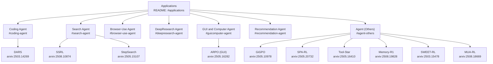
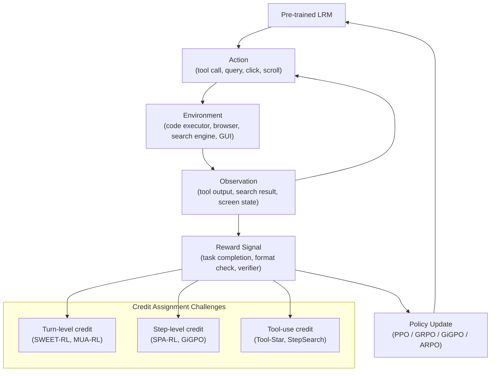
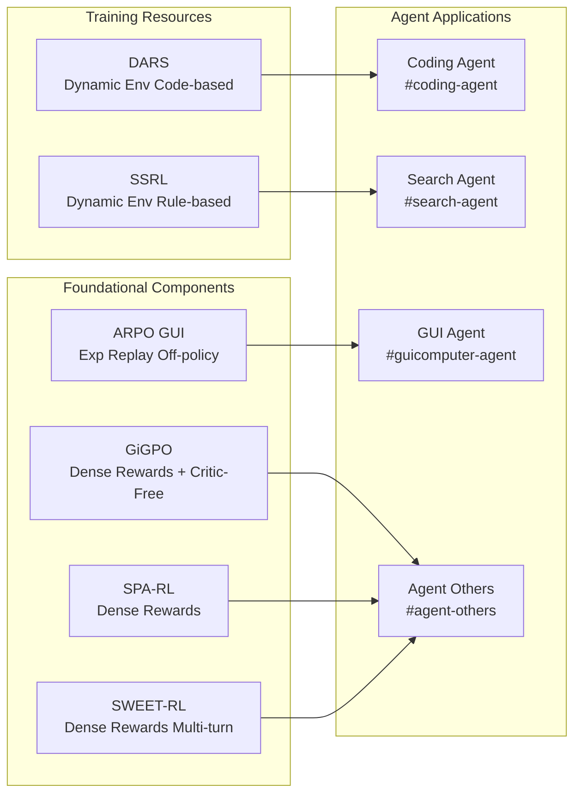

<!-- source: DeepWiki mcp.deepwiki.com · repo TsinghuaC3I/Awesome-RL-for-LRMs · extra page Agent Applications · fetched 2026-10-30 -->

# Agent Applications

Relevant source files

The following files were used as context for generating this wiki page:

- [README.md](README.md)
- [reference.bib](reference.bib)

## Purpose and Scope

This page covers the **Agent Applications** sub-section of the survey taxonomy, cataloging papers that apply RL-trained Large Reasoning Models (LRMs) to interactive, tool-using, or environment-grounded agent tasks. The agent applications section is one of four top-level application domains tracked by the survey (see page 2.4 for the full Applications overview).

Agent applications are distinct from general code generation or software engineering tasks (page 2.4.2) in that the model must act within an environment — making sequential decisions, using tools, issuing queries, or manipulating interfaces — rather than producing a single output artifact. They are also distinct from multi-agent systems (page 2.4.4), which focus on coordination between multiple LRM instances.

The agent applications section in the README is organized into seven sub-categories:

| Sub-category | README anchor | Focus |
|---|---|---|
| Coding Agent | `#coding-agent` | RL-trained agents for code-centric tasks requiring tool use and iteration |
| Search Agent | `#search-agent` | Agents trained to retrieve and reason over information via search |
| Browser-Use Agent | `#browser-use-agent` | Agents trained to operate web browsers interactively |
| DeepResearch Agent | `#deepresearch-agent` | Long-horizon agents combining search, reading, and synthesis |
| GUI & Computer Agent | `#guicomputer-agent` | Agents trained to control graphical user interfaces or desktops |
| Recommendation Agent | `#recommendation-agent` | Agents trained with RL for recommendation tasks |
| Agent (Others) | `#agent-others` | Agent papers that do not fit the above five categories |

Sources: [README.md:77-83]()

---

## Taxonomy Overview

The following diagram maps the seven sub-categories to their README section anchors and representative paper identifiers visible across the repository.

**Diagram: Agent Applications Taxonomy and README Anchors**

Sources: [README.md:77-83](), [README.md:21-22](), [README.md:198-232](), [README.md:373](), [README.md:415]()

---

## Agent Applications and the RL Training Pipeline

Agent tasks introduce specific structural differences compared to single-turn reasoning tasks. The following diagram shows how agent RL differs from standard single-step RL at the training pipeline level.

**Diagram: Agent RL Training Loop with Multi-Turn and Tool-Use Specifics**

Sources: [README.md:211-228](), [README.md:232]()

---

## Sub-Category Details

### Coding Agent

Coding agents are LRM-based systems trained with RL to perform iterative coding tasks that require calling tools such as interpreters, test runners, or repository navigation utilities. Unlike single-pass code generation (page 2.4.2), coding agents must plan, execute, observe results, and revise.

A key challenge in coding agent RL is effective tree-structured exploration, since the agent may need to backtrack across multiple attempts. The `DARS` paper (arxiv:2503.14269) addresses this through **Dynamic Action Re-Sampling** with adaptive tree traversal for coding agents.

| Name | arXiv | Key Technique |
|---|---|---|
| `DARS` | 2503.14269 | Dynamic action re-sampling, adaptive tree traversal |

Sources: [README.md:415]()

---

### Search Agent

Search agents are trained with RL to issue queries to a retrieval system (search engine, knowledge base, or internal index) and reason over retrieved passages to answer questions or complete research tasks.

The SSRL project (affiliated with this repository) specifically investigates **agentic search RL without reliance on an external search engine**, making it a notable contribution to this sub-category. The `StepSearch` paper applies step-wise proximal policy optimization to train search-capable LLMs, assigning reward at each search step rather than only at the final answer.

| Name | arXiv | Key Technique |
|---|---|---|
| `SSRL` | 2508.10874 | Agentic search RL, no external engine dependency |
| `StepSearch` | 2505.15107 | Step-wise PPO for search, dense step-level rewards |
| `ARPO` (Agentic RP Optimization) | 2507.19849 | Agentic reinforced policy optimization |

Sources: [README.md:21](), [README.md:224](), [README.md:214]()

---

### Browser-Use Agent

Browser-use agents are trained to interact with live or simulated web browsers — following links, filling forms, extracting content — using RL to optimize task completion. This requires handling visual or DOM-structured observations and multi-step action sequences.

Sources: [README.md:79]()

---

### DeepResearch Agent

DeepResearch agents combine long-horizon planning, iterative search, document reading, and synthesis into a single agent loop, targeting tasks that require producing research-quality outputs. RL is used to optimize the full trajectory from initial query to final report.

Sources: [README.md:80]()

---

### GUI & Computer Agent

GUI and computer-use agents are trained to control graphical interfaces — web UIs, desktop applications, or operating systems — by perceiving screen states and issuing low-level actions such as clicks, keystrokes, and scrolls.

A representative paper is `ARPO` (End-to-End Policy Optimization for GUI Agents with Experience Replay, arxiv:2505.16282), which uses experience replay (see page 2.2.2 for the Off-policy + Experience Replay optimization sub-category) to stabilize GUI agent training across long multi-step trajectories.

| Name | arXiv | Key Technique |
|---|---|---|
| `ARPO` (GUI) | 2505.16282 | End-to-end policy optimization with experience replay for GUI agents |

Sources: [README.md:373]()

---

### Recommendation Agent

Recommendation agents apply RL-trained LRMs to sequential recommendation tasks, where the agent must select items for users based on dialogue, context, or feedback signals. This sub-category represents an application of agent RL to production recommendation settings.

Sources: [README.md:82]()

---

### Agent (Others)

This catch-all category contains agent papers that apply RL to interactive or tool-augmented tasks that do not fit the five specific agent types above. Common themes include:

- **Multi-turn credit assignment**: distributing reward across multiple conversation turns
- **Tool-use with heterogeneous tool sets**: training agents that call diverse APIs or tools
- **Memory and state management**: agents that write and retrieve from external memory

Representative papers in this sub-category include:

| Name | arXiv | Key Technique |
|---|---|---|
| `GiGPO` | 2505.10978 | Group-in-group policy optimization for LLM agent training; step-level and episode-level reward |
| `SPA-RL` | 2505.20732 | Stepwise progress attribution for LLM agent reward shaping |
| `Tool-Star` | 2505.16410 | Multi-tool reasoner via RL with hierarchical tool rewards |
| `SWEET-RL` | 2503.15478 | Multi-turn agent RL on collaborative reasoning tasks with turn-level credit |
| `MUA-RL` | 2508.18669 | Multi-turn user-interacting agent RL for agentic tool use |
| `Memory-R1` | 2508.19828 | RL-trained agent memory management with experience replay |
| `G-RA` | 2508.10548 | Gated rewards for stabilizing long-term multi-turn RL |

Sources: [README.md:211-212](), [README.md:221-232](), [README.md:226-228](), [README.md:370]()

---

## Relationship to Other Survey Sections

The agent application papers frequently draw on methods from other parts of the taxonomy:

**Diagram: Cross-cutting Method Usage in Agent Applications**

Sources: [README.md:198-232](), [README.md:373](), [README.md:415](), [README.md:21]()

---

## Notes on Coverage

The Applications section is structured to capture deployment-oriented work where the LRM operates as an agent. Papers that develop agent-specific RL algorithms (such as credit assignment for multi-turn trajectories) may appear in both the **Foundational Components** section (pages 2.2.1–2.2.3) and the Agent Applications section, depending on whether their primary contribution is methodological or application-oriented.

The related project `MARTI` (Multi-Agent Reinforced Training and Inference Framework) sits at the boundary of agent applications and multi-agent systems (page 2.4.4), providing infrastructure for training LLM-based multi-agent systems with RL.

Sources: [README.md:22](), [README.md:83-90]()

---

