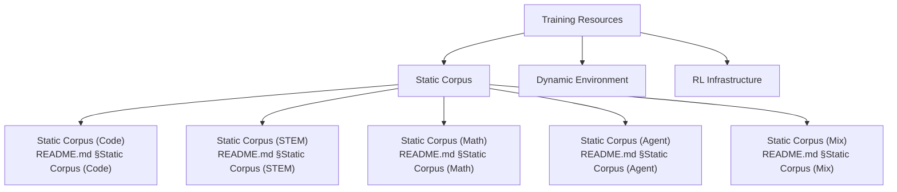
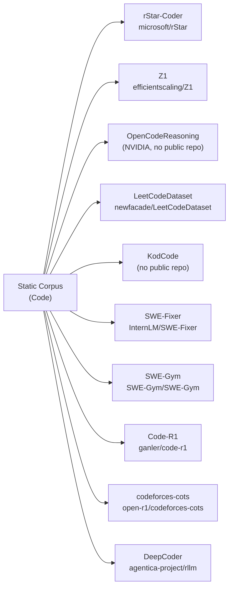
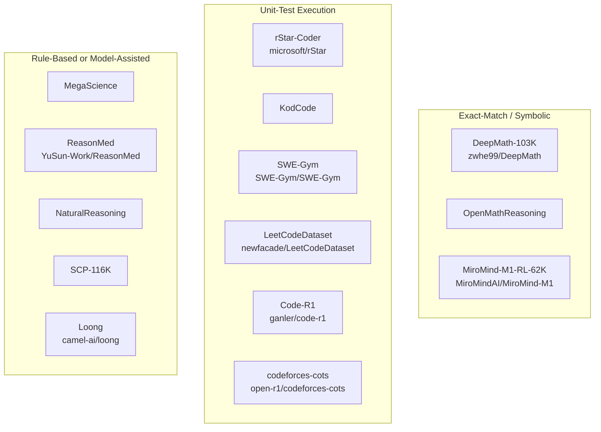
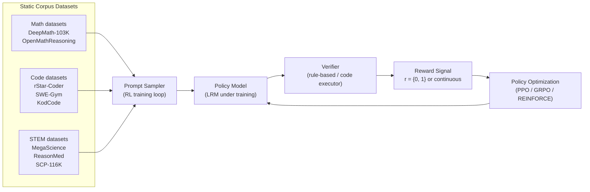

<!-- source: DeepWiki mcp.deepwiki.com · repo TsinghuaC3I/Awesome-RL-for-LRMs · extra page Static Corpus Datasets · fetched 2026-10-30 -->

# Static Corpus Datasets

Relevant source files

The following files were used as context for generating this wiki page:

- [README.md](README.md)
- [reference.bib](reference.bib)

This page documents the **Static Corpus** sub-section of the Training Resources taxonomy used in the survey. A static corpus is a pre-collected, fixed dataset used to supply training prompts and verifiable reference answers to an RL training loop. These datasets do not change during training and differ from dynamic environments, which provide interactive feedback at inference time. For information about environments that generate feedback dynamically, see [Dynamic Environments](#2.3.2). For the RL frameworks that consume these datasets, see [RL Infrastructure](#2.3.3).

The survey organizes static corpora into five domain-specific sub-categories reflected directly in the `README.md` section headers: **Code**, **STEM**, **Math**, **Agent**, and **Mix**.

---

## Role in the RL Training Pipeline

Static corpus datasets serve as the **prompt source** for the policy's rollout phase. Each dataset entry typically consists of a problem statement and one or more verifiable answers. The RL loop samples problems from this corpus, generates candidate solutions, and scores them against the reference answer using a rule-based or model-based verifier.

**Taxonomy Diagram: Static Corpus within Training Resources**

Sources: [README.md:63-68]()

---

## Sub-category Overview

| Sub-category | Domain | Typical Verifier Type | Examples |
|---|---|---|---|
| Code | Programming tasks, competitive coding, SWE | Unit test execution | `rStar-Coder`, `KodCode`, `SWE-Gym` |
| STEM | Science, medicine, music theory | Rule-based, model-based | `MegaScience`, `ReasonMed`, `SCP-116K` |
| Math | Mathematical problem solving | Exact-match symbolic | `DeepMath-103K`, `OpenMathReasoning` |
| Agent | Tool use, multi-step agentic tasks | Trajectory evaluation | *(see Agent sub-section)* |
| Mix | Cross-domain blended collections | Mixed | *(see Mix sub-section)* |

---

## Static Corpus (Code)

Code datasets provide programming problems with verifiable correctness criteria, typically executed via unit tests or comparison against reference outputs. Problems span competitive programming, open-source repository issues, and general algorithmic challenges.

**Dataset → GitHub Repository Mapping**

Sources: [README.md:439-452]()

| Date | Name | Description |
|---|---|---|
| 2025-05 | `rStar-Coder` | Large-scale verified competitive code reasoning dataset from Microsoft. |
| 2025-04 | `Z1` | Code-centric dataset designed for efficient test-time scaling. |
| 2025-04 | `OpenCodeReasoning` | Competitive coding dataset built via data distillation from frontier models (NVIDIA). |
| 2025-04 | `LeetCodeDataset` | Temporally partitioned LeetCode problems for robust evaluation and training. |
| 2025-03 | `KodCode` | Diverse, challenging, verifiable synthetic coding problems. |
| 2025-01 | `SWE-Fixer` | GitHub issue resolution training data for open-source LLM fine-tuning. |
| 2024-12 | `SWE-Gym` | Environment and dataset for training software engineering agents and verifiers. |
| — | `Code-R1` | Dataset reproducing DeepSeek-R1 setup for code tasks with reliable rewards. |
| — | `codeforces-cots` | CodeForces problems with associated chain-of-thought reasoning traces (HuggingFace). |
| — | `DeepCoder` | Training data for a fully open-source 14B coder at O3-mini parity level. |

Sources: [README.md:439-452]()

---

## Static Corpus (STEM)

STEM datasets span science disciplines beyond mathematics: physics, chemistry, biology, medicine, and even music theory. They typically require multi-step scientific reasoning and may include structured knowledge extraction from textbooks or research literature.

| Date | Name | Description |
|---|---|---|
| 2025-09 | `SSMR-Bench` | Sheet music problem synthesis for evaluation and RL (music theory domain). |
| 2025-09 | `Loong` | Long chain-of-thought synthesis at scale using verifier-guided generation (`camel-ai/loong`). |
| 2025-07 | `MegaScience` | Large post-training dataset pushing frontiers of science reasoning across multiple disciplines. |
| 2025-06 | `ReasonMed` | 370K multi-agent generated dataset for medical reasoning (`YuSun-Work/ReasonMed`). |
| 2025-05 | `ChemCoTDataset` | Chemical QA with modular chemical operations for step-level reasoning evaluation. |
| 2025-02 | `NaturalReasoning` | 2.8M challenging naturally-occurring reasoning questions across STEM topics. |
| 2025-01 | `SCP-116K` | 116K high-quality problem–solution pairs extracted from higher education science sources. |

Sources: [README.md:454-464]()

---

## Static Corpus (Math)

Mathematical datasets are the most widely used static corpus for RL training of LRMs, because answers are programmatically verifiable (exact symbolic match, numerical equivalence). Competition-level and olympiad-level problems provide sufficient difficulty to challenge frontier models.

| Date | Name | Description |
|---|---|---|
| 2025-07 | `MiroMind-M1-RL-62K` | 62K problems supporting multi-stage policy optimization for math reasoning (`MiroMindAI/MiroMind-M1`). |
| 2025-04 | `DeepMath-103K` | 103K large-scale, decontaminated, verifiable math problems (`zwhe99/DeepMath`). |
| 2025-04 | `OpenMathReasoning` | State-of-the-art math reasoning dataset from the AIMO-2 winning solution (NVIDIA). |

Sources: [README.md:466-472]()

> **Note:** The Math sub-section continues beyond the visible excerpt. Additional datasets are referenced in the full `README.md` and `reference.bib`.

---

## Static Corpus (Agent)

Agent datasets cover multi-step tasks requiring tool use, web interaction, or other agentic behavior. Verifiable reward signals in this category typically assess task completion over a full trajectory rather than a single output token.

> The specific dataset entries for this sub-category appear in the full `README.md` beyond the available excerpt. The section is referenced in the table of contents at [README.md:67]().

---

## Static Corpus (Mix)

Mixed-domain datasets combine problems from multiple categories (math, code, STEM, general reasoning) into a single training corpus. These are used when training a generalist reasoning model that should not specialize in a single domain.

> The specific dataset entries for this sub-category appear in the full `README.md` beyond the available excerpt. The section is referenced in the table of contents at [README.md:68]().

---

## Dataset Provenance and Verification Approach

A key property distinguishing static corpus datasets suitable for RL is that they must supply **verifiable** ground truth. The diagram below maps dataset names to the verification strategy they support.

**Diagram: Dataset Names → Verification Strategy**

Sources: [README.md:439-472]()

---

## Relationship to the RL Training Loop

Static corpus datasets feed into the **rollout / sampling phase** of the RL loop described in the survey. The policy generates completions for sampled prompts; the verifier checks correctness against the stored ground truth labels.

**Diagram: Static Corpus → RL Loop Integration**

Sources: [README.md:63-68](), [README.md:439-472]()

For the dynamic alternative to this static prompt-supply pattern, see [Dynamic Environments](#2.3.2). For the infrastructure frameworks that orchestrate this loop, see [RL Infrastructure](#2.3.3).

---

