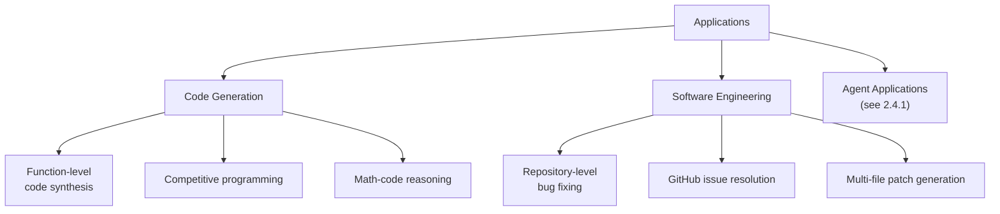
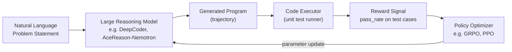
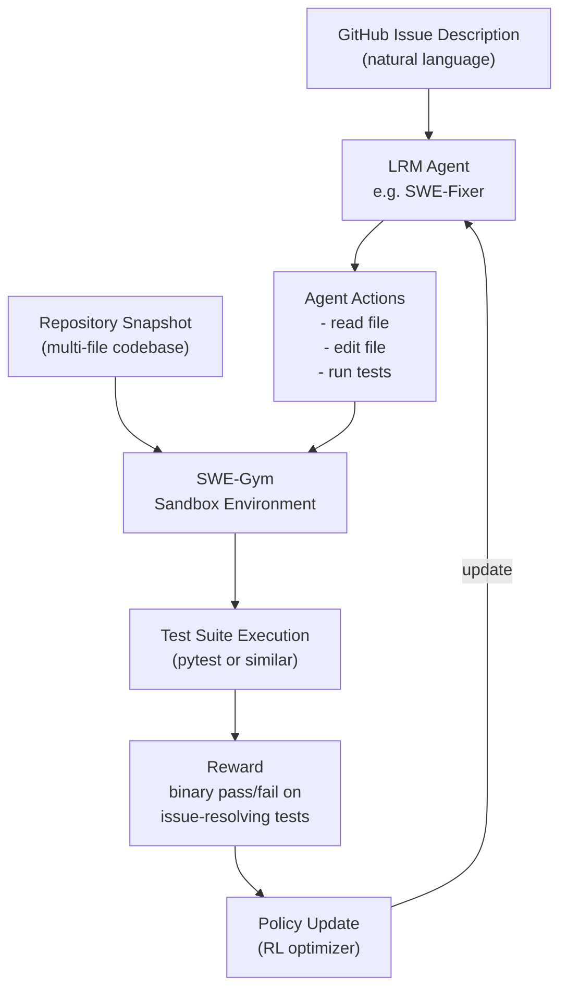

<!-- source: DeepWiki mcp.deepwiki.com · repo TsinghuaC3I/Awesome-RL-for-LRMs · extra page Code Generation and Software Engineering · fetched 2026-10-30 -->

# Code Generation and Software Engineering

<details>
<summary>Relevant source files</summary>

The following files were used as context for generating this wiki page:

- [README.md](README.md)
- [reference.bib](reference.bib)

</details>


This page covers two application sub-categories from the survey's Applications taxonomy: **Code Generation** and **Software Engineering**. Both involve applying RL to programming-related tasks, but they differ in scope and environment complexity. Code Generation focuses on producing correct code from a specification, typically evaluated with unit tests. Software Engineering targets repository-level tasks such as resolving GitHub issues, requiring agents to navigate and modify multi-file codebases.

> For RL-trained agents that *use* code as a tool within broader agentic tasks (e.g., a search agent that writes code to retrieve information), see [Agent Applications](#2.4.1). For the datasets and environments used to train these models, see [Static Corpus Datasets](#2.3.1) and [Dynamic Environments](#2.3.2).

---

## Overview: How RL Applies to Programming Tasks

The core insight enabling RL on programming tasks is that code correctness is mechanically verifiable. Unlike open-ended text generation, a program either passes its test suite or it does not. This makes code execution a natural source of binary or graded reward signals without requiring a learned reward model.

**Taxonomy Position:**



Sources: [README.md:84-85]()

---

## Code Generation

### What It Covers

Code Generation in this survey refers to tasks where a model produces a self-contained function, program, or solution in response to a natural language specification or problem statement. The canonical evaluation benchmarks include HumanEval, MBPP, LiveCodeBench, and competitive programming platforms like Codeforces and LeetCode.

RL is applied here by treating each generated program as a trajectory. The reward is typically derived from:

- **Unit test execution**: pass/fail result on hidden test cases
- **Compilation success**: binary signal for syntactically valid code
- **Graded correctness**: partial credit on subset of test cases

This creates a closed-loop training signal that does not require human annotation.

### RL Pipeline for Code Generation

**Diagram: RL Training Loop for Code Generation**



Sources: [README.md:64-74](), [README.md:439-452]()

### Key Datasets and Training Resources

The following static corpora are specifically designed for RL training on code generation tasks. See [Static Corpus Datasets](#2.3.1) for full coverage.

| Date | Name | Description |
|:----:|:----:|:-----------|
| 2025-05 | `rStar-Coder` | Large-scale verified dataset for competitive code reasoning |
| 2025-04 | `Z1` | Efficient test-time scaling with code-focused problems |
| 2025-04 | `OpenCodeReasoning` | Data distillation pipeline for competitive coding |
| 2025-04 | `LeetCodeDataset` | Temporal dataset for robust evaluation and RL training |
| 2025-03 | `KodCode` | Diverse, challenging, verifiable synthetic coding dataset |
| — | `Code-R1` | Reproduces the R1 training approach for code with reliable rewards |
| — | `codeforces-cots` | Chain-of-thought traces from Codeforces problems |
| — | `DeepCoder` | Fully open-source 14B model at O3-mini level |

Sources: [README.md:439-452]()

### Representative Papers

| Date | Name | Key Contribution |
|:----:|:----:|:----------------|
| 2025-06 | `AceReason-Nemotron` | Joint math and code reasoning through RL with sampling hyper-parameter analysis |
| 2025-06 | `AceReason-Nemotron 1.1` | SFT and RL synergy for math and code |
| 2025-07 | `Archer` (`ArcherCodeR`) | Dual-token constraints for stable RLVR on code tasks |
| 2025-03 | `DARS` | Dynamic Action Re-Sampling for coding agents via adaptive tree traversal |

Sources: [README.md:385](), [README.md:415](), [README.md:425-426](), [README.md:429]()

---

## Software Engineering

### What It Covers

Software Engineering tasks require models to modify existing code repositories in response to issue descriptions or bug reports. The canonical benchmark is SWE-bench, which evaluates a model's ability to generate patches that resolve real GitHub issues.

These tasks are substantially harder than function-level code generation because:

1. The model must locate the relevant file(s) among many
2. Changes must be consistent with the surrounding codebase
3. Rewards come from end-to-end test suite execution after patching

### Environment Structure for SE Tasks

**Diagram: Software Engineering Task Environment (SWE-Gym / SWE-Fixer)**



Sources: [README.md:448-449]()

### Key Datasets and Environments

| Date | Name | Type | Description |
|:----:|:----:|:----:|:-----------|
| 2025-01 | `SWE-Fixer` | Model + Dataset | Training open-source LLMs for GitHub issue resolution |
| 2024-12 | `SWE-Gym` | Dynamic Environment | Sandbox for training SE agents and verifiers |

Sources: [README.md:448-449]()

The `SWE-Gym` environment is classified under **Dynamic Environment (Code-based)** in the training resources taxonomy, as it uses code execution (test suite pass/fail) as the feedback mechanism. `SWE-Fixer` contributes both a training dataset and a trained model.

---

## Comparison: Code Generation vs. Software Engineering

| Dimension | Code Generation | Software Engineering |
|:----------|:---------------|:--------------------|
| Task scope | Single function or program | Multi-file repository patch |
| Input | Problem statement | Issue description + repository |
| Reward source | Unit test execution | Full test suite on patched repo |
| Environment type | Static corpus or code executor | Dynamic multi-step sandbox (e.g. `SWE-Gym`) |
| Primary benchmark | HumanEval, Codeforces, LeetCode | SWE-bench |
| Trajectory length | Short (single generation) | Long (multi-turn file edits) |
| Key dataset | `rStar-Coder`, `KodCode`, `LeetCodeDataset` | `SWE-Gym`, `SWE-Fixer` |

Sources: [README.md:64-91](), [README.md:439-452]()

---

## Relationship to Other Sections

**Diagram: Code-Related Paper Categories and Their Home Sections**

```mermaid
graph LR
  subgraph "2.3.1 Static Corpus Code"
    SC1["`rStar-Coder`"]
    SC2["`KodCode`"]
    SC3["`LeetCodeDataset`"]
    SC4["`OpenCodeReasoning`"]
    SC5["`SWE-Gym` dataset"]
    SC6["`SWE-Fixer` dataset"]
    SC7["`Code-R1`"]
    SC8["`DeepCoder`"]
  end

  subgraph "2.3.2 Dynamic Environments"
    DE1["`SWE-Gym` sandbox\n(code-based)"]
    DE2["Unit test executors\n(code-based)"]
  end

  subgraph "2.4.1 Agent Applications"
    CA1["Coding Agent\n(tool-use, multi-step)"]
  end

  subgraph "2.4.2 This Page"
    CG["Code Generation\n(function/program level)"]
    SE["Software Engineering\n(repo-level patching)"]
  end

  SC1 --> CG
  SC2 --> CG
  SC3 --> CG
  SC4 --> CG
  SC7 --> CG
  SC8 --> CG
  DE2 --> CG
  SC5 --> SE
  SC6 --> SE
  DE1 --> SE
  CA1 -.->|"overlaps on coding tasks"| CG
```

Sources: [README.md:76-91](), [README.md:439-452]()

The boundary between **Coding Agent** (section 2.4.1) and **Code Generation** (this section) is primarily one of task framing. Coding agents operate in multi-turn, tool-using scenarios (e.g., `DARS` uses tree traversal across multiple attempts). Code generation tasks are typically evaluated as single-generation outputs against a fixed test suite.

---

