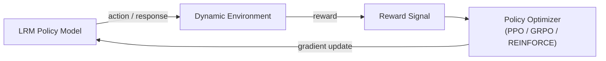
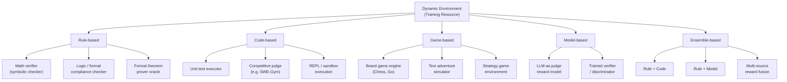
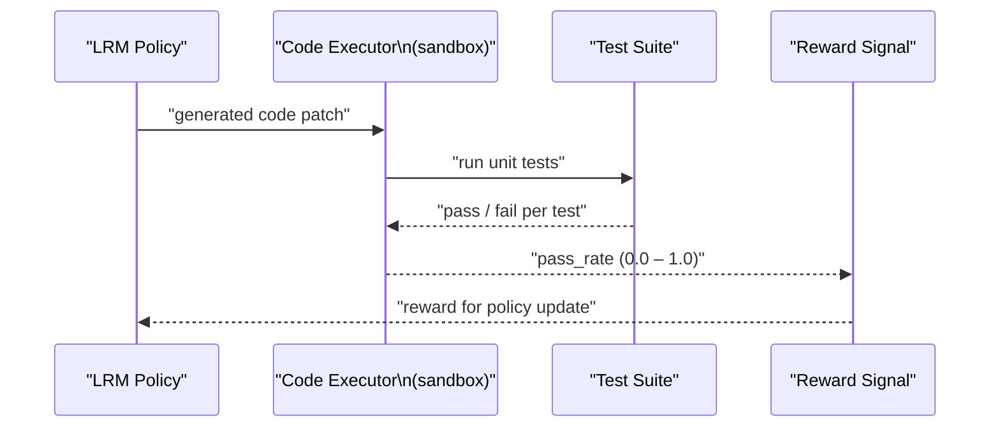
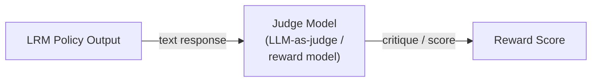
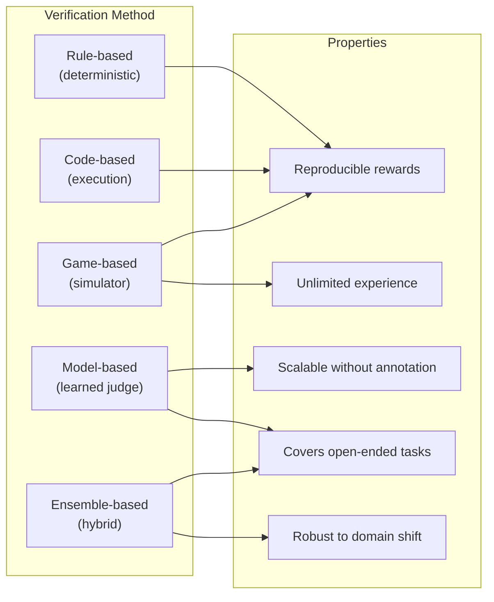
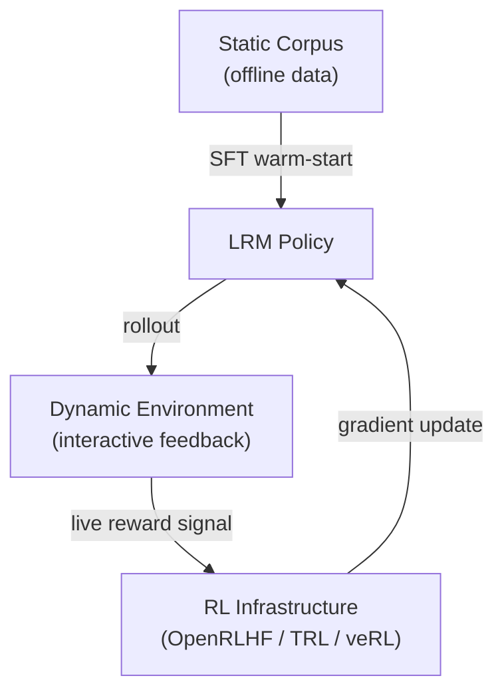

<!-- source: DeepWiki mcp.deepwiki.com · repo TsinghuaC3I/Awesome-RL-for-LRMs · extra page Dynamic Environments · fetched 2026-10-30 -->

# Dynamic Environments

Relevant source files

The following files were used as context for generating this wiki page:

- [README.md](README.md)
- [reference.bib](reference.bib)

This page documents the **Dynamic Environment** sub-category of Training Resources in the survey taxonomy. Dynamic environments are interactive systems that provide feedback to an RL-trained language model at runtime, as opposed to static corpora which are fixed datasets collected offline. For documentation on static pre-collected datasets, see [2.3.1](#2.3.1). For documentation on RL infrastructure tools that implement or wrap these environments, see [2.3.3](#2.3.3).

Dynamic environments supply the reward signal by actually executing, judging, or simulating the model's output. They are a core ingredient in the RL training loop (see [2](#2) for the full survey taxonomy overview). The five sub-categories differ in *what generates the feedback*: hand-written rules, code execution engines, game simulators, learned models, or a combination of the above.

---

## Role in the RL Training Pipeline

Dynamic environments sit between the policy model and the reward signal. At each training step, the model generates a response (action), the environment processes it, and a scalar reward is returned for use by the policy optimizer.

**Dynamic Environment Interaction Flow**

Sources: [README.md:63-73]()

---

## Sub-category Overview

| Sub-category | Feedback Source | Primary Use Cases |
|---|---|---|
| Rule-based | Hard-coded deterministic verifiers | Math, logic, format compliance |
| Code-based | Code execution engine / unit tests | Programming tasks, software engineering |
| Game-based | Game simulator / game engine | Strategy games, text adventures, board games |
| Model-based | A learned model (e.g., LLM-as-judge) | Open-ended tasks, subjective quality |
| Ensemble-based | Combination of the above | Mixed-domain or robustness-focused training |

Sources: [README.md:69-73]()

---

## Environment Type Taxonomy

**Taxonomy of Dynamic Environment Sub-categories**

Sources: [README.md:63-73]()

---

## Rule-based Environments

Rule-based environments use manually authored, deterministic functions to verify correctness. They require no learned component and produce consistent rewards for identical outputs.

**Characteristics:**
- Reward computation is deterministic and cheap.
- Rules must be authored by humans (or generated formally), so coverage is limited to domains with verifiable ground truth.
- Commonly used for math problem solving, where a symbolic checker or string-matching verifier can confirm whether the final numerical answer is correct.
- Also used for format compliance rewards (e.g., rewarding structured output formats like JSON).

**Typical feedback mechanism:** The model's response is parsed, and the extracted answer is compared against a known solution using exact match, numerical equivalence, or a symbolic solver. DeepSeek-R1 uses this approach — its math training relies on rule-based outcome verifiers that check whether the final boxed answer matches the reference.

| Representative Paper | Notes |
|---|---|
| `DeepSeek-R1` (arxiv:2501.12948) | Uses format and answer correctness rules as the primary reward signal |
| `Qwen2.5-Math` (arxiv:2409.12122) | Rule-based verifiers for mathematical reasoning |
| `DAPO` (arxiv:2503.14476) | Combines rule-based correctness with format reward shaping |

Sources: [README.md:286-287](), [README.md:330]()

---

## Code-based Environments

Code-based environments execute the model's generated code against a test harness and return a binary or graded reward based on test outcomes. They are the standard environment for programming and software engineering tasks.

**Characteristics:**
- Reward signal is objective and unambiguous: code either passes tests or it does not.
- Environment requires a sandboxed execution runtime (subprocess, container, or remote judge).
- Naturally supports multi-turn interaction when the model iteratively debugs code.
- Unit test suites provide dense, per-test coverage signals that can optionally be aggregated.

**Typical feedback mechanism:** The model generates a code solution; the environment compiles and runs it against a hidden or visible test suite; the fraction of passing tests (or a binary pass/fail) becomes the reward.

**SWE-Gym** (arxiv:2412.21139) is the canonical example: it provides a repository of real GitHub issues with associated test suites, allowing an agent to receive reward by making repository-level code changes that pass the CI test suite.

| Representative Paper | Notes |
|---|---|
| `SWE-Gym` (arxiv:2412.21139) | GitHub-issue sandbox with CI test suite feedback |
| `Code-R1` | Competitive coding with reliable unit-test-based rewards |
| `KodCode` (arxiv:2503.02951) | Synthetic verified coding dataset with execution-based verification |
| `rStar-Coder` (arxiv:2505.21297) | Scaled competitive code reasoning with execution-verified data |
| `LeetCodeDataset` (arxiv:2504.14655) | Temporal benchmark with judge-based pass/fail rewards |

Sources: [README.md:443-452]()

---

## Game-based Environments

Game-based environments use established game simulators as the reward oracle. Games offer advantages for RL research because they have clear win/loss conditions, are fully specified, and can generate unlimited training experience.

**Characteristics:**
- Win/loss outcomes or game scores provide unambiguous terminal rewards.
- Environments can often be run millions of times in parallel, enabling high sample efficiency.
- Multi-step game trajectories naturally model sequential decision-making.
- Useful for developing and benchmarking general reasoning and planning capabilities before applying to less structured domains.

**Examples include:**
- Board games (Chess, Go): require long-horizon strategic planning.
- Text adventure games: require natural language understanding and multi-step navigation.
- Strategy and puzzle games: test compositional reasoning under constraint.

**Vision-Zero** (arxiv:2509.25541) applies a gamified self-play approach to VLM improvement, using strategic game interactions to generate the training signal without external annotators.

| Representative Paper | Notes |
|---|---|
| `Vision-Zero` (arxiv:2509.25541) | Gamified self-play for VLM training |
| `Absolute Zero` (arxiv:2505.03335) | Self-play reasoning with zero external data; game-like problem construction |

Sources: [README.md:247](), [README.md:259]()

---

## Model-based Environments

Model-based environments use a learned model — most commonly another language model acting as a judge or critic — to evaluate the policy model's outputs. This enables RL training in domains where no ground-truth rule or executable program is available.

**Characteristics:**
- Enables training on open-ended tasks (writing, dialogue, reasoning over ambiguous text) that cannot be verified symbolically or by code execution.
- The environment model can itself be updated, leading to co-training dynamics.
- Risk of reward hacking: the policy may learn to exploit weaknesses of the verifier model.
- The verifier/judge is a source of potential noise; papers like `TinyV` (arxiv:2505.14625) specifically study reducing false negatives from model-based verifiers.

**Typical feedback mechanism:** The model output is passed to a judge LLM (or a trained reward model), which returns a score or binary preference signal.

| Representative Paper | Notes |
|---|---|
| `JudgeLRM` (arxiv:2504.00050) | Large reasoning model acting as a judge / reward oracle |
| `Auto-J` (arxiv:2310.05470) | Generative judge model for evaluating alignment |
| `J1` (arxiv:2505.10320) | Incentivizes reasoning in LLM-as-a-judge via RL |
| `GRAM` (arxiv:2506.14175) | Generative foundation reward model for reward generalization |
| `RewardAnything` (arxiv:2506.03637) | Generalizable principle-following reward models |
| `TinyV` (arxiv:2505.14625) | Reducing false negatives from model verifiers in RL |
| `Cooper` (arxiv:2508.05613) | Co-optimizing policy and reward model jointly |

Sources: [README.md:147-192](), [README.md:171-172]()

---

## Ensemble-based Environments

Ensemble-based environments combine multiple feedback sources — typically a mix of rule-based, code-based, and model-based mechanisms — to produce a more robust or comprehensive reward signal.

**Characteristics:**
- Different environment components address different aspects of quality (correctness, style, safety, relevance).
- Reward fusion can be additive, weighted, or gated.
- Reduces the failure modes of relying on any single verifier type.
- Often used when training on heterogeneous task mixes where no single verification strategy covers all domains.

**Typical reward fusion patterns:**

| Fusion Strategy | Description |
|---|---|
| Additive | `reward = w1 * rule_reward + w2 * model_reward` |
| Gated | Rule-based reward used when exact verification is possible; model-based otherwise |
| Sequential | Code executor filters responses; model judge scores the remaining candidates |

Papers applying ensemble-based reward design include `OMNI-THINKER` (arxiv:2507.14783), which uses hybrid rewards across multiple domains, and `Skywork-R1V2` (arxiv:2504.16656), which employs multimodal hybrid RL combining rule-based and model-based components.

| Representative Paper | Notes |
|---|---|
| `OMNI-THINKER` (arxiv:2507.14783) | Multi-task RL with hybrid reward sources across domains |
| `Skywork-R1V2` (arxiv:2504.16656) | Multimodal hybrid RL with mixed reward types |
| `Tool-Star` (arxiv:2505.16410) | Multi-tool reasoner; verification combines tool execution + rule checking |

Sources: [README.md:155](), [README.md:135](), [README.md:226]()

---

## Comparison of Environment Types

| Property | Rule-based | Code-based | Game-based | Model-based | Ensemble-based |
|---|:---:|:---:|:---:|:---:|:---:|
| Deterministic reward | ✓ | ✓ | ✓ | ✗ | Partial |
| No annotation needed | ✓ | ✓ | ✓ | Partial | Partial |
| Covers open-ended tasks | ✗ | ✗ | ✗ | ✓ | ✓ |
| Unlimited episodes | ✓ | ✓ | ✓ | ✓ | ✓ |
| Scales to real-world tasks | Partial | ✓ | Partial | ✓ | ✓ |

Sources: [README.md:63-73](), [README.md:69-76]()

---

## Relationship to Other Training Resource Categories

Dynamic environments complement the other two training resource categories documented in this survey:

- **Static Corpus** ([2.3.1](#2.3.1)) — pre-collected question-answer pairs used for SFT warm-start or offline RL. Dynamic environments add an interactive loop absent in static data.
- **RL Infrastructure** ([2.3.3](#2.3.3)) — frameworks such as OpenRLHF, TRL, and veRL that implement the scaffolding for connecting dynamic environments to policy optimization algorithms.

Sources: [README.md:63-76]()

---

