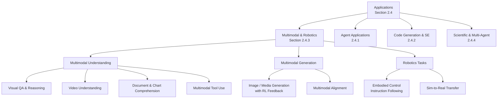
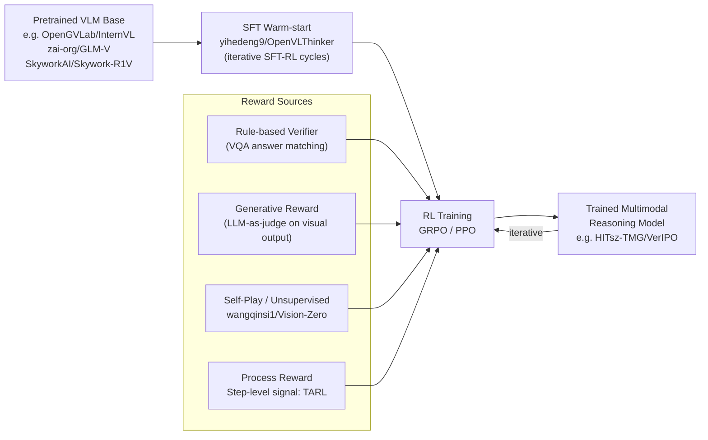
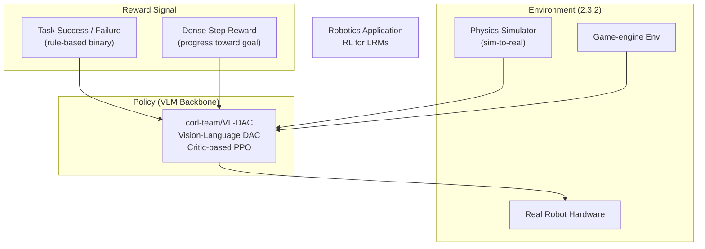
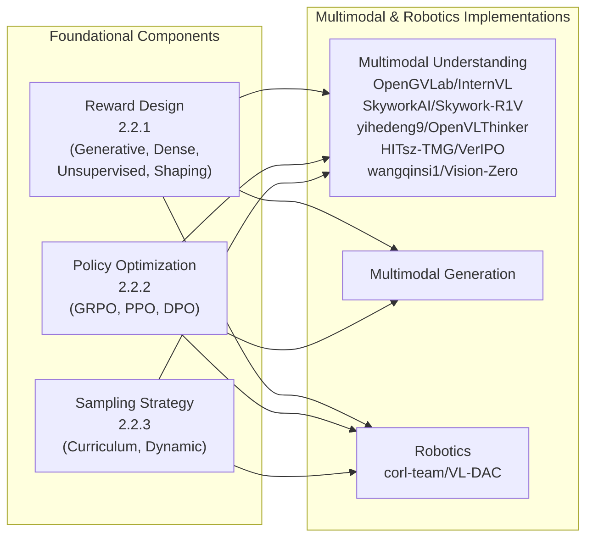

<!-- source: DeepWiki mcp.deepwiki.com · repo TsinghuaC3I/Awesome-RL-for-LRMs · extra page Multimodal and Robotics · fetched 2026-10-30 -->

# Multimodal and Robotics

Relevant source files

The following files were used as context for generating this wiki page:

- [README.md](README.md)
- [reference.bib](reference.bib)

## Purpose and Scope

This page covers the **Multimodal and Robotics** sub-section of the Applications category in the RL for Large Reasoning Models survey. It addresses three sub-categories:

1. **Multimodal Understanding** — RL applied to Vision-Language Models (VLMs) for tasks combining image, video, and text inputs
2. **Multimodal Generation** — RL applied to models that produce non-text outputs such as images
3. **Robotics Tasks** — RL-trained LRMs applied to physical or simulated robotic control

This page is scoped to where RL for LRMs extends *beyond text*. For text-only code and software engineering applications, see [2.4.2](#2.4.2). For agent applications (browser, GUI, search), see [2.4.1](#2.4.1). For the foundational RL components shared across all domains, see [2.2](#2.2).

---

## Overview

The core RL pipeline described in the survey's Foundational Components section (policy gradient updates driven by reward feedback) transfers to multimodal settings by replacing or augmenting the text-only policy with a VLM backbone. The primary adaptations are in **reward signal design**: visual outputs cannot always be verified by simple rule matchers, so researchers use generative judges, task success signals, or self-play mechanisms.

**Taxonomy diagram — Multimodal & Robotics in context:**

Sources: [README.md:76-91]()

---

## Multimodal Understanding

This sub-category covers work that trains VLMs using RL to improve **visual reasoning**: answering questions about images, understanding charts and documents, reasoning over video frames, and using visual tools.

### Training Pipeline

The standard approach mirrors the text-only RL loop but operates on a VLM backbone:

- **Policy**: A pretrained VLM (e.g., InternVL, GLM-V series)
- **Reward**: Rule-based answer verifier for structured outputs (multiple-choice VQA), or a generative reward model for open-ended visual answers
- **Optimizer**: GRPO or PPO-family algorithms (see [2.2.2](#2.2.2))
- **Optional**: SFT warm-start before RL, iterative SFT-RL cycles

**Pipeline diagram — mapping model/repo names to pipeline stages:**

Sources: [README.md:115-142](), [README.md:247](), [README.md:303-313](), [README.md:329-330]()

### Representative Papers

| Date | Name | Title Focus | GitHub Repo |
|:----:|:----:|:-----------|:-----------:|
| 2025-09 | `Vision-Zero` | Scalable VLM self-improvement via gamified self-play | `wangqinsi1/Vision-Zero` |
| 2025-09 | `TARL` | Process-supervised RL for interactive multimodal tool-use agents | — |
| 2025-08 | `VL-DAC` | VLM training with RL in synthetic worlds | `corl-team/VL-DAC` |
| 2025-08 | `InternVL3.5` | Open-source multimodal reasoning model | `OpenGVLab/InternVL` |
| 2025-07 | `GLM-4.5V` / `GLM-4.1V-Thinking` | Versatile multimodal reasoning via scalable RL | `zai-org/GLM-V` |
| 2025-07 | `Skywork-R1V3` | Multimodal reasoning technical report | `SkyworkAI/Skywork-R1V` |
| 2025-05 | `VerIPO` | Long-reasoning video model with iterative policy optimization | `HITsz-TMG/VerIPO` |
| 2025-04 | `Skywork-R1V2` | Multimodal hybrid reinforcement learning for reasoning | `SkyworkAI/Skywork-R1V` |
| 2025-04 | `InternVL3` | Advanced training & test-time recipes for open-source multimodal models | `OpenGVLab/InternVL` |
| 2025-03 | `OpenVLThinker` | Complex VL reasoning via iterative SFT-RL cycles | `yihedeng9/OpenVLThinker` |

Sources: [README.md:115-142](), [README.md:247](), [README.md:200](), [README.md:303-313](), [README.md:305](), [README.md:329-330]()

### Frontier Models in Multimodal RL

Several of the surveyed Frontier Models (see [2.1](#2.1)) are specifically built on RL-trained multimodal reasoning:

| Model | GitHub Repo | Key Technique |
|:-----:|:-----------:|:-------------:|
| `Intern-S1` | `InternLM/Intern-S1` | Scientific multimodal foundation with RL |
| `InternVL3.5` | `OpenGVLab/InternVL` | Versatility, reasoning, and efficiency via RL |
| `InternVL3` | `OpenGVLab/InternVL` | SFT + RL for open-source multimodal |
| `GLM-4.5V` | `zai-org/GLM-V` | Scalable RL for multimodal reasoning |
| `GLM-4.1V-Thinking` | `zai-org/GLM-V` | Thinking-mode VLM via RL |
| `Skywork-R1V2` | `SkyworkAI/Skywork-R1V` | Hybrid RL (text + visual) |
| `Skywork-R1V3` | `SkyworkAI/Skywork-R1V` | Updated multimodal reasoning |

Sources: [README.md:117-136]()

---

## Multimodal Generation

Multimodal Generation covers RL applied to models whose **outputs** include images, audio, or other non-text media. This is a more challenging setting for RL because:

- Generated visual content cannot be verified by rule-based checkers
- Reward signals typically come from **discriminative models** (image quality scorers, CLIP-style alignment scores), **human preference** (RLHF), or **consistency-based** comparisons between generated and reference media

The applicable foundational reward techniques are primarily Generative Rewards and Reward Shaping (see [2.2.1](#2.2.1)).

Sources: [README.md:86-88]()

---

## Robotics Tasks

Robotics Tasks covers RL-trained VLMs or LRMs operating in **physical or simulated robotic environments**. The core challenge is grounding high-level language and visual reasoning to low-level motor control.

### Key Themes

- **Sim-to-real transfer**: Training entirely in simulation (game-engine or physics-simulator) then evaluating on real hardware. `VL-DAC` (`corl-team/VL-DAC`) exemplifies this approach.
- **Instruction following**: Using RL feedback from environment success signals to teach models to execute natural language commands as robot trajectories.
- **Long-horizon reasoning**: Applying chain-of-thought or extended reasoning to multi-step manipulation tasks, where the RL reward is terminal task success.

### Relationship to Dynamic Environments

Robotics reward sources fall into the Dynamic Environments taxonomy (see [2.3.2](#2.3.2)): specifically **model-based** and **ensemble-based** environments that simulate physical worlds, or **rule-based** environments using physics-simulator success/failure signals.

**Diagram — code-level mapping of Robotics sub-domain:**

Sources: [README.md:303]()

### Representative Papers

| Date | Name | Description | Repo |
|:----:|:----:|:-----------|:----:|
| 2025-08 | `VL-DAC` | VLM training with RL in synthetic worlds; evaluates real-world task success | `corl-team/VL-DAC` |

Sources: [README.md:303]()

---

## Cross-Cutting: Reward Signal by Sub-domain

The most significant difference across the three sub-categories is reward availability. This table summarizes the mapping:

| Sub-domain | Reward Type | Verifiability | Example |
|:----------:|:-----------:|:-------------:|:-------:|
| Visual QA / Reasoning | Rule-based (answer match) | High | `InternVL3`, `Skywork-R1V2` |
| Video Reasoning | Outcome (temporal prediction) | Medium | `VerIPO` |
| VLM Self-Play | Unsupervised / self-reward | Self-assessed | `Vision-Zero` |
| Multimodal Tool Use | Process reward (step-level) | Medium | `TARL` |
| Image Generation | Discriminative / human preference | Low | — |
| Robotics Sim-to-Real | Environment success signal | High (in sim) | `VL-DAC` |

Sources: [README.md:243-272](), [README.md:194-241](), [README.md:274-288](), [README.md:303-313]()

---

## Relationship to Foundational Components

All three sub-categories draw directly on the foundational methods covered in [2.2](#2.2):

Sources: [README.md:144-288](), [README.md:289-436](), [README.md:398-436]()

---

## Summary

| Sub-category | Maturity | Core Challenge | Dominant Reward |
|:------------:|:--------:|:--------------:|:---------------:|
| Multimodal Understanding | Most active | Visual answer verification | Rule-based + generative |
| Multimodal Generation | Emerging | No rule-verifiable output | Discriminative / preference |
| Robotics Tasks | Early | Sim-to-real gap | Environment success |

The multimodal and robotics domain confirms that the RL-for-LRMs framework is not inherently text-specific: any task with a computable or learnable reward signal can leverage the same policy gradient infrastructure. The most developed sub-area is Multimodal Understanding, where verifiable visual QA tasks provide clean reward signals analogous to math problem verification in text-only settings.

For the broader context of all application domains, see [2.4](#2.4). For the training resources (datasets and environments) used in these domains, see [2.3](#2.3).

---

