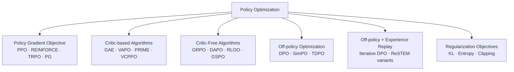
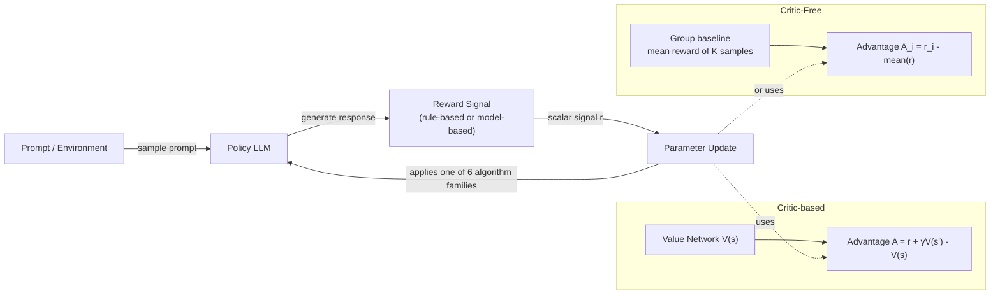
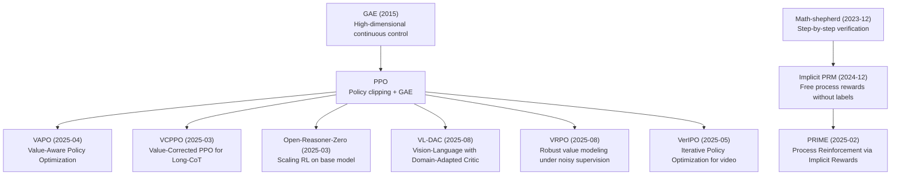
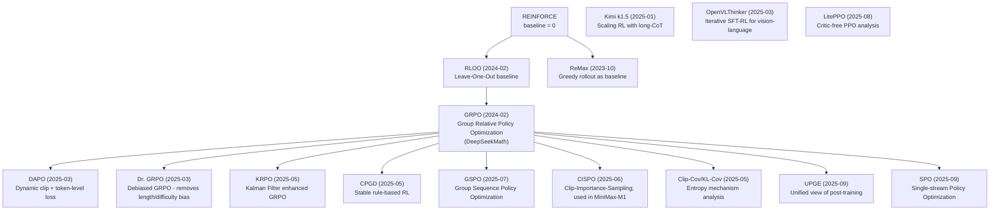
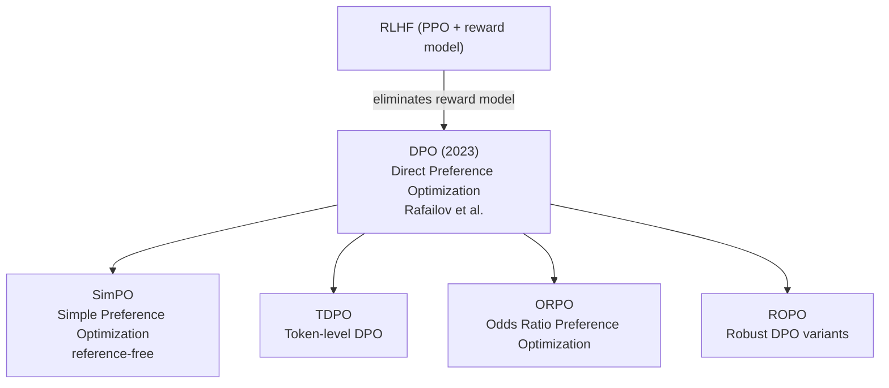
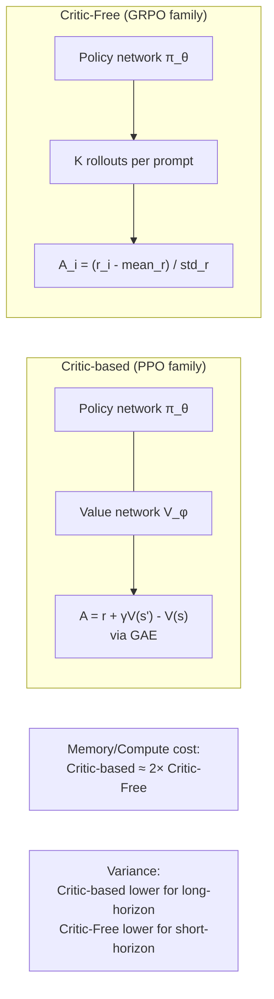
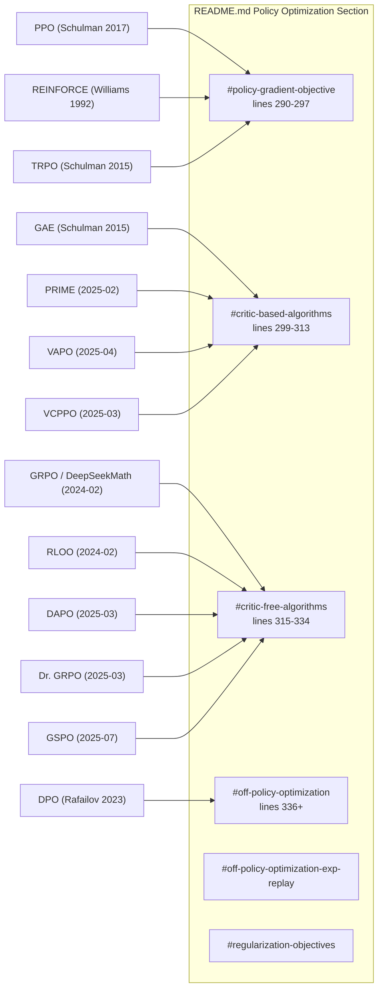

<!-- source: DeepWiki mcp.deepwiki.com · repo TsinghuaC3I/Awesome-RL-for-LRMs · extra page Policy Optimization · fetched 2026-10-30 -->

# Policy Optimization

<details>
<summary>Relevant source files</summary>

The following files were used as context for generating this wiki page:

- [README.md](README.md)
- [Survey@RL4LRM-v1.pdf](Survey@RL4LRM-v1.pdf)
- [reference.bib](reference.bib)

</details>


This page documents the **Policy Optimization** sub-category of the survey's Foundational Components, covering the six algorithm families used to update LLM policies during RL training. The scope is the six algorithm categories listed in [README.md:53-59]() under the `### Policy Optimization` section.

For the reward signals that feed into these algorithms, see [Reward Design](#2.2.1). For the data sampling strategies that interact with policy optimization, see [Sampling Strategy](#2.2.3). For an overview of all three Foundational Components together, see [Foundational Components](#2.2).

---

## Overview

Policy optimization defines how the LLM's parameters are updated given a reward signal. The survey partitions this into six categories based on how value estimation, reference policy constraints, and training data provenance are handled.

**Policy Optimization Taxonomy**



Sources: [README.md:53-59](), [README.md:289-334]()

**Relationship to the RL Training Loop**



Sources: [README.md:95-110](), [README.md:289-334]()

---

## Policy Gradient Objective

These are the foundational RL algorithms from which all LRM-specific methods derive.

| Algorithm | Year | Core Idea |
|:---|:---:|:---|
| `REINFORCE` | — | Monte-Carlo policy gradient; high variance, no baseline |
| `PG` | — | Policy gradient with function approximation |
| `TRPO` | — | Trust-region constraint: limits KL divergence per update |
| `PPO` | 2017 | Clipped surrogate objective; practical approximation of TRPO |

All four foundational papers are listed in the `#### Policy Gradient Objective` section of [README.md:290-297]().

### PPO Objective

PPO dominates practical LRM training. Its clipped surrogate loss is:

```
L_CLIP(θ) = E[ min(r_t(θ) · A_t,  clip(r_t(θ), 1-ε, 1+ε) · A_t) ]

where r_t(θ) = π_θ(a_t|s_t) / π_θ_old(a_t|s_t)
```

The `ε` clip parameter (typically 0.2) prevents large policy updates, serving the same purpose as TRPO's KL constraint but with lower computational cost.

Sources: [README.md:292-297]()

---

## Critic-based Algorithms

Critic-based methods train a separate **value network** alongside the policy. The value network estimates `V(s)` (expected future reward from state `s`), enabling lower-variance advantage estimates via **Generalized Advantage Estimation (GAE)**.

**Critic-based Algorithm Lineage**



Sources: [README.md:299-313]()

### Representative Papers

| Date | Name | Key Contribution |
|:---:|:---|:---|
| 2015-06 | `GAE` | Generalized Advantage Estimation for high-dim continuous control |
| 2023-12 | `Math-shepherd` | Step-by-step process reward without human annotations |
| 2024-12 | `Implicit PRM` | Free process rewards without explicit process labels |
| 2025-02 | `PRIME` | Process reinforcement through implicit rewards; combines ORM + PRM |
| 2025-03 | `VCPPO` | Diagnoses value collapse in long-CoT; proposes value optimization fix |
| 2025-04 | `VAPO` | Value-aware policy optimization for advanced reasoning |
| 2025-08 | `VRPO` | Robust value modeling under noisy reward supervision |
| — | `Autopsv` | Automated process-supervised verifier |

Sources: [README.md:299-313]()

### Limitation: Critic Overhead

Maintaining a value network roughly doubles memory and compute relative to critic-free approaches. This cost motivated the development of the critic-free family described below.

---

## Critic-Free Algorithms

Critic-free methods eliminate the value network entirely. Advantage is estimated using a **group baseline**: for each prompt, `K` responses are sampled and the baseline is the mean reward across the group.

**Critic-Free Algorithm Lineage**



Sources: [README.md:315-334]()

### GRPO: The Central Algorithm

`GRPO` (Group Relative Policy Optimization), introduced with DeepSeekMath, is the most widely adopted critic-free algorithm in this survey. It defines advantage as:

```
A_i = (r_i - mean(r_1..r_K)) / std(r_1..r_K)

where K responses are sampled per prompt
```

It replaces the per-token value baseline of PPO with a per-group scalar, eliminating the critic network.

### Representative Papers

| Date | Name | Key Contribution |
|:---:|:---|:---|
| 2023-10 | `ReMax` | Greedy rollout as variance-reduction baseline |
| 2024-02 | `RLOO` | Leave-one-out baseline; revisits REINFORCE for RLHF |
| 2024-02 | `GRPO` | Group relative advantage; no value network needed |
| 2025-01 | `Kimi k1.5` | Scales critic-free RL to long-CoT with curriculum |
| 2025-03 | `DAPO` | Dynamic sampling + token-level policy loss; improves GRPO stability |
| 2025-03 | `Dr. GRPO` | Removes length and difficulty bias from GRPO advantage |
| 2025-05 | `Clip-Cov/KL-Cov` | Analyzes entropy collapse in RL for reasoning models |
| 2025-06 | `CISPO` | Clip importance sampling; used in MiniMax-M1 training |
| 2025-07 | `GSPO` | Group Sequence Policy Optimization; sequence-level grouping |
| 2025-08 | `LitePPO` | Empirical deep dive into tricks vs. traps in critic-free RL |
| 2025-09 | `UPGE` | Unified gradient estimation framework across post-training methods |

Sources: [README.md:315-334]()

---

## Off-policy Optimization

Off-policy methods use pre-collected preference pairs `(x, y_w, y_l)` rather than online rollouts. The central algorithm is **DPO** (Direct Preference Optimization), which reparameterizes the reward as an implicit function of the policy ratio.

**DPO Family Relationships**



Sources: [README.md:53-59]()

### DPO Objective

```
L_DPO(θ) = -E[ log σ( β · log(π_θ(y_w|x)/π_ref(y_w|x))
                     - β · log(π_θ(y_l|x)/π_ref(y_l|x)) ) ]
```

The `β` parameter controls deviation from the reference policy `π_ref`. DPO directly optimizes preference rankings without a separate reward model.

---

## Off-policy Optimization with Experience Replay

This category covers methods that combine off-policy preference data with a **replay buffer** or iterative data collection, allowing the training distribution to evolve while reusing historical data.

Key strategies in this family:

| Strategy | Description |
|:---|:---|
| **Iterative DPO** | Re-sample preference pairs from the updated policy periodically |
| **ReSTEM-style** | Rejection sampling fine-tuning; filtered self-generated rollouts |
| **Hybrid on/off-policy** | Mix fresh rollouts with a historical buffer |

Sources: [README.md:53-59]()

---

## Regularization Objectives

Regularization terms are added to any of the above objectives to control entropy, prevent reward hacking, and stabilize training.

**Common Regularization Terms**

| Term | Symbol | Effect |
|:---|:---:|:---|
| KL divergence from reference | `KL(π_θ ‖ π_ref)` | Prevents deviation from the base model; used in PPO and DPO |
| Entropy bonus | `H(π_θ)` | Encourages exploration; prevents premature collapse |
| Token-level loss normalization | per-token vs per-sequence | Affects length bias in GRPO/DAPO |
| Clip ratio | `ε` in PPO | Limits per-step policy change |

**Regularization in Practice: DAPO Modifications to GRPO**

`DAPO` [README.md:330]() introduces several regularization changes over base `GRPO`:

1. **Clip-Higher**: Asymmetric clipping — raises the upper clip bound to allow more exploration
2. **Dynamic Sampling**: Drops prompts where all `K` samples have the same reward (zero gradient)
3. **Token-level Policy Gradient Loss**: Averages loss over tokens, not sequences, reducing length bias
4. **Overlong Reward Shaping**: Penalizes responses that exceed a maximum length

`Clip-Cov/KL-Cov` [README.md:328]() provides a theoretical analysis of entropy dynamics, showing that standard KL regularization can cause entropy collapse that harms reasoning diversity.

Sources: [README.md:315-334]()

---

## Critic-based vs Critic-Free: Trade-offs



| Property | Critic-based | Critic-Free |
|:---|:---|:---|
| Extra parameters | Value network `V_φ` | None |
| Advantage estimation | GAE with bootstrapping | Group mean/std baseline |
| Training stability | Higher for long CoT | Can collapse entropy |
| Complexity | Higher (two-model update) | Lower (single model) |
| Primary algorithm | PPO + GAE | GRPO, RLOO, REINFORCE |
| Key fix for instability | `VCPPO` (value collapse) | `DAPO` (clip-higher) |

Sources: [README.md:289-334]()

---

## Cross-Reference: Algorithm Names to README Sections

The README organizes papers under these exact section anchors. The table below maps algorithm names to their canonical README entry locations.



Sources: [README.md:53-59](), [README.md:289-334]()

---

## Summary Table: All Sub-Categories

| Sub-category | README Anchor | Core Mechanism | Representative Algorithms |
|:---|:---|:---|:---|
| Policy Gradient Objective | `#policy-gradient-objective` | Direct gradient of expected reward | `PPO`, `REINFORCE`, `TRPO`, `PG` |
| Critic-based Algorithms | `#critic-based-algorithms` | Learned value function `V(s)` for advantage | `GAE`, `PRIME`, `VAPO`, `VCPPO` |
| Critic-Free Algorithms | `#critic-free-algorithms` | Group baseline from `K` rollouts | `GRPO`, `DAPO`, `RLOO`, `GSPO`, `CISPO` |
| Off-policy Optimization | `#off-policy-optimization` | Pre-collected preference pairs; no rollouts | `DPO`, `SimPO`, `TDPO` |
| Off-policy + Exp Replay | `#off-policy-optimization-exp-replay` | Replay buffer + iterative data refresh | Iterative DPO, ReSTEM |
| Regularization Objectives | `#regularization-objectives` | KL penalty, entropy bonus, clipping | KL-Cov, Clip-Cov, DAPO clip-higher |

Sources: [README.md:53-59](), [README.md:289-334]()

---

