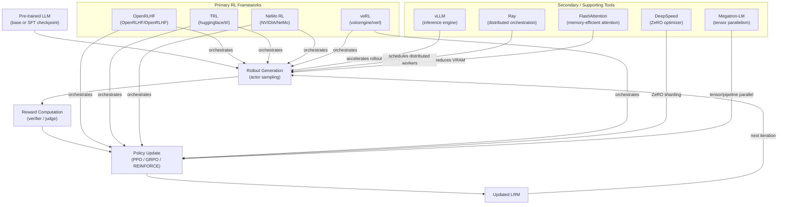
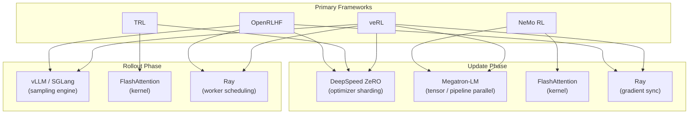

<!-- source: DeepWiki mcp.deepwiki.com · repo TsinghuaC3I/Awesome-RL-for-LRMs · extra page RL Infrastructure · fetched 2026-10-30 -->

# RL Infrastructure

<details>
<summary>Relevant source files</summary>

The following files were used as context for generating this wiki page:

- [README.md](README.md)
- [reference.bib](reference.bib)

</details>


This page documents the **RL Infrastructure** sub-section of the [Training Resources](2.3) category in the survey taxonomy. It covers the open-source frameworks and supporting tools that practitioners use to implement RL training pipelines for Large Reasoning Models (LRMs). This page covers infrastructure tools (frameworks, engines, libraries); for the datasets that feed those pipelines, see [Static Corpus Datasets](#2.3.1), and for the interactive feedback environments, see [Dynamic Environments](#2.3.2).

---

## Scope and Structure

The survey divides RL infrastructure into two tiers:

| Tier | Role |
|---|---|
| **Primary Infrastructure** | Full-featured RL training frameworks that orchestrate the entire training loop (rollout generation, reward computation, policy update) |
| **Secondary Infrastructure** | Supporting libraries that are composed into the primary frameworks — inference engines, parallelism backends, memory optimizers |

These tools sit between the raw algorithmic ideas covered in [Foundational Components](#2.2) and the actual trained models that appear in [Frontier Models](#2.1) and [Applications](#2.4).

Sources: [README.md:63-75]()

---

## Position in the Training Pipeline

The following diagram shows how RL infrastructure tools slot into the overall RL training loop described by the survey.

**Diagram: RL Infrastructure in the Training Pipeline**



Sources: [README.md:74-75](), [README.md:103-110]()

---

## Primary Infrastructure

Primary RL frameworks provide an end-to-end implementation of the RL training loop for LLMs, handling actor-critic coordination, distributed rollout, and gradient updates. They are the direct counterpart to the algorithmic papers documented in [Policy Optimization](#2.2.2).

### Framework Overview

**Diagram: Primary Framework Responsibilities**

```mermaid
graph LR
    subgraph "OpenRLHF\n(OpenRLHF/OpenRLHF)"
        OA["Actor rollout"]
        OC["Critic / reference model"]
        OR["Reward model serving"]
        OP["PPO / REINFORCE++ loop"]
    end

    subgraph "TRL\n(huggingface/trl)"
        TA["PPOTrainer"]
        TB["GRPOTrainer"]
        TC["DPOTrainer"]
        TD["SFTTrainer"]
    end

    subgraph "NeMo RL\n(NVIDIA/NeMo)"]
        NA["Megatron-LM backend"]
        NB["GRPO / PPO support"]
        NC["Multi-node GPU scaling"]
    end

    subgraph "veRL\n(volcengine/verl)"
        VA["Hybrid engine\n(train + infer same GPU)"]
        VB["FSDP / Megatron backends"]
        VC["Ray-based orchestration"]
    end
```

Sources: [README.md:74-75](), [README.md:337](), [README.md:362-363]()

### OpenRLHF

`OpenRLHF` (`OpenRLHF/OpenRLHF`) is one of the most widely referenced frameworks in the papers indexed by this survey. It implements full PPO-style RLHF with separate actor, critic, reward model, and reference model roles distributed across GPU workers via `Ray`. It is cited directly in the survey as the source implementation for `REINFORCE++`.

Key characteristics:

| Feature | Detail |
|---|---|
| Backend | Ray + DeepSpeed |
| Supported algorithms | PPO, REINFORCE++, DPO, SFT |
| Model scale | Designed for 70B+ models |
| Reference in README | REINFORCE++ GitHub badge links to `OpenRLHF/OpenRLHF` |

Sources: [README.md:337]()

### TRL (Transformer Reinforcement Learning)

`TRL` (`huggingface/trl`) is HuggingFace's library providing trainer classes (`PPOTrainer`, `GRPOTrainer`, `DPOTrainer`, `SFTTrainer`) that integrate directly with the `transformers` ecosystem. Its tight coupling with HuggingFace model hubs makes it the most accessible entry point for RL fine-tuning.

Key characteristics:

| Feature | Detail |
|---|---|
| Backend | `accelerate` + DeepSpeed optional |
| Supported algorithms | PPO, GRPO, DPO, ORPO, SFT |
| Integration | `transformers`, `datasets`, `peft` |
| Primary use case | Small-to-medium scale experiments |

### NeMo RL

`NeMo RL` (part of `NVIDIA/NeMo`) is NVIDIA's production-grade RL training stack. It uses Megatron-LM for tensor and pipeline parallelism and is designed for large-scale multi-node training on NVIDIA hardware. The survey references `NVIDIA/Megatron-LM` in the context of `Llama-Nemotron-Ultra`.

Key characteristics:

| Feature | Detail |
|---|---|
| Backend | Megatron-LM, NCCL |
| Supported algorithms | PPO, GRPO |
| Target scale | Hundreds of GPUs |
| Reference in README | `NVIDIA/Megatron-LM` GitHub badge |

Sources: [README.md:130]()

### veRL

`veRL` (`volcengine/verl`, also appearing as `yaof20/verl`) is a framework that co-locates training and inference on the same GPU workers using a hybrid engine. This avoids expensive GPU reallocation between rollout and update phases. It supports both `FSDP` and Megatron backends and uses `Ray` for orchestration.

`veRL` is referenced by the survey in the context of off-policy RL techniques and the `GiGPO` agent training paper.

Key characteristics:

| Feature | Detail |
|---|---|
| Backend | FSDP or Megatron-LM + Ray |
| Key innovation | Hybrid train+infer engine on same GPUs |
| Supported algorithms | PPO, GRPO, off-policy variants |
| Reference in README | `yaof20/verl` (off-policy RL), `langfengQ/verl-agent` (GiGPO) |

Sources: [README.md:221](), [README.md:362-363]()

---

## Secondary Infrastructure

Secondary infrastructure tools are composable components that primary frameworks build upon. They do not implement the full RL loop themselves but are essential for scale and efficiency.

### Component Summary

| Tool | Category | Role in RL Pipeline |
|---|---|---|
| `vLLM` | Inference engine | Fast autoregressive sampling during rollout phase; PagedAttention reduces GPU memory |
| `SGLang` | Inference engine | Structured generation and batched inference for rollout |
| `DeepSpeed` | Training optimizer | ZeRO-1/2/3 sharding for optimizer states, gradients, and parameters |
| `Megatron-LM` | Parallelism library | Tensor, pipeline, and sequence parallelism for large model training |
| `Ray` | Distributed runtime | Worker scheduling, resource management across actor/critic/reward model processes |
| `FlashAttention` | Attention kernel | Memory-efficient attention; enables long-sequence RL training |
| `RLLM` | RL convenience layer | Used by `DeepScaleR` and `DeepCoder`; sits atop base frameworks |

Sources: [README.md:435](), [README.md:452]()

### Diagram: Secondary Tool Composition

**Diagram: How Secondary Tools Compose into Primary Frameworks**



Sources: [README.md:74-75](), [README.md:130](), [README.md:337](), [README.md:362-363](), [README.md:435](), [README.md:452]()

---

## Relationship to Specific Papers

Several papers listed in the survey either introduce new infrastructure or build directly atop existing frameworks. The table below maps notable papers to the infrastructure they use or extend.

| Paper / System | Framework Used | Infrastructure Contribution |
|---|---|---|
| `REINFORCE++` | OpenRLHF | Canonical REINFORCE++ implementation |
| `DAPO` | veRL | Clip-higher, token-level policy gradient at scale |
| `PRIME` | OpenRLHF | Implicit process reward integrated into PPO |
| `DeepScaleR` | `rllm-org/rllm` | Curriculum RL scaling with a 1.5B model |
| `DeepCoder` | `agentica-project/rllm` | Code RL built on RLLM stack |
| `GiGPO` | `langfengQ/verl-agent` | Group-in-group advantage, agent-task credit |
| `FlashRL` | Custom (Flash-RL) | Quantized rollouts for fast RL training |
| `Open-Reasoner-Zero` | OpenRLHF | Open reproduction of R1-Zero style training |

Sources: [README.md:221](), [README.md:309](), [README.md:330-331](), [README.md:337](), [README.md:435](), [README.md:452]()

---

## Selection Criteria

The survey classifies a tool as **Primary** if it implements a self-contained RL training loop (rollout → reward → update) and is designed to be used directly as the entry point for LRM fine-tuning experiments. A tool is **Secondary** if it fills a specific subsystem role (inference, memory, parallelism) and is expected to be composed into a primary framework.

This distinction maps onto how papers cite infrastructure: primary frameworks are typically named in the experimental setup section, while secondary tools appear in implementation details or are implied by the hardware configuration.

Sources: [README.md:63-75](), [README.md:103-110]()

---

