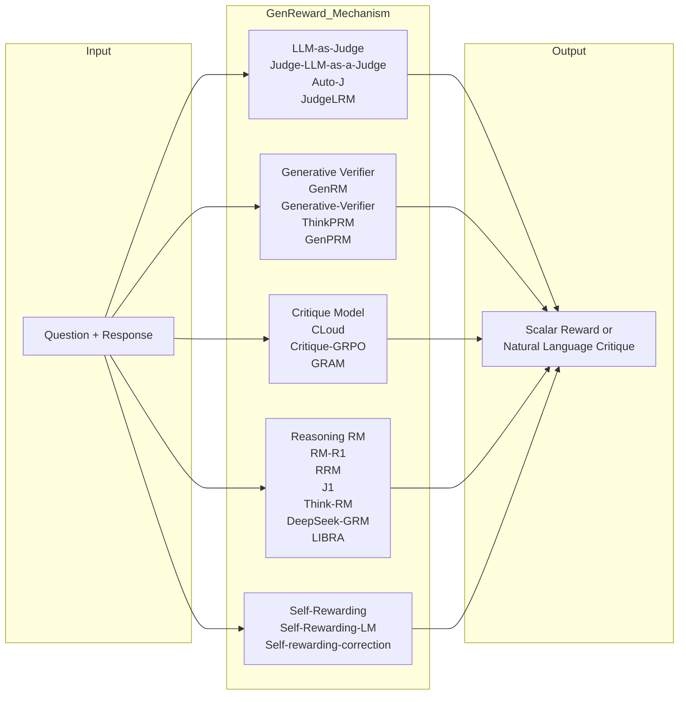
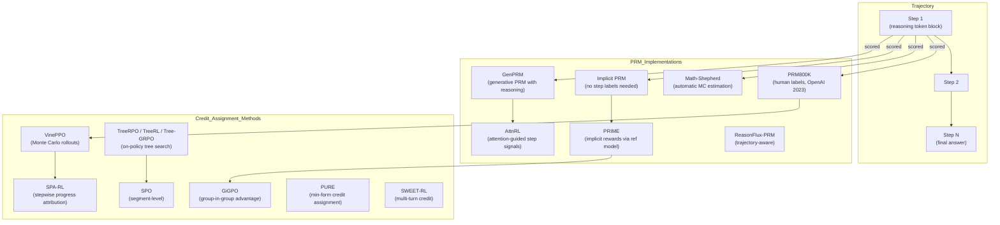
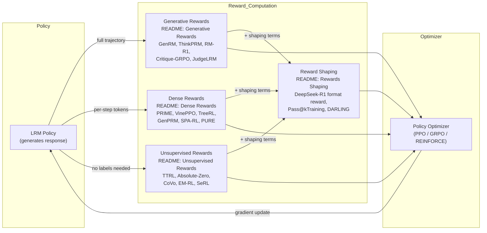

<!-- source: DeepWiki mcp.deepwiki.com · repo TsinghuaC3I/Awesome-RL-for-LRMs · extra page Reward Design · fetched 2026-10-30 -->

# Reward Design

Relevant source files

The following files were used as context for generating this wiki page:

- [README.md](README.md)
- [Survey@RL4LRM-v1.pdf](Survey@RL4LRM-v1.pdf)
- [reference.bib](reference.bib)

This page covers the **Reward Design** sub-section of the survey taxonomy. It documents how reward signals are constructed to train Large Reasoning Models (LRMs) via RL. The four sub-categories — Generative Rewards, Dense Rewards, Unsupervised Rewards, and Reward Shaping — correspond directly to the `### Reward Design` section of [README.md:144-288]().

For the broader context of how reward design fits alongside Policy Optimization and Sampling Strategy, see [Foundational Components](#2.2). For the RL infrastructure frameworks that implement these reward signals at training time, see [RL Infrastructure](#2.3.3).

---

## Overview

Reward design determines what signal the policy receives after generating a response. The choice of reward construction method has significant downstream effects on training stability, the range of tasks where RL can be applied, and the quality of learned behaviors.

The survey partitions reward design into four distinct categories based on **how the reward is derived**:

| Sub-category | Source of Reward | Supervision Required |
|---|---|---|
| **Generative Rewards** | Another LLM (judge, critic, verifier) | Weak / preference labels |
| **Dense Rewards** | Step-level process verifier | Step labels or implicit signals |
| **Unsupervised Rewards** | Self-consistency, entropy, self-play | None (no ground-truth needed) |
| **Reward Shaping** | Auxiliary signals added to a base reward | Varies |

**Taxonomy diagram: Reward Design sub-categories and representative named systems**

```mermaid
graph TD
  RD["Reward Design"]

  RD --> GR["Generative Rewards"]
  RD --> DR["Dense Rewards"]
  RD --> UR["Unsupervised Rewards"]
  RD --> RS["Reward Shaping"]

  GR --> GR1["LLM-as-Judge\n(Judge, Auto-J, JudgeLRM)"]
  GR --> GR2["Generative Verifier / GenRM\n(GenRM, Generative Verifier, ThinkPRM)"]
  GR --> GR3["Reasoning Reward Models\n(RM-R1, RRM, J1, Think-RM, LIBRA)"]
  GR --> GR4["Critique Models\n(CLoud, Critique-GRPO, GRAM)"]
  GR --> GR5["Self-Rewarding\n(Self-Rewarding LM, Self-rewarding correction)"]

  DR --> DR1["Outcome vs Process Feedback\n(PRM800K, Math-Shepherd)"]
  DR --> DR2["Implicit Process Rewards\n(Implicit PRM, PRIME)"]
  DR --> DR3["Tree-based Credit Assignment\n(VinePPO, TreeRPO, TreeRL, TreePO)"]
  DR --> DR4["Step/Segment-level\n(SPA-RL, SPO, S-GRPO, GiGPO)"]
  DR --> DR5["Generative PRMs\n(GenPRM, ReasonFlux-PRM, TP-GRPO)"]

  UR --> UR1["Self-Play\n(Absolute Zero, SeRL, TRANS-ZERO)"]
  UR --> UR2["Self-Rewarding / Consistency\n(SSR-Zero, CoVo, EMPO, R-Zero)"]
  UR --> UR3["Entropy / Confidence\n(EM-RL, RENT-RL, RLIF)"]
  UR --> UR4["Test-Time RL\n(TTRL, One-Shot-RLVR)"]

  RS --> RS1["Format / Length Signals\n(DeepSeek-R1, rl-without-gt)"]
  RS --> RS2["Pass-at-k Objectives\n(Pass@kTraining, PKPO)"]
  RS --> RS3["Exploration Bonuses\n(CDE, DARLING, OBE)"]
```

Sources: [README.md:144-288](), [README.md:48-53]()

---

## Generative Rewards

A **generative reward** is produced by a language model that evaluates a candidate response, rather than by a deterministic rule or lookup. This enables reward signals in open-ended domains (creative writing, long-form reasoning, multi-step judgment) where symbolic verifiers do not exist.

### Conceptual Variants

**Taxonomy diagram: Generative Reward model types mapped to named README entries**

Sources: [README.md:145-192](), [reference.bib:1213-1425]()

### Key Approaches

| Approach | How it works | Representative papers |
|---|---|---|
| **LLM-as-Judge** | A separate LLM scores responses using a prompt-based rubric, without explicit training for judging | `Judge LLM-as-a-Judge` (2023), `Auto-J`, `JudgeLRM` |
| **Generative Verifier** | The verifier generates reasoning before emitting a correctness verdict, framing reward modeling as next-token prediction | `Generative Verifier` (2024), `GenRM`, `ThinkPRM` |
| **Reasoning Reward Model** | An RM trained explicitly to reason about response quality, often via RL itself | `RM-R1`, `RRM`, `J1`, `Think-RM`, `LIBRA`, `DeepSeek-GRM` |
| **Critique Model** | The reward model outputs a natural-language critique alongside a score | `CLoud`, `Critique-GRPO`, `GRAM`, `CAPO` |
| **Self-Rewarding** | The same model being trained also generates its own reward signal | `Self-Rewarding LM`, `Self-rewarding correction` |
| **Unified / Principle-Following** | Reward models that generalize across domains using principles or constitutions | `RewardAnything`, `QA-LIGN`, `RLCF` |
| **Verifier Tooling** | Lightweight verifiers designed for efficiency or false-negative reduction | `xVerify`, `TinyV`, `CompassVerifier` |

### When to Use

Generative rewards are appropriate when:
- The correct answer is not symbolically verifiable (e.g., writing quality, alignment).
- Fine-grained natural language feedback is needed for multi-step credit assignment.
- The task domain is too broad for hand-crafted rules.

Potential pitfalls include reward model bias, self-consistency collapse when the policy and reward model share parameters, and susceptibility to adversarial inputs ("one token to fool" vulnerabilities noted in the survey).

Sources: [README.md:145-192](), [reference.bib:1213-1425]()

---

## Dense Rewards

A **dense reward** provides feedback at the level of individual steps within a chain-of-thought, rather than a single outcome reward at the end. This addresses the **credit assignment problem**: determining which reasoning steps contributed to a correct or incorrect final answer.

### Process Reward Models (PRMs)

Dense rewards are commonly delivered through a **Process Reward Model (PRM)** that scores each intermediate step. The survey traces PRM development from early human-annotated datasets to fully automatic derivation.

**Diagram: Dense reward signal flow and key PRM implementations**

Sources: [README.md:194-241](), [reference.bib:805-1148]()

### Sub-approaches

| Approach | Mechanism | Representative Papers |
|---|---|---|
| **Foundational PRMs** | Human-annotated step labels used to train a verifier | `PRM800K` (Let's Verify Step by Step), `Math-Shepherd` |
| **Implicit PRMs** | Derive process rewards from outcome supervision without step labels | `Implicit PRM`, `PRIME` |
| **Generative PRMs** | PRM generates explicit reasoning before scoring each step | `GenPRM`, `ThinkPRM`, `ReasonFlux-PRM`, `TP-GRPO` |
| **Tree-based Credit Assignment** | Use Monte Carlo tree search or branching rollouts to estimate step value | `VinePPO`, `TreeRPO`, `TreeRL`, `Tree-GRPO`, `TreePO` |
| **Segment / Step Aggregation** | Aggregate token-level advantages into step or segment-level signals | `SPO`, `SPA-RL`, `GiGPO`, `S-GRPO` |
| **Min-form Assignment** | Replace sum-based reward aggregation with minimum across steps | `PURE` |
| **Multi-turn Dense Rewards** | Assign per-turn rewards in dialogue/agentic multi-step trajectories | `SWEET-RL`, `G-RA`, `MUA-RL`, turn-level credit assignment |

### Process vs. Outcome Reward

The tension between process rewards (per-step) and outcome rewards (final answer only) is a central topic. Several papers (`PROF`, `HICRA`) study how to harmonize both signal types during training.

Sources: [README.md:194-241](), [reference.bib:805-1148](), [reference.bib:1149-1209]()

---

## Unsupervised Rewards

**Unsupervised rewards** require no ground-truth labels, human preferences, or trained reward models. They derive the training signal entirely from the model's own outputs via consistency, entropy, self-play, or structural properties of the response.

This category is especially important for tasks where:
- No labeled answer corpus exists (e.g., open-ended generation, novel domains).
- Training must proceed at test time on unseen inputs (`TTRL`).
- The goal is data-free or near-data-free self-improvement.

### Approach Map

**Diagram: Unsupervised reward mechanisms mapped to README entries**

```mermaid
graph TD
  subgraph "Signal_Source"
    C["Consistency\nSelf-Agreement"]
    E["Entropy\nModel Confidence"]
    SP["Self-Play\nProposer + Solver"]
    SF["Self-Feedback\nIntrinsic Critique"]
    FMT["Surrogate Structural\nFormat + Length"]
  end

  subgraph "Representative_Systems"
    CoVo_s["CoVo\n(path consistency)"]
    TTRL_s["TTRL\n(majority vote pseudo-label)"]
    AbsoluteZero["Absolute-Zero\n(self-play, zero data)"]
    SeRL_s["SeRL\n(limited data self-play)"]
    EMPO_s["EMPO\n(question self-generation)"]
    RZero["R-Zero\n(self-evolving, zero data)"]
    EMmin["EM-RL\n(entropy minimization)"]
    RENT["RENT-RL\n(confidence maximization)"]
    RLIF["RLIF / Intuitor\n(no external reward)"]
    SSRZero["SSR-Zero\n(self-rewarding translation)"]
    SurSig["rl-without-gt\n(format+length surrogates)"]
    CoReward["Co-Reward\n(contrastive agreement)"]
    SQLM_s["SQLM\n(self-questioning)"]
    TransZ["TRANS-ZERO\n(multilingual self-play)"]
    OneShot["One-Shot-RLVR\n(single example)"]
    Spurious["Spurious-Rewards\n(signal analysis)"]
  end

  C --> CoVo_s
  C --> TTRL_s
  C --> CoReward
  SP --> AbsoluteZero
  SP --> SeRL_s
  SP --> TransZ
  SF --> EMPO_s
  SF --> RZero
  SF --> SQLM_s
  E --> EMmin
  E --> RENT
  E --> RLIF
  FMT --> SurSig
  FMT --> OneShot
  FMT --> Spurious
```

Sources: [README.md:243-273](), [reference.bib:324-803]()

### Sub-approaches

| Approach | Mechanism | Representative Papers |
|---|---|---|
| **Self-play** | A model proposes tasks for itself (or an opponent) to solve; reward comes from solving success | `Absolute Zero`, `SeRL`, `TRANS-ZERO`, `Vision-Zero` |
| **Self-rewarding / consistency** | Rewards are derived from agreement across multiple sampled solutions | `CoVo`, `TTRL`, `SSR-Zero`, `Co-Reward` |
| **Confidence / entropy minimization** | High-confidence (low-entropy) outputs are rewarded, driving model to be more decisive | `EM-RL`, `RENT-RL`, `ETTRL` |
| **Intrinsic / internal feedback** | The model critiques or questions itself without an external oracle | `RLIF`, `SQLM`, `RLSF`, `R-Zero`, `EMPO` |
| **Surrogate structural signals** | Format compliance and response length proxy for quality when ground truth is absent | `rl-without-gt`, `One-Shot-RLVR`, `Spurious Rewards` |
| **Test-time RL** | RL applied at inference time on the test prompt, using pseudo-labels derived from consistency | `TTRL`, `SEAL`, `RPT` |

> **Note on `Spurious Rewards`**: This paper provides a critical analysis — it shows that even random or structurally trivial reward signals can improve reasoning metrics, raising questions about what the RL signal is actually teaching.

Sources: [README.md:243-273](), [reference.bib:324-803]()

---

## Reward Shaping

**Reward shaping** refers to augmenting or modifying the base reward signal with additional auxiliary terms designed to improve exploration, regularize training, or guide the model toward qualitatively better behaviors.

This is a broad, catch-all category. Unlike the other three, reward shaping does not define a new reward source — it modifies an existing outcome reward.

### Common Shaping Techniques

| Technique | Effect | Representative Papers |
|---|---|---|
| **Format rewards** | Binary bonus for well-structured output (e.g., using `` tags.

This is the canonical example of reward shaping as a simple, non-learned auxiliary signal layered on top of outcome verification.

Sources: [README.md:274-288](), [reference.bib:1210-1212]()

---

## Summary: Reward Design Landscape

The following diagram maps each reward sub-category to where it sits in the RL training loop and the key README entries that implement it.

**Diagram: Reward sub-category position in RL training pipeline and README section headers**

Sources: [README.md:144-288](), [reference.bib:241-1425]()

### Design Tradeoffs at a Glance

| Property | Generative | Dense (PRM) | Unsupervised | Shaping |
|---|---|---|---|---|
| Requires ground truth | Partial | Often (step labels) | No | Depends on base reward |
| Scalable to open-ended tasks | Yes | Harder | Yes | Depends |
| Credit assignment granularity | Outcome or step | Step | Outcome | Varies |
| Training cost | High (judge model inference) | Medium | Low | Low |
| Risk of reward hacking | Moderate–high | Low–medium | High | Moderate |
| Key limitation | Judge bias / cost | Step label scarcity | Signal quality | Hyperparameter sensitivity |

Sources: [README.md:144-288](), [reference.bib:241-1425]()

---

