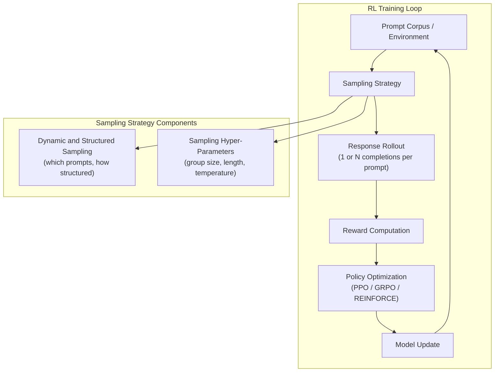
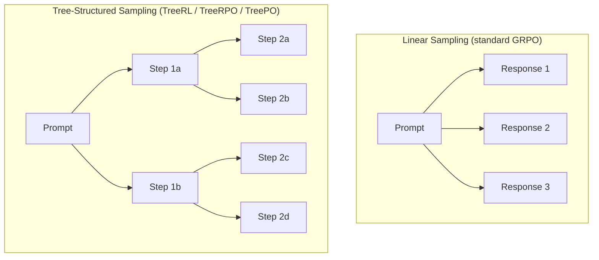
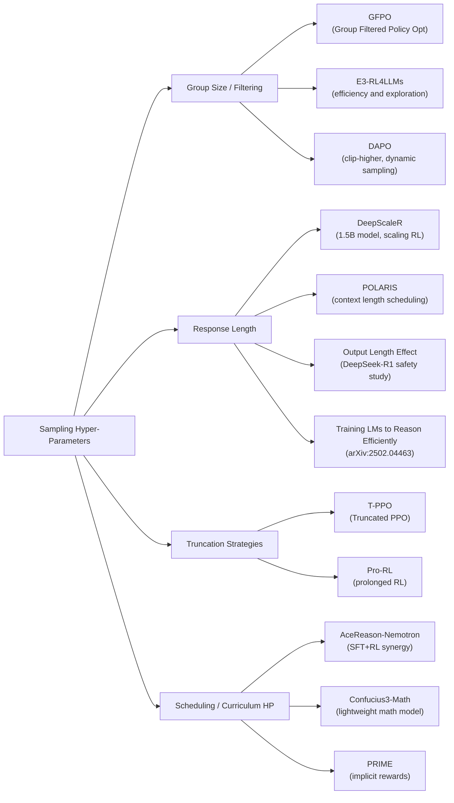

<!-- source: DeepWiki mcp.deepwiki.com · repo TsinghuaC3I/Awesome-RL-for-LRMs · extra page Sampling Strategy · fetched 2026-10-30 -->

# Sampling Strategy

Relevant source files

The following files were used as context for generating this wiki page:

- [README.md](README.md)
- [reference.bib](reference.bib)

This page covers the **Sampling Strategy** category of the survey taxonomy — specifically, how training examples and rollout samples are selected, structured, and configured during RL training of Large Reasoning Models (LRMs). Sampling strategy is distinct from what reward signal is used (see [Reward Design](#2.2.1)) and how policy parameters are updated given collected samples (see [Policy Optimization](#2.2.2)). It answers the question: *which data to sample, how to structure that sampling, and with what quantitative settings?*

The survey organizes sampling strategy into two sub-categories: **Dynamic and Structured Sampling** and **Sampling Hyper-Parameters**.

---

## Position in the RL Training Loop

Sampling strategy operates at the data collection stage of each RL update step. It determines what prompts are selected, how responses are generated or structured, and what filtering is applied before reward computation and policy updates occur.

**Diagram: Sampling Strategy in the RL Training Pipeline**

Sources: [README.md:398-436]()

---

## Dynamic and Structured Sampling

Dynamic and structured sampling covers methods that go beyond uniform random sampling of training prompts. The core ideas are:

- **Curriculum learning**: schedule prompts by difficulty, from easy to hard, so the model builds capability progressively.
- **Difficulty-aware selection**: select prompts whose current estimated difficulty is optimal for learning (not too easy, not too hard).
- **Tree-structured rollout**: instead of sampling a single linear response, explore a branching tree of partial completions to better cover the solution space.
- **Exploration-focused sampling**: explicitly design the sampling procedure to maximize solution diversity and avoid mode collapse.

**Diagram: Dynamic and Structured Sampling Sub-categories and Representative Methods**

```mermaid
graph TD
    DSS["Dynamic and Structured Sampling"]

    DSS --> CURR["Curriculum / Difficulty-Aware\nScheduling"]
    DSS --> TREE["Tree-Structured\nSampling"]
    DSS --> EXPL["Exploration-Focused\nSampling"]
    DSS --> AGENT["Agentic / Multi-step\nStructured Sampling"]

    CURR --> E2H["E2H\n(easy-to-hard curriculum)"]
    CURR --> DACE["DACE\n(difficulty-aware certainty)"]
    CURR --> POLARIS["POLARIS\n(post-training recipe)"]

    TREE --> TreeRL["TreeRL\n(on-policy tree search)"]
    TREE --> TreeRPO["TreeRPO\n(tree relative policy optimization)"]
    TREE --> TreePO["TreePO\n(heuristic tree-based modeling)"]
    TREE --> ToTRL["ToTRL\n(tree-of-thoughts RL)"]
    TREE --> DARS["DARS\n(dynamic action re-sampling)"]

    EXPL --> EEPO["EEPO\n(sample-then-forget)"]
    EXPL --> AttnRL["AttnRL\n(attention-guided exploration)"]
    EXPL --> GG2RPO["G2RPO-A\n(guided group relative policy opt)"]
    EXPL --> RuscaRL["RuscaRL\n(rubric-scaffolded RL)"]

    AGENT --> ARPO["ARPO\n(agentic reinforced policy opt)"]
    AGENT --> ParallelR1["Parallel-R1\n(parallel thinking)"]
    AGENT --> PRIME["PRIME\n(process reinforcement)"]
    AGENT --> DAPO["DAPO\n(dynamic sampling policy opt)"]
```

Sources: [README.md:398-418]()

### Curriculum and Difficulty-Aware Sampling

Curriculum sampling progressively increases task difficulty so that a model receives learning signal appropriate to its current capability. If tasks are always too easy, gradients carry little information; if too hard, all rollouts fail and rewards are uniformly zero.

| Paper | Method Name | Key Idea |
|---|---|---|
| arXiv:2506.06632 | `E2H` | Curriculum RL from easy-to-hard tasks; shows systematic difficulty ordering improves reasoning |
| arXiv:2509.00125 | `DACE` | Difficulty-Aware Certainty as a guide; samples prompts where model certainty is intermediate |
| POLARIS blog | `POLARIS` | Post-training recipe that includes difficulty-based prompt scheduling as part of a broader RL recipe |

Sources: [README.md:412](), [README.md:405](), [README.md:418]()

### Tree-Structured Sampling

Rather than sampling a single linear completion per prompt, tree-structured methods generate a branching tree of partial completions. This is particularly useful for problems where reasoning paths diverge after early steps, providing richer training signal and enabling process-level reward assignment.

| Paper | Method Name | Key Idea |
|---|---|---|
| arXiv:2506.11902 | `TreeRL` | On-policy tree search integrated into RL training loop |
| arXiv:2506.05183 | `TreeRPO` | Tree Relative Policy Optimization — advantage estimation over tree branches |
| arXiv:2508.17445 | `TreePO` | Heuristic tree-based modeling bridging policy optimization and inference efficiency |
| arXiv:2505.12717 | `ToTRL` | Tree-of-Thoughts RL using puzzle-solving to unlock branching reasoning |
| arXiv:2503.14269 | `DARS` | Dynamic Action Re-Sampling via adaptive tree traversal for coding agents |

Sources: [README.md:409-416]()

**Diagram: Tree-Structured vs. Linear Sampling in RL Rollout**

Sources: [README.md:409-416]()

### Exploration-Focused Sampling

A recurring challenge in RL for LRMs is entropy collapse — the policy concentrates on a narrow distribution of responses, reducing gradient diversity and stalling learning. Exploration-focused sampling methods directly address this.

| Paper | Method Name | Key Idea |
|---|---|---|
| arXiv:2510.05837 | `EEPO` | Sample-Then-Forget: generates many samples but drops lower-quality ones to maintain diversity |
| arXiv:2509.26628 | `AttnRL` | Uses attention patterns as a compass for efficient exploration in process-supervised RL |
| arXiv:2508.13023 | `G^2RPO-A` | Guided Group Relative Policy Optimization with adaptive guidance for exploration |
| arXiv:2508.16949 | `RuscaRL` | Rubric-Scaffolded RL to break the exploration bottleneck in general reasoning |

Sources: [README.md:403-408]()

---

## Sampling Hyper-Parameters

Sampling hyper-parameters are the quantitative settings governing how many and which responses are collected per update step. While these may appear to be implementation details, they materially affect training stability, compute efficiency, and final model quality.

The primary hyper-parameters studied in the literature are:

| Parameter | Description | Effect |
|---|---|---|
| **Group size G** | Number of responses sampled per prompt per RL step | Larger G improves advantage estimation quality in GRPO-style algorithms; diminishing returns at high G |
| **Response length** | Maximum token budget per rollout | Directly controls training cost and affects quality of long-chain-of-thought models |
| **Temperature** | Sampling temperature during rollout | Controls diversity; too low → collapse; too high → incoherent |
| **Filtering / pruning** | Which samples are retained for update | Removes degenerate samples (all-correct, all-wrong) that provide no gradient signal |
| **Truncation** | Early stopping of rollout | Reduces compute cost per step; trade-off with completeness of reasoning chains |

**Diagram: Sampling Hyper-Parameter Methods and Their Primary Focus**

Sources: [README.md:420-436]()

### Group Size and Filtering

In GRPO-style algorithms, each prompt is answered by a group of G rollouts; the advantage is estimated relative to the group mean reward. The choice of G and whether to filter certain sample groups significantly affects the training signal quality.

`GFPO` (Group Filtered Policy Optimization, arXiv:2508.09726) proposes filtering at the group level — if a group's variance is too low (all correct or all wrong), the group is dropped from the update. This reduces wasted compute and focuses gradient steps on genuinely informative prompts.

`E3-RL4LLMs` (arXiv:2505.18573) systematically studies the interaction between efficiency and exploration, examining how group size and sampling strategy jointly determine training dynamics.

`DAPO` (arXiv:2503.14476) introduces several practical sampling fixes including a **clip-higher** trick and dynamic sampling to keep group diversity above a minimum threshold.

Sources: [README.md:424](), [README.md:428](), [README.md:416](), [README.md:432]()

### Response Length Scheduling

Overly long responses dominate compute budgets during rollout. Several works treat maximum response length as an active hyper-parameter:

| Paper | Method Name | Approach |
|---|---|---|
| DeepScaleR blog | `DeepScaleR` | Incrementally increases maximum length budget during training, starting short and expanding as capability grows |
| POLARIS blog | `POLARIS` | Context length warm-up schedule as part of a principled post-training recipe |
| arXiv:2503.01923 | (unnamed) | Studies the effect of forced thinking length on safety properties of DeepSeek-R1 |
| arXiv:2502.04463 | (unnamed) | Demonstrates training LMs to reason efficiently by controlling budget during RL |

Sources: [README.md:431](), [README.md:434-436]()

### Truncation and Prolongation

Two contrasting approaches exist:

- **Truncated rollout** (`T-PPO`, arXiv:2506.15050): truncates rollouts early to save compute, relying on the value function to estimate future returns for incomplete traces.
- **Prolonged RL** (`Pro-RL` / `ProRL`, arXiv:2505.24864): intentionally extends RL training duration with carefully controlled schedules, finding that longer RL can push reasoning boundaries further than previously assumed.

Sources: [README.md:426](), [README.md:430]()

---

## Summary Comparison

The table below summarizes the two sub-categories with their primary concerns and representative papers drawn from the survey.

| Sub-category | Primary Concern | Representative Papers |
|---|---|---|
| Dynamic and Structured Sampling | *Which* data to sample; *how* rollouts are structured | `E2H`, `DACE`, `TreeRL`, `TreeRPO`, `TreePO`, `EEPO`, `DAPO`, `POLARIS`, `PRIME` |
| Sampling Hyper-Parameters | *How much* to sample; quantitative settings per update | `GFPO`, `T-PPO`, `DeepScaleR`, `POLARIS`, `E3-RL4LLMs`, `AceReason-Nemotron`, `Pro-RL` |

Sources: [README.md:398-436]()

---

## Relationship to Other Foundational Components

Sampling strategy interacts closely with both reward design and policy optimization:

- **Reward Design** (see [2.2.1](#2.2.1)): tree-structured sampling generates intermediate steps, which enables dense/process-level rewards to be applied to each branch.
- **Policy Optimization** (see [2.2.2](#2.2.2)): group-based algorithms like GRPO depend directly on group size G set by sampling hyper-parameters; off-policy algorithms (DPO, experience replay) interact with filtering decisions about which samples to retain.
- **Training Resources** (see [2.3](#2.3)): the static corpus and dynamic environment used determine what prompts are available for curriculum or difficulty-aware scheduling.

Sources: [README.md:60-62](), [README.md:398-436]()

---

