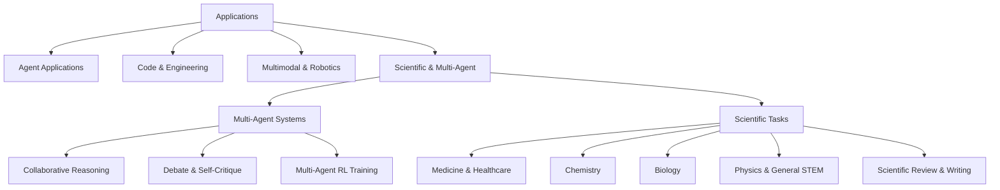
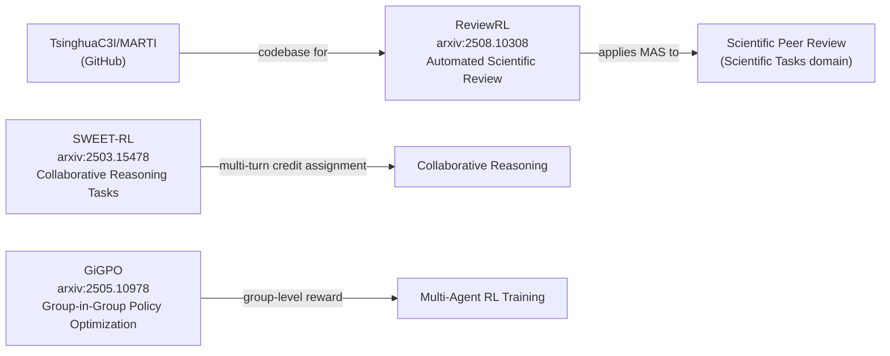
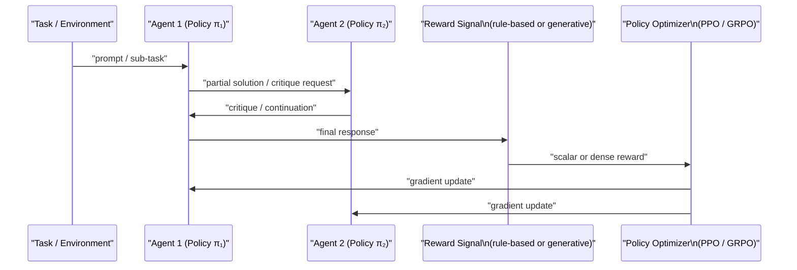
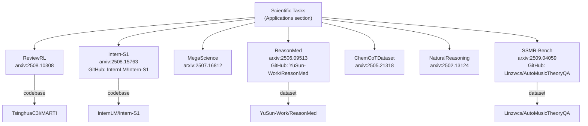
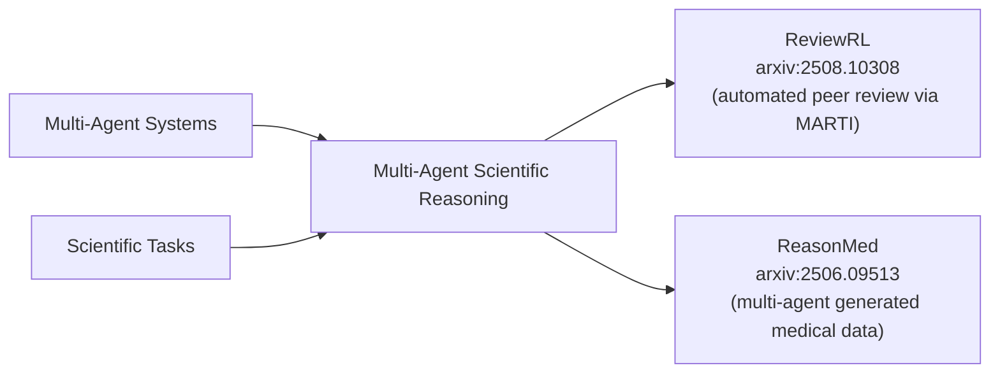

<!-- source: DeepWiki mcp.deepwiki.com · repo TsinghuaC3I/Awesome-RL-for-LRMs · extra page Scientific Tasks and Multi-Agent Systems · fetched 2026-10-30 -->

# Scientific Tasks and Multi-Agent Systems

Relevant source files

The following files were used as context for generating this wiki page:

- [README.md](README.md)
- [reference.bib](reference.bib)

This page covers the two final application sub-categories within the survey's Applications section: **Scientific Tasks** and **Multi-Agent Systems**. Both categories represent specialized deployment contexts where RL-trained Large Reasoning Models (LRMs) operate on structured, domain-specific problems or within networks of interacting agents.

For context on the broader Applications section, see [Applications (2.4)](#2.4). For agent-specific applications such as search agents and browser-use agents, see [Agent Applications (2.4.1)](#2.4.1). For scientific datasets used as training corpora, see [Static Corpus Datasets (2.3.1)](#2.3.1).

---

## Positioning Within the Survey Taxonomy

Both sub-categories occupy the "Scientific & Multi-Agent" leaf of the Applications branch. They are distinct in scope:

- **Scientific Tasks** focuses on applying RL-trained LRMs to problems in specific scientific domains (medicine, chemistry, mathematics, etc.).
- **Multi-Agent Systems** focuses on training regimes and inference pipelines where multiple LRM-based agents interact, cooperate, or compete.

**Diagram: Scientific Tasks and Multi-Agent Systems in the Applications Taxonomy**

Sources: [README.md:76-91]()

---

## Multi-Agent Systems

### Overview

Multi-Agent Systems (MAS) in this context refers to setups where multiple LRM instances participate in a shared reasoning or training process. This differs from single-agent RL training: agents may produce outputs that serve as feedback, rewards, or context for one another.

The primary distinction from single-agent RL training (covered in [Foundational Components (2.2)](#2.2)) is the **interaction structure**: multiple policy instances are active simultaneously, and the reward signal may be shaped by inter-agent dynamics rather than only external verifiers.

### Key Concepts

| Concept | Description |
|---|---|
| Collaborative reasoning | Multiple agents work toward a shared goal, dividing sub-tasks or cross-checking outputs |
| Debate / self-critique | Agents argue for competing solutions; a judge (LRM or rule-based) adjudicates |
| Multi-agent RL training | The RL policy update loop is run across agent pairs or groups |
| Turn-level credit assignment | Reward is assigned per agent turn in a multi-turn dialogue |

### MARTI Framework

The most directly affiliated project is **MARTI** (`TsinghuaC3I/MARTI`), introduced by the survey authors. MARTI is described as a framework for **LLM-based Multi-Agent Reinforced Training and Inference**. It provides the infrastructure for running RL experiments where multiple LLM agents interact during both training and inference.

`ReviewRL` (arxiv:2508.10308), which is listed in the Generative Rewards sub-category of Reward Design, builds directly on the MARTI codebase — its GitHub link resolves to `TsinghuaC3I/MARTI`.

**Diagram: MARTI Framework and Associated Papers**

Sources: [README.md:22-22](), [README.md:152-152]()

### Representative Papers

| Date | Name | Focus |
|---|---|---|
| 2025-08 | `ReviewRL` | Automated scientific review using multi-agent RL with generative rewards |
| 2025-03 | `SWEET-RL` | Multi-turn LLM agents on collaborative reasoning; introduces turn-level credit assignment |
| 2025-05 | `GiGPO` | Group-in-Group Policy Optimization for LLM agents; sub-group reward structure |
| 2025-05 | — | Reinforcing Multi-Turn Reasoning via Turn-Level Credit Assignment |

A common design pattern across these papers: a **shared reward** is computed at the end of a multi-turn interaction and then decomposed or attributed back to individual agent turns. This is the same credit assignment problem addressed by dense reward methods (see [Reward Design (2.2.1)](#2.2.1)), but applied across agent boundaries rather than token sequences.

### Structural Pattern: Multi-Agent RL Training Loop

**Diagram: Multi-Agent RL Training Loop (Conceptual)**

Sources: [README.md:221-222](), [README.md:232-232]()

---

## Scientific Tasks

### Overview

Scientific Tasks covers applications where RL-trained LRMs are evaluated and trained on domain-specific scientific problems. The defining characteristic is that the **reward signal is grounded in scientific correctness** — either via rule-based verifiers (symbolic solvers, unit tests, database lookups) or via domain-expert-calibrated generative judges.

Scientific tasks present challenges not present in general math benchmarks:

1. **Answer ambiguity** — many scientific questions do not have a single canonical string answer.
2. **Multi-step reasoning with tool use** — chemistry and physics problems often require chained computation.
3. **Domain-specific evaluation** — reward models must understand domain conventions.

### Domain Coverage

| Domain | Example Papers / Datasets |
|---|---|
| Medicine & Healthcare | `ReasonMed` (370K multi-agent generated, arxiv:2506.09513) |
| Chemistry | `ChemCoTDataset` (modular chemical operations, arxiv:2505.21318) |
| Physics & General STEM | `MegaScience` (post-training datasets, arxiv:2507.16812); `SCP-116K` (arxiv:2501.15587) |
| Scientific Reasoning (broad) | `NaturalReasoning` (2.8M questions, arxiv:2502.13124) |
| Music Theory | `SSMR-Bench` (sheet music problems, arxiv:2509.04059) |
| Scientific Review & Writing | `ReviewRL` (automated peer review, arxiv:2508.10308) |
| Multimodal Scientific | `Intern-S1` (Scientific Multimodal Foundation Model, arxiv:2508.15763) |

Sources: [README.md:454-464](), [README.md:117-117](), [README.md:152-152]()

### Relationship to STEM Static Corpus

Many scientific task benchmarks also appear as **training datasets** in the Static Corpus (STEM) section of Training Resources. The distinction in the survey taxonomy is:

- **Static Corpus (STEM)** — the dataset itself, used for RL training data.
- **Scientific Tasks (Applications)** — papers that train or evaluate LRMs on scientific problems, describing the application methodology.

**Diagram: Scientific Task Papers Mapped to Data and Codebase Entities**

Sources: [README.md:117-117](), [README.md:152-152](), [README.md:458-464]()

### Reward Signal Design for Scientific Tasks

A key challenge is constructing verifiable rewards for scientific domains. The survey tracks several approaches:

| Reward Type | How It Applies to Scientific Tasks |
|---|---|
| Rule-based verifiers | Unit checking for chemistry equations, symbolic solvers for physics |
| Generative rewards | LLM-as-judge for open-ended scientific explanations; `ReviewRL` trains an RL agent to generate peer review quality scores |
| Dense / process rewards | Step-level verification of reasoning chains in multi-step STEM problems |

`ReviewRL` specifically targets the case where human expert judgment is the gold standard but is expensive — it trains an LRM using RL to automate this judgment, making the reward model itself a scientific reasoning system.

For the mechanics of these reward types, see [Reward Design (2.2.1)](#2.2.1).

---

## Intersection: Multi-Agent Systems for Scientific Tasks

The two sub-categories overlap when multi-agent setups are used specifically for scientific discovery. `ReviewRL` is the clearest example: it applies MAS-style training (via MARTI) to produce automated scientific peer reviews — a scientific task solved via a multi-agent RL pipeline.

`ReasonMed` is another example: its dataset of 370K medical reasoning examples is explicitly described as **multi-agent generated**, meaning multiple LRM agents collaborated to produce the training data.

**Diagram: Overlap Between Multi-Agent Systems and Scientific Tasks**

Sources: [README.md:152-152](), [README.md:461-461](), [README.md:22-22]()

---

## Summary

| Sub-category | Core Problem | Key RL Challenge | Representative Systems |
|---|---|---|---|
| Multi-Agent Systems | Coordinating multiple LRM instances during training and inference | Credit assignment across agent turns; inter-agent reward shaping | `MARTI`, `ReviewRL`, `SWEET-RL`, `GiGPO` |
| Scientific Tasks | Applying LRMs to domain-specific scientific problems | Constructing verifiable rewards for non-trivial scientific correctness | `Intern-S1`, `ReviewRL`, `ReasonMed`, `MegaScience`, `ChemCoTDataset` |

Both sub-categories share a dependency on well-designed reward signals — the foundational treatment of which is in [Reward Design (2.2.1)](#2.2.1) — and benefit from the STEM-domain datasets described in [Static Corpus Datasets (2.3.1)](#2.3.1).

Sources: [README.md:76-91](), [README.md:113-120](), [README.md:152-152](), [README.md:454-464]()