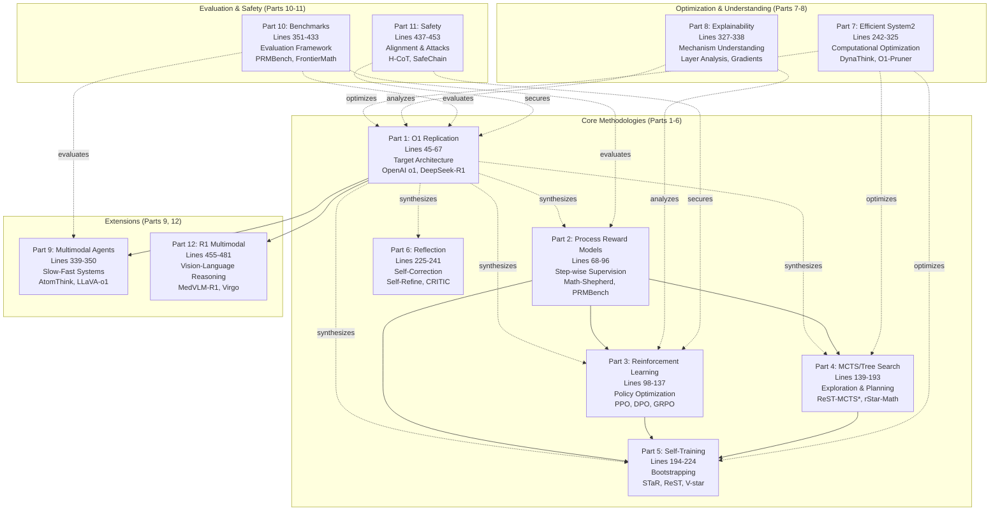
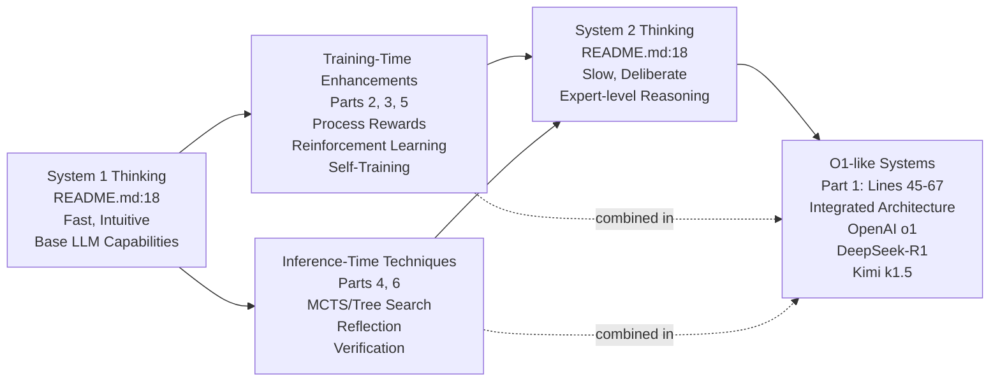
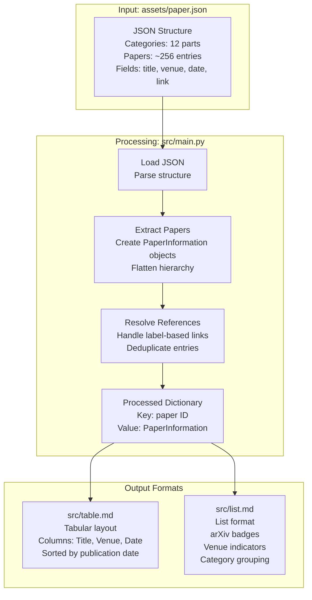

<!-- source: DeepWiki mcp.deepwiki.com · repo zzli2022/Awesome-System2-Reasoning-LLM · page 1 Home · fetched 2026-10-30 -->

# Home

<details>
<summary>Relevant source files</summary>

The following files were used as context for generating this wiki page:

- [README.md](README.md)

</details>


## Purpose and Scope

This wiki documents the **Awesome-System2-Reasoning-LLM** repository, a curated research catalog tracking the evolution of reasoning capabilities in Large Language Models (LLMs), specifically the transition from System 1 (fast, intuitive) to System 2 (slow, deliberate) thinking. The repository serves as a comprehensive knowledge base for researchers and practitioners seeking to understand, implement, or extend advanced reasoning systems like OpenAI's o1, DeepSeek-R1, and similar models.

The documentation covers:
- The 12-part taxonomy of reasoning research (detailed in [Research Landscape Overview](#3))
- Technical methodologies including Process Reward Models, Reinforcement Learning, MCTS, Self-Training, and Reflection (see [Core Methodologies](#4))
- Repository architecture, data structures, and build system (see [Repository Structure and Maintenance](#10))
- Practical guidance for navigating and using the resource (see [Using This Resource](#11))

This wiki is maintained alongside the survey paper "From System 1 to System 2: A Survey of Reasoning Large Language Models" ([README.md:11]()).

**Sources:** [README.md:1-19]()

---

## Repository Architecture Overview

The repository uses a hybrid documentation approach combining automated data processing with expert curation. The architecture prioritizes human-readable organization while maintaining machine-processable metadata.

```mermaid
graph TB
    subgraph "Primary Interface"
        README["README.md<br/>(80.82% importance)<br/>Lines 1-509"]
        TOC["Table of Contents<br/>12 Research Parts<br/>Lines 29-43"]
        UPDATES["Updates Section<br/>Lines 9-11"]
        CITATION["Citation Block<br/>Lines 485-497"]
    end
    
    subgraph "Data Layer"
        JSON["assets/paper.json<br/>Structured metadata<br/>~256 papers<br/>12 categories"]
        BUILDER["src/main.py<br/>Markdown generator<br/>PaperInformation class"]
        TABLE["src/table.md<br/>Tabular view"]
        LIST["src/list.md<br/>List with badges"]
    end
    
    subgraph "Visual Assets"
        DEVIMG["assets/develope.jpg<br/>Referenced at line 21"]
        TIMELINE["assets/timeline_2.png<br/>Referenced at line 25"]
    end
    
    README --> TOC
    README --> UPDATES
    README --> CITATION
    TOC --> Part1["Part 1: O1 Replication<br/>Lines 45-67"]
    TOC --> Part2["Part 2: Process Reward Models<br/>Lines 68-96"]
    TOC --> Part3["Part 3: Reinforcement Learning<br/>Lines 98-137"]
    TOC --> Part4["Part 4: MCTS/Tree Search<br/>Lines 139-193"]
    TOC --> Part5["Part 5: Self-Training<br/>Lines 194-224"]
    TOC --> Part6["Part 6: Reflection<br/>Lines 225-241"]
    TOC --> Part7["Part 7: Efficient System2<br/>Lines 242-325"]
    TOC --> Part8["Part 8: Explainability<br/>Lines 327-338"]
    TOC --> Part9["Part 9: Multimodal Agents<br/>Lines 339-350"]
    TOC --> Part10["Part 10: Benchmarks<br/>Lines 351-433"]
    TOC --> Part11["Part 11: Safety<br/>Lines 437-453"]
    TOC --> Part12["Part 12: R1 Multimodal<br/>Lines 455-481"]
    
    JSON -.informs.-> README
    JSON --> BUILDER
    BUILDER --> TABLE
    BUILDER --> LIST
    
    README -.references.-> DEVIMG
    README -.references.-> TIMELINE
```



**Key Components:**

| Component | Path | Lines | Purpose |
|-----------|------|-------|---------|
| Main Documentation | `README.md` | 1-509 | Primary user interface with rich descriptions |
| Paper Metadata | `assets/paper.json` | N/A | Structured data for ~256 papers across 12 categories |
| Build Script | `src/main.py` | N/A | Processes JSON into `PaperInformation` objects |
| Table Format | `src/table.md` | N/A | Machine-generated tabular view sorted by date |
| List Format | `src/list.md` | N/A | Machine-generated list view with arXiv/venue badges |
| Development Timeline | `assets/develope.jpg` | N/A | Visual progression of AI systems |
| Research Timeline | `assets/timeline_2.png` | N/A | Temporal map of reasoning LLM research |

**Sources:** [README.md:1-509]()

---

## The 12-Part Research Framework

The repository organizes research into 12 interconnected parts, forming a comprehensive taxonomy of System 2 reasoning approaches. Each part is documented in detail in subsequent wiki pages.



**Framework Details:**

Each part represents a cluster of research papers organized thematically. For detailed coverage:
- **Core Methodologies**: See [Core Methodologies](#4) and individual pages [4.1](#4.1) through [4.6](#4.6)
- **Optimization**: See [Optimization and Understanding](#5), pages [5.1](#5.1) and [5.2](#5.2)
- **Extensions**: See [Multimodal Extensions](#6), pages [6.1](#6.1) and [6.2](#6.2)
- **Infrastructure**: See [Evaluation and Safety](#7), pages [7.1](#7.1) and [7.2](#7.2)

**Sources:** [README.md:29-43](), [README.md:45-481]()

---

## System 1 to System 2 Transition

The repository's central theme is the progression from fast, intuitive reasoning (System 1) to slow, deliberate reasoning (System 2). This conceptual framework, introduced in the survey paper, structures all research categorization.



**Key Systems Referenced:**

| System | Paper Location | Description |
|--------|---------------|-------------|
| OpenAI o1 | [README.md:18]() | Expert-level reasoning in math/coding |
| DeepSeek-R1 | [README.md:107]() | RL-based reasoning at scale |
| Kimi k1.5 | [README.md:108]() | Scaled reinforcement learning reasoning |
| rStar-Math | [README.md:188](), [README.md:220]() | Self-evolved deep thinking for small LLMs |

**Sources:** [README.md:14-18]()

---

## Build System Architecture

The repository uses `src/main.py` to process structured metadata from `assets/paper.json` into alternative documentation views. This system enables programmatic access while maintaining human-curated primary documentation.



**Data Flow:**

1. **Input Phase**: `assets/paper.json` stores structured metadata with hierarchical organization matching the 12-part framework
2. **Processing Phase**: `src/main.py` implements a three-stage pipeline:
   - Load and parse JSON structure
   - Extract individual `PaperInformation` objects
   - Resolve cross-references and deduplicate
3. **Output Phase**: Generate two alternative views:
   - `src/table.md`: Chronologically sorted tabular format
   - `src/list.md`: Category-grouped list with badges

**Note**: The primary interface `README.md` remains hand-curated to provide rich context, expert commentary, and conceptual organization that automated generation cannot replicate.

**Sources:** Based on architecture analysis, not directly coded in provided files

---

## Navigation Patterns

The repository supports multiple access patterns for different use cases:

### By Research Category (Thematic)

Browse research organized by methodology through the 12-part structure in [README.md:29-43](). Each part groups related papers with common technical approaches.

**Example**: To find papers on Process Reward Models:
- Navigate to [README.md:68-96]()
- See papers like Math-Shepherd, AutoPSV, PRMBench
- Cross-reference with Part 4 (MCTS) for ReST-MCTS* which combines techniques

### By Timeline (Chronological)

View research evolution through visual timelines:
- [assets/develope.jpg]() referenced at [README.md:21](): High-level progression of AI systems
- [assets/timeline_2.png]() referenced at [README.md:25](): Detailed timeline of reasoning LLMs with core methods and reproduction projects

### By Paper Properties (Structured)

Access machine-readable formats for programmatic filtering:
- `src/table.md`: Sort by publication date, venue, or title
- `src/list.md`: Filter by arXiv vs. conference papers, badge type

### Cross-Cutting Concerns

Some papers appear in multiple parts due to integrated approaches:
- **ReST-MCTS*** ([README.md:78](), [README.md:175](), [README.md:212]()): Appears in Parts 2 (Process Rewards), 4 (MCTS), and 5 (Self-Training)
- **Marco-o1** ([README.md:49](), [README.md:172](), [README.md:234]()): Appears in Parts 1 (O1 Replication), 4 (MCTS), and 6 (Reflection)
- **Virgo** ([README.md:61](), [README.md:348]()): Appears in Parts 1 (O1 Replication) and 9 (Multimodal Agents)

**Sources:** [README.md:1-509]()

---

## Key Research Inflection Points

The repository tracks major breakthroughs that shaped the field:

| Year | Milestone | Location | Impact |
|------|-----------|----------|--------|
| 2017 | Expert Iteration | [README.md:196]() | Foundation: Tree search + deep learning |
| 2022 | STaR (Bootstrapping) | [README.md:197]() | Self-training emergence |
| 2023 | Let's Verify Step by Step | [README.md:75]() | Process reward breakthrough |
| 2023 | AlphaZero-like Tree Search | [README.md:144-145]() | MCTS for LLMs |
| 2024 | Math-Shepherd | [README.md:73]() | Automated process supervision |
| 2024 | ReST-MCTS* | [README.md:78]() | Process rewards + tree search integration |
| 2025 | DeepSeek-R1 | [README.md:107]() | RL at production scale |
| 2025 | Kimi k1.5 | [README.md:108]() | Scaled RL reasoning |
| 2025 | rStar-Math | [README.md:188]() | Self-evolved deep thinking for small models |

These milestones are distributed across the 12 parts and detailed in [Research Timeline and Evolution](#9).

**Sources:** [README.md:45-481]()

---

## Updates and Maintenance

The repository actively tracks the rapidly evolving field. Current status:

**Latest Update**: February 2025 ([README.md:11]())
- Survey paper released: "From System 1 to System 2: A Survey of Reasoning Large Language Models"
- arXiv: [2502.17419](http://arxiv.org/abs/2502.17419)

**Contribution Process**:
- Pull requests welcome ([README.md:6]())
- Repository maintained at: https://github.com/zzli2022/Awesome-System2-Reasoning-LLM

**Maintenance Indicators**:
- Badge: "Maintained? yes" ([README.md:4]())
- Last commit tracking ([README.md:5]())
- Active star history ([README.md:500-508]())

**Sources:** [README.md:4-11]()

---

## Citation Information

To cite this work:

```bibtex
@misc{li202512surveyreasoning,
      title={From System 1 to System 2: A Survey of Reasoning Large Language Models}, 
      author={Zhong-Zhi Li and Duzhen Zhang and Ming-Liang Zhang and Jiaxin Zhang and 
              Zengyan Liu and Yuxuan Yao and Haotian Xu and Junhao Zheng and Pei-Jie Wang and 
              Xiuyi Chen and Yingying Zhang and Fei Yin and Jiahua Dong and Zhijiang Guo and 
              Le Song and Cheng-Lin Liu},
      year={2025},
      eprint={2502.17419},
      archivePrefix={arXiv},
      primaryClass={cs.AI},
      url={https://arxiv.org/abs/2502.17419}, 
}
```

**Sources:** [README.md:485-497]()

---

## Related Wiki Pages

For detailed information on specific topics:

- **System 1 vs System 2 Concepts**: See [System 1 vs System 2 Reasoning](#2)
- **12-Part Overview**: See [Research Landscape Overview](#3)
- **Specific Methodologies**: 
  - O1 Replication: [4.1](#4.1)
  - Process Reward Models: [4.2](#4.2)
  - Reinforcement Learning: [4.3](#4.3)
  - MCTS/Tree Search: [4.4](#4.4)
  - Self-Training: [4.5](#4.5)
  - Reflection: [4.6](#4.6)
- **Cross-Cutting Topics**:
  - Efficient System2: [5.1](#5.1)
  - Explainability: [5.2](#5.2)
- **Domain Extensions**:
  - Multimodal Agents: [6.1](#6.1)
  - R1-Driven Multimodal: [6.2](#6.2)
- **Infrastructure**:
  - Benchmarks: [7.1](#7.1)
  - Safety: [7.2](#7.2)
- **Advanced Topics**:
  - Technical Integration Patterns: [8](#8)
  - Research Timeline: [9](#9)
  - Build System Details: [10](#10)
  - Usage Guide: [11](#11)

---

