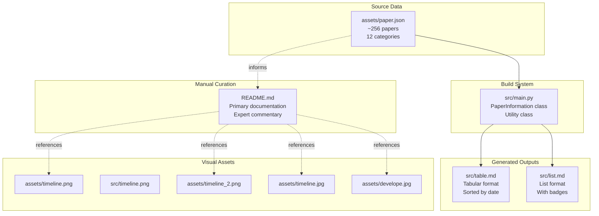
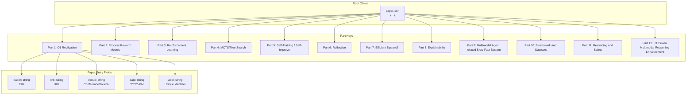
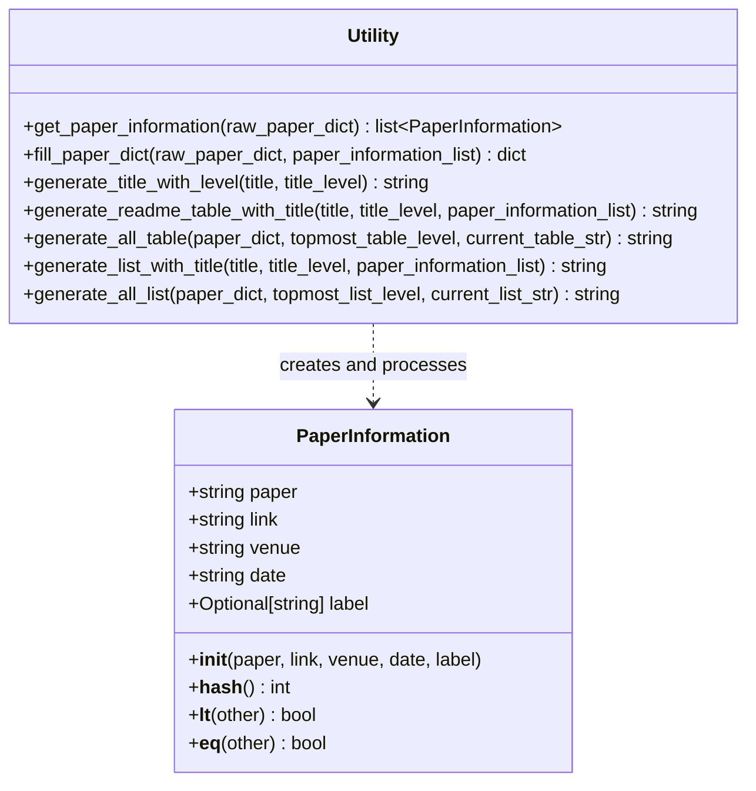
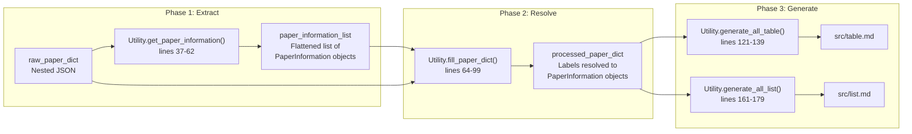

<!-- source: DeepWiki mcp.deepwiki.com · repo zzli2022/Awesome-System2-Reasoning-LLM · page 10 Repository Structure and Maintenance · fetched 2026-10-30 -->

# Repository Structure and Maintenance

<details>
<summary>Relevant source files</summary>

The following files were used as context for generating this wiki page:

- [README.md](README.md)
- [assets/paper.json](assets/paper.json)
- [src/list.md](src/list.md)
- [src/main.py](src/main.py)
- [src/table.md](src/table.md)

</details>


This document describes the technical infrastructure of the Awesome-System2-Reasoning-LLM repository, focusing on how research papers are stored, processed, and presented. It covers the data schema ([assets/paper.json]()), the automated build pipeline ([src/main.py]()), and the generation of alternative documentation formats. For information about the research content itself, see [Research Landscape Overview](#3).

## Repository Architecture

The repository uses a **hybrid documentation strategy** that combines manual curation with automated generation. The primary interface is the hand-crafted [README.md:1-416](), while auxiliary formats are generated programmatically from a structured data source.

### File Organization



**Sources:** [README.md:1-416](), [assets/paper.json:1-848](), [src/main.py:1-198]()

### Maintenance Strategy

| Component | Update Method | Frequency | Complexity |
|-----------|---------------|-----------|------------|
| `assets/paper.json` | Manual editing | Per new paper | Low |
| `src/table.md` | Automated via `main.py` | On demand | None |
| `src/list.md` | Automated via `main.py` | On demand | None |
| `README.md` | Manual curation | Varies | High |
| Timeline images | Manual creation | Periodic | Medium |

**Sources:** [src/main.py:182-197](), [README.md:1-416]()

## Data Layer: assets/paper.json

The [assets/paper.json:1-848]() file is the authoritative source of paper metadata. It uses a hierarchical JSON structure organized by the 12 research parts.

### Schema Structure



**Sources:** [assets/paper.json:1-848]()

### Paper Entry Format

Each paper entry in `paper.json` follows this structure:

```json
{
    "paper": "DeepSeek-R1: Incentivizing Reasoning Capability in LLMs via Reinforcement Learning",
    "link": "https://arxiv.org/abs/2501.12948",
    "venue": "arXiv",
    "date": "2025-01",
    "label": "luong2025deepseekr1"
}
```

**Field Specifications:**

| Field | Type | Required | Description |
|-------|------|----------|-------------|
| `paper` | string | Yes | Full paper title |
| `link` | string | Yes | URL to paper (arXiv, ACL Anthology, etc.) |
| `venue` | string | Yes | Publication venue (arXiv, NeurIPS, ACL, etc.) |
| `date` | string | Yes | Publication date in `YYYY-MM` format |
| `label` | string | Yes* | Unique identifier for deduplication |

*The `label` field is technically optional but required for papers that appear in multiple categories. See "Label-Based References" below.

**Sources:** [assets/paper.json:176-181](), [src/main.py:6-14]()

### Label-Based References

To avoid duplication when papers belong to multiple categories, the JSON supports label references:

```json
{
    "Part 1: O1 Replication": [
        {
            "paper": "Marco-o1: Towards Open Reasoning Models for Open-Ended Solutions",
            "link": "https://arxiv.org/abs/2411.14405",
            "venue": "arXiv",
            "date": "2024-11",
            "label": "zhao2024marco"
        }
    ],
    "Part 4: MCTS/Tree Search": [
        {
            "label": "zhao2024marco"
        }
    ],
    "Part 6: Reflection": [
        {
            "label": "zhao2024marco"
        }
    ]
}
```

This mechanism allows a paper to be defined once with full metadata, then referenced by label in other categories.

**Sources:** [assets/paper.json:18-23](), [assets/paper.json:297-301](), [src/main.py:76-87]()

## Build System: src/main.py

The [src/main.py:1-198]() script processes `paper.json` through a three-phase pipeline implemented in the `Utility` class.

### Class Architecture



**Sources:** [src/main.py:6-33](), [src/main.py:35-180]()

### Processing Pipeline

The build process consists of three phases:



**Sources:** [src/main.py:182-197]()

### Phase 1: Paper Extraction

The `get_paper_information()` method recursively traverses the JSON structure to extract all paper entries:

**Method:** [src/main.py:36-62]()

**Algorithm:**
1. Recursively descend into nested dictionaries
2. For list values, iterate over paper entries
3. Skip label-only references (handled in Phase 2)
4. Create `PaperInformation` objects for complete entries
5. Return flattened list of all papers

**Deduplication:** The method uses `assert` statements to ensure that papers without labels are not duplicated in the list:

```python
assert (
    paper_label is not None
    or paper_information not in paper_information_list
)
```

**Sources:** [src/main.py:55-58]()

### Phase 2: Label Resolution

The `fill_paper_dict()` method resolves label references to actual `PaperInformation` objects:

**Method:** [src/main.py:64-99]()

**Algorithm:**
1. Recursively rebuild the dictionary structure
2. For label-only entries, look up the corresponding `PaperInformation` from the flattened list
3. Replace label references with actual objects
4. Preserve the original hierarchical structure

**Label Lookup Logic:**

```python
paper_label = raw_paper_information["label"]
for paper_information in paper_information_list:
    if paper_information.label == paper_label:
        break
else:
    raise ValueError(f"Paper label not found: {paper_label}")
```

**Sources:** [src/main.py:81-86]()

### Phase 3: Output Generation

Two generation methods produce the output files:

#### Table Format Generation

**Method:** [src/main.py:121-139]()

**Structure:**
- Markdown tables with columns: Title | Venue | Date
- Hierarchical section headers using `#` depth based on `topmost_table_level`
- Papers sorted by date (most recent first) via `PaperInformation.__lt__()` [src/main.py:19-29]()

**Example output:** [src/table.md:10-27]()

#### List Format Generation

**Method:** [src/main.py:161-179]()

**Features:**
- Bullet list format
- Dynamic badge generation based on venue type
- arXiv papers get red badges: `arXiv-YYYY.MM`
- Conference papers get blue badges: `VENUE-YYYY`

**Badge Logic:**

```python
badge_color = "blue"
if "arxiv" in paper_information.link.lower():
    badge_color = "red"
    badge_text = f"arXiv-{paper_information.date.replace('-', '.')}"
else:
    venue = paper_information.venue.replace(" ", "_")
    year = paper_information.date.split("-")[0]
    badge_text = f"{venue}-{year}"
```

**Sources:** [src/main.py:147-154]()

### PaperInformation Class

The `PaperInformation` class represents a single paper entry:

**Definition:** [src/main.py:6-33]()

**Key Methods:**

| Method | Purpose | Implementation |
|--------|---------|----------------|
| `__hash__()` | Enable set operations | Returns `self.label` |
| `__eq__()` | Deduplication | Compares `label` fields |
| `__lt__()` | Sorting | Reverse chronological by date, then by venue/title |

**Sorting Logic:**

The `__lt__()` method implements a custom sort order:
1. **Primary:** Date (most recent first) - reverse chronological
2. **Secondary:** Venue (ascending alphabetical)
3. **Tertiary:** Title (ascending alphabetical)

**Sources:** [src/main.py:19-29]()

## Output Formats

### src/table.md

The [src/table.md:1-149]() file presents papers in a tabular format organized by the 12 research parts.

**Structure:**
```
## Part N: Category Name
|Title|Venue|Date|
|:---|:---|:---|
|[Paper Title](URL)|Venue|YYYY-MM|
...
```

**Use Cases:**
- Quick scanning of papers by category
- Finding papers by publication venue
- Identifying temporal clusters of research

**Generation:** Automatically generated by running `python src/main.py` [src/main.py:188-190]()

**Sources:** [src/table.md:1-149](), [src/main.py:121-139]()

### src/list.md

The [src/list.md:1-129]() file presents papers in a bullet list format with colored badges.

**Structure:**
```
## Part N: Category Name
* Paper Title [[Paper]](URL) 
...
```

**Badge Colors:**
- 🔴 Red: arXiv preprints
- 🔵 Blue: Conference/journal publications

**Use Cases:**
- Compact browsing experience
- Visual distinction between preprints and published work
- Integration with GitHub markdown rendering

**Generation:** Automatically generated by running `python src/main.py` [src/main.py:191-193]()

**Sources:** [src/list.md:1-129](), [src/main.py:161-179]()

## Maintenance Workflows

### Adding a New Paper

To add a paper to the repository:

**Step 1: Edit paper.json**

Add the paper entry to the appropriate category in [assets/paper.json]():

```json
{
    "paper": "Full Paper Title",
    "link": "https://arxiv.org/abs/XXXX.XXXXX",
    "venue": "arXiv",
    "date": "2025-04",
    "label": "firstauthor2025keyword"
}
```

**Label Convention:** `{firstauthor}{year}{keyword}` (all lowercase)

**Step 2: Add Cross-References (if applicable)**

If the paper belongs to multiple categories, add label-only references:

```json
{
    "Part X: Another Category": [
        {
            "label": "firstauthor2025keyword"
        }
    ]
}
```

**Step 3: Regenerate Auxiliary Files**

Run the build script:

```bash
python src/main.py
```

This updates [src/table.md]() and [src/list.md]().

**Step 4: Update README.md (optional)**

Manually add the paper to [README.md]() with contextual description if desired. The README follows a richer format with inline badges and commentary:

```markdown
* Paper Title [[Paper]](URL) 
```

**Sources:** [assets/paper.json:1-848](), [src/main.py:182-197]()

### Running the Build System

The build system has no external dependencies beyond Python's standard library.

**Requirements:**
- Python 3.7+ (for type hints)
- No third-party packages required

**Execution:**

```bash
cd /path/to/repository
python src/main.py
```

**Output:**
- Overwrites [src/table.md]()
- Overwrites [src/list.md]()
- Does not modify [assets/paper.json]() or [README.md]()

**Sources:** [src/main.py:196-197]()

### Version Control Strategy

The repository tracks all files, including generated ones:

| File Type | Tracked | Regenerated | Human-Edited |
|-----------|---------|-------------|--------------|
| `paper.json` | ✅ | ❌ | ✅ |
| `table.md` | ✅ | ✅ | ❌ |
| `list.md` | ✅ | ✅ | ❌ |
| `README.md` | ✅ | ❌ | ✅ |

**Rationale for tracking generated files:**
- Provides immediate visibility of changes in pull requests
- Ensures consistency between data source and outputs
- Enables diff-based review of additions/changes

**Sources:** Repository structure analysis

## Design Rationale

### Why Hybrid Documentation?

The repository uses **manual curation** for `README.md` but **automated generation** for auxiliary formats:

| Aspect | Manual (README) | Automated (table/list) |
|--------|-----------------|------------------------|
| **Content Richness** | High - contextual descriptions, groupings | Low - structured metadata only |
| **Maintenance Cost** | High - requires expert knowledge | Low - script handles updates |
| **Flexibility** | High - custom organization, emphasis | Low - fixed templates |
| **Consistency** | Variable - human judgment | High - algorithmic sorting |
| **Primary vs Secondary** | Primary user interface | Alternative views |

The `README.md` (80.82% importance) remains hand-crafted because:
1. It provides expert commentary on research trends
2. It groups papers thematically beyond the 12 parts
3. It includes visual timeline assets
4. It maintains an introduction and citation information

The generated formats serve complementary purposes:
- **table.md:** Machine-readable, sortable reference
- **list.md:** Compact format for quick browsing

**Sources:** [README.md:1-416](), High-level system architecture analysis

### Why Label-Based References?

The label-based reference system solves the **multi-category paper problem**:

**Problem:** Many papers contribute to multiple research areas. For example:
- `Marco-o1` appears in Parts 1, 4, and 6
- `ReST-MCTS*` appears in Parts 2, 4, and 5
- `HuatuoGPT-o1` appears in Parts 1, 4, and 6

**Without labels:** Metadata would be duplicated across categories, creating maintenance burden and inconsistency risk.

**With labels:** Define once, reference everywhere:

```json
{
    "Part 1": [
        {"paper": "...", "link": "...", "label": "zhao2024marco"}
    ],
    "Part 4": [
        {"label": "zhao2024marco"}
    ]
}
```

**Benefits:**
- Single source of truth for metadata
- Easier updates (change once, propagates everywhere)
- Explicit modeling of paper relationships
- Deduplication in generated outputs

**Sources:** [assets/paper.json:18-23](), [src/main.py:76-87]()

### Why Python Script Over Build Tool?

The repository uses a simple Python script rather than a build system (Make, npm, etc.):

**Advantages:**
- Zero dependencies beyond Python standard library
- Cross-platform compatibility (Windows, Linux, macOS)
- Readable implementation (198 lines of Python)
- No configuration files needed
- Easy to extend with custom logic

**Trade-offs:**
- Manual execution required (no automatic rebuild on file change)
- No incremental build optimization (full regeneration each run)

For this use case, the trade-offs are acceptable because:
- Papers are added infrequently (not real-time)
- Full regeneration is fast (<1 second)
- Simplicity reduces maintenance burden

**Sources:** [src/main.py:1-198]()

## File Path Reference Guide

Quick reference for key repository files:

| File | Purpose | Type |
|------|---------|------|
| [README.md:1-416]() | Primary documentation with expert commentary | Manual |
| [assets/paper.json:1-848]() | Structured paper metadata (12 categories, ~256 papers) | Manual |
| [src/main.py:1-198]() | Build script for generating auxiliary formats | Code |
| [src/table.md:1-149]() | Tabular format of all papers | Generated |
| [src/list.md:1-129]() | List format with badges | Generated |
| [assets/timeline.png]() | Visual timeline of research evolution | Manual |
| [assets/timeline_2.png]() | Recent timeline of reasoning LLMs | Manual |
| [assets/develope.jpg]() | AI systems progression diagram | Manual |

**Sources:** Repository file structure analysis

---

