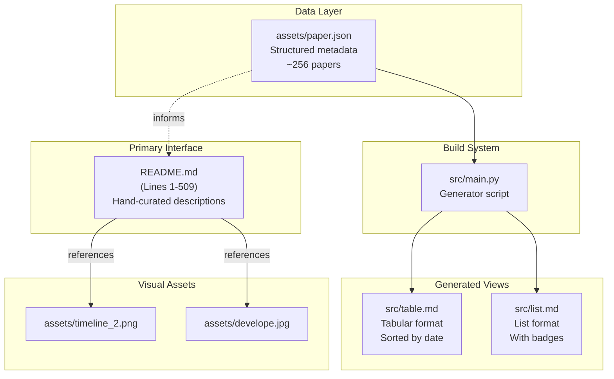
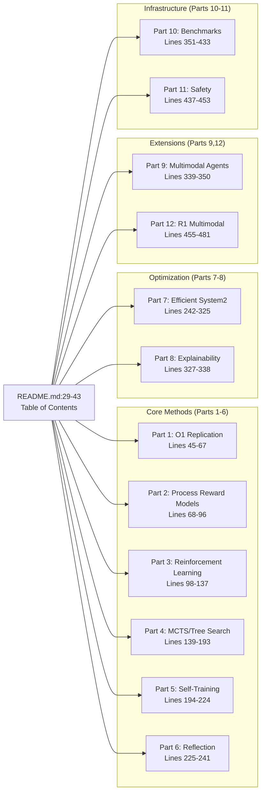
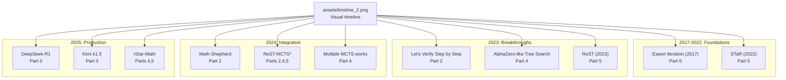
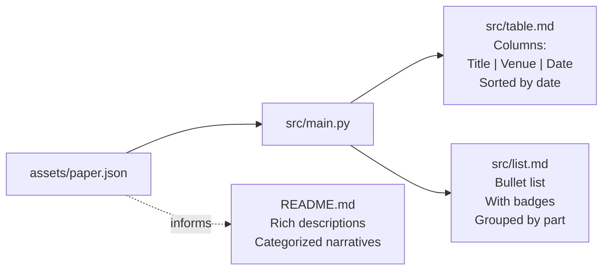
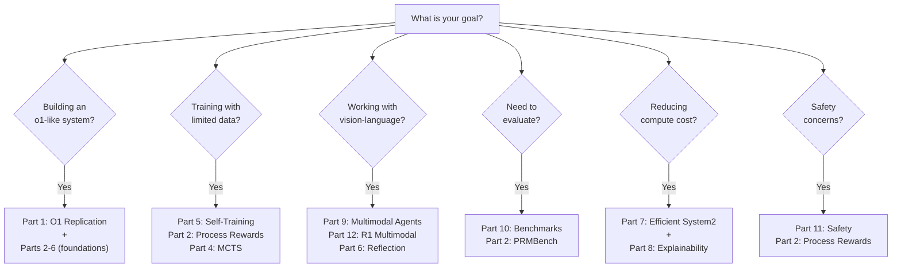
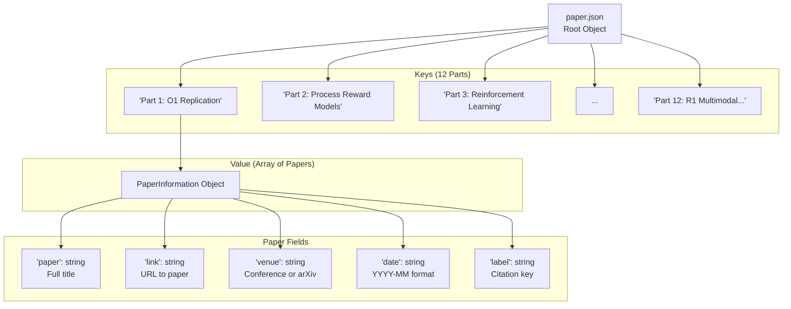
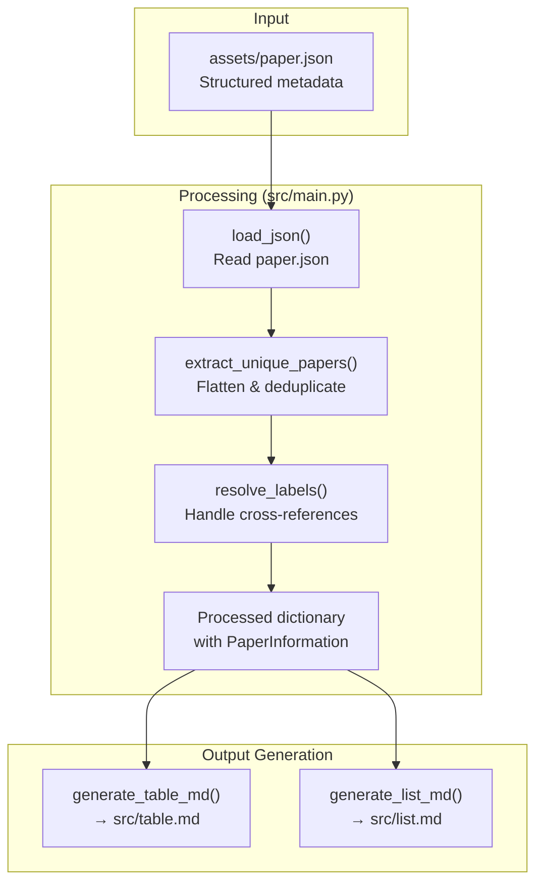
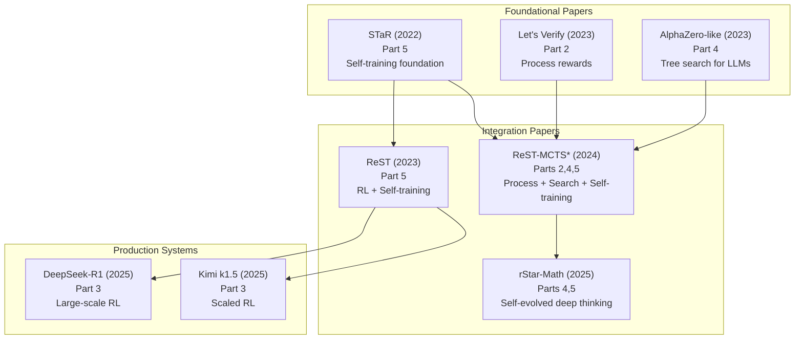
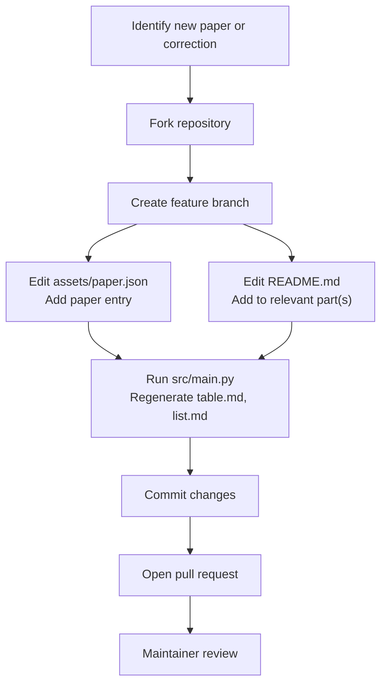

<!-- source: DeepWiki mcp.deepwiki.com · repo zzli2022/Awesome-System2-Reasoning-LLM · page 11 Using This Resource · fetched 2026-10-30 -->

# Using This Resource

<details>
<summary>Relevant source files</summary>

The following files were used as context for generating this wiki page:

- [README.md](README.md)
- [assets/paper.json](assets/paper.json)

</details>


This document provides practical guidance for researchers and practitioners on navigating the Awesome-System2-Reasoning-LLM repository, finding relevant papers for specific use cases, understanding the data structure, and contributing updates.

For an overview of the research landscape and the 12-part taxonomy, see [Research Landscape Overview](#3). For technical details on specific methodologies, see [Core Methodologies](#4).

## Purpose and Scope

This guide covers:
- **Navigation strategies** for finding papers by topic, timeline, or venue
- **Use case mapping** to identify which research parts address your specific problems
- **Data structure** (`paper.json`) and how to work with it
- **Build system** for generating alternative views
- **Contribution workflow** for adding new papers or corrections

---

## Repository Structure and Entry Points

The repository provides multiple interfaces for accessing the same underlying paper collection, optimized for different exploration strategies.

### Primary Files



**Sources:** [README.md:1-509](), [assets/paper.json:1-848](), [src/main.py]()

---

## Navigation Methods

### Method 1: Thematic Navigation via 12 Research Parts

The primary navigation path is through the 12 research parts defined in the README table of contents.



**How to use:** Scan [README.md:29-43]() to identify which parts align with your research interests, then jump directly to the corresponding section.

**Sources:** [README.md:29-43](), [README.md:45-481]()

---

### Method 2: Chronological Navigation via Timeline

For understanding the field's evolution, use the timeline images and chronological ordering.



**How to use:** Reference [assets/timeline_2.png]() for a visual overview. Papers in each part are generally ordered chronologically within their sections.

**Sources:** [README.md:25-26](), [assets/timeline_2.png]()

---

### Method 3: Venue-Based Filtering

Papers are tagged with venue badges for filtering by publication type.

| Badge Color | Venue Type | Example |
|------------|------------|---------|
|  | Preprints | Most recent work |
|  | Conference | Peer-reviewed |
|  | Conference | NLP-focused |
|  | Conference | ML/representation learning |
|  | Blog posts | Technical reports |
|  | Code repos | Implementation-focused |

**How to use:** In [README.md](), scan for badge colors. Blue badges indicate peer-reviewed conference papers, red badges indicate preprints or technical reports.

**Sources:** [README.md:47-481]()

---

### Method 4: Alternative Views

For different presentation formats, use the generated views.



**When to use each:**
- **README.md**: Primary interface with context and descriptions
- **src/table.md**: Quick scanning by date or venue
- **src/list.md**: Compact view for reference
- **assets/paper.json**: Programmatic access or custom filtering

**Sources:** [src/main.py](), [assets/paper.json:1-848]()

---

## Finding Papers for Your Use Case

Map your research problem to the relevant parts using this decision tree.



### Use Case Examples

| Problem | Recommended Parts | Key Papers |
|---------|------------------|------------|
| **Reproduce o1 capabilities** | Parts 1, 2, 3, 4 | DeepSeek-R1, ReST-MCTS*, Kimi k1.5 |
| **Improve math reasoning** | Parts 2, 4, 5 | Math-Shepherd, rStar-Math, ReST-MCTS* |
| **Enable self-improvement** | Parts 5, 6 | STaR, V-star, Self-Refine |
| **Add vision understanding** | Parts 9, 12 | LLaVA-o1, Virgo, AtomThink |
| **Reduce inference cost** | Part 7 | DynaThink, O1-Pruner, Token-Budget-Aware |
| **Verify reasoning steps** | Part 2 | Let's Verify Step by Step, AutoPSV, PRMBench |
| **Test reasoning robustness** | Parts 10, 11 | MR-Ben, PRMBench, SafeChain |

**Sources:** [README.md:45-481]()

---

## Understanding the Data Structure

### paper.json Schema

The repository's source data is stored in [assets/paper.json:1-848]() with the following structure:



**Example entry:**

```json
{
    "paper": "DeepSeek-R1: Incentivizing Reasoning Capability in LLMs via Reinforcement Learning",
    "link": "https://arxiv.org/abs/2501.12948",
    "venue": "arXiv",
    "date": "2025-01",
    "label": "luong2025deepseekr1"
}
```

**Sources:** [assets/paper.json:1-848]()

---

### Programmatic Access Pattern

To extract papers by part or filter by criteria:

```python
# Pseudocode for accessing paper.json
import json

# Load data
with open('assets/paper.json') as f:
    data = json.load(f)

# Access specific part
o1_papers = data["Part 1: O1 Replication"]

# Filter by date
recent_papers = [p for p in o1_papers if p["date"] >= "2025-01"]

# Filter by venue
conference_papers = [p for p in o1_papers if p["venue"] != "arXiv"]
```

**Sources:** [assets/paper.json:1-848]()

---

## Build System and Generation Pipeline

The repository uses [src/main.py]() to generate alternative views from [assets/paper.json]().



### Key Functions

| Function | Purpose | Output |
|----------|---------|--------|
| `load_json()` | Parse `paper.json` into Python dict | Dictionary of parts → paper arrays |
| `extract_unique_papers()` | Flatten and remove duplicates | Single list of unique papers |
| `resolve_labels()` | Expand label references | Papers with full metadata |
| `generate_table_md()` | Create sorted table view | `src/table.md` |
| `generate_list_md()` | Create categorized list | `src/list.md` |

**Sources:** [src/main.py](), [assets/paper.json:1-848]()

---

### Label Reference System

Papers can appear in multiple parts via the `label` field. When a paper is referenced again, only the label is needed:

```json
{
    "Part 2: Process Reward Models": [
        {
            "paper": "ReST-MCTS*: LLM Self-Training via Process Reward Guided Tree Search",
            "link": "https://arxiv.org/abs/2406.03816",
            "venue": "NeurIPS",
            "date": "2024-12",
            "label": "zhang2024restmcts"
        }
    ],
    "Part 4: MCTS/Tree Search": [
        {
            "label": "zhang2024restmcts"
        }
    ],
    "Part 5: Self-Training / Self-Improve": [
        {
            "label": "zhang2024restmcts"
        }
    ]
}
```

The build system resolves these references to avoid duplication in the JSON file.

**Sources:** [assets/paper.json:55-60](), [assets/paper.json:409-414](), [assets/paper.json:571-577]()

---

## Understanding Paper Relationships

Papers in this repository often build on or combine techniques from multiple parts.



### Multi-Part Papers

Papers appearing in multiple parts indicate integration of techniques:

| Paper | Parts | Integrates |
|-------|-------|------------|
| **ReST-MCTS*** | 2, 4, 5 | Process Rewards + MCTS + Self-Training |
| **HuatuoGPT-o1** | 1, 4, 6 | O1 Replication + MCTS + Reflection |
| **Marco-o1** | 1, 4, 6 | O1 Replication + MCTS + Reflection |
| **rStar-Math** | 4, 5, 6 | MCTS + Self-Training + Reflection |
| **ReFT** | 3, 5 | RL + Self-Training |
| **Mulberry** | 4, 6 | MCTS + Reflection (multimodal) |

**How to find related papers:** Search for the same paper title across multiple parts in [README.md](), or check the `label` field in [assets/paper.json]().

**Sources:** [README.md:45-481](), [assets/paper.json:1-848]()

---

## Contributing Updates

### Contribution Workflow



**Sources:** [README.md:6]()

---

### Adding a New Paper

1. **Choose the appropriate part(s):** Refer to the 12-part taxonomy in [README.md:29-43]()

2. **Add entry to paper.json:**

```json
{
    "Part X: Category Name": [
        {
            "paper": "Paper Title: Subtitle",
            "link": "https://arxiv.org/abs/XXXX.XXXXX",
            "venue": "arXiv",
            "date": "YYYY-MM",
            "label": "firstauthor2025keyword"
        }
    ]
}
```

3. **Add entry to README.md:**

```markdown
* Paper Title: Subtitle [[Paper]](https://arxiv.org/abs/XXXX.XXXXX) 
```

4. **For multi-part papers:** Add full entry in primary part, use `label` reference in other parts:

```json
{
    "Part Y: Another Category": [
        {
            "label": "firstauthor2025keyword"
        }
    ]
}
```

5. **Regenerate views:** Run `python src/main.py` (if applicable)

6. **Submit pull request** with descriptive title

**Sources:** [README.md:6](), [assets/paper.json:1-848]()

---

### Reporting Issues

For corrections, missing papers, or categorization suggestions:

1. **Check existing issues** to avoid duplicates
2. **Open a GitHub issue** with:
   - Paper title and link (for additions)
   - Current vs. proposed categorization (for changes)
   - Rationale for the change
3. **Tag appropriately:** `addition`, `correction`, `enhancement`

**Sources:** [README.md:6]()

---

## Citation Information

If using this resource in academic work, cite the survey paper:

```bibtex
@misc{li202512surveyreasoning,
      title={From System 1 to System 2: A Survey of Reasoning Large Language Models}, 
      author={Zhong-Zhi Li and Duzhen Zhang and Ming-Liang Zhang and Jiaxin Zhang and Zengyan Liu and Yuxuan Yao and Haotian Xu and Junhao Zheng and Pei-Jie Wang and Xiuyi Chen and Yingying Zhang and Fei Yin and Jiahua Dong and Zhijiang Guo and Le Song and Cheng-Lin Liu},
      year={2025},
      eprint={2502.17419},
      archivePrefix={arXiv},
      primaryClass={cs.AI},
      url={https://arxiv.org/abs/2502.17419}, 
}
```

**Sources:** [README.md:485-497]()

---

## Quick Reference Table

| Task | File | Lines | Purpose |
|------|------|-------|---------|
| Browse by topic | `README.md` | 29-481 | Hand-curated descriptions |
| Browse by date | `src/table.md` | All | Chronologically sorted |
| Access structured data | `assets/paper.json` | 1-848 | Programmatic access |
| Regenerate views | `src/main.py` | All | Build system |
| View timeline | `assets/timeline_2.png` | N/A | Visual evolution |
| Submit updates | GitHub PR | N/A | Contribution workflow |

**Sources:** [README.md:1-509](), [assets/paper.json:1-848](), [src/main.py]()