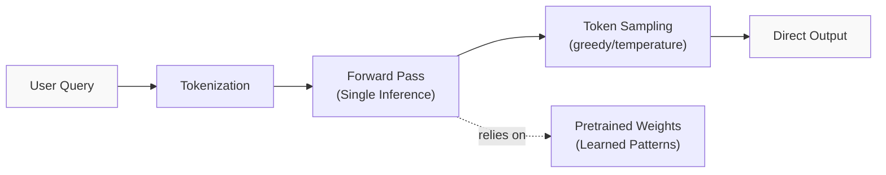
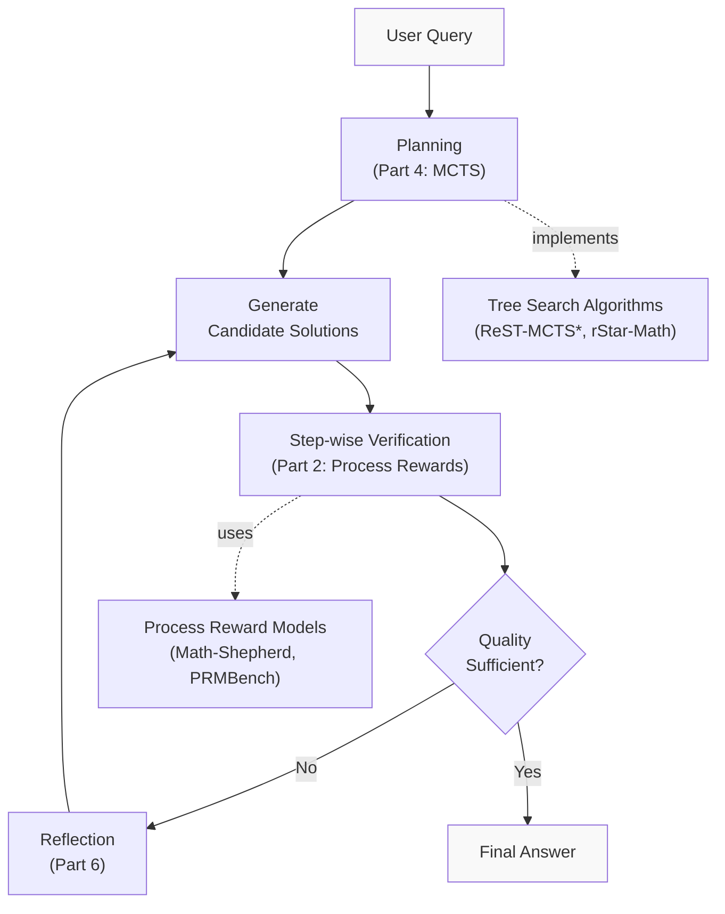
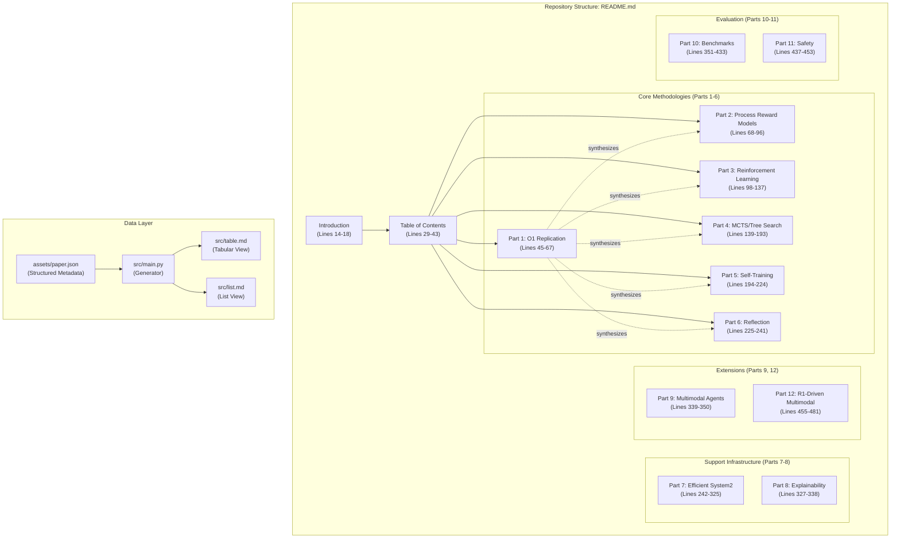
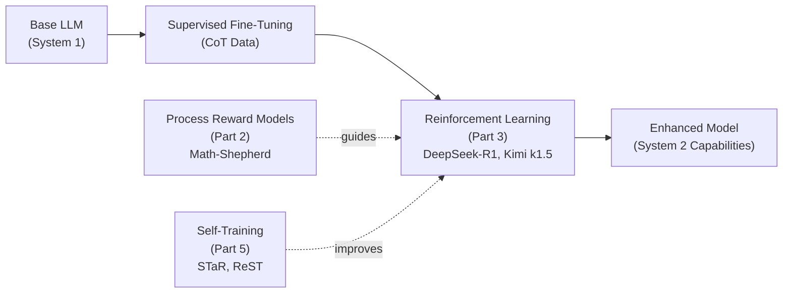
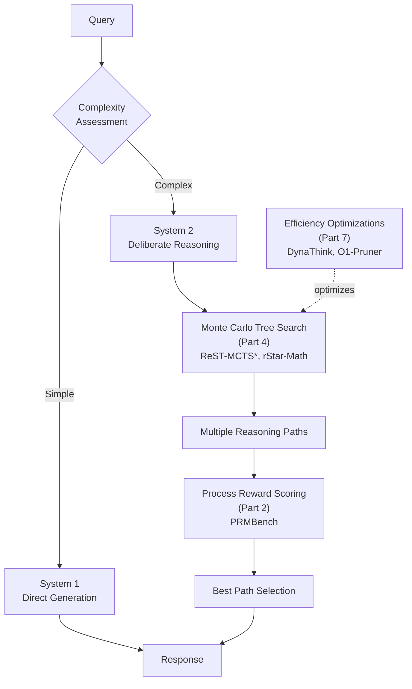
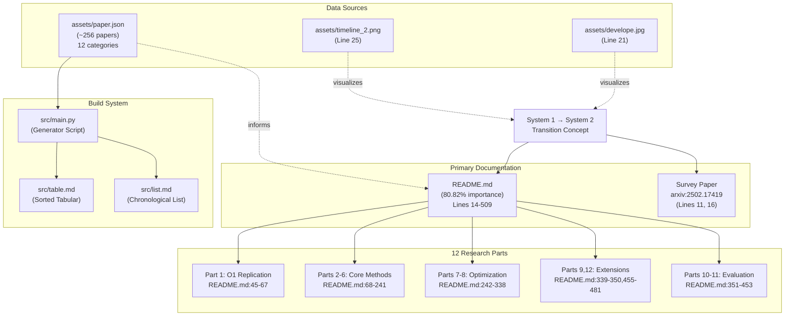
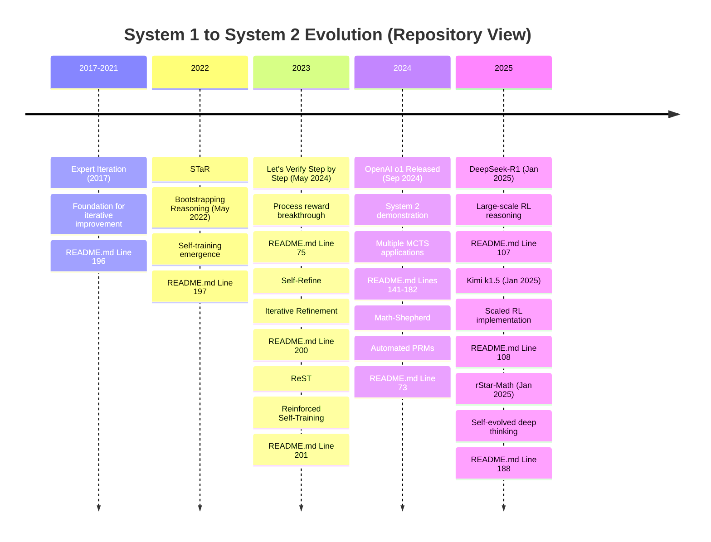

<!-- source: DeepWiki mcp.deepwiki.com · repo zzli2022/Awesome-System2-Reasoning-LLM · page 2 System 1 vs System 2 Reasoning · fetched 2026-10-30 -->

# System 1 vs System 2 Reasoning

Relevant source files

The following files were used as context for generating this wiki page:

- [README.md](README.md)
- [src/list.md](src/list.md)

## Purpose and Scope

This page explains the fundamental distinction between System 1 (fast, intuitive) and System 2 (slow, deliberate) reasoning in the context of Large Language Models. It defines the theoretical foundation that organizes all research tracked in this repository and clarifies what it means for an LLM to transition from instinctive pattern matching to deliberate multi-step reasoning.

For detailed coverage of the 12 research methodologies that enable this transition, see [Research Landscape Overview](#3). For specific techniques like MCTS, process rewards, and reinforcement learning, see [Core Methodologies](#4).

**Sources:** [README.md:14-18]()

---

## Dual-Process Theory Background

The System 1 / System 2 framework originates from cognitive psychology (Kahneman's "Thinking, Fast and Slow") and describes two modes of human cognition:

| Aspect | System 1 | System 2 |
|--------|----------|----------|
| **Speed** | Fast, automatic | Slow, effortful |
| **Control** | Unconscious, instinctive | Conscious, deliberate |
| **Capacity** | Parallel processing | Sequential processing |
| **Error Rate** | Higher (relies on heuristics) | Lower (systematic reasoning) |
| **Examples** | Pattern recognition, intuition | Mathematical proofs, planning |

In LLMs, this distinction maps to:
- **System 1**: Standard autoregressive generation, single-pass inference
- **System 2**: Multi-step reasoning with verification, tree search, reflection

**Sources:** [README.md:18]()

---

## System 1 Characteristics in LLMs

### Diagram: System 1 Generation Pipeline

### Technical Properties

System 1 reasoning in LLMs manifests through:

1. **Autoregressive Generation**: Sequential token prediction without lookahead
   - Standard `next_token = model(context)` inference
   - No backtracking or revision mechanisms
   - Output determined by learned probability distributions

2. **Single-Pass Processing**: 
   - One forward pass through the network
   - No intermediate verification steps
   - Fast but error-prone on complex tasks

3. **Pattern Matching**:
   - Relies on memorized templates from pretraining/fine-tuning
   - Strong on familiar task distributions
   - Struggles with novel combinations or multi-step logic

4. **Implicit Reasoning**:
   - Chain-of-thought may be present but not systematically verified
   - Reasoning happens "in the weights" rather than explicit computation

### Repository Coverage

The baseline System 1 capabilities are implicit in all papers as the starting point. Explicit discussions appear in:
- **Part 8: Explainability** - comparing fast vs slow thinking [README.md:328-338]()
- Papers like "What Happened in LLMs Layers when Trained for Fast vs. Slow Thinking" [README.md:331]()

**Sources:** [README.md:14-18](), [README.md:328-338]()

---

## System 2 Characteristics in LLMs

### Diagram: System 2 Reasoning Pipeline

### Technical Properties

System 2 reasoning introduces:

1. **Multi-Step Deliberation**:
   - Explicit intermediate reasoning steps
   - Visible chain-of-thought traces
   - Examples: OpenAI o1, DeepSeek-R1 [README.md:107-108]()

2. **Search and Exploration**:
   - Tree search over reasoning paths (MCTS, beam search)
   - Evaluation of multiple candidate solutions
   - Implementations: [README.md:139-193]() (Part 4: MCTS/Tree Search)

3. **Process Supervision**:
   - Step-by-step verification of reasoning
   - Process Reward Models that score intermediate steps
   - Key papers: Math-Shepherd, PRMBench [README.md:73-81]()

4. **Self-Correction**:
   - Ability to detect and fix errors
   - Reflection mechanisms
   - Coverage: [README.md:225-241]() (Part 6: Reflection)

5. **Reinforcement Learning**:
   - Training models to optimize reasoning processes
   - Policy optimization for multi-step tasks
   - Major systems: DeepSeek-R1, Kimi k1.5 [README.md:107-108]()

**Sources:** [README.md:45-67](), [README.md:68-96](), [README.md:98-137](), [README.md:139-193](), [README.md:194-224](), [README.md:225-241]()

---

## The Transition Problem

### Why LLMs Need System 2

Standard LLMs excel at System 1 tasks (text completion, pattern recognition) but struggle with:

| Task Type | System 1 Performance | System 2 Requirement |
|-----------|---------------------|---------------------|
| **Mathematical Olympiad** | Inconsistent, pattern-dependent | Multi-step proof construction |
| **Code Generation (Complex)** | Syntax correct, logic flawed | Systematic planning and verification |
| **Scientific Reasoning** | Surface-level explanations | Deep causal understanding |
| **Long-Horizon Planning** | Myopic decisions | Lookahead and backtracking |

The repository documents that "foundational Large Language Models (LLMs) have made significant strides, they still fall short of human-like reasoning in complex tasks" [README.md:18]().

### Diagram: Transition Architecture in Repository

### Key Insight

**Part 1: O1 Replication** [README.md:45-67]() represents the aspirational target - systems that successfully combine all other techniques to achieve expert-level System 2 reasoning. Papers in this section attempt to reproduce or extend OpenAI's o1 model, which demonstrated breakthrough performance on mathematical reasoning and coding tasks.

**Sources:** [README.md:14-26](), [README.md:45-67]()

---

## Training-Time vs Inference-Time Strategies

The repository organizes System 2 research into two complementary approaches:

### Training-Time Enhancement

These techniques modify the model's learned behavior:

**Key Papers:**
- **DeepSeek-R1**: "Incentivizing Reasoning Capability in LLMs via Reinforcement Learning" [README.md:107]()
- **Kimi k1.5**: "Scaling Reinforcement Learning with LLMs" [README.md:108]()
- **Math-Shepherd**: Automated process supervision [README.md:73]()
- **STaR**: Bootstrapping reasoning with reasoning [README.md:197]()

### Inference-Time Augmentation

These techniques enhance reasoning without retraining:

**Key Papers:**
- **ReST-MCTS***: LLM self-training via process reward guided tree search [README.md:78, 175]()
- **rStar-Math**: Self-evolved deep thinking [README.md:188]()
- **DynaThink**: Dynamic decision-making framework [README.md:246]()
- **O1-Pruner**: Length-harmonizing fine-tuning [README.md:254]()

**Sources:** [README.md:98-137](), [README.md:139-193](), [README.md:242-325]()

---

## Comparative Analysis Table

| Dimension | System 1 (Base LLMs) | System 2 (Reasoning LLMs) | Repository Coverage |
|-----------|---------------------|--------------------------|---------------------|
| **Inference Cost** | O(n) tokens | O(n × k) with k rollouts | Part 7: Efficient System2 [README.md:242-325]() |
| **Training Approach** | Supervised fine-tuning | RL + Process supervision | Part 3 [README.md:98-137](), Part 2 [README.md:68-96]() |
| **Error Detection** | None | Step-wise verification | Part 2: PRMBench [README.md:81]() |
| **Self-Correction** | Limited | Reflection mechanisms | Part 6 [README.md:225-241]() |
| **Search Strategy** | Greedy decoding | Tree search (MCTS, beam) | Part 4 [README.md:139-193]() |
| **Benchmark Tasks** | MMLU, HellaSwag | MATH, FrontierMath, Olympiad | Part 10 [README.md:351-433]() |
| **Safety Concerns** | Standard alignment | Deliberative alignment, jailbreaks | Part 11 [README.md:437-453]() |
| **Multimodal Extension** | Vision-language understanding | Visual reasoning with CoT | Part 9 [README.md:339-350](), Part 12 [README.md:455-481]() |

**Sources:** [README.md:29-43]()

---

## Repository Organization Around System 1/2 Concept

### Diagram: Conceptual Map to File Structure

### File-Level Mapping

1. **Introduction and Motivation**: [README.md:14-26]()
   - Defines System 1 vs System 2 distinction
   - References survey paper as comprehensive treatment

2. **Methodological Organization**: [README.md:29-43]()
   - Table of contents organizing research into 12 parts
   - Each part addresses specific aspect of System 1→2 transition

3. **Data Infrastructure**: 
   - `assets/paper.json`: Structured metadata for research papers
   - `src/main.py`: Processes JSON into alternative views
   - `src/table.md`, `src/list.md`: Auto-generated reference formats

4. **Visual Context**:
   - `assets/timeline_2.png`: Historical progression of reasoning LLMs [README.md:25-26]()
   - `assets/develope.jpg`: Conceptual evolution diagram [README.md:21-23]()

**Sources:** [README.md:1-509](), [src/main.py](), [assets/paper.json](), [src/list.md:1-129]()

---

## Key Research Milestones in System 1→2 Evolution

### Timeline of Breakthrough Papers

### Citation Network

Papers frequently appear in multiple parts, indicating integration of techniques:

| Paper | Parts | Significance |
|-------|-------|--------------|
| **ReST-MCTS*** [README.md:78, 175, 212]() | Part 2, 4, 5 | Combines process rewards, tree search, self-training |
| **Math-Shepherd** [README.md:73]() | Part 2 | Automated process supervision without human labels |
| **DeepSeek-R1** [README.md:107]() | Part 3 | Largest-scale RL-based reasoning model |
| **Marco-o1** [README.md:49, 172, 234]() | Part 1, 4, 6 | Open reasoning with MCTS and reflection |
| **HuatuoGPT-o1** [README.md:53, 177, 237]() | Part 1, 4, 6 | Medical domain System 2 reasoning |

**Sources:** [README.md:45-509]()

---

## Practical Implications for Researchers

### Using This Repository to Navigate System 1→2 Research

**If you want to understand:**

1. **What makes o1 special** → Start with [Part 1: O1 Replication](#4.1)
   - Papers attempting to reproduce/extend o1 [README.md:45-67]()
   
2. **How to train reasoning models** → Focus on [Part 3: Reinforcement Learning](#4.3)
   - DeepSeek-R1, Kimi k1.5 as reference implementations [README.md:98-137]()
   
3. **How to verify reasoning steps** → Examine [Part 2: Process Reward Models](#4.2)
   - Math-Shepherd, PRMBench [README.md:68-96]()
   
4. **How to enable inference-time reasoning** → Study [Part 4: MCTS/Tree Search](#4.4)
   - ReST-MCTS*, rStar-Math [README.md:139-193]()
   
5. **How to make it efficient** → Review [Part 7: Efficient System2](#5.1)
   - DynaThink, O1-Pruner [README.md:242-325]()

### Evaluation Strategy

For assessing System 2 capabilities:

- **Mathematical Reasoning**: FrontierMath, MATH benchmarks [README.md:355, 410]()
- **Meta-Reasoning**: MR-Ben [README.md:356]()
- **Process-Level**: PRMBench [README.md:81, 365]()
- **Safety**: H-CoT jailbreak analysis [README.md:447]()

**Sources:** [README.md:351-433]()

---

## Relationship to Other Wiki Pages

This page provides the conceptual foundation. For detailed technical coverage:

- **[Research Landscape Overview](#3)**: How the 12 parts interconnect
- **[Core Methodologies](#4)**: Deep dive into Parts 1-6
  - **[O1 Replication](#4.1)**: Target architecture
  - **[Process Reward Models](#4.2)**: Step-wise supervision
  - **[Reinforcement Learning](#4.3)**: Training strategies
  - **[MCTS and Tree Search](#4.4)**: Search algorithms
  - **[Self-Training](#4.5)**: Bootstrapping methods
  - **[Reflection](#4.6)**: Self-correction mechanisms
- **[Optimization and Understanding](#5)**: Making System 2 practical
- **[Multimodal Extensions](#6)**: Beyond text reasoning
- **[Evaluation and Safety](#7)**: Assessment and risks
- **[Repository Structure](#10)**: How documentation is maintained

**Sources:** [README.md:29-43]()

---

## Summary

The System 1 vs System 2 framework is the organizing principle for this entire repository:

- **System 1**: Fast, pattern-matching LLMs (baseline autoregressive generation)
- **System 2**: Slow, deliberate reasoning (multi-step verification, search, reflection)
- **Transition**: Achieved through combinations of:
  - Reinforcement learning for reasoning capabilities
  - Process reward models for step-wise supervision
  - Tree search for exploration
  - Self-training for bootstrapping
  - Reflection for error correction

The repository tracks ~256 papers across 12 research parts, with files structured as:
- `README.md`: Primary curated documentation (80.82% importance)
- `assets/paper.json`: Structured metadata
- `src/main.py`: Generation pipeline
- `src/table.md`, `src/list.md`: Alternative views

**Part 1: O1 Replication** represents the synthesis target where all techniques converge to achieve expert-level reasoning comparable to OpenAI's o1 or DeepSeek-R1.

**Sources:** [README.md:1-509]()

---

