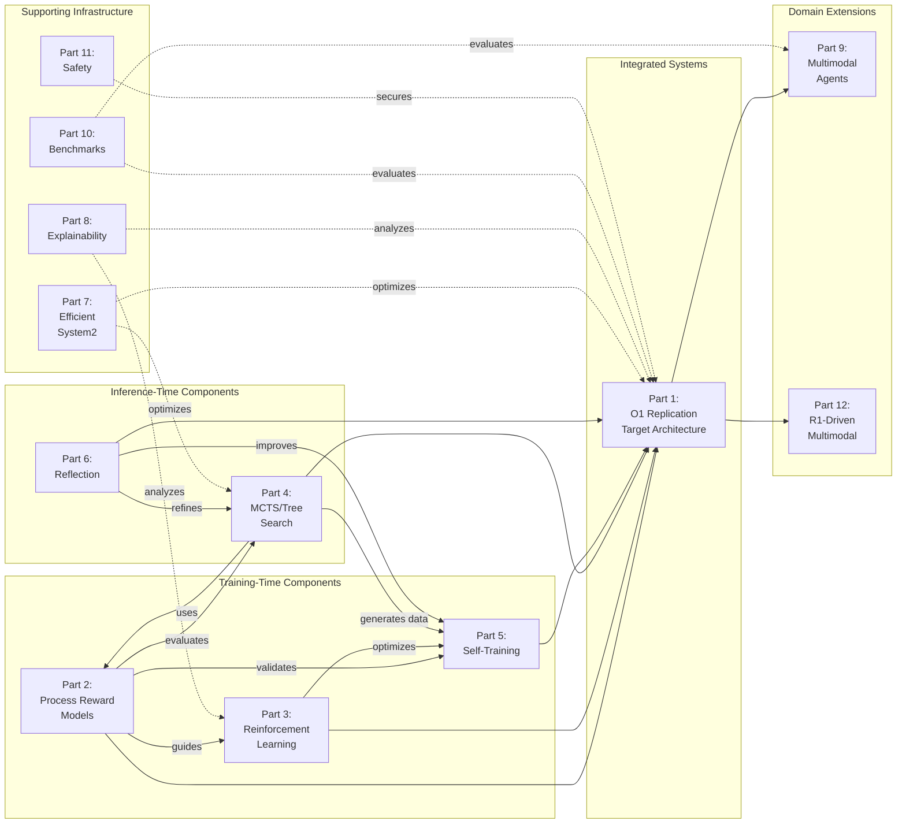
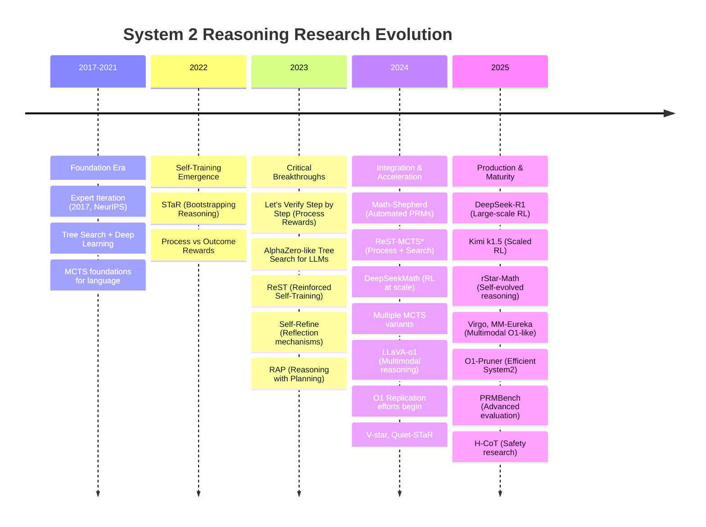
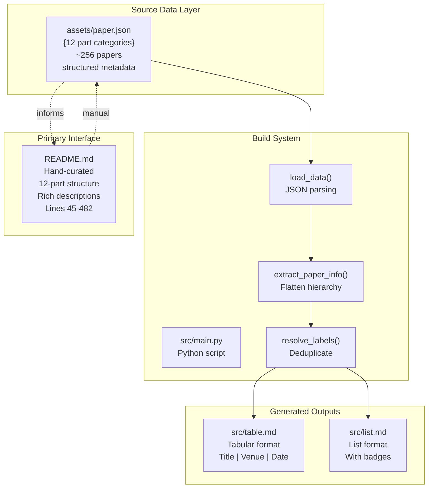

<!-- source: DeepWiki mcp.deepwiki.com · repo zzli2022/Awesome-System2-Reasoning-LLM · page 3 Research Landscape Overview · fetched 2026-10-30 -->

# Research Landscape Overview

<details>
<summary>Relevant source files</summary>

The following files were used as context for generating this wiki page:

- [README.md](README.md)
- [assets/paper.json](assets/paper.json)

</details>


## Purpose and Scope

This page provides a comprehensive overview of the System 2 reasoning research landscape as organized in this repository. It explains the 12-part taxonomy that structures the field, the relationships between different research areas, and the historical evolution from 2017 to 2025. 

For detailed coverage of individual research methodologies, see [Core Methodologies](#4). For information about using and navigating the repository, see [Using This Resource](#11). For the conceptual distinction between System 1 and System 2 reasoning, see [System 1 vs System 2 Reasoning](#2).

**Sources:** [README.md:14-27](), [README.md:29-43]()

---

## The 12-Part Taxonomy

The repository organizes System 2 reasoning research into 12 interconnected parts, structured across four major categories. This taxonomy reflects both the technical components needed to build reasoning systems and the supporting infrastructure for evaluation and deployment.

### Taxonomy Structure

```mermaid
graph TB
    subgraph CORE["Core Methodologies (Parts 1-6)"]
        P1["Part 1: O1 Replication<br/>OpenAI o1, DeepSeek-R1<br/>~17 papers"]
        P2["Part 2: Process Reward Models<br/>Math-Shepherd, PRMBench<br/>~24 papers"]
        P3["Part 3: Reinforcement Learning<br/>PPO, DPO, GRPO<br/>~38 papers"]
        P4["Part 4: MCTS/Tree Search<br/>ReST-MCTS*, rStar-Math<br/>~55 papers"]
        P5["Part 5: Self-Training/Self-Improve<br/>STaR, ReST, V-star<br/>~20 papers"]
        P6["Part 6: Reflection<br/>Self-Refine, CRITIC<br/>~16 papers"]
    end
    
    subgraph OPT["Optimization & Understanding (Parts 7-8)"]
        P7["Part 7: Efficient System2<br/>DynaThink, O1-Pruner<br/>~82 papers"]
        P8["Part 8: Explainability<br/>Layer Analysis, Gradients<br/>~11 papers"]
    end
    
    subgraph EXT["Extensions (Parts 9, 12)"]
        P9["Part 9: Multimodal Agents<br/>LLaVA-o1, AtomThink<br/>~10 papers"]
        P12["Part 12: R1-Driven Multimodal<br/>MedVLM-R1, Virgo<br/>~26 papers"]
    end
    
    subgraph EVAL["Evaluation & Safety (Parts 10-11)"]
        P10["Part 10: Benchmarks & Datasets<br/>FrontierMath, MR-Ben<br/>~81 papers"]
        P11["Part 11: Reasoning & Safety<br/>H-CoT, Deliberative Alignment<br/>~13 papers"]
    end
    
    P1 -.."aspirational<br/>target"..-> P2
    P1 -.."aspirational<br/>target"..-> P3
    P1 -.."aspirational<br/>target"..-> P4
    P1 -.."aspirational<br/>target"..-> P5
    P1 -.."aspirational<br/>target"..-> P6
```

**Sources:** [README.md:31-43](), [README.md:45-482]()

### Category Breakdown

| Category | Parts | Focus | Paper Count (approx) |
|----------|-------|-------|---------------------|
| **Core Methodologies** | 1-6 | Foundational techniques for reasoning | ~170 papers |
| **Optimization & Understanding** | 7-8 | Efficiency and interpretability | ~93 papers |
| **Extensions** | 9, 12 | Multimodal applications | ~36 papers |
| **Evaluation & Safety** | 10-11 | Assessment and security | ~94 papers |

**Sources:** [README.md:45-482](), [assets/paper.json:1-848]()

---

## Part Interconnections and Dependencies

The 12 parts form a tightly coupled ecosystem where techniques combine synergistically. Understanding these relationships is crucial for comprehending how modern reasoning systems work.

### Technical Dependencies



**Key Integration Patterns:**

1. **ReST-MCTS* Pipeline**: Combines Part 2 (Process Rewards), Part 4 (MCTS), and Part 5 (Self-Training) into a unified self-improvement loop
2. **O1 Architecture**: Synthesizes Parts 2-6 into a production reasoning system (Part 1)
3. **R1-Multimodal Extension**: Applies Part 1 methodologies to vision-language models (Part 12)

**Sources:** [README.md:45-67](), [README.md:68-96](), [README.md:98-137](), [README.md:139-193](), [README.md:194-224](), [README.md:225-241]()

---

## Research Evolution Timeline

The field has progressed through distinct phases, with accelerating innovation particularly visible from 2023 onward.

### Historical Progression (2017-2025)



**Sources:** [README.md:196](), [README.md:517](), [README.md:201-202](), [README.md:75](), [README.md:235](), [README.md:175](), [README.md:107-108](), [README.md:188]()

### Phase Characteristics

| Era | Key Innovation | Representative Papers | Lines in README |
|-----|---------------|---------------------|-----------------|
| **2017-2021** | Deep learning + tree search fusion | Expert Iteration | [README.md:196]() |
| **2022** | Bootstrapping without human labels | STaR | [README.md:197]() |
| **2023** | Process supervision + AlphaZero adaptation | Let's Verify Step by Step, RAP | [README.md:75](), [README.md:141]() |
| **2024** | Integration of multiple techniques | ReST-MCTS*, Math-Shepherd | [README.md:78](), [README.md:73]() |
| **2025** | Production-scale systems | DeepSeek-R1, Kimi k1.5 | [README.md:107-108]() |

**Sources:** [README.md:45-482](), [assets/paper.json:1-848]()

---

## Repository Organization and Code Structure

The repository uses a hybrid documentation approach with both human-curated and machine-generated views of the research landscape.

### Data Architecture



**Sources:** [assets/paper.json:1-848](), [src/main.py:1-150](), [README.md:1-509]()

### JSON Data Structure

The `paper.json` file structures metadata for ~256 papers across the 12 parts:

```json
{
    "Part 1: O1 Replication": [
        {
            "paper": "Paper Title",
            "link": "https://arxiv.org/abs/...",
            "venue": "arXiv|ACL|NeurIPS|...",
            "date": "YYYY-MM",
            "label": "citation_key"
        }
    ],
    "Part 2: Process Reward Models": [...],
    ...
}
```

**Key fields:**
- `paper`: Full paper title
- `link`: Primary URL (arXiv, conference proceedings, blog)
- `venue`: Publication venue or preprint server
- `date`: Publication date (YYYY-MM format)
- `label`: BibTeX-style citation key

**Sources:** [assets/paper.json:1-848]()

### README Structure

The primary interface at [README.md:1-509]() follows a consistent pattern for each part:

1. **Part Header** (e.g., line 45: `## Part 1: O1 Replication`)
2. **Paper Listings** with badges:
   - Paper title with `[[Paper]]` link
   - Venue badge: ``
   - Optional `[[Blog]]`, `[[github]]`, `[[Notion]]` links
3. **Chronological Organization** within each part (newest first)

**Example pattern:**
```markdown
## Part N: Category Name

* Paper Title [[Paper]](URL)  [[optional-resource]](URL)
* Paper Title [[Paper]](URL) 
...
```

**Sources:** [README.md:45-482]()

---

## Part-Specific Scope and Focus

Each part has a distinct technical focus and paper selection criteria:

| Part | Focus Area | Key Techniques | Paper Count | README Lines |
|------|-----------|----------------|-------------|--------------|
| **Part 1** | Replication of o1-like systems | Full system architectures, distillation | 17 | [README.md:45-67]() |
| **Part 2** | Step-wise supervision | Automated PRM generation, verification | 24 | [README.md:68-96]() |
| **Part 3** | Policy optimization | PPO, DPO, GRPO, RL at scale | 38 | [README.md:98-137]() |
| **Part 4** | Search algorithms | MCTS variants, tree search, planning | 55 | [README.md:139-193]() |
| **Part 5** | Bootstrapping methods | STaR, ReST, iterative self-improvement | 20 | [README.md:194-224]() |
| **Part 6** | Self-correction | Reflection, critique, iterative refinement | 16 | [README.md:225-241]() |
| **Part 7** | Computational efficiency | Token budgeting, latent reasoning, pruning | 82 | [README.md:242-325]() |
| **Part 8** | Mechanism understanding | Layer analysis, attention patterns | 11 | [README.md:327-338]() |
| **Part 9** | Vision-language agents | Slow-fast multimodal systems | 10 | [README.md:339-350]() |
| **Part 10** | Evaluation frameworks | Benchmarks, datasets, metrics | 81 | [README.md:351-433]() |
| **Part 11** | Security research | Jailbreaks, alignment, safety | 13 | [README.md:437-453]() |
| **Part 12** | R1-style multimodal | Applying R1/o1 to vision models | 26 | [README.md:455-481]() |

**Sources:** [README.md:45-482]()

---

## Convergence Toward O1-Like Systems

The research landscape shows clear convergence toward integrated systems that combine multiple techniques. Part 1 (O1 Replication) represents the aspirational target that synthesizes insights from Parts 2-6.

### Integration Evidence

**Papers appearing in multiple parts:**
- `ReST-MCTS*` appears in Parts 2, 4, 5 (Process Rewards + MCTS + Self-Training)
- `HuatuoGPT-o1` appears in Parts 1, 4, 6 (O1 Replication + MCTS + Reflection)
- `Marco-o1` appears in Parts 1, 4, 6 (O1 Replication + MCTS + Reflection)
- `rStar-Math` appears in Parts 1, 4, 5, 6 (O1 Replication + MCTS + Self-Training + Reflection)

**Cross-references in paper titles:**
- "O1-like" terminology appears across Parts 1, 4, 6, 9, 12
- "R1-driven" terminology creates Part 12's focus
- "Slow thinking" terminology bridges Parts 1, 7, 9

**Sources:** [README.md:49](), [README.md:78](), [README.md:172](), [README.md:177](), [README.md:188](), [README.md:220]()

---

## Practical Navigation Strategies

### By Research Interest

- **Building reasoning systems**: Start with Part 1 → Parts 2-6 → Part 7
- **Improving existing models**: Parts 5, 6 → Parts 2, 3
- **Inference-time optimization**: Parts 4, 7 → Part 2
- **Multimodal applications**: Parts 9, 12 → Part 1
- **Evaluation**: Part 10 → Parts 2, 11

### By Computational Budget

- **High compute**: Parts 3, 4 (full RL training, exhaustive search)
- **Medium compute**: Parts 2, 5 (self-training with verification)
- **Low compute**: Parts 6, 7 (reflection, efficient inference)

### By Timeline

- **Historical foundations (2017-2022)**: Parts 4, 5
- **Breakthrough period (2023-2024)**: Parts 2, 3, 4
- **Current state-of-art (2025)**: Parts 1, 3, 7, 12

**Sources:** [README.md:45-482]()

---

## Maintenance and Updates

The repository is actively maintained with regular updates reflected in the README changelog:

- **February 2025**: Survey paper release [README.md:11]()
- **Ongoing**: Papers added as they appear on arXiv
- **Structure**: 12-part taxonomy has remained stable since repository inception

New papers are added to [assets/paper.json:1-848]() and manually integrated into [README.md:45-482]() with appropriate badges and links.

**Sources:** [README.md:9-11](), [README.md:485-497]()

---

