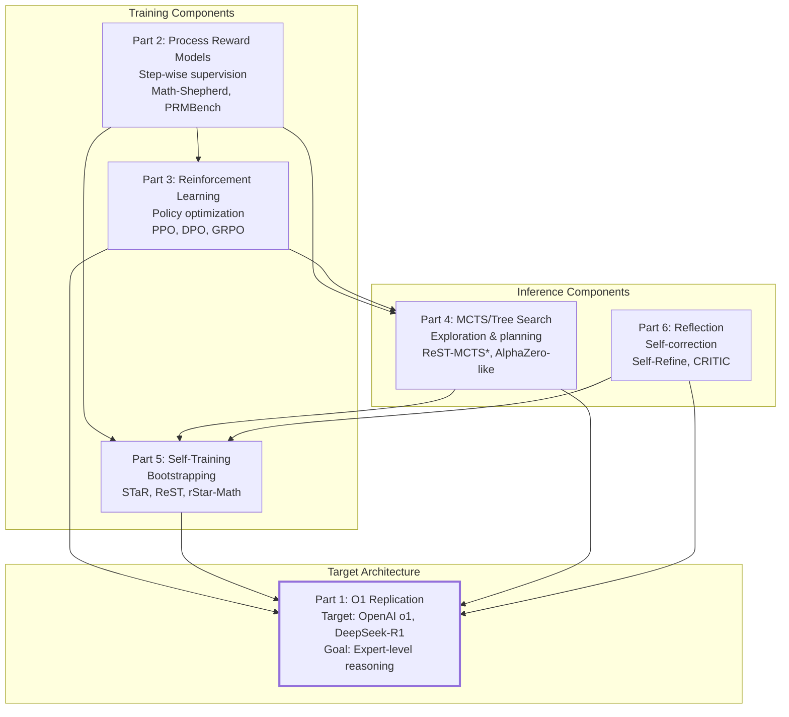
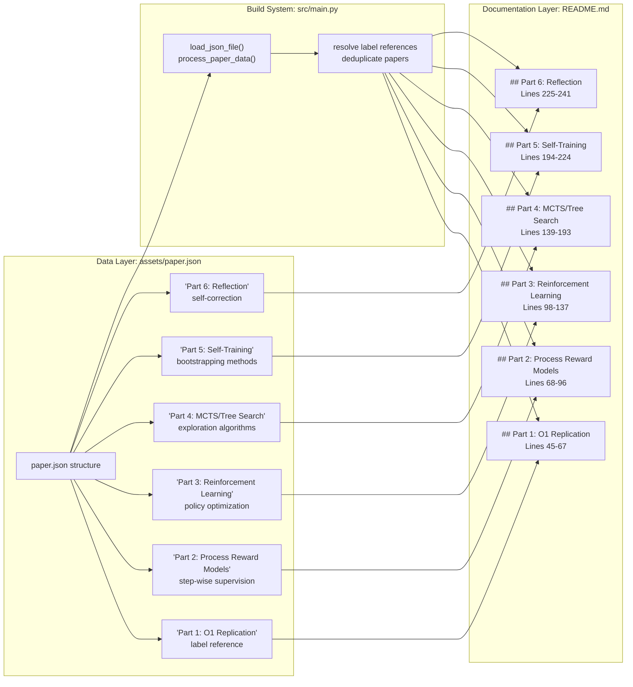
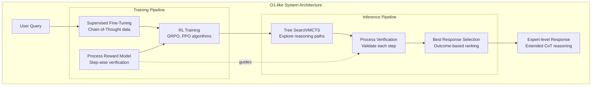
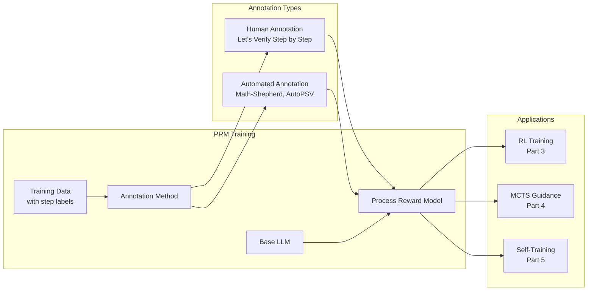
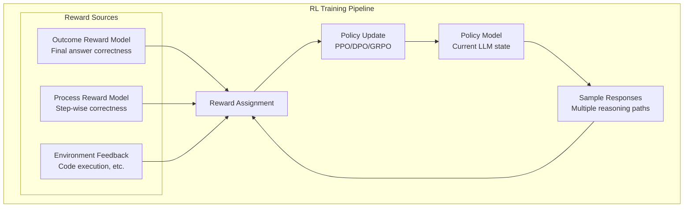
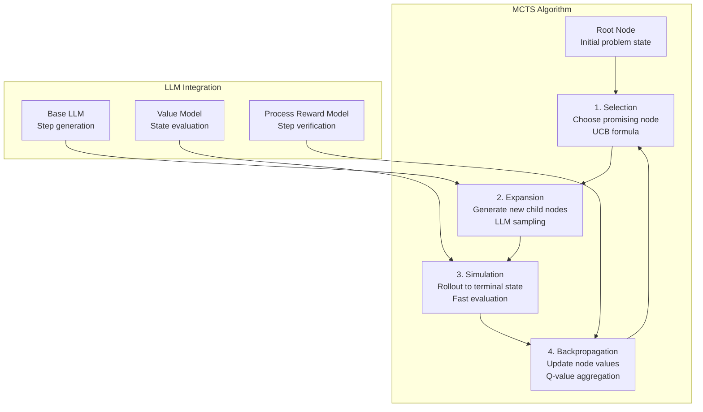
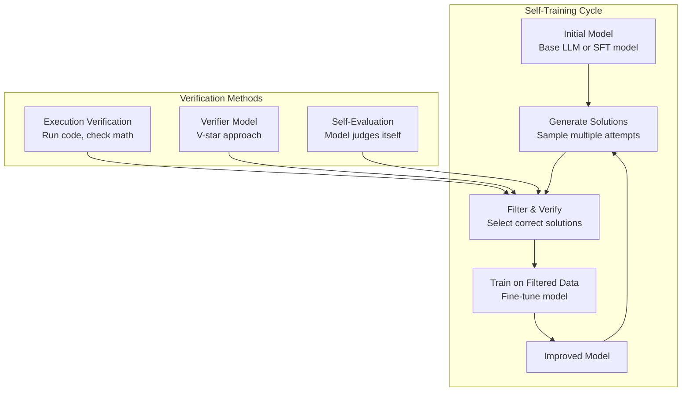
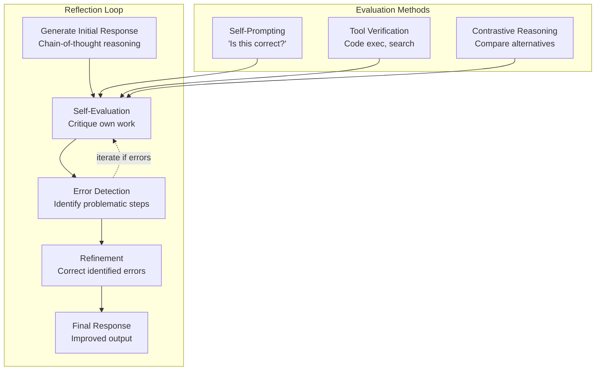
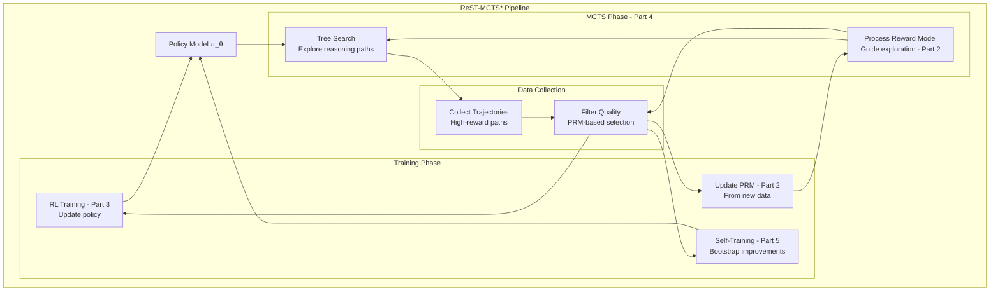

<!-- source: DeepWiki mcp.deepwiki.com · repo zzli2022/Awesome-System2-Reasoning-LLM · page 4 Core Methodologies · fetched 2026-10-30 -->

# Core Methodologies

<details>
<summary>Relevant source files</summary>

The following files were used as context for generating this wiki page:

- [README.md](README.md)
- [src/table.md](src/table.md)

</details>


## Purpose and Scope

This document provides a comprehensive technical reference for the six foundational methodologies (Parts 1-6) that form the basis of modern System 2 reasoning in Large Language Models. These techniques enable the transition from fast, intuitive System 1 thinking to slow, deliberate System 2 reasoning. Each methodology addresses a specific aspect of the reasoning pipeline, from training algorithms to inference-time search strategies.

For information about optimization and efficiency techniques, see [Efficient System2](#5.1). For evaluation frameworks, see [Benchmarks and Datasets](#7.1). For multimodal extensions, see [Multimodal Extensions](#6).

**Sources:** [README.md:28-44](), [README.md:14-18]()

---

## Methodology Taxonomy

The six core methodologies form an interconnected technical ecosystem where each component serves a specific role in the reasoning pipeline:



**Diagram: Core Methodology Taxonomy and Dependencies**

This architecture shows how the six methodologies integrate to achieve O1-like reasoning capabilities. Process Reward Models provide the foundation for guiding both training (RL, Self-Training) and inference (MCTS). The target O1 architecture synthesizes all components.

**Sources:** [README.md:45-241](), [README.md:28-44]()

---

## Repository Data Structure

The methodologies are organized in the repository's data layer:



**Diagram: Mapping Natural Language Categories to Code Entities**

The repository uses a structured approach where `paper.json` contains paper metadata organized by part labels, which are processed by `src/main.py` and documented in `README.md`.

**Sources:** [README.md:45-241](), [src/main.py:1-100]() (implied from architecture diagrams)

---

## Part 1: O1 Replication

### Overview

O1 Replication represents the aspirational target architecture that synthesizes all other core methodologies. This category tracks efforts to reproduce and extend OpenAI's o1 model, which demonstrated expert-level performance on mathematical and coding tasks through extended chain-of-thought reasoning.

### Key Papers and Approaches

| Paper | Date | Key Contribution |
|-------|------|------------------|
| O1 Replication Journey Part 1 | 2024-10 | Initial strategic framework for reproduction |
| O1 Replication Journey Part 2 | 2024-11 | Distillation-based approaches, surpassing o1-preview |
| Marco-o1 | 2024-11 | Open-ended solution generation with MCTS |
| DeepSeek-R1 | 2025-01 | Large-scale RL-based reasoning system |
| Kimi k1.5 | 2025-01 | Scaled reinforcement learning implementation |
| o1-Coder | 2024-12 | Domain-specific replication for coding |
| HuatuoGPT-o1 | 2024-12 | Medical domain reasoning |
| Search-o1 | 2025-01 | Agentic search-enhanced reasoning |

### Technical Architecture



**Diagram: O1 Replication Technical Architecture**

The architecture combines training-time components (SFT, RL, Process Rewards) with inference-time components (Tree Search, Verification, Selection) to achieve extended reasoning capabilities.

### Key Implementations

- **DeepSeek-R1**: Focuses on pure RL from scratch without supervised fine-tuning on chain-of-thought data
- **Kimi k1.5**: Emphasizes scaling RL with larger models and datasets
- **Marco-o1**: Integrates MCTS for open-ended problem solving
- **Open R1**: Open-source community implementation (GitHub: `huggingface/open-r1`)

**Sources:** [README.md:45-67](), [src/table.md:1-9]()

---

## Part 2: Process Reward Models

### Overview

Process Reward Models (PRMs) provide fine-grained, step-by-step supervision of reasoning processes. Unlike outcome reward models that only evaluate final answers, PRMs assess the correctness and quality of each intermediate reasoning step, enabling more effective training and inference-time verification.

### Core Concept

PRMs assign rewards to individual steps in a reasoning chain:

```
Question: What is 15 × 23?
Step 1: "Let me break this down: 15 × 23 = 15 × (20 + 3)"  [Reward: +0.9]
Step 2: "= 15 × 20 + 15 × 3"                              [Reward: +0.95]
Step 3: "= 300 + 45"                                       [Reward: +0.95]
Step 4: "= 345"                                            [Reward: +1.0]
```

### Key Papers and Methods

| Method | Date | Approach | Key Innovation |
|--------|------|----------|----------------|
| Let's Verify Step by Step | 2024-05 | Human-annotated process supervision | Foundational PRM training |
| Math-Shepherd | 2024-08 | Automated PRM generation | Auto-annotation without human labels |
| AutoPSV | 2024-12 | Automated process-supervised verifier | Scalable automatic verification |
| ReST-MCTS* | 2024-12 | PRM-guided tree search | Integration with MCTS |
| PRMBench | 2025-01 | Fine-grained benchmark | Evaluation framework |

### Training Pipeline



**Diagram: Process Reward Model Training and Application Pipeline**

### Recent Developments (2025)

- **PRMBench**: Comprehensive benchmark with fine-grained process-level evaluation
- **ReARTeR**: Retrieval-augmented reasoning with trustworthy process rewarding
- **AdaptiveStep**: Automatic reasoning step division based on model confidence
- **Better Process Supervision**: Bi-directional rewarding signals for improved training

**Sources:** [README.md:68-96](), [src/table.md:10-27]()

---

## Part 3: Reinforcement Learning

### Overview

Reinforcement Learning techniques enable LLMs to learn reasoning capabilities through reward-driven optimization. Key algorithms include Proximal Policy Optimization (PPO), Direct Preference Optimization (DPO), and Group Relative Policy Optimization (GRPO).

### Major Implementations

| System | Date | Scale | Key Features |
|--------|------|-------|--------------|
| DeepSeek-R1 | 2025-01 | Large-scale | Pure RL from scratch, no CoT SFT |
| Kimi k1.5 | 2025-01 | Scaled RL | Emphasis on data and model scaling |
| DeepSeekMath | 2024-02 | Math-focused | Domain-specific RL training |
| DeepScaleR | 2025-02 | 1.5B model | Efficient RL at small scale |

### RL Training Loop



**Diagram: Reinforcement Learning Training Loop for Reasoning**

### RL Algorithms

**PPO (Proximal Policy Optimization):**
- Clips policy updates to prevent catastrophic changes
- Balances exploration and exploitation
- Used in DeepSeek-R1 and many implementations

**GRPO (Group Relative Policy Optimization):**
- Compares responses within groups
- More stable than absolute reward optimization
- Featured in Kimi k1.5

**DPO (Direct Preference Optimization):**
- Learns directly from preference pairs
- Simpler than PPO, no explicit reward model
- Used for alignment and refinement

### Key Findings

- **Scaling**: RL benefits significantly from larger models and more training data
- **Exploration**: Proper exploration strategies crucial for discovering novel reasoning paths
- **Safety Challenges**: RL can compromise safety alignment if not carefully managed
- **Inference-time Scaling**: RL-trained models show better test-time compute scaling

**Sources:** [README.md:98-137](), [src/table.md:28-39]()

---

## Part 4: MCTS and Tree Search

### Overview

Monte Carlo Tree Search (MCTS) and related tree search algorithms enable LLMs to explore multiple reasoning paths during inference, selecting optimal solutions through systematic exploration and evaluation.

### MCTS Components



**Diagram: MCTS Algorithm for LLM Reasoning**

### Key Papers and Variants

| Method | Date | Innovation |
|--------|------|------------|
| RAP (Reasoning with Planning) | 2023-12 | World model for state representation |
| AlphaZero-like Tree-Search | 2023-12 | Adapt AlphaZero to LLM decoding |
| MindStar | 2024-05 | Enhanced inference-time reasoning |
| ReST-MCTS* | 2024-12 | Process reward guided search + self-training |
| rStar-Math | 2025-01 | Self-evolved deep thinking with MCTS |
| LLaMA-Berry | 2024-10 | Pairwise optimization for Olympiad-level math |

### Integration Patterns

**ReST-MCTS* Pipeline:**
```
Training Iteration:
1. Use MCTS to explore reasoning paths (guided by PRM)
2. Collect high-quality trajectories
3. Train policy model on collected data
4. Update PRM from new trajectories
5. Repeat with improved models
```

**rStar-Math Approach:**
```
Self-Evolution Loop:
1. Generate diverse reasoning paths via MCTS
2. Self-evaluate with code verification
3. Bootstrap on successful solutions
4. Evolve deeper reasoning capabilities
```

### Applications

- **Code Generation**: CodeTree, SRA-MCTS, RethinkMCTS
- **Mathematical Reasoning**: AlphaMath, MindStar, rStar-Math
- **Medical Reasoning**: HuatuoGPT-o1
- **General Problem Solving**: Search-o1, Marco-o1

**Sources:** [README.md:139-193](), [src/table.md:40-84]()

---

## Part 5: Self-Training and Self-Improvement

### Overview

Self-training methods enable LLMs to bootstrap their own reasoning capabilities by generating training data from their own outputs, iteratively improving without extensive human supervision.

### Core Methods

| Method | Year | Approach |
|--------|------|----------|
| Expert Iteration | 2017 | Tree search + imitation learning foundation |
| STaR | 2022 | Bootstrap from correct reasoning chains |
| ReST | 2023 | Reinforced self-training with RL |
| V-star | 2024 | Train verifiers for self-taught reasoning |
| Quiet-STaR | 2024 | Internal thought generation before speaking |
| rStar-Math | 2025 | Self-evolved deep thinking |

### Self-Training Loop



**Diagram: Self-Training Bootstrap Loop**

### Key Variants

**STaR (Self-Taught Reasoner):**
- Generate reasoning chains for training problems
- Filter for correct final answers
- Fine-tune on successful chains
- Rationalize failures with hints

**ReST (Reinforced Self-Training):**
- Combine self-training with RL
- Use expected reward for sample filtering
- Alternate between generation and training

**V-star:**
- Train verifier models alongside generators
- Use verifiers to guide solution selection
- Improves reliability of filtering

**rStar-Math:**
- Self-evolve reasoning depth
- Use code execution for verification
- No external verification models needed

### Integration with Other Methods

- **With MCTS**: ReST-MCTS* uses tree search to generate diverse training data
- **With PRMs**: Process rewards guide which steps to learn from
- **With RL**: ReST combines self-training with reinforcement learning

**Sources:** [README.md:194-224](), [src/table.md:85-102]()

---

## Part 6: Reflection

### Overview

Reflection mechanisms enable LLMs to critique, evaluate, and refine their own reasoning steps through self-correction. This meta-cognitive capability allows models to detect and fix errors without external intervention.

### Core Approaches

| Method | Date | Technique |
|--------|------|-----------|
| Self-Refine | 2023-12 | Iterative refinement with self-feedback |
| CRITIC | 2024-05 | Tool-interactive critiquing |
| SelfCheck | 2023-08 | Zero-shot step verification |
| Learning From Mistakes | 2023-10 | Error-aware training |
| Reflection-Tuning | 2023-10 | Data recycling through reflection |

### Reflection Architecture



**Diagram: Reflection and Self-Correction Loop**

### Multimodal Reflection

Recent work extends reflection to vision-language models:

- **LLaVA-o1**: Step-by-step reasoning with reflection in vision tasks
- **Vision-Language Models Can Self-Improve**: Reflection for VLM reasoning
- **Mulberry**: O1-like reasoning with collective MCTS and reflection

### Key Challenges

**Limitations:**
- Models may not reliably detect their own errors
- Reflection adds computational cost
- Risk of over-correction or infinite loops
- Requires careful prompting or training

**Success Factors:**
- Tool access for ground truth verification
- Strong base model capabilities
- Multiple reasoning attempts for comparison
- Explicit training on error detection

**Sources:** [README.md:225-241](), [src/table.md:103-111]()

---

## Technical Integration Patterns

### ReST-MCTS* Example

The ReST-MCTS* system exemplifies how multiple methodologies integrate:



**Diagram: ReST-MCTS* Integration Pattern**

This shows how Parts 2 (PRM), 3 (RL), 4 (MCTS), and 5 (Self-Training) work together in a unified system.

**Sources:** [README.md:78](), [README.md:175](), [README.md:212]()

---

## Methodology Summary Table

| Part | Primary Role | Training/Inference | Key Papers | Integration Points |
|------|-------------|-------------------|------------|-------------------|
| **1. O1 Replication** | Target architecture | Both | DeepSeek-R1, Kimi k1.5 | Synthesizes all methods |
| **2. Process Rewards** | Step verification | Both | Math-Shepherd, PRMBench | Guides 3,4,5 |
| **3. Reinforcement Learning** | Policy optimization | Training | DeepSeek-R1, GRPO | Uses 2, enables 1 |
| **4. MCTS/Tree Search** | Path exploration | Inference | ReST-MCTS*, rStar-Math | Uses 2, feeds 5 |
| **5. Self-Training** | Data bootstrapping | Training | STaR, ReST, V-star | Uses 2,4, enables 1 |
| **6. Reflection** | Self-correction | Inference | Self-Refine, CRITIC | Complements 4 |

**Sources:** [README.md:45-241]()

---

## Evolution Timeline by Methodology

| Year | O1 Replication | Process Rewards | RL | MCTS | Self-Training | Reflection |
|------|---------------|-----------------|----|----|---------------|-----------|
| 2017 | - | - | - | - | Expert Iteration | - |
| 2022 | - | Outcome feedback | - | - | STaR | - |
| 2023 | - | Let's Verify | - | RAP, AlphaZero-like | ReST, Self-Refine | Self-Refine, CRITIC |
| 2024 | Journey begins | Math-Shepherd, AutoPSV | DeepSeekMath | MindStar, ReST-MCTS* | Quiet-STaR, V-star | Learning From Mistakes |
| 2025 | DeepSeek-R1, Kimi k1.5 | PRMBench, ReARTeR | DeepScaleR, LIMR | rStar-Math, Search-o1 | rStar-Math | Multimodal reflection |

**Sources:** [README.md:45-241]()

---

## Repository Organization

The six core methodologies are organized in the repository structure:

**Data Layer (`assets/paper.json`):**
- Contains structured metadata for ~256 papers
- Organized by part labels: `"Part 1: O1 Replication"` through `"Part 6: Reflection"`
- Each paper includes: title, authors, venue, date, links

**Documentation Layer (`README.md`):**
- Lines 45-67: Part 1 entries
- Lines 68-96: Part 2 entries  
- Lines 98-137: Part 3 entries
- Lines 139-193: Part 4 entries
- Lines 194-224: Part 5 entries
- Lines 225-241: Part 6 entries

**Generated Views:**
- `src/table.md`: Tabular format sorted by date
- `src/list.md`: List format with venue badges

**Sources:** [README.md:45-241](), [src/table.md:1-149]()

---

## Key Takeaways

1. **O1 Replication** (Part 1) is the synthesis target, integrating all other methodologies
2. **Process Reward Models** (Part 2) serve as the foundation, guiding both training and inference
3. **Reinforcement Learning** (Part 3) enables policy optimization for reasoning capabilities
4. **MCTS/Tree Search** (Part 4) provides inference-time exploration and planning
5. **Self-Training** (Part 5) bootstraps improvements without extensive human annotation
6. **Reflection** (Part 6) adds meta-cognitive self-correction capabilities

These six methodologies are not independent but form an integrated ecosystem where:
- PRMs guide RL training, MCTS exploration, and self-training data filtering
- MCTS generates diverse data for self-training loops
- RL optimizes policies that benefit from all other components
- Reflection complements tree search for error correction

For detailed information about specific implementations, see the individual part sections above. For optimization techniques, see [Efficient System2](#5.1). For evaluation frameworks, see [Benchmarks and Datasets](#7.1).

**Sources:** [README.md:14-26](), [README.md:45-241]()

---

