<!-- source: DeepWiki mcp.deepwiki.com · repo zzli2022/Awesome-System2-Reasoning-LLM · page 4.1 O1 Replication · fetched 2026-10-30 -->

# O1 Replication

<details>
<summary>Relevant source files</summary>

The following files were used as context for generating this wiki page:

- [README.md](README.md)
- [assets/paper.json](assets/paper.json)
- [src/list.md](src/list.md)

</details>


## Purpose and Scope

This page documents **Part 1: O1 Replication** from the System 2 reasoning research taxonomy. It covers efforts to reproduce, understand, and extend OpenAI's o1 model and similar advanced reasoning systems that exhibit slow, deliberate thinking capabilities. This includes academic papers, open-source implementations, technical reports, and production-scale systems like DeepSeek-R1 and Kimi k1.5.

O1 replication represents the aspirational target that synthesizes multiple core methodologies. For information on the individual component techniques, see:
- Process Reward Models: [#4.2](#4.2)
- Reinforcement Learning: [#4.3](#4.3)
- MCTS and Tree Search: [#4.4](#4.4)
- Self-Training and Self-Improvement: [#4.5](#4.5)
- Reflection Mechanisms: [#4.6](#4.6)

For optimization techniques applied to reasoning systems, see [Efficient System2](#5.1).

**Sources:** [README.md:45-67](), [README.md:14-18]()

## What is O1 Replication?

O1 replication refers to efforts to recreate or approximate the reasoning capabilities demonstrated by OpenAI's o1 model, which exhibits expert-level performance in mathematics, coding, and scientific reasoning through extended chain-of-thought reasoning. Unlike traditional LLMs that generate responses through single-pass autoregressive decoding (System 1), o1-like systems engage in multi-step deliberation, verification, and self-correction (System 2).

The defining characteristics of o1-like systems include:

| Characteristic | Description | Implementation Approach |
|----------------|-------------|------------------------|
| **Long Chain-of-Thought** | Extended reasoning traces (often thousands of tokens) | Training on long CoT data, RL with length rewards |
| **Test-Time Scaling** | Performance improves with more inference compute | Tree search, best-of-N sampling, iterative refinement |
| **Step-wise Verification** | Validation of intermediate reasoning steps | Process reward models (PRMs), self-verification |
| **Self-Correction** | Detection and correction of errors during generation | Reflection mechanisms, backtracking in search trees |
| **Multi-Method Integration** | Combination of RL, search, and self-training | Unified training pipelines, hybrid architectures |

**Sources:** [README.md:45-67](), [assets/paper.json:2-45]()

## Research Timeline and Evolution

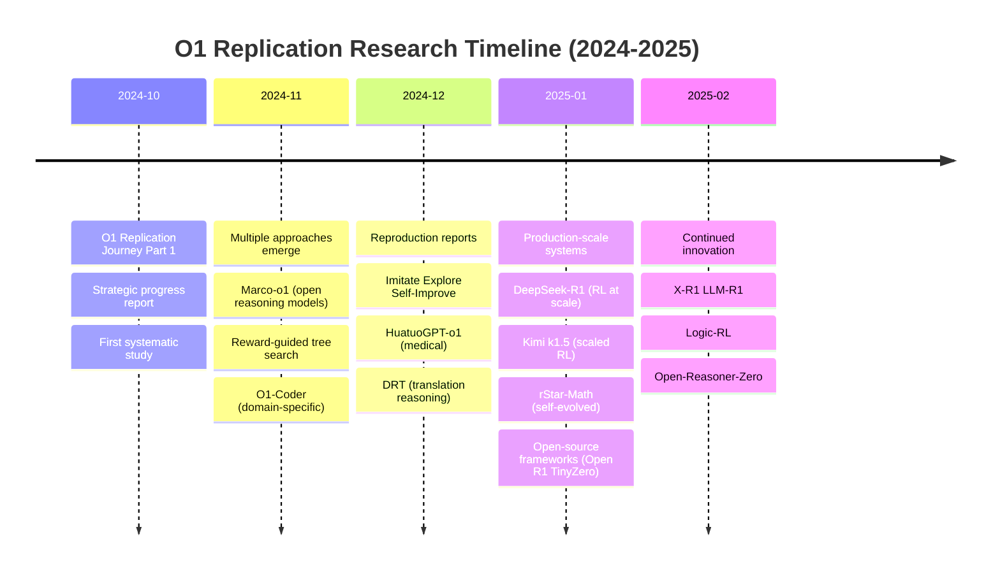

**Sources:** [README.md:45-67](), [README.md:26]()

## Major Research Papers and Projects

### Academic Reproduction Studies

The following table catalogs key academic papers attempting to understand and replicate o1's capabilities:

| Paper | Date | Key Contribution | Venue |
|-------|------|------------------|-------|
| O1 Replication Journey Part 1 | 2024-10 | First strategic analysis and progress report | arXiv |
| O1 Replication Journey Part 2 | 2024-11 | Distillation approach, surpassing o1-preview | arXiv |
| Imitate, Explore, Self-Improve | 2024-12 | Three-phase reproduction framework | arXiv |
| Marco-o1 | 2024-11 | Open reasoning models for open-ended solutions | arXiv |
| Enhancing LLM Reasoning with Reward-guided Tree Search | 2024-11 | Integration of search and rewards | arXiv |

**Sources:** [assets/paper.json:2-45](), [README.md:47-51]()

### Domain-Specific Replications

O1-like reasoning has been adapted to specialized domains:

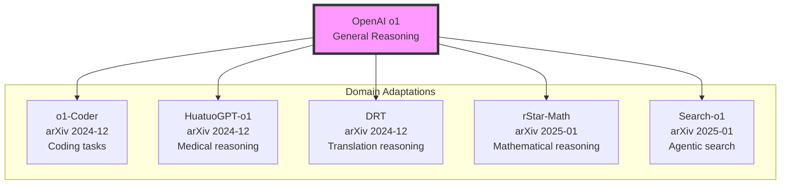

**Sources:** [README.md:52-54](), [README.md:60-61](), [assets/paper.json:25-30]()

### Production-Scale Systems

Two major production systems have been released that achieve o1-like reasoning capabilities:

#### DeepSeek-R1

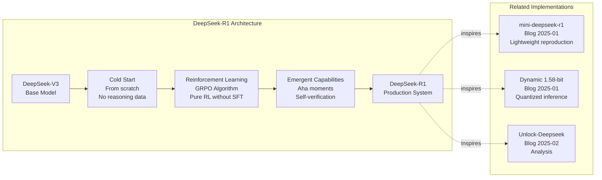

DeepSeek-R1 demonstrated that pure reinforcement learning (without supervised fine-tuning on reasoning data) can incentivize complex reasoning behaviors. The model learns to:
- Generate long chains of thought spontaneously
- Perform self-verification and error correction
- Exhibit "aha moments" where reasoning breakthroughs occur

**Implementation References:**
- Core approach: `DeepSeek-R1: Incentivizing Reasoning Capability in LLMs via Reinforcement Learning` (arXiv 2025-01)
- Lightweight reproduction: `mini-deepseek-r1` blog (2025-01)
- Quantization: `Run DeepSeek R1 Dynamic 1.58-bit` blog (2025-01)

#### Kimi k1.5

Kimi k1.5 represents another production-scale approach to scaling reinforcement learning for reasoning:

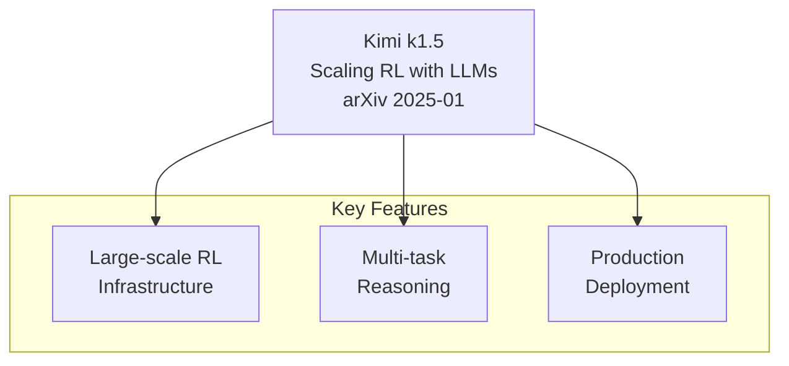

**Sources:** [README.md:107-108](), [assets/paper.json:183-188]()

### Open-Source Frameworks

Several open-source implementations have emerged to democratize o1-like capabilities:

| Framework | Type | Description | Reference |
|-----------|------|-------------|-----------|
| `Open R1` | GitHub | Hugging Face's open replication | [README.md:59]() |
| `TinyZero` | GitHub | Lightweight implementation | [README.md:58]() |
| `Simple RL for Reasoning` | Notion | HKUST-NLP framework | [README.md:57]() |
| `Open-Reasoner-Zero` | PDF/GitHub | Complete replication report | [README.md:63]() |
| `X-R1` | GitHub | Extended R1 implementation | [README.md:64]() |
| `LLM-R1` | GitHub | LMM-R1 variant | [README.md:67]() |

**Sources:** [README.md:55-67]()

## Core Methodologies in O1 Replication

O1 replication efforts integrate multiple techniques. The following diagram shows how these components interact:

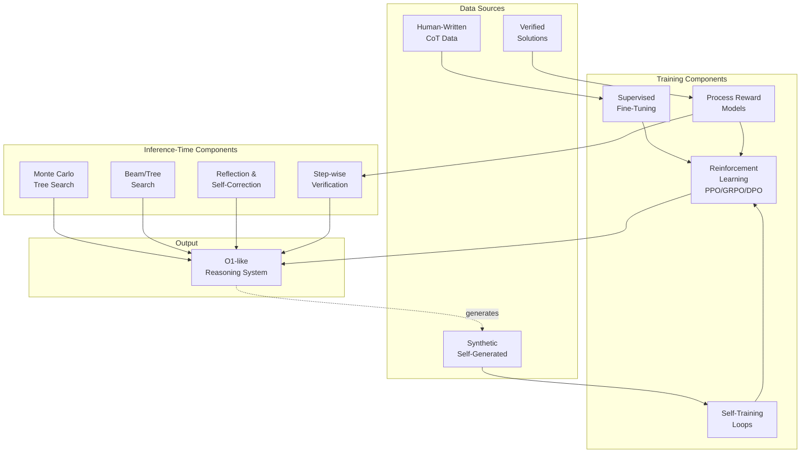

**Sources:** [README.md:45-67](), [README.md:68-97](), [README.md:98-138](), [README.md:139-194]()

### Integration Patterns

Different replication efforts combine these techniques in various ways:

#### Pattern 1: Pure RL (DeepSeek-R1 Style)

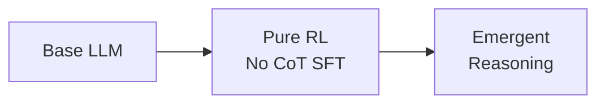

- No supervised fine-tuning on reasoning traces
- Relies on reward signal to discover reasoning strategies
- Exhibits emergent self-verification behaviors

#### Pattern 2: Distillation (O1 Journey Part 2)

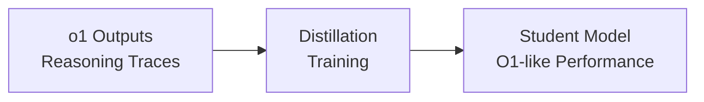

- Train on outputs from original o1 model
- Simpler than from-scratch RL
- Can surpass teacher with proper training

#### Pattern 3: Imitate-Explore-Improve

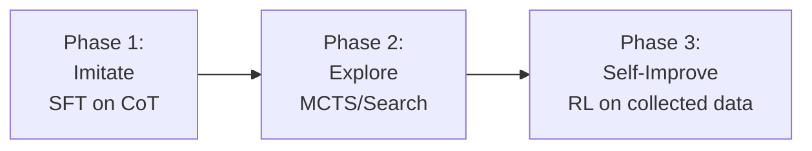

- Three-phase approach combining multiple methods
- Gradual capability building
- Documented in reproduction report

**Sources:** [README.md:47-51](), [README.md:107](), [assets/paper.json:4-43]()

## Repository Artifacts and Data Organization

The repository catalogs O1 replication research through structured data:

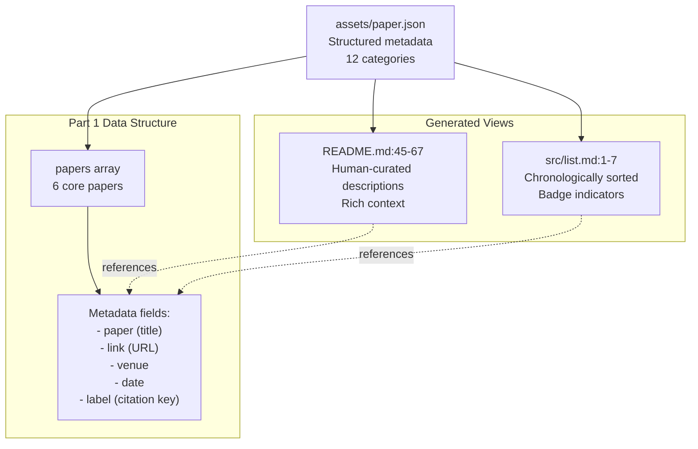

### Data Structure for O1 Replication Papers

The structured paper metadata in `assets/paper.json` follows this schema:

```json
{
  "Part 1: O1 Replication": [
    {
      "paper": "Paper Title",
      "link": "https://arxiv.org/abs/...",
      "venue": "arXiv|ACL|NeurIPS|...",
      "date": "YYYY-MM",
      "label": "citationkey"
    }
  ]
}
```

Key papers are stored at [assets/paper.json:2-45]() with 6 core academic papers and additional entries in the README for blogs and GitHub projects.

**Sources:** [assets/paper.json:1-45](), [src/list.md:1-7]()

## Technical Challenges and Open Problems

### Computational Cost

O1-like systems require significant test-time compute:

| Approach | Tokens/Query | Time Multiplier | Trade-off |
|----------|--------------|-----------------|-----------|
| Standard LLM | 100-500 | 1x | Fast, less accurate |
| O1-like (short) | 1,000-5,000 | 10-50x | Moderate cost, better reasoning |
| O1-like (long) | 10,000-100,000+ | 100-1000x | High cost, best reasoning |

Solutions being explored:
- **O1-Pruner**: Length harmonization and pruning [README.md:254]()
- **DynaThink**: Dynamic fast/slow routing [README.md:246]()
- **Token budgeting**: Adaptive reasoning depth [README.md:248]()

For detailed optimization techniques, see [Efficient System2](#5.1).

### Training Challenges

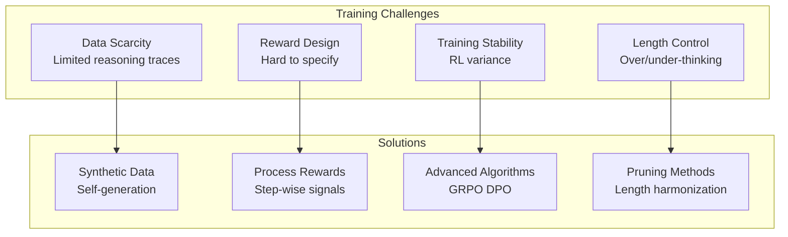

**Sources:** [README.md:242-325](), [README.md:98-138]()

## Relationships to Other Research Areas

O1 replication synthesizes and depends on multiple research areas:

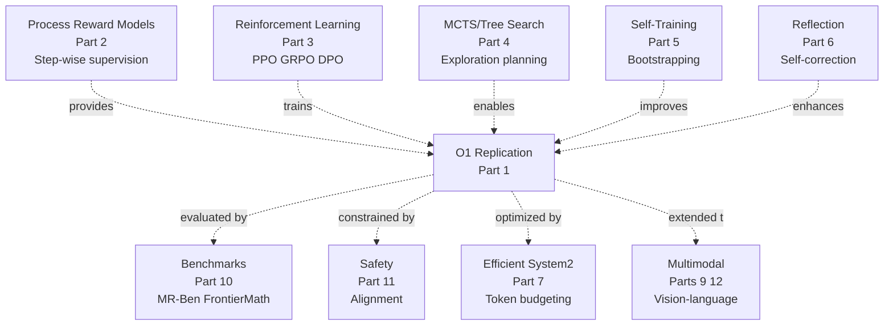

**Cross-references:**
- **Process Reward Models** ([#4.2](#4.2)): Provide step-wise supervision signals
- **Reinforcement Learning** ([#4.3](#4.3)): Training methodology (DeepSeek-R1, Kimi k1.5)
- **MCTS/Tree Search** ([#4.4](#4.4)): Inference-time exploration (rStar-Math, Search-o1)
- **Self-Training** ([#4.5](#4.5)): Bootstrap reasoning capabilities
- **Reflection** ([#4.6](#4.6)): Self-correction mechanisms
- **Efficient System2** ([#5.1](#5.1)): Computational optimization
- **Benchmarks** ([#7.1](#7.1)): Evaluation frameworks
- **Safety** ([#7.2](#7.2)): Alignment considerations

**Sources:** [README.md:26-416]()

## Notable Research Findings

### Emergent Behaviors in Pure RL

DeepSeek-R1 demonstrated that reinforcement learning without supervised fine-tuning on reasoning data can lead to:

1. **Spontaneous long-chain reasoning**: Models learn to "think before answering" without explicit instruction
2. **Self-verification**: Models develop habits of checking their work
3. **Aha moments**: Sudden breakthroughs in reasoning during inference
4. **Language mixing**: Reasoning in multiple languages during thought process

These findings suggest that reasoning capabilities may emerge from optimization pressure rather than requiring explicit training on reasoning traces.

### Test-Time Scaling Laws

Research on o3-mini and related systems reveals that:
- Performance scales with inference compute budget
- Longer reasoning traces correlate with higher accuracy on complex problems
- There exists an optimal length for different problem types (avoiding overthinking)

Documented in: "The Relationship Between Reasoning and Performance in Large Language Models -- o3 (mini) Thinks Harder, Not Longer" [README.md:62]()

### Distillation Effectiveness

The O1 Replication Journey Part 2 showed that:
- Student models can surpass teacher (o1-preview) through distillation
- Simpler training procedure than pure RL from scratch
- Raises questions about "bitter lesson" vs. "big progress"

**Sources:** [README.md:50](), [README.md:62](), [README.md:107]()

## Implementation Resources

### Getting Started

For practitioners looking to implement o1-like reasoning:

1. **Start with reproduction studies**: Read O1 Replication Journey Part 1 and Part 2
2. **Choose framework**: Consider Open R1, TinyZero, or Simple RL for Reasoning
3. **Understand dependencies**: Study process reward models and RL techniques
4. **Start small**: Begin with domain-specific adaptation (coding, math) before general reasoning

### Key Implementation Components

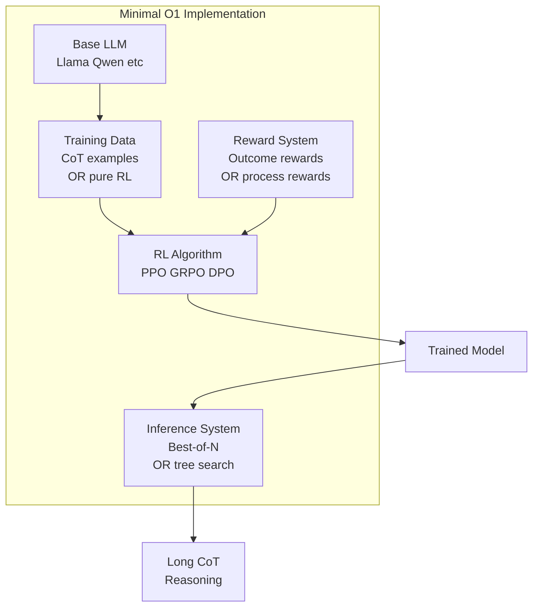

**Sources:** [README.md:55-67]()

## Future Directions

The O1 replication research continues to evolve with several open directions:

1. **Efficiency**: Reducing computational cost while maintaining reasoning quality
2. **Interpretability**: Understanding what reasoning models actually do internally (see [Explainability](#5.2))
3. **Multimodal reasoning**: Extending to vision-language tasks (see [Multimodal Extensions](#6))
4. **Robustness**: Ensuring consistent performance across domains
5. **Safety**: Preventing misuse and ensuring alignment (see [Reasoning and Safety](#7.2))

### Active Research Questions

- Can smaller models (1-3B parameters) achieve o1-like reasoning with sufficient training?
- What is the optimal balance between pre-training, SFT, and RL for reasoning?
- How can we reduce test-time compute without sacrificing accuracy?
- Can reasoning capabilities transfer across domains effectively?

**Sources:** [README.md:242-325](), [README.md:327-338]()

---

