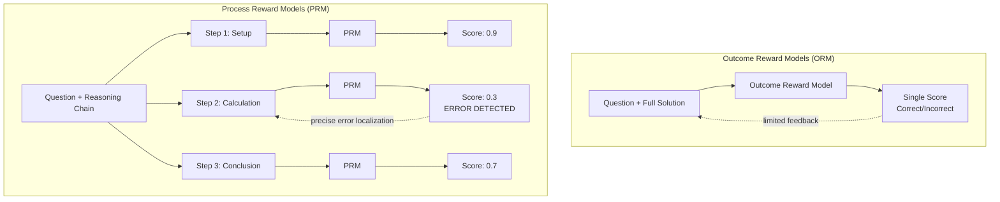
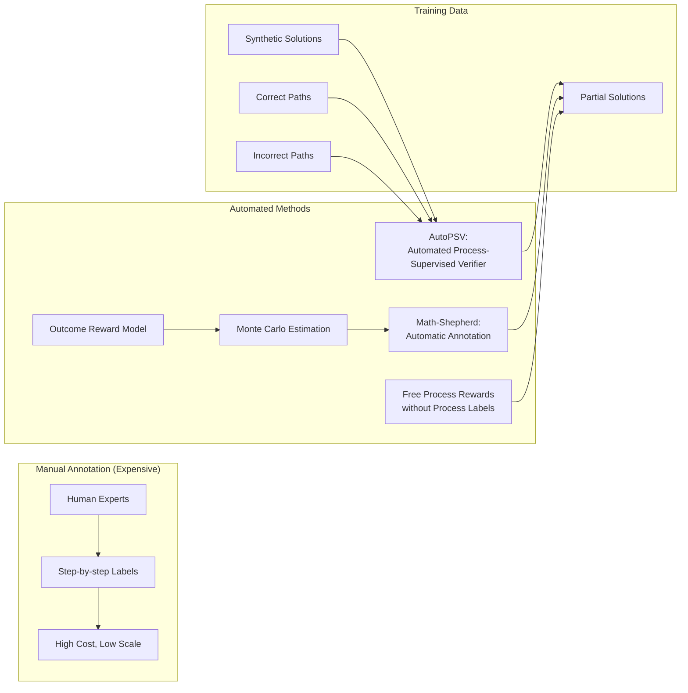
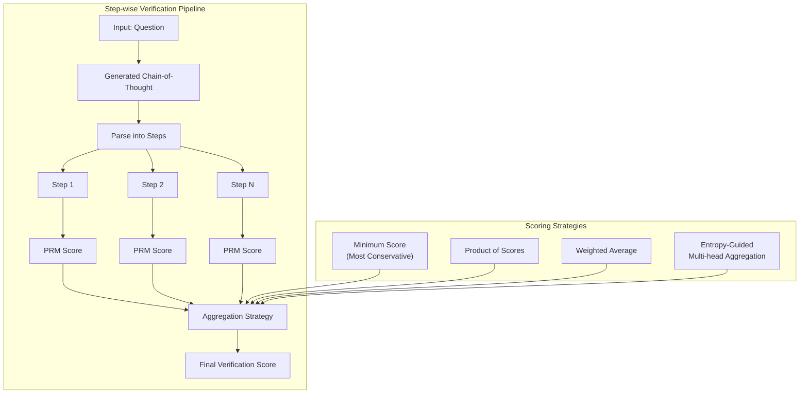
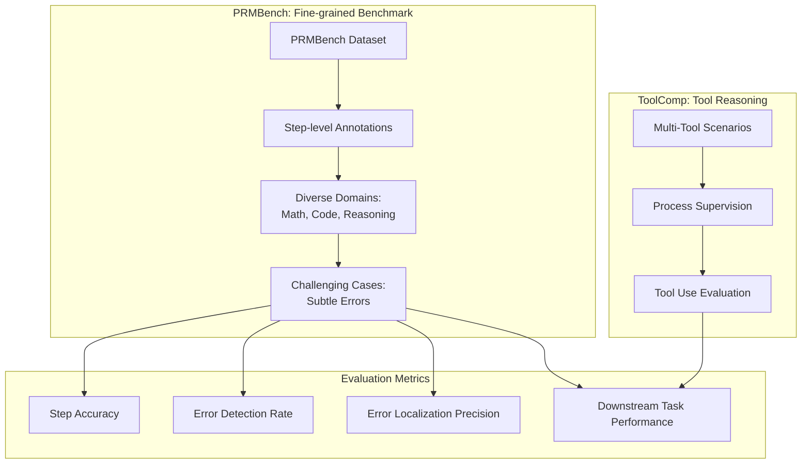
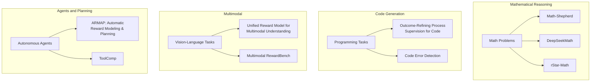
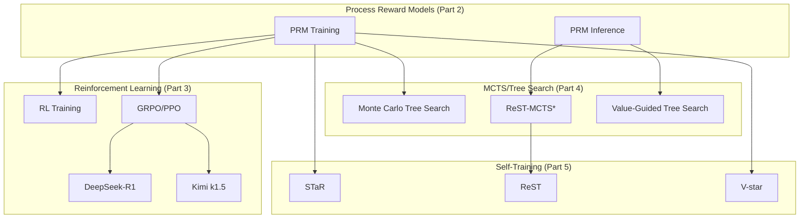
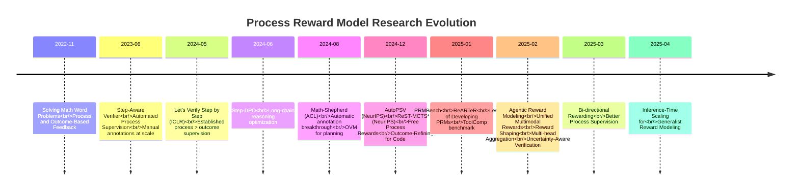
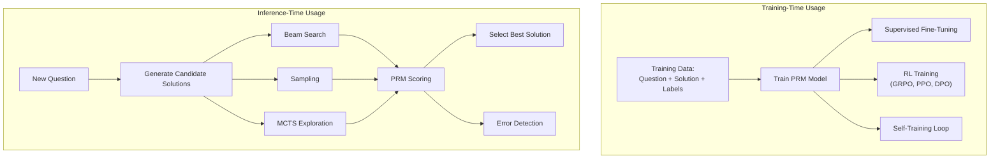

<!-- source: DeepWiki mcp.deepwiki.com · repo zzli2022/Awesome-System2-Reasoning-LLM · page 4.2 Process Reward Models · fetched 2026-10-30 -->

# Process Reward Models

<details>
<summary>Relevant source files</summary>

The following files were used as context for generating this wiki page:

- [README.md](README.md)
- [assets/paper.json](assets/paper.json)
- [src/list.md](src/list.md)

</details>


## Purpose and Scope

Process Reward Models (PRMs) provide **step-by-step supervision** of reasoning processes, assigning rewards or verification scores to individual intermediate steps rather than only evaluating final outcomes. This fine-grained feedback mechanism enables more effective training and inference-time guidance for System 2 reasoning tasks.

This document covers the research and techniques for building, training, and applying PRMs as cataloged in Part 2 of the repository. For reinforcement learning methods that consume these rewards, see [Reinforcement Learning](#4.3). For tree search algorithms guided by PRMs, see [MCTS and Tree Search](#4.4). For self-training methods that leverage process supervision, see [Self-Training and Self-Improvement](#4.5).

**Sources:** [README.md:68-96]()

## Process vs. Outcome Supervision



**Key Distinction**: ORMs evaluate only the final answer, while PRMs provide supervision at each reasoning step. This granular feedback enables:
- **Error Localization**: Identify which step introduced a mistake
- **Credit Assignment**: Reward correct intermediate reasoning even if the final answer is wrong
- **Guided Search**: Use step-level scores to prune search trees during inference
- **Better Training Signals**: More supervision per training example

**Sources:** [README.md:70-76](), [assets/paper.json:90-94]()

## Repository Data Structure

```mermaid
graph TB
    subgraph "assets/paper.json Structure"
        ROOT["paper.json"]
        PART2["'Part 2: Process Reward Models'<br/>Array of Papers"]
        
        PAPER1["Paper Object 1:<br/>Math-Shepherd"]
        PAPER2["Paper Object 2:<br/>ReST-MCTS*"]
        PAPER3["Paper Object 3:<br/>AutoPSV"]
        PAPER4["Paper Object 4:<br/>PRMBench"]
        PAPERN["... 27 total papers"]
        
        FIELDS["Fields:<br/>- paper: title<br/>- link: URL<br/>- venue: conference/journal<br/>- date: YYYY-MM<br/>- label: citation key"]
    end
    
    subgraph "Generated Outputs"
        README["README.md:68-96<br/>Part 2 Section"]
        LISTMD["src/list.md:8-23<br/>Sorted List View"]
        TABLEMD["src/table.md<br/>Tabular View"]
    end
    
    ROOT --> PART2
    PART2 --> PAPER1
    PART2 --> PAPER2
    PART2 --> PAPER3
    PART2 --> PAPER4
    PART2 --> PAPERN
    
    PAPER1 --> FIELDS
    
    PART2 -.processed by src/main.py.-> README
    PART2 -.processed by src/main.py.-> LISTMD
    PART2 -.processed by src/main.py.-> TABLEMD
```

The repository stores PRM research papers in a structured JSON format at [assets/paper.json:46-152](). Each paper entry contains metadata including title, venue, publication date, and a citation label. The `src/main.py` build script processes this data to generate multiple documentation views.

**Sources:** [assets/paper.json:46-152](), [src/list.md:8-23]()

## Core Research Directions

### Automated PRM Generation



**Key Innovations:**

| Paper | Method | Key Contribution |
|-------|--------|------------------|
| **Math-Shepherd** (ACL 2024) | Automatic annotation using correct/incorrect solution pairs | Eliminates need for human step-level labels |
| **AutoPSV** (NeurIPS 2024) | Automated process-supervised verifier training | Scalable verification without manual supervision |
| **Free Process Rewards** (arXiv 2024.12) | Derive process rewards without process labels | Extract implicit step-wise signals from outcome data |
| **Let's Verify Step by Step** (ICLR 2024.05) | Large-scale manual annotation study | Established that process supervision outperforms outcome supervision |

**Sources:** [README.md:70-96](), [assets/paper.json:48-137]()

### Verification and Scoring



**Verification Techniques:**

- **Step-Aware Verifier** (arXiv 2023.06): Position-aware scoring considering step context
- **OVM** (ACL Findings 2024): Outcome-supervised value models for planning
- **Step-DPO** (arXiv 2024.06): Step-wise preference optimization for long-chain reasoning
- **Uncertainty-Aware Verification** (arXiv 2025.02): Incorporate model confidence in step scoring
- **AdaptiveStep** (arXiv 2025.02): Automatically divide reasoning steps based on model confidence
- **Bi-directional Rewarding** (arXiv 2025.03): Forward and backward signal propagation

**Sources:** [README.md:72-96](), [assets/paper.json:69-95]()

### Benchmarking Process Rewards



**Key Benchmarks:**

| Benchmark | Focus | Publication |
|-----------|-------|-------------|
| **PRMBench** | Fine-grained process-level evaluation across domains | arXiv 2025.01 |
| **ToolComp** | Multi-tool reasoning with process supervision | arXiv 2025.01 |
| **RewardBench** | General reward model evaluation | arXiv 2024.03 |
| **Multimodal RewardBench** | Vision-language reward models | arXiv 2025.02 |

**Sources:** [README.md:81-85](), [assets/paper.json:139-151]()

## Domain-Specific Applications



**Sources:** [README.md:79-92](), [assets/paper.json:125-151]()

## Integration with Other Methodologies



**Integration Patterns:**

1. **PRM + Reinforcement Learning**: Process rewards serve as the reward signal for RL training
   - DeepSeek-R1 uses process-level rewards in RL training
   - Kimi k1.5 scales RL with step-wise supervision
   - GRPO (Group Relative Policy Optimization) leverages process rewards

2. **PRM + MCTS**: Step-level scores guide tree search exploration
   - ReST-MCTS* combines process reward guidance with tree search
   - Value-guided MCTS uses PRMs as value functions
   - Search-o1 enhances reasoning with PRM-guided search

3. **PRM + Self-Training**: PRMs select high-quality reasoning traces
   - V-star trains verifiers alongside self-taught reasoners
   - ReST uses process verification for filtering
   - rStar-Math self-evolves using PRM feedback

**Sources:** [README.md:68-225](), Diagram 2 from high-level architecture

## Research Evolution Timeline



**Key Inflection Points:**
- **2023**: Establishment of process supervision superiority over outcome-only
- **2024**: Automated PRM generation (Math-Shepherd, AutoPSV) enabling scale
- **2024 Q4**: Integration with tree search (ReST-MCTS*) and RL systems
- **2025**: Multimodal expansion and specialized benchmarking

**Sources:** [README.md:68-96](), [assets/paper.json:46-152]()

## Representative Papers

| Category | Paper | Venue/Date | Key Contribution |
|----------|-------|------------|------------------|
| **Foundation** | Let's Verify Step by Step | ICLR 2024.05 | Demonstrated process supervision superiority with large-scale study |
| **Automated Generation** | Math-Shepherd | ACL 2024 | Automatic step-by-step annotation without human labels |
| **Automated Generation** | AutoPSV | NeurIPS 2024 | Scalable automated process-supervised verifier |
| **Automated Generation** | Free Process Rewards | arXiv 2024.12 | Extract process signals from outcome data only |
| **Integration** | ReST-MCTS* | NeurIPS 2024 | Combined with tree search for self-training |
| **Optimization** | Step-DPO | arXiv 2024.06 | Step-wise preference optimization |
| **Planning** | OVM | ACL Findings 2024 | Outcome-supervised value models for reasoning |
| **Benchmarking** | PRMBench | arXiv 2025.01 | Fine-grained evaluation benchmark |
| **Benchmarking** | ToolComp | arXiv 2025.01 | Multi-tool reasoning and process supervision |
| **Retrieval** | ReARTeR | arXiv 2025.01 | Retrieval-augmented with trustworthy process rewards |
| **Analysis** | Lessons of Developing PRMs | arXiv 2025.01 | Comprehensive study of PRM development practices |
| **Multimodal** | Unified Reward Model | arXiv 2025.02 | Multimodal understanding and generation rewards |
| **Agents** | ARMAP | ICLR 2025 | Automatic reward modeling for autonomous agents |
| **Uncertainty** | Uncertainty-Aware Verification | arXiv 2025.02 | Generative reward models with uncertainty |
| **Adaptive** | AdaptiveStep | arXiv 2025.02 | Automatic reasoning step division via confidence |
| **Architecture** | Multi-head Reward Aggregation | arXiv 2025.03 | Entropy-guided aggregation strategies |
| **Bidirectional** | Better Process Supervision | arXiv 2025.03 | Bi-directional rewarding signals |
| **Inference-Time** | Inference-Time Scaling | arXiv 2025.04 | Generalist reward modeling at test time |

**Sources:** [README.md:68-96](), [assets/paper.json:46-152](), [src/list.md:8-23]()

## Training and Inference Patterns



**Training-Time Applications:**
- **Reward Signal for RL**: PRMs provide dense rewards for each reasoning step during policy optimization
- **Data Filtering**: Select high-quality reasoning traces for supervised fine-tuning
- **Curriculum Learning**: Gradually increase difficulty based on PRM-assessed complexity

**Inference-Time Applications:**
- **Best-of-N Selection**: Score N sampled solutions and select highest-scoring
- **Tree Search Guidance**: Use PRM scores to guide MCTS exploration and pruning
- **Error Detection**: Identify and potentially correct erroneous steps
- **Beam Search**: Prune low-scoring reasoning paths during generation

**Sources:** [README.md:68-96](), Diagram 3 from high-level architecture

## Challenges and Open Problems

**Scalability Issues:**
- Manual annotation remains expensive; automated methods still developing
- Training PRMs requires large datasets of step-labeled reasoning chains
- Generalization across domains (math, code, science) remains difficult

**Technical Challenges:**
- **Granularity**: Determining optimal step size for supervision
- **Credit Assignment**: Accurately attributing errors to specific steps
- **Robustness**: PRMs can be brittle to small perturbations in reasoning style
- **Reward Hacking**: Models may learn to game PRM scores without improving reasoning

**Current Research Directions (2025):**
- Inference-time scaling with generalist reward models
- Multimodal process rewards for vision-language reasoning  
- Agentic reward modeling integrating human preferences with verifiable signals
- Reward shaping to mitigate hacking behaviors
- Uncertainty quantification in process scoring

**Sources:** [README.md:86-96]()

## Related Work in Other Parts

Process Reward Models intersect heavily with other research areas in the repository:

- **[O1 Replication](#4.1)**: O1-like systems rely on PRMs for training and inference
- **[Reinforcement Learning](#4.3)**: PRMs provide the reward signal for RL training (DeepSeek-R1, Kimi k1.5)
- **[MCTS and Tree Search](#4.4)**: PRMs guide exploration in tree search algorithms (ReST-MCTS*, rStar-Math)
- **[Self-Training and Self-Improvement](#4.5)**: PRMs enable self-verification and data filtering (V-star, ReST)
- **[Benchmarks and Datasets](#7.1)**: PRMBench, ToolComp, and other evaluation frameworks
- **[Reasoning and Safety](#7.2)**: Process supervision for alignment and safety considerations

**Sources:** [README.md:26-416](), Diagram 2 from high-level architecture

---

