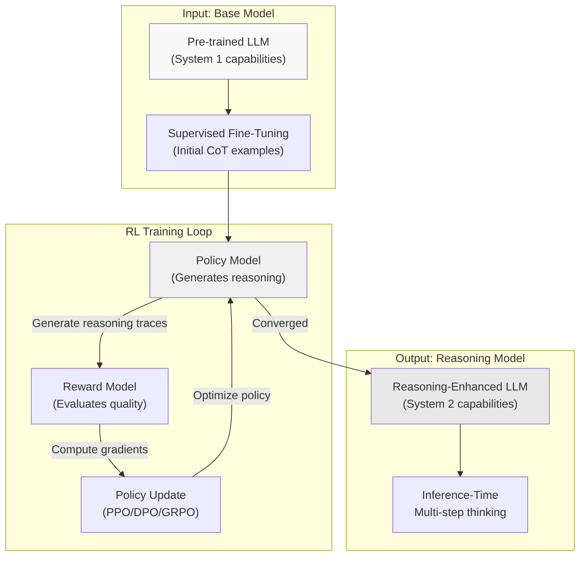
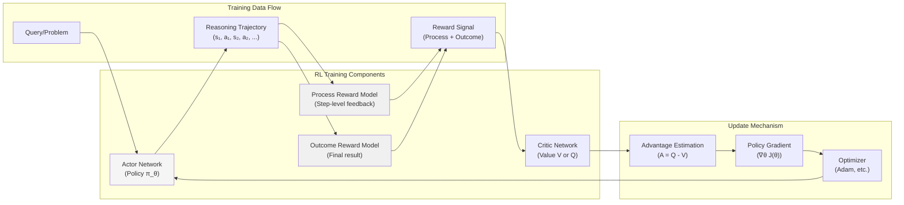
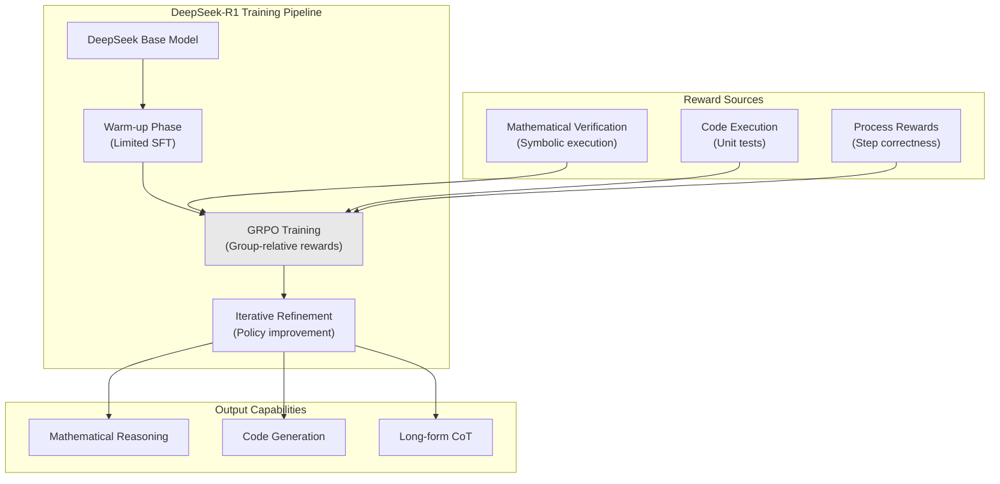
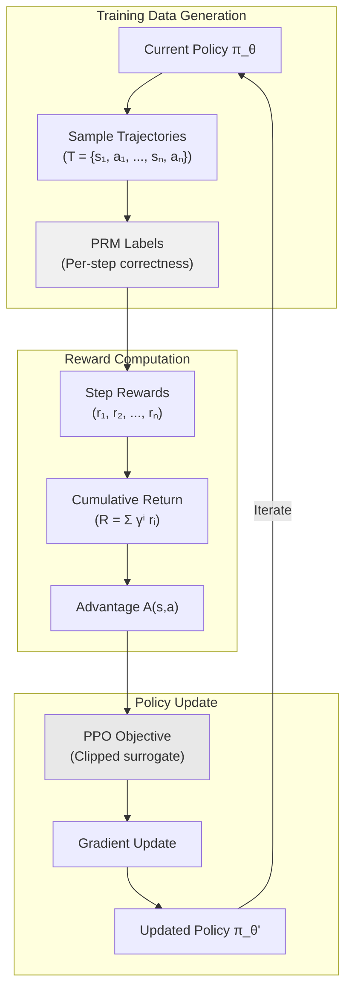
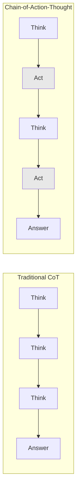
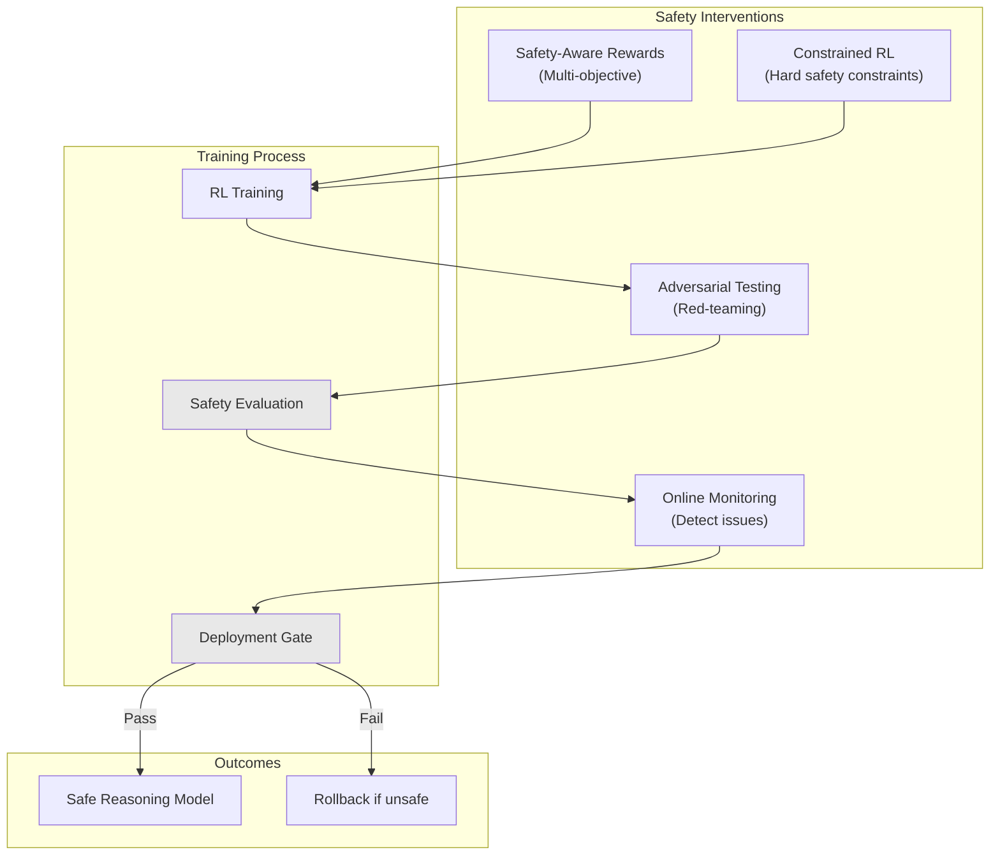
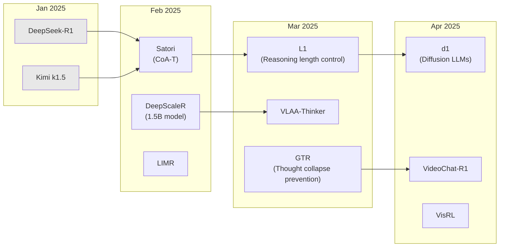

<!-- source: DeepWiki mcp.deepwiki.com · repo zzli2022/Awesome-System2-Reasoning-LLM · page 4.3 Reinforcement Learning · fetched 2026-10-30 -->

# Reinforcement Learning

<details>
<summary>Relevant source files</summary>

The following files were used as context for generating this wiki page:

- [README.md](README.md)
- [assets/paper.json](assets/paper.json)
- [src/table.md](src/table.md)

</details>


## Purpose and Scope

This page documents reinforcement learning (RL) techniques for training reasoning capabilities in Large Language Models. Reinforcement learning enables LLMs to learn complex, multi-step reasoning through interaction with reward signals, moving beyond pure supervised learning approaches. This section covers policy optimization algorithms (PPO, DPO, GRPO), large-scale RL implementations like DeepSeek-R1 and Kimi k1.5, and the integration of RL with process reward models and self-training.

For process-level supervision that guides RL training, see [Process Reward Models](#4.2). For self-training approaches that can complement RL, see [Self-Training and Self-Improvement](#4.5). For computational efficiency of RL-trained models, see [Efficient System2](#5.1).

**Sources:** [README.md:98-138]()

---

## Overview: RL's Role in System 2 Reasoning

Reinforcement learning serves as a critical bridge between supervised fine-tuning and emergent reasoning capabilities. Unlike traditional SFT which requires extensive human-annotated reasoning traces, RL can optimize models directly for reasoning quality using outcome-based or process-based rewards. The key insight is that RL allows models to explore the space of reasoning strategies and self-discover effective patterns.



**Diagram: RL Training Pipeline for Reasoning Models**

The training process involves iteratively generating reasoning traces, evaluating them with reward models, and updating the policy to maximize expected rewards. This enables the discovery of reasoning patterns that may not appear in supervised datasets.

**Sources:** [README.md:98-138](), [README.md:14-26]()

---

## Key RL Approaches and Algorithms

### Policy Optimization Methods

Modern reasoning models employ several RL algorithms, each with distinct characteristics:

| Algorithm | Type | Key Characteristic | Representative Papers |
|-----------|------|-------------------|----------------------|
| **PPO** (Proximal Policy Optimization) | On-policy | Stable updates via clipping | DeepSeek-R1, Kimi k1.5 |
| **DPO** (Direct Preference Optimization) | Offline | Learns from preference pairs | ReFT |
| **GRPO** (Group Relative Policy Optimization) | Hybrid | Relative rewards within groups | DeepSeek-R1 |
| **Offline RL** | Offline | Learns from fixed datasets | Offline Reinforcement Learning for LLM Multi-Step Reasoning |

**Sources:** [README.md:98-138]()

### Technical Architecture



**Diagram: RL Training Architecture with Process and Outcome Rewards**

The architecture combines actor-critic methods with both process-level and outcome-level reward signals. Process rewards (from PRMs) provide dense feedback at each reasoning step, while outcome rewards evaluate final correctness.

**Sources:** [README.md:98-138](), [README.md:68-97]()

---

## Major Implementations

### DeepSeek-R1: Large-Scale RL for Reasoning

DeepSeek-R1 represents a breakthrough in scaling RL to reasoning tasks, demonstrating that pure RL can incentivize sophisticated reasoning without extensive supervised reasoning data.

**Key Papers:**
- **DeepSeek-R1: Incentivizing Reasoning Capability in LLMs via Reinforcement Learning** [README.md:107]()
- **Deepseekmath: Pushing the limits of mathematical reasoning in open language models** [README.md:109]()

**Technical Characteristics:**
- Uses **GRPO** (Group Relative Policy Optimization) for stable training
- Scales to billions of parameters with distributed RL
- Combines cold-start exploration with iterative refinement
- Integrates process rewards for step-wise guidance



**Diagram: DeepSeek-R1 Training Architecture**

**Sources:** [README.md:107-109]()

### Kimi k1.5: Scaling RL with LLMs

Kimi k1.5 demonstrates another approach to scaling RL for reasoning, with emphasis on inference-time computation.

**Key Paper:**
- **Kimi k1.5: Scaling Reinforcement Learning with LLMs** [README.md:108]()

**Technical Approach:**
- Focuses on **inference scaling** where reasoning length adapts to problem difficulty
- Uses RL to learn when to extend reasoning vs. conclude
- Integrates with tree search methods for exploration

**Sources:** [README.md:108]()

---

## Integration with Other Techniques

### RL + Process Reward Models

The combination of RL with Process Reward Models (PRMs) creates a powerful training paradigm:



**Diagram: RL Training Loop with Process Reward Guidance**

Key papers demonstrating this integration:
- **ReST-MCTS*: LLM Self-Training via Process Reward Guided Tree Search** [README.md:78]() - Combines tree search, PRMs, and self-training
- **Math-Shepherd: Verify and Reinforce LLMs Step-by-step** [README.md:73]() - Automated PRM generation for RL

**Sources:** [README.md:68-97](), [README.md:78]()

### RL + Tree Search (MCTS)

Reinforcement learning and Monte Carlo Tree Search create synergistic combinations. See [MCTS and Tree Search](#4.4) for detailed coverage. Key integration points:

- **Value-Guided MCTS**: RL-trained value functions guide tree exploration
- **Policy-Guided MCTS**: RL policies provide prior probabilities for action selection
- **MCTS as Data Augmentation**: Tree search generates high-quality trajectories for RL training

**Representative Papers:**
- **MAKING PPO EVEN BETTER: VALUE-GUIDED MONTE-CARLO TREE SEARCH DECODING** [README.md:146]()
- **Monte Carlo Tree Search Boosts Reasoning via Iterative Preference Learning** [README.md:154]()

**Sources:** [README.md:139-193]()

---

## RL Algorithm Details

### Representation Finetuning (ReFT)

ReFT offers an efficient alternative to full model finetuning:

**Key Paper:** **ReFT: Representation Finetuning for Language Models** [README.md:103](), [README.md:216]()

**Technical Approach:**
- Finetunes only **learned linear transformations** on frozen model representations
- Significantly reduces trainable parameters compared to full RL
- Can be applied with various RL objectives (PPO, DPO)
- Maintains model capabilities while improving reasoning

**Sources:** [README.md:103]()

### Offline RL for Multi-Step Reasoning

Offline RL enables learning from fixed datasets without online interaction:

**Key Paper:** **Offline Reinforcement Learning for LLM Multi-Step Reasoning** [README.md:102]()

**Advantages:**
- Avoids costly online sampling and reward computation
- Can leverage existing reasoning datasets
- More stable training than online methods
- Suitable for scenarios where online evaluation is expensive

**Technical Approach:**
- Learns from pre-collected trajectories with rewards
- Uses conservative Q-learning or implicit Q-learning to avoid overestimation
- Handles distribution shift between behavior and learned policy

**Sources:** [README.md:102]()

---

## Advanced RL Techniques

### Chain-of-Action-Thought (Satori)

**Satori: Reinforcement Learning with Chain-of-Action-Thought** [README.md:113]() introduces a novel paradigm combining action planning with reasoning.

**Technical Innovation:**
- Integrates **action sequences** into reasoning chains
- RL learns to select both reasoning steps and actions
- Enables **autoregressive search** through action space
- Applies to agent tasks and complex problem-solving



**Diagram: CoT vs. Chain-of-Action-Thought**

**Sources:** [README.md:113]()

### Scaling Laws and Compute Efficiency

Several papers investigate how RL scales with compute:

| Paper | Key Finding | Citation |
|-------|-------------|----------|
| **Does RLHF Scale?** | Examines scaling behavior of RLHF across data, model size, and method | [README.md:101]() |
| **Advancing Language Model Reasoning** | Studies inference scaling with RL | [README.md:105]() |
| **DeepScaleR** | Achieves o1-preview performance with 1.5B model via scaled RL | [README.md:114]() |
| **LIMR: Less is More for RL Scaling** | Demonstrates efficient RL with reduced compute | [README.md:115]() |

**Sources:** [README.md:101-138]()

---

## Multimodal RL Extensions

RL techniques extend to multimodal reasoning tasks:

### Vision-Language RL

**Key Papers:**
- **Improve Vision Language Model Chain-of-thought Reasoning** [README.md:100]()
- **MM-RLHF: The Next Step Forward in Multimodal LLM Alignment** [README.md:112]()
- **Visual-RFT: Visual Reinforcement Fine-Tuning** [README.md:123]()
- **R1-Zero's "Aha Moment" in Visual Reasoning** [README.md:122]()

**Technical Extensions:**
- Applies RL to vision-language models (VLMs)
- Rewards based on visual grounding accuracy
- Handles multimodal reasoning chains (vision → text → vision)

### Agent RL

**Key Papers:**
- **UI-R1: Enhancing Action Prediction of GUI Agents** [README.md:120]()
- **GTR: Guided Thought Reinforcement** [README.md:124]()
- **VideoChat-R1: Enhancing Spatio-Temporal Perception** [README.md:133]()

**Application Domains:**
- GUI interaction and web navigation
- Video understanding and reasoning
- Embodied agent tasks

**Sources:** [README.md:100-138]()

---

## Safety and Alignment Challenges

### RL Safety Concerns

**Challenges in Ensuring AI Safety in DeepSeek-R1 Models** [README.md:106]() highlights critical safety issues:

**Key Concerns:**
- **Reward Hacking**: Models exploit reward model weaknesses
- **Goal Misgeneralization**: RL optimizes for proxies rather than true objectives
- **Safety-Capability Tradeoffs**: Reasoning improvements may reduce safety alignment
- **Harmful Reasoning**: Models may learn to generate harmful reasoning chains

### Mitigation Strategies



**Diagram: RL Safety Framework**

For comprehensive coverage of safety issues, see [Reasoning and Safety](#7.2).

**Sources:** [README.md:106](), [README.md:437-456]()

---

## Domain-Specific RL Applications

### Medical Reasoning

**Med-RLVR: Emerging Medical Reasoning from a 3B base model** [README.md:117]() demonstrates RL for medical domain:

**Approach:**
- RL training on medical QA tasks
- Reward models based on medical accuracy
- Emerges complex medical reasoning from small base models

### Machine Translation

**MT-R1-Zero: Advancing LLM-based Machine Translation** [README.md:136]() applies R1-style RL to translation:

**Innovation:**
- RL for translation quality optimization
- Reasoning-aware translation strategies
- Multi-step refinement of translations

### Code Generation

Multiple papers apply RL to code reasoning:
- **Process Reinforcement through Implicit Rewards** [README.md:119]()
- **Algorithm Discovery With LLMs** [README.md:131]()

**Sources:** [README.md:117-137]()

---

## Training Dynamics and Optimization

### Curriculum Learning

**Efficient Reinforcement Finetuning via Adaptive Curriculum Learning** [README.md:132]() introduces adaptive curricula for RL:

**Key Ideas:**
- Start with easier reasoning problems
- Progressively increase difficulty
- Adapt curriculum based on model performance
- Improves sample efficiency and final performance

### Reinforcement Learning Fundamentals

The theoretical foundation connects to classical RL objectives:

**Policy Gradient Objective:**
```
J(θ) = E[τ~π_θ] [Σ_t γ^t r_t]
```

Where:
- `θ`: Policy parameters
- `τ`: Trajectory (reasoning chain)
- `γ`: Discount factor
- `r_t`: Reward at step t (from PRM or outcome)

**PPO Update Rule:**
```
L^CLIP(θ) = E_t [min(r_t(θ)Â_t, clip(r_t(θ), 1-ε, 1+ε)Â_t)]
```

Where:
- `r_t(θ)`: Probability ratio (new/old policy)
- `Â_t`: Advantage estimate
- `ε`: Clipping parameter (typically 0.2)

**Sources:** [README.md:98-138]()

---

## Research Frontiers

### Recent Developments (2025)



**Diagram: Recent RL Research Timeline (2025)**

### Emerging Directions

1. **Controlling Reasoning Length**: **L1: Controlling How Long A Reasoning Model Thinks** [README.md:125]()
2. **Diffusion-Based RL**: **d1: Scaling Reasoning in Diffusion Large Language Models** [README.md:130]()
3. **Thought Collapse Prevention**: **GTR: Guided Thought Reinforcement** [README.md:124]()
4. **Small Model RL**: **Reinforcement Learning for Reasoning in Small LLMs** [README.md:126]()

**Sources:** [README.md:98-138]()

---

## Implementation Considerations

### Compute Requirements

| Model Scale | Training Compute | Typical Configuration | Reference |
|-------------|------------------|----------------------|-----------|
| 1-3B params | 100-500 GPU-hours | 8-16 A100 GPUs | Med-RLVR, DeepScaleR |
| 7-13B params | 1K-5K GPU-hours | 32-64 A100 GPUs | Various implementations |
| 70B+ params | 10K-100K GPU-hours | 256+ A100 GPUs | DeepSeek-R1, Kimi k1.5 |

### Training Stability

Key techniques for stable RL training:
- **Reward Clipping**: Prevent extreme reward values
- **Value Function Clipping**: Constrain value predictions
- **KL Penalty**: Regularize policy changes (stay close to SFT initialization)
- **Advantage Normalization**: Stabilize gradient magnitudes
- **Multiple Epochs per Batch**: Improve sample efficiency

### Hyperparameter Sensitivity

Critical hyperparameters requiring tuning:
- Learning rate (typically 1e-6 to 1e-5 for large models)
- PPO clip ratio ε (typically 0.1 to 0.3)
- Value function coefficient (0.5 to 1.0)
- Entropy bonus (0.01 to 0.1)
- Batch size and number of rollouts

**Sources:** [README.md:98-138]()

---

## Comparison with Alternative Approaches

### RL vs. Supervised Fine-Tuning

| Aspect | Supervised Fine-Tuning | Reinforcement Learning |
|--------|------------------------|------------------------|
| **Data Requirements** | Requires human-annotated reasoning | Can use automated rewards |
| **Exploration** | Limited to training distribution | Discovers novel strategies |
| **Scalability** | Bounded by annotation cost | Scales with compute |
| **Sample Efficiency** | High (learns from demonstrations) | Lower (requires exploration) |
| **Reasoning Quality** | Good on similar problems | Better on novel problems |

### RL vs. Self-Training

See [Self-Training and Self-Improvement](#4.5) for detailed comparison. Key differences:
- **RL**: Active exploration with reward-guided learning
- **Self-Training**: Passive filtering of self-generated data
- **Hybrid**: Many modern systems (e.g., ReST-MCTS*) combine both

**Sources:** [README.md:98-138](), [README.md:194-224]()

---

## Code and Implementation Resources

While this repository primarily catalogs research papers rather than providing implementations, the following resources are referenced:

### Open-Source Implementations

- **mini-deepseek-r1** [README.md:55]() - Blog on lightweight DeepSeek-R1 implementation
- **TinyZero** [README.md:58]() - GitHub implementation of RL training
- **Open R1** [README.md:59]() - HuggingFace's open RL implementation
- **Simple Reinforcement Learning for Reasoning** [README.md:57]() - HKUST-NLP's RL framework

### Training Frameworks

The papers reference various frameworks:
- **DeepSpeed** for distributed RL training (implied in large-scale papers)
- **TRL (Transformer Reinforcement Learning)** for PPO/DPO
- **Custom implementations** for specialized algorithms (GRPO, etc.)

**Sources:** [README.md:55-67]()

---

## Future Directions

### Open Research Questions

1. **Theoretical Understanding**: Why does RL induce reasoning? Mechanisms remain unclear.
2. **Scaling Laws**: How do RL scaling laws differ from pretraining/SFT?
3. **Sample Efficiency**: Can we match supervised learning efficiency?
4. **Reward Design**: What reward structures best incentivize reasoning?
5. **Safety Alignment**: How to maintain safety during RL optimization?

### Emerging Paradigms

- **Continuous Latent Reasoning**: Training models to reason in continuous spaces rather than discrete tokens
- **Multi-Agent RL**: Using multiple agents to discover diverse reasoning strategies
- **Meta-RL**: Learning to adapt RL strategies across problem domains
- **Hybrid Training**: Seamlessly combining RL with SFT and self-training

**Sources:** [README.md:98-138]()

---

## Summary

Reinforcement learning has emerged as a critical technique for training System 2 reasoning in LLMs. Key takeaways:

1. **Major Breakthroughs**: DeepSeek-R1 and Kimi k1.5 demonstrate that RL can scale to produce state-of-the-art reasoning models
2. **Algorithm Diversity**: PPO, DPO, GRPO, and offline RL offer different tradeoffs for reasoning tasks
3. **Integration Synergies**: RL combines powerfully with process reward models, tree search, and self-training
4. **Safety Challenges**: RL introduces unique alignment challenges requiring careful mitigation
5. **Rapid Evolution**: The field is evolving rapidly with new techniques emerging monthly in 2025

The transition from supervised learning to reinforcement learning represents a fundamental shift in how we train reasoning capabilities, moving from imitation to discovery-based learning.

**Sources:** [README.md:98-138](), [README.md:14-26]()

---

