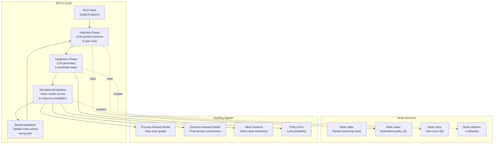
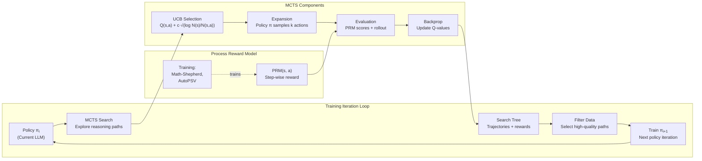
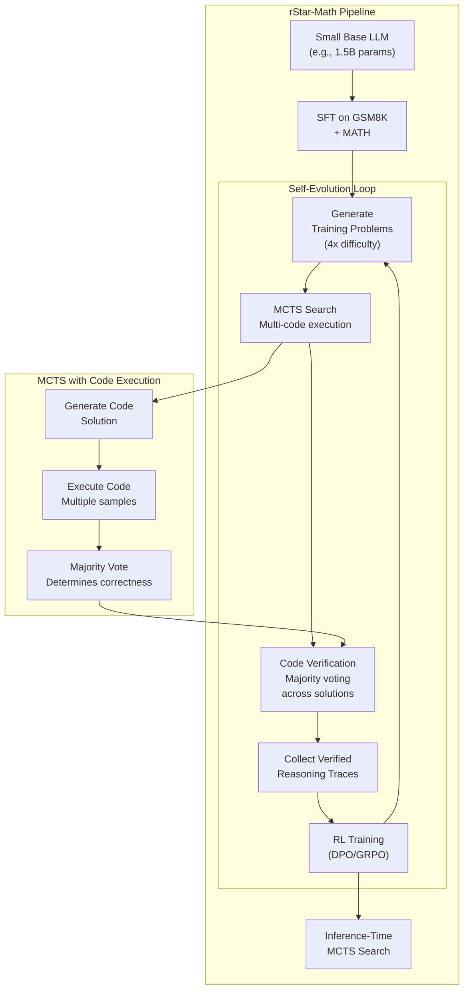
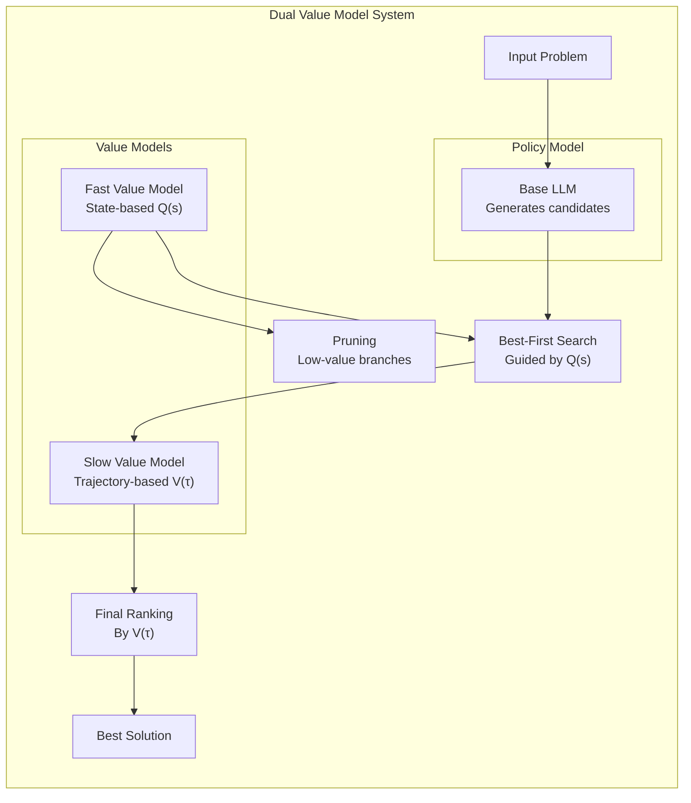
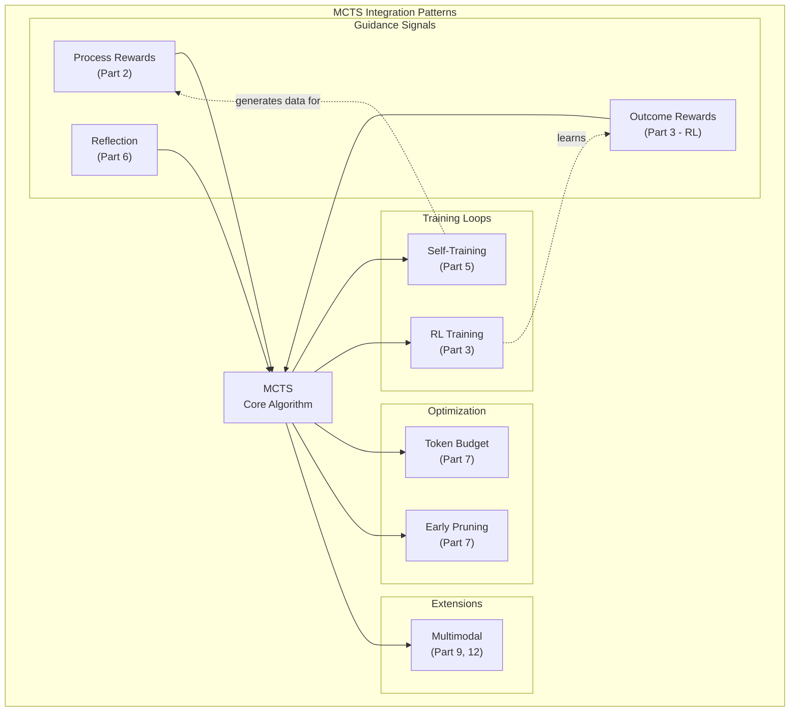
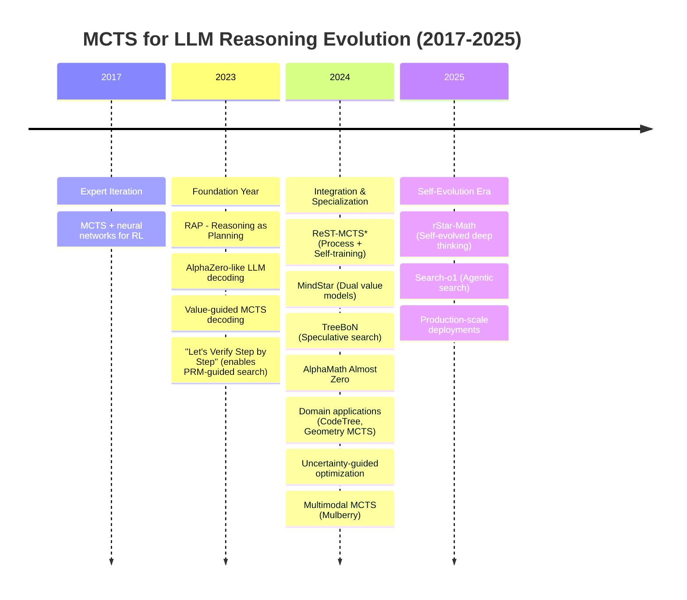
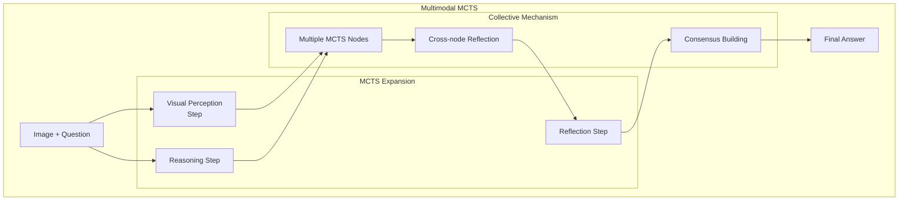
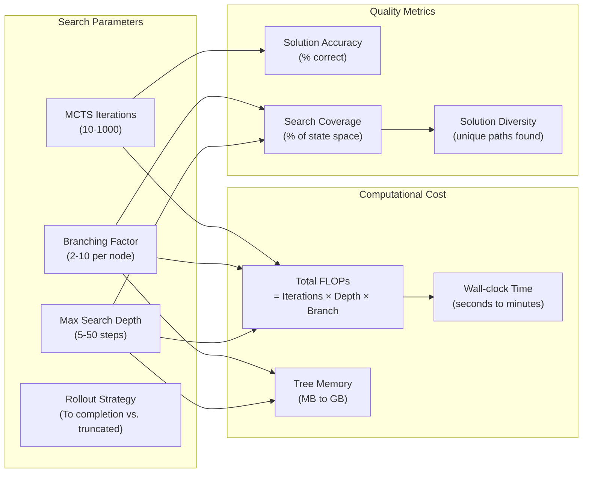

<!-- source: DeepWiki mcp.deepwiki.com · repo zzli2022/Awesome-System2-Reasoning-LLM · page 4.4 MCTS and Tree Search · fetched 2026-10-30 -->

# MCTS and Tree Search

<details>
<summary>Relevant source files</summary>

The following files were used as context for generating this wiki page:

- [README.md](README.md)
- [assets/paper.json](assets/paper.json)
- [src/list.md](src/list.md)

</details>


## Purpose and Scope

This page documents Monte Carlo Tree Search (MCTS) and related tree search algorithms as applied to Large Language Model reasoning. These techniques enable structured exploration of reasoning paths, combining search-based planning with neural language generation to achieve System 2 thinking capabilities.

**Scope**: This page covers MCTS algorithms, tree search variants (e.g., best-first search, beam search with backtracking), value-guided decoding, and their application to LLM reasoning tasks. For process-level supervision that guides these searches, see [Process Reward Models](#4.2). For self-training methods that utilize MCTS-generated data, see [Self-Training and Self-Improvement](#4.5). For computational optimization of tree search, see [Efficient System2](#5.1).

**Sources**: [README.md:35](), [README.md:139-193]()

---

## Conceptual Foundation

Monte Carlo Tree Search adapts game-playing algorithms (notably from AlphaGo/AlphaZero) to language model reasoning. Instead of searching discrete board states, MCTS explores the space of partial reasoning chains, using the LLM to generate candidate continuations and learned value functions to estimate their quality.

### Core MCTS Operations for LLMs



**Key Differences from Game MCTS**:
- **State space**: Text sequences instead of board configurations
- **Actions**: Token sequences (reasoning steps) instead of discrete moves
- **Terminal states**: Solution verification rather than win/loss
- **Branching factor**: Controlled via top-k sampling rather than exhaustive
- **Evaluation**: Learned reward models or LLM self-verification

**Sources**: [README.md:141-145](), [assets/paper.json:220-239]()

---

## Major Algorithmic Variants

The field has developed several distinct approaches to tree search for LLM reasoning, each with specific design choices.

### Comparison of Key Methods

| Method | Guidance Signal | Training Data | Search Depth | Primary Use Case |
|--------|----------------|---------------|--------------|------------------|
| **RAP** (2023) | World model rewards | None (inference-only) | Fixed depth | Task planning, reasoning |
| **AlphaZero-LLM** (2023) | Self-play iterations | Generated trajectories | Full tree | Decoding optimization |
| **ReST-MCTS*** (2024) | Process reward model | Self-generated + filtering | Adaptive | Self-training pipeline |
| **rStar-Math** (2025) | Multi-code execution | Self-evolved data | Deep (iterative) | Mathematical reasoning |
| **MindStar** (2024) | Dual value models | None (inference-only) | Inference-time | Math problem solving |
| **TreeBoN** (2024) | Speculative search + BoN | Alignment data | Shallow tree | Inference-time alignment |
| **Mulberry** (2024) | Collective MCTS | Multimodal data | Collaborative | Vision-language reasoning |

**Sources**: [README.md:141-182](), [assets/paper.json:218-512]()

---

## ReST-MCTS*: Process-Reward Guided Self-Training

One of the most influential integration patterns combines MCTS with process reward models for iterative self-improvement.



**Algorithm: ReST-MCTS* Core Loop**

1. **Initialization**: Start with policy π₀ and trained PRM
2. **Generation Phase** (per problem):
   - Run MCTS for N iterations
   - Each iteration: Select → Expand → Evaluate (using PRM) → Backprop
   - Extract best trajectory via tree traversal
3. **Filtering Phase**:
   - Retain only trajectories with correct final answers
   - Filter by PRM scores (keep top percentile)
4. **Training Phase**:
   - Fine-tune π₀ on filtered trajectories → π₁
   - Repeat for multiple iterations

**Key Design Choices**:
- **Process rewards over outcome**: PRM provides dense supervision at each step
- **Self-consistency filtering**: Only keep correct solutions to prevent error propagation
- **Iterative refinement**: Each policy iteration improves over previous

**Paper Reference**: "ReST-MCTS*: LLM Self-Training via Process Reward Guided Tree Search" (NeurIPS 2024)

**Sources**: [README.md:78](), [README.md:175](), [assets/paper.json:55-60](), [assets/paper.json:409-414]()

---

## rStar-Math: Self-Evolved Deep Thinking

A more recent approach eliminates reliance on human-annotated process rewards by using code execution as the verification signal.



**Key Innovations**:
1. **Self-generated curriculum**: Model creates harder problems for itself
2. **Code as verifier**: Python execution provides ground-truth rewards
3. **Deep thinking at scale**: Small models (1.5B) achieve reasoning comparable to 10-100x larger models
4. **No human annotations**: Fully self-evolved from initial SFT checkpoint

**Paper Reference**: "rStar-Math: Small LLMs Can Master Math Reasoning with Self-Evolved Deep Thinking" (arXiv 2025-01)

**Sources**: [README.md:188](), [README.md:220](), [assets/paper.json:465-470]()

---

## Value-Guided Decoding

Several methods use learned value functions to guide tree search without full MCTS iterations, enabling efficient inference-time reasoning.

### MindStar Architecture



**Dual Value Approach**:
- **Fast value model**: Quickly estimates state quality for pruning
- **Slow value model**: Accurately evaluates complete trajectories for ranking
- **Separation of concerns**: Efficiency during search, accuracy during selection

**Sources**: [README.md:153](), [assets/paper.json:353-358]()

---

## Domain-Specific Applications

MCTS has been successfully adapted to various reasoning domains beyond pure mathematics.

### Application Matrix

| Domain | Paper | Key Adaptation | Search Strategy |
|--------|-------|----------------|-----------------|
| **Mathematical Reasoning** | AlphaMath Almost Zero | No process labels | Reward-free search |
| **Code Generation** | CodeTree, SRA-MCTS | Agent-guided expansion | Syntax-aware tree |
| **Olympiad Geometry** | Geometry MCTS | Symbolic constraints | Guided tree search |
| **Instruction Following** | SPaR | Refinement loops | Self-play search |
| **Multimodal Math** | AtomThink, Mulberry | Image + text states | Collective search |
| **Medical Reasoning** | HuatuoGPT-o1 | Domain knowledge | Specialized PRM |
| **Financial Analysis** | GPT-Guided MCTS | Symbolic regression | Domain-specific ops |

**Sources**: [README.md:151-182](), [assets/paper.json:423-477]()

---

## Integration with Other Methodologies

MCTS naturally combines with other System 2 reasoning techniques documented in this repository.



### Cross-Part Connections

1. **MCTS + Process Rewards ([Part 2](#4.2))**:
   - Papers: ReST-MCTS*, Math-Shepherd, AutoPSV
   - Pattern: PRM provides per-step guidance for MCTS value estimation
   - Data flow: MCTS generates trajectories → PRM filters quality data

2. **MCTS + Self-Training ([Part 5](#4.5))**:
   - Papers: ReST-MCTS*, rStar-Math, STaR
   - Pattern: MCTS explores → Filter trajectories → Train next iteration
   - Closes the loop: Better policy → Better MCTS → Better data

3. **MCTS + Reinforcement Learning ([Part 3](#4.3))**:
   - Papers: DeepSeek-R1, Kimi k1.5 (implicitly use search)
   - Pattern: MCTS provides exploration, RL provides policy optimization
   - Integration: MCTS trajectories as RL training data

4. **MCTS + Reflection ([Part 6](#4.6))**:
   - Papers: Mulberry, Marco-o1, LLaMA-Berry
   - Pattern: MCTS nodes include self-critique steps
   - Enhancement: Reflection improves node expansion quality

5. **MCTS + Efficiency ([Part 7](#5.1))**:
   - Papers: O1-Pruner, DynaThink, Token-Budget-Aware
   - Pattern: Adaptive search depth, early termination
   - Tradeoff: Search breadth vs. computational cost

**Sources**: [README.md:32-43](), Multiple sections across README.md

---

## Research Evolution Timeline



### Capability Progression

| Period | Key Capability | Representative Work |
|--------|---------------|---------------------|
| **2017-2022** | Basic tree search for RL | Expert Iteration, STaR |
| **2023 Q1-Q2** | Task planning with world models | RAP, AlphaZero-LLM |
| **2023 Q3-Q4** | Value-guided decoding | Value-MCTS, PPO-MCTS |
| **2024 Q1-Q2** | Process-reward guided search | ReST-MCTS*, AlphaMath |
| **2024 Q3-Q4** | Domain specialization | CodeTree, Geometry MCTS, Mulberry |
| **2025 Q1+** | Self-evolved systems | rStar-Math, Search-o1 |

**Sources**: [README.md:139-193](), [assets/paper.json:218-512]()

---

## Representative Implementations

### RAP (Reasoning with Language Model is Planning with World Model)

**Core Idea**: Treat reasoning as sequential decision-making where LLM acts as both policy (action generator) and world model (state transition predictor).

**Architecture**:
- **State**: Reasoning chain prefix
- **Action**: Next reasoning step (text)
- **World Model**: LLM self-evaluates "what happens next"
- **Reward**: Task-specific heuristics (e.g., correctness likelihood)
- **Search**: MCTS with UCB for exploration

**Paper**: "Reasoning with Language Model is Planning with World Model" (EMNLP 2023)

**Sources**: [README.md:141](), [assets/paper.json:220-225]()

---

### AlphaZero-like LLM Decoding

**Core Idea**: Apply AlphaZero's self-play framework to language model decoding, where the LLM serves as both policy and value network.

**Key Modifications**:
- **Policy prior**: LLM token probabilities (not uniform)
- **Value network**: Separate head or self-evaluation
- **Terminal reward**: Task completion (not game outcome)
- **Training**: Self-play generates improved decoding trajectories

**Paper**: "Alphazero-like Tree-Search can Guide Large Language Model Decoding and Training" (NeurIPS Workshop 2023)

**Sources**: [README.md:144-145](), [assets/paper.json:234-239]()

---

### Value-Guided Monte-Carlo Tree Search Decoding

**Core Idea**: Use a learned value model to guide MCTS during decoding, improving over pure PPO sampling.

**Components**:
- **Value model**: Trained to predict trajectory quality
- **MCTS decoding**: Explores token sequences as tree nodes
- **Integration with PPO**: Value model trained alongside PPO policy
- **Inference**: MCTS selects optimal completion using value estimates

**Paper**: "Don't throw away your value model! Generating more preferable text with Value-Guided Monte-Carlo Tree Search decoding" (CoLM 2024)

**Sources**: [README.md:174](), [assets/paper.json:241-246]()

---

### Mulberry: Collective MCTS for Multimodal Reasoning

**Core Idea**: Extend MCTS to multimodal settings (vision + language) with collective reflection across multiple reasoning paths.

**Architecture**:


**Key Features**:
- **Multimodal states**: Include both visual and textual information
- **Collective reflection**: Nodes critique each other's reasoning
- **o1-like capabilities**: Step-by-step reasoning with reflection

**Paper**: "Mulberry: Empowering MLLM with o1-like Reasoning and Reflection via Collective Monte Carlo Tree Search" (arXiv 2024-12)

**Sources**: [README.md:178](), [assets/paper.json:248-253]()

---

## Theoretical Properties

### Convergence Guarantees

Recent work has established formal convergence properties of MCTS in the LLM reasoning setting.

**Key Results**:
- **Optimal value estimation**: MCTS converges to optimal Q-values under certain conditions (finite action space, Lipschitz rewards)
- **Convergence rate**: O(1/√N) for N simulations in discrete action MDPs
- **Practical implications**: Finite search budgets require careful tuning of exploration constants

**Paper**: "On the Convergence Rate of MCTS for the Optimal Value Estimation in Markov Decision Processes" (IEEE TAC 2025)

**Sources**: [README.md:186](), [assets/paper.json:416-421]()

---

## Uncertainty-Guided Variants

Several methods incorporate uncertainty quantification to improve search efficiency.

### Uncertainty Mechanisms

| Method | Uncertainty Source | Use in Search |
|--------|-------------------|---------------|
| **Uncertainty of Thoughts** | Ensemble of forward predictions | Prioritize exploration of uncertain states |
| **Uncertainty-Guided Optimization** | Prediction confidence intervals | Prune low-confidence branches early |
| **LiteSearch** | Token-level uncertainty | Adaptive depth per branch |

**Common Pattern**: Use model uncertainty to:
1. **Focus exploration**: Search more in uncertain regions
2. **Early stopping**: Terminate confident branches sooner
3. **Resource allocation**: Spend more compute on uncertain paths

**Sources**: [README.md:150](), [README.md:160-161](), [README.md:158]()

---

## Practical Considerations

### Computational Tradeoffs



### Typical Configurations

**Math Reasoning** (e.g., GSM8K, MATH):
- Iterations: 50-200
- Branching: 3-5 candidates per node
- Depth: 10-30 reasoning steps
- Guidance: Process reward model or code execution

**Code Generation**:
- Iterations: 20-100
- Branching: 2-4 code candidates
- Depth: 5-15 code blocks
- Guidance: Syntax checker + test execution

**Multimodal Reasoning**:
- Iterations: 30-100
- Branching: 3-6 reasoning paths
- Depth: 8-20 steps
- Guidance: Vision-language reward model

**Sources**: Multiple papers across [README.md:139-193]()

---

## Implementation Patterns

### Common Code Structure

Most MCTS implementations for LLMs follow this general pattern:

```
class MCTSNode:
    - state: str  # Partial reasoning chain
    - children: List[MCTSNode]
    - visits: int
    - value: float  # Q-value estimate
    - prior: float  # Policy probability
    
class MCTSReasoner:
    
    def search(problem: str, num_iterations: int) -> str:
        root = MCTSNode(state=problem)
        
        for _ in range(num_iterations):
            # Selection: UCB traversal
            leaf = select_leaf(root)
            
            # Expansion: LLM generates candidates
            candidates = llm.generate(leaf.state, n=k)
            leaf.children = [MCTSNode(c) for c in candidates]
            
            # Evaluation: Reward model scores
            for child in leaf.children:
                child.value = reward_model(child.state)
            
            # Backpropagation: Update ancestors
            backpropagate(leaf, child.value)
        
        # Extract best path
        return extract_best_trajectory(root)
    
    def select_leaf(node: MCTSNode) -> MCTSNode:
        while node.children:
            # UCB formula: Q + c * sqrt(log(N_parent) / N_child)
            node = max(node.children, key=ucb_score)
        return node
```

**Key Functions**:
- `select_leaf()`: UCB-based traversal
- `llm.generate()`: Policy expansion
- `reward_model()`: Value estimation (PRM, outcome, or code execution)
- `backpropagate()`: Update Q-values up the tree
- `extract_best_trajectory()`: Final path selection (max visits or max value)

**Sources**: Inferred from paper descriptions in [README.md:139-193]()

---

## Relation to Other Parts

### Part 2: Process Reward Models
- **Dependency**: MCTS relies on PRMs for step-wise evaluation
- **Data flow**: MCTS → trajectories → PRM training data
- **Papers**: ReST-MCTS*, AutoPSV, Math-Shepherd

### Part 3: Reinforcement Learning  
- **Synergy**: MCTS exploration + RL policy learning
- **Pattern**: MCTS as data generator for RL training
- **Papers**: DeepSeek-R1, Kimi k1.5 (use search internally)

### Part 5: Self-Training
- **Core integration**: MCTS generates training data for self-improvement
- **Loop**: Policy → MCTS search → Filtered data → Next policy
- **Papers**: ReST-MCTS*, rStar-Math, STaR + MCTS

### Part 6: Reflection
- **Enhancement**: MCTS nodes include reflection steps
- **Pattern**: Self-critique at expansion or evaluation
- **Papers**: Mulberry, Marco-o1, LLaMA-Berry

### Part 7: Efficient System2
- **Optimization target**: Reduce MCTS computational cost
- **Techniques**: Adaptive depth, early pruning, token budgeting
- **Papers**: O1-Pruner, DynaThink, TreeBoN

### Part 9-12: Multimodal Extensions
- **Adaptation**: MCTS for vision-language reasoning
- **Challenges**: Multimodal state representation, value estimation
- **Papers**: Mulberry, Virgo, AtomThink

**Sources**: [README.md:32-43](), cross-references across all parts

---

## Key Research Papers

### Foundational Works (2017-2023)

| Paper | Venue | Key Contribution |
|-------|-------|------------------|
| Expert Iteration | NeurIPS 2017 | MCTS + deep learning for RL |
| RAP | EMNLP 2023 | Reasoning as planning with world model |
| AlphaZero-like LLM Decoding | NeurIPS WS 2023 | Self-play MCTS for language |
| Value-Guided MCTS | arXiv 2023-09 | PPO + MCTS for better decoding |

### Integration Era (2024)

| Paper | Venue | Key Contribution |
|-------|-------|------------------|
| ReST-MCTS* | NeurIPS 2024 | Process rewards + self-training |
| MindStar | arXiv 2024-05 | Dual value models for math |
| AlphaMath Almost Zero | arXiv 2024-05 | Process-free MCTS |
| TreeBoN | arXiv 2024-10 | Speculative tree search |
| Mulberry | arXiv 2024-12 | Collective MCTS for multimodal |

### Self-Evolution Era (2025)

| Paper | Venue | Key Contribution |
|-------|-------|------------------|
| rStar-Math | arXiv 2025-01 | Self-evolved deep thinking |
| Search-o1 | arXiv 2025-01 | Agentic search-enhanced reasoning |

**Sources**: [README.md:139-193](), [assets/paper.json:218-512]()

---

## Future Directions

Based on the current trajectory of research, key open problems include:

1. **Scalability**: Efficient MCTS for 100+ step reasoning chains
2. **Generalization**: Transfer learned value models across domains
3. **Multimodal**: Unified MCTS for vision-language-action reasoning
4. **Verification**: Better reward signals beyond code execution
5. **Meta-learning**: Learning when to use MCTS vs. direct generation

**Sources**: Inferred from research trends in [README.md:139-193]()

---

