<!-- source: DeepWiki mcp.deepwiki.com · repo zzli2022/Awesome-System2-Reasoning-LLM · page 4.5 Self-Training and Self-Improvement · fetched 2026-10-30 -->

# Self-Training and Self-Improvement

Relevant source files

The following files were used as context for generating this wiki page:

- [README.md](README.md)
- [assets/paper.json](assets/paper.json)
- [src/table.md](src/table.md)

This page documents self-training and self-improvement methodologies for Large Language Models, where systems generate their own training data and iteratively enhance reasoning capabilities without continuous human supervision. These bootstrapping techniques enable LLMs to autonomously improve through cycles of generation, filtering, and refinement.

**Scope**: This page covers Part 5 of the research taxonomy, focusing on methods that leverage model-generated data for training. For process-level supervision that guides these methods, see [Process Reward Models](#4.2). For tree-based exploration strategies often combined with self-training, see [MCTS and Tree Search](#4.4). For reinforcement learning approaches that may incorporate self-generated data, see [Reinforcement Learning](#4.3).

## Overview and Core Principles

Self-training for reasoning represents a paradigm shift from traditional supervised learning, enabling models to bootstrap their capabilities through iterative cycles of generation, evaluation, and retraining. The fundamental principle involves using the model's own outputs (filtered by correctness or reward signals) as training data for subsequent iterations.

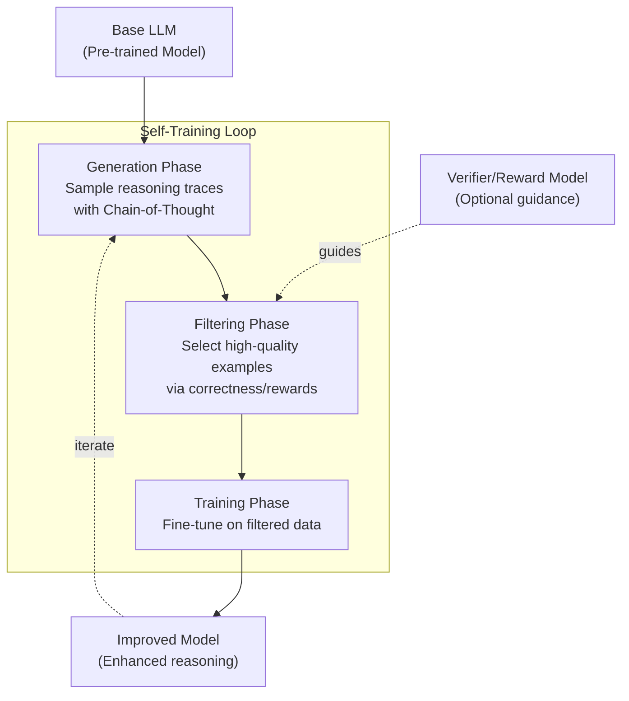

**Key Characteristics**:
- **Data Efficiency**: Generates training data without human annotation
- **Iterative Improvement**: Multiple training cycles compound improvements
- **Quality Control**: Filtering mechanisms ensure only correct/high-reward examples are retained
- **Scalability**: Can generate unlimited training data given computational resources

Sources: [README.md:194-224]()

## Foundational Methods

### Expert Iteration (ExIt)

The pioneering approach that established the self-training paradigm for reasoning systems, combining deep learning with tree search to iteratively improve policy and value networks.

**Mechanism**:
1. **Apprentice**: Neural network policy
2. **Expert**: Tree search algorithm (e.g., MCTS) that generates improved actions
3. **Imitation**: Apprentice learns from expert's decisions
4. **Iteration**: Process repeats with improved apprentice

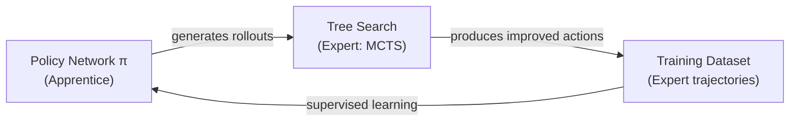

**Historical Context**: Published in NeurIPS 2017, ExIt laid the groundwork for modern self-training by demonstrating how to combine neural approximators with search algorithms to bootstrap performance.

Sources: [README.md:196](), [assets/paper.json:537-542]()

### STaR: Self-Taught Reasoner

STaR introduced the concept of bootstrapping reasoning by having the model rationalize correct answers, creating a self-supervised learning loop specifically for chain-of-thought reasoning.

**Algorithm**:
1. Generate reasoning chains for training problems
2. Filter for chains that arrive at correct answers
3. Fine-tune on correct reasoning chains
4. Repeat with improved model

**Key Innovation**: **Rationalization** - if initial reasoning fails but answer is eventually correct, the model learns to generate reasoning that leads to the correct answer, even if it differs from the original attempt.

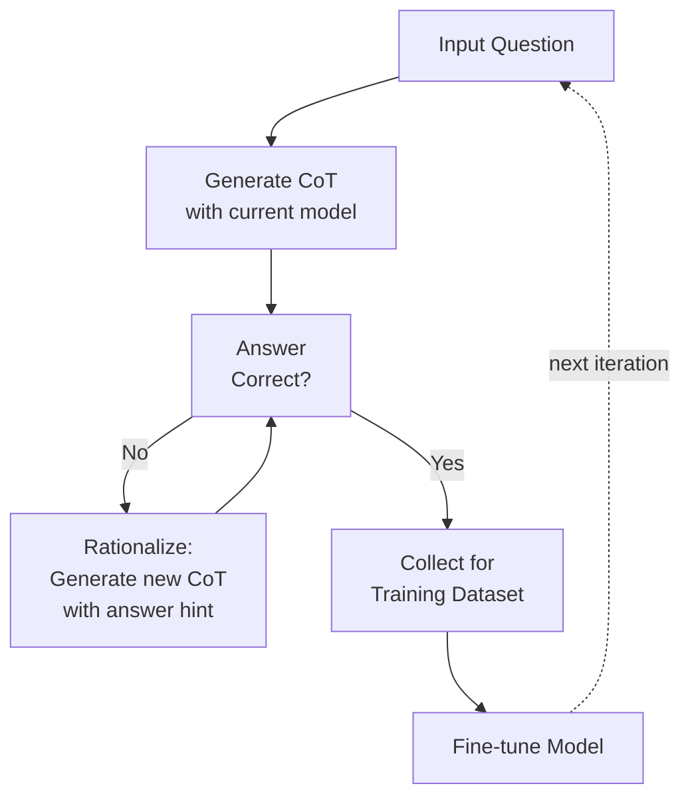

**Implementation Details**:
- Uses greedy decoding or sampling for generation
- Requires access to correct answers for filtering
- Typically runs 3-5 iterations before diminishing returns

Sources: [README.md:197](), [assets/paper.json:516-521]()

### ReST: Reinforced Self-Training

ReST extends self-training by incorporating reinforcement learning principles, using reward signals to guide the filtering and training process.

**Two-Phase Approach**:

1. **Grow Phase**: Generate multiple samples per problem, creating a diverse dataset
2. **Improve Phase**: Filter high-reward samples and fine-tune via supervised learning

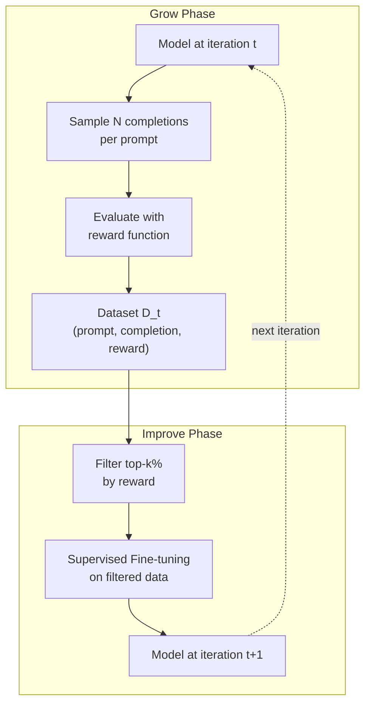

**Reward Functions**:
- **Outcome-based**: Correctness of final answer
- **Process-based**: Step-by-step verification (see [Process Reward Models](#4.2))
- **Hybrid**: Combination of outcome and process signals

Sources: [README.md:201](), [assets/paper.json:523-528]()

### ReST-EM: Expectation-Maximization Variant

ReST-EM (Expectation-Maximization) formulates self-training as an EM optimization problem, providing theoretical grounding for the iterative improvement process.

**Mathematical Framework**:
- **E-step**: Generate samples and compute expected rewards
- **M-step**: Update policy to maximize expected reward

**Practical Advantages**:
- Principled approach to balancing exploration and exploitation
- Handles partial credit through soft filtering
- Scales to problems without binary correct/incorrect labels

Sources: [README.md:215](), [assets/paper.json:530-535]()

## Advanced Self-Training Architectures

### V-star: Verifier-Augmented Self-Training

V-star enhances the self-training loop by explicitly training a verifier model to guide the selection of high-quality reasoning traces.

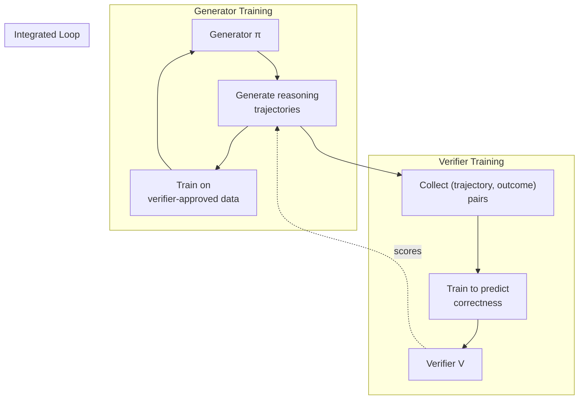

**Two-Model Architecture**:
1. **Generator**: Produces reasoning chains
2. **Verifier**: Evaluates quality of reasoning steps and final answers

**Training Dynamics**:
- Generator and verifier co-evolve
- Verifier provides fine-grained feedback beyond binary correctness
- Enables selection of partially correct trajectories for continued training

Sources: [README.md:203](), [assets/paper.json:551-556]()

### Quiet-STaR: Internal Reasoning Tokens

Quiet-STaR extends self-training to teach models to generate internal reasoning at every token position, not just for explicit reasoning prompts.

**Key Innovation**: Models learn to "think" before generating each token by:
1. Generating short internal thought sequences
2. Predicting next tokens based on thoughts
3. Training on predictions that improve accuracy

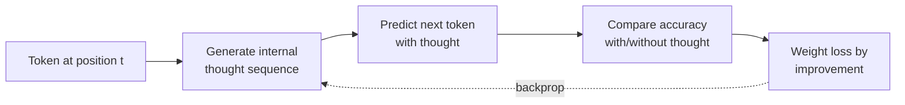

**Implementation**:
- Uses special thought tokens invisible to user
- Parallel generation of multiple thought candidates
- Mixture of thought lengths for efficiency
- REINFORCE-style training on successful thoughts

Sources: [README.md:204](), [assets/paper.json:544-549]()

### ReST-MCTS*: Process Reward Guided Tree Search

ReST-MCTS* represents a sophisticated integration of self-training with Monte Carlo Tree Search and process reward models, creating a powerful synergy between multiple System 2 techniques.

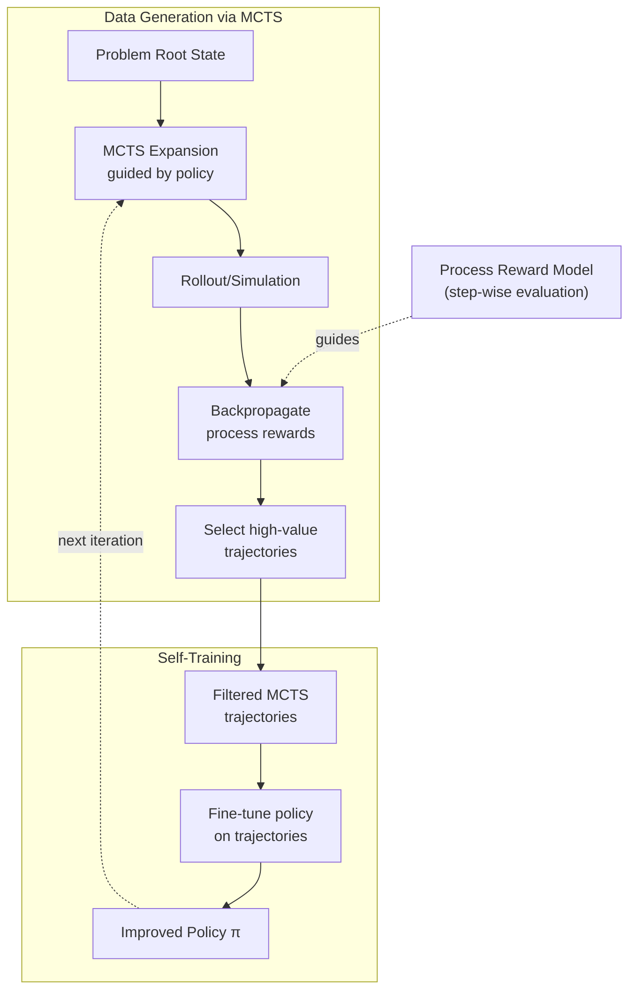

**Three-Component Integration**:
1. **MCTS**: Explores reasoning space systematically (see [MCTS and Tree Search](#4.4))
2. **Process Rewards**: Evaluates each reasoning step (see [Process Reward Models](#4.2))
3. **Self-Training**: Distills search results into policy

**Advantages**:
- Process rewards provide richer signal than outcome-only feedback
- Tree search explores beyond model's current policy
- Self-training distills expensive search into fast inference
- Iterative improvement compounds benefits

Sources: [README.md:78](), [README.md:212](), [assets/paper.json:55-60](), [assets/paper.json:572-577]()

### rStar-Math: Self-Evolved Deep Thinking

rStar-Math demonstrates self-training at scale for mathematical reasoning, enabling small LLMs to achieve state-of-the-art performance through self-evolution.

**Multi-Stage Pipeline**:

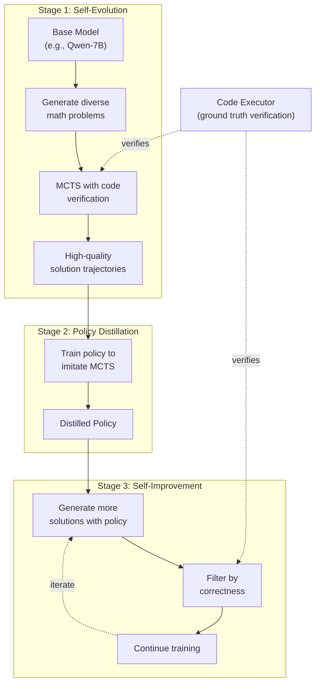

**Key Features**:
- **Problem Generation**: Model creates diverse training problems
- **Code Verification**: Uses executable code for ground truth checking
- **Deep Thinking**: Long reasoning chains via MCTS exploration
- **Iterative Refinement**: Multiple self-training cycles

**Results**: Achieves competitive performance with models 10-100x larger through intensive self-training.

Sources: [README.md:188](), [README.md:220](), [README.md:239](), [assets/paper.json:465-470](), [assets/paper.json:593-598]()

## Self-Correction and Reflection Integration

### Self-Refine: Iterative Refinement with Feedback

Self-Refine introduces a feedback loop where models critique and improve their own outputs without external supervision.

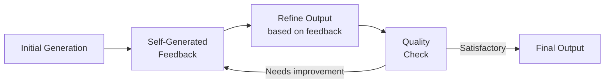

**Three-Step Process**:
1. **Generate**: Produce initial output
2. **Feedback**: Model critiques its own output
3. **Refine**: Model improves based on self-critique

**Application to Self-Training**: Self-Refine outputs can be used as higher-quality training data for subsequent iterations.

Sources: [README.md:200](), [README.md:202](), [assets/paper.json:607-612]()

### CRITIC: Tool-Interactive Critiquing

CRITIC enhances self-correction by enabling models to interact with external tools during the critique phase.

**Architecture**:
1. **Generate**: Produce initial reasoning/code
2. **Verify**: Use external tools (code executors, search engines) to check
3. **Critique**: Generate feedback based on verification results
4. **Refine**: Improve output incorporating critique

**Tool Integration**:
- Code execution environments
- Search engines for fact-checking
- Calculators for numerical verification
- APIs for domain-specific validation

This approach bridges self-training with tool use, enabling more reliable self-improvement cycles.

Sources: [README.md:205](), [README.md:209](), [assets/paper.json:614-619]()

### Recursive Introspection

Recursive Introspection teaches models to introspect on their reasoning process at multiple levels of abstraction.

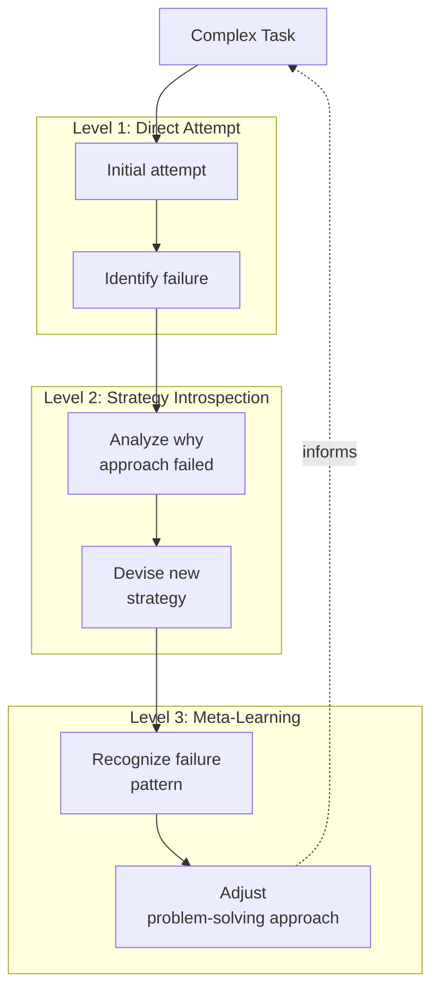

**Hierarchical Improvement**:
- **Level 1**: Improve specific solution
- **Level 2**: Improve solution strategy
- **Level 3**: Improve meta-strategy for problem-solving

**Training**: Self-generated examples of successful introspection become training data.

Sources: [README.md:213](), [assets/paper.json:579-584]()

## Exploration-Exploitation Balance

### B-STaR: Balanced Self-Taught Reasoner

B-STaR addresses a critical challenge in self-training: balancing exploration of new reasoning paths with exploitation of known successful patterns.

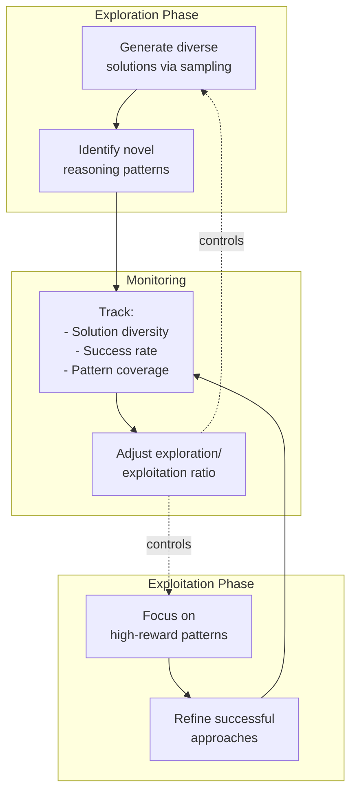

**Key Mechanisms**:
- **Diversity Metrics**: Monitor variety in generated solutions
- **Temperature Scheduling**: Adjust sampling temperature based on metrics
- **Curriculum Learning**: Gradually increase problem difficulty
- **Pattern Tracking**: Ensure coverage of different reasoning approaches

**Prevents**: Mode collapse where model converges to limited set of reasoning patterns.

Sources: [README.md:214](), [README.md:247](), [assets/paper.json:586-591]()

## Domain-Specific Self-Training

### Vision-Language Self-Training

Self-training extends to multimodal reasoning, where models generate and learn from their own visual reasoning trajectories.

**Challenges**:
- Verification requires understanding both visual and textual content
- Longer reasoning chains needed for visual understanding
- More complex feedback signals (spatial, relational, etc.)

**Approaches**:
- Generate image descriptions and verify via question-answering
- Create reasoning chains that explicitly reference visual elements
- Use code execution for geometric/spatial reasoning verification

Sources: [README.md:206](), [README.md:346](), [assets/paper.json:600-605]()

### Neural-Symbolic Self-Training

Interactive Evolution combines neural generation with symbolic reasoning for self-training.

**Hybrid Framework**:
1. **Neural Component**: Generates candidate reasoning
2. **Symbolic Component**: Verifies logical consistency
3. **Integration**: Symbolic feedback guides neural training

**Advantages**:
- Logical correctness guaranteed for symbolic portions
- Neural flexibility for pattern matching
- Self-training data has formal guarantees

Sources: [README.md:207](), [assets/paper.json:558-563]()

## Data Flow and System Integration

### Self-Training Data Pipeline

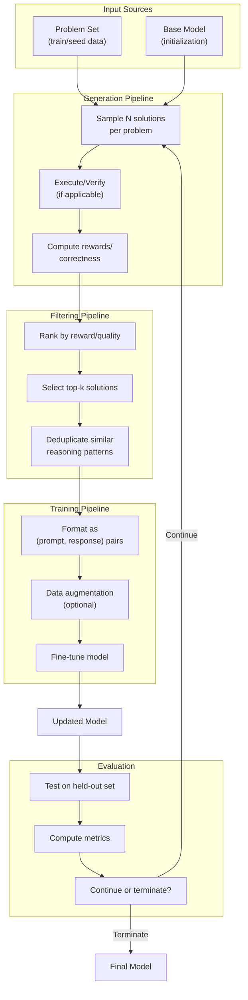

**Critical Parameters**:
- **N (samples per problem)**: Higher N increases diversity but costs more compute
- **k (selection threshold)**: Lower k means stricter filtering
- **Deduplication strategy**: Prevents overfitting to specific reasoning patterns
- **Iteration count**: Typically 3-5 iterations optimal

Sources: [README.md:194-224]()

## Integration with Other System 2 Components

### Self-Training + Process Reward Models

Process Reward Models (PRMs) provide fine-grained supervision for self-training, enabling step-level filtering.

**Integration Pattern**:
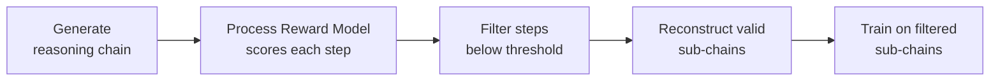

**Benefits**:
- Learn from partially correct solutions
- More training data (step-level vs trajectory-level)
- Better credit assignment

See [Process Reward Models](#4.2) for detailed PRM architectures.

Sources: [README.md:68-97](), [README.md:212]()

### Self-Training + MCTS

Monte Carlo Tree Search provides exploration mechanism for self-training data generation.

**Synergy**:
1. **MCTS explores** beyond current policy distribution
2. **PRM guides** MCTS node evaluation
3. **Self-training distills** MCTS search into fast policy
4. **Improved policy** makes MCTS more efficient

**Implementation** (ReST-MCTS*):
- Use current policy as MCTS prior
- Expand tree with policy-guided selection
- Evaluate nodes with process rewards
- Collect high-value trajectories for training
- Repeat with improved policy

See [MCTS and Tree Search](#4.4) for search algorithms.

Sources: [README.md:139-193](), [README.md:212]()

### Self-Training + Reinforcement Learning

Self-training can be viewed as offline RL with model-generated data.

**Relationship**:
- **Self-training**: Generate data, filter, supervised learning
- **RL**: Generate data, compute rewards, policy gradient updates

**Hybrid Approaches**:
- Use RL to optimize data generation strategy
- Use self-training to pre-train before expensive RL
- Alternate between self-training and RL phases

See [Reinforcement Learning](#4.3) for RL techniques.

Sources: [README.md:98-138]()

## Practical Considerations and Implementation

### Computational Costs

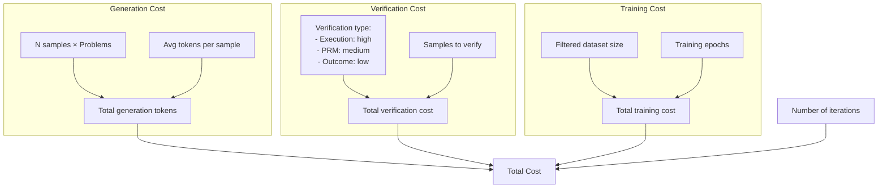

**Cost Optimization Strategies**:
- **Early stopping**: Monitor held-out performance
- **Adaptive sampling**: Generate fewer samples for easy problems
- **Cached verification**: Reuse verification results across iterations
- **Progressive filtering**: Quick heuristic filter before expensive verification

### Failure Modes and Mitigation

**Common Issues**:

1. **Mode Collapse**: Model converges to single reasoning pattern
   - *Mitigation*: Diversity penalties, temperature scheduling (B-STaR approach)

2. **Distribution Shift**: Generated data differs from target distribution
   - *Mitigation*: Mix self-generated and human data, regularization

3. **Reward Hacking**: Model exploits verification mechanism
   - *Mitigation*: Robust verification, multiple verification sources

4. **Diminishing Returns**: Performance plateaus after few iterations
   - *Mitigation*: Increase problem difficulty, curriculum learning

5. **Quality Degradation**: Model forgets capabilities
   - *Mitigation*: Mix replay data, catastrophic forgetting prevention

### Hyperparameter Guidelines

| Parameter | Typical Range | Notes |
|-----------|---------------|-------|
| Samples per problem (N) | 16-256 | Higher for harder problems |
| Selection threshold (k) | top 10-50% | Stricter for more data |
| Learning rate | 1e-6 to 1e-5 | Lower than initial training |
| Iterations | 3-5 | Diminishing returns after |
| Temperature | 0.7-1.0 | Higher for exploration |
| Max sequence length | 2048-8192 | Depends on reasoning depth |

Sources: [README.md:194-224]()

## Recent Advances (2024-2025)

### Self-Evolved Deep Thinking (rStar-Math)

Recent work demonstrates that small models can achieve strong reasoning through intensive self-training:

**Key Results**:
- 7B model approaches GPT-4 level on math benchmarks
- Requires 10-100x more training compute than base model
- Achieves 90%+ accuracy on competition math problems

**Innovations**:
- Self-generated problem sets
- Multi-stage training pipeline
- Code-based verification for mathematical correctness

Sources: [README.md:220](), [README.md:239]()

### Genius Framework

Generalizable and Purely Unsupervised Self-Training for advanced reasoning.

**Features**:
- No human annotations required at any stage
- Automatic difficulty calibration
- Cross-domain transfer of reasoning skills
- Unified framework for multiple reasoning types

Sources: [README.md:223]()

### START: Self-Taught Reasoner with Tools

Extension of self-training that incorporates tool use:

**Components**:
1. Generate reasoning with tool calls
2. Execute tools and collect results
3. Filter successful tool-augmented reasoning
4. Train on successful trajectories

**Tools Integrated**:
- Code interpreters
- Search engines
- Calculators
- Domain-specific APIs

Sources: [README.md:224]()

## Evaluation Metrics

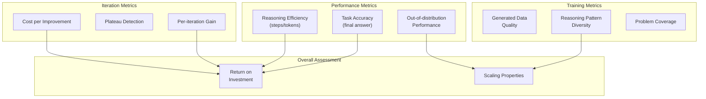

**Key Metrics to Track**:
- **Pass@1**: Accuracy with single sample
- **Pass@K**: Accuracy with K samples (measures exploration)
- **Improvement Rate**: Gain per iteration
- **Cost Efficiency**: Performance gain per compute unit
- **Data Efficiency**: Performance vs training examples

Sources: [README.md:351-433]()

## Comparison with Other Approaches

| Aspect | Self-Training | Supervised Learning | Reinforcement Learning | MCTS |
|--------|---------------|---------------------|----------------------|------|
| **Data Source** | Model-generated | Human-annotated | Reward signal | Search |
| **Supervision** | Self-supervised | Fully supervised | Reward-based | Value-based |
| **Scalability** | High (infinite data) | Limited (human cost) | Medium | Medium |
| **Quality Control** | Via filtering | Human quality | Via rewards | Via search |
| **Compute Cost** | Medium-High | Low | High | Very High |
| **Inference Cost** | Low (distilled) | Low | Low | High |

**When to Use Self-Training**:
- ✓ Have good verification mechanism (executability, formal specs)
- ✓ Need to scale beyond human-annotated data
- ✓ Can afford generation and filtering costs
- ✓ Have iterative training budget
- ✗ No reliable verification available
- ✗ Need guaranteed quality
- ✗ Limited computational resources

Sources: [README.md:1-44]()

## Future Directions

**Open Research Questions**:

1. **Optimal Iteration Strategy**: When to stop self-training? How to detect saturation?

2. **Multi-Task Self-Training**: Can self-training on one reasoning task improve others?

3. **Verification Scaling**: As models improve, verification becomes harder - how to scale verification?

4. **Theoretical Foundations**: What guarantees exist for self-training convergence and quality?

5. **Efficiency**: Can we reduce computational costs while maintaining benefits?

6. **Safety**: How to prevent self-training from amplifying undesired behaviors?

**Emerging Trends**:
- Integration with test-time compute (see [Efficient System2](#5.1))
- Combination with multimodal reasoning (see [Multimodal Extensions](#6))
- Application to agent systems and long-horizon tasks
- Self-training for alignment and safety (see [Reasoning and Safety](#7.2))

Sources: [README.md:1-44]()

---

