<!-- source: DeepWiki mcp.deepwiki.com · repo zzli2022/Awesome-System2-Reasoning-LLM · page 4.6 Reflection Mechanisms · fetched 2026-10-30 -->

# Reflection Mechanisms

<details>
<summary>Relevant source files</summary>

The following files were used as context for generating this wiki page:

- [README.md](README.md)
- [assets/paper.json](assets/paper.json)
- [src/list.md](src/list.md)

</details>


## Purpose and Scope

This document covers **Part 6: Reflection** from the Awesome-System2-Reasoning-LLM repository, focusing on self-correction capabilities that enable LLMs to critique, evaluate, and refine their own reasoning steps. Reflection mechanisms represent a critical component of System 2 reasoning, allowing models to detect errors and improve outputs through iterative self-assessment.

**Related topics:** For process-level evaluation using external reward models, see [Process Reward Models](#4.2). For bootstrapping methods that generate training data via self-improvement, see [Self-Training and Self-Improvement](#4.5). For tree search algorithms that explore multiple reasoning paths, see [MCTS and Tree Search](#4.4). This page specifically addresses mechanisms where the model acts as its own critic during or after generation.

**Sources:** [README.md:225-241]()

---

## Reflection in the System 2 Reasoning Pipeline

Reflection mechanisms occupy a unique position in the System 2 reasoning architecture, operating as both an inference-time and training-time capability. Unlike external verification (Process Reward Models) or exploration-based methods (MCTS), reflection involves the model directly evaluating and modifying its own outputs.

### Reflection Pipeline Architecture

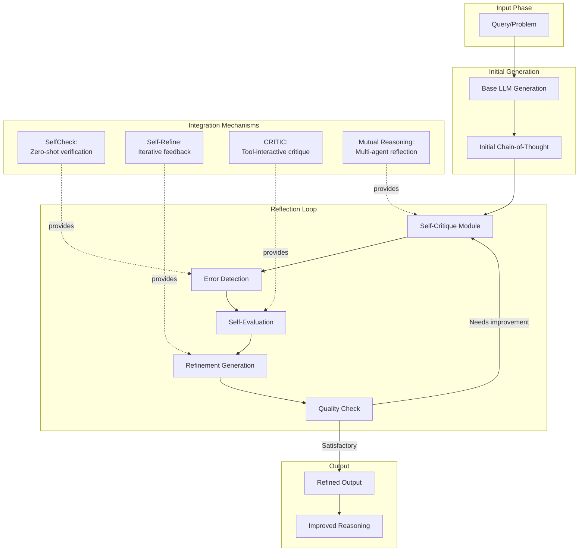

**Diagram: Reflection Loop Architecture**
The iterative cycle where models critique and refine their own outputs, with various mechanisms implementing different stages of the loop.

**Sources:** [README.md:225-241]()

---

## Core Reflection Patterns

Reflection mechanisms in the repository follow several distinct patterns, each addressing different aspects of self-correction.

### Pattern Taxonomy

| Pattern | Mechanism | Key Papers | Primary Use Case |
|---------|-----------|------------|------------------|
| **Zero-shot Self-Verification** | Model checks its own reasoning without additional training | SelfCheck | Step-by-step reasoning validation |
| **Iterative Refinement** | Multiple rounds of critique and improvement | Self-Refine, Reflection-Tuning | General output quality improvement |
| **Tool-Interactive Critique** | External tool feedback guides refinement | CRITIC | Factual correctness verification |
| **Multi-agent Reflection** | Multiple models critique each other | Mutual Reasoning | Enhanced problem-solving via collaboration |
| **Pairwise Optimization** | Comparative evaluation of solutions | LLaMA-Berry | Mathematical olympiad-level reasoning |
| **Vision-Language Reflection** | Multimodal self-improvement | LLaVA-o1, AtomThink, Mulberry | Visual reasoning correction |

**Sources:** [README.md:226-236](), [assets/paper.json:621-663]()

### Self-Verification Mechanisms

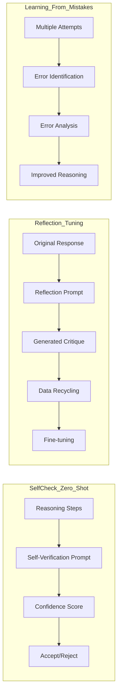

**Diagram: Self-Verification Pattern Implementations**
Three distinct approaches to enabling models to check their own work, ranging from zero-shot verification to training-based improvement.

**Sources:** [README.md:226-228](), [assets/paper.json:622-635]()

---

## Integration with Other Methodologies

Reflection mechanisms frequently combine with other System 2 techniques to create more powerful reasoning systems.

### Reflection + MCTS Integration

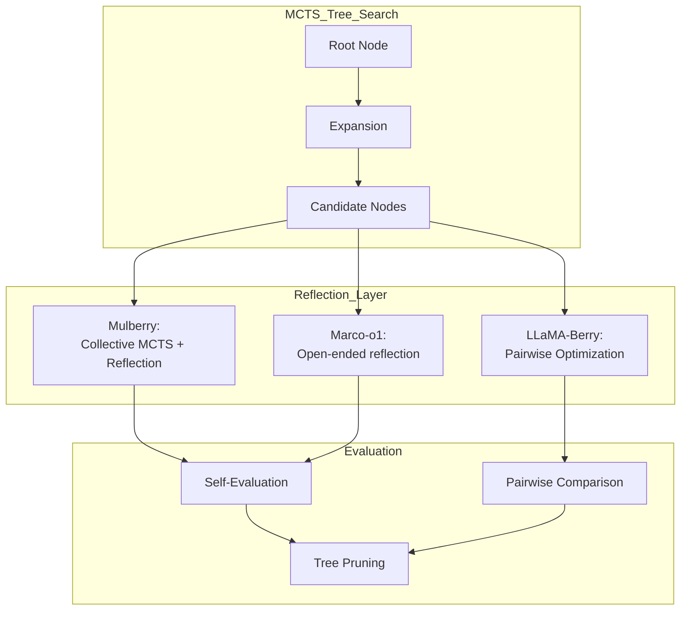

**Diagram: MCTS-Reflection Hybrid Systems**
Reflection mechanisms enhance tree search by providing better node evaluation and pruning strategies.

**Sources:** [README.md:230-234](), [assets/paper.json:248-252, 339-343]()

### Reflection + Self-Training Pipeline

The integration between reflection (Part 6) and self-training (Part 5) creates a powerful feedback loop where models use reflection to generate higher-quality training data.

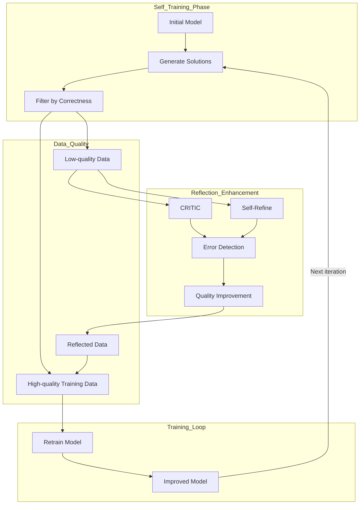

**Diagram: Self-Training Enhanced by Reflection**
Reflection mechanisms improve the quality of self-generated training data, creating a more effective self-improvement loop.

**Sources:** [README.md:225-241, 194-224]()

---

## Multimodal Reflection Systems

Recent work extends reflection mechanisms to vision-language models, enabling self-correction in multimodal reasoning tasks.

### Multimodal Reflection Architecture

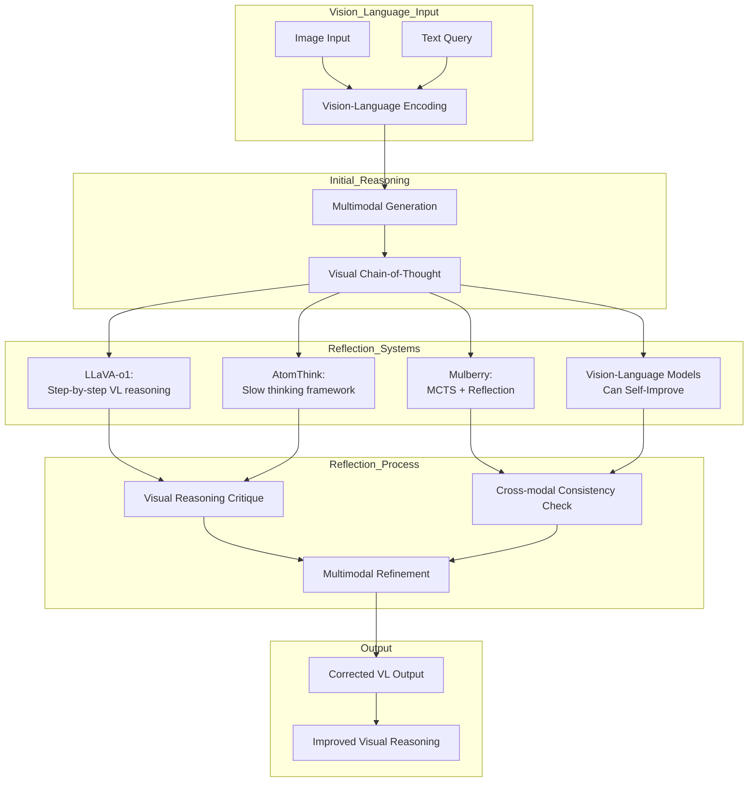

**Diagram: Multimodal Reflection Pipeline**
Extension of reflection mechanisms to handle visual reasoning tasks, with specialized critique and refinement for vision-language models.

**Sources:** [README.md:232-236](), [assets/paper.json:658-663, 762-809]()

### Key Multimodal Reflection Papers

| System | Innovation | Modality | Year |
|--------|-----------|----------|------|
| **LLaVA-o1** | Step-by-step visual reasoning with reflection | Vision-Language | 2024-11 |
| **AtomThink** | Slow thinking framework for mathematical visual reasoning | Vision-Language-Math | 2024-11 |
| **Mulberry** | Collective MCTS with multimodal reflection | Vision-Language | 2024-12 |
| **Vision-Language Models Can Self-Improve** | Self-improvement via visual reflection | Vision-Language | 2024-11 |

**Sources:** [README.md:235-236](), [assets/paper.json:658-663]()

---

## Reflection Mechanisms in O1-like Systems

Reflection plays a critical role in O1 replication efforts (Part 1), where it provides the self-correction capability necessary for expert-level reasoning.

### O1 Reflection Integration

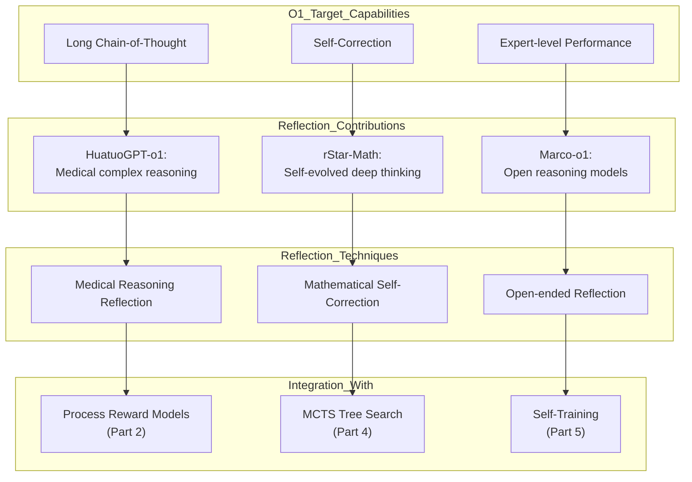

**Diagram: Reflection in O1 Replication Systems**
How reflection mechanisms contribute to achieving O1-like capabilities across different domains.

**Sources:** [README.md:237-240](), [README.md:45-67]()

---

## Technical Implementation Patterns

### Basic Reflection Prompt Structure

Reflection systems typically follow this general prompt pattern:

```
Initial Generation Phase:
  1. Generate initial reasoning/solution
  2. Output step-by-step chain-of-thought

Reflection Phase:
  1. Critique the initial solution
  2. Identify specific errors or weaknesses
  3. Explain what improvements are needed
  
Refinement Phase:
  1. Generate improved solution
  2. Incorporate insights from critique
  3. Verify improvements address identified issues
```

**Sources:** [README.md:226-241]()

### Reflection Data Structure Flow

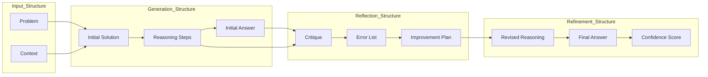

**Diagram: Data Flow in Reflection Systems**
The structured information flow from initial generation through reflection to refined output.

**Sources:** [README.md:225-241]()

---

## Reflection Training Strategies

### Reflection-Tuning Approach

Reflection-Tuning ([README.md:227]()) introduces a data recycling strategy where reflection outputs become training data:

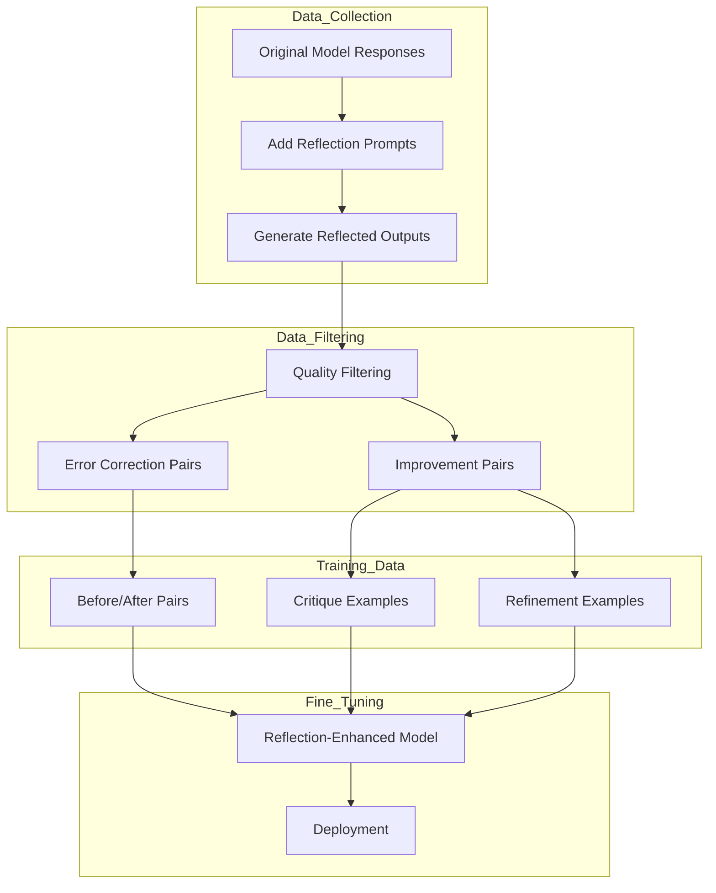

**Diagram: Reflection-Tuning Training Pipeline**
Converting reflection outputs into training data for teaching models to self-correct.

**Sources:** [README.md:227](), [assets/paper.json:630-634]()

---

## Mutual Reasoning Pattern

Multi-agent reflection enables smaller models to achieve stronger problem-solving through collaborative critique.

### Mutual Reasoning Architecture

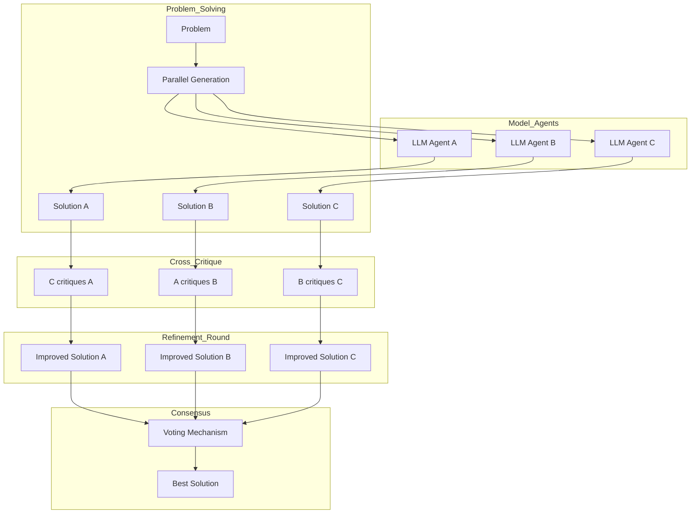

**Diagram: Mutual Reasoning Multi-Agent Reflection**
Multiple models critique each other's solutions, creating a collaborative refinement process.

**Sources:** [README.md:229](), [assets/paper.json:623-627]()

---

## Domain-Specific Reflection Applications

### Medical Reasoning Reflection

**HuatuoGPT-o1** ([README.md:237]()) demonstrates reflection for medical complex reasoning:

- **Medical Knowledge Integration:** Reflection prompts incorporate medical knowledge bases
- **Multi-step Clinical Reasoning:** Critique focuses on diagnostic logic and treatment plans
- **Safety Validation:** Additional reflection layer for medical safety checks

### Mathematical Reasoning Reflection

**rStar-Math** ([README.md:239]()) applies self-evolved deep thinking with reflection:

- **Step-by-step Verification:** Each mathematical step undergoes self-verification
- **Error Pattern Learning:** Model learns common error patterns through reflection
- **Theorem Application Check:** Reflects on correctness of theorem/formula application

**Sources:** [README.md:237-240]()

---

## Reflection vs. Related Mechanisms

Understanding the distinction between reflection and related methodologies:

| Mechanism | Primary Actor | When Applied | Data Required | Papers |
|-----------|--------------|--------------|---------------|--------|
| **Reflection** | Self-critique by same model | During/after generation | No external labels | Self-Refine, CRITIC, SelfCheck |
| **Process Reward Models** | External reward model | Step-wise evaluation | Human-labeled process data | Math-Shepherd, PRMBench |
| **Self-Training** | Model generates training data | Training time | Outcome correctness | STaR, ReST, V-star |
| **MCTS** | Tree search algorithm | Inference time exploration | Value function | RAP, MindStar, ReST-MCTS* |

**Sources:** [README.md:68-241]()

---

## Research Evolution Timeline

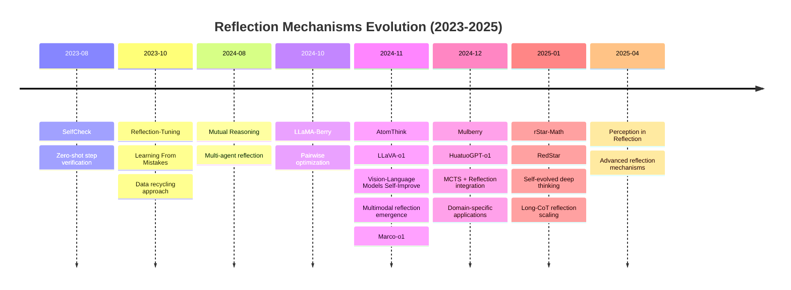

**Diagram: Timeline of Reflection Mechanisms Research**
Evolution from basic self-checking to sophisticated multimodal and domain-specific reflection systems.

**Sources:** [README.md:225-241](), [assets/paper.json:621-663]()

---

## Key Papers and Their Contributions

### Foundational Papers

1. **SelfCheck** ([README.md:226]())
   - Zero-shot step-by-step reasoning verification
   - No additional training required
   - Foundation for subsequent reflection work

2. **Self-Refine** ([README.md:200, 202]())
   - Iterative refinement with self-feedback
   - Multiple rounds of critique and improvement
   - General-purpose output enhancement

3. **CRITIC** ([README.md:205, 209]())
   - Tool-interactive critiquing
   - External tool feedback integration
   - Factual correctness verification

### Advanced Systems

4. **LLaMA-Berry** ([README.md:230]())
   - Pairwise optimization for mathematical reasoning
   - Olympiad-level problem solving
   - Comparative evaluation mechanism

5. **Mulberry** ([README.md:231]())
   - Collective MCTS with reflection
   - Multimodal o1-like capabilities
   - Integrated tree search and self-correction

6. **rStar-Math** ([README.md:239]())
   - Self-evolved deep thinking
   - Mathematical reasoning mastery
   - Small models achieving expert performance

**Sources:** [README.md:225-241](), [assets/paper.json:621-663]()

---

## Reflection in Efficient System2

Reflection mechanisms contribute to efficiency (Part 7) by reducing unnecessary computation through early error detection:

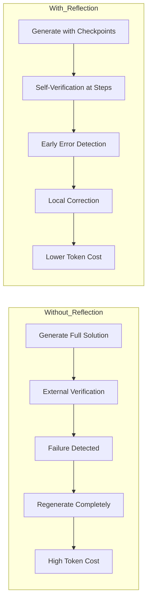

**Diagram: Reflection Efficiency Benefits**
Self-reflection enables early error detection and localized corrections, reducing computational cost compared to full regeneration.

**Sources:** [README.md:242-325]()

---

## Practical Implementation Considerations

### When to Use Reflection

Reflection mechanisms are most effective when:

1. **Error patterns are learnable:** The model can recognize its own common mistakes
2. **Reasoning is verifiable:** Correctness can be assessed without external labels
3. **Iterative improvement is possible:** Solutions can be refined incrementally
4. **Cost-performance tradeoff favors quality:** Extra generation cost is acceptable for better results

### Integration Patterns

Reflection can be integrated with:

- **Process Reward Models** ([README.md:68-97]()): Use PRM scores to trigger reflection
- **MCTS** ([README.md:139-193]()): Reflect on tree nodes before expansion
- **Self-Training** ([README.md:194-224]()): Use reflection to improve training data quality
- **RL Training** ([README.md:98-138]()): Reflection as part of the reward signal

**Sources:** [README.md:68-325]()

---

## Future Directions

Based on recent papers ([README.md:239-241]()), emerging research directions include:

1. **Long-CoT Reflection Scaling:** RedStar explores whether scaling long chain-of-thought data with reflection improves slow-reasoning systems

2. **Perception in Reflection:** New work on understanding how models perceive and reflect on their reasoning processes

3. **Cross-Modal Reflection:** Extending reflection to handle consistency across different modalities (vision, language, audio)

4. **Automated Reflection Learning:** Teaching models to develop their own reflection strategies without explicit prompting

**Sources:** [README.md:239-241]()

---

## Summary

Reflection mechanisms represent a critical self-correction capability in System 2 reasoning, enabling models to:

- **Detect errors** in their own reasoning through self-verification
- **Critique outputs** using iterative refinement patterns
- **Improve solutions** through multiple reflection rounds
- **Integrate with other techniques** (MCTS, self-training, PRMs) for enhanced reasoning
- **Extend to multimodal** vision-language tasks
- **Support O1-like systems** with self-correction capabilities

The field has evolved from basic zero-shot checking (SelfCheck) to sophisticated multimodal systems (Mulberry, LLaVA-o1) that combine reflection with tree search and reinforcement learning. Reflection continues to be a key component in achieving expert-level reasoning performance in LLMs.

**Sources:** [README.md:225-241](), [assets/paper.json:621-663]()

---

