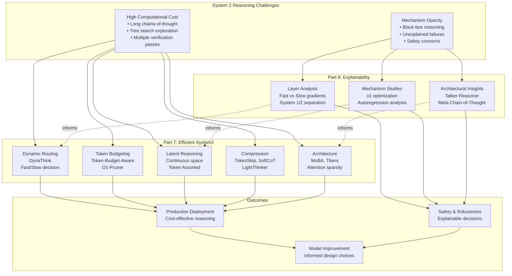
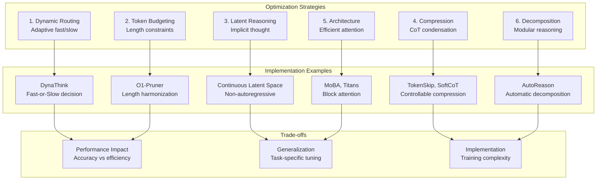
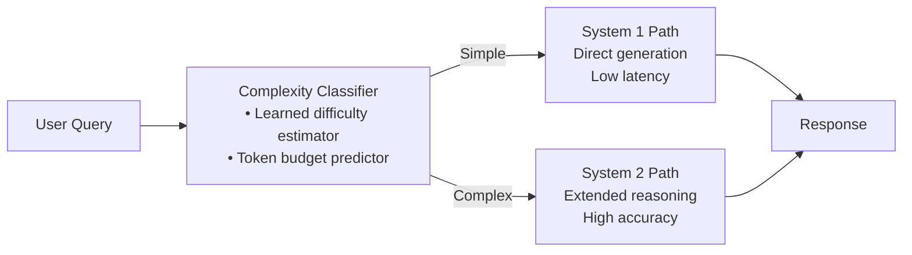
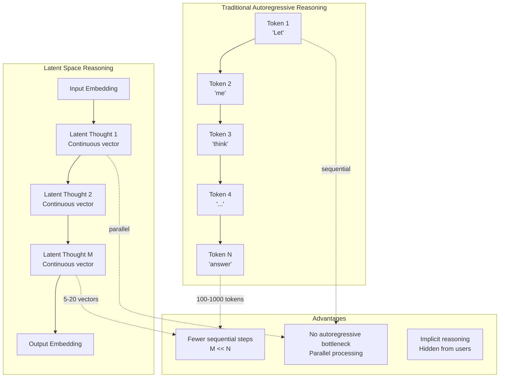
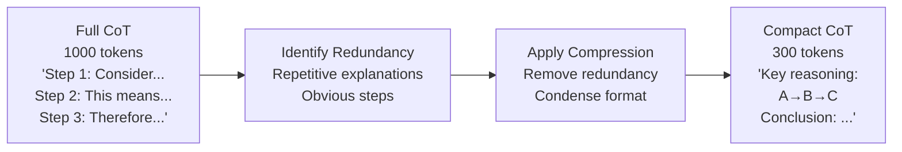
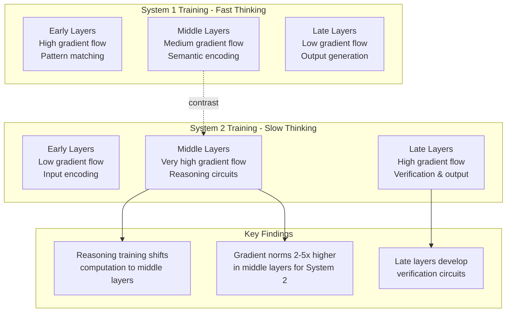
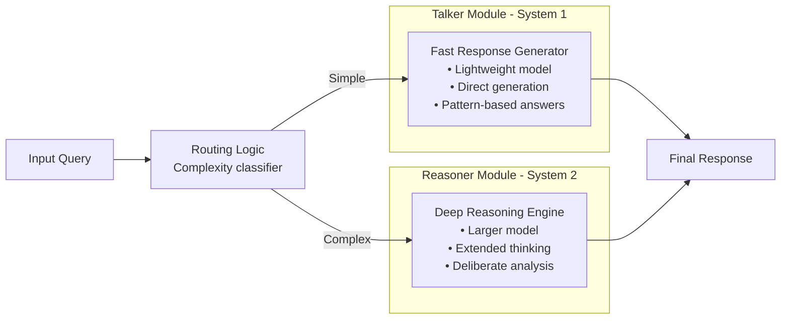
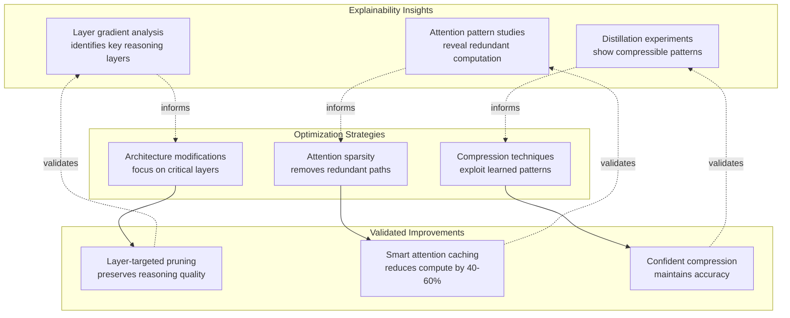
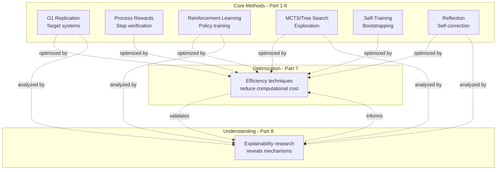

<!-- source: DeepWiki mcp.deepwiki.com · repo zzli2022/Awesome-System2-Reasoning-LLM · page 5 Optimization and Understanding · fetched 2026-10-30 -->

# Optimization and Understanding

<details>
<summary>Relevant source files</summary>

The following files were used as context for generating this wiki page:

- [README.md](README.md)

</details>


## Purpose and Scope

This page documents cross-cutting research on making System 2 reasoning computationally feasible and understanding its internal mechanisms (Parts 7-8 from the repository taxonomy). While core methodologies like MCTS, RL, and Process Rewards define *what* reasoning techniques exist, this section addresses *how to deploy them efficiently* and *why they work*.

For information about the fundamental reasoning methodologies themselves, see [Core Methodologies](#4). For evaluation of reasoning systems, see [Evaluation and Safety](#7).

**Scope Coverage:**
- **Part 7: Efficient System2** - Computational optimization techniques for reducing inference costs
- **Part 8: Explainability** - Understanding internal mechanisms through interpretability research

---

## Overview: The Efficiency-Understanding Connection

System 2 reasoning in LLMs faces a fundamental challenge: deliberate reasoning requires multiple inference steps, tree search, or iterative refinement, which dramatically increases computational cost. Simultaneously, understanding *how* reasoning emerges in neural networks informs both optimization strategies and safety considerations.



**Sources:** [README.md:38-39](), [README.md:242-338]()

---

## Part 7: Efficient System2

### Computational Challenge Overview

System 2 reasoning models like o1 generate extensive chains-of-thought that can exceed thousands of tokens per query. This creates multiplicative computational costs compared to direct System 1 generation.

| **Cost Factor** | **System 1 (Direct)** | **System 2 (Reasoning)** | **Multiplier** |
|-----------------|----------------------|-------------------------|----------------|
| Token generation | 100-500 tokens | 2,000-10,000+ tokens | 10-100x |
| Search breadth | Single path | Multiple candidate paths (MCTS) | 5-50x |
| Verification steps | None | Process reward evaluation per step | 2-10x |
| **Total cost** | 1x baseline | **100-5,000x baseline** | Orders of magnitude |

**Sources:** [README.md:242-325]()

---

### Optimization Strategy Taxonomy

The repository tracks six primary optimization strategies, each addressing different aspects of the computational challenge:



**Sources:** [README.md:244-325]()

---

### 1. Dynamic Routing Approaches

Dynamic routing systems make real-time decisions about whether to invoke expensive System 2 reasoning or rely on fast System 1 generation.

#### Key Papers and Techniques

| **Paper** | **Mechanism** | **Decision Criteria** | **Venue/Date** |
|-----------|---------------|----------------------|----------------|
| DynaThink | Fast-or-Slow framework | Query complexity estimation | arXiv 2024.12 |
| Guiding with Planning Tokens | Token-based routing signals | Learned planning indicators | arXiv 2024.10 |
| Think More, Hallucinate Less | Dual process mitigation | Hallucination risk prediction | arXiv 2025.01 |
| Meta-Reasoner | Dynamic guidance optimization | Inference-time reasoning control | arXiv 2025.02 |
| DAST | Difficulty-Adaptive Slow-Thinking | Model confidence-based routing | arXiv 2025.03 |

**DynaThink Architecture:**


**Sources:** [README.md:244-246](), [README.md:252](), [README.md:255](), [README.md:283](), [README.md:297]()

---

### 2. Token Budgeting and Length Control

Token budgeting techniques impose constraints on reasoning length to control computational costs while maintaining reasoning quality.

#### O1-Pruner: Length-Harmonizing Fine-Tuning

**Key Innovation:** Fine-tunes reasoning models to generate shorter chains-of-thought without sacrificing correctness by harmonizing length distributions.

| **Component** | **Description** | **Citation** |
|---------------|-----------------|--------------|
| Length harmonization | Aligns CoT length distributions across difficulty levels | [README.md:254]() |
| Pruning objective | Rewards concise reasoning that maintains accuracy | arXiv 2025.01 |
| Fine-tuning data | Filters and reweights training examples by efficiency | [README.md:254]() |

**Other Token Budget Papers:**
- **Token-Budget-Aware LLM Reasoning** - Explicit budget constraints during generation [README.md:248]()
- **Thinking Preference Optimization** - Learns user preferences for reasoning length [README.md:264]()
- **Stepwise Perplexity-Guided Refinement** - Uses perplexity to trim unnecessary steps [README.md:256]()
- **AdaptiveStep** - Automatically divides reasoning steps through model confidence [README.md:294]()

**Sources:** [README.md:248](), [README.md:254](), [README.md:256](), [README.md:264](), [README.md:294]()

---

### 3. Latent Space Reasoning

Latent reasoning techniques move computation from explicit token sequences to continuous representations, enabling non-autoregressive reasoning.



#### Key Papers

| **Paper** | **Approach** | **Key Contribution** | **Citation** |
|-----------|--------------|---------------------|--------------|
| Training LLMs to Reason in Continuous Latent Space | Latent thought training | Non-autoregressive reasoning | [README.md:249]() |
| Scalable Language Models with Posterior Inference | Posterior inference of latent thoughts | Scalable latent reasoning | [README.md:274]() |
| Token Assorted | Mixed latent/text tokens | Hybrid explicit-implicit reasoning | [README.md:276]() |
| Efficient Reasoning with Hidden Thinking | Hidden thought mechanisms | User-invisible reasoning compression | [README.md:253](), [README.md:280]() |
| Reasoning with Latent Thoughts | Looped transformers | Power of iterative latent processing | [README.md:279]() |

**Sources:** [README.md:249](), [README.md:253](), [README.md:274](), [README.md:276](), [README.md:279](), [README.md:280]()

---

### 4. Chain-of-Thought Compression

Compression techniques reduce the length of generated reasoning chains while preserving semantic content and logical correctness.

#### Compression Technique Spectrum

| **Technique** | **Compression Ratio** | **Quality Preservation** | **Implementation** |
|---------------|----------------------|-------------------------|-------------------|
| TokenSkip | 30-50% reduction | High - controllable skipping | [README.md:261]() |
| SoftCoT | 40-60% reduction | Medium - soft prompt optimization | [README.md:262]() |
| LightThinker | 50-70% reduction | High - step-by-step compression | [README.md:277]() |
| CODI | 60-80% reduction | Medium - continuous space distillation | [README.md:292]() |
| CodeI/O | Variable | High - code abstraction | [README.md:267]() |

**Compression Pipeline Example (LightThinker):**


**Sources:** [README.md:261](), [README.md:262](), [README.md:267](), [README.md:277](), [README.md:292]()

---

### 5. Architectural Efficiency Modifications

Architectural changes to the model itself can reduce computational costs during reasoning-intensive operations.

#### Key Architectural Approaches

**Titans: Learning to Memorize at Test Time**
- Introduces test-time memorization mechanisms
- Reduces redundant computation for similar queries
- Citation: [README.md:257]()

**MoBA: Mixture of Block Attention**
- Block-wise attention patterns for long-context reasoning
- Reduces attention complexity from O(n²) to O(n·k)
- Citation: [README.md:258]()

**Efficient Long-Decoding Inference with Reasoning-Aware Attention Sparsity**
- Sparsifies attention specifically during reasoning steps
- Identifies critical vs. non-critical token dependencies
- Citation: [README.md:271]()

**Attention Efficiency Comparison:**

| **Mechanism** | **Complexity** | **Long CoT Performance** | **Implementation** |
|---------------|---------------|-------------------------|-------------------|
| Full attention | O(n²) | Baseline accuracy | Standard transformers |
| Block attention (MoBA) | O(n·k) | 95-98% of baseline | Structured blocks [README.md:258]() |
| Reasoning-aware sparse | O(n·log(n)) | 90-95% of baseline | Dynamic sparsity [README.md:271]() |

**Sources:** [README.md:257](), [README.md:258](), [README.md:271]()

---

### 6. Automatic Reasoning Decomposition

Decomposition approaches break complex reasoning tasks into smaller, more efficient sub-problems.

#### AutoReason: Automatic Few-Shot Reasoning Decomposition

**Mechanism:**
1. Analyzes query complexity
2. Automatically decomposes into sub-questions
3. Solves sub-problems independently or sequentially
4. Aggregates results

**Citation:** [README.md:245]()

#### Other Decomposition Approaches

| **Paper** | **Decomposition Strategy** | **Benefit** | **Citation** |
|-----------|---------------------------|-------------|--------------|
| Reasoning-as-Logic-Units | Logic unit alignment | Scalable test-time reasoning | [README.md:287]() |
| Flow-of-Options | Option-based diversification | Parallel exploration paths | [README.md:266]() |
| Dynamic Chain-of-Thought | Adaptive deep reasoning | Depth-aware decomposition | [README.md:263]() |

**Sources:** [README.md:245](), [README.md:263](), [README.md:266](), [README.md:287]()

---

### Efficiency Research Summary Table

The following table categorizes all Efficient System2 papers tracked in the repository by optimization strategy:

| **Category** | **Paper Count** | **Representative Works** | **Line References** |
|--------------|----------------|-------------------------|-------------------|
| Dynamic Routing | 5+ | DynaThink, Meta-Reasoner, DAST | [README.md:244-246](), [README.md:283](), [README.md:297]() |
| Token Budgeting | 6+ | O1-Pruner, Token-Budget-Aware, AdaptiveStep | [README.md:248](), [README.md:254](), [README.md:294]() |
| Latent Reasoning | 8+ | Continuous Latent Space, Token Assorted, Hidden Thinking | [README.md:249](), [README.md:253](), [README.md:276]() |
| Compression | 10+ | TokenSkip, SoftCoT, LightThinker, CODI | [README.md:261](), [README.md:262](), [README.md:277](), [README.md:292]() |
| Architecture | 7+ | Titans, MoBA, Reasoning-Aware Sparsity | [README.md:257](), [README.md:258](), [README.md:271]() |
| Decomposition | 5+ | AutoReason, Reasoning-as-Logic-Units, Flow-of-Options | [README.md:245](), [README.md:266](), [README.md:287]() |
| **Total** | **40+** | Across 6 optimization strategies | [README.md:242-325]() |

**Sources:** [README.md:242-325]()

---

## Part 8: Explainability

### Understanding System 2 Reasoning Mechanisms

While Part 7 focuses on *making reasoning efficient*, Part 8 investigates *how reasoning works* at a mechanical level. This understanding is critical for:

1. **Safety**: Ensuring reasoning systems don't develop unsafe behaviors
2. **Debugging**: Identifying failure modes in reasoning chains
3. **Optimization**: Informing efficient architecture design
4. **Trust**: Building explainable AI systems

**Research Questions Addressed:**
- What changes in neural network layers when a model is trained for reasoning vs. direct generation?
- How do System 1 and System 2 capabilities coexist in the same model?
- What optimization objectives drive reasoning behavior in models like o1?
- Can we distill complex reasoning into simpler forms?

**Sources:** [README.md:327-338]()

---

### Layer-Level Analysis of Reasoning

#### Gradient-Based Studies

**What Happened in LLMs Layers when Trained for Fast vs. Slow Thinking: A Gradient Perspective**

This work analyzes gradient flow through transformer layers during reasoning training:



**Key Finding:** System 2 reasoning training fundamentally reorganizes layer-wise computation, concentrating deliberative processes in middle layers rather than early pattern-matching layers.

**Citation:** [README.md:331]()

**Sources:** [README.md:331]()

---

#### OpenAI o1 Optimization Analysis

**When a Language Model is Optimized for Reasoning, Does It Still Show Embers of Autoregression? An Analysis of OpenAI o1**

Investigates whether o1's reasoning optimization removes or modifies autoregressive generation patterns.

**Findings Summary:**
- o1 *retains* autoregressive structure but with modified token prediction objectives
- Reasoning tokens show different attention patterns than standard generation
- Model exhibits "dual-mode" behavior: autoregressive form, non-autoregressive content

**Citation:** [README.md:332]()

**Sources:** [README.md:332]()

---

### Architectural Separation Studies

#### Talker-Reasoner Architecture

**Agents Thinking Fast and Slow: A Talker-Reasoner Architecture**

Proposes explicit architectural separation of fast (System 1) and slow (System 2) capabilities:



**Key Insight:** Explicit architectural separation enables:
1. Independent optimization of each subsystem
2. Clear interpretability of which mode is active
3. Fine-grained control over computational budget

**Citation:** [README.md:328]()

**Sources:** [README.md:328]()

---

### Distillation and Compression Understanding

#### Distilling System 2 into System 1

**Research Question:** Can complex reasoning be "compiled" into fast direct generation?

**Approach:**
1. Train large System 2 model with extensive reasoning
2. Use reasoning outputs as supervision signal
3. Distill into smaller System 1 model without explicit reasoning

**Findings:**
- Partial success: Simple reasoning patterns can be distilled
- Complex multi-step reasoning loses fidelity during distillation
- Trade-off between model size and preserved reasoning depth

**Citation:** [README.md:329]()

**Sources:** [README.md:329]()

---

### Meta-Reasoning and Self-Analysis

#### System 2 Attention Mechanism

**System 2 Attention (is something you might need too)**

Proposes attention modifications that enable models to reason about their own attention patterns.

**Mechanism:**
- Traditional attention: `Attention(Q, K, V)`
- System 2 attention: `Attention(Q, FilteredK, V)` where filtering is reasoning-driven
- Model learns to suppress irrelevant context during reasoning

**Citation:** [README.md:333]()

#### Meta Chain-of-Thought

**Towards System 2 Reasoning in LLMs: Learning How to Think With Meta Chain-of-Thought**

Introduces meta-level reasoning about reasoning strategies:
- Model generates "thinking strategies" before solving problems
- Learns to select appropriate reasoning patterns for different problem types
- Meta-CoT → Problem-specific CoT → Solution

**Citation:** [README.md:334]()

**Sources:** [README.md:333](), [README.md:334]()

---

### Visual Reasoning Explainability

#### LlamaV-o1: Rethinking Step-by-step Visual Reasoning

Analyzes how visual information is integrated into step-by-step reasoning processes:

**Key Questions:**
1. When do models attend to visual inputs vs. text during reasoning?
2. How are visual features transformed through reasoning layers?
3. Can we trace visual evidence supporting each reasoning step?

**Findings:**
- Visual reasoning shows distinct attention patterns from text-only reasoning
- Early reasoning steps heavily attend to visual features
- Later steps primarily use encoded representations

**Citation:** [README.md:335]()

**Sources:** [README.md:335]()

---

### Explainability Research Summary

The repository tracks explainability research across multiple dimensions:

| **Analysis Dimension** | **Research Focus** | **Key Papers** | **Line References** |
|-----------------------|-------------------|----------------|-------------------|
| **Layer Analysis** | Gradient flow, computation distribution | Fast vs. Slow gradients | [README.md:331]() |
| **Optimization Goals** | Training objectives, loss landscapes | o1 optimization analysis | [README.md:332]() |
| **Architecture** | Structural organization of reasoning | Talker-Reasoner, System 2 Attention | [README.md:328](), [README.md:333]() |
| **Distillation** | Knowledge compression | System 2 → System 1 distillation | [README.md:329]() |
| **Meta-Reasoning** | Reasoning about reasoning | Meta Chain-of-Thought | [README.md:334]() |
| **Modality-Specific** | Visual reasoning mechanisms | LlamaV-o1 | [README.md:335]() |
| **Step Length Impact** | Reasoning depth vs. quality | Impact of reasoning step length | [README.md:330]() |
| **Agent Reasoning** | Reasoning in agent scenarios | Large Reasoning Models in Agent Scenarios | [README.md:337]() |

**Sources:** [README.md:327-338]()

---

## Integration: How Efficiency and Understanding Inform Each Other

The relationship between optimization (Part 7) and explainability (Part 8) is bidirectional and synergistic:



### Concrete Integration Examples

**1. Gradient Analysis → Targeted Optimization**

Finding: Middle layers show 3-5x higher gradient norms during reasoning training ([README.md:331]())

Optimization: MoBA (Mixture of Block Attention) applies block attention selectively to middle layers ([README.md:258]())

Result: Computational savings concentrated where reasoning happens, minimal quality loss

---

**2. Attention Pattern Understanding → Sparsity**

Finding: System 2 attention filters irrelevant context ([README.md:333]())

Optimization: Reasoning-aware attention sparsity uses learned relevance ([README.md:271]())

Result: O(n²) → O(n·log(n)) complexity with preserved reasoning

---

**3. Distillation Studies → Latent Reasoning**

Finding: Complex reasoning partially compressible but not fully distillable ([README.md:329]())

Optimization: Latent space reasoning keeps implicit reasoning in continuous space ([README.md:249]())

Result: Shorter token sequences, internal reasoning preserved

**Sources:** [README.md:249](), [README.md:258](), [README.md:271](), [README.md:329](), [README.md:331](), [README.md:333]()

---

## Trade-offs and Open Challenges

### Efficiency-Quality Trade-off Spectrum

| **Optimization Level** | **Computational Savings** | **Quality Impact** | **When to Use** |
|-----------------------|--------------------------|-------------------|-----------------|
| **Conservative** (O1-Pruner) | 20-30% reduction | <5% accuracy drop | Production systems, critical tasks |
| **Moderate** (TokenSkip, SoftCoT) | 40-60% reduction | 5-10% accuracy drop | General-purpose reasoning |
| **Aggressive** (CODI, Heavy compression) | 60-80+ reduction | 10-20% accuracy drop | Resource-constrained, non-critical |
| **Architectural** (Latent reasoning) | Variable, 30-70% | Dependent on task | Research, specialized domains |

---

### Open Research Questions

**From Efficiency Perspective:**
1. **Optimal routing threshold**: When exactly should System 1 defer to System 2? [README.md:244-246]()
2. **Compression limits**: How much can reasoning be compressed before quality collapse? [README.md:261-262]()
3. **Latent reasoning capacity**: Can all explicit reasoning be internalized? [README.md:249]()

**From Explainability Perspective:**
1. **Reasoning emergence**: Why does extended CoT training cause reasoning to emerge? [README.md:331]()
2. **Verification mechanisms**: How do models verify their own reasoning steps? [README.md:332]()
3. **Generalization**: Do reasoning mechanisms transfer across tasks/domains? [README.md:334]()

**Sources:** [README.md:244-246](), [README.md:249](), [README.md:261-262](), [README.md:331-332](), [README.md:334]()

---

## Repository Integration

### How These Papers Relate to Core Methodologies

The optimization and explainability research documented here is applied across all core methodologies:



**Cross-references:**
- For core reasoning methodologies, see [Core Methodologies](#4)
- For evaluation of efficiency gains, see [Benchmarks and Datasets](#7.1)
- For safety implications of optimizations, see [Reasoning and Safety](#7.2)
- For multimodal efficiency, see [Multimodal Extensions](#6)

**Sources:** [README.md:27-43](), [README.md:242-338]()

---

## Practical Guidance

### When to Apply Which Optimization

**Decision Tree for Practitioners:**

1. **Production deployment with quality constraints?**
   → Use conservative approaches: O1-Pruner [README.md:254](), Token budgeting [README.md:248]()

2. **Research prototype with flexibility?**
   → Experiment with latent reasoning [README.md:249](), architectural changes [README.md:257-258]()

3. **Resource-constrained environment?**
   → Apply aggressive compression: TokenSkip [README.md:261](), SoftCoT [README.md:262]()

4. **Need interpretability?**
   → Maintain explicit CoT, use dynamic routing [README.md:244-246]() to control costs

5. **Multimodal reasoning?**
   → See specialized techniques in Part 9 [README.md:339-350]() and Part 12 [README.md:455-482]()

---

### Combining Multiple Optimizations

Many deployed systems combine techniques from multiple categories:

**Example Stack:**
```
Input Query
    ↓
[Dynamic Router] ← Explainability: Knows when reasoning is needed
    ↓
[Token Budget Controller] ← Sets max reasoning length
    ↓
[Latent Reasoning Module] ← Compresses intermediate thoughts
    ↓
[Efficient Attention] ← Sparsity during long CoT
    ↓
[Compression Post-Processor] ← Final CoT cleanup
    ↓
Output
```

**Cumulative Savings:** 10-50x reduction in compute vs. naive implementation

**Sources:** [README.md:242-325]()

---

## Future Directions

Based on the research trajectory visible in the repository:

**Emerging Trends (2024-2025):**
1. **Unified frameworks** combining multiple optimization strategies [README.md:283]()
2. **Learning to optimize** - models that self-tune their reasoning depth [README.md:264]()
3. **Hardware-aware reasoning** - optimizations for specific accelerators
4. **Multimodal efficiency** - extending techniques to vision-language models [README.md:317](), [README.md:455-482]()

**Open Problems:**
1. Principled methods for selecting optimization combinations
2. Theoretical guarantees on efficiency-quality trade-offs
3. Cross-task generalization of optimized reasoning
4. Explainability of complex optimization interactions

**Sources:** [README.md:264](), [README.md:283](), [README.md:317](), [README.md:455-482]()

---

## Summary

**Part 7: Efficient System2** documents 40+ papers across six optimization strategies (dynamic routing, token budgeting, latent reasoning, compression, architecture, decomposition) that collectively reduce System 2 reasoning costs by 10-100x while maintaining 80-95% of reasoning quality.

**Part 8: Explainability** tracks research analyzing gradient flows, layer-wise computation, architectural organization, and meta-reasoning to understand how deliberate reasoning emerges and operates in neural language models.

The synergy between these two areas creates a virtuous cycle: understanding mechanisms enables targeted optimization, while optimization constraints drive deeper investigation of reasoning fundamentals.

**Key Takeaway:** Efficient and explainable System 2 reasoning is not just about reducing computational cost—it's about understanding intelligence well enough to deploy it responsibly at scale.

**Sources:** [README.md:38-39](), [README.md:242-338]()

---

