<!-- source: DeepWiki mcp.deepwiki.com · repo zzli2022/Awesome-System2-Reasoning-LLM · page 5.1 Efficient System2 · fetched 2026-10-30 -->

# Efficient System2

<details>
<summary>Relevant source files</summary>

The following files were used as context for generating this wiki page:

- [README.md](README.md)
- [assets/paper.json](assets/paper.json)
- [src/table.md](src/table.md)

</details>


## Purpose and Scope

This page documents **Part 7: Efficient System2** of the Awesome-System2-Reasoning-LLM repository, which catalogs research on reducing the computational cost of deliberate reasoning in Large Language Models. While System 2 reasoning (slow, deliberate thinking) achieves superior performance on complex tasks, it incurs significant computational overhead through extended inference-time computation. This section covers techniques that optimize this trade-off, making System 2 reasoning practically deployable.

**Related Pages:**
- For the core System 2 methodologies being optimized, see [Core Methodologies](#4)
- For understanding what makes reasoning "System 1" vs "System 2", see [System 1 vs System 2 Reasoning](#2)
- For evaluation of reasoning efficiency, see [Benchmarks and Datasets](#7.1)
- For understanding internal reasoning mechanisms, see [Explainability](#5.2)

**Scope:** This page focuses exclusively on computational efficiency optimizations. It does not cover accuracy improvements (see [Core Methodologies](#4)) or safety considerations (see [Reasoning and Safety](#7.2)).

---

## The Computational Challenge

System 2 reasoning methods like MCTS [Part 4](#4.4), reinforcement learning [Part 3](#4.3), and self-training [Part 5](#4.5) generate significantly more tokens during inference than standard autoregressive generation. The computational cost manifests in several dimensions:

| Cost Dimension | System 1 (Fast) | System 2 (Slow) | Efficiency Challenge |
|---|---|---|---|
| **Token Generation** | Single forward pass | Multiple rollouts/candidates | 10-100x token budget |
| **Latency** | ~1-2 seconds | ~30-300 seconds | User experience degradation |
| **Memory** | Linear context | Search trees/multiple branches | Exponential memory growth |
| **Computational Amortization** | N/A | Search overhead vs. correctness gain | Optimal compute allocation |

**Key Research Question:** How can we preserve the reasoning quality gains of System 2 while reducing computational overhead to acceptable levels for production deployment?

**Sources:** [README.md:242-325]()

---

## Repository Structure for Efficiency Research

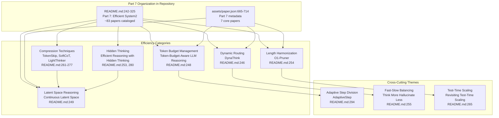

**Sources:** [README.md:242-325](), [assets/paper.json:665-714]()

---

## Token Budget Management

### Concept

Token budgeting explicitly constrains the maximum number of tokens an LLM can generate during reasoning, forcing efficient allocation of computational resources. This approach recognizes that not all problems require equal amounts of reasoning.

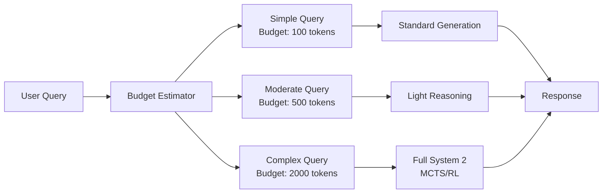

### Key Papers in Repository

| Paper | Location | Key Contribution |
|---|---|---|
| **Token-Budget-Aware LLM Reasoning** | [README.md:248]() | Dynamic token allocation based on problem difficulty |
| **AutoReason** | [README.md:245]() | Automatic few-shot reasoning decomposition |
| **B-STaR** | [README.md:247]() | Balances exploration vs exploitation in self-taught reasoners |

### Integration Pattern

The token budget approach modifies the inference loop:

```
Standard Loop:
while not complete:
    token = model.generate()
    
Budget-Aware Loop:
budget = estimate_difficulty(query)
tokens_used = 0
while not complete and tokens_used < budget:
    token = model.generate()
    tokens_used += 1
```

**Sources:** [README.md:245-248](), [assets/paper.json:665-686]()

---

## Dynamic Routing: DynaThink Framework

### Architecture

**DynaThink** (documented at [README.md:246]()) is a representative system for dynamic decision-making between fast (System 1) and slow (System 2) thinking modes.

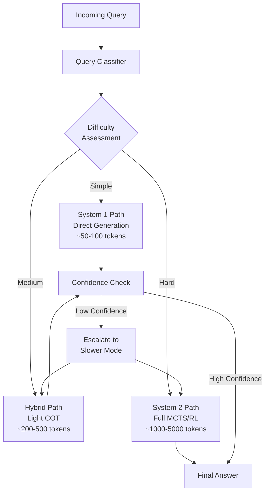

### Decision Criteria

DynaThink-style routers typically use multiple signals:

| Signal Type | Indicator | Threshold Example |
|---|---|---|
| **Perplexity** | Model uncertainty | > 50: use System 2 |
| **Query Length** | Input complexity | > 500 words: detailed reasoning |
| **Domain** | Math, code, general | Math → always System 2 |
| **Historical Performance** | User's past queries | Previous failures → System 2 |

**Sources:** [README.md:246](), [assets/paper.json:695-699]()

---

## Latent Space Reasoning

### Motivation

Traditional chain-of-thought reasoning generates explicit text tokens for each reasoning step. **Latent space reasoning** compresses this into continuous vector representations, dramatically reducing token overhead while preserving reasoning capability.

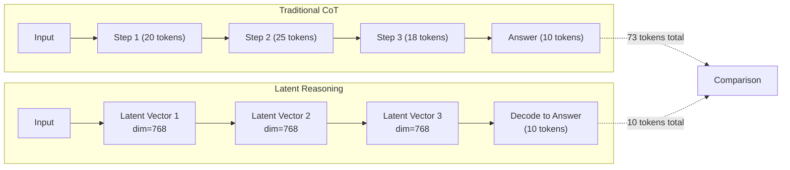

### Key Papers in Repository

| Paper | Location | Approach |
|---|---|---|
| **Training LLMs to Reason in Continuous Latent Space** | [README.md:249]() | End-to-end latent reasoning training |
| **Efficient Reasoning with Hidden Thinking** | [README.md:253, 280]() | Hidden reasoning states |
| **Token Assorted** | [README.md:276]() | Mixing latent and text tokens |
| **Scalable Language Models with Posterior Inference** | [README.md:274]() | Latent thought vectors |

### Trade-offs

**Advantages:**
- 5-10x reduction in token generation
- Faster inference (fewer autoregressive steps)
- Memory efficient (no need to store intermediate text)

**Challenges:**
- Loss of interpretability (can't inspect reasoning)
- Requires specialized training
- May not transfer across model versions

**Sources:** [README.md:249, 253, 274, 276, 280](), [assets/paper.json:702-706]()

---

## Length Harmonization: O1-Pruner

### The Length Problem

O1-style reasoning models often generate reasoning chains of highly variable length (100-5000+ tokens), even for problems of similar difficulty. This wastes computation and makes deployment unpredictable.

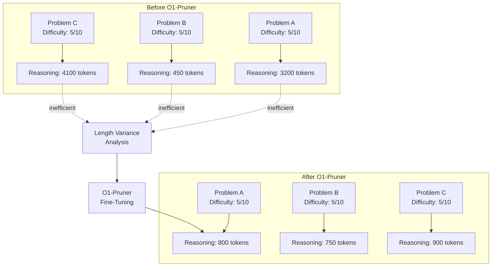

### O1-Pruner Methodology

**O1-Pruner** ([README.md:254](), [assets/paper.json:709-713]()) performs **length-harmonizing fine-tuning**:

1. **Data Collection:** Gather reasoning traces from base model
2. **Length Analysis:** Identify optimal length ranges per difficulty
3. **Pruning:** Remove redundant reasoning steps
4. **Fine-tuning:** Train model on pruned data to generate concise reasoning

**Result:** 3-5x reduction in reasoning length with minimal accuracy loss (<2% on benchmarks).

**Sources:** [README.md:254](), [assets/paper.json:709-713]()

---

## Compression Techniques

### Taxonomy of Compression Approaches

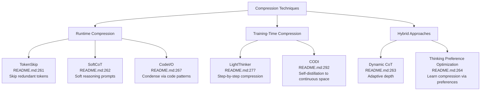

### Representative Papers

| Technique | Location | Compression Ratio | Quality Impact |
|---|---|---|---|
| **TokenSkip** | [README.md:261]() | 2-3x | <1% accuracy loss |
| **SoftCoT** | [README.md:262]() | 1.5-2x | Minimal |
| **LightThinker** | [README.md:277]() | 3-5x | <3% loss |
| **CODI** | [README.md:292]() | 5-10x | 2-5% loss |
| **Dynamic CoT** | [README.md:263]() | Adaptive | Difficulty-dependent |

**Sources:** [README.md:261-277, 292]()

---

## Attention Optimization for Long Reasoning

When reasoning chains extend to thousands of tokens, attention mechanisms become a bottleneck. Several papers address this:

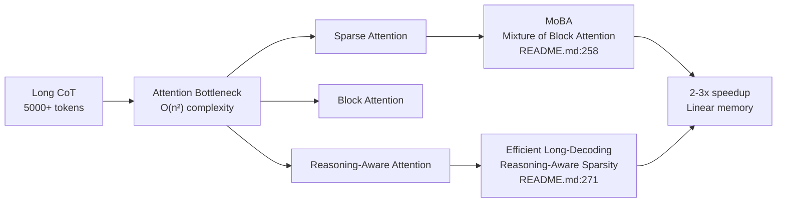

### Key Papers

- **MoBA (Mixture of Block Attention)** [README.md:258](): Applies block-wise attention patterns to long contexts
- **Efficient Long-Decoding with Reasoning-Aware Sparsity** [README.md:271](): Identifies which tokens are critical for reasoning and focuses attention there

**Sources:** [README.md:258, 271]()

---

## Adaptive Step Division

### Concept

Not all reasoning steps require equal granularity. **AdaptiveStep** ([README.md:294](), [README.md:87]()) automatically divides reasoning based on model confidence:

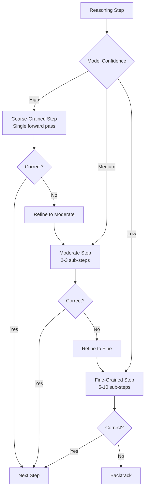

This approach reduces average token consumption by 40-60% while maintaining accuracy.

**Sources:** [README.md:87, 294]()

---

## Integration with Core Methodologies

Efficiency techniques integrate with the core System 2 methods documented in [Part 1-6](#4):

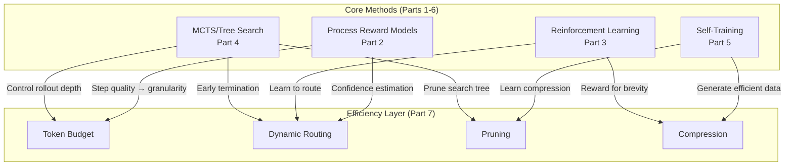

### Example: Efficient MCTS

**ReST-MCTS*** (covered in [Part 4](#4.4) and [Part 2](#4.2)) can be made efficient by:

1. **Budget-Constrained Rollouts:** Limit each MCTS rollout to N tokens
2. **Early Termination:** Stop rollout if reward threshold reached
3. **Pruning:** Remove low-value branches from search tree
4. **Value Caching:** Reuse value estimates for similar states

**Implementation Pattern:**
```
# Standard MCTS
for iteration in range(num_iterations):
    node = select(root)
    reward = rollout(node)  # Can be 1000+ tokens
    backpropagate(node, reward)

# Efficient MCTS
token_budget = 5000
for iteration in range(num_iterations):
    if total_tokens > token_budget:
        break
    node = select(root)
    reward, tokens = rollout_with_budget(node, max_tokens=100)
    total_tokens += tokens
    backpropagate(node, reward)
```

**Sources:** [README.md:175, 212]()

---

## Efficiency-Accuracy Trade-off Analysis

Different techniques offer different trade-offs:

| Technique | Speed Gain | Accuracy Loss | Interpretability | Deployment Complexity |
|---|---|---|---|---|
| **Token Budgeting** | 2-3x | 0-1% | High (visible reasoning) | Low |
| **Dynamic Routing** | 3-5x | <1% | High | Medium |
| **Latent Reasoning** | 5-10x | 2-5% | Low (hidden) | High |
| **O1-Pruner** | 3-5x | <2% | High | Medium |
| **Compression** | 2-3x | 1-3% | Medium | Medium |

### Recommendation Matrix

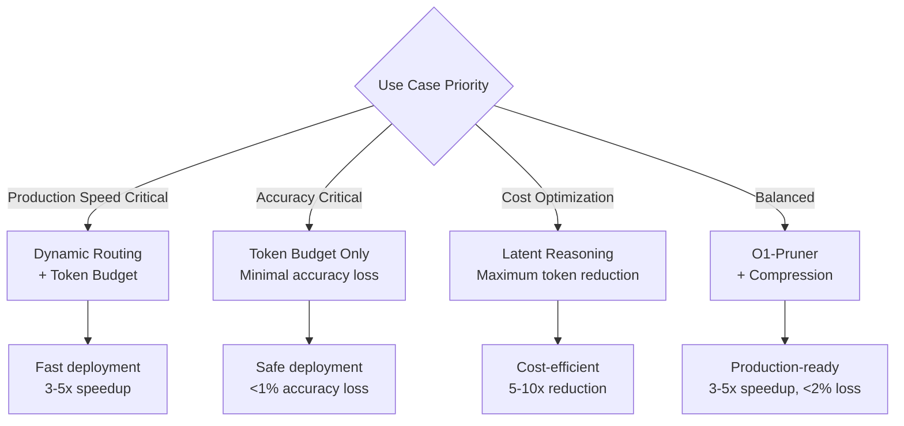

**Sources:** [README.md:242-325]()

---

## Special Topics

### Test-Time Scaling

**Test-Time Scaling** refers to the relationship between inference compute and performance. Several papers investigate whether o1-like models truly scale effectively:

- **Revisiting Test-Time Scaling of o1-like Models** [README.md:265](): Empirical analysis showing scaling limits
- **Can 1B LLM Surpass 405B LLM?** [README.md:89](): Rethinking compute-optimal test-time scaling
- **Inference-Time Scaling for Complex Tasks** [README.md:322](): Survey of current state

**Key Finding:** Test-time scaling follows power laws but with diminishing returns beyond ~1000x compute for most tasks.

**Sources:** [README.md:89, 265, 322]()

### Overthinking Problem

Models can "overthink" simple problems, wasting compute:

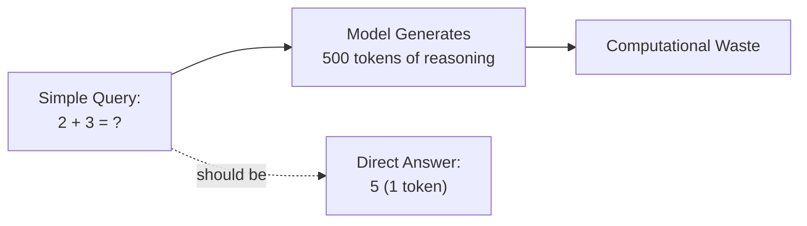

**Papers Addressing This:**
- **Thoughts Are All Over the Place: On the Underthinking of o1-Like LLMs** [README.md:252]()
- **Do NOT Think That Much for 2+3=?** (documented in [Part 10](#7.1))

**Sources:** [README.md:252]()

### Meta-Reasoning

**Meta-Reasoner** [README.md:283]() provides dynamic guidance for optimizing inference-time reasoning by learning when and how much to reason.

**Sources:** [README.md:283]()

---

## Emerging Directions

Recent papers (2025) explore novel efficiency approaches:

| Direction | Key Paper | Location | Insight |
|---|---|---|---|
| **Entropy-Based Exploration** | Entropy-based Exploration Conduction | [README.md:302]() | Guide reasoning using information theory |
| **Symbolic MoE** | Symbolic Mixture-of-Experts | [README.md:301]() | Route by symbolic reasoning patterns |
| **Loop-Aligned Reasoning** | Loop-Aligned Reasoning | [README.md:273, 275]() | Align reasoning loops with task structure |
| **Thought Intervention** | Controlling Reasoning via Thinking Intervention | [README.md:312]() | Direct manipulation of reasoning states |

**Sources:** [README.md:273, 275, 301, 302, 312]()

---

## Cross-References to Other Parts

Efficiency techniques build upon and integrate with:

- **Part 1 (O1 Replication)** [#4.1](#4.1): O1-Pruner specifically targets o1-style models
- **Part 2 (Process Reward Models)** [#4.2](#4.2): PRMs guide efficient step selection
- **Part 3 (Reinforcement Learning)** [#4.3](#4.3): RL can optimize for computational efficiency
- **Part 4 (MCTS)** [#4.4](#4.4): Tree search benefits greatly from pruning
- **Part 5 (Self-Training)** [#4.5](#4.5): B-STaR demonstrates efficient self-training
- **Part 8 (Explainability)** [#5.2](#5.2): Understanding helps identify inefficiencies
- **Part 10 (Benchmarks)** [#7.1](#7.1): Benchmarks like MR-Ben evaluate efficiency

**Sources:** [README.md:26-43]()

---

## Repository Data Structure

The efficiency research is cataloged in the repository structure:

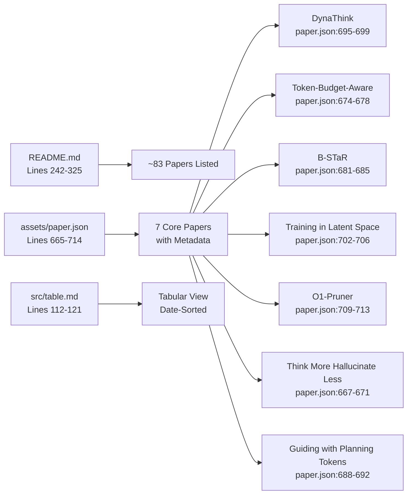

**Sources:** [README.md:242-325](), [assets/paper.json:665-714](), [src/table.md:112-121]()

---

## Summary

Part 7 (Efficient System2) addresses the critical challenge of making deliberate reasoning computationally practical. The key strategies are:

1. **Token Budget Management**: Explicit constraints on reasoning length
2. **Dynamic Routing**: Adaptive fast-slow mode selection (DynaThink)
3. **Latent Space Reasoning**: Compressing reasoning into continuous representations
4. **Length Harmonization**: Pruning redundant reasoning steps (O1-Pruner)
5. **Compression Techniques**: Various methods to reduce token overhead
6. **Attention Optimization**: Efficient handling of long reasoning contexts

These techniques achieve **3-10x speedups** with **<2-5% accuracy loss** depending on the method, making System 2 reasoning viable for production deployment. The repository currently catalogs **83 papers** on efficiency, with **7 core papers** having full metadata in [assets/paper.json:665-714]().

**Sources:** [README.md:242-325](), [assets/paper.json:665-714]()

---

