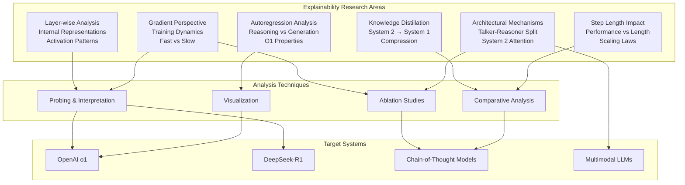
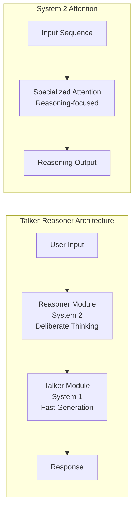
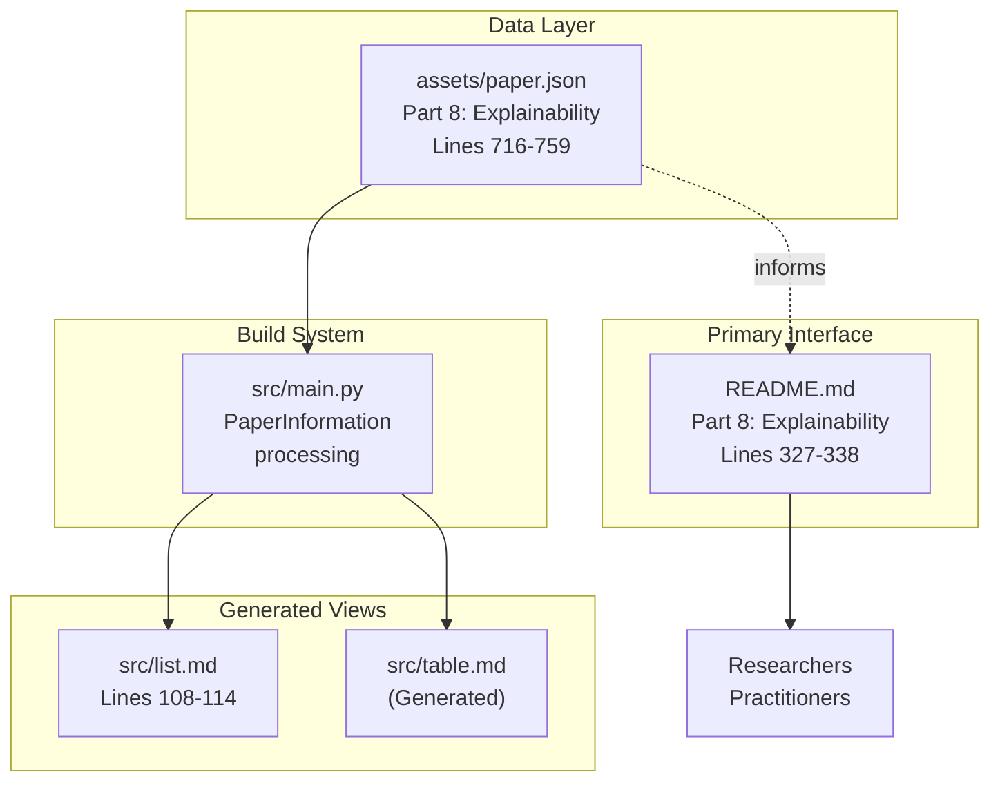
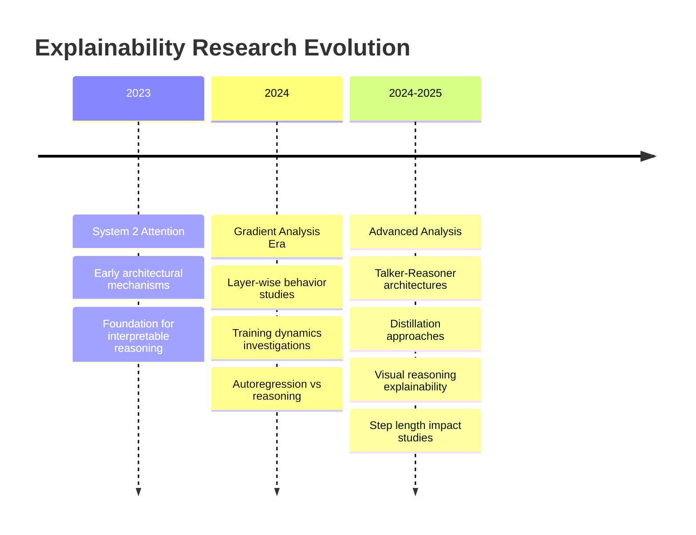
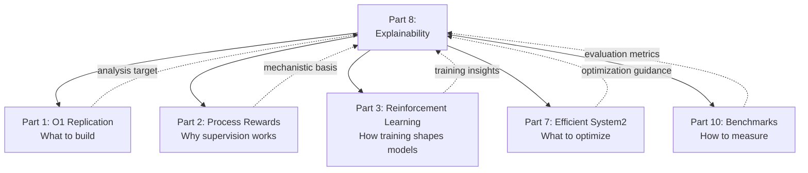

<!-- source: DeepWiki mcp.deepwiki.com · repo zzli2022/Awesome-System2-Reasoning-LLM · page 5.2 Explainability · fetched 2026-10-30 -->

# Explainability

<details>
<summary>Relevant source files</summary>

The following files were used as context for generating this wiki page:

- [README.md](README.md)
- [assets/paper.json](assets/paper.json)
- [src/list.md](src/list.md)

</details>


## Purpose and Scope

This page documents research on understanding and interpreting the internal mechanisms of System 2 reasoning in Large Language Models. Explainability research investigates how LLMs implement deliberate reasoning, what happens inside model layers during slow thinking, and how reasoning capabilities emerge from training. This work is distinct from the core methodologies that enable reasoning (see [Core Methodologies](#4)) and from efficiency optimizations (see [Efficient System2](#5.1)). Instead, it focuses on mechanistic understanding, gradient analysis, architectural interpretations, and knowledge distillation approaches.

The repository catalogs explainability research in [README.md:327-338]() under "Part 8: Explainability" and stores structured metadata in [assets/paper.json:716-759]().

**Sources:** [README.md:327-338](), [assets/paper.json:716-759]()

## Overview

Explainability research in System 2 reasoning addresses fundamental questions about how LLMs perform deliberate reasoning:

- **What computational patterns emerge during slow thinking?** Layer-wise analysis reveals how different transformer layers contribute to reasoning.
- **How does training for reasoning change model internals?** Gradient studies show how optimization shapes reasoning capabilities.
- **Do reasoning models retain autoregressive properties?** Analysis of models like OpenAI o1 investigates architectural tradeoffs.
- **Can System 2 reasoning be distilled into System 1?** Knowledge transfer approaches compress slow thinking into fast execution.
- **How does reasoning step length impact performance?** Studies quantify the relationship between chain-of-thought length and accuracy.

This research provides critical insights for designing better reasoning systems, understanding failure modes, and developing more interpretable AI.

**Sources:** [README.md:327-338]()

## Research Taxonomy



**Sources:** [README.md:327-338](), [assets/paper.json:716-759]()

## Research Categories

### Layer-wise Analysis

Research examining what happens in different transformer layers during reasoning:

| Paper | Focus | Key Findings |
|-------|-------|--------------|
| "What Happened in LLMs Layers when Trained for Fast vs. Slow Thinking" | Gradient perspective on layer behavior | Analyzes training dynamics across layers |
| "Towards System 2 Reasoning in LLMs" | Meta chain-of-thought learning | Layer-wise reasoning strategy development |
| "LlamaV-o1" | Visual reasoning layers | Step-by-step visual processing mechanisms |

These studies use probing classifiers, activation analysis, and gradient flow tracking to understand how reasoning emerges across model depth.

**Sources:** [README.md:331](), [README.md:334-335](), [assets/paper.json:718-723]()

### Autoregression vs Reasoning

Analysis of whether reasoning models retain traditional language model properties:

**Key Paper:** "When a Language Model is Optimized for Reasoning, Does It Still Show Embers of Autoregression? An Analysis of OpenAI o1" ([README.md:332]())

This research investigates whether models optimized for reasoning (like o1) still exhibit next-token prediction patterns or develop fundamentally different computational strategies. The analysis is critical for understanding:
- Whether reasoning is a distinct computational mode
- How to balance reasoning with generation quality
- Architectural choices for future systems

**Sources:** [README.md:332](), [assets/paper.json:725-730]()

### Architectural Mechanisms

Research on specialized architectures for explainable reasoning:



**Papers:**
- "Agents Thinking Fast and Slow: A Talker-Reasoner Architecture" - Separates reasoning from generation for interpretability
- "System 2 Attention (is something you might need too)" - Attention mechanisms specialized for deliberate reasoning

These architectures make reasoning explicit and separable from generation, enabling better analysis and control.

**Sources:** [README.md:328](), [README.md:333](), [assets/paper.json:732-744]()

### Knowledge Distillation

Transferring reasoning capabilities from slow to fast systems:

**Key Paper:** "Distilling System 2 into System 1" ([README.md:329]())

This research explores:
- Compressing multi-step reasoning into single-pass inference
- Preserving reasoning accuracy while reducing computational cost
- Training student models on teacher reasoning traces

The distillation approach connects to [Efficient System2](#5.1) by providing a mechanism to deploy reasoning capabilities at lower cost.

**Sources:** [README.md:329](), [assets/paper.json:746-751]()

### Step Length Impact

Quantitative analysis of reasoning length vs performance:

**Key Paper:** "The Impact of Reasoning Step Length on Large Language Models" ([README.md:330]())

Findings include:
- Optimal step length varies by task complexity
- Longer reasoning ≠ always better (diminishing returns)
- Step length impacts both accuracy and efficiency

This connects to:
- [Efficient System2](#5.1) for optimization strategies
- [Process Reward Models](#4.2) for step-wise supervision
- [O1 Replication](#4.1) for understanding target architectures

**Sources:** [README.md:330](), [assets/paper.json:753-758]()

## Repository Structure for Explainability



**Sources:** [README.md:327-338](), [assets/paper.json:716-759](), [src/list.md:108-114]()

## Paper Metadata Structure

Explainability papers are stored in `assets/paper.json` with this schema:

```json
{
    "Part 8: Explainability": [
        {
            "paper": "Paper Title",
            "link": "https://arxiv.org/abs/...",
            "venue": "arXiv|ACL|NeurIPS",
            "date": "YYYY-MM",
            "label": "author2024keyword"
        }
    ]
}
```

The `src/main.py` script processes this data through:
1. **Load Phase** - Parses JSON from [assets/paper.json:716-759]()
2. **Extract Phase** - Creates `PaperInformation` objects
3. **Resolve Phase** - Deduplicates and cross-references
4. **Generate Phase** - Produces [src/list.md:108-114]() and table views

**Sources:** [assets/paper.json:716-759](), [src/main.py]()

## Research Timeline



**Sources:** [README.md:327-338](), [assets/paper.json:716-759]()

## Integration with Other Research Areas

Explainability research intersects with multiple parts of the repository:

| Connection | Relationship | Example |
|------------|--------------|---------|
| [O1 Replication](#4.1) | Analysis target | Understanding what makes o1 work |
| [Process Reward Models](#4.2) | Mechanistic basis | Why step-wise rewards improve reasoning |
| [Reinforcement Learning](#4.3) | Training insights | How RL shapes reasoning capabilities |
| [Efficient System2](#5.1) | Optimization guidance | Which components to prune/compress |
| [Benchmarks](#7.1) | Evaluation foundation | Metrics for interpretability |



**Sources:** [README.md:26-416]()

## Key Papers Summary

| Paper | Venue | Date | Focus Area |
|-------|-------|------|------------|
| System 2 Attention | arXiv | 2023-11 | Architectural mechanism |
| The Impact of Reasoning Step Length | ACL Findings | 2024-08 | Performance analysis |
| Distilling System 2 into System 1 | arXiv | 2024-07 | Knowledge transfer |
| When a Language Model is Optimized for Reasoning | arXiv | 2024-10 | O1 analysis |
| What Happened in LLMs Layers | arXiv | 2024-10 | Gradient perspective |
| Agents Thinking Fast and Slow | NeurIPS Workshop | 2024-12 | Dual architecture |
| Towards System 2 Reasoning in LLMs | arXiv | 2025-01 | Meta-learning |
| LlamaV-o1 | arXiv | 2025-01 | Visual reasoning |
| Two Heads Are Better Than One | arXiv | 2025-02 | Dual-model reflection |
| Large Reasoning Models in Agent Scenarios | arXiv | 2025-03 | Agent capabilities |
| Cosmos-Reason1 | arXiv | 2025-03 | Embodied reasoning |

**Sources:** [README.md:327-338](), [assets/paper.json:716-759](), [src/list.md:108-114]()

## Accessing Explainability Research

Users can access papers through multiple paths:

1. **Categorized browsing** via [README.md:327-338]()
2. **Chronological view** via [src/list.md:108-114]()
3. **Tabular comparison** via `src/table.md` (generated)
4. **Direct metadata** via [assets/paper.json:716-759]()

All papers include arXiv/conference links for full text access.

**Sources:** [README.md:327-338](), [src/list.md:108-114](), [assets/paper.json:716-759]()

---

