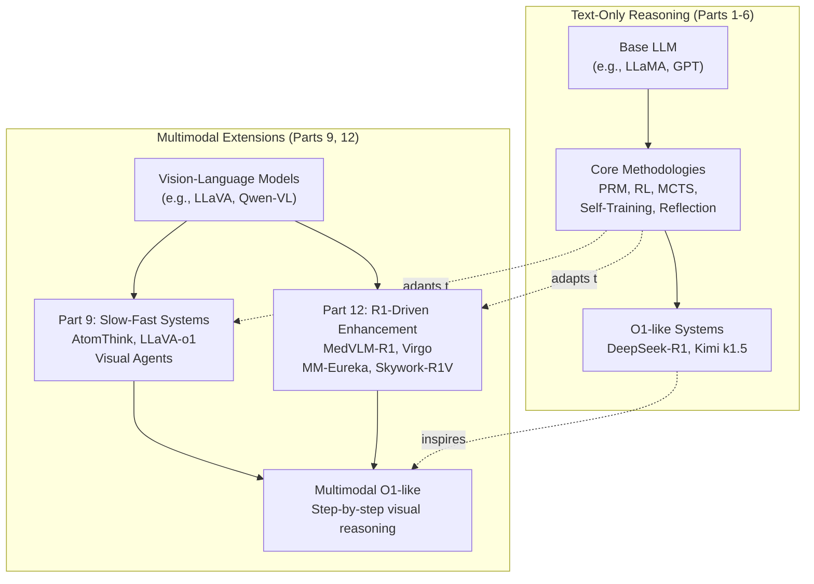
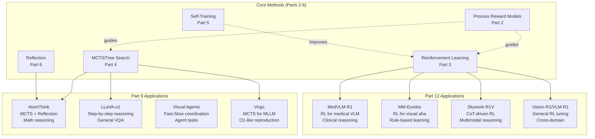
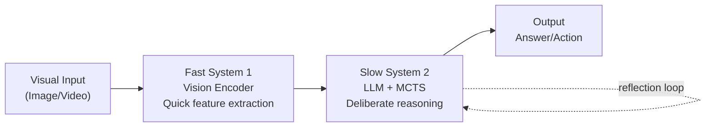
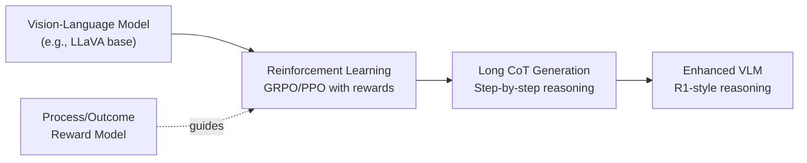
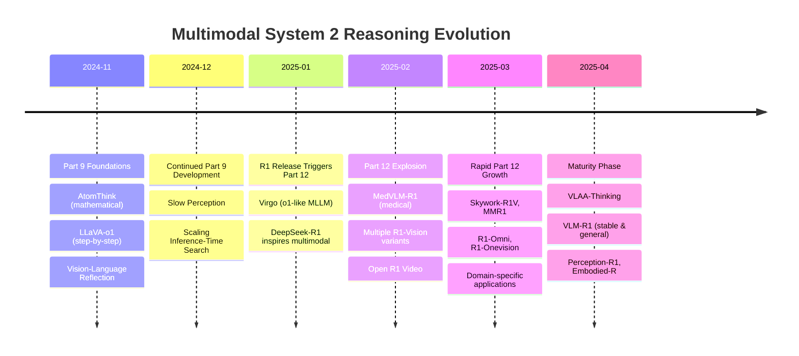

<!-- source: DeepWiki mcp.deepwiki.com · repo zzli2022/Awesome-System2-Reasoning-LLM · page 6 Multimodal Extensions · fetched 2026-10-30 -->

# Multimodal Extensions

Relevant source files

The following files were used as context for generating this wiki page:

- [README.md](README.md)

## Purpose and Scope

This page provides an overview of research extending System 2 reasoning capabilities beyond text-only large language models to multimodal domains, particularly vision-language models and multimodal agents. The repository organizes this research into two distinct but complementary parts:

- **Part 9: Multimodal Agents and Slow-Fast Systems** - For detailed coverage of dual-process architectures that integrate fast and slow thinking in multimodal agents, see [Multimodal Agents and Slow-Fast Systems](#6.1)
- **Part 12: R1-Driven Multimodal Reasoning** - For applications of R1/o1-style reinforcement learning methodologies to vision-language models, see [R1-Driven Multimodal Reasoning](#6.2)

This document explains the conceptual differences between these two paradigms, their relationship to core methodologies (Parts 1-6), and the architectural patterns that enable System 2 reasoning in multimodal contexts.

**Sources:** [README.md:40-43](), [README.md:339-481]()

## Overview: Extending System 2 to Multiple Modalities

While foundational System 2 reasoning techniques (process rewards, MCTS, reinforcement learning, self-training, reflection) were primarily developed for text-based mathematical and coding tasks, real-world intelligence requires reasoning over visual information, audio, video, and other modalities. The multimodal extensions adapt these techniques to handle perceptual input alongside linguistic reasoning.

The extension occurs along two dimensions:

1. **Architectural Integration** (Part 9): Designing systems that coordinate fast perceptual processing with slow deliberative reasoning across modalities
2. **Training Methodologies** (Part 12): Applying R1-style reinforcement learning to train multimodal models with enhanced reasoning capabilities

Both approaches aim to replicate the success of o1-class models in multimodal domains, enabling vision-language models to perform step-by-step reasoning, self-correction, and verification on visual tasks.

**Sources:** [README.md:339-350](), [README.md:455-481]()

## Evolution: From Text to Multimodal Reasoning

**Diagram: Progression from text-only to multimodal System 2 reasoning**

The diagram shows how core text-based methodologies from Parts 1-6 are adapted to multimodal contexts through two distinct pathways (Parts 9 and 12), ultimately converging on multimodal o1-like systems.

**Sources:** [README.md:45-194](), [README.md:339-481]()

## Two Paradigms: Architectural vs Training-Centric Approaches

### Part 9: Architectural Slow-Fast Integration

Part 9 focuses on **system design** - how to architect multimodal agents that coordinate fast perceptual processing with slow deliberative reasoning. Key characteristics:

- **Dual-process architecture**: Explicit separation of System 1 (fast perception) and System 2 (slow reasoning) components
- **Inference-time reasoning**: Applying MCTS, tree search, and reflection at test time
- **Multimodal coordination**: Managing interactions between vision encoders, language models, and action modules
- **Domain-general frameworks**: AtomThink, LLaVA-o1, Visual Agents as general-purpose architectures

Representative papers: AtomThink (mathematical reasoning), LLaVA-o1 (step-by-step visual reasoning), Visual Agents as Fast and Slow Thinkers (agent architectures).

**Sources:** [README.md:339-350]()

### Part 12: R1-Driven Training Enhancement

Part 12 focuses on **training methodologies** - applying reinforcement learning techniques inspired by DeepSeek-R1 and OpenAI o1 to enhance multimodal reasoning. Key characteristics:

- **RL-based training**: Using reinforcement fine-tuning (RFT) with reward models
- **Long chain-of-thought**: Training models to produce extended reasoning traces for visual tasks
- **Domain-specific applications**: Medical imaging (MedVLM-R1), video understanding (Open R1 Video), segmentation (Seg-Zero)
- **R1-style methodology transfer**: Direct application of techniques from text-based R1 models

Representative papers: MedVLM-R1 (medical VLM with RL), Virgo (o1-like MLLM reproduction), MM-Eureka (visual aha moments via RL).

**Sources:** [README.md:455-481]()

## Comparative Analysis

| Aspect | Part 9: Slow-Fast Systems | Part 12: R1-Driven Enhancement |
|--------|---------------------------|-------------------------------|
| **Primary Focus** | System architecture design | Training methodology |
| **Timing** | Inference-time reasoning | Training-time + inference |
| **Key Technique** | MCTS, tree search, reflection | Reinforcement learning (GRPO, PPO) |
| **Inspiration** | Dual-process theory, agent design | DeepSeek-R1, OpenAI o1 |
| **Generalization** | Domain-general frameworks | Often domain-specific |
| **First Papers** | AtomThink, LLaVA-o1 (Nov 2024) | MedVLM-R1, Virgo (Jan-Feb 2025) |
| **Representative Works** | 10 papers (Nov 2024 - Feb 2025) | 27+ papers (Feb-Apr 2025) |

**Sources:** [README.md:339-350](), [README.md:455-481]()

## Integration with Core Methodologies

**Diagram: How core methodologies flow into multimodal applications**

Part 9 primarily leverages **MCTS and Reflection** (Parts 4, 6) for inference-time reasoning, while Part 12 primarily applies **Reinforcement Learning** (Part 3) often guided by Process Reward Models (Part 2).

**Sources:** [README.md:68-96](), [README.md:98-137](), [README.md:139-193](), [README.md:339-350](), [README.md:455-481]()

## Key Architectural Patterns

### Pattern 1: Perception-Reasoning Decoupling (Part 9)

**Diagram: Dual-process architecture separating perception and reasoning**

Examples: Visual Agents as Fast and Slow Thinkers, AtomThink

**Sources:** [README.md:341-348]()

### Pattern 2: RL-Enhanced Chain-of-Thought (Part 12)

**Diagram: RL fine-tuning pipeline for multimodal reasoning**

Examples: MedVLM-R1, Virgo, Skywork-R1V

**Sources:** [README.md:458-476]()

## Representative Systems

### From Part 9 (Slow-Fast Architectures)

| System | Key Innovation | Domain | Paper Date |
|--------|---------------|--------|------------|
| **AtomThink** | MCTS + reflection for multimodal math | Mathematical reasoning | Nov 2024 |
| **LLaVA-o1** | Step-by-step visual reasoning framework | General VQA | Nov 2024 |
| **Visual Agents** | Dual-process agent architecture | Agent tasks | ICLR 2025 |
| **Virgo** | O1-like MLLM with tree search | General reasoning | Jan 2025 |

**Sources:** [README.md:341-348]()

### From Part 12 (R1-Driven Enhancement)

| System | Key Innovation | Domain | Release Date |
|--------|---------------|--------|--------------|
| **MedVLM-R1** | RL for clinical reasoning in VLMs | Medical imaging | Feb 2025 |
| **Virgo** | Reproducing o1-like capabilities in MLLM | General | Jan 2025 |
| **MM-Eureka** | RL for visual aha moments | Rule learning | Mar 2025 |
| **Skywork-R1V** | CoT-guided multimodal RL | General reasoning | Mar/Apr 2025 |
| **VLM-R1** | Stable, generalizable R1-style VLM | Cross-domain | Apr 2025 |
| **VLAA-Thinking** | RL-tuned visual reasoning | General | Apr 2025 |

**Sources:** [README.md:458-476]()

## Timeline: Emergence of Multimodal Reasoning

**Diagram: Timeline showing Part 9 emerged first, Part 12 exploded after DeepSeek-R1 release**

Notable pattern: Part 9 papers emerged Nov-Dec 2024 as architectural explorations. Part 12 exploded in Feb-Apr 2025 following the DeepSeek-R1 release in January 2025, demonstrating rapid methodology transfer.

**Sources:** [README.md:339-350](), [README.md:455-481]()

## Relationship to O1 Replication (Part 1)

Both Parts 9 and 12 can be viewed as **multimodal extensions of Part 1 (O1 Replication)**:

- Part 9 extends the **inference-time reasoning architecture** of o1 to multimodal inputs
- Part 12 extends the **training methodology** (RL-based long CoT generation) to vision-language models

Several papers appear in multiple parts:
- **Virgo** appears in both Part 1 ([README.md:61]()) and Part 9 ([README.md:348]()) - bridging o1 replication and multimodal agents
- Many Part 12 systems explicitly cite DeepSeek-R1 ([README.md:107]()) as inspiration

**Sources:** [README.md:45-67](), [README.md:339-350](), [README.md:455-481]()

## Cross-Cutting Themes

### Integration with Efficient System2 (Part 7)

Several multimodal papers address computational efficiency:
- Dynamic routing between fast and slow modes (echoing DynaThink approach from Part 7)
- Token budget management for long visual reasoning chains
- Latent space reasoning to reduce multimodal token overhead

**Sources:** [README.md:242-325]()

### Evaluation Challenges (Part 10)

Part 10 includes multimodal-specific benchmarks:
- **MME-CoT**: Benchmarking chain-of-thought in multimodal models
- **MM-IQ**: Abstract reasoning in multimodal contexts
- **ZeroBench**: Impossible visual problems for contemporary models
- **EnigmaEval**: Long multimodal reasoning challenges

These benchmarks are critical for evaluating both Part 9 and Part 12 systems.

**Sources:** [README.md:368-402]()

## Research Directions

### Emerging Patterns in Part 12 (Feb-Apr 2025)

The recent explosion of Part 12 papers reveals several trends:

1. **Domain Specialization**: Medical (MedVLM-R1), video (Open R1 Video), audio (Audio-QA RL), segmentation (Seg-Zero)
2. **Modality Expansion**: Beyond vision-language to video, audio, embodied perception
3. **Reinforcement Learning Variants**: GRPO, PPO, custom reward formulations for different modalities
4. **Generalization Focus**: VLM-R1 and Skywork-R1V emphasize stable, cross-domain performance

**Sources:** [README.md:455-481]()

### Open Questions

1. **Part 9 vs Part 12 Complementarity**: Can architectural patterns (Part 9) be combined with RL training (Part 12) for superior performance?
2. **Computational Cost**: Multimodal MCTS and long CoT generation are expensive - how to scale?
3. **Modality Coordination**: Best practices for managing different input modalities in reasoning chains
4. **Transfer Learning**: How well do text-based reasoning techniques truly transfer to visual domains?

## Summary

Multimodal extensions represent a critical frontier in System 2 reasoning research, adapting successful text-based techniques to visual and multimodal domains. The repository organizes this work into:

- **Part 9**: Architectural frameworks emphasizing dual-process design and inference-time reasoning (10 papers, Nov 2024-Feb 2025)
- **Part 12**: Training methodologies applying R1-style RL to multimodal models (27+ papers, Feb-Apr 2025 explosion)

Both approaches aim to bring o1-level reasoning capabilities to vision-language models, with Part 9 focusing on system architecture and Part 12 on training techniques. The rapid growth of Part 12 following DeepSeek-R1's release demonstrates the field's ability to quickly adapt breakthrough methodologies to new domains.

For detailed coverage of specific systems and papers, see:
- [Multimodal Agents and Slow-Fast Systems](#6.1) for Part 9 details
- [R1-Driven Multimodal Reasoning](#6.2) for Part 12 details

**Sources:** [README.md:339-481]()

---

