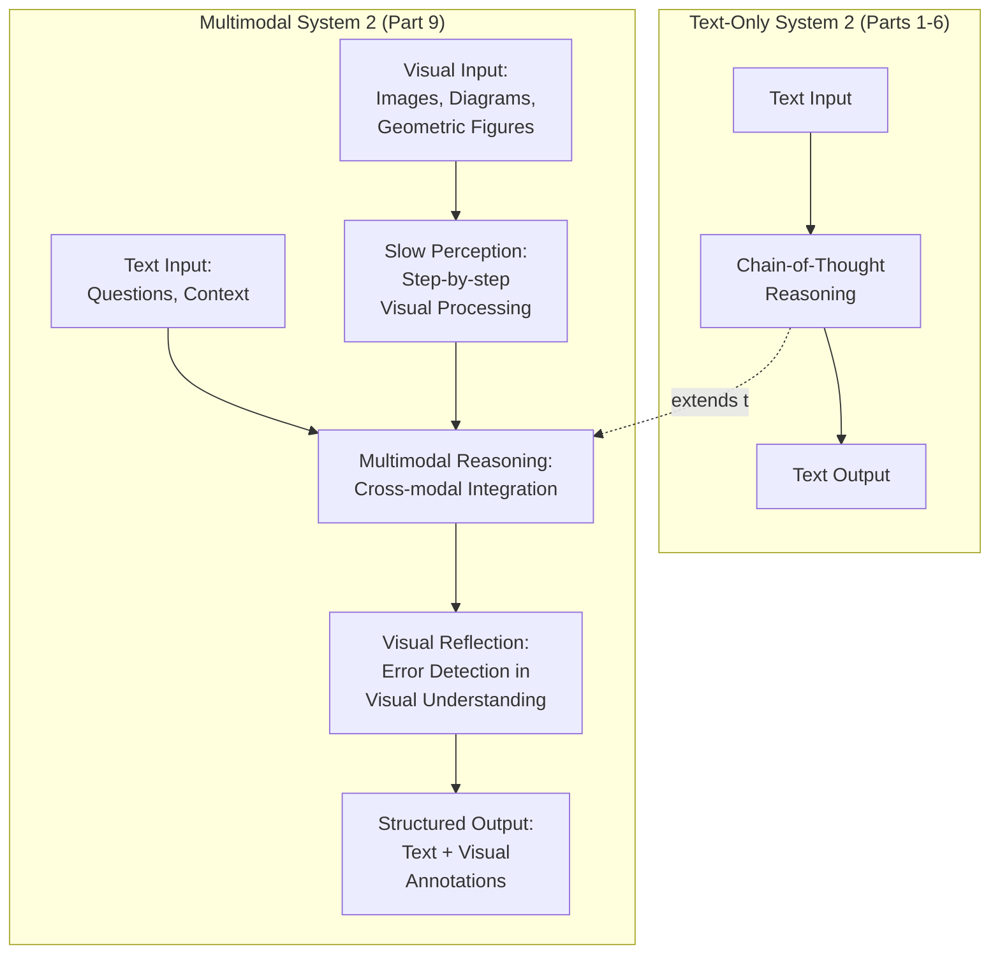
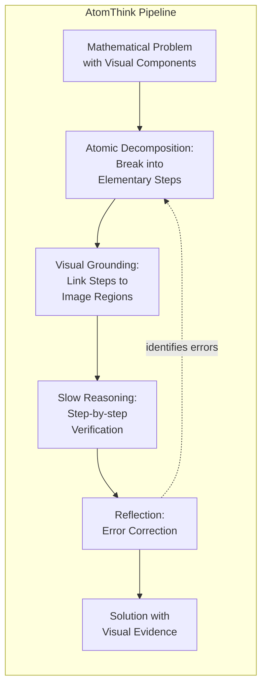
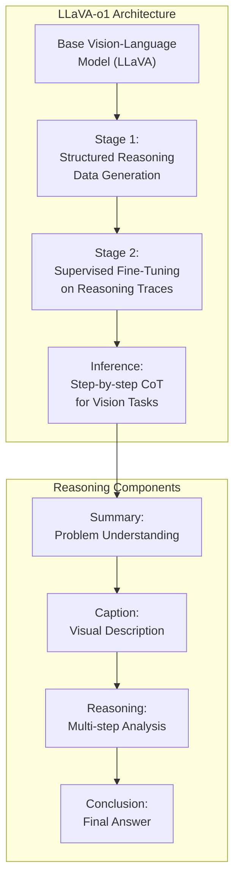
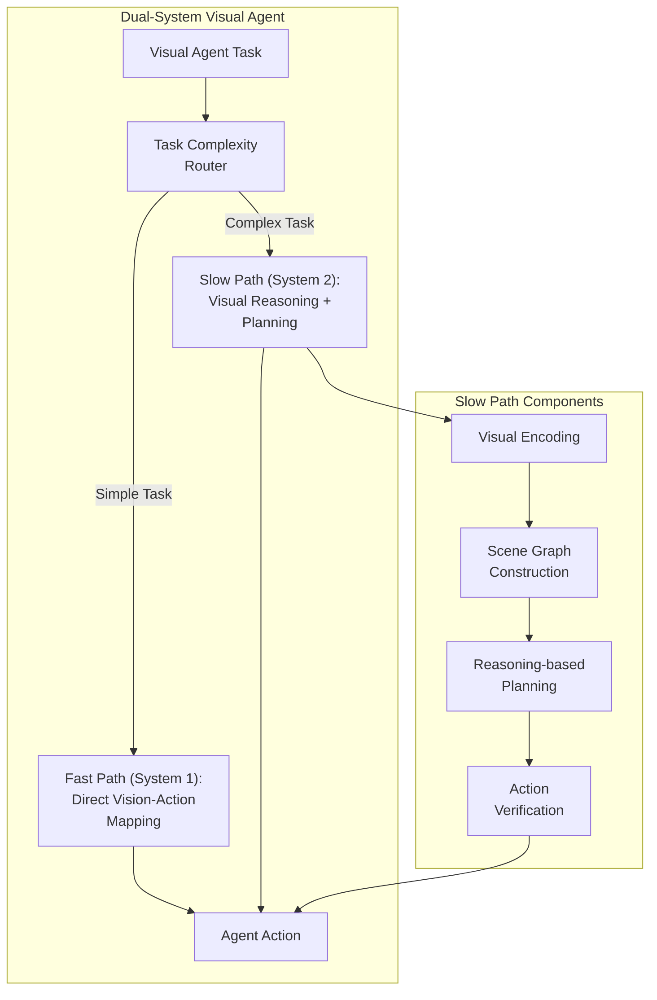
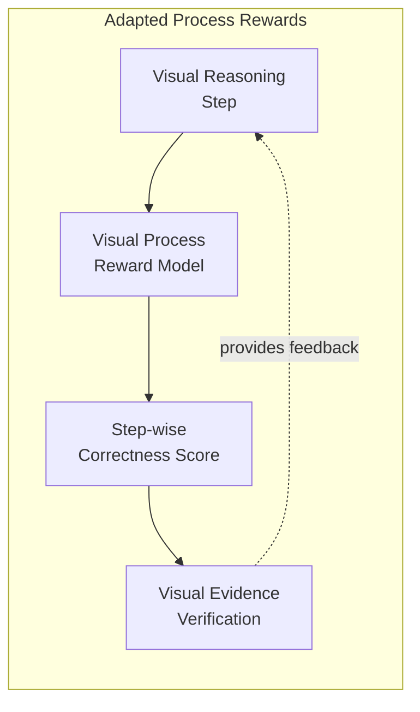
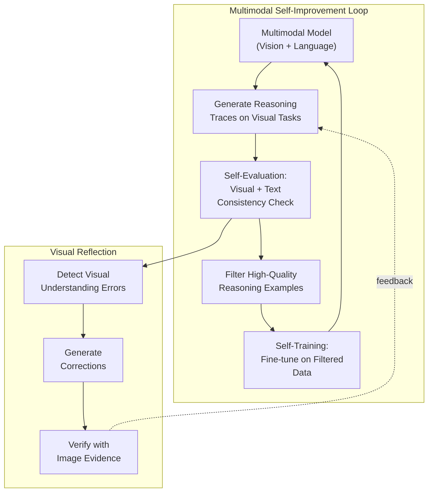
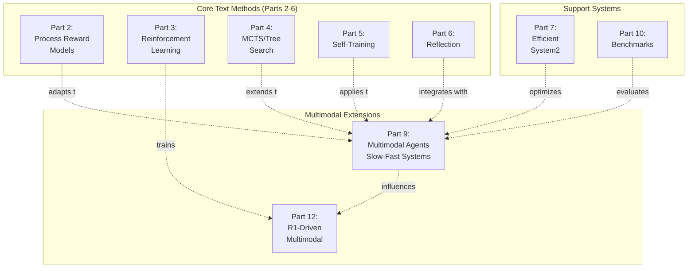
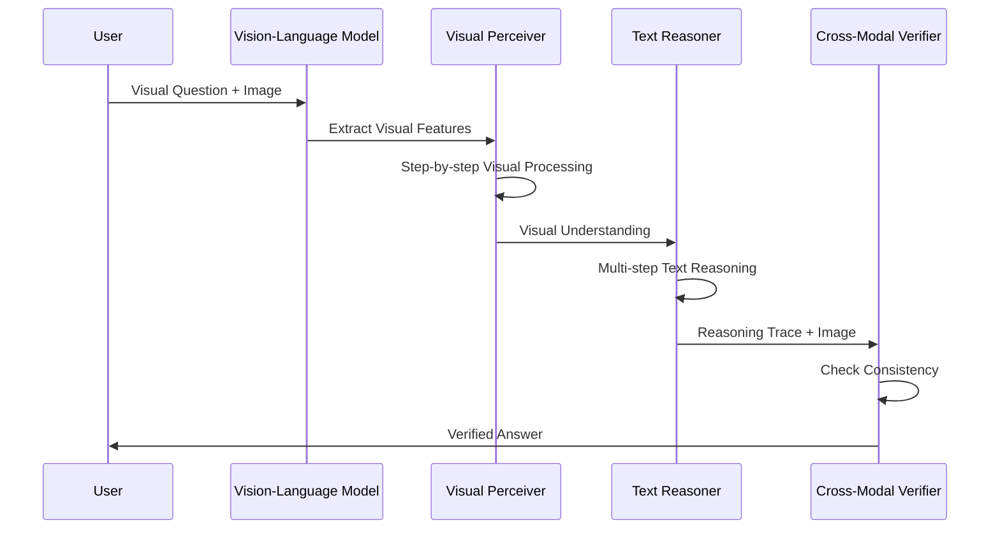

<!-- source: DeepWiki mcp.deepwiki.com · repo zzli2022/Awesome-System2-Reasoning-LLM · page 6.1 Multimodal Agents and Slow-Fast Systems · fetched 2026-10-30 -->

# Multimodal Agents and Slow-Fast Systems

<details>
<summary>Relevant source files</summary>

The following files were used as context for generating this wiki page:

- [README.md](README.md)
- [assets/paper.json](assets/paper.json)
- [src/list.md](src/list.md)

</details>


## Purpose and Scope

This page documents **Part 9: Multimodal Agent related Slow-Fast System** from the Awesome-System2-Reasoning-LLM repository. This section covers research that extends System 1 (fast, intuitive) and System 2 (slow, deliberate) reasoning paradigms to multimodal contexts, where agents process and reason over multiple modalities such as vision, language, and geometric representations.

For research specifically focused on applying R1/DeepSeek-R1 methodologies to multimodal models, see [R1-Driven Multimodal Reasoning](#6.2). For general slow-fast reasoning in text-only LLMs, see [Core Methodologies](#4). For optimization of multimodal reasoning systems, see [Efficient System2](#5.1).

**Sources:** [README.md:339-350](), [README.md:40]()

## Overview: Extending System 2 to Multimodal Domains

Traditional System 2 reasoning research (Parts 1-6) has primarily focused on text-based chain-of-thought reasoning. Part 9 addresses the challenge of bringing deliberate, multi-step reasoning to agents that must process visual information, spatial relationships, and cross-modal understanding.

### Distinction from Text-Only Reasoning



**Diagram: Evolution from Text-Only to Multimodal System 2 Reasoning**

**Sources:** [README.md:339-350](), [README.md:14-18]()

## Core Research Directions

The multimodal agent slow-fast systems documented in Part 9 can be categorized into four primary research directions:

| Research Direction | Key Papers | Primary Focus | Data Location |
|-------------------|------------|---------------|---------------|
| **Slow Perception** | Slow Perception (2024.12) | Step-by-step visual processing of geometric figures | [README.md:345]() |
| **Vision-Language Reasoning** | LLaVA-o1 (2024.11), AtomThink (2024.11) | Chain-of-thought for vision-language models | [README.md:342](), [README.md:341]() |
| **Visual Agent Systems** | Visual Agents as Fast and Slow Thinkers (ICLR 2025) | Dual-system agents for visual tasks | [README.md:347]() |
| **O1-like MLLMs** | Virgo (2025.01) | Replicating o1 reasoning in multimodal LLMs | [README.md:348]() |

**Sources:** [README.md:339-350](), [assets/paper.json:760-816]()

## Key Systems and Methodologies

### AtomThink: Multimodal Mathematical Reasoning



**Diagram: AtomThink Framework Architecture**

AtomThink (liu2024atomthink) introduces atomic-level decomposition for multimodal mathematical reasoning. The system breaks complex visual math problems into elementary reasoning steps, each grounded in specific regions of the input image. This enables fine-grained verification and error correction.

**Key Characteristics:**
- **Atomic Step Decomposition**: Problems decomposed into irreducible reasoning units
- **Visual Grounding**: Each reasoning step linked to image evidence
- **Slow Thinking Framework**: Multi-step deliberation with verification
- **Reflection Mechanism**: Self-correction via error detection

**Sources:** [README.md:341](), [assets/paper.json:762-767]()

### LLaVA-o1: Step-by-Step Vision-Language Reasoning



**Diagram: LLaVA-o1 Training and Inference Pipeline**

LLaVA-o1 (xu2024llava) extends the LLaVA vision-language model with structured chain-of-thought reasoning capabilities. The system generates explicit reasoning traces that include visual understanding, multi-step analysis, and conclusion formulation.

**Training Methodology:**
1. **Data Generation**: Create reasoning traces with summary, caption, reasoning, and conclusion components
2. **Supervised Fine-Tuning**: Train the model to produce structured reasoning outputs
3. **Inference-Time Reasoning**: Generate step-by-step explanations during test time

**Sources:** [README.md:342](), [README.md:235](), [assets/paper.json:768-774]()

### Visual Agents as Fast and Slow Thinkers



**Diagram: Dual-System Architecture for Visual Agents**

The Visual Agents paper (gao2025visualagents, ICLR 2025) introduces a dual-system architecture that dynamically routes visual agent tasks between fast (System 1) and slow (System 2) processing paths based on task complexity.

**System 1 (Fast Path):**
- Direct perception-to-action mapping
- Suitable for simple, familiar visual tasks
- Minimal computational overhead

**System 2 (Slow Path):**
- Scene graph construction for structured representation
- Multi-step reasoning and planning
- Action verification before execution
- Used for complex, novel visual tasks

**Sources:** [README.md:347](), [assets/paper.json:776-781]()

## Integration with Core System 2 Techniques

Multimodal agents leverage and adapt techniques from text-only System 2 reasoning (Parts 2-6):

### Process Reward Models for Visual Reasoning



**Diagram: Process Reward Adaptation for Multimodal Reasoning**

Papers like "Scaling Inference-Time Search With Vision Value Model" extend process reward models (Part 2) to multimodal contexts. The vision value model provides step-wise feedback on visual reasoning quality.

**Key Adaptations:**
- **Visual Grounding**: PRMs verify alignment between reasoning steps and visual evidence
- **Cross-Modal Consistency**: Reward models check consistency between text reasoning and visual content
- **Spatial Reasoning Verification**: Specialized rewards for geometric and spatial understanding

**Sources:** [README.md:344](), [README.md:68-97]()

### MCTS and Tree Search for Visual Tasks

Several papers apply Monte Carlo Tree Search (Part 4) to multimodal reasoning:

| Paper | MCTS Application | Visual Domain |
|-------|------------------|---------------|
| Mulberry | Collective MCTS for MLLM reasoning | General vision-language tasks |
| Virgo | o1-like tree search for MLLMs | Mathematical reasoning with diagrams |
| AtomThink | Atomic-step exploration | Geometric problem solving |

**MCTS Adaptations for Vision:**
- **Visual State Representation**: Nodes encode both text and visual understanding
- **Cross-Modal Action Space**: Branches explore different visual interpretations
- **Vision-Grounded Rollouts**: Simulations verify consistency with image content

**Sources:** [README.md:178](), [README.md:348](), [README.md:341]()

### Self-Training and Reflection in Multimodal Models



**Diagram: Self-Training and Reflection for Multimodal Models**

Papers like "Vision-Language Models Can Self-Improve Reasoning via Reflection" and "Diving into Self-Evolving Training for Multimodal Reasoning" extend self-training (Part 5) and reflection (Part 6) methodologies to multimodal contexts.

**Key Innovations:**
- **Cross-Modal Error Detection**: Identify inconsistencies between visual perception and text reasoning
- **Visual Evidence-Based Correction**: Use image content to verify and correct reasoning steps
- **Self-Evolving Data Generation**: Bootstrap multimodal reasoning without human annotations

**Sources:** [README.md:343](), [README.md:346](), [README.md:194-224](), [README.md:225-241]()

## Specialized Techniques

### Slow Perception for Geometric Understanding

The "Slow Perception" paper introduces step-by-step visual processing for geometric figures:

**Methodology:**
1. **Sequential Attention**: Process image regions incrementally rather than holistically
2. **Geometric Primitive Detection**: Identify basic shapes and relationships
3. **Hierarchical Composition**: Build complex understanding from primitives
4. **Verification at Each Step**: Validate geometric properties before proceeding

**Technical Implementation:**
- Vision transformers with controlled attention patterns
- Explicit intermediate representations of geometric properties
- Step-wise verification using geometric constraints

**Sources:** [README.md:345](), [assets/paper.json:783-788]()

### Diffusion Models with Reasoning Capabilities

"I Think, Therefore I Diffuse" extends reasoning to generative diffusion models:

**Architecture:**
- **In-Context Reasoning**: Embed reasoning steps in the diffusion process
- **Multimodal Conditioning**: Use both text and image context for reasoning
- **Iterative Refinement**: Generate and refine outputs through deliberate steps

**Applications:**
- Visual problem solving during generation
- Reasoning-guided image synthesis
- Multimodal in-context learning

**Sources:** [README.md:349]()

## Data Structures and Repository Organization

### Part 9 Data in paper.json

The structured metadata for Part 9 papers is stored in `assets/paper.json`:

```json
"Part 9: Multimodal Agent related Slow-Fast System": [
    {
        "paper": "AtomThink: A Slow Thinking Framework for Multimodal Mathematical Reasoning",
        "link": "https://arxiv.org/abs/2411.11930",
        "venue": "arXiv",
        "date": "2024-11",
        "label": "liu2024atomthink"
    },
    // ... additional papers
]
```

**Key Fields:**
- `label`: Unique identifier used for cross-referencing (e.g., `liu2024atomthink`)
- `venue`: Publication venue (arXiv, ICLR, NeurIPS, etc.)
- `date`: Publication date in YYYY-MM format
- `link`: Direct URL to the paper

**Sources:** [assets/paper.json:760-816]()

### Generated Views

The build system generates alternative views of Part 9 papers:

**Table View** (`src/table.md`): Chronologically sorted tabular format
**List View** (`src/list.md`): Badge-annotated list format with venue indicators

Both views are generated by [src/main.py]() from the structured JSON data.

**Sources:** [src/main.py:1-50](), [src/list.md:115-123]()

## Relationship to Other Repository Parts



**Diagram: Integration of Part 9 with Other Research Areas**

**Connections:**
- **Part 2 (PRMs)**: Visual process reward models verify step-wise correctness
- **Part 3 (RL)**: Reinforcement learning trains multimodal reasoning policies
- **Part 4 (MCTS)**: Tree search explores visual reasoning paths
- **Part 5 (Self-Training)**: Bootstrapping multimodal reasoning data
- **Part 6 (Reflection)**: Visual error detection and correction
- **Part 7 (Efficient)**: Optimizing computational cost of visual reasoning
- **Part 10 (Benchmarks)**: Evaluating multimodal reasoning capabilities
- **Part 12 (R1-Multimodal)**: Applying R1 methodologies to vision-language models

**Sources:** [README.md:26-43](), [README.md:339-350]()

## Technical Implementation Patterns

### Pattern 1: Staged Visual Reasoning



**Diagram: Staged Visual Reasoning Pattern**

This pattern, used in LLaVA-o1 and AtomThink, separates visual perception, text reasoning, and cross-modal verification into distinct stages.

**Sources:** [README.md:342](), [README.md:341]()

### Pattern 2: Dynamic Fast-Slow Routing

The Visual Agents paper implements dynamic routing:

**Routing Decision Factors:**
- Task complexity estimation
- Visual ambiguity detection
- Available computational budget
- Prior task performance

**Implementation:**
- Lightweight complexity classifier
- Threshold-based routing decision
- Fallback to slow path on uncertainty

**Sources:** [README.md:347]()

### Pattern 3: Vision-Grounded Tree Search

For papers applying MCTS to multimodal tasks:

**Tree Node Structure:**
- Text reasoning state
- Visual grounding annotations (image regions)
- Cross-modal consistency score
- Parent/child pointers

**Expansion Strategy:**
- Generate candidate reasoning steps
- Ground each step in visual evidence
- Filter inconsistent branches

**Rollout Simulation:**
- Fast forward reasoning to completion
- Verify final answer against image
- Backpropagate visual consistency scores

**Sources:** [README.md:178](), [README.md:348]()

## Benchmark and Evaluation Considerations

Multimodal reasoning systems are evaluated on specialized benchmarks (see [Benchmarks and Datasets](#7.1)):

| Benchmark Category | Example Benchmarks | Part 9 Papers Evaluated |
|-------------------|-------------------|------------------------|
| Mathematical Reasoning | Plot2code, PuzzleVQA | AtomThink, LLaVA-o1 |
| Geometric Understanding | Custom geometric datasets | Slow Perception |
| Agent Tasks | OSWorld, VisualWebArena | Visual Agents |
| General Vision-Language | MME-CoT, MM-IQ | Virgo, Self-Evolving Training |

**Key Evaluation Metrics:**
- Visual grounding accuracy
- Step-wise reasoning correctness
- Cross-modal consistency
- Computational efficiency (tokens/time)

**Sources:** [README.md:351-433](), [README.md:389-403]()

## Future Directions and Open Challenges

Based on the papers in Part 9, key open challenges include:

1. **Scalability**: Extending slow visual reasoning to high-resolution images and videos
2. **Efficiency**: Reducing computational cost of step-by-step visual processing
3. **Generalization**: Transferring visual reasoning across diverse domains
4. **Integration**: Seamlessly combining fast and slow processing in real-time systems
5. **Evaluation**: Developing comprehensive benchmarks for multimodal System 2 reasoning

The research trajectory shows increasing sophistication in applying System 2 reasoning to vision, with papers progressing from simple chain-of-thought to complex tree search and self-evolving systems.

**Sources:** [README.md:339-350](), [README.md:23-26]()

## Accessing Part 9 Papers

All papers in Part 9 are cataloged with links and metadata:

- **README.md**: Human-readable descriptions at [README.md:339-350]()
- **paper.json**: Structured metadata at [assets/paper.json:760-816]()
- **list.md**: Chronological list at [src/list.md:115-123]()
- **Survey Paper**: Comprehensive analysis at http://arxiv.org/abs/2502.17419

The repository is actively maintained with new papers added as the field evolves.

**Sources:** [README.md:9-11](), [README.md:16]()

---

