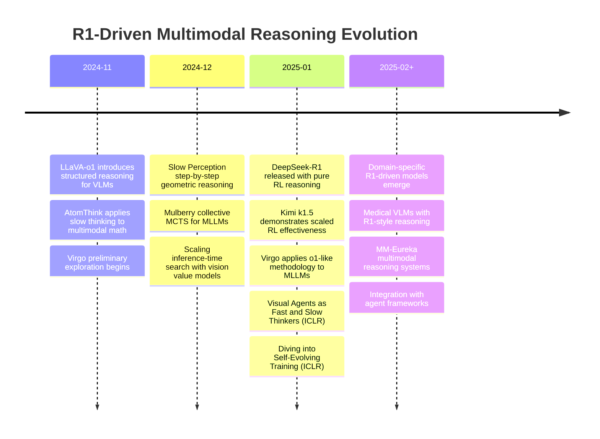
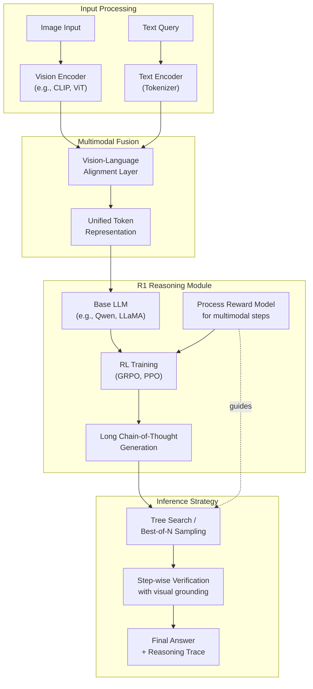
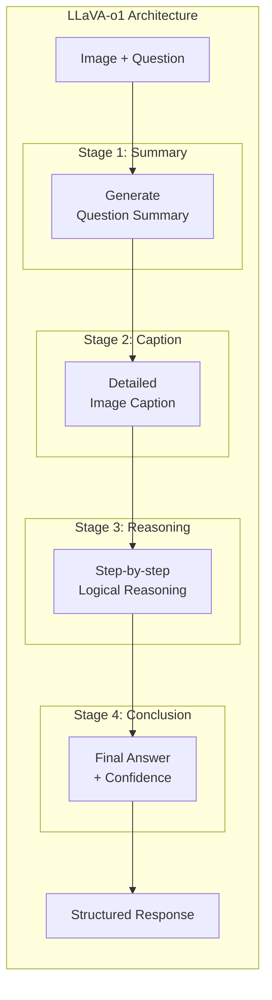
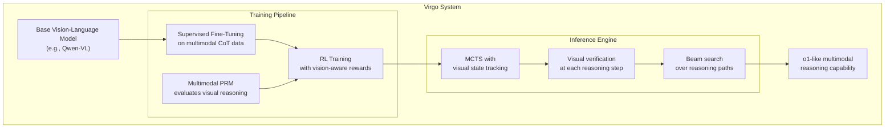
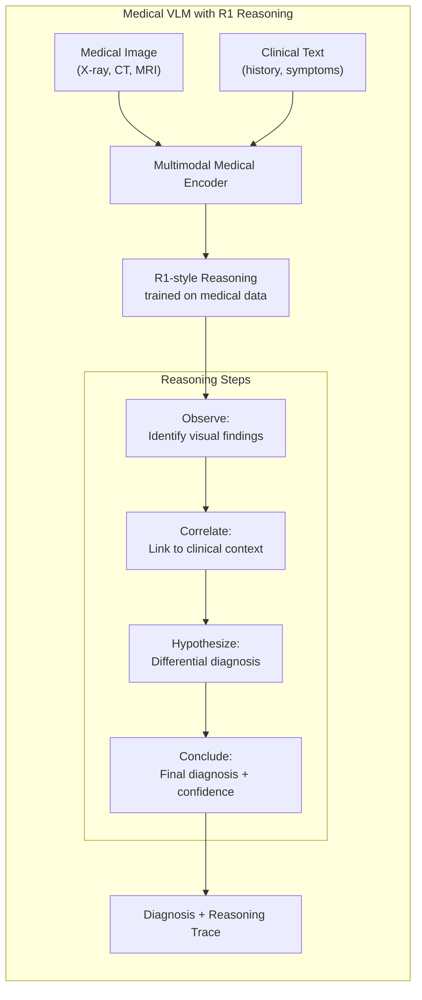
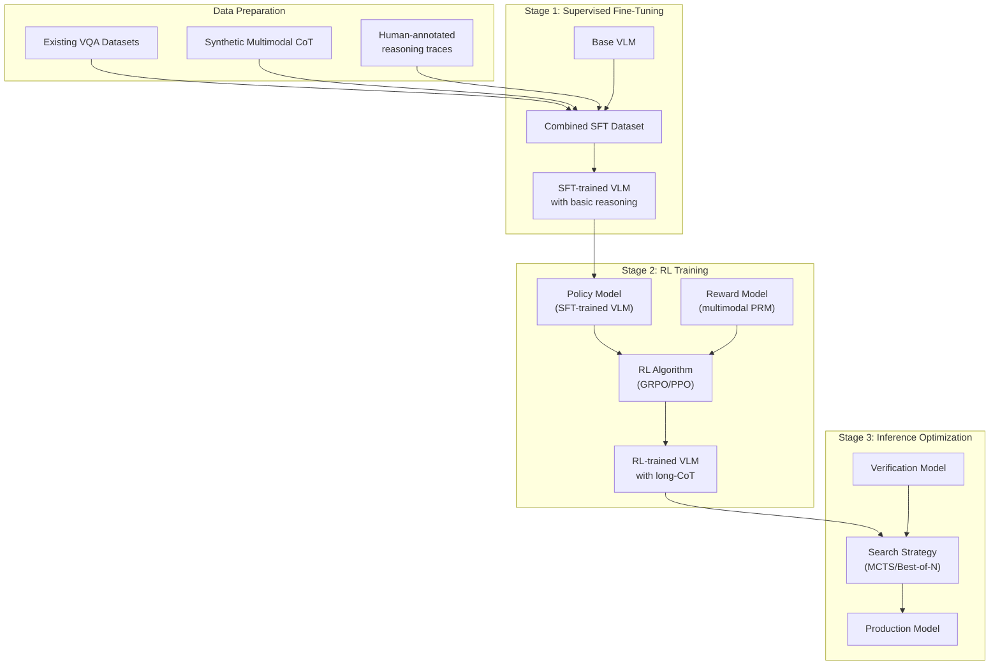
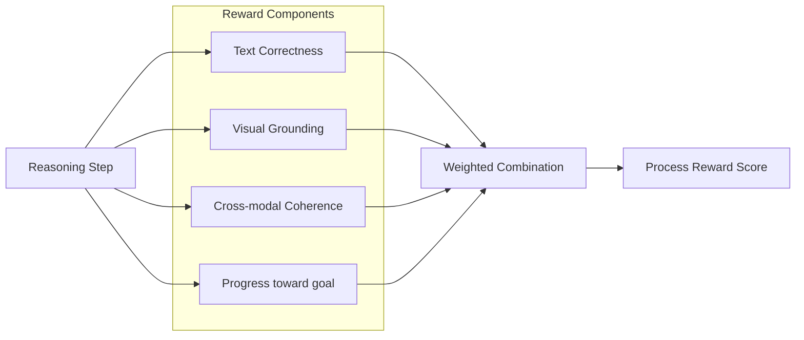
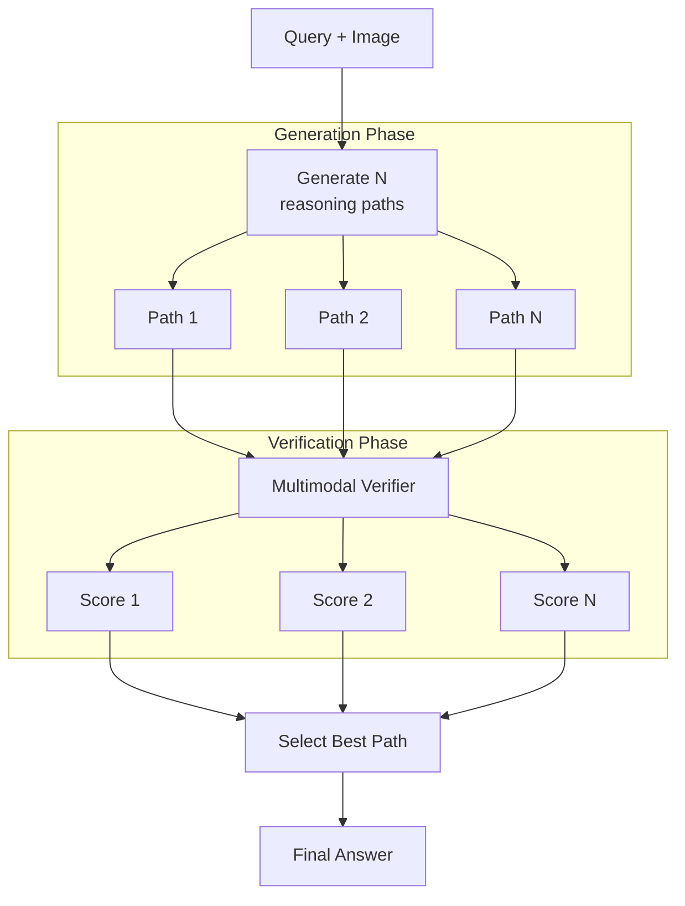
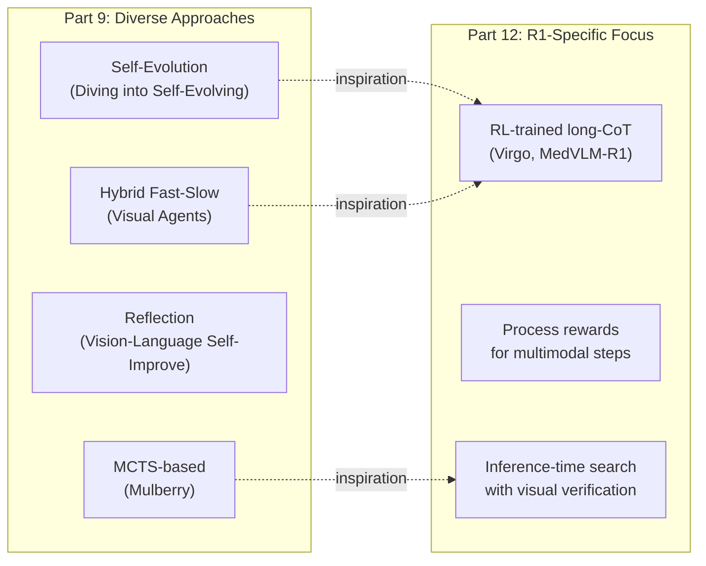
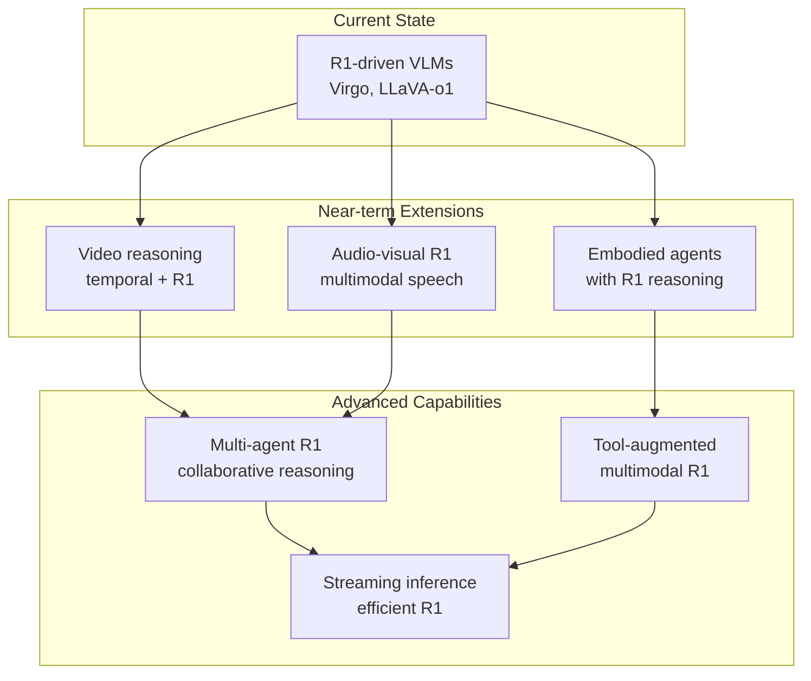

<!-- source: DeepWiki mcp.deepwiki.com · repo zzli2022/Awesome-System2-Reasoning-LLM · page 6.2 R1-Driven Multimodal Reasoning · fetched 2026-10-30 -->

# R1-Driven Multimodal Reasoning

Relevant source files

The following files were used as context for generating this wiki page:

- [README.md](README.md)
- [assets/paper.json](assets/paper.json)
- [src/table.md](src/table.md)

## Purpose and Scope

This page documents **Part 12: R1-Driven Multimodal Reasoning Enhancement**, which covers the application of R1/o1-style reasoning methodologies—specifically reinforcement learning-based long chain-of-thought reasoning—to vision-language models and multimodal systems. This represents the convergence of advanced reasoning techniques from text-only LLMs (Parts 1-3) with multimodal capabilities.

For general multimodal slow-fast systems and architectural patterns, see [Part 9: Multimodal Agents and Slow-Fast Systems](#6.1). For the foundational R1 and RL methodologies being applied here, see [O1 Replication](#4.1) and [Reinforcement Learning](#4.3). For evaluation of multimodal reasoning capabilities, see [Benchmarks and Datasets](#7.1).

**Key Distinction**: While Part 9 covers diverse multimodal reasoning architectures (MCTS-based, self-evolution, reflection), Part 12 specifically focuses on systems that apply the **R1 paradigm**—RL-trained long-form reasoning with process rewards—to vision-language tasks.

Sources: [README.md:1-43](), [README.md:339-350]()

---

## Overview: R1 Reasoning Meets Vision-Language Models

The R1-driven multimodal reasoning paradigm emerged following the success of **DeepSeek-R1** (January 2025) and **Kimi k1.5**, which demonstrated that pure RL training could elicit complex reasoning behaviors in text-only models. Part 12 extends this methodology to multimodal domains, where models must reason jointly over visual and textual information.

### Timeline of Key Developments

Sources: [README.md:339-350](), [README.md:45-67](), [README.md:98-138]()

---

## Core Methodology: From Text-R1 to Multimodal-R1

### Architecture Pattern

The R1-driven multimodal approach follows a consistent pattern:

**Key Components**:
1. **Vision-Language Alignment**: Projects visual features into text token space
2. **RL-Trained Reasoning**: Learns to generate long-CoT via process rewards
3. **Multimodal Process Rewards**: Evaluates reasoning quality considering both modalities
4. **Inference-Time Search**: Explores multiple reasoning paths with visual verification

Sources: [README.md:339-350](), [README.md:98-138]()

---

## Key Systems and Papers

### LLaVA-o1: Structured Reasoning for VLMs

**Paper**: "LLaVA-o1: Let Vision Language Models Reason Step-by-Step" (November 2024)

**Technical Details**:
- **Structured Four-Stage Reasoning**: Separates perception, reasoning, and conclusion
- **Training Data**: Uses synthesized multimodal reasoning chains
- **Inference**: Can be combined with beam search for better exploration

Sources: [README.md:235](), [README.md:342](), [assets/paper.json:658-663]()

### Virgo: Reproducing o1-like MLLM

**Paper**: "Virgo: A Preliminary Exploration on Reproducing o1-like MLLM" (January 2025)

**Key Contributions**:
- **First systematic o1 replication** for multimodal domain
- **Hybrid training**: SFT + RL with visual grounding
- **Inference-time search**: MCTS adapted for multimodal state space

Sources: [README.md:61](), [README.md:348](), [assets/paper.json:790-795]()

### AtomThink: Slow Thinking for Multimodal Math

**Paper**: "AtomThink: A Slow Thinking Framework for Multimodal Mathematical Reasoning" (November 2024)

Technical focus on **mathematical reasoning with visual elements** (diagrams, geometric figures, plots):

- **Visual Atom Decomposition**: Breaks complex visual math problems into atomic perceptual units
- **Slow Perception**: Iterative visual understanding before reasoning
- **Math-Specific CoT**: Structured reasoning chains for equation solving with visual context

Sources: [README.md:232](), [README.md:341](), [assets/paper.json:651-656](), [assets/paper.json:762-767]()

### Additional Systems

| System | Focus | Key Feature |
|--------|-------|-------------|
| **Mulberry** | MLLM with o1-like reasoning | Collective MCTS across multiple MLLMs |
| **Visual Agents (Fast/Slow)** | Agent reasoning | Dual-process architecture for visual tasks |
| **Slow Perception** | Geometric reasoning | Step-by-step visual perception |
| **Scaling Inference-Time Search** | Vision value models | Best-of-N with visual comprehension metrics |

Sources: [README.md:178](), [README.md:231](), [README.md:344-347](), [assets/paper.json:797-802]()

---

## Domain-Specific Applications

### Medical Multimodal Reasoning

**Example Systems**:
- **MedVLM-R1**: Applies R1 reasoning to radiology and pathology
- **HuatuoGPT-o1**: Medical complex reasoning with LLMs (includes multimodal extension)

Sources: [README.md:53](), [README.md:177](), [README.md:237]()

### Mathematical and Scientific Reasoning

**Geometric Problem Solving**:
- Papers like "Proposing and solving olympiad geometry" use guided tree search
- Slow Perception focuses on step-by-step geometric figure understanding
- AtomThink handles multimodal mathematical reasoning

**Visual STEM Problems**:
- Diagrams, plots, and scientific visualizations
- Multi-step reasoning over visual + textual information
- Process rewards adapted for mathematical correctness

Sources: [README.md:179](), [README.md:345]()

---

## Technical Integration Patterns

### Pattern 1: SFT → RL Pipeline for Multimodal Models

Sources: [README.md:98-138](), [README.md:339-350]()

### Pattern 2: Multimodal Process Reward Models

**Challenges**:
1. **Visual grounding**: Rewards must evaluate visual perception accuracy
2. **Cross-modal coherence**: Reasoning must be consistent with visual evidence
3. **Step-level granularity**: Each reasoning step may involve visual reference

**Implementation**:

Sources: [README.md:68-97](), [README.md:85](), [assets/paper.json:46-152]()

### Pattern 3: Inference-Time Search for Multimodal Tasks

**Best-of-N with Visual Verification**:

**MCTS Adaptation for Multimodal State Space**:
- **State**: Includes both textual reasoning history and visual attention regions
- **Actions**: Text generation tokens + visual grounding operations
- **Rewards**: Multimodal process rewards
- **Rollout policy**: Considers visual context at each step

Sources: [README.md:139-193](), [README.md:344]()

---

## Relationship to Other Parts

### Integration with Part 1 (O1 Replication)

Part 12 systems **extend O1 replication** to multimodal domains:

| Aspect | Text-Only O1 (Part 1) | Multimodal R1 (Part 12) |
|--------|----------------------|------------------------|
| **Input** | Text only | Text + Vision |
| **Reasoning** | Long-CoT text | Long-CoT with visual grounding |
| **Training** | RL on text data | RL on multimodal data |
| **Verification** | Text-based PRM | Multimodal PRM |
| **Inference** | MCTS/Best-of-N | MCTS/Best-of-N with visual state |

Sources: [README.md:45-67]()

### Distinction from Part 9 (Multimodal Agents)

**Key Difference**: Part 9 covers **general architectural patterns** for multimodal reasoning, while Part 12 specifically focuses on **R1-style RL-based approaches** with long-form reasoning.

Sources: [README.md:339-350]()

### Dependency on Parts 2-4 (Core Methods)

Part 12 systems leverage:
- **Part 2 (Process Rewards)**: Adapted for multimodal step verification
- **Part 3 (Reinforcement Learning)**: Core RL training methodology
- **Part 4 (MCTS)**: Tree search adapted for multimodal state space

Sources: [README.md:68-193]()

---

## Evaluation Considerations

### Multimodal Reasoning Benchmarks

From Part 10, key benchmarks for evaluating R1-driven multimodal reasoning:

| Benchmark | Focus Area | Key Metrics |
|-----------|-----------|-------------|
| **MME-CoT** | Chain-of-thought quality | Reasoning quality, robustness, efficiency |
| **MM-IQ** | Abstraction and reasoning | Human-like reasoning patterns |
| **MV-MATH** | Multimodal math | Multi-visual context reasoning |
| **EnigmaEval** | Long multimodal reasoning | Complex multi-step challenges |
| **CoMT** | Chain of multi-modal thought | Cross-modal reasoning consistency |

Sources: [README.md:368-395]()

### Evaluation Challenges

1. **Visual grounding accuracy**: Does reasoning correctly reference visual content?
2. **Cross-modal coherence**: Is reasoning consistent across modalities?
3. **Long-CoT quality**: Are extended reasoning chains helpful or noisy?
4. **Computational cost**: R1-style inference is expensive for multimodal models

---

## Future Directions

### Emerging Trends (2025)

Sources: [README.md:98-138]()

### Open Research Questions

1. **Scaling Laws**: How do multimodal R1 systems scale with compute/data?
2. **Efficiency**: Can we distill long-CoT multimodal reasoning into fast models?
3. **Generalization**: Do R1-trained multimodal models transfer across domains?
4. **Safety**: How to ensure faithful visual grounding in reasoning chains?

---

## Repository Structure

### Papers in Part 12 Context

While Part 12 is a newer designation, relevant papers can be found in:

**README.md sections**:
- [README.md:339-350]() - Part 9 Multimodal Agent systems (foundation for Part 12)
- [README.md:45-67]() - Part 1 O1 Replication (includes multimodal extensions like Virgo)

**paper.json entries**:
- [assets/paper.json:760-817]() - Part 9 papers with multimodal reasoning
- [assets/paper.json:2-45]() - Part 1 papers including multimodal O1 replications

**Key identifiers for code search**:
- `"Virgo"` - O1-like MLLM reproduction
- `"LLaVA-o1"` - Structured VLM reasoning
- `"AtomThink"` - Multimodal mathematical reasoning
- `"Mulberry"` - MLLM with MCTS
- `"Visual Agents"` - Fast and slow thinking for vision

Sources: [README.md:1-527](), [assets/paper.json:1-848]()

---

## Summary

R1-Driven Multimodal Reasoning (Part 12) represents the **convergence of advanced reasoning methods** from text-only LLMs with vision-language capabilities. Key characteristics:

1. **RL-trained long-form reasoning** adapted for multimodal contexts
2. **Process rewards** that evaluate both textual and visual reasoning steps
3. **Inference-time search** with visual verification and grounding
4. **Domain-specific applications** in medicine, mathematics, and scientific reasoning
5. **Building on Part 9** but with specific focus on R1/o1-style methodologies

The field is rapidly evolving with systems like **Virgo**, **LLaVA-o1**, and domain-specific implementations demonstrating that the R1 paradigm effectively extends to multimodal domains, though with additional complexity in training, inference, and evaluation.

Sources: [README.md:1-527](), [assets/paper.json:1-848]()

---

